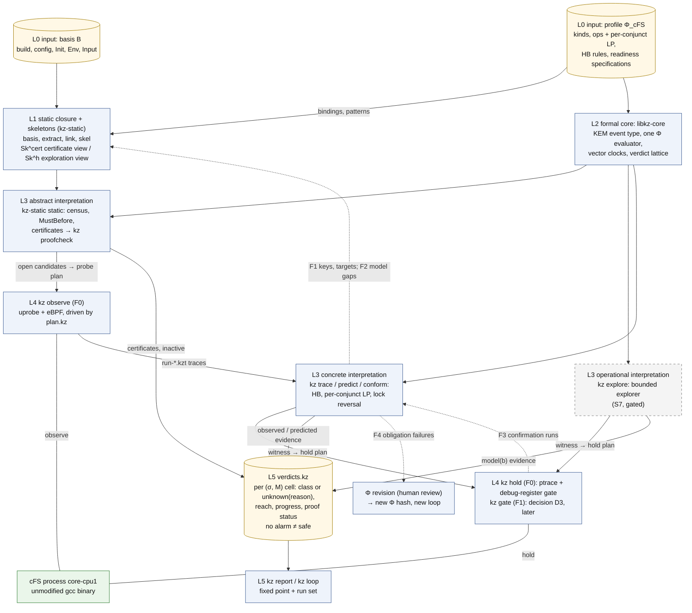

# Kairos 개요: cFS의 process-level 준비 상태 위반 판정

이 문서는 NASA cFS v7.0.1에서 앱·서비스 task 사이의 준비 상태 위반(readiness violation, 순서위반의 한 부류)을 판정하는 설계 Kairos를, spec을 읽지 않은 연구자가 15–25분 안에 파악하도록 요약한다. 문제의 정의, 관련 연구와의 차이와 실험 비교의 범위, 핵심 아이디어, 판정 체계, 주장하는 것과 주장하지 않는 것을 다룬다. spec에 없는 설계 요소·수치·인용은 더하지 않으며, 세부는 spec의 해당 절로 넘긴다.

상태: 설계 문서 — 구현·측정 전. 규범 원문: [spec/SPEC_FINAL.md](spec/SPEC_FINAL.md)(revision 1.3: 2026-10-22 PI 결정 D1–D5 반영, spec §0.12. revision 1.2: 2026-10-15 PI 결정, 용어 결정 T1, CORD 인용 정리 반영, spec §0.9–§0.11. revision 1.1: 외부 검토 EXT-20261012 반영, spec §0.7)

> **rev 1.3 반영 (2026-10-22).** 이 문서는 SPEC revision 1.3(spec §0.12; 변경표 `plan/REV13_CHANGE_TABLE.md`; 결정 기록 `spec/PI_DECISIONS_RESOLVED_20261022.md`) 가운데 이 문서가 풀어 쓰는 절의 변경을 반영했다. 반영한 변경표 행: C-01, C-02, C-03, C-04, C-05, C-07, C-08, C-09, C-10, C-11, C-12, C-13, C-14, C-15, C-16, C-22, C-23, C-25, C-26, C-27, C-29, C-30, C-32, C-33, C-34, C-35, C-36, C-37, C-39, C-40, C-41, C-42, C-43, C-46, C-49, C-50, C-51(C-52는 이 반영 자체다). 이 변경은 결정 [D]이고 결과가 아니다. 이 판을 위해 만들거나 실행한 것은 없고, 연구 조건도 정하지 않았다. **우선 규칙**(spec §0.12 "Precedence", ADR-053): revision 1.0–1.2를 위해 쓴 문장 가운데 certificate, explorer, 진행(progress) 결과, loop를 Kairos의 첫 산출물·필수 산출물·정의적 산출물로 부르는 것은 ADR-053에 따라 읽는다. 이 경로들은 쓰인 그대로 정의되어 있고 그 주장이 필요할 때 쓰며, 관측 기반 판정·한정 예측·제어 실행 확인의 전제 조건이 아니다. 아래에서 그런 문장 옆에는 "rev 1.3" 표시를 붙였다.

## 목차

- [0. 읽는 법](#0-읽는-법)
- [1. 문제](#1-문제): process-level의 뜻과 실행 관계, 준비 상태 명세와 발생의 상태, 세 판단과 근거 등급, 네 가지 예(R2, C1, SB 구독 전 송신, OSAL RESERVED 구간), 다섯 설계 사례
- [2. 기존 탐지 기법의 한계](#2-기존-탐지-기법의-한계): 순서가 잘못 정해진 사용, lock으로 보호된 순서 위반, soft barrier, 실험 비교의 범위(기존 Process-Level Race 연구)
- [3. Kairos의 핵심 아이디어](#3-kairos의-핵심-아이디어): 한 장 그림(그림 D0), 하나의 모형과 세 해석, 증명 동반 판정과 trust ledger, 증명 상태, 미수정 바이너리 관측
- [4. 판정 체계](#4-판정-체계): (σ, M) 칸과 경계, 안전성 기록과 class, 진행(progress) 결과, 근거 축과 증명 상태·근거 등급, "경보 없음 ≠ 안전", 요약 뷰(rev 1.3)
- [5. 기여 가설과 하지 않는 주장](#5-기여-가설과-하지-않는-주장)
- [6. 다음에 읽을 곳](#6-다음에-읽을-곳)
- [부록 A. 처음 읽을 때 필요한 용어](#부록-a-처음-읽을-때-필요한-용어)

---

## 0. 읽는 법

**근거 표기**는 spec 머리말을 따른다. 이 문서의 수치는 spec과, spec이 인용하는 기록([LED], [R2g], [BM], [R07])에서 왔다. Kairos가 직접 측정한 값은 아직 없다.

| 표기 | 뜻 |
|---|---|
| [F] | 코드·기록·보고서 인용이 있는 사실 |
| [M] | 측정값. 누가 측정했는지 출처를 붙인다(예: [R07], [BM], [R2g]) |
| [I] | 추론 또는 설계상 추론. 실행하지 않았다 |
| [D] | 설계 결정. spec §11의 ADR이 기록한다 |
| [U] | 미확인 |

**문헌**은 [R04]·[R05]·[R06]이 확인한 만큼만 인용하고 그 상태 표지를 붙인다. V-doc은 원문을 직접 읽은 것, V-abs는 서지와 초록 수준의 주장을 확인한 것, V-me는 해당 보고서 작성자가 검색으로 서지·초록 수준을 확인한 것, P는 일부만 확인한 것, UNVERIFIED는 확인하지 않아 결론에 쓰지 않는 것이다([R04 §0.2]; [R05 §0.2]; V-me는 [R06 §9]).

**인용 형식.** 이 폴더의 모든 문서가 같은 형식을 쓴다(spec 머리말).

| 표기 | 가리키는 것 |
|---|---|
| (spec §4.4), (spec App. A.1) | [spec/SPEC_FINAL.md](spec/SPEC_FINAL.md)의 절과 부록 |
| [R01]–[R07], 예: [R03 §4] | [background/](background/README.md)의 배경 조사 보고서와 그 절. "[R07] L340"처럼 L이 붙으면 그 보고서의 줄 번호다 |
| [LED], [R2g], [BM], [POL] | 연구 기록: `cases/ledger.md`, `results/R2_gdb_v701.md`(gdb), `env/BASELINE_MEASURE.md`, `CONDITIONS_POLICY.md`(모두 `research/cfs_procrace/` 아래) |
| [A], [B], [C], 예: [B §4.4] | 세 설계안 [history/proposal_A-static-model.md](history/proposal_A-static-model.md)(CAIRN), [history/proposal_B-dynamic-predictive.md](history/proposal_B-dynamic-predictive.md)(Sextant), [history/proposal_C-hybrid-layered.md](history/proposal_C-hybrid-layered.md)(Kairos)와 그 절 |
| [J1]–[J3], 예: [J1 §6], [J2-9], [J1 X8] | 세 설계안을 각각 형식(J1), cFS(J2), 방법(J3) 관점에서 심사한 문서([history/judgment_J1-formal.md](history/judgment_J1-formal.md) 등)와 그 절·항목 번호. "[J1 X8]"의 X8은 심사 J1 안의 항목 번호이고, 검토 X1–X3과 관계없다 |
| [X1]–[X3], 예: [X1-C1], [X2-14 (d)] | 세 적대적 검토(X1 형식적 건전성, X2 cFS 충실도, X3 실현 가능성·평가, [history/](history/))와 그 issue 번호. C는 critical, M은 major, m은 minor다. 처리는 [spec/ISSUE_RESOLUTION.md](spec/ISSUE_RESOLUTION.md) |
| [X3, here] | 검토 X3이 이 머신에서 직접 잰 값 [M] |
| v0.1, 예: v0.1 §7.3 | 사용자가 2026-10-08에 쓴 설계안 v0.1과 그 절. [R06]이 비판한 대상이고, 이 폴더에는 없다([background/06_critique_v01.md](background/06_critique_v01.md) 머리말에 파일 이름이 있다) |
| `path:line` | 고정된 cFS tree(cFS `088b2fa8`) 기준의 코드 위치. "`:835`"처럼 경로가 없으면 바로 앞에 적은 파일이다 |

**2026-10-15의 PI 결정과 CORD.** revision 1.2는 PI의 2026-10-15 결정을 반영한다(spec §0.10; 결정 원문은 `spec/PI_DECISIONS_RESOLVED_20261015.md`). 이 결정은 연구 계획·범위·표현에 대한 결정 [D]이다. 도구·논문·출처에 대한 사실도, 실행 기록도 아니다. 폐기한 기록기 CORD의 결과는 이 폴더의 문서에서 근거로 쓰지 않는다(PI 결정 D12). R2의 실행 근거는 gdb 원시 기록 `env/logs/r2_g1..3_*`와 `results/R2_gdb_v701.md`([R2g])다.

**2026-10-22의 PI 결정** (revision 1.3; spec §0.12, §10.1 "Decisions of 2026-10-22"; ADR-053–ADR-058). PI는 검토된 제안 문서 0.2(spec의 [P0.2])를 revision 1.3의 기초로 삼고, 다섯 결정을 내렸다 [D]. 결정 원문은 `spec/PI_DECISIONS_RESOLVED_20261022.md`이고, 반영은 변경표 `plan/REV13_CHANGE_TABLE.md`의 행 C-01–C-52를 거친다.

| 결정 | 내용 |
|---|---|
| 2026-10-22 결정 D1 | 제안 0.2를 revision 1.3의 기초로 채택한다. 중심 주장과 필수 경로가 바뀌고, certificate·explorer·진행 결과·loop는 선택 경로가 된다. P-LADDER는 재정의하고, D20, P-Z3, ADR-046, P-ABL-ALLOWED, QT-4, QT-5, Q15, T1, D8/P-RECALL은 유지한다 |
| 2026-10-22 결정 D2 | 요약 뷰에서 `PENDING`과 `OPEN`은 `INCONCLUSIVE(horizon-open)`이다. `NO_VIOLATION_IN_CHECKED_PREFIX`는 `READY`와, `caller` 기록과 ACCEPT가 있는 `TOLERATED`에만 쓴다 |
| 2026-10-22 결정 D3 | 기여 증거의 첫 사례는 C1이다. D22의 공개 BP basis를 단계 B와 병행해 만든다. C5는 6.4.x 실행 basis가 생긴 뒤다 |
| 2026-10-22 결정 D4 | 실행하지 못한 원 도구에 대한 기여 주장은 문헌·코드 분석의 결과 상태로만 적고, "탐지하지 못한다"고 쓰지 않는다 |
| 2026-10-22 결정 D5 | 단계 B의 사례별 완료에는 그 사례의 닫힘 범위가 조건에 필요한 writer와 별칭을 덮어야 한다. C1, C2, C5는 앱 코드까지 닫힘을 넓힌다 |

같은 날의 범위 진술: 각 task와 그 task를 만든 애플리케이션의 대응(task→앱 매핑)은 구현 범위다(spec §1.2, ADR-056). 이 결정들도 연구 계획·범위·완료 조건에 대한 결정 [D]이고 결과가 아니다. **바뀌지 않는 것**: spec §1의 모든 정의(상태, 세 판단, 근거 등급, σ, M, Allowed, horizon), 모든 lemma와 그 증명 상태, 모든 가정, 비교 집합(ADR-046), P-Z3, QT-4/QT-5/Q15, T1(spec 머리말 revision 1.3 블록).

**이름이 겹치는 기호.** 같은 기호가 여러 뜻으로 쓰인다. 예를 들어 "PI 결정 D4"(native σ_R1 실현 여부)와 "그림 D4"(연구 워크플로우 그림), "보장 G5"(spec §6.3)와 "gap G5"([R04 §5]), "단계 S0"와 "Init snapshot S0", HB stratum S/O와 cold/warm 층(stratum)이 다르다. 2026-10-22의 결정 D1–D5는 같은 번호의 이전 PI 결정(예: 관측 hook의 D1, F1 gate 후순위의 D3, native σ_R1의 D4)과 다른 결정이다. 이 문서는 새 결정에 언제나 "2026-10-22 결정"을 붙인다. 제안 0.2의 단계 A–F(spec §9.3)도 구현 단계 S0–S10이나 사례 C1–C5와 다른 이름이다. 이 폴더의 문서는 언제나 앞에 종류를 붙인다. 전체 목록은 [10_decisions_adr.md §0.2](10_decisions_adr.md#02-이름-충돌-주의)다.

**연구 조건 정책.** 모든 경계·예산·매개변수는 세 부류 중 하나다. reference(코드 상수나 고정 문서)에서 온 값은 `from-reference`, 자원이 유한해서 사람이 고른 값은 `deviation`(이유·효과·필요성을 기록), reference가 정하지 않았고 값도 고르지 않은 것은 `unspecified_by_reference`다(spec 머리말; `CONDITIONS_POLICY.md`). 이 원칙은 숫자에도 적용된다. 실행 횟수 N, 작업량 상한, 감시 한도는 이 문서에 없다. N은 S1에서 목적별로 정하고 각 단계의 상한은 그 단계의 파일럿 뒤에 정하며, 해당 본실험 전에 동결한다(PI 결정 D14·D15).

---

## 1. 문제

### 1.1 "process-level"의 뜻

POSIX native port에서 cFS의 앱, core 서비스 task, child task는 모두 한 OS process 안의 thread다 [F] (spec §1.1; `osal/src/os/posix/src/os-impl-tasks.c:568`). 그래서 여기서 *process-level*은 OS process 경계가 아니다. 서로 다른 cFS 앱·서비스 task·실행 문맥이 하는 논리적 작업 사이의 순서를 말한다(spec §1.1).

관심 대상은 raw memory word가 아니라 **framework resource**다. 이름 붙은 OSAL object, ES의 app/task/lib record, 서비스 identity, SB route와 pipe, pipe 용량, TBL registry 항목, phase와 app state, CDS block, callback, loader symbol, file이 여기에 든다(spec §1.1).

분석 중에 memory-level data race를 발견할 수도 있다(예: EVS filter counter를 lock 없이 갱신하는 것, [R02 §3.3]). 이것은 별도 class **M**에 넣고 순서 위반으로 세지 않는다(spec §1.1).

**실행 관계** [D] (revision 1.3; spec §1.1 "Execution relations"; C-04). process-level은 cFS 애플리케이션들의 상호작용 범위를 뜻하고, 서로 다른 OS process를 요구하지 않는다. 순서 분석의 단위는 task나 실행 문맥(spec §1.2)이고, 소유와 역할이 붙는 단위는 애플리케이션이다. 모든 결과는 관련 actor 사이의 관계를 밝힌다.

| 실행 관계 | 다루는 법 |
|---|---|
| 서로 다른 애플리케이션의 task | 주 대상 |
| core 서비스의 task, 또는 애플리케이션과 core 실행 경로 | 주 대상 |
| 애플리케이션 생성 framework와 새 애플리케이션의 task(C5) | 실행과 소유가 형성되는 과정으로 포함 |
| 한 애플리케이션 안의 task끼리만 | 대조나 기법 확인에 쓸 수 있다. 애플리케이션 사이의 결과로 세지 않는다 |
| 애플리케이션이 아직 정해지지 않은 task | 위반과 정해지지 않은 소유를 따로 보고한다. 애플리케이션 사이의 결과로 세지 않는다 |

**생성 애플리케이션(`app_owner`)** [D] (revision 1.3; spec §1.2 "Creating application", §5.7; ADR-056; C-05, C-32). 네 가지 identity(§2.3) 말고도 모든 actor instance는 `app_owner`, 곧 자신을 만든 애플리케이션을 그 수명, 근거, 근거 수준 `confirmed | inferred | undetermined`과 함께 가진다. 이 매핑은 정규화의 필수 산출물이다. 근거는 다음 순서로 쓴다: 생성 요청(애플리케이션이나 child task를 시작하는 ES 호출과 그 인자), 생성하는 OSAL 호출과 그 호출의 진입–반환 구간 안에 든 생성자 쪽 thread의 kernel fork 기록, 자식이 첫 사건에서 알리는 OSAL id, 그리고 ES의 task·App 기록. 다만 그 기록이 순서를 분석하는 자원 자체일 때는 쓰지 않는다(EV-03: C5에서는 task–애플리케이션 표가 분석 대상이므로, 그 표의 조회로는 매핑을 세울 수 없다). 매핑은 프로세스 안에서 framework 조회를 불러 얻지 않는다(spec §5.7). 시간 포함 관계에만 기대고 생성자 쪽 out 매개변수가 없는 매핑은 `inferred`이고 `match-by-time`으로 표시한다. 현재 관측기의 perf-sample backend는 그 out 매개변수를 읽지 못하므로, 지금의 매핑은 `inferred`이며 `match-by-time`과 `id-unverified`로 표시된다. C1의 단계 B 전에 생성자 쪽 근거를 더하는 관측점을 계획에 넣어, 애플리케이션 사이 관계를 `confirmed`로 만들 수 있게 한다(spec §5.7 "The task-to-application mapping in the current observer"). 소유가 정해지지 않은 actor가 있는 instance의 결과는 애플리케이션 사이의 결과로 세지 않는다(spec §6.4 항목 61).

### 1.2 준비 상태 명세 (readiness specification)

Kairos가 판정하는 단위는 **readiness specification**(준비 상태 명세; 처음 쓸 때는 provenance-tracked readiness specification, 근거 기록 준비 상태 명세)의 instance다. 준비 상태 명세는 "어떤 연산이 framework resource를 쓰려면 그 resource가 생애주기의 특정 상태에 있어야 한다"는 규칙이다(spec §0.1, §1.6). 용어 결정 T1 = (a)(2026-10-15)에 따라 이 이름을 쓴다. "계약"이라는 말은 문서화된 API 의미(API 계약)와 근거 등급 이름 `contract-backed`에만 남는다. 한국어로는 준비 상태 명세를 줄이지 않고 쓴다. 그냥 "명세"라고 쓰면 "spec §x"와 겹친다. 옛 이름과의 대응은 spec Appendix C에 있다.

생애주기는 resource 종류(kind)마다 상태 기계로 적는다. 이 방식을 **typestate**라 부른다. 객체의 현재 상태가 어떤 연산이 허용되는지를 정한다는 개념이다(Strom & Yemini 1986 [V-me]; spec §1.3).

준비 상태 명세 하나(κ)는 다음 요소를 가진다(spec §1.6).

| 요소 | 뜻 | cFS 예 |
|---|---|---|
| use pattern `U` | 어떤 연산과 위치가 "사용"인가 | `CFE_EVS_SendEventWithAppID` 호출 |
| `Req`: 준비 사전조건(readiness precondition) | 사용 시점에 참이어야 할 조건들의 논리곱. 각 항(conjunct)을 따로 평가한다. 자원 상태에 대한 요구이고, 어느 당사자가 그것을 약속했다는 뜻이 아니다 | 넘긴 AppID 값이 유효함 ∧ 그 AppID가 EVS에 등록됨(spec §1.4) |
| `Oracle` | 각 조건에 대응하는 framework 자신의 유효성 검사. Kairos가 실행하지는 않는다 | `EVS_GetAppDataByID(a) != NULL && EVS_AppDataIsMatch(...)` |
| `Allowed` | 준비되지 않았을 때 받아들이는 결과. 정해진 어휘와 reference에서 온 관찰 범위(horizon)를 가진다. 상태를 정하는 것은 호출자 수준 Allowed다. `caller` 기록이 있는 항목만 horizon monitor가 되고, `supplier` 기록뿐이거나 `rule` 기록뿐인 항목은 상태를 정하지 않는다(QT-4 엄격한 대안; 아래 "세 판단") | CF의 횟수 제한 재시도는 `retry_until_ready`(CF의 인정 주석 `cf_cfdp.c:1272–1278`이 `caller` 기록일 때 [I]); EVS 자기 ID guard는 `documented_drop` |
| `appreq` | 이 사용이 호출하는 앱이나 미션을 위해 이뤄야 할 것을 적은 reference. 기본값은 `unspecified_by_reference`다. 공급자(supplier) 쪽 문서나 Kairos의 규칙에서 가져오지 않는다 | K-ID: `cfe_evs.h:169–172` |
| `harm` | 허용되지 않은 결과의 피해 종류 | `event_request_rejected`, `panic`, `task_never_runs` |
| `prov` | 출처 기록. 종류(`api_doc`, cFS 기능 요구사항 `requirement`, 코드 인정 주석 `code_admission`, 코드 패턴 `code_pattern`, `issue`, `researcher`), 쪽(side: `supplier`, `caller`, `rule`), 본문의 해시 | `cfe_evs.h:168–172`(`caller`) |
| `scope` | 발생이 결정되기 전에 종료 요청(shutdown request)이 없었던 발생에만 적용한다. scope는 instance의 일부다 | 결정이 종료 요청 뒤에 오는 발생은 K-TEARDOWN instance로 따로 보고 |

**발생과 상태.** 사용 지점이 한 번 실행된 것을 발생(occurrence)이라 한다. 발생은 호출에서 시작하고, 늦어도 호출이 돌아올 때 결정된다. 발생마다 서수(ordinal) `(a, k)`가 붙는다. actor instance `a`가 그 key로 시작한 k번째 발생이라는 뜻이고, `a`는 실행이 달라도 같은 이름으로 부른다(spec §1.2, §1.6). 상태는 유한 실행(finite execution) 위에서 정한다(spec §1.6, §1.8).

- **NOT_EVALUATED**: 호출이 모든 conjunct의 LP를 지나기 전에 돌아왔다(예: 이름 검색 전의 인자 검사). 준비도 미준비도 아니고, 어떤 진술도 이것을 세지 않는다.
- **READY**: 모든 조건이 참이다.
- **TOLERATED**: 준비되지 않았지만 Allowed의 horizon monitor가 ACCEPT했다. 말로는 "허용된 미준비 발생"이라 쓴다. 상태 이름 `TOLERATED`는 이 revision에서 그대로이고, class refinement의 이름만 `allowed-not-ready`로 바뀌었다(spec Appendix C).
- **VIOLATING**: 준비되지 않았고, monitor가 REJECT했거나 Allowed가 `none`이다. 범위 안의 VIOLATING 발생이 준비 상태 위반이다.
- **PENDING**: 준비되지 않았고 monitor가 아직 OPEN이다. PENDING은 결코 TOLERATED로 세지 않는다.
- **NOT_READY_UNJUDGED**: 준비되지 않았는데 호출자 수준 Allowed가 `unspecified_by_reference`다.

**horizon monitor**는 Allowed 항목 하나를 감시 대상 actor의 ACCEPT 사건과 REJECT 사건으로 읽은 것이다. 예를 들어 `returned_and_tested`는 상태를 검사한 뒤, 항목이 근거와 함께 이름 붙인 정상 연속(normal continuation)에 이르면 ACCEPT이고, 그 전에 오류 종료나 오류 반환이 오면 REJECT다. 정상 연속을 인용하지 않은 항목은 monitor가 없고 `unspecified_by_reference`다(Q15 엄격한 대안, 2026-10-15). 코드에서 뽑은 후속 경로 후보 `cont_candidate`는 사실로만 기록하고, 그것을 허용된 회복으로 읽는 판단은 reference 없이 하지 않는다. 프로세스를 끝내는 단계(process-terminal step) 뒤에는 어떤 상태도 정하지 않는다(spec §1.6).

**준비 상태 위반과 판정 불가.** 이 문서에서 **준비 상태 위반**(readiness violation)은 범위 안의 VIOLATING 발생을 말하고, 순서위반(order violation)의 한 부류다(상태를 만드는 provider가 있는 경우). 연구자가 만든 판정을 "계약 위반"이라 부르지 않는다. Allowed가 정해지지 않은 준비 상태 명세의 NOT_READY_UNJUDGED 발생(route·용량 명세는 LOSS-UNDER-ORDER)은 위반이라 부르지 않는다. 다만 두 경우 모두 유한 실행을 나쁘게 만들어 안전성 진술 `¬Bad_i`가 센다(§4.5). 결과 label이 어느 뜻인지는 늘 밝힌다(spec §1.6).

**세 판단**(spec §1.6 "Three judgements"; ADR-043). 준비되지 않은 사용은 세 번 따로 판단하고, 기록도 따로 둔다 [D].

| 판단 | 묻는 것 | 근거 | 기록 |
|---|---|---|---|
| framework 수준 | 자원이 준비되지 않았을 때 공급자가 무엇을 돌려주고 무엇을 하는가. 프레임워크가 어떤 반환 결과를 허용한다고 문서화한 것이 호출자의 요구 충족을 뜻하지는 않는다(QT-3) | op의 결과 대응표와 그 문서화된 결과, O4(a), `kz conform`, SB counter oracle | `fw_doc`(instance마다), `fw_conf`(칸마다). 이 판단으로 TOLERATED가 되는 발생은 없다 |
| 호출자 수준 | 사용하는 코드가 무엇을 이뤄야 하고, 어떤 미준비 결과를 받아들이는가 | `appreq`와 호출자 수준 Allowed. `caller` 기록이 있는 항목만 여기에 든다. `rule` 기록뿐이거나 `supplier` 기록뿐인 항목은 들지 않는다. 규칙만으로는 어떤 발생도 허용으로 처리하지 않는다(QT-4 엄격한 대안) | 상태, class, 결과 label, `harm`은 이 판단만으로 정한다 |
| 관측된 결과 | 실제로 무슨 일이 일어났나(실패, 손실, 종료) | trace나 모형의 연속, run oracle의 관측 횟수 | `consequence`. 앞의 두 판단과 관계없이 미준비 발생마다 적는다 |

`appreq`와 `caller` 항목이 충돌하거나 두 `caller` 항목이 서로 양립하지 않는 연속을 허용하면, 두 reference를 함께 기록하고 **충돌을 명시한 채 판정을 보류한다**(QT-5). 문서의 버전·대상·적용 범위를 먼저 확인하고, 그래도 풀리지 않으면 임의의 우선순위를 만들지 않는다. 충돌한 항목의 호출자 수준 Allowed는 `unspecified_by_reference`이고 그 발생은 NOT_READY_UNJUDGED다. 판정에 충돌을 적는다.

PI는 2026-10-15에 QT-2·QT-3을 승인하고, QT-4·Q15에는 엄격한 대안을 정하고, QT-5는 판정 보류로, QT-9는 구현 결함 계열 분리로 정했다(spec §0.10, ADR-043 개정, ADR-048) [D]. 그 결과 규칙에서 나오던 허용·위반 label 일부가 줄어든다. 줄어드는 것은 label이다. 관측은 줄지 않는다. 상태 변화, 반환 코드, 오류 반환·종료, 추출한 `cont_candidate` 같은 코드 사실과 관측 횟수는 모든 미준비 발생의 `consequence`에 계속 남는다.

**근거 등급(source tier).** 판정에는 그 준비 상태 명세가 어떤 종류의 근거 위에 서는지도 보인다. 근거 등급은 보고 시점에 `prov` 기록에서 유도하고, 기록 형식에 필드를 더하지 않는다(spec §1.6). 일곱 가지이고, 여러 근거가 섞이면 나열한 순서에서 약한 쪽을 쓴다.

| 근거 등급 | 뜻 |
|---|---|
| `contract-backed` (API 계약 근거) | 호출자 쪽 API 의무 문서에 근거한다(`api_doc`, 쪽 `caller`). 예: R2의 K-ID, `cfe_evs.h:169–172`. 공급자가 오류 반환을 문서화했는지와 무관하다 |
| `requirement-derived` (요구사항 근거) | 호출자 수준 일부가 cFS 기능 요구사항(`requirement`, QT-2)에 근거하고 더 약한 것은 없다 |
| `admitted` (코드 인정) | 일부가 `code_admission`에 근거한다. 예: CF의 주석 `cf_cfdp.c:1272–1278` |
| `issue-derived` (issue 근거) | 일부가 `issue`에 근거한다 |
| `code-derived` (코드 유도) | 고정된 규칙이 프로그램 텍스트에서 만들었고(`code_pattern`, 쪽 `rule`) 그 호출자 수준 부분에 `caller` 기록이나 지정된 `appreq`가 없다. `rule` 기록은 상태를 정하지 않으므로 발생은 NOT_READY_UNJUDGED다 |
| `researcher` (연구자) | 호출자 수준 일부가 `researcher` 기록에 근거한다 |
| `unreferenced` (근거 없음) | 호출자 수준 부분에 어떤 기록도 없고, 호출자 수준 Allowed가 `unspecified_by_reference`이며 `rule` 기록이 그 명세를 만들지도 않았다 |

"reference에서 유도"라는 말은 앞의 네 등급에만 쓴다. 이 등급 순서가 맞는지는 용어 조사 노트에서도 열려 있다(`background/08_terminology.md` §7 Q4). `code-derived`와 `unreferenced`의 정의는 QT-4 엄격한 대안에 맞춘 것이다 [I]. 등급 이름 `contract-backed`는 문서화된 API 의미를 뜻하므로 그대로 둔다. census 개수, 판정, 확장 평가의 recall은 등급별로 보고한다.

**지원하는 조건** [D] (revision 1.3; spec §1.6 "Supported conditions"; C-07). 준비 상태 명세는 상태·수명·값에 기대는 순서 조건을 나타내는 한 가지 표현이다. 연구 대상은 process-level 순서 위반이고, 이 표현이 덮는 조건의 부류가 아니다. profile 언어와 evaluator가 표현하지 못하는 순서 조건은 이유와 함께 `not supported`로 기록하고, 확장이 필요한지는 그 조건에서 따진다. 모든 사례의 판정 규칙으로 고정된 두 사건 모형을 들이지 않는다. 식별자 `rspec`, `Req`, `Allowed`는 그대로다(T1). 위의 여섯 상태, 세 판단, QT-4 엄격한 대안은 바뀌지 않는다.

**준비 상태 명세 이름.** K-로 시작하는 이름은 준비 상태 명세 template family다. `K-<family>.<변형>` 꼴로 쓴다. 예를 들어 K-ID는 "넘긴 identity 값이 유효하고 등록되어 있다", K-ROUTE는 "송신 시점에 route가 있다", K-SELF.es는 "호출자 자신의 ES App·task record가 LIVE다"이다. 전체 목록과, [R03 §4]가 "readiness-contract kinds"라 부른 15개를 이 spec에서 준비 범주 RC1–RC15로 부르는 것과의 대응은 [05_cfs_mapping.md §3](05_cfs_mapping.md#3-계약-라이브러리와-15개-계약-종류)에 있다.

### 1.3 네 가지 구체 예

| 예 | 준비되어야 할 것 | 먼저 일어날 수 있는 것 | 결과 | 상태 |
|---|---|---|---|---|
| R2 | SB의 AppId 셀 | ES·EVS init 안 SB 코드의 이벤트 송신 | `ILLEGAL_APP_ID`, 이벤트 요청 거부 | 관측됨 [M] (gdb) |
| C1 | 다른 앱이 만드는 OSAL counting semaphore | CF의 이름 조회 | 조회 실패 → 재시도 또는 오류 | v7.0.1 기본 구성에서는 실행 안 됨 [F] |
| SB 구독 전 송신 | `(MsgId, pipe)` route | 송신 | 성공을 반환하며 메시지 소실 | 카운터로 관측됨 [M] |
| OSAL RESERVED 구간 | 이름은 보이지만 아직 LIVE가 아닌 OSAL object | 이름 또는 ID 조회 | 즉시 오류와 lock 누수, 또는 task 소실 | 코드 읽기에서 나온 후보 [I] |

#### R2: SB의 AppId가 발행되기 전에 쓰인다 (cFE #2663)

- **자원.** `CFE_SB_Global.AppId`다. SB task가 자기 init에서 `CFE_ES_GetAppID(&CFE_SB_Global.AppId)`로 채운다(`cfe_sb_task.c:138`) [F] (spec §1.3, App. A.1).
- **사용.** ES와 EVS task가 자기 init에서 `CFE_SB_CreatePipe`, subscribe, transmit 같은 SB API를 부른다. SB 코드는 호출자의 task 안에서 실행되면서 `CFE_EVS_SendEventWithAppID`에 SB의 AppId를 넘긴다(spec §1.2, §3.9).
- **결과.** 이때 AppId는 아직 0(= `CFE_ES_APPID_UNDEFINED`)이다. `CFE_SB_Global`은 0으로 초기화된 전역이고 EarlyInit도 0을 쓴다. EVS는 이벤트 패킷을 만들기 전에 요청을 거부하고 `ILLEGAL_APP_ID`를 돌려준다(`cfe_evs.c:185–189`). SB 호출자는 이 상태를 버린다 [F] (spec App. A.1 steps 2–3, 8). 결과는 "이벤트 요청 거부"라고 쓴다. 이미 만들어진 패킷의 손실이 아니므로 "이벤트 소실"이나 "패킷 소실"이라 쓰지 않는다(spec §6.4 항목 22, 47).
- **세 판단**(spec App. A.1 step 8). 호출자 수준: `appreq`는 `cfe_evs.h:169–172`(caller 쪽)이고 Allowed는 `none`, harm은 `event_request_rejected`다. framework 수준: `ILLEGAL_APP_ID`는 `\retval`로 문서화된 오류 결과다(`fw_doc` = `documented-result`). 관측된 결과: "status ignored"와 "event rejected"(EVS가 패킷을 만들기 전에 요청을 거부한다). 이 오류는 구독자 없는 송신에 대한 SB 규정(cSB4305.5)과 다른 API에 대한 다른 진술이고, 어느 쪽도 다른 쪽의 근거가 아니다(QT-2).
- **순서.** core 시작은 직렬화되어 있다. ES startup thread는 생성된 core 순서대로 core task를 하나씩 띄우고, 각각이 RUNNING에 이를 때까지 기다린다(`MainTaskSyncDelay`, `cfe_es_start.c:835`; spec §3.6의 규칙 R19 CORE-SERIAL). ES와 EVS가 SB보다 먼저 오므로 위반 사용은 SB의 AppId 저장보다 앞선다.
- **관측(Kairos 이전의 기록).** v7.0.1 ENV 빌드를 gdb로 세 번 실행한 기록이 있다. 세 번 모두 부팅마다 위반 사용 24건(ES 20, EVS 4)이 나왔고, 모두 SB의 발행보다 먼저였다 [M] ([R2g §2]). gdb는 breakpoint hit마다 모든 thread를 잠시 멈추므로, 이 기록은 교란 없는 스케줄에 대한 증거가 아니다([R2g] 머리말). 그 순서가 core 직렬화에서 온다는 것은 기록 자신의 추론이다 [I] ([R2g §2]). revision 1.2까지 Kairos는 이것을 certificate로 증명하려 했다(§3.3). revision 1.3에서 R2는 관측 경로의 **기반 검증**(rung V1′)이고 기여의 증거가 아니며, certificate는 모든 도달한 발생이 위반이라는 보편 진술을 논문이 할 때만 쓰는 선택 경로다(spec App. A.1 머리 주석; ADR-053, ADR-057; C-49). certificate가 없으면 R2의 칸은 "스케줄 의존성 미확정"으로 읽는다(§4.9). 같은 기록에서 위반 사용은 정적 위치 3곳, task × 함수 문맥 6개, 호출 문자열 12개에서 나왔다([R2g §6]). 한 원인에서 나온 반복 호출이고 독립 결함 24개가 아니다. 이 기록은 시스템 호출을 관측하지 않았다. 시스템 호출이 있었는지 없었는지는 gdb 기록만으로 말하지 않는다. 코드 분석 [I]이나 시스템 호출 관측이 있어야 한다(spec §6.4 항목 47).
- **주의.** 24라는 수는 Kairos의 결과가 아니다. ENV basis(스케줄을 뺀, 실행을 정하는 모든 조건, §4.1; 생성된 module version table이 입력의 하나다)에서 gdb로 센 수다. 부팅마다의 수가 그 table에 의존하는지는 아직 관측하지 않았다. table이 없는 basis에서 Kairos 자신의 recorder가 확인할 설정 질문이다 [I]. 코드 읽기로는 24건 가운데 version-event callback에서 나온 13건이 그 table에 의존한다고 본다 [I] (spec §1.7 Build, §6.4 항목 21, App. A.1 step 12).
- **성격.** R2는 race가 아니라 순서가 고정된 의존 오류다(spec §6.4 항목 12).
- **관측 기반 판정의 기대 결과** [I] (revision 1.3; spec App. A.1 머리 주석; ADR-055; C-49). S1-R2의 8개 지점 계획(`kairos/profiles/cfs-v7.0.1/observe/sites.kzp`)에서: `AppID` 인자가 0이고 반환이 `CFE_EVS_APP_ILLEGAL_APP_ID`인 24개 사용은 호출 시점에 `VIOLATING`이다(값 conjunct는 관측된 인자에서 capture한다). 요약은 `OBSERVED_VIOLATION`이고, actor는 ES와 EVS, `app_owner`는 `inferred`(`match-by-time`)다. SB의 발행 뒤의 사용은 registry conjunct에 대해 `INCONCLUSIVE`다(`start_state_unknown` / `effect_unsupported`: registry conjunct의 LP도 등록 writer도 계획에 없다). 결코 `VIOLATING`이 아니고, `NOT_EVALUATED`를 준비됨으로 읽지도 않는다. registry LP와 `register` 효과를 계획에 더하면(spec §4.7) `READY`로 예상한다. 24개가 저장보다 앞선다는 것은 HB edge나 certificate로 순서가 세워질 때까지 한 시계의 근거일 뿐이다(spec §5.8; `observer_smoke_run.md` §5).

#### C1: CF가 다른 앱이 만들 semaphore를 이름으로 찾는다 (CF #184)

- **자원.** OSAL counting semaphore다. 이름은 CF table 필드 `chan[i].sem_name`에서 온다. 만드는 쪽은 다른 앱이다. 공개된 예로 nasa/bp가 init에서 `OS_CountSemCreate`를 부른다 [F] ([LED §1a]).
- **사용.** CF init이 `OS_CountSemGetIdByName`으로 semaphore를 찾는다. 수정 전에는 한 번만 시도했고, 실패하면 앱이 오류로 종료했다 [F] ([LED §1a]).
- **순서.** 생성이 조회보다 먼저임을 보장하는 장치가 없다. 두 앱 모두 startup phase를 기다리지 않는다. OSAL table lock은 각 호출을 원자적으로 만들 뿐, 두 호출의 순서는 정하지 않는다 [F] ([LED §1a]).
- **수정.** `NAME_NOT_FOUND`일 때만 지연을 두고 재시도하는 bounded retry다. 순서 보장은 아니다 [F] ([LED §1b]). spec은 재시도 횟수를 빌드에서 상수 평가한 유효값 `CF_STARTUP_SEM_MAX_RETRIES`로 다룬다(spec §0.5). 재시도 횟수와 지연은 선택한 CF 버전의 소스에서 읽고, 모든 버전에 25나 100 ms를 고정하지 않는다(spec App. A.4 step 2·6).
- **기준 구성(D22 [D], 2026-10-15).** 공개 BP 코드 기반을 채택했고, 수정 전후 비교 후보는 CF `281a941` → `833fdbb`다. 공개 nasa/bp `b051eb0`의 값으로 semaphore 이름 `BP0_tsem`·`BP1_tsem`, 시작 순서(CF 다음 BP), 설정 우선순위(CF 65, BP 55)가 있다 [F] (spec App. A.4 step 2). 이는 공개 구성의 값이지 원 보고자 환경의 값이 아니다. 아직 알려지지 않은 것은 [U] cFS·cFE·OSAL·PSP의 전체 버전 조합과 당시 mutable 참조의 내용, 원 보고자의 provider가 공개 BP 구성과 같은지, 실시간 우선순위의 실제 적용과 CPU 수·affinity, 다른 버전으로 옮길 때의 구성·코드 차이다. 공개 통합의 버전 호환성을 먼저 확인하고, 그대로 구성할 수 없으면 옮긴 차이를 모두 기록한다. 원 보고의 CF `2a024d8`과 공개 BP 테이블은 섞지 않는다. 이름·순서·우선순위에 reference가 없다는 앞선 설명은 철회했다(spec §0.9 항목 5, ADR-044·ADR-050).
- **실행 확인(P-C1HOLD [D]).** 정상 경로는 생성·조회 사건을 직접 기록한다. 실패 경로를 확인할 때는 provider를 생성 직전에 보류하고, CF의 재시도 종료나 최종 초기화 결과라는 사건에서 푼다. 감시 한도와 중단 조건은 본실험 전에 기록하고, 재시도 수 × 지연을 벽시계상의 안전한 상한으로 간주하지 않는다. 보류로 만든 실패는 자연 실행과 구분하고, timeout 관측만으로 영구 교착이라 판정하지 않는다(spec App. A.4 step 5).
- **v7.0.1.** 기본 table의 이름이 비어 있어서, 기본 구성에서는 이 조회 경로가 실행되지 않는다. 이런 경로를 latent하다고 한다 [F] ([LED §2]; spec App. A.4 step 1).
- **revision 1.3의 역할과 버전별 경로** (2026-10-22 결정 D3; spec App. A.4 머리 주석; C-50). C1은 기여 증거의 첫 사례다(spec §8.2). 경로는 버전별로 나눈다. CF `281a941`(재시도 없음)에서는 한 번의 조회 실패가 CF의 초기화를 끝낸다. CF `833fdbb`(재시도 추가: 25회, 100 ms, `cf_platform_cfg.h`, `plan/C1_basis_plan.md` §5)에서는 앞선 실패 시도가 그 revision에 다시 묶은 CF 시작 인정의 `caller` 기록(`833fdbb`의 `cf_cfdp.c` L993–L999; anchor audit이 C1 첫 출력의 전제 조건이다)을 통해서만 허용되고, 재시도 소진은 따로 된 결과다. OSAL 내부 객체 상태와 lock에 기대는 경로(`OS_ERR_INCORRECT_OBJ_STATE`, K-LOCKBAL)는 다른 결함 후보이고 다섯 사례의 수에 넣지 않는다(P-C1HOLD). C1을 재시도 소진으로 줄이지 않는다(spec §1.8). 원 보고자의 `2a024d8`은 공개 BP 표와 섞지 않는다. revision 1.3은 App. A.4 step 6의 `281a941` 라벨을 step 3에 맞춰 (CF, 1) NOT_READY_UNJUDGED로 정리했다(QT-4/Q15 엄격한 대안; 둘 다 나쁘므로 class는 같다). 이 문서 §4.5의 설명이 이미 그 라벨을 쓴다.

#### SB 구독 전 송신: 구독자가 생기기 전에 보낸 메시지는 조용히 사라진다

- **자원.** route `sb.route(MsgId, pipe)`다. SB에서 구독(subscribe)은 동기화 edge가 아니라 **상태**다. 송신할 때 SB는 자기 lock 아래에서 route를 찾고 목적지 목록을 snapshot한다. 늦게 구독한 pipe는 이미 보낸 메시지를 받지 못한다 [F] (spec §3.9 "Subscribe-before-send", 규칙 R8).
- **결과.** route가 없으면 SB는 `NoSubscribersCounter`를 올리고 `SEND_NO_SUBS` 이벤트를 낸 뒤, 송신자에게 `CFE_SUCCESS`를 돌려준다 [F] (spec §3.9).
- **관측.** 기본 bundle에서 부팅마다 `NoSubscribersCounter`가 15–26이었다 [M] ([BM §0]; spec §8.1 RQ5). R2의 ES 사용 중 17건은 `SEND_NO_SUBS` 이벤트의 사용이다 [M] ([R2g §2]). 이것이 아직 아무도 구독하지 않은 EVS event packet(MsgId 0x808)을 보낼 때 이 경로에서 생긴다는 귀속은 기록의 추론이다 [I] ([R2g §2]는 이 귀속을 event ID와 뒤의 콘솔 줄 "No subscribers for MsgId 0x808"에서 끌어낸 추론으로 적는다; spec §1.6, App. A.1 step 13).
- **준비 상태 명세와 세 판단.** K-ROUTE다(spec §3.15 RC5).
  - 호출자 수준: 대부분의 소비자·미션 문서는 전달을 요구하지 않는다. 전달을 요구하는 `appreq`가 없으면 Allowed는 `unspecified_by_reference`이고, 결과 label은 **LOSS-UNDER-ORDER**, harm은 `unspecified_by_reference`가 된다. TO_LAB처럼 소비자가 늦은 구독을 밝힌 경우는 `defer_by_design`이다. 이때 송신 시점의 발생은 PENDING이고, TO_LAB이 구독하면 TOLERATED, TO_LAB이 먼저 끝나면 VIOLATING이 된다(spec App. A.1 step 13).
  - framework 수준: SB의 기능 요구사항 cSB4305.5는 이 결과를 오류로 보지 않는다(`fw_doc` = `documented-not-error`). 이 판단은 LOSS-UNDER-ORDER 옆에 따로 보고하고 합치지 않는다. 발생을 TOLERATED로 만들지도 않는다. 이 규정은 구독자 없는 송신에 대한 것이고, R2의 유효하지 않은 AppId 오류와는 다른 API에 대한 다른 진술이다(QT-2).
  - 관측된 결과: 손실은 counter 변화량과 함께 `consequence`로 남는다(spec §1.6, §3.9).

#### OSAL RESERVED 구간: 이름은 보이는데 object는 아직 준비되지 않았다

- **자원.** `osal.obj<T>`다. POSIX 구현 수준에서 OSAL object 생성은 한 단계가 아니다(spec §1.3, §3.2) [F].
  1. type lock 아래에서 slot을 할당한다.
  2. slot을 RESERVED로 표시하고 lock을 **푼다**.
  3. 이름이 보이게 된다.
  4. `pthread_create`, `mq_open` 같은 구현 호출을 한다.
  5. 다시 lock을 잡고 최종 ID를 기록해 발행한다(`osapi-idmap.c:1092`).

  3과 5 사이(RES_CN)에서는 이름이 보이지만 object는 LIVE가 아니고, lock도 잡혀 있지 않다.
- **이름으로 찾을 때.** 이 구간에서 by-name lookup은 즉시 `OS_ERR_INCORRECT_OBJ_STATE`로 실패한다. header는 실패 시 lock을 항상 푼다고 적지만(`osapi-idmap.c:384–385`), 이 경로는 unlock 전에 return한다(`:401–404`) [F] (spec §3.2). spec은 이 문서화된 공급자 쪽 사후조건에서 준비 상태 명세 K-LOCKBAL을 끌어낸다. lock이 남으면 생성자가 발행 단계에서 막힐 수 있다(OSAL F1, spec App. A.4 step 4) [I]. 이것은 class가 아니라 진행(progress) 결과의 `leaked-lock` 종류로 나타난다(§4.6; spec §1.8). OSAL F1·F7은 [R01]이 코드 읽기로 낸 OSAL 결함 후보 번호이고, 실행으로 확인한 적은 없다.
- **ID로 찾을 때.** by-ID lookup은 RESERVED record를 만나면 대기한다. broadcast나 timeout으로 깨어나 다시 시도하고, 정해진 횟수 뒤에는 `OS_ERR_OBJECT_IN_USE`로 실패한다(`osapi-idmap.c:475–480`) [F] (spec §3.2). 새 task의 자기 확인(handshake)이 이렇게 실패하면, 생성자는 `OS_SUCCESS`를 받았는데 task entry는 실행되지 않는다(OSAL F7, 준비 상태 명세 K-SPAWN.osal, 효과 `task_never_runs`). OSAL timebase callback thread도 같은 handshake를 하므로 1 Hz 체인이 시작되지 않을 수 있다(spec §3.3) [I].
- **세 판단에서.** K-LOCKBAL과 K-SPAWN.osal의 `Allowed = none`은 공급자 쪽 문서에만 기댄다. 그래서 두 명세의 발생은 NOT_READY_UNJUDGED이고 harm은 `unspecified_by_reference`다. 효과는 consequence로 남는다. PI는 2026-10-15에 이 둘을 **구현 결함 계열**로 분리했다(QT-9 [D]). 연구자가 만든 요구사항(`appreq`)을 더해 호출자 요구 위반(준비 상태 위반)으로 만들지 않고, 순서위반과 연결되는 부분만 따로 근거를 달아 보고한다(spec §1.6 harm; ADR-048).
- **모형 수준.** 이 구간은 OSAL을 POSIX 구현 수준까지 펼치는 모형 M_impl에서만 보인다. API 계약 수준 모형 M_api에서는 생성이 원자적이다(spec §1.4; §4.3 아래).
- **상태.** 이 경로들은 코드 읽기에서 나온 후보다. 확인 실행 전에는 버그라고 주장하지 않는다(spec §6.4 항목 23). RESERVED 구간의 확인 실험은 C1 검증의 시작 조건이 아니고 다섯 사례 성과의 수에도 넣지 않는, 후속 OSAL 결함 후보 항목이다(P-C1HOLD; spec §6.4 항목 52).

### 1.4 다섯 설계 사례와 그 역할

설계 과정에서 다섯 사례를 개발 사례(development cases)로 썼다([LED §1a, §1b, §2]).

| 사례 | 내용 | v7.0.1에서 |
|---|---|---|
| C1, CF #184 | CF의 semaphore 이름 조회 대 제공 앱의 생성 | 재시도 수정이 있고 기본 구성에서는 latent. 파생 구성(B′, 공개 BP 기반, D22)에서만 실행된다 |
| C2, cFE #198 | 앱 P가 RUNNING을 알린 뒤에 하는 late init이 끝나기 전에 다른 앱들이 호출을 진행함(그 호출이 P를 향했다는 것은 추론) | 수정으로 들어간 2단계 barrier(APPS_INIT/LATE_INIT)가 있다. opt-in이고 timeout은 soft하다([LED §1b]; spec §3.6). 원 시스템이 비공개라 역할 재구성(P-C2)만 가능하다. 결과는 "C2 메커니즘의 역할 기반 검증"이고 비공개 원 시스템의 재현이 아니다 |
| C3, cFE #73 | 6.4.1에서 우선순위(TIME 60이 EVS 61, SB 64보다 높음) 때문에 TIME이 먼저 실행되어 core 시작 중 crash | 원래 버그 코드는 없다(spec §6.4 항목 13). SB AppId를 발행 전에 읽는 잔여 경로가 R2로 남았다([LED §2]) |
| C5, cFE #72 | 6.4.0/6.4.1의 AppCreate가 lock을 푼 채 task를 만들고 나중에 등록함 | 원래 코드는 없다. App-record 구간이 C5 모양의 잔여 후보다 [I] (spec §8.1 RQ2) |
| R2, cFE #2663 | 위 §1.3 | 존재하며 issue는 열려 있다 |

이 사례들은 개발용일 뿐이다. 준비 상태 명세는 사례가 아니라 API와 resource kind마다 쓴다(spec §7.1). 다섯 사례로 일반성을 주장하지 않으며(spec §6.4 항목 16), C3와 C5를 v7.0.1에서 재현했다고 주장하지도 않는다(spec §6.4 항목 13).

v7.0.1에서 실행 경로의 증거가 있는 것은 R2뿐이다([R2g]). C1의 공개 BP basis(D22), C2의 역할 재구성(P-C2, Q22), C3·C5의 6.4.x basis(D13, Q16)는 2026-10-15에 선택이 정해졌다. 그러나 이 basis들은 아직 만들지 않았고, 만들어져 도구 출력이 나오기 전에는 사례 자신의 현상에 대한 도구 수준 증거가 R2에만 있다. v7.0.1의 대응물에서 나온 결과는 그 사례의 증거로 보고하지 않고, R2 하나에 그친 결과는 단일 사례 결과로 보고한다(spec §0.7 항목 5·7, §9.3, §6.4 항목 42–43).

**revision 1.3의 사례 역할** [D] (2026-10-22 결정 D3; spec §8.2 "Roles of the cases in revision 1.3"; ADR-057; C-41). R2는 ENV basis에서 관측 경로의 **기반 검증**이다. 그 결과는 보고하지만 기여의 증거가 아니다(spec §6.4 항목 58). **C1이 기여 증거의 첫 사례**다. D22의 공개 BP basis를 단계 B와 병행해 만들고, C1의 판정·예측·확인이 revision 1.3 연구 질문 Q2(기존 기법의 어떤 부족을 메우는가)와 Q3(실행이 보이지 않은 위반을 찾는가)의 첫 시험이다(spec §8.1). C5는 6.4.x 실행 basis가 생기면 뒤따른다(D13). C2의 역할 재구성과 C3의 플랫폼 차이는 그대로 기록한다. 다섯 사례는 개발·회귀 자료다. 어느 것도 처음 보는 자료가 아니고, 하나를 뺀다고 처음 보는 자료가 되지도 않는다(spec §7.5).

목표는 다섯 사례를 모두 검증하는 것이다(P-F1GATE). 수행하지 못한 사례는 이유와 연구 범위의 한계를 밝힌다. 사례를 수행하지 않기로 했다는 기록만으로, 또는 다른 코드의 결과로 그 사례를 완료한 것으로 세지 않는다(spec §6.4 항목 57). 대조는 사례별로 정해졌다. R2는 자연 회귀 쌍 `b9bec567^`/`b9bec567`(c2)을 먼저, 배포 버전 v7.0.0 → v7.0.1(c1)을 보조로, PR #2820의 변경을 적용한 무변화 대조(b)를 선택으로 본다(P-R2CTRL). C5의 `58abd38d^`/`58abd38d`는 A.3 선의 보조 대조이고 원 C5(#72)의 대체 검증이 아니며 맹검 결과로 보고하지 않는다(P-RGIT).

---

## 2. 기존 탐지 기법의 한계

이 절은 cFS의 준비 상태 위반이 기존 탐지 기법의 틀을 어떻게 벗어나는지를 spec §1.11이 정리한 대로 요약한다. 여기에 나오는 thread data-race 탐지 도구와 예측 분석(FastTrack, ThreadSanitizer, Djit+, lockset, CP·WCP·SHB·M2·SyncP, RVPredict, GPredict, ExceptioNULL, DefUse, DCatch 등)은 위치를 잡기 위한 **관련 연구**다. 2026-10-15의 PI 결정으로 이들은 실험 비교군이 아니고, 비교를 위한 재구현도 만들지 않는다(ADR-046). 실험 비교는 기존 Process-Level Race 연구와 한다([§2.5](#25-실험-비교의-범위-기존-process-level-race-연구-spec-83)). 아래에서 선행 연구가 하는 일에 대한 설명은 [R04]가 확인한 수준을 따른다. 이 문서가 도구를 직접 읽거나 실행해서 얻은 것이 아니다.

### 2.1 짧은 복습: data race, happens-before, vector clock

- **data race**는 두 thread가 같은 메모리 위치에 동기화 없이 접근하고, 그중 적어도 하나가 쓰기인 경우다.
- **happens-before(HB)**는 한 실행 안에서 program order와 동기화(lock 해제→다음 획득, 메시지 송신→수신 등)로 정해지는 사건 사이의 부분 순서다. "a가 반드시 b보다 먼저"라는 관계다(Lamport 1978 [V-abs]).
- **vector clock**은 HB를 계산하는 자료 구조다. thread마다 "다른 각 thread의 사건을 몇 번째까지 알고 있는가"를 숫자 벡터로 들고 다닌다(Fidge 1988; Mattern 1989 [V-abs]).
- HB 기반 detector(FastTrack PLDI 2009, ThreadSanitizer [V-abs]; Djit+ [P])는 HB로 순서가 정해지지 않은 충돌 접근 쌍을 보고한다.
- **predictive detector**는 관측한 trace의 사건을 재배열해, 같은 프로그램에서 가능한 다른 실행을 추론한다. CP, WCP, SHB, M2, SyncP [V-abs]가 그렇다. 이들도 재배열 가능한 쌍만 보고한다([R04 §3 L4]; spec §1.11).

### 2.2 cFS의 위반이 이 틀을 벗어나는 세 가지 방식 (spec §1.11)

**(1) 순서가 잘못된 방향으로 정해진 사용(wrong-way ordered uses), 예: R2.**
- spec §1.11은 R2의 위반 사용이 core 직렬화 때문에 HB상 SB의 발행보다 앞선다고 정리한다([R2g §2]). 순서가 정해져 있으니 HB detector와 predictive detector에게는 보고할 쌍이 없다.
- DefUse(OOPSLA 2010 [V-abs])는 실행에서 def-use 불변식(어느 쓰기를 어느 읽기가 읽는가)을 배운다. R2에서는 모든 실행이 EarlyInit의 0을 읽으므로, 그 잘못된 정의를 정상으로 배울 것이다 [I] (spec §1.11).
- GPredict(ICSE 2015 [V-abs])는 사용자가 쓴 일반 속성을 예측된 trace에서 검사한다. [R04 L553]의 "합법적인 오류 결과라는 개념이 없다"는 초록 수준의 추론이고, 도구와 그 속성 형식은 확인하지 않았다(P-PAPERS) [U]. spec은 유한 horizon의 Allowed 항목을 GPredict 식 속성으로 쓸 수 있다고 추론한다 [I]. 이 추론은 관련 연구 안에서 위치를 잡는 설계 근거이고 실험이 아니다. revision 1.2부터 GPredict 식 재구현은 비교군이 아니다(spec §1.11, §8.3; ADR-046).
- **Kairos의 답.** reference에서 온 준비 상태 명세를 호출자 수준 Allowed(§1.2 "세 판단")와 함께, 순서가 정해진 쌍에도 검사한다. 그리고 σ(스케줄 의미론)와 M(OSAL 모형 수준)을 밝힌 PWB certificate로 "잘못된 방향으로 정해짐"을 `fixed-order`로 끌어올린다. 이것은 모든 유한 실행에 대한 안전성 진술이다(spec §1.10, §1.11). PWB는 "둘 다 일어나면 항상 먼저"라는 관계이고, certificate는 다시 확인할 수 있는 증명 기록이다(§3.3). σ와 M은 §4.2–4.3에서 설명한다. **rev 1.3**(ADR-053; C-13): 이 답은 revision 1.2의 중심 주장이다. revision 1.3에서 certificate는 보편 순서 주장이 필요할 때 쓰는 선택 경로이고, 첫 산출물은 관측 기반 판정이다(§3 머리, §5.1). 보편 `fixed-order` 주장에는 여전히 certificate나 유한 모형의 완전한 분석이 필요하다(§4.9).

**(2) lock으로 보호된 순서 위반(lock-protected order violations), 예: C1, C5, App-record 구간.**
- 세 경우 모두 같은 lock 아래에서 일어나는 연산 쌍이다. C1은 생성과 조회, C5와 두 App-record 구간은 발행과 `GetAppID`다.
- 한 trace에서 HB는 이 둘을 lock edge로 순서 짓는다. **lockset** 기법(공유 변수를 항상 같은 lock이 보호하는지 보는 기법)은 일관된 보호를 본다([R04 §2.3, §3 L5]; spec §1.11).
- 그러나 lock은 원자성을 줄 뿐 순서를 주지 않는다(spec §4.4). 반대 순서도 가능하다.
- **선행 연구.** RVPredict(PLDI 2014 [V-abs])와 GPredict 식의 제약 인코딩은 이미 key를 충돌 대상으로, lock을 원자성으로 다룬다([R04 L259, L492]). ExceptioNULL(FSE 2012 [V-abs])은 한 실행에서 "초기화 전 사용"을 예측하며, readiness에 가장 가까운 예측 선행 연구다([R04 L253–255]).
- **Kairos의 답.** solver 대신 explicit-state 탐색(가능한 상태를 하나씩 직접 열거하는 탐색)으로 lock 구간의 순서를 뒤집어 본다. 이것은 공학적 선택이지 새로움이 아니다. framework typestate에도 선행 연구가 있다(predictive typestate checking, ASE 2008; Lifestate, ECOOP 2019; 둘 다 전문 미확인, P-PAPERS). Kairos가 여기에 더하는 것은 호출자·소비자·미션의 reference가 받아들이는 미준비 결과(호출자 수준 Allowed)를 horizon과 출처와 함께 두는 것뿐이고, 이 차이도 두 논문을 확인할 때까지 보류다. 그 밖에 같은 서수의 짝으로 정하는 σ별 class, S-edge가 쌍의 순서를 정하는 곳에서만 나오는 certificate, hold 확인이 있다. Kairos의 trace는 API 수준이라 성기므로, 예측의 건전성은 RVPredict보다 약하다(spec §1.11). 그래서 예측 witness(판정을 뒷받침하는 구체적 실행)마다 가정 A-COMM을 검사한다. trace에 없는 공유 읽기가 관측되었거나, 상수이거나, 유지된 결과로 덮이는지 보는 검사이고, 실패하면 그 witness는 모형 근거(`predicted-modelled`)로 내려간다(spec §4.9).

**(3) 임시방편 soft barrier(ad hoc soft barriers).**
- 앱이 쓰는 시작 barrier(script 단계)는 opt-in이고, 시간이 초과되면 log만 남기고 통과한다. core 직렬화의 대기는 예외로, timeout되면 panic한다(spec §3.14). `CFE_ES_WaitForStartupSync`는 void를 반환하므로 호출자는 대기가 성공했는지 알 수 없다(`cfe_es_api.c:616–619`; spec §1.11, §3.6).
- 그래서 barrier가 주는 순서는 "제때 성공했을 때만" 성립하는 조건부 순서다.
- **선행 연구.** EventRacer(OOPSLA 2013 [V-abs])와 Tian et al.(ISSTA 2008 [V-abs])은 ad hoc 동기화를 인식한다. 그러나 timeout에 따라 성립 여부가 갈리는 edge는 모형화하지 않는다([R04 §5]의 gap G3). gap G1–G8은 [R04 §5]가 "조사한 기법이 모형화하지 않는데 cFS가 요구하는 것"으로 정리한 공백 목록의 번호이고, [R04]는 이 목록을 추론으로 표시한다. spec §6.3의 보장 G1–G11과는 다른 번호 체계다([10_decisions_adr.md §0.2](10_decisions_adr.md#02-이름-충돌-주의)).
- **Kairos의 답.** 조건부 O-edge, guard가 붙은 S-edge, σ_U와 σ_U∞의 분리, timeout-dependent refinement(class를 더 나눈 하위 판정, §4.5)를 쓴다(spec §1.8, §1.9, §1.11). S-edge는 두 끝이 모두 있는 모든 실행에서 성립하는 구조적 순서이고, O-edge는 관측한 실행에서만 성립하는 동기화 순서다(§3.1).
- **새로움은 미확인.** 이 형식화(gap G3)가 새로운지는 문헌 확인이 끝나지 않았다(open literature check)([R04 §8 항목 5]; spec §1.11).

### 2.3 그 밖의 cFS 특성

spec §1.11 표의 나머지 행이다. 괄호 안의 gap 번호는 §2.2 (3)에서 설명한 [R04 §5]의 공백 목록 번호다.

| cFS 현상 | 선행 연구가 하는 것 | Kairos가 더하는 것 (새 메커니즘 주장 없음) |
|---|---|---|
| 구독 전 송신: 성공을 반환하는 조용한 손실 | InitRacer(OOPSLA 2017 [V-abs])의 "late event handler registration" | 그 분류의 cFS instance. registry를 key로 삼고, 전달을 요구하는 `appreq`가 없으면 LOSS-UNDER-ORDER. framework 수준 판단(cSB4305.5: 오류가 아님)은 옆에 따로 보고하고 합치지 않는다 |
| 용량 손실: queue가 차면 조용히 버린다. 부팅당 4–49건 [M] ([BM §0]) (gap G5) | event·분산 HB 모형은 전달을 가정한다([R04 §5]) | 용량(queue depth, MsgLim)을 typestate로 두고, 가능한 순서가 결과를 바꾸는지 예측·탐색. gap G5는 용량에 대해서만 실제로 열린 문제다 |
| 실행 task ≠ 소유 앱 ≠ 서비스 ≠ 찍힌 AppId (gap G6) | thread identity. CAFA/DroidRacer는 thread와 event를 나누고, DCatch는 RPC pool을 추상화한다 | identity 필드 네 개, on-behalf frame(다른 앱을 대신해 실행되는 코드의 identity 표시), capture point(§3.1)(spec §1.2, §1.4). revision 1.3부터 actor마다 생성 애플리케이션 `app_owner`와 그 근거 수준(§1.1; ADR-056) |
| 구성이 도달 여부와 용량을 정함 (gap G7) | 구성을 주어진 것으로 받는다 | basis B와 구성 closure, `inactive`, provider 축 |
| 우선순위 순서는 RT target에서만 성립 (gap G8) | edge도 없고 판정도 없다 | σ_R1[P_sched]를 schedule 제약으로 두고, σ마다 판정 |

### 2.4 빌려 오는 것

Kairos는 어떤 메커니즘도 새롭다고 주장하지 않는다(spec §1.11; §6.4 항목 18). 주요 출처는 다음과 같다(spec §1.11; App. B).

| 요소 | 출처 (상태) |
|---|---|
| HB 부분 순서, vector clock | Lamport 1978; Fidge 1988; Mattern 1989 [V-abs] |
| feasible 대 apparent race; order violation이 주요 버그 부류 | Netzer & Miller 1992 [V-abs]; Lu et al. ASPLOS 2008 [V-abs] |
| framework/event HB 규칙(looper 등) | DroidRacer PLDI 2014, CAFA PLDI 2014 [V-abs]; DCatch ASPLOS 2017 [P] |
| 초기화 race | InitRacer OOPSLA 2017 [V-abs] |
| typestate | Strom & Yemini 1986 [V-me] |
| predictive typestate checking; trace 위에서 검사하는 framework 생애주기 typestate | Joshi & Sen ASE 2008; Lifestate ECOOP 2019 (서지 확인, 내용은 초록 수준, 전문 미확인 P-PAPERS; spec §1.11 "Defensible contribution") |
| 예측 분석, 후보 제안 뒤 별도 검증(vindication) | maximal causal models RV 2012; RVPredict PLDI 2014; Vindicator PLDI 2018 [V-abs] |
| 체계적 탐색 | DPOR POPL 2005 [V-abs; 보장 문구 UNVERIFIED]; source-DPOR POPL 2014 [V-abs; disabling 확장(JACM)은 P]; fair stateless model checking PLDI 2008 [V-abs] |
| 확인과 triage(보고를 결과별로 분류·선별) | CTrigger, RaceFuzzer, RacePro, Portend, DataCollider [V-abs] |
| soundiness(가정 목록을 명시하고 그 아래에서만 건전성을 주장하는 태도; spec §6.1의 "soundiness manifest") | Livshits et al. CACM 2015 [V-abs] |
| 불완전하거나 순서가 뒤바뀐 기록 위의 감시(revision 1.3; C-14) | Leucker, Sánchez, Scheffel, Schmitz, Thoma RV 2019(부분 정보가 있는 timed event stream, 가능한 stream의 추상 집합 위의 건전한 출력); Basin, Klaedtke, Zălinescu TOCL 2019(지연·재정렬·손실이 있는 stream 위의 세 값 관측 의미론). 둘 다 [P0.2] §2.3이 보고한 대로이고 [U: 이 저장소에서 읽지 않음]. Kairos는 불완전 기록 위의 보수적 판정이라는 원리를 자기 기여로 주장하지 **않는다**. spec §4.8의 구성은 이 범위에서 검증할 설계이고, 두 논문의 정리를 거기로 옮기지 않는다 |

**DPOR**(dynamic partial-order reduction)은 의존하는(dependent) transition이 뒤바뀔 수 있는 곳에만 backtracking 지점(다른 순서를 시도하려고 되돌아갈 지점)을 두어, 독립 연산의 순서만 다른 interleaving의 탐색을 줄이는 체계적 탐색 기법이다([R05 §2.2]; DPOR POPL 2005 [V-abs; 보장 문구 UNVERIFIED]). interleaving은 여러 thread의 사건이 끼어드는 순서 하나를 말한다. Kairos의 source-DPOR은 class(독립 연산의 순서만 다른 실행들의 동치류)당 실행 하나를 주장하지 않는다(spec §6.4 항목 9).

### 2.5 실험 비교의 범위: 기존 Process-Level Race 연구 (spec §8.3)

2026-10-15의 PI 결정으로 실험 비교는 **기존 Process-Level Race 연구**와 Kairos를 다섯 사례에서 비교하는 것으로 한정된다(ADR-046, ADR-047) [D]. thread data-race 도구(helgrind, DRD, ThreadSanitizer 등)와 GPredict·happens-before·lockset 식 재구현은 실험 비교군이 아니고 관련 연구다(§2.1–§2.3). helgrind·DRD 실행과 ThreadSanitizer 재빌드는 하지 않고, Nidhugg는 첫 구현에서 보류한다(P-VALGRIND, P-TSAN, P-NIDHUGG).

| 도구 | 조사에서의 역할 | 처음 확인할 것 |
|---|---|---|
| RacePro (SOSP 2011) | 탐지 | 논문 §4–§6, 공개 코드, 실행 환경, 후보를 만들고 검증하는 방식 |
| SimRacer | 탐지 | 관측·실행 단위, 자원·순서 모형 |
| SIMEXPLORER | 탐지, 탐색 범위 | 어떤 시스템 수준 사건과 메모리 관측을 다루는가 |
| RRF | 보고된 race의 재현 | 입력으로 필요한 위치·사건·실패 조건, 실행 제어 |
| DESCRY | 실패 로그로 재현 | 실패 로그 요구, 시스템 호출 사건, 의존성 모형 |
| SimEvo | 회귀 관련 분석 | 버전 쌍, 시스템 사건의 사용 방식 |
| ReDPro | 역할·세부 모형 미확인 | 논문을 읽기 전에는 탐지나 재현 행에 넣지 않는다 |
| SysPro | 버그 보고서로 재현 | 보고서에서 뽑는 사건, 실제 제어 위치와 결과 |

역할은 저장소 조사(`baselines/availability.md`, 2026-10-08)의 범위를 요약한 것이고, 이 spec이 정한 것이 아니다. 조사에서 도구를 하나도 실행하지 않았고, 다섯 사례의 모든 칸이 `NOT_RUN`이다. 이는 실제 미탐지 결과가 아니라 실행 환경이나 자료 접근의 장애 기록이다. 논문을 읽지 못한 도구의 세부 능력은 검색 발췌로 단정하지 않는다(P-PAPERS: 접근 가능한 경로부터 즉시 읽는다).

(도구, 사례) 쌍마다 같은 **여섯 분석 질문**에 답하고 각 답의 근거를 적는다.
1. 원 도구가 사례에 필요한 관측 사건을 수집하는가?
2. 서로 다른 이름·ID·필드가 같은 자원·같은 세대를 가리킴을 식별하는가?
3. 생성·등록·초기화 완료와 의존 사용의 관계를 표현하는가?
4. 필요한 순서나 허용된 오류 처리를 입력으로 받는가, 추론하는가?
5. 실행되지 않은 순서를 예측·탐색하는가? 실제 실행에서 확인할 수 있는가?
6. 출력이 후보, 재현 성공, 오류 결과 중 무엇이고, 사례의 현상과 대응하는가?

관측 가능성, 표현 가능성, 실제 탐지 성공은 한 칸에 합치지 않는다. 칸마다 결과 상태 하나를 붙인다. 상태 이름은 결과를 정리하기 위한 것이고 도구의 순위를 매기지 않는다.

| 상태 | 뜻 | 세는 법 |
|---|---|---|
| `NOT_RUN` | 환경·자료·결정 때문에 실행하지 못함 | 미탐지로 세지 않는다 |
| `INAPPLICABLE` | 사례가 기법의 명시된 입력·대상 범위 밖이다 | 이유와 원문 위치를 보고한다 |
| `PATH_NOT_EXECUTED` | 도구는 실행했으나 목표 현상이 실행되지 않았다 | 능력 판정을 보류한다 |
| `OBSERVATION_GAP` | 목표 사건은 실행됐으나 필요한 정보가 기록되지 않았다 | 관측의 부족으로 보고한다 |
| `ANALYSIS_GAP` | 필요한 사건은 기록됐으나 의존성·후보를 만들지 못했다 | 그 입력·기준에서 분석의 부족으로 보고한다. "사건이 기록됐다"는 기준이 부족하면 서둘러 붙이지 않는다 |
| `REPORTED` | 관련 후보·재현·오류를 출력했다 | 사례와의 정확한 대응과 실제 근거를 확인한다. 출력이 있다는 것이 사례의 탐지는 아니다 |

결과는 원 도구를 실행한 것(K1), 원 도구를 실행할 수 없을 때 논문·코드로 만든 재구현(K2), Kairos의 한 요소를 뺀 ablation(K3)을 이름과 표와 결론에서 나눈다. 재구현은 원 도구 결과와 섞지 않고, 어떤 사건을 더 주었는지와 기법을 확장했는지를 적는다. 도구 사이의 점수·순위·짝지은 검정은 없다. 첫 비교는 RacePro와 R2다. R2의 AppId 저장, 값 전달, 이벤트 요청, 오류 반환을 RacePro의 기록 사건·후보 사건에 대응시켜, 원 코드의 어느 규칙이 적용되고 어느 사건이 대응하지 않는지 적는다. 기존 도구의 부족이 확인된 행에 대해서만 Kairos 기능 후보와 연결하고, 이미 있는 기능을 차별점으로 주장하지 않는다. R2의 원시 기록에 대한 단순 상태 검사는 recorder 분류의 내부 정확성 확인에만 쓰고 비교군이 아니다.

**실행하지 못한 도구** [D] (revision 1.3; 2026-10-22 결정 D4; spec §8.3 "Unrun tools"; ADR-058; C-39). 원 도구마다 확인하는 순서는 빌드·실행 가능성 → 실제 관측 범위 → 자원·조건 표현 → 후보 생성 → 보고 기준이다. 결과 상태와 위 표의 대응은 다음과 같다.

| 결과 상태 | 위 표의 상태 |
|---|---|
| `not run` | `NOT_RUN` |
| `environment not buildable` | 이유를 붙인 `NOT_RUN` |
| `out of observation scope`, `insufficient expressiveness` | 문헌·코드 분석 결과. 질문에 따라 `INAPPLICABLE`, 또는 `OBSERVATION_GAP` / `ANALYSIS_GAP` |
| `run but not reported` | 원인에 따라 `PATH_NOT_EXECUTED`, `OBSERVATION_GAP`, `ANALYSIS_GAP` |
| `detected` | 대응을 확인한 뒤 `REPORTED` |

RacePro나 다른 원 도구를 실행하지 못하면, 첫 기여 가설(§5.1)은 이 문헌·코드 분석 결과 상태로만 적는다. "탐지하지 못한다"고 쓰지 않고, `NOT_RUN`은 결코 미탐지가 아니다. 도구 자신의 실패 기준이 여기의 순서 위반 기준과 다르면 표에 둘 다 보인다. 도구의 생각을 Kairos 안에 넣은 내부 비교를 그 도구의 결과라 부르지 않는다.

---

## 3. Kairos의 핵심 아이디어

**rev 1.3: 첫 산출물** (spec §0.1 revision 1.3 문단; ADR-053; C-02). Kairos의 첫 산출물은 실제 run 위에서 각 조건 instance를 **관측에 기반해 판정**한 결과와 그 근거(spec §4.8의 설명 집합, actor와 그 생성 애플리케이션, 자원과 수명, trust ledger)다. 그 다음이 run이 보이지 않은 위반의 **한정 예측**과 그 **제어 실행 확인**이다. certificate는 논문이 보편 순서 진술을 할 때 그 진술을 더하고, explorer는 경계가 있는 보편 진술과 진행 결과를 더한다. 보고서는 §4.9의 요약 뷰로 시작하고, 그 아래에 판정 기록을 빠짐없이 둔다. 아래의 증명 동반 판정(§3.3)과 모형 탐색(§3.2의 operational 해석)은 그대로 정의된 선택 경로로 읽는다.

spec §0.2는 설계의 형식적 핵심을 여덟 요점으로 적는다. 이 절은 그중 세 축을 다룬다. 하나의 모형을 세 방식으로 해석하는 것(§3.2), 증명 동반 판정(§3.3), 수정하지 않은 바이너리의 관측(§3.4)이다. 그리고 이 셋을 묶는 상호 검사와 feedback(§3.5)을 설명한다.

### 3.0 한 장 그림 (그림 D0)

**그림 D0. 한 장으로 보는 Kairos** (렌더링: [diagrams/D0_big_picture.svg](diagrams/D0_big_picture.svg); spec §0.1–0.2, §2.1, §2.4, §4.14)

읽는 법은 다음과 같다(범례는 [diagrams/README.md](diagrams/README.md)).

- L0–L5는 spec §2.1의 계층이다. L0 입력, L1 정적 closure와 skeleton(§3.2), L2 formal core, L3 세 해석기, L4 실제 바이너리 관측·제어, L5 orchestration·보고.
- 원통은 산출물이고, 점선 테두리는 PI 결정이 있어야 하거나 늦은 단계에 쓰는 구성요소다. explorer가 그런 예다.
- 점선 화살표는 feedback F1–F4다(§3.5).
- 이 코드 블록은 revision 1.2에 맞췄다(T1 이름, 증명 상태, F1 gate는 후순위). `diagrams/`의 원본과 렌더링 파일은 그림 단계에서 같은 내용으로 맞춘다.
- **rev 1.3의 필수 경로와 선택 경로** (spec §2.2 "Required and optional routes"; ADR-053; C-15, C-16). 필수 경로는 `basis`, `extract`, `link` → `plan`(또는 손으로 보강한 계획, spec §4.7) → `observe` → `trace`(정규화, task→앱 매핑, 관측 기반 판정) → `predict`(명시적 상태 탐색 먼저) → `hold` → `report`다. `skel`과 `static`(MustBefore, certificate), `proofcheck`, `explore`, `conform`의 O8, `loop`, `gate`, 그리고 전과 같이 `modref`는 바뀌지 않은 채 정의된 선택 경로이고, 그 주장이 필요할 때 쓴다. `static`의 census와 `skel`의 view는 선택 경로나 닫힘 검사(spec §4.1)가 필요로 하는 곳에서 계속 쓴다. `proofcheck`는 certificate를 발행할 때만 만든다. 그림 D0은 아직 이 구분을 그리지 않았다. 그림 D2·D3의 개정 지시(spec §12, C-48)는 그림 단계에서 반영한다.
- 판정(L5)에는 "safe" 상태가 없고, "live"나 "deadlock-free"를 뜻하는 진행 값도 없다(§4.7).

### 3.1 하나의 typed event model과 framework profile Φ_cFS

**KEM(Kairos Event Model)**은 모든 구성요소가 공유하는 타입 있는 사건 형식 하나다(spec §0.2 항목 1, §1.5). 사건 하나에는 다음이 들어 있다.

- 실행 주체(actor)와 actor별 순번
- 연산과 인자
- 프로그램이 실제로 받은 결과 코드
- resource key와 코드 위치
- identity 필드 네 개
- LP 구간
- timestamp(증거로만 쓴다)

정적 template도 같은 타입을 쓰고, 필드만 기호적이다. 그래서 정적 층, trace 층, 모형 층이 같은 검사기를 쓴다(spec §1.5).

**Φ_cFS**는 cFS에 대한 지식을 코드가 아닌 데이터로 적은 profile이다. 작은 선언형 DSL(영역 전용 언어)로 쓴다(spec §0.2 항목 1; §2.1 원칙 2). Φ에 담기는 것은 다음과 같다.

| Φ 항목 | 뜻 | cFS 예 |
|---|---|---|
| resource kind와 lifecycle automaton | 자원 종류와 그 상태 기계 | `osal.obj<T>`: FREE → ALLOC → RES_C → RES_CN → LIVE → RES_D → FREE(spec §1.3) |
| operation, effect, LP | API가 자원 상태를 어떻게 바꾸는가, 그 효과가 어느 명령 지점에서 일어나는가 | `CFE_SB_TransmitMsg`: SB lock 아래의 route_lookup LP, 이어서 목적지마다 lock 밖의 put LP(spec §1.4, §3.9) |
| HB rule, stratum, robustness tag | 어떤 사건 쌍에 순서 edge를 주는가, 그 edge가 얼마나 강한가 | R19 CORE-SERIAL(stratum S, tag obs-fatal)(spec §3.6) |
| readiness specification | §1.2의 준비 상태 명세. Φ 블록의 keyword는 `readiness`다(옛 이름 `contract`; spec Appendix C) | K-ID.send-with-appid, 출처 `cfe_evs.h:168–172`(spec App. A.1) |

몇 가지 용어를 정리한다.

- **actor**는 실행 흐름 하나다. OSAL task, OSAL record가 없는 raw thread, 외부 입력의 근원이 actor다(spec §1.2).
- **linearization point(LP)**는 연산의 효과가 한순간에 일어났다고 보는 명령 지점이다. Kairos는 요구 조건의 각 항(conjunct)마다 LP를 따로 둔다[D].
- 호출자가 값을 미리 읽어 두었다가 넘기는 경우에는 그 load 지점이 LP다. 이것을 **capture point**라 한다(spec §1.4). R2에서는 SB 코드가 `CFE_SB_Global.AppId`를 읽는 지점이 capture point다(spec App. A.1 step 2).
- **stratum**은 순서 edge의 등급이다(spec §1.9).
  - S(structural): 두 끝이 모두 있는 모든 실행에서 성립한다. 예: program order, task 생성 → 자식 시작.
  - O(observed): 관측한 실행에서만 성립하고, 예측에서는 뒤집을 수 있다. 예: lock 해제 → 다음 획득, 메시지 전달.
  - C_σ: σ_R1의 우선순위 제약이다. HB edge가 결코 아니다.
- **looper**는 메시지를 받아 handler를 부르는 loop를 도는 actor다. looper에서는 handler 하나 안에서만 program order를 HB로 인정하고, handler 사이에는 HB edge를 두지 않는다(CAFA [V-abs], DCatch [P]; spec §1.9).

engine은 framework에 중립적이다. engine 코드에 사례 식별자(예: `CFE_SB_Global`, `C1`)를 쓰지 못하도록 lint(코드 규칙 자동 검사)가 막는다(spec §2.1 원칙 2, §7.2).

### 3.2 같은 Φ를 세 방식으로 해석한다

**skeleton**은 각 actor의 제어 흐름에서 Φ가 관심 갖는 사건만 남긴 모형이다(spec §4.3). 구성을 닫은(configuration-closed) skeleton을 쓴다. 즉 시작 script, 생성된 core object table, table 값 같은 basis B의 상수를 반영해 경로를 접는다(spec §1.7, §4.3).

| 해석 | 무엇 위에서 | 무엇을 내놓나 | 구성요소 (단계) |
|---|---|---|---|
| abstract(정적) | actor별 skeleton의 두 view. **certificate view** `Sk^cert`는 상한 없는 loop를 "0회 이상 반복"으로 닫는다(star-closure). **exploration view** `Sk^h`는 loop를 h번까지 펼치고 나머지에 잘림(TRUNC)을 표시한다 | census(모든 준비 상태 명세의 instance 목록, §4.1), MustBefore와 PWB(§3.3), certificate, `inactive`. 모두 certificate view에서만 낸다 | `kz-static static`(S3a) |
| concrete(trace) | 수정하지 않은 gcc 바이너리의 실행 trace | vector clock으로 계산한 HB, conjunct별 LP에서의 준비 상태 검사, lock 구간을 뒤집는 예측 | `kz trace`, `kz predict`, `kz conform`(S2, S5) |
| operational(모형 탐색) | 후보마다 닫은 유한 모형, exploration view 사용 | 경계 b 안의 안전성 기록과 class, 발생 서수가 붙은 witness(판정을 뒷받침하는 유한 실행), reach, 진행(progress) 결과(§4.5–4.6) | `kz explore`(S7; 늦은 단계이고 kill criterion이 있다) |

S0–S10은 spec §9.3의 구현 단계 이름이다.

**rev 1.3** (ADR-053; C-22, C-29). abstract 해석의 MustBefore와 certificate(spec §4.4–§4.5)는 보편 순서 진술이 필요할 때 쓰는 선택 경로이고, 관측 기반 판정·예측·확인의 전제 조건이 아니다. R2도 이것을 요구하지 않는다. operational 해석의 explorer(spec §4.10)도 선택 경로다. 그중 작은 유한 모형 위의 전수 모드 `exh`를 먼저 시험 T-13(예측 엔진과의 대조, spec §4.9)의 독립 기준으로 쓰고, closed cone 위의 전체 explorer, 그 refinement와 진행 결과는 여전히 gate를 거친다(spec §4.10 항목 9).

세 해석은 모두 `libkz-core` 안의 evaluator 하나로 Φ predicate를 평가한다(spec §0.2 항목 2; §2.1 원칙 1). 그래서 세 층의 답이 다르면 "해석 차이"로 묻히지 않고, §3.5의 obligation 실패로 드러난다. 의도한 예외가 하나 있다. `kz proofcheck`는 코드에서 뽑은 대기 조건의 함축(`Pred_code ⇒ C`)을 자기 절차로 판단한다. 검사기의 다른 Φ 평가는 이 evaluator를 부르므로, evaluator는 검사기의 trusted base에 든다(§3.3; spec §2.1 원칙 1).

view가 둘인 이유는 이렇다. protected, fixed-order, no-final-status, inactive는 모든 실행에 대한 주장이다. loop를 h에서 자른 view로는 이런 주장을 할 수 없다. 그래서 이 판정들은 certificate view에서만 내고, exploration view에서 나온 결과에는 h를 경계 b에 적는다. 독립 검사기는 잘린 영역을 쓰는 certificate 단계를 거부한다(spec §0.6 항목 1, §4.3). 그림은 [diagrams/D10_skeleton_views.svg](diagrams/D10_skeleton_views.svg)에 있다.

### 3.3 증명 동반 판정 (proof-carrying verdicts)

> **revision 1.3부터 선택 경로** (spec §4.4 머리 주석; ADR-053; C-22). 이 절의 MustBefore, PWB, certificate, `kz proofcheck`는 보편 순서 진술이 필요할 때(spec §1.10 "Fixed-order evidence", 이 문서 §4.9) 쓴다. 관측 기반 판정, 예측, 확인의 전제 조건이 아니고, R2도 이것을 요구하지 않는다. 다시 적용할 때 보고서는 관계의 정의, 분석 영역, 전이 규칙의 단조성, 수렴 조건, 계산한 관계와 프로그램 순서 사이의 보존 논증을 밝힌다. 수렴한 고정점 그 자체는 그 관계가 프로그램의 올바른 순서라는 뜻이 아니고, certificate는 언제나 그 전제, 모형 범위, 증명되지 않은 lemma와 함께 보고한다.

**정적 순서는 must-analysis다**(spec §0.2 항목 3, §4.4). 모든 실행에서 반드시 성립하는 순서만 결론으로 낸다는 뜻이다.

- **MustBefore(MB)**: `a ∈ MB(n)`은 "모든 실행에서 n이 일어날 때마다 그 전에 a가 일어났다"는 뜻이다. 최대 고정점(greatest fixpoint)으로 계산한다. 즉 시작 actor의 entry 같은 기저 노드는 빈 집합에서, 나머지 노드는 가장 큰 집합에서 시작해, 규칙이 더 줄일 수 없을 때까지 줄인다.
- 규칙은 넷이다.
  - **T-PO**: actor 안의 program order.
  - **T-SPAWN**: task 생성 → 자식 시작. 생성 지점이 여럿이면 모두에 대한 교집합을 쓴다.
  - **T-OBS**: 코드에서 뽑은 조건을 기다리다 빠져나오는 관측. writer 집합이 완전할 때만 적용한다.
  - **T-TERM**: panic처럼 끝나는 분기를 잘라낸다.
- lock만으로는 순서가 생기지 않는다.

**PWB(precedes-whenever-both-occur)**는 "둘 다 일어나는 실행에서는 항상 a가 b보다 먼저"라는 관계다. 이것을 쓰려면 **once(τ)**를 분석으로 증명해야 한다. once(τ)는 actor τ가 한 실행에서 많아야 하나 존재한다는 사실이다(spec §1.2, §1.9, §4.5).

**certificate**는 안전성 진술 하나를 다시 확인할 수 있게 적은 증명 기록이다. FIXED_ORDER certificate는 `¬OK_i`(도달한 in-scope 발생 중 READY나 TOLERATED가 없다)를, PROTECTED certificate는 `¬NR_i`(도달한 in-scope 발생 중 미준비로 결정된 것이 없다. 곧 결정된 발생이 모두 READY이거나 NOT_EVALUATED다. 모든 도달한 발생이 READY라는 뜻이 아니다)를 증명한다(spec §2.1 원칙 3, §4.5; 진술은 §4.5에서 설명한다). 다음이 들어간다.

- 사용한 규칙 instance
- writer 항목과 각 항목의 전이·key 상태
- once 사실과 `derives` 사실
- 코드에서 뽑은 predicate
- 각각의 코드 위치

certificate는 사용에 도달하는지, 모든 실행이 결정에 이르는지, 영구 대기나 deadlock이 없는지는 증명하지 않는다. 그래서 certificate로 낸 판정의 진행(progress) 값은 explorer가 따로 정하기 전까지 `unknown(not_checked)`다(spec §4.5, §6.4 항목 26).

**검사기 `kz proofcheck`**는 producer와 분석 코드를 공유하지 않고, Clang도 link하지 않는다. 다만 두 쪽 모두 `libkz-core`를 link한다. 검사기는 certificate의 추론 단계를 **이름 붙인 trusted base에 상대적으로** 다시 검증한다 [D] (spec §4.5; ADR-041).
- **믿는 것(trusted base).** 추출 사실(`facts.kz`), skeleton(`skel.kz`, `anchors.kz`; 검사기는 skeleton을 다시 만들지 않는다), closure의 spawn 목록, Φ, 공유 `libkz-core`, 그리고 reach에는 그 단계가 가리키는 run·`hb-*.kz`·prefix-probe 기록, 곧 recorder의 기록이다.
- **스스로 다시 하는 것.** view, dominance, spawn 목록, once 사실, 코드에서 뽑은 대기 조건과 그 함축, writer 집합의 재계산과 제외, `derives` 사슬, frontier, SCOPE, INIT 평가, badness 경로 검사, 상태 일관성, reach.
- **"via T5" 표시.** `libkz-core`의 evaluator나 rule engine을 부르는 단계(INIT 평가, falsifier 조건, 규칙 해석)는 "via T5"로 표시한다. 그 단계에서는 검사기의 추론이 producer와 독립이 아니다.
- **시험.** 일부러 망가뜨린 certificate(mutant)는 모두 거부해야 한다(certificate-mutation test). 이 시험은 검사기를 시험할 뿐이고, 추출 사실이나 `libkz-core`의 오류는 잡지 못한다. 분석 자체는 프로그램을 바꾼 program mutant로 시험한다(spec §2.2, §4.5, §8.5).

**trust ledger.** 검증하지 못한 것을 숨기지 않는다. certificate와 판정 칸마다 네 부분 기록이 붙는다 [D] (spec §4.5.1; §6.3 보장 G10).
1. 다시 검증한 추론 단계(own 또는 via T5)
2. 그 단계들이 읽은 추출 사실. hash로 그 추출에 묶는다
3. 신뢰 항목: 쓴 Φ 항목, `DECLARED_TRUSTED` 항목, 가정, 진술이 쓴 lemma(각각 증명 상태와 함께. 의무로만 나열된 lemma는 `unproved`다), 도구 기반(`libkz-core`와 검사기의 tool hash). certificate 자기 칸에는 늘 L-MB, L-ONCE, L-PWB, L-DERIVE, L-FO 또는 L-PR, L1, L-STATUS가 들어간다. reach나 witness가 실제 run에 기대는 칸에는 certificate 자기 칸을 포함해 L-CONT (c)와 L-STATUS가 들어가고, M_api에서는 L-MLEVEL 또는 L-MAPI-CONE도 들어간다
4. 관측으로 반박될 수는 있지만 증명되지 않은 항목: 반박할 수 있는 obligation, 그 상태(`not run`, 실행한 경로에서 반박되지 않음, 반박됨), 실행한 경로의 한계. L-CONT (c), L-MAPI-CONE, L-REACH-CONE의 run 쪽 전제도 여기에 든다. certificate-view automaton이 받아들이지 않는 run(O1, O2), 계산된 상태와 결과 코드가 어긋난 run(O4), closure 밖의 actor나 key를 가진 run(O5)이 그 시뮬레이션 주장을 반박한다

**certificate 없는 결과의 ledger** (revision 1.3에서 일반화; D20 유지; spec §4.5.1 "Results without a certificate"; C-23). 모든 관측 기반 판정, 예측, 실행 확인, 정적 증명은 네 부분 ledger를 가진다. (i) 검사기가 실제로 다시 확인한 관계와 계산, (ii) 출처에서 믿은 코드·문서·모형 사실, (iii) 실행·관측·요약 가정(관측 기반 판정이면 A-OBS와 L-OBS), (iv) 증명되지 않은 의무와 지원하지 않는 경로다. certificate가 없으면 (i)은 비어 있을 수 있고, 나머지 부분은 언제나 있다. ledger는 요약 뷰, 상태, 세 판단, 근거 등급, 모형 식별자(§4.2), 관측 적합성 기록, 그리고 예측이면 값·경로 보존 검사에 이어진다. 어떤 결과도 무조건적인 탐지로 보이지 않는다.

obligation을 통과한 것을 증명으로 적지 않는다. 관측이 증명하는 것은 reach 하나뿐이고, 그것도 L-CONT (c)와 그 칸이 쓰는 다른 lemma를 통해서이며 그 lemma의 증명 상태를 옆에 보인다. "독립 검증"이라는 말도 위의 뜻으로만 쓴다(spec §6.4 항목 31).

**증명 상태(proof status)** [D] (PI 결정 D20 = A의 추가 완료 조건; spec §6.2, ADR-045). 모든 lemma와 보장은 셋 중 하나를 가진다.
- `proved`: spec이 완전한 증명을 담고, §1의 정의와 `proved`인 lemma만 쓴다. §6.1의 가정도, 추출 사실도, 쓰지 않은 단계도 없다.
- `depends-on-stated-assumption`: §6.1의 가정(id로 나열)을 전제로 하면 논증이 완전하고, 쓰는 다른 lemma는 `proved`이거나 같은 상태다. 가정은 관측으로 반박할 수는 있어도 증명할 수는 없다.
- `unproved`: 그 밖의 모든 경우. 증명이 단계 하나를 주장만 하는 sketch이거나, 의무로만 나열됐거나, `unproved` lemma를 쓴다.

여러 lemma를 쓴 진술의 상태는 그중 가장 약한 것이다(weakest link). 네 규칙이 있다. PS1: 상태는 이 텍스트의 속성이다. 증명을 써 넣는 수정만 상태를 올리고, 도구 실행, 통과한 시험, 통과한 obligation, ledger 항목은 올리지 못한다. PS2: 의무로만 나열된 lemma, 또는 그것에 기댄 진술에 "proved"·"verified"·"certified"를 쓰지 않는다. PS3: 모든 certificate, certificate 기반 칸, ledger가 증명 상태를 가지고(`KZ_CERT.proof_status`, `KZ_VERDICT_CELL.proof_status`, `KZ_TRUST.proof`) 보고서가 진술 옆에 보인다. "accepted by `kz proofcheck`" 뒤에는 늘 "relative to its trusted base"와 이 상태가 따른다. PS4: `proved`는 lemma의 상태이지 판정의 상태가 아니다. 모든 lemma가 `proved`인 certificate도 추출 사실, skeleton, closure 목록, Φ, `libkz-core`, 가정에 상대적이고, 이진 파일에 대한 진술이 되지는 않는다.

이 revision의 분류에서 `proved`인 것은 L-CONT (a), 그 따름정리(역방향 prefix 포함), L-DEAD (b)뿐이다. L-DERIVE, L-CONT (c), L-DEAD (c)·(d), 보장 G1·G3·G6은 `depends-on-stated-assumption`이고, 나머지(L-MB, L-ONCE, L-PWB, L-FO, L-PR, L1 등)는 `unproved`다. 이 분류는 작성자의 것이고 독립 검토 기록은 아직 없다 [I]. 그래서 첫 R2 결과의 모든 certificate 칸은 "lemma status: unproved"를 보이고, 결과는 "신뢰 기반과 그 lemma에 상대적으로 검사기가 받아들였다"로만 쓴다. V0-P가 이 상태를 올린다(spec §9.3). R2 결과에 필요한 lemma와 가정의 표는 `plan/proof_status_R2.md`에 있다.

**revision 1.3의 더한 것** (C-33, C-34, C-35). 가정 **A-OBS**(관측 대응): probe에 묶인 모형 사건은 profile이 말하는 값 capture, 검사, 상태 효과에 대응하고(한 지점이 호출의 원자적 효과를 대신한다는 것은 따로 근거가 필요하다), 관측 적합성 기록이 충실하다(spec §6.1). 의무 **L-OBS**(설명 집합의 보존, 증명 상태 `unproved`): 실제 기록의 구체적 설명 집합 `Eobs`가 구현이 평가하는 추상 표현 `Aobs`의 concretization에 포함된다, 곧 `Eobs ⊆ γ(Aobs)`다(spec §6.2). 공허한 `Aobs`에서 나오는 참은 주장하지 않고 입력 오류로 다루며, 위반 설명과 비위반 설명이 둘 다 남는 결과는 보류한다. 확정된 관측 판정은 L-OBS와 A-OBS에 기대고, 증명을 쓸 때까지 ledger는 L-OBS를 `unproved`로 보인다. 보장 **G3**(관측된 준비 상태 위반)은 conjunct의 LP에서의 상태를 기록된 사건만으로 재생한 상태가 아니라 **기록의 모든 설명**에서의 상태로 다시 썼다. 그래서 요약 `OBSERVED_VIOLATION`은 모든 설명에서 위반일 때만 나오고, A-OBS와 L-OBS에도 기대며 보고서가 그 증명 상태를 보인다. 보장 G2(certificate 판정)는 revision 1.3부터 선택 경로의 보장이다(spec §6.3; ADR-053, ADR-055). lemma 표의 다른 증명 상태는 바뀌지 않았다.

**R2 certificate의 골자.** 기대 동작이며, 실행한 것은 없다 [I] (spec App. A.1). **rev 1.3**: 이것은 모든 도달한 발생이 위반이라는 보편 진술을 위한 선택 경로이고, 논문이 그 진술을 할 때만 쓴다. R2의 관측 기반 판정 기대 결과는 §1.3에 있다(spec App. A.1 머리 주석; C-49).

1. ES와 EVS의 init 안에 있는 각 사용(capture point `c`)은 그 task가 RUNNING을 알리기(raise) 전에 있다. 더 정확히는, 같은 task 안에서 `c`로 가는 경로가 없는 frontier 노드 `m`보다 앞에 있다.
2. startup thread는 ES가(이어서 EVS가) RUNNING에 이른 것을 관측한 뒤에야 다음 core task를 띄운다. 관측 지점은 `o`(`cfe_es_start.c:835`)이고, 관측 조건은 코드에서 뽑는다.
3. SB는 그 뒤에 생성된다. SB AppId를 유효하게 만드는 writer `x`(`cfe_sb_task.c:138`)는 SB 안에 있다.
4. 따라서 모든 실행에서 `m` → `o` → SB 생성 → `x` 순서가 성립하고, 사용은 항상 `x`보다 먼저다. 도달한 모든 사용에서 값 조건이 거짓이므로 READY인 발생이 없다(`¬OK_i`). Allowed가 `none`이라 발생은 결정 시점에 VIOLATING이 되고, 그래서 결정 경로가 있는 `fixed-order`다.
5. 실패 시의 early return은 영향이 없다. 이 증명은 사용 지점이 다른 지점을 지배(dominate)할 것을 요구하지 않는다(step 7).
6. trust ledger를 붙인다. 신뢰 항목 중 `DECLARED_TRUSTED`는 ES 쪽이 `CleanUpApp` 관계 guard 하나이고, EVS 쪽이 할당 신선도 가정 A-FRESH, 소유 가정 A-OWNER, 같은 guard다. 기본 부팅은 성공 경로만 지나므로 `:823` → panic 분기 같은 경로는 기본 부팅의 obligation으로 반박할 수 없다는 한계도 적는다. (σ_U, M_impl) 칸의 reach는 Kairos 자신의 recorder가 관측한 run으로 증명하므로, L-CONT (c)와 L-STATUS, 가정 A2·A6이 같은 ledger의 신뢰 항목에 들어간다(steps 9, 9a).
7. 출처 회계: "generic 준비 상태 명세 K-ID + framework 규칙 R19". 사례를 아는 상태에서 쓴 framework 규칙에 기댄다는 것을 판정에 밝힌다(spec §7.2; step 10).
8. 진행은 주장하지 않는다. 모든 칸의 진행 값은 `unknown(not_checked)`다(step 9).
9. 증명 상태: R2의 모든 certificate 칸이 "lemma status: unproved"를 보인다. L-MB, L-ONCE, L-PWB, L-FO, L1이 `unproved`이기 때문이다(ADR-045).

그림은 [diagrams/D8_r2_certificate_overview.svg](diagrams/D8_r2_certificate_overview.svg)에 있다.

### 3.4 수정하지 않은 바이너리를 관측한다

- **실행 바이너리.** cFS 빌드 그대로의 gcc 바이너리(gcc 13.3.0, `-O0 -g`)를 실행한다. Clang/LLVM은 분석에만 쓰고, 분석 사실은 DWARF와 기계어 수준에서 gcc 바이너리에 묶는다(spec §2.6, §3.17).
- **충실도 분류**(fidelity class, [R07 §7]; spec §5.1). 기본은 F0이다(spec §2.1 원칙 4).
  - F0: 수정하지 않은 기준 바이너리를 같은 cFS 사용자와 같은 명령으로 실행하고, 별도의 root 프로세스가 hook을 걸어 관측한다. "시간만 바뀐다"는 것은 가정으로도 주장하지 않는다. 관측의 trap, CPU 사용, 스케줄링, hold는 확인해야 할 영향이다.
  - F1: 같은 source와 compiler에서 link나 code-generation 옵션만 바꾼다.
  - F2: source를 고친다.
  - F3: 다른 compiler를 쓴다.
- **관측: `kz observe`, F0.**
  - **uprobe**는 실행 파일을 고치지 않고 사용자 프로그램의 명령 주소에 커널이 거는 탐침이다. **eBPF**는 그 탐침에서 커널 안에서 실행되는, 검증된 작은 프로그램이다.
  - 새 패키지 설치 없이 perf-PMU uprobe(kernel perf 하위 시스템의 PMU 인터페이스로 거는 uprobe; tracefs에 전역 event를 만들지 않는다)와 자체 raw `bpf()` loader로 구현한다(spec §2.1 원칙 7, §5.1).
  - entry+4 위치의 uprobe 비용은 hit당 0.57 µs다 [M] ([R07 §4.7]). BPF 본체의 비용은 아직 측정하지 않았다(spec §5.1).
- **확인: `kz hold`, F0.**
  - ptrace(다른 process를 멈추고 조사·제어하는 Linux system call)와 x86 debug register(지정한 주소를 실행하면 trap을 내는 CPU 레지스터)의 실행 breakpoint로 한 thread만 멈춘다. 코드 text는 고치지 않는다.
  - #DB trap(x86 debug exception: debug register에 건 주소를 실행할 때 CPU가 내는 예외)은 약 34 µs다 [M] ([R07 §4.7]). 전용 holder의 비용은 아직 측정하지 않았다(spec §4.13, §5.1).
- **PI 결정과 그 결과**(2026-10-15 [D]; spec §0.10, ADR-049).
  - D1 승인(설명 수정): root 권한의 관측 프로세스가 cFS 프로세스에 hook을 거는 방식을 쓰고, cFS 실행 사용자와 기준 바이너리는 유지한다(spec §5.1). 관측 영향은 관측하지 않은 기준 실행과 견주는 **관측 영향 점검**으로 확인한다. 비교하는 것은 기록 손실, 사건 대응 실패, 부팅·진행 시간, 외부에서 보이는 기능 결과다(spec §8.6). 비교할 기준 실행이 없는 내부 사건에는 "영향 없음"이라는 결론을 내리지 않는다(spec §6.4 항목 48). 관측 기능과 실행 제어 기능(보류·정지·해제)을 구분하고 제어를 쓴 실행에는 그 표시를 붙인다. run마다 cFS 프로세스의 실제 사용자 ID, 명령, 우선순위·스케줄링 정책, 환경, 초기 상태를 기록한다.
  - D11: 커널을 바꾼 뒤의 기준 실행(group A)을 S1의 관측 영향 비교보다 먼저 다시 잰다. 이전 커널의 결과를 현재 기준 실행과 합치지 않는다.
  - D17 (a): CI의 ES POWERON 재시작 명령이 정상 종료와, 비정상 종료 뒤 정규화 부팅의 기준이다. POWERON이 모든 유지 파일·파일 캐시·공유 파일시스템을 초기화하지는 않으므로 초기 상태와 종료 기록을 남긴다(spec §6.4 항목 49).
  - D3 후순위: F1 `--wrap` gate(linker가 API 호출을 감싼 함수로 돌리게 하는 방식)와 PCT(깊이 d인 버그를 실행마다 하한이 있는 확률로 찾는 무작위 schedule 시험 기법 [V-abs; 메커니즘 P], spec §6.3 보장 G7)는 현재의 사건 기반 hold로 필요한 확인이 되는지 먼저 평가한 뒤, 부족한 질문이 확인될 때 추가한다. 이 둘의 결과는 주장하지 않는다(spec §6.4 항목 56).
  - P-LIBBPF: 로더는 기존 환경에서 먼저 진행한다. 필요한 기능이 모자란 것이 확인되면 유지되는 공개 라이브러리를 검토하고 환경 변경을 기록한다.
- **timestamp는 HB를 만들지 않는다.** 증거로만 쓴다(spec §1.5, §5.8).
- **관측은 지지 증거일 뿐이다.** 관측만으로 보편 class(protected, fixed-order, no-final-status)를 만들지 않는다(spec §4.12 항목 2).

관측 파이프라인 그림은 [diagrams/D7_observation_pipeline.svg](diagrams/D7_observation_pipeline.svg)에 있다.

### 3.5 층끼리 서로 검사하고, 고정점까지 되먹인다

**obligation O1–O10과 certificate 검사 CC**가 층 사이의 일관성을 검사한다(spec §2.5). 예를 들면 다음과 같다.

- O1/O2: 관측된 사건열을 skeleton이 받아들이는가.
- O3: 관측된 순서가 MB 사실이나 certificate와 모순되지 않는가.
- O4: 프로그램 자신의 결과 코드가 계산한 상태와 맞는가. PROTECTED certificate가 있는 instance에 미준비 발생이 없는가.
- O7: 정적으로 찾은 writer가 Φ가 선언한 효과와 같은가.
- O10: 같은 칸과 경계에서 `exh`의 결과가 certificate의 진술(또는 그것을 옮긴 진술)과 어긋나지 않는가.

**모순이 나오면** 관련 규칙이나 모형을 중지한다. 실제 run의 증거가 certificate에서 온 진술과 어긋나면(O3, O4, O9) `unknown(model_fault)`와 model-fault 기록을 남기고, 그 Φ 버전의 loop를 끝낸다. 모순을 조용히 해결하지 않는다(spec §0.2 항목 7, §6.3 보장 G9).

**모형 증거와 어긋나면 그 경계만 다툰다.** `exh` witness가 certificate 진술과 어긋나거나(O10), 실현된 witness가 `exh`만으로 세운 진술과 어긋나면(O6 (b)), 그 탐색 경계만 `contested`가 된다. `contested`는 `unknown(model_fault)`로 보인다. O10은 이어서 directed check를 한다. reduction을 끄고 다시 탐색하고, 그래도 남으면 `kz proofcheck`를 다시 돌리고, 그래도 남으면 certificate의 b = ∞ 기록은 그대로 둔 채 contested 표시를 붙이고 witness의 확인을 계획한다. 이때 loop는 끝나지 않는다(spec §2.5, §4.12 항목 5).

예외가 하나 있다. M_api에서만 성립하는 certificate가 실제 바이너리와 모순되면, 이것은 model fault가 아니라 portability-hazard의 증거다(spec §1.4).

**feedback**은 네 경로가 있다(spec §2.4, §4.14; 그림 D0의 점선).

- F1: 관측에서 배운 key와 target을 정적 closure로 되돌린다.
- F2: model gap을 정적 closure로 되돌린다.
- F3: 확인 실행의 trace를 trace 분석에 다시 넣는다.
- F4: obligation 실패를 사람의 Φ 수정으로 넘긴다. Φ를 고치면 새 Φ hash로 새 loop를 시작한다.

이름이 겹치는 것에 주의한다. feedback F1–F4는 충실도 분류 F0–F3(§3.4), 동결 F1·F2(§5.2), OSAL 결함 번호 F1·F7(§1.3)과 이름만 같다.

**`kz loop`**는 판정 상태가 더 바뀌지 않는 고정점에서 멈추고, 그 결과를 run 집합과 함께 보고한다. 분석 예산은 wall clock이 아니라 결정적인 work unit(전개한 상태 수, 탐색 노드 수 등)으로 센다. 상한은 단계의 파일럿 뒤에 동결하고 초과는 `unknown(budget)`으로 보고한다(PI 결정 D15). 그래서 저장된 산출물에서 다시 돌리면 판정 저장소가 byte 단위로 같아야 한다(spec §2.1 원칙 8, §6.3 보장 G8).

---

## 4. 판정 체계

### 4.1 판정 단위: instance와 (σ, M) 칸

- **instance**는 (준비 상태 명세 κ, 문맥까지 구분한 template t, key, scope)다. template은 (static actor, inline된 호출 문자열, 위치)로 구분한다. 그래서 같은 SB 코드 위치라도 ES의 TaskInit에서 도달했는지 ES 명령 loop에서 도달했는지에 따라 다른 template이 된다. scope는 default 또는 teardown이다(spec §1.5, §1.6).
- **census**는 모든 준비 상태 명세를 그 명세가 맞는 모든 위치에 instance로 만들고, 각각에 class 또는 `unknown(reason)`을 주는 작업이다(spec §4.6).
- **판정 기록**은 instance마다 하나다. 분석한 (σ, M) 조합마다 칸(cell)이 하나씩 있다. 칸은 경계 b마다 안전성 기록, class, reach, 진행 결과를 따로 둔다. certificate에 기댄 진술은 그 진술이 쓴 lemma의 증명 상태(§3.3)와 함께 보인다. certificate, run, 그리고 그것에서 옮긴 결과는 b = ∞이고, explorer는 끝낸 h마다 결과를 낸다(spec §0.1, §1.10).
- **basis B**는 스케줄을 뺀, 실행을 정하는 모든 것이다(Build, Config, Init, Env, Input). 구성이나 입력을 바꾼 변형은 새 basis B′다. B′에서 나온 결과는 "새 버그"가 아니다(spec §1.7).
- **관측한 run의 basis 규칙** [D] (revision 1.3; spec §1.7 "Rules for the basis of an observed run"; C-08).
  - IN-01: 모든 결과는 쓴 build, 구성, profile, 관측 기록, 도구 버전까지 거슬러 갈 수 있다.
  - IN-02: closure가 core-cpu1뿐인 분석은 애플리케이션 코드의 분석으로 보고하지 않고, 빠진 애플리케이션, 동적 호출, library 효과를 나열한다.
  - IN-03: 시작 상태는 초기화 코드, 프로그램 진입(INIT), 또는 일관성을 보인 상태 capture로 정한다. **"등록 사건이 관측되지 않았다"를 "처음부터 등록되지 않았다"로 읽지 않는다.**
  - IN-04: 재시작, reset, ID 재사용이 있으면 분석 구간과 자원 수명을 나눈다. 추적하지 않은 수명 경계는 미확정으로 남긴다.
  - IN-05: 순서에 영향을 주는 scheduler, 우선순위, CPU, 메모리 가정을 밝힌다. 순차 일관성 모형은 실제 build에 대한 가정(A4)으로 표시한다.

### 4.2 σ: 어떤 스케줄을 고려하는가 (spec §1.8)

| σ | 정의 (요약) | 역할 |
|---|---|---|
| σ_U | 시간을 무시한 임의 interleaving이다. `OS_TaskDelay`는 양보(yield)다. timeout이 있는 대기는 시작 후 언제든 timeout될 수 있다. 횟수 제한 retry는 reference 횟수를 다 쓴 뒤에만 소진된다 | certificate와 모형 분류의 기준 의미 |
| σ_U∞ | σ_U에서 **시간 기반 전이**(time-based transition)를 뺀 것이다. 주기적이지 않은 timed wait의 timeout, 지연을 둔 retry의 마지막 시도의 실패, ES kill timer가 끝나지 않은 앱을 강제로 죽이는 것이 여기에 든다. 그래서 지연을 둔 retry의 마지막 시도는, 수준 M에서 전이 하나이면 성공할 수 있을 때만 일어나고, 여러 전이이면 그 actor가 실패한 결과 위에 남겨진다(stranded). 주기적 대기, timer tick, 이미 끝난 앱의 정리는 남는다. Φ가 아직 시간 기반으로 선언하지 않은 포기(HS의 application monitor, TIME의 flywheel 진입)도 남고, 그것에 기대는 결과에는 `tb-undeclared`를 붙인다 | 시간 기반 전이를 거쳐서만 위반되는지, 순서 논리 자체가 위반되는지 가른다. 시간 기반 전이가 가리는 영구 대기도 드러낸다 |
| σ_R1[P_sched] | 한 CPU에서 고정 우선순위로 선점한다. 인용한 scheduling profile `P_sched`로 매개변수화한다. 따로 정의한 전이 시스템이고, 투영(projection)하면 σ_U에 들어간다 | 우선순위가 순서를 정하는 RT 플랫폼(예: 6.4.1의 C3). 기본은 모형으로만 |
| σ_E | 기록된 환경에서 실제 바이너리가 보이는 실행이다. 모형화하지 않고 관측·확인 실행으로 표본만 얻는다 | 실제 witness와 빈도 |

**안전성은 유한 실행 위에서, 진행은 도달 가능한 상태 위에서.** 상태, 나쁜 유한 실행, §4.5의 진술과 class, witness는 유한 실행(finite execution) 위에서 정의한다. dead actor와 stall 상태(§4.6)는 도달 가능한 상태 위에서 정의한다. 어떤 판정도 공정성(fairness) 가정에 기대지 않는다. σ_U∞의 강한 공정성은 극대 실행을 정의할 때만 쓴다(spec §1.8) [D].

**포함 관계**(spec §1.8 L-CONT, §6.2). 유한 실행(prefix)에 대해서만, 모형 수준 M마다 말한다.
- σ_U∞의 유한 실행은 시간 기반 전이가 없는 σ_U의 유한 실행과 정확히 같다.
- σ_R1의 유한 실행은 투영하면 같은 M의 σ_U 유한 실행이다.
- 실제 run(σ_E)은 모두 (σ_U, M_impl)의 유한 실행이다. 이것은 가정 A(spec §6.1) 아래에서만 주장한다. M_api에 대해서는 이 포함을 주장하지 않는다.
- 극대 실행(maximal execution)의 포함은 주장하지 않는다. 예를 들어 영원히 참이 되지 않는 조건을 기다리는 timed wait는 σ_U∞에서는 실행을 끝내지만 σ_U에서는 timeout으로 이어진다(litmus LP-TW; spec §6.4 항목 27).

**모든 결과의 모형·스케줄 식별자** [D] (revision 1.3; spec §1.8 "Model and schedule identifiers on every result"; C-09). σ와 M의 정의는 바뀌지 않는다. 모든 결과는 `model_id`, `model_level`(M_api | M_impl), `schedule_profile_id`(σ, σ_R1이면 P_sched까지), `basis_id`, `scope_id`를 기록한다. 관측한 결과는 σ_E와 그 환경을 기록하고, 그것을 해석하는 데 쓴 profile은 따로 기록한다. **모든 (σ, M) 칸을 구현할 의무는 없다.** 보고서마다 실행한 칸, 모형으로만 분석한 칸, 지원하지 않는 칸을 표시한다. 시간 의존성을 분리하지 않은 실험은 분리했다고 말하지 않는다. 특히 C1을 재시도 소진으로 줄이지 않는다. 선택한 CF 버전 사이에서, 그리고 M_api와 M_impl 사이에서 오류 경로가 다르다(spec App. A.4).

### 4.3 M: OSAL을 어느 수준으로 모형화하는가 (spec §1.4)

- **M_api.** OSAL API 하나가 LP에서의 원자적 전이 하나다. M_api는 "API 계약을 원자적으로 따르는 가상의 OSAL backend"의 실행이다. 그래서 M_api 판정은 API 계약에 대한 이식성(portability) 주장이고, POSIX 바이너리에 대한 주장이 아니다.
- **M_impl.** OSAL의 idmap, task, binsem, queue 경로를 pthread, `sem_*`, `mq_*` 수준으로 펼친다. RESERVED 구간, timeout 대기, lock 누수 경로가 여기서 보인다.
- **M_impl-relevant 연산.** 두 수준에서 다르게 모형화되는 연산이다. idmap의 생성·조회·삭제, task 생성, binsem, queue가 해당한다.
- **두 수준의 결과가 다르면** 그대로 보고한다. M_impl에서는 보호되는데 M_api에서는 위반 가능하면 **portability hazard**다. M_impl에서만 위반 가능하면 OSAL POSIX의 **implementation-defect candidate**다.

### 4.4 σ 사이의 전이 규칙 (spec §1.8)

전이 규칙은 EXT-20261012 §4.2로 고쳐졌다 [D]. 옮기는 것은 안전성 진술(§4.5)이고, 진술 하나씩 옮긴다.

1. **안전성은 아래로**(규칙 1(a)). σ_U에서 세운 진술 `¬Bad_i`, `¬OK_i`, `¬NR_i`는 같은 M, 같은 경계 b에서 σ_U∞에도 성립한다. σ_R1로는 b = ∞이거나, 경계가 있으면 σ_R1 모형의 cone이 σ_U 모형의 cone을 포함할 때만 옮긴다. 옮긴 진술에는 `SAFETY_TRANSFERRED`를 붙이고, `¬OK_i`의 결정 경로는 받는 σ에서 다시 정한다.
2. **존재는 σ마다**(규칙 1(b)). reach, witness(따라서 `allowed-not-ready`, `schedule-dependent`, `ordinal-split`), 진행 결과는 아래로 옮기지 않고 σ마다 계산한다. 예외는 deadlock 순환과 남은 lock의 stall 상태다. 계산하지 않은 칸은 `reach = assumed`, `progress = unknown(not_checked)`다. `exh`가 경계 b 안에서 사용에 이르지 않음을 보이면 reach는 `unreached(b)`이고, 옮긴 보편 class는 "도달한다면 …; b 안에서는 도달하지 않음"으로 읽는다.
3. **σ_E로는 b = ∞의 안전성 진술만**(규칙 2). M_impl에서 세운 경우, 또는 M_api에서 세웠는데 (i) 그 instance의 관련 범위(cone)와 certificate에 M_impl-relevant 연산이 없거나 (ii) M_impl 결과가 있고 같은 경우만 옮긴다. 그 밖에는 σ_E 칸이 `unknown(model_level)`이다. σ_E 칸이 말하는 것은 그 진술을 L-FO, L-PR이 증명하는 형태 그대로, 실제 run의 **결정된** in-scope 발생에 대해서다. `¬Bad_i`는 VIOLATING·NOT_READY_UNJUDGED가 없다는 것, `¬OK_i`는 READY·TOLERATED가 없다는 것, `¬NR_i`는 미준비로 결정된 것이 없다는 것(곧 결정된 발생이 모두 READY이거나 NOT_EVALUATED)이다. run이 끝날 때 아직 열린 발생은 세 진술 밖에 있다. 조기 반환한 NOT_EVALUATED 발생은 세 진술이 모두 허용하므로, 그런 발생이 있는 run은 반례가 아니다. 모든 in-scope 발생이 READY라거나, 어떤 발생에 도달한다거나, 진행에 대한 말은 하지 않는다(spec §1.8 규칙 2, §6.4 항목 44).
4. **witness는 위로**(규칙 3). σ_U∞의 유한 실행, 투영한 σ_R1의 유한 실행, 실제 run(M_impl에서, 또는 M_api에서는 cone에 M_impl-relevant 연산이 없거나 cone actor의 M_api 적합성 검사를 통과한 run)은 같은 M의 σ_U에서도 witness다. witness는 판정을 뒷받침하는 유한 실행 하나이고, 발생 서수를 함께 적는다. PENDING과 NOT_EVALUATED 발생은 witness가 아니고, stall witness는 옮기지 않는다.
5. **σ_E로 들어가는 빈도·존재는 없다**(규칙 4). σ_U 예측이나 모형 witness에서 σ_E 빈도·class·reach·진행 결과를 만들지 않고, 실행 횟수(나쁜 실행을 보지 못했다는 사실)에서 σ_E class를 만들지 않는다. σ_E 빈도 `n of N`은 pool key가 같은 실행끼리만 합치고 `σ_E(plan P)`로 표시한다. `schedule-dependent(σ_E)`는 같은 발생 서수에서 나쁜 발생과 좋은 발생을 보인 서로 다른 두 자연 run으로만 얻는다(spec §1.10, §4.12 항목 4, §6.4 항목 3·10·28).

### 4.5 class (spec §1.10, §1.8)

class는 **안전성**(safety)에 대한 분류다. 영구 대기와 deadlock은 class가 아니라 칸마다 따로 적는 진행(progress) 결과다(§4.6). 이 구분은 EXT-20261012 §4.1이 고친 것이다 [D] (ADR-039).

**안전성 기록**(safety record). 칸과 경계마다 다음 세 진술 중 세워진 것을 그 경로(certificate, `exh`, 전이)와 함께 적는다(spec §1.10).
- `¬Bad_i`: 도달한 in-scope 발생 중 VIOLATING(Allowed가 정해지지 않았으면 NOT_READY_UNJUDGED)인 것이 없다.
- `¬OK_i`: 도달한 in-scope 발생 중 READY나 TOLERATED인 것이 없다.
- `¬NR_i`: 도달한 in-scope 발생 중 미준비로 결정된 것이 없다. PROTECTED certificate(또는 그것을 옮긴 것)에서만 나오고, `¬Bad_i`를 함축한다. 곧 결정된 발생이 모두 READY이거나 NOT_EVALUATED다. 조기 반환한 NOT_EVALUATED 발생은 세 진술 어디에도 세지 않으므로 허용된다.

`¬OK_i`에는 **결정 경로**(decision route)를 함께 적는다. 그 칸·경계에 나쁜 witness가 있거나, 진술이 FIXED_ORDER certificate에서 왔고 그 REJECT 사건이 발생의 결정 시점에 있으면(`Allowed = none`, `unspecified_by_reference`, 항목의 코드 밖 결과) `¬OK_i`는 결정적이다. REJECT가 결정 뒤에 있으면(retry 소진, 오류 종료나 오류 반환) certificate만으로는 어느 σ에서도 결정 경로가 없다. 그 길은 timeout 없는 대기, σ_U∞가 없앤 전이, σ_R1의 starvation에 막힐 수 있기 때문이다. 기록에는 나쁜 witness와 좋은 witness도 발생 서수와 함께 들어간다.

세 진술은 도달한 발생에 대한 것이다. 도달한 발생이 없으면 공허하게 성립하고, 도달하지 않는 실행에 대해서는 아무것도 말하지 않는다. 도달 여부는 class가 아니라 reach 축이 적는다(§4.6).

**class는 안전성 기록의 함수다**(spec §1.10).

| class | 기록 | 근거 요건 |
|---|---|---|
| `inactive(B)` | 어떤 실행도 사용에 도달하지 않는다 | certificate view에 경로가 없다. B의 상수와 메시지 출처로 접은 경로 조건이 증명이다. **관측되지 않았다는 것은 inactive가 아니다**: 그것은 `unknown(not_reached)`다 |
| `protected` | `¬Bad_i`는 서고 `¬OK_i`는 서지 않았다. 도달한 in-scope 발생은 READY, TOLERATED, PENDING 중 하나이고, VIOLATING이나 NOT_READY_UNJUDGED는 없다. `¬NR_i`가 있으면 결정된 발생이 모두 READY다(NOT_EVALUATED 발생은 어느 진술에도 세지 않으므로 "모든 발생이 READY"는 아니다) | certificate(b = ∞, `¬NR_i`를 증명), 경계 b 안의 `exh`(`Q_bad` = no), 또는 전이 |
| ↳ `allowed-not-ready` | protected이면서 TOLERATED 발생이 있다 | 경계 b 안의 `exh`에서만. PROTECTED certificate는 `¬NR_i`를 증명하므로 `allowed-not-ready`를 뒷받침하지 않는다. 말로는 "허용된 미준비 결과"이고, 발생 상태의 이름 `TOLERATED`는 그대로다 |
| `fixed-order` | `¬OK_i`가 서고 결정적이며, `¬Bad_i`는 서지 않았다 | certificate(결정 시점의 REJECT), 나쁜 witness가 있는 경계 b 안의 `exh`(`Q_ok` = no), 또는 받는 σ에서 결정 경로가 있는 전이. 반복된 실패 실행으로는 결코 내지 않는다. 모든 실행이 결정에 이른다고 주장하지도 않는다 |
| `no-final-status` | `¬Bad_i`와 `¬OK_i`가 둘 다 선다. 도달한 in-scope 발생이 모두 PENDING(또는 NOT_EVALUATED)이거나, 도달한 발생이 없다 | 두 진술, 각각 어느 경로로든 |
| `schedule-dependent` | **같은 발생 서수**에 나쁜 witness와 좋은 witness가 있다(서로 다른 두 유한 실행) | 같은 칸·경계의 두 witness. stall witness는 그중 하나가 될 수 없다 |
| ↳ `timeout-dependent` | σ_U에서 schedule-dependent이고, σ_U∞에서 `¬Bad_i`가 서고, σ_U∞에서 사용에 도달한다. 곧 σ_U의 나쁜 유한 실행은 모두 시간 기반 전이를 거친다 | σ_U와 σ_U∞ 칸에서 유도하고 자기 경계와 함께 적는다. `exh`가 필요하다 |
| `ordinal-split` | 나쁜 witness와 좋은 witness가 있지만 같은 서수의 짝은 없다 | 서수가 붙은 witness. 어느 한 발생이 스케줄에 따라 달라진다고 말하지 **않는다** |
| `unknown(reason)` | 아무것도 서지 않았거나, `¬OK_i`만 있고 결정 경로가 없거나(`no_decision_route`; 진술은 그대로 보인다), 진술 없이 한쪽 witness만 있다. 곧 `¬OK_i` 없는 나쁜 witness이거나 `¬Bad_i` 없는 좋은 witness다(`one_sided`; witness는 그대로 보인다) | reason ∈ {`not_reached`, `model_gap`, `bound`, `budget`, `key_unresolved`, `loss`, `unmodelled`, `writer_incomplete`, `horizon`(horizon monitor가 OPEN인 채 trace가 끝남), `horizon_static`(trace 없는 census의 정적 경우: FIXED_ORDER 항목 5가 horizon 안의 연장 중 일부만 허용되지 않음을 찾아 class가 열린 채 남음; spec §4.5, §4.6), `no_decision_route`, `one_sided`, `unordered`, `O-ordered-only`, `conditional-observation`(census의 열린 경로, 어느 경로도 결정하지 않은 동안; spec §4.6), `conformance`, `model_fault`(`contested` 경계 포함), `model_level`}. census의 `open`은 class가 아니며 `unknown(<열린 경로 reason>)`으로 보인다(spec §12 D6) |

좋은 쪽 flag `timeout-rescued`는 σ_U에서 좋은 witness가 있고 σ_U∞에서 `¬OK_i`가 설 때, 곧 좋은 발생이 모두 어떤 대기가 포기한 덕분일 때 붙는다. protected, schedule-dependent, ordinal-split에 붙을 수 있다(spec §1.8, §1.10). **explorer 없이는 refinement가 성립하지 않는다.** certificate는 σ_U의 진술만, 예측은 witness만 주기 때문이다(spec §1.8).

**C1로 본 refinement의 뜻**(기대 동작 [I], spec App. A.4 step 3). 공개 BP 기반(D22)의 CF 쌍 `281a941`(수정 전) → `833fdbb`(수정 후)에서의 기대다.
- 수정 전(CF `281a941`, 조회를 한 번만 시도)에는 조회 실패 뒤 오류가 반환되고 CF는 `APP_ERROR`로 끝난다. 이 처리를 허용된 회복으로 인용한 reference도, 정상 연속을 이름 붙인 reference도 없다 [I]. 그래서 엄격한 대안(QT-4, Q15) 아래에서 발생은 NOT_READY_UNJUDGED이고, 시간 기반 전이 없이 나쁘므로 σ_U∞에서도 schedule-dependent다. 나중에 `caller` 기록이 생기면 label이 바뀔 뿐 class는 바뀌지 않는다(NOT_READY_UNJUDGED 발생도 나쁘다). 수정 전 코드의 구조와 줄 번호는 `281a941`에서 anchor audit이 다시 읽어야 한다 [U].
- 수정 뒤에는 지연을 둔 retry가 있다. 이 retry 항목이 상태를 정하는 것은 CF의 인정 주석(`cf_cfdp.c:1272–1278`)을 `caller` 기록으로 쓸 때다 [I]. M_api의 σ_U∞에서는 마지막 시도의 실패가 없어지므로, provider가 아직 실행될 수 있는 동안 나쁜 유한 실행이 없다(`¬Bad_i(σ_U∞)`). σ_U∞에서 사용에 도달하면 refinement는 `timeout-dependent`다. 이것을 세우려면 `exh`가 필요하다.
- 즉 C1의 수정은 순서 논리 속 준비 상태 위반을 timing 여유에 대한 의존으로 바꾸었다.

### 4.6 class 밖의 축 (spec §1.10)

| 축 | 값 | 뜻 |
|---|---|---|
| provider | `present`, `none`, `env-absent`, `unknown` | 준비 상태를 만드는 writer가 있는가. `none`: 조건이 처음에 거짓이고 writer 집합이 비었다. `env-absent`: writer가 환경 조건에 묶였는데 B.Env가 그 조건을 거짓으로 기록했다(예: HS의 `linux_sysmon`, `/proc/schedstat` 없음, spec App. A.6) |
| reach | b = ∞에서 `proved(run id 또는 확인된 모형 경로)`, `assumed`. 경계 b에서 `model(b)`(`exh`가 b 안에서 결정된 발생을 찾음), `unreached(b)`(찾지 못함). 증거가 경계를 반박하면 `contested` | 칸(σ, M)과 경계마다 따로 적는다. `proved`에는 **그 σ, 그 M**의 유한 실행이 필요하다. 예를 들어 M_api의 칸을 run으로 증명하려면 cone actor의 OSAL 호출 결과가 모두 M_api가 허용하는 것이어야 하고, σ_U∞의 칸이면 cone actor의 prefix에 시간 기반 전이가 없어야 한다. `assumed`면 "도달한다면 …", `unreached(b)`면 "도달한다면 …; b 안에서는 도달하지 않음"으로 읽는다 |
| progress | `stall-witness(S)`, `no-stall-within(b)`, `unknown(reason)`(기본 `unknown(not_checked)`) | 칸과 경계마다 따로 적는다. 아래 "진행 결과" |
| scope | `in-scope`, `teardown` | 결정이 종료 요청 뒤에 오는 발생은 K-TEARDOWN이다 |
| realization | `certificate`, `model(b)`, `predicted`, `predicted-modelled`, `predicted-extrapolated`, `realized` | 판정을 무엇이 지지하는가 |
| naturalness(realized만) | `natural`, `held-F0`, `gated-F1`, `timeout-exercised`; flag `derived` | 실현된 실행이 얼마나 자연스러웠나. hold 중이나 hold 때문에 cone actor에 시간 기반 전이가 일어났으면 `timeout-exercised`다. 주기적 대기의 timeout은 세지 않는다 |
| 증명 상태(proof status) | `proved`, `depends-on-stated-assumption`, `unproved`. certificate 기반 진술이 없는 칸은 `NA` | 칸마다. 그 칸의 진술이 쓴 `LEMMA` 항목 가운데 가장 약한 상태다(§3.3). certificate와 trust ledger도 같은 값을 가진다 |
| 근거 등급(source tier) | `contract-backed`, `requirement-derived`, `admitted`, `issue-derived`, `code-derived`, `researcher`, `unreferenced` | instance마다. 보고 시점에 `prov` 기록에서 유도하고 기록 필드는 없다(§1.2) |

**진행(progress) 결과**(spec §1.8, §1.10; ADR-039). 영구 대기와 deadlock은 어떤 class에도 속하지 않는다 [D].
- **dead actor와 stall 상태.** 끝나지 않은 actor가 도달 가능한 어느 상태에서도 다시 움직일 수 없으면 그 instance에 대해 dead다. 이 정의에는 공정성이 필요 없고, 굶고 있는(starved) actor는 dead가 아니다. dead actor가 아직 사용 앞에 있으면 pre-use stall, 호출 안에서 결정 전에 있으면 in-use stall, PENDING 발생의 horizon을 감시하는 actor이면 horizon stall이다. 프로세스를 끝내는 단계 뒤의 상태와, default scope에서는 종료 요청 뒤의 상태를 뺀다.
- **값.** `stall-witness(S)`는 S ⊆ {pre-use, in-use, horizon}이 성립하는 stall 상태에 이르는 유한 실행이다. 종류(`deadlock-cycle`, `leaked-lock`, `other`), qualifier(`idle`, `terminal-pending`, `choice-dependent`), wait-for root, harm(`hang_or_deadlock`, `task_never_runs`, `terminal_pending(panic | abort)`), progress chain, 결과 label `liveness`를 함께 적는다. `no-stall-within(b)`는 `exh`가 경계 b 안에 stall 상태가 없음을 보였다는 뜻이고, 그 모형에 대한 진술일 뿐이다. 그 밖은 `unknown(reason)`이다.
- **누가 정하나.** 모형의 진행 결과는 `exh`(단계 S7)만 정한다. 실제 run에서는 영구성을 보이는 wait-for 사실(`deadlock-cycle`, 또는 holder가 끝났거나 같은 lock에 막힌 `leaked-lock`)이 있을 때만 `stall-witness(realized)`다. certificate, 예측, wait-for 사실 없는 관측, σ 사이의 전이는 진행 결과를 정하지 않는다. deadlock 순환과 남은 lock의 stall 상태만 예외다.
- **class와의 관계.** 진행 결과는 class를 바꾸지 않고, class는 어떤 진행 값도 함축하지 않는다. protected와 stall witness가 함께 있는 기록은 모순이 아니다(litmus LP-DL).
- **refinement.** `timeout-masked-liveness`는 instance의 진행 refinement다. σ_U∞에서는 hang 상태인데 σ_U에서는 아닌 상태가 있을 때 붙는다. 그 상태에서 σ_U로 빠져나가는 길은 모두 시간 기반 전이(위반, panic 등)를 거친다. progress chain이 들어오지 않는 뿌리 instance에는 flag `tml-root`가 붙고, 보고서는 뿌리를 보인다.
- **보이는 법**(rendering rule). 보편 class는 **언제나 그 칸의 reach·progress 값과 경계를 함께** 보인다. 예: "protected — every decided occurrence READY or NOT_EVALUATED (certificate, b = ∞); reach proved; progress not checked; lemma status: unproved". certificate에 기댔거나 그것을 옮긴 진술은 증명 상태(§3.3)도 함께 보인다. stall witness는 종류, qualifier, wait-for root와 함께 보인다.
- **세는 법**(counting rule). stall witness는 `realized`이거나, 확인할 수 있는(confirmable) 종류이면서 `choice-dependent`가 아닌 모형 witness일 때만 탐지로 센다. 같은 wait-for root 집합끼리 묶어 칸마다 한 번 센다. 나머지 모형 stall witness는 진행 후보로만 나열한다.

**축별로 어느 쪽이 약한가.** realization은 `model(b)` ≈ `predicted-modelled` ≈ `predicted-extrapolated` < `predicted` < `realized`다. naturalness는 `timeout-exercised` < `gated-F1` ≈ `held-F0` < `natural`이다. schedule-dependent 기록은 축마다 더 약한 쪽 근거를 남긴다(spec §1.10).

**그 밖의 필드**(spec §1.10).
- shape: 나쁜 witness와 "실패한 조건을 참으로 만들 첫 전이" p* 사이의 관계다. witness는 유한 실행이므로, 그 실행과 기록된 연장(같은 run의 나머지나 explorer 경로)에서 정한다.
  - WRONG-WAY: p*가 사용 뒤에 오고, 사용이 HB상 p*보다 앞선다.
  - UNORDERED: 둘 사이에 HB 순서가 없다.
  - ABSENT: 어떤 연장도 p*를 가질 수 없다. 정적으로(provider `none`, 또는 once 노드를 p* 없이 이미 지남) 또는 경계 b 안의 `exh`로 보인다. 그냥 끝난 run에서 추론하지 않는다.
  - NOT-OBSERVED: p*가 실행에도 기록된 연장에도 없고, ABSENT는 보이지 않았다.
  - STALE: 조건이 한때 참이었다가 사용 전에 다시 거짓이 되었다.
- 결과 label(호출자 수준): `violation`(Allowed가 정해짐), `LOSS-UNDER-ORDER`(호출자 수준 Allowed가 미정이고 must-deliver `appreq`가 없는 route·용량 준비 상태 명세), `not-ready-unjudged`(그 밖의 준비 상태 명세, Allowed 미정; 그리고 must-deliver `appreq`와 `caller` 항목이 충돌해 Allowed가 미정인 route·용량 준비 상태 명세, spec §1.6 `appreq` 단계 (3), QT-5). class가 fixed-order, schedule-dependent, ordinal-split인 칸만 이 label을 보인다. `liveness`는 진행 결과의 label이다.
- framework 수준: `fw_doc`(instance마다: `documented-not-error`, `documented-result`, `undocumented`), `fw_conf`(칸마다: `as-documented`, `deviates`, `unknown`). 결과 label과 합치지 않는다.
- 관측된 결과 `consequence`(관측 횟수와 함께), harm(호출자 수준), 준비 상태 위반 사슬과 progress chain, trust ledger 참조와 증명 상태, 근거 등급(보고 시점에 유도), B·Φ·tool hash.

판정 상태 기계 그림은 [diagrams/D6_verdict_overview.svg](diagrams/D6_verdict_overview.svg)와 [diagrams/D6_verdict_axes.svg](diagrams/D6_verdict_axes.svg)에 있다.

### 4.7 경보 없음 ≠ 안전

- 판정 기록에는 "safe" 필드가 없고, "live"나 "deadlock-free"를 뜻하는 필드도 없다(spec §1.10).
- 경보가 없다는 것은 근거가 없다는 뜻이고, 그런 칸은 `unknown(reason)`이 된다. σ_E class를 나쁜 실행이 없다는 사실에서 유도하는 일은 없다(spec §0.1).
- σ_E class는 자연 실행의 witness로만 정한다. `schedule-dependent(σ_E)`에는 **같은 발생 서수**에서 나쁜 발생과 좋은 발생을 보인 서로 다른 두 자연 run이 필요하다. 서수가 다르면 `ordinal-split(σ_E)`이고, 이것은 run 하나에서도 나올 수 있다. hold나 gate가 개입한 실행이면 `σ_E(held)`다. σ_E의 protected·fixed-order·no-final-status는 실행에서 유도하지 않고, 전이 규칙 2(b = ∞)로만 얻는다(spec §1.10).
- σ_E의 진행 결과는 영구성을 보이는 wait-for 사실이 있을 때만 `stall-witness(realized)`이고, 그 밖에는 `unknown(not_checked)`다. σ_E에 `no-stall-within(b)`는 없다(spec §1.10).
- 나쁜 실행을 관측하지 못하면 기록 문구는 정확히 "no σ_E bad witness in n of N runs (pool key); σ_E class unknown"이다. pool key는 빈도를 합칠 때 같아야 하는 (B hash, plan hash, cold/warm 층)이다(spec §4.12 항목 4). "timing-protected"라고 쓰지 않는다(spec §1.10; §6.4 항목 3).
- 예측이 반대 순서를 찾지 못한 것("not predictable")은 protected가 아니다(spec §4.9 항목 9; §6.3 보장 G4). prefilter(예측 전에 후보를 고르는 SHB, WCP, SyncP 같은 빠른 검사)가 아무것도 내지 않았다는 것은 아무 뜻도 없다(spec §4.9 항목 6).
- 경계 b를 넘어선 탐색, obligation이 실패한 모형에서도 안전을 말하지 않는다(spec §6.4 항목 2).
- "stall 없음", "deadlock-free", "live"는 `exh`의 경계 b 안에서만, 그것도 closed cone 모형에 대해서만 말한다(spec §6.4 항목 29).
- certificate를 검사기가 받아들였다는 말은 "신뢰 기반에 상대적으로 재검증했다"이다. "proved"·"verified"·"certified"는 증명 상태가 `proved`인 lemma에만 쓴다(PS2; spec §6.4 항목 45). `reach = proved`는 관측만으로 성립하지 않고 L-CONT (c)와 그 칸의 다른 lemma에 기댄다(항목 46).

### 4.8 예: 기대 판정 (모두 [I], 실행 전)

| instance | 기대 판정 | 근거 |
|---|---|---|
| R2: ES·EVS init의 SB 이벤트 사용(K-ID), 관측 기반 판정(rev 1.3, 필수 경로) | S1-R2의 8개 지점 계획에서: `AppID` 인자가 0이고 `CFE_EVS_APP_ILLEGAL_APP_ID`를 받는 24개 사용은 `VIOLATING`, 요약 `OBSERVED_VIOLATION`, `app_owner` `inferred`(`match-by-time`). SB 발행 뒤의 사용은 registry conjunct에 대해 `INCONCLUSIVE`(`start_state_unknown` / `effect_unsupported`). registry LP와 `register` 효과를 계획에 더하면 `READY`로 예상. certificate가 없으면 칸은 "스케줄 의존성 미확정"(§4.9) | spec App. A.1 머리 주석; ADR-055; C-49 |
| R2: ES·EVS init의 SB 이벤트 사용(K-ID), certificate 경로(rev 1.3부터 선택 경로, 보편 진술을 할 때만) | `fixed-order(σ_U, M_api)`와 `fixed-order(σ_U, M_impl)`: b = ∞의 안전성 진술 `¬OK_i`이고, Allowed가 `none`이라 결정 시점에 REJECT하므로 결정 경로가 있다. σ_U∞와 σ_R1 칸은 전이 규칙 1(a)로 같은 진술을 받고, σ_E 칸은 M_impl에서 전이 규칙 2로 얻는다. reach는 칸마다 다르다: (σ_U, M_impl)은 S1이 발생을 관측하면 `proved`, M_api 칸은 cone actor의 M_api 적합성 검사를 통과할 때만 `proved`, σ_R1은 `assumed`다. progress는 모든 칸에서 `unknown(not_checked)`다. realization은 `certificate`이고, 관측 `n of N`을 더한다. 모든 certificate 칸이 증명 상태 `unproved`를 함께 보인다(L-MB, L-ONCE, L-PWB, L-FO, L1이 `unproved`). shape는 SB가 나중에 발행하는 곳에서 WRONG-WAY, SB 자신의 App-record 구간에 걸린 곳에서 ABSENT다 | spec App. A.1 steps 9, 9a |
| C1, 기본 B | `inactive(B)`: 기본 table의 이름이 비어 있어 조회 경로가 접힌다 | App. A.4 step 1 |
| C1, 공개 BP 기반 B′(D22), M_api | σ_U에서 `schedule-dependent`. σ_U∞에서는 provider가 아직 실행될 수 있는 동안 나쁜 유한 실행이 없으므로 refinement `timeout-dependent`(`exh` 필요). 이른 조회 한 번은 `allowed-not-ready`(`exh`에서; CF의 retry 항목이 `caller` 기록을 가질 때 [I]). 수정 전 쪽(CF `281a941`)은 발생이 NOT_READY_UNJUDGED이고 σ_U∞에서도 schedule-dependent다 | App. A.4 step 3 |
| C1, 공개 BP 기반 B′, M_impl | RESERVED 구간의 by-name 조회가 `INCORRECT_OBJ_STATE`를 낸다. 이 결과는 `retry_until_ready` 항목이 `caller` 기록을 가질 때 [I] 항목의 코드 밖이라 결정 시점에 REJECT, 곧 VIOLATING이다(그 기록이 없으면 NOT_READY_UNJUDGED다). 시간 기반 전이가 필요 없으므로 refinement는 없다. countsem table lock이 남아 provider와 그 lock을 잡는 뒤의 연산이 dead가 되고(`leaked-lock`), 이 진행 결과들은 CF의 VIOLATING 시도에 사슬로 붙는다. implementation-defect candidate(F1)다. M_api 결과는 σ_E로 옮기지 않는다 | App. A.4 step 4 |
| core task의 App-record 구간(K-SELF.es) | 정적 certificate가 없어 열린 후보다. lock을 뒤집는 예측으로 간다. 두 M 모두 σ_U에서 `schedule-dependent`이고, timeout이 끼지 않으므로 σ_U∞에서도 그렇다(refinement 없음). σ_U∞에서 raise가 빠지면 startup thread가 `cfe_es_start.c:835`에서 dead가 된다. 그 뒤에 있는 instance들은 `timeout-masked-liveness`를 가진 채 progress chain으로 이 instance에 붙고, 이 instance가 `tml-root`로 보고된다 [I]. σ_R1[`P_sched^posix`]에서는 한 CPU에서 이 구간이 열리지 않는다 [I]. `P_sched^posix`는 RT 스케줄링이 허용될 때의 OSAL POSIX scheduling profile이다([04 §7.2](04_formal_model.md#72-네-의미론)). σ_E는 "no σ_E bad witness in n of N runs; σ_E class unknown"으로 예상한다 | App. A.2; spec §7.3 |
| timebase 이름 조회(TIME, SCH_LAB) | 종료 구간 밖에서 `protected(σ_U, M_api)`와 `protected(σ_U, M_impl)`. 도달한 조회는 모두 READY라는 안전성 진술(`¬NR_i`)이다. 진행은 주장하지 않는다(모든 certificate 칸에서 `unknown(not_checked)`). 코드가 순서를 정한 곳에서 race를 지어내지 않는지 보는 calibration이다 | App. A.7 |
| `SBNSubPipe`(SBN 앱이 구독 보고를 받는 pipe, 실효 용량 10) 시작 폭주(K-MODE: SB 전역 mode 변경, K-CAP: queue 용량, K-CAP.msglim: 구독별 MsgLim) | 같은 put 서수 k가 한 자연 run에서는 전달되고 다른 자연 run에서는 넘치면 `schedule-dependent(σ_E)`다. 한 run에서 앞의 put은 전달되고 뒤의 put이 넘치는 것만으로는 `ordinal-split(σ_E)`다. 호출자 수준 LOSS-UNDER-ORDER, harm `unspecified_by_reference`; framework 수준 cSB4305.3 `documented-result` | App. A.5 |

### 4.9 요약 뷰와 불완전 기록 위의 판정 (revision 1.3)

**요약 뷰** [D] (2026-10-22 결정 D2; spec §1.10 "Summary view", §4.12 항목 10; ADR-054; C-10, C-30). 보고서는 위의 판정 기록 위에 요약 뷰를 더한다. 요약 뷰는 아무것도 대신하지 않는다. 모든 기록은 발생 상태(§1.2의 여섯 상태와, trace가 끝날 때까지 결정에 이르지 못한 호출의 `OPEN`, `phi_reference.md` §7.5), 세 판단, 근거 등급, 근거 축, unknown 이유를 그대로 가진다. 요약 값은 칸마다, 종류(관측, 예측, 확인)마다 기록에서 마지막에 계산한다. 관측, 예측, 확인은 따로 보고하고 따로 센다(OUT-01). instance의 실행 관계(§1.1)도 함께 보고하고, 어느 actor의 `app_owner`가 미확정이면 `ownership undetermined`다.

| 종류 | 요약 값 |
|---|---|
| 관측 기반 판정(spec §4.8) | `OBSERVED_VIOLATION`, `NO_VIOLATION_IN_CHECKED_PREFIX`, `INCONCLUSIVE(reason)`, `NOT_APPLICABLE` |
| 한정 예측(spec §4.9) | `MODEL_CANDIDATE`, `NONE_IN_SCOPE`, `INCONCLUSIVE(reason)`, `NOT_RUN` |
| 제어 실행 확인(spec §4.13) | `CONFIRMED`, `NOT_CONFIRMED(reason)`, `NOT_RUN` |
| 실행 관계(§1.1) | 애플리케이션 사이, core–애플리케이션, 생성 framework–새 애플리케이션, 애플리케이션 내부 대조, 소유 미확정 |

같은 조건, instance, 검사한 구간에서 발생 상태를 관측 요약으로 옮기는 규칙이다. 각 행은 그 조건이 성립할 때만 적용하고, 기계적 치환이 아니다.

| 상태 | 요약 | 조건과 남기는 것 |
|---|---|---|
| `VIOLATING` | `OBSERVED_VIOLATION` | 기록의 모든 설명에서 위반이 성립할 때(아래 "설명 집합"). 아니면 `INCONCLUSIVE(explanation_ambiguous)`. 틀린 값 하나만으로는 올리지 않는다 |
| `READY` | `NO_VIOLATION_IN_CHECKED_PREFIX` | 실제로 평가한 조건과 구간에 대해서만. 다른 조건이나 미래에 대해서는 아무것도 말하지 않는다 |
| `TOLERATED` | `NO_VIOLATION_IN_CHECKED_PREFIX` | `caller` 기록과 horizon monitor의 ACCEPT가 있을 때만(QT-4). 다른 곳에서 이미 세운 순서 위반을 지우지 않는다 |
| `NOT_READY_UNJUDGED` | `INCONCLUSIVE(caller_requirement_absent)` | 호출자 수준 요구가 없거나 충돌한다(QT-4, QT-5). 상태, 반환 코드, 관측된 결과는 남긴다. 위반으로 세지 않는다 |
| **`PENDING`** | **`INCONCLUSIVE(horizon-open)`** (2026-10-22 결정 D2) | 미준비 결과가 일어났고 호출자 수준 판단이 열려 있다. `TOLERATED`나 위반 없음으로 세지 않는다 |
| **`OPEN`** | **`INCONCLUSIVE(horizon-open)`** (2026-10-22 결정 D2) | trace 안에서 호출의 결정에 이르지 못했다 |
| `NOT_EVALUATED` | 그 조건에 대해 `INCONCLUSIVE(not_evaluated)` | early return을 기록한다. 그 return 자체는 다른 조건이 판정할 수 있다 |
| 버전, 구성, 경로 근거로 보인 조건의 범위 밖 | `NOT_APPLICABLE` | 자기 근거가 필요하다. 어떤 상태도 이것으로 자동으로 옮겨지지 않는다 |

관측된 값 자체가 모호하면 상태는 미확정으로 남는다. `NOT_READY_UNJUDGED`를 정보가 없을 때의 공통 값으로 쓰지 않는다. `INCONCLUSIVE`는 아래 보류 사유 가운데 하나를 가진다. 제약을 모순되게 만드는 입력(손상된 기록, 서로 맞지 않는 사건)은 **분석 입력 오류**이고, 따로 보고하며 위반 없음으로 보고하지 않는다. 영향받지 않은 instance는 계속 평가하고, 보고서는 결과가 부분적이라고 표시한다.

**설명 집합** [D] (spec §4.8 "Explanation set of an incomplete record", "Replay convention for real records"; ADR-055; C-25, C-26). trace는 사건의 일부만 기록한다. 관측 기반 판정은 **기록과 양립하는 run의 모든 설명에서 성립할 때만** 확정된다. 기록의 제약을 `Cobs`, 검사 구간에서의 조건 위반을 `Vφ`라 하면 판정은 `Qv = SAT(Cobs ∧ Vφ)`와 `Qn = SAT(Cobs ∧ ¬Vφ)`로 정한다.

| `Qv` | `Qn` | 결과 |
|---|---|---|
| SAT | UNSAT | 모든 설명에서 계산한 상태(`VIOLATING`, 요약 `OBSERVED_VIOLATION`) |
| UNSAT | SAT | 모든 설명에서 계산한 상태(`READY`, 또는 ACCEPT가 있는 `TOLERATED`; 요약 `NO_VIOLATION_IN_CHECKED_PREFIX`) |
| SAT | SAT | `INCONCLUSIVE(explanation_ambiguous)` |
| UNSAT | UNSAT | 분석 입력 오류 |
| unknown 또는 끝나지 않음 | 무엇이든 | 다른 완전한 근거가 정하지 않으면 `INCONCLUSIVE(limit)` |

이 표는 뜻을 정할 뿐, 검사마다 solver를 두 번 부르라는 것이 아니다. 순서와 관측이 모두 갖춰진 구간은 재생으로 바로 평가하고, 추상 영역의 가능한 상태 집합이 설명들을 대신할 수 있다(L-OBS). `Cobs`는 **한** run 안의 모호성이고, 예측한 다른 스케줄로 세지 않는다. 기록된 쓰기만으로 자원을 갱신하려면 그 구간에서 writer·별칭·외부 효과가 덮이고(spec §4.7, §4.1 "Closure per case"), 시작 상태와 수명을 알고, 효과마다 probe가 제때 붙어 활성이었고, 손실 보고가 없어야 한다. 하나라도 어긋나면 가능한 상태를 그 효과만큼 넓히거나 판정을 보류한다. 빠진 사건의 수를 임의의 경계에서 잘라 다른 설명이 없다고 결론짓지 않고, 설명 집합을 예측 예산에 맞추려고 줄이지도 않는다. **재생 규약**(OB-05): 나열되지 않은 자원을 그 kind의 초기 상태로, 나열되지 않은 위치를 0으로 두는 재생 규약(`phi_reference.md` §6)은 합성 trace와 INIT에는 맞지만 실제 run의 관측되지 않은 자원에는 맞지 않는다. 실제 기록을 재생할 때는 조건이 읽는 관측되지 않은 자원·위치마다 가능한 상태, 값, ID, 수명, 관계를 명시하고, 현재 영역으로 나타낼 수 없으면 그것에 기대는 결과를 보류한다. OB-01–OB-03: 합성 시험의 초기 상태 규약을 실제 부분 관측에 쓰지 않는다. 적용되지 않는 조건과 평가하지 않은 조건을 나눈다. 빠진 정보는 그것이 관련된 instance와 구간에만 영향을 준다.

**보류 사유** [D] (spec §4.8 "Reasons for withholding"; C-27). `INCONCLUSIVE` 관측 결과는 다음 가운데 적어도 하나를 밝힌다: `start_state_unknown`, `loss`, `resource_or_lifetime_unmatched`, `ownership_undetermined`(task–애플리케이션), `effect_point_ambiguous`, `caller_requirement_absent`, `effect_unsupported`, `horizon-open`, `not_evaluated`, `explanation_ambiguous`, `limit`. 수치 신뢰도 점수가 확정 판정을 대신하지 않는다.

**고정 순서의 근거와 미확정 스케줄 의존성** [D] (spec §1.10 "Fixed-order evidence and undetermined schedule dependence"; C-11).
- 관측된 위반 하나는 조건이 모든 스케줄에서 위반된다는 것을 보이지 않는다. 반복된 실패 run(spec §6.4 항목 4)과 예측의 `NONE_IN_SCOPE`도 그렇다.
- 같은 basis, 입력, 발생 대응을 가진 좋은 실행과 나쁜 실행은 그 범위에서 스케줄에 따른 차이를 보인다(같은 서수의 `schedule-dependent`). 다른 build나 구성의 좋은 결과는 수정 대조이지, 같은 basis의 다른 스케줄이 아니다.
- 보편 `fixed-order` 주장에는 선언한 실행 집합 전체에 대한 순서 근거가 필요하다: certificate(spec §4.5, 선택 경로, ADR-053)나 유한 모형의 완전한 분석(b 안의 `exh`). 경계가 있는 결과는 그 경계 안에서만 성립한다.
- 그런 근거가 없으면 칸은 **"스케줄 의존성 미확정"**으로 읽는다. 이것은 관측된 위반을 지우지 않는다.

**세는 법** [D] (spec §1.10 "Counting"; C-12).
- OUT-01: 관측된 위반, 모형 후보, 확인된 실행을 한 탐지 수로 더하지 않는다. 한 결함의 반복 발생은 발생 수와 결함 수로 따로 센다(spec §8.7).
- OUT-02: 확인된 위반도 스케줄 의존성이 미확정일 수 있다. 고정된 잘못된 순서와 순서 의존 위반은 따로 둔다. R2는 다섯 사례 기록에 남고, 고정 순서가 세워진 구성을 스케줄 의존 race의 탐지로 세지 않는다.

---

## 5. 기여 가설과 하지 않는 주장

### 5.1 기여 가설 [I]

**revision 1.3의 기여 가설과 그 반증** [D] (spec §1.11 "Contribution hypotheses and their falsification"; 2026-10-22 결정 D4; ADR-053, ADR-058; C-13). 기여는 사실이 아니라 시험할 가설로 적는다. **가설.** 기존 process race 탐지의 관측·자원 효과 표현이 놓치는 process-level 순서 위반이 cFS task 사이에 있고, cFS 자원 identity, 상태 효과, 실행 제약, task→앱 매핑을 명시적으로 잇는 탐지기가 그 틈을 줄인다. 연구 대상은 여전히 process-level 순서 위반의 탐지다.

| 시험할 주장 | 필요한 근거 | 주장할 수 없을 때 |
|---|---|---|
| 기존 기법이 이 사례들에 실제 틈을 가진다 | 같은 사례와 basis에서 원 도구의 관측, 표현, 탐색, 판정을 따라간 것. **도구를 실행할 수 없으면 spec §8.3의 문헌·코드 분석 결과 상태만**(2026-10-22 결정 D4; §2.5) | 원 도구가 이미 그 조건을 탐지하거나, 환경 구축 실패만 보였을 때 |
| 새 모형화와 분석이 탐지를 낫게 한다 | 같은 입력과 조건에서 요소를 하나씩 뺀 효과(자원 수명, 값 출처, 실행 제약, 소유; spec §8.4) | 보고서에 애플리케이션 이름만 더했거나, 단순 상태 검사가 같은 판정과 발견을 줄 때(R2, spec §6.4 항목 58) |
| run을 넘어선 실제 잠재 위반을 찾는다 | 기록에 없는 후보가 유효한 값과 경로를 가지고 같은 basis에서 확인되거나(spec §4.13), 근거 있는 예측 보장이 있을 때 | 실행 불가능한 후보만 더했거나, 실패가 제어의 부작용에서만 왔을 때(CF-04) |
| 규칙이 다섯 사례에 맞춰지지 않았다 | 동결한 engine과 일반 규칙을 새 사용에 적용한 결과와 추가 적응 비용(spec §7.5) | 대상마다 버그 전용 조건이 필요할 때 |

불완전 기록 위의 보수적 판정, 애플리케이션 소유의 표시, SMT solver의 사용, certificate의 존재는 그 자체로 새로움으로 주장하지 않는다(spec §6.4 항목 62). cFS에 GPredict의 원리를 적용한 것이 충분한 새 기여를 보이지 못하면 그 한계를 보고하고, 알고리즘과 표현이 실제로 더한 효과를 더 시험한다. 관측 판정과 사례 basis를 만드는 일이 차별점 시험보다 먼저다. 아래 목록(revision 1.2)은 이전 주장의 기록으로 남긴다. 거기서 certificate를 첫 기여로 부르는 곳은 ADR-053이 우선한다.

spec이 방어 가능하다고 보는 기여는 다음 조합이다(spec §1.11 "Defensible contribution"; [X1 §4]를 따르고 EXT-20261012가 고쳤다).

1. σ와 M을 밝힌 must-order certificate다. 관측된 "HB상 순서가 정해진 준비 상태 위반"을 보편 class인 fixed-order로 끌어올린다. 그 결과는 안전성 진술이고, 명시한 trusted base에 상대적으로 다시 검증한 것이다(trust ledger, §3.3).
2. 호출자 수준 Allowed 결과(출처와 reference horizon이 붙는다; §1.2 "세 판단")와 conjunct별 LP.
3. 위 둘을 lock을 뒤집는 예측, hold 확인, 그리고 평가와 결합한 것. 평가는 탐지, 분류, 근거를 따로 보고한다. 놓친 것을 history 유래 mutant와 수정 전후 쌍으로 재는 recall 프로토콜은 확장 평가(D8/P-RECALL)에 속하고, 그 결과는 변형 집합에 한정된다.
4. 이 전체를 cFS 의미론, 곧 [R04 §5]의 gap G1–G8을 중심으로 조직한 것.

개별 메커니즘에는 모두 선행 연구가 있다. 더 가까운 선행 연구도 세 갈래 있다. 예측된 trace에서 사용자가 쓴 속성을 검사하는 GPredict(ICSE 2015 [V-abs]), 다중 thread 프로그램의 predictive typestate checking(Joshi & Sen, ASE 2008), trace 위에서 검사하는 framework 생애주기 typestate와 protocol 명세(Lifestate, ECOOP 2019)다. 세 논문 모두 이 spec은 전문을 읽지 않았다. P-PAPERS(2026-10-15 승인, 즉시 진행)로 접근 가능한 경로부터 읽고, GPredict의 형식에 대한 이 문서의 진술은 그 논문 §II.B를 읽을 때까지 [U]다. 그래서 후보 기여는 cFS에 특화한 추출, 분류, 근거이고, 명세나 framework typestate를 쓰는 것 자체가 아니다. Joshi & Sen과 Lifestate에 대해 주장하는 유일한 차이(호출자·소비자·미션의 reference가 받아들이는 미준비 결과마다 horizon과 출처를 붙이고, framework의 문서화된 결과는 따로 보고하는 것)도 두 논문을 확인할 때까지 보류다. 다른 명세 기반 기법이 Allowed를 표현하지 못한다는 주장도 아니다(spec §6.4 항목 37). gap G3(timeout 조건부 barrier edge) 형식화가 새로운지는 문헌 확인 전이다(spec §6.4 항목 18).

**R2 밖에서 보여야 한다.** C1, C2, C3, C5에서 분류의 차이를 보이려면 explorer(S7)와 사례 basis(C1은 D22, C2는 P-C2, C3·C5는 D13)가 있어야 한다. 이 선택은 2026-10-15에 정해졌고 basis는 아직 만들지 않았다. R2 하나에 그친 결과는 단일 사례 결과다(spec §1.11, §8.8, §9.3). **rev 1.3**: R2는 기반 검증이고 기여의 증거가 아니며, C1이 기여 증거의 첫 사례다(§1.4; 2026-10-22 결정 D3; C-41).

**평가는 놓친 것을 잰다**(spec §0.2 항목 8, §8.5). 이 부분은 확장 평가(D8/P-RECALL)에 속한다. 다섯 사례의 검증과 따로 그 뒤에 하고, 새 자료마다 질의·노출·동결을 기록하며, 결과는 변형 집합에 한정된 성과로 보고한다.
- recall 프로토콜은 history에서 유래한 program mutant와 수정 전후 쌍에 대해 층별로 detected / unknown / missed를 보고한다. class label이 있으면 class-correct를 따로 적고, mutant별·원래 수정별로 적는다. 구간에는 그 단위와 독립 가정을 밝힌다(spec §8.7). 프로토콜은 F2 동결 전에 고정한다.
- mutant의 문서화된 동작과 모순되는 certificate는 soundness 실패로 센다.
- recall 수치는 합성(synthetic) 측정이며, 실제 순서 버그 일반에 대한 recall이 아니다(spec §6.4 항목 25).
- 첫 사례 평가는 기술통계와 사례별 근거 중심이다(P-STATS). 원인·수정·정적 지점·동적 발생·실행 횟수를 따로 세고, 다섯 사례를 독립 표본으로 보는 자동 유의성 검정은 쓰지 않는다. 원출처의 "race"라는 말은 도구 class로 자동 변환하지 않는다(P-CLASSGT). 정량 판정에는 독립된 두 판정자를 쓰고, 인력을 확보하기 전에는 독립 검토를 했다고 쓰거나 그 정량 정밀도를 주장하지 않는다(P-TRIAGE). 다섯 설계 사례와 그 수정은 미관측 평가 집합에서 제외한다.
- 실험 비교는 기존 Process-Level Race 연구와 한다(§2.5). 도구마다 같은 여섯 분석 질문에 답하고 결과 상태 하나를 붙이며, 점수·순위·짝지은 검정은 없다. Kairos 자신의 결과는 탐지·분류·근거 세 부분으로 따로 보고한다. 한 요소를 뺀 ablation(24개. 그중 Allowed 제거와 결과 의미 제거는 단일 요소 시험으로 채택됐다)은 Kairos의 요소가 더하는 것을 재고, 기존 기법의 표현력에 대해서는 아무것도 말하지 않는다(spec §8.3–§8.5; ADR-046, ADR-047, ADR-051).
- **revision 1.3의 단일 요소 비교** [D] (spec §8.4 "Single-element comparisons of revision 1.3"; P-ABL-ALLOWED 유지; C-40). 같은 basis, profile, 관측에서 (a) 단순 관측 검사, 자원 상태/연산 쌍 후보 방법, 한정 예측(spec §4.9)을 방법 선택으로 견주고(이름 붙은 도구의 재구현으로 부르지 않는다), (b) 자원·수명 대응, cFS 실행 제약, **애플리케이션 소유**, 예측, 선택 관측을 하나씩 뺀다. 애플리케이션 label만 빼면, 조건이 소유에 기대지 않는 곳에서 기본 위반 판정은 바뀌지 않아야 한다(시험 T-14). 소유가 조건의 입력인 실험은 따로 보고한다. 한 방법에 정답이나 상태 정보를 더 준 데서 온 효과를 알고리즘의 이점으로 보고하지 않는다.

**revision 1.3의 사다리** [D] (spec §9.3 "Ladder of revision 1.3"; 2026-10-22 결정 D1, D3, D5; P-LADDER 재정의; ADR-057; C-42, C-43). 이 문단은 아래 "첫 목표와 최소 핵심"(revision 1.2)과 다른 곳에서 그보다 우선한다.
- **V1′ R2 기반 검증**이 V1을 대신해 첫 rung이 된다: ENV basis에서 관측(S1), task→앱 매핑을 포함한 정규화, 설명 집합을 쓴 관측 기반 판정(S2, spec §4.8), trust ledger를 R2의 동결된 기대표(spec App. A.1)와 견준다. V1의 certificate 출구 항목(FIXED_ORDER, `kz proofcheck`, R2 certificate ledger)은 **선택**이고, 논문이 R2의 보편 진술을 할 때만 한다. V2(R2의 대조 basis)는 V1′ 뒤에 온다.
- **V3 C1(D22 basis)은 V1′와 병행한다**: 공개 BP basis의 구축, 애플리케이션 닫힘(spec §4.1 "Closure per case"), C1의 관측 계획(spec §4.7)이 단계 B와 함께 시작한다. C1의 예측, 확인, 기여 근거가 뒤따른다(spec §8.2).
- 제안 0.2의 **단계 A–F**: A(자산과 specification의 대응; 다섯 사례가 모두 나온다) = V0와 paper track, B(실제 기록 판정) = V1′와 V3·VP-D3·VP-D4의 관측 부분, C(한정 예측) = V3에서 먼저 S5, D(제어 실행 확인) = V3에서 먼저 S6 — **R2의 관측만으로는 끝나지 않는다**, E(동결 뒤 독립 평가) = V4b, F(논문 주장) = §5.1 기여 가설을 쓴 V4a.
- **사례별 단계 B 완료**(2026-10-22 결정 D5): 실제 기록과 올바른 대조의 판정이 근거까지 거슬러 가고, 시험 T-05, T-17–T-20을 통과하고, 사례의 닫힘이 조건에 필요한 writer와 별칭을 덮어야 한다. 그래서 C1, C2, C5는 애플리케이션 닫힘이 필요하고, 그 트랙에서 S3a의 app-unit link probe가 필수다. 사례의 조건이 덮이는 곳에서 S2는 S3a의 전체 추출을 기다리지 않는다.
- 실행할 수 있는 사례부터 구현을 시작할 수 있지만, 나머지 넷의 표현을 미룬 채 한 사례 전용 engine을 완성하지 않는다. "다섯 사례를 검토함"은 "다섯 사례를 탐지함"이 아니고, 원 사례와 그 재구성을 한 결과로 더하지 않는다.

**첫 목표와 최소 핵심** (revision 1.2의 기록; rev 1.3에서는 위 사다리가 우선한다). 첫 목표는 thin MVC(S0+S1+S2+S3a) 전체가 아니라 검증 사다리(validation ladder)의 rung V1이다. ENV basis에서 R2의 K-ID 사슬을 끝까지 통과시키는 것이고, 단계 출구 조건 가운데 R2 사슬에 필요한 항목만 떼어 낸 하위 관문 S0-R2, S3a-R2, S1-R2, S2-R2를 쓴다. thin MVC의 나머지 출구 조건은 rung V1b다 [D] (spec §9.3; ADR-044). PI는 2026-10-15에 이 사다리를 승인했다(P-LADDER). R2의 전체 처리 경로를 먼저 구현하면서 나머지 사례의 기준 소스·구성 준비를 함께 진행하고, thin MVC 전체는 첫 완료 조건이 아니라 claims table과 자르는 순서를 부르는 이름이다. rung마다의 공수 추정은 없다(`unspecified_by_reference`). thin MVC까지 오면 다음을 주장할 수 있다고 spec은 계획한다 [I] (spec §9.3 Claims).
- census
- R2의 fixed-order 안전성 진술((σ_U, M_api)와 (σ_U, M_impl)). V0-P 뒤에는 certified fixed-order로, 독립 검사기가 명시한 trusted base(추출 사실, skeleton, Φ)에 상대적으로 추론 단계를 다시 검증한 것이다. V0-P 전에는 "accepted by `kz proofcheck`, conditional on the unwritten lemma obligations"라고만 쓴다. V0-P는 V1 결과를 certificate로 적기 전에 그 문구의 lemma obligation을 쓰고 검토하는 항목이다(spec §9.3 사다리 표). 그 문구에는 lemma의 증명 상태가 따라붙고, 현재 분류에서 R2 certificate 칸은 `unproved`다(§3.3)
- 구성 closure와 메시지 출처에서 나온 inactive·provider 판정
- 정적 층과 trace 층의 recall

### 5.2 사례에 맞추지 않았다는 근거 (개방성)

- **준비 상태 명세 단위.** 준비 상태 명세는 사례가 아니라 API와 resource kind마다 쓴다. census가 cFE core와 번들 앱 15개의 모든 문맥 위치에 적용한다(spec §7.1).
- **후보 출처 14개의 합집합**(spec §7.1).
  - 정적 census.
  - outcome mining: 관측된 not-ready 결과 코드에서 instance를 만든다.
  - key-pair 열거.
  - retry·timeout loop에서 유도한 준비 상태 명세(`rule` 기록이라 `caller` 기록 없이는 상태를 정하지 않는다).
  - 생애주기 대칭과 문맥 조회 대칭.
  - API 문서의 `\par Assumptions` 블록(cFE core API header에 138개).
  - 코드 주석이 인정한 순서 가정과 race.
  - belief deviance: 순위만 매기고 판정은 하지 않는다.
  - 한 순서로만 관측된 쌍.
  - 앱별 profiling, watchpoint, 구성 변형, held-out 출처.
- **반순환(anti-circularity) 장치**(spec §7.2).
  - 두 oracle(Φ 효과와 framework 유효성 검사)의 일치를 검사한다.
  - Φ 항목마다 출처의 종류와 쪽(side), 작성 시점, 작성자가 어떤 사례를 봤는지 기록한다.
  - engine 코드에 사례 식별자를 금지하는 lint를 둔다.
  - 첫 평가 실행은 사례별 항목 없이(template-only) 한다.
  - 동결 F1(평가 엔진·규칙, 평가 기준, 기대표의 hash)과 F2(held-out을 열기 전)를 둔다. 기대표는 사례의 첫 출력 전에 동결한다. F1은 D13·D22·P-C2의 선택과 세부 조건이 기록되고 다섯 사례가 각자 기준 구성·기대표·필요한 기능·검증 단계를 갖출 때까지, 또는 수행하지 못한 사례의 이유와 연구 범위의 한계가 기록될 때까지 기다린다(P-F1GATE).
  - 사례를 아는 상태에서 쓴 framework 규칙을 판정마다 밝힌다.
- **개발 사례는 맹검이 아니다.** 저자들은 R2, C1, C2, C3, C5와 두 App-record 구간을 이미 안다. 그래서 개발 집합의 실행은 모두 맹검이 아니다. 수정·issue 텍스트는 정답(ground truth)의 출처일 뿐 맹검의 근거가 아니다. 맹검은 노출·동결 기록(exposure and freeze record)이, 그 항목을 지배하는 동결 전에 아무도 그 사례, 수정, 기대 판정을 보지 않았음을 보일 때만 주장한다. 그 대상은 held-out 출처(설계 중 열어 보지 않은 평가 출처: 다른 cFS revision, 다른 구성, 동결 전 고정한 질의로 찾은 issue, recall mutant, 설계에 쓰지 않은 코드 주석)다(spec §7.2, §7.5). held-out과 recall은 확장 평가이고 다섯 사례의 검증과 따로 한다(D8/P-RECALL). **revision 1.3**(spec §7.5; C-37): 이 protocol과 노출·동결 기록은 그대로다. 평가하는 항목마다 누가 언제 issue, 코드, 수정, 기대 결과를 봤는지 기록하고, 동결 시점마다 대상, engine, profile, 판정 조건, 기대와 그 hash를 고정한다. 버전 문자열 하나는 동결이 아니다. 다섯 설계 사례는 개발 자료로 남고 결코 `blind`가 아니다.
- **다섯 사례 밖의 후보**도 일반 template에서 나온다(spec §7.3). core-task App-record 구간, OSAL lock 누수(F1), 조용한 task 소실(F7), timebase handshake, SB pipe 이름 가시성, TIME callback, `SBNSubPipe` 폭주, SCH_LAB 깨우기 대 늦은 구독자 등이다. 증거가 나오기 전까지는 모두 후보다. PI 결정 D9에 따라 이 후보들은 모델 입력과 확장 평가의 재료로 기록하고, 첫 논문의 독립 목표로 늘리지 않으며 설계 사례를 대신하지도 않는다.

### 5.3 일반화 가설: 진술하되 주장하지 않는다 (spec §7.6)

| 가설 | 내용 | 시험 / 상태 |
|---|---|---|
| H-V(cFS 버전) | 버전과 backend에 따라 바뀌는 것은 Φ와 scheduling profile `P_sched`뿐이다 | 6.4.x용 Φ, 인용한 `P_sched`, 바뀌지 않은 engine으로 C3(6.4.1)가 σ_R1에서 fixed-order(`exh`로만, S7), σ_U에서 schedule-dependent로, C5(6.4.1)가 schedule-dependent로 나와야 한다. engine을 고쳐야 하면 강한 형태가 반박된다. PI 결정 D13은 2026-10-15에 정해졌다((a) 분석 전용 파싱 인정, (b)(i)부터, (c) F1 전). basis는 아직 만들지 않았다 |
| H-C(구성) | 판정은 B를 통해서만 바뀐다 | §7.4의 구성·입력 변형으로 시험한다 |
| H-F(다른 비행 framework) | 다른 framework(예: F Prime)의 profile에 무엇이 필요한지만 적었다 | F Prime의 메커니즘은 R01–R07에서 검토하지 않았다. 아무것도 주장하지 않는다 |

### 5.4 하지 않는 주장 (spec §6.4, 62개 항목을 묶음)

항목 26–43은 EXT-20261012가, 항목 44–57은 2026-10-15의 PI 결정(revision 1.2)이, 항목 58–62는 2026-10-22의 PI 결정(revision 1.3; C-36)이 더한 것이다.

| 범주 | 하지 않는 주장 | §6.4 항목 |
|---|---|---|
| 건전성·완전성 | 한정어 없는 "sound", "complete", "모든 race를 탐지", "false positive 없음" | 1 |
| 안전 | 경보 없음, 경계를 넘은 탐색, 예측·prefilter의 침묵, obligation이 실패한 모형에서 "safe"나 "위반 없음" | 2 |
| σ_E | 나쁜 실행이 없다는 사실에서 "σ_E에서 timing-protected" 또는 σ_E class. σ_U 예측이나 모형 witness에서 σ_E 빈도나 class. hold·gate·timeout-exercised 실행에서 σ_E class. σ_R1과 σ_E 사이의 우선순위 판정 이동. "σ 사이에 아무것도 옮기지 않음"(너무 약함)과 σ_U→σ_E 빈도 이전(너무 강함). 전이로 얻은 σ_E 칸이 실제 run의 모든 in-scope 발생이 READY라고 말하는 것(조기 반환한 NOT_EVALUATED는 세 진술이 모두 허용한다) | 3, 10, 11, 44 |
| fixed-order | 반복된 실패 실행에서. 정적 certificate 없이 trace 안의 강건 사슬(VC_R: 무조건·obs-fatal edge만으로 계산한 vector clock)만으로. h로 자른 view에서 h를 밝히지 않은 보편 판정. fixed-order instance의 모든 실행이 결정에 이른다는 것 | 4, 5, 6, 35 |
| 모형 수준 | cone이 M_impl-relevant인 M_api 판정의 σ_E 타당성 | 7 |
| 예측·탐색 | A-COMM 검사에 실패한 witness를 "trace-sound"라 부름. T-JACM(disabling까지 확장한 source-DPOR의 정확성 정리, 상태 P)이 미확인인 동안 `dpor`가 "b 안에서 정확". "Mazurkiewicz class(독립 연산의 순서만 다른 실행들의 동치류)당 실행 하나" | 8, 9 |
| 진행 | certificate에서 진행, 종료, deadlock 없음, 도달을 주장함. `exh`의 경계 안 closed cone 모형 밖에서 "stall 없음", "deadlock-free", "live"; livelock, starvation, divergence. K-TEARDOWN instance의 진행. `other` 종류이거나 `idle`, `terminal-pending`, `choice-dependent`인 모형 stall witness를 바이너리의 hang으로 부름. explorer 없는 refinement. 사용하는 actor가 발생 없이 끝나거나 panic으로 끝나는 실행(안전성 축도 진행 축도 덮지 않는다). closed cone에서 계산한 `terminal-pending`이 프로세스 전체에서 성립함 | 26, 29, 32, 33, 34, 35 |
| 포함·전이 | 극대 실행의 포함. reach, witness(따라서 `allowed-not-ready`, `schedule-dependent`, `ordinal-split`), stall witness(deadlock 순환과 남은 lock 제외), 진행 결과의 σ 간 전이. 전이로 얻은 σ_E 진행, 경계가 있는 진술의 σ_E 전이, cone을 포함하지 않는 σ_R1 모형으로의 경계 진술 전이 | 27, 28 |
| 서수 | `ordinal-split` instance가 스케줄에 의존한다는 것 | 30 |
| 검사기 | 이보다 강한 뜻의 "독립 검증": `kz proofcheck`는 추출 사실, skeleton, closure 목록, Φ, `libkz-core`를 믿고 그에 상대적으로 추론 단계를 다시 검증했으며, "via T5" 단계는 공유 evaluator나 rule engine도 썼다 | 31 |
| σ_U∞ | Φ가 시간 기반으로 선언하지 않은 포기가 σ_U∞에 없다는 것(그런 결과에는 `tb-undeclared`). 프로세스 종료 단계 뒤에 결정된 발생. L1 요약에 기댄 결과가 L1 없이도 성립함 | 36 |
| R2 | "R2는 race다". R2 certificate가 generic template만으로 나왔다. Kairos 자체 recorder가 사용 집합을 재관측하기 전에 R2 수를 Kairos 결과로 씀. ENV basis가 아닌 basis에서 "24"(그 수가 생성된 module version table에 의존하는지는 Kairos 자신의 recorder가 확인한다) | 12, 21 |
| 사례 | v7.0.1에서 C3·C5 재현. v7.0.1 기본 구성에서 C1, C2, C3, C5 "재현". 다섯 사례에서 나온 일반성. 한 사례의 결과를 다른 사례의 증거로 씀, 다섯 사례를 독립 표본으로 셈. 파생·역할 파생·seeded·mutant·구성 변경 시험에서 "새 버그". 기존 process-level 도구가 C1–R2에서 실패함(모두 `NOT_RUN`이고, `NOT_RUN`은 false negative가 아니다) | 13, 14, 16, 42, 43 |
| 새로움 | HB/vector clock, DPOR, PCT, lockset, delay injection, 예측 분석, SMT 인코딩, points-to, key 충돌 lock 뒤집기(RVPredict/GPredict), 늦은 등록 손실(InitRacer), 예측된 초기화 전 사용(ExceptioNULL), framework typestate(Joshi & Sen; Lifestate)의 메커니즘 새로움. "최초의 process race detector". 명세 기반·GPredict 식 기법이 Allowed, 유한 retry, 유한 horizon을 표현하지 못한다는 것(revision 1.2부터 그런 기법의 재구현은 평가에 없고, Kairos 한 요소를 뺀 ablation은 기존 기법의 표현력에 대해 아무것도 말하지 않는다) | 18, 24, 37 |
| 평가 | 탐지(경보 유무)만으로 certificate와 예측이 더하는 가치. 노출·동결 기록 없는 맹검, 수정 텍스트에서 온 맹검, rater masking만으로 "blind evaluation". 발생·instance·mutant·run 위의 구간을 독립 결함에 대한 진술로 읽음; 동적 발생 수를 표본 크기로 씀. class label 없는 class 정확도 | 38, 39, 40, 41 |
| 범위 | MLIR에 관한 어떤 주장(MLIR 단계는 이 로드맵에서 제외됐다, D6). H-F를 넘는 F Prime 등에 대한 주장. Linux `SCHED_OTHER` permissive mode에서 얻은 비행 대표 timing이나 overhead. profile이 없는 RTEMS/VxWorks의 RT 판정. ad hoc 동기화 위치의 memory model 정확성(가정 A4) | 15, 17, 19, 20 |
| 결과 해석 | EVS가 거부한 이벤트 요청을 "잃어버린 packet"이나 "소실된 이벤트"로 부름(올바른 말은 "이벤트 요청 거부"). gdb 로그만으로 시스템 호출이 있었다/없었다고 말함. 확인 실행 전에 OSAL F1, F7, timebase handshake 소실, 두 App-record 구간을 버그로 부름. 실제 순서 버그 일반에 대한 recall 수치 | 22, 23, 25, 47 |
| 증명 상태 | 증명 상태가 `proved`가 아닌 lemma, 의무로만 나열된 lemma, 또는 그것에 기댄 진술에 "proved"·"verified"·"certified"라 쓰는 것. `proved`를 이진 파일에 대한 진술로 읽는 것. `reach = proved`가 관측만으로 성립한다는 것 | 45, 46 |
| 관측과 환경 | 관측이 시간만 바꾼다거나 영향이 없다는 것(기준 실행과 견준 점검이 있고, 기준 실행이 없는 내부 사건에는 결론을 내리지 않는다). POWERON 재시작이 유지 파일·파일 캐시·공유 파일시스템을 모두 초기화한다는 것 | 48, 49 |
| 판정 규칙 | `rule` 기록만으로, 또는 추출한 후속 경로 후보만으로 허용·TOLERATED·harm을 정하는 것. 어떤 reference도 정하지 않은 문서 사이의 우선순위. 연구자가 만든 요구사항으로 K-SPAWN.osal·K-LOCKBAL을 준비 상태 위반으로 만드는 것 | 53 |
| 비교와 통계 | 기존 Process-Level 도구 사이의 점수·순위. `NOT_RUN` 칸을 미탐지로, 확인 안 한 `REPORTED` 칸을 사례 탐지로 세는 것. 재구현의 결과를 원 도구 결과로 쓰는 것. 읽지 않은 도구의 표현력·관측 범위를 검색 발췌로 말하는 것. 다섯 사례를 독립 표본으로 본 유의성 검정·일반 비율·구간. 원출처의 "race"에서 자동으로 만든 class. 독립 검토 인력이 없을 때의 독립 검토 주장. 변형 예제의 결과를 변형 집합 밖으로 확장하는 것 | 54, 55 |
| 사례별 해석 | C2의 비공개 시스템을 재현했다는 것(결과는 "C2 메커니즘의 역할 기반 검증"이다. 초기화가 실패하지 않는다는 가정은 재구성에만 적용하고, 2×2의 네 셀은 독립된 실제 결함 네 개가 아니다). 분석 전용 파싱(이 컨테이너의 32-bit 헤더)에서 원 6.4.1 플랫폼의 실행을 재현했다는 것, 헤더에 민감한 결과를 민감성이 해소되기 전에 쓰는 것. RESERVED 구간·lock 누수 실험을 C1 검증의 일부나 다섯 사례 성과로 세는 것, hold로 만든 실패를 자연 실행으로, timeout 관측만으로 영구 교착으로 판정하는 것 | 50, 51, 52 |
| 실행 범위 | 모델 기반 σ_R1에서 나온 결과를 실제 실시간 실행 결과라 부르는 것(D4), F1 `--wrap` gate와 PCT의 결과(D3, 후순위) | 56 |
| 완료 | 사례를 수행하지 않는다는 기록이나 다른 코드의 결과로 다섯 사례 검증을 완료했다고 쓰는 것 | 57 |
| 기반 검증과 기여 (rev 1.3) | R2의 관측 기반 결과를 기여의 증거로 쓰는 것(같은 준비 사전조건을 받은 단순 상태 검사도 같은 발생을 찾을 것으로 예상된다, 항목 38. R2는 관측 경로의 기반 검증이다, ADR-057) | 58 |
| 요약 뷰 (rev 1.3) | `PENDING`이나 `OPEN` 발생에서 나온 `INCONCLUSIVE(horizon-open)`을 위반 없음이나 허용된 결과로 세는 것(2026-10-22 결정 D2) | 59 |
| 실행하지 못한 도구 (rev 1.3) | 빌드하거나 실행하지 않은 기존 도구에 대해 "탐지하지 못한다"나 미탐지를 말하는 것. 그 틈은 문헌·코드 분석 결과 상태로만 적는다(2026-10-22 결정 D4, ADR-058) | 60 |
| 소유 (rev 1.3) | actor의 애플리케이션 소유가 미확정인 instance를 애플리케이션 사이의 결과로 세는 것(ADR-056) | 61 |
| 새로움 (rev 1.3) | 불완전 기록 위의 보수적 판정, SMT solver의 사용, 애플리케이션 소유의 표시, certificate의 존재 그 자체의 새로움(spec §1.11 기여 가설) | 62 |

전체 가정 목록(soundiness manifest)은 spec §6.1, 보장 G1–G11의 문구는 spec §6.3에 있다. 보장 G11은 진행 결과가 경계가 있고 모형에 상대적이라는 것이다. 모든 보장은 B, Φ, M, σ, 경계 b, skeleton view, 가정 A에 상대적이다. "sound"라는 말을 한정어 없이 쓰지 않는다(spec §6 머리말).

---

## 6. 다음에 읽을 곳

처음 읽는다면 01 → 02 → 03 → 04 → 05 → 06 → 07 → 08 → 09 → 10 순서를 권한다. 문제와 구조(01–03)를 먼저 보고, 형식 모형과 cFS 대응(04–05), 관측·확인과 평가(06–07), 구현 단계와 선행 연구(08–09)를 본 뒤, 설계 결정·PI 결정·용어집(10)으로 끝난다. 알고 싶은 것이 분명하면 아래 표에서 바로 고른다. 폴더의 입구는 [README.md](README.md)다.

| 문서 | 내용 | spec |
|---|---|---|
| [README.md](README.md) | 폴더 입구: 읽는 순서, 문서별 한 줄 요약 | — |
| **01_overview.md (이 문서)** | 문제, 네 가지 예(R2, C1, SB 구독 전 송신, OSAL RESERVED 구간), 기존 기법의 한계, 판정 체계, 기여 가설과 하지 않는 주장(그림 D0) | §0, §1, §6.4 |
| [02_architecture.md](02_architecture.md) | 계층 L0–L5, 구성요소, 두 실행 파일, typed 산출물, 데이터 흐름, obligation O1–O10(그림 D1, D2) | §2 |
| [03_workflow.md](03_workflow.md) | instance 하나의 분석 순서, feedback loop, 판정 상태 기계, 연구 단계 개요(그림 D3, D4 개요, D6, D7) | §4, §9.3 |
| [04_formal_model.md](04_formal_model.md) | 형식 모형: actor·자원·준비 상태 명세, 의미론 σ와 모형 수준 M, MustBefore·PWB·certificate의 형식 유도, 보장(그림 D10) | §1, §4.2–4.5, §6 |
| [05_cfs_mapping.md](05_cfs_mapping.md) | cFS 계층과 Φ_cFS의 대응, 준비 상태 명세 template K-*와 준비 범주 RC1–RC15, R2 certificate, 종료 범위(그림 D5, D8, D9) | §3, §7.3, App. A |
| [06_observation_confirmation.md](06_observation_confirmation.md) | 수정하지 않은 바이너리의 관측(`kz observe`)과 확인 실행(`kz hold`, `kz gate`), 비용 모형(그림 D7) | §4.13, §5 |
| [07_evaluation.md](07_evaluation.md) | 평가 계획: 연구 질문, 기준선, ablation, recall protocol, triage, perturbation 실험군, 통계(그림 D4 상세) | §7.2, §7.5, §8 |
| [08_roadmap.md](08_roadmap.md) | 구현 단계 S0–S10, 출구 조건, 공수 추정, 범위를 줄이는 순서, 위험(그림 D4 개요) | §9, §10.2 |
| [09_prior_work.md](09_prior_work.md) | 선행 연구와의 관계, 빌려 온 것과 새로움, [R04 §5]의 gap G1–G8(그림 D0) | §1.11, §0.3, §0.5, App. B |
| [10_decisions_adr.md](10_decisions_adr.md) | ADR 52개, PI 결정 목록(§2), 이름 충돌 주의(§0.2), 한국어 용어집(§3) | §10, §11, §13 |
| [diagrams/README.md](diagrams/README.md) | 그림 D0–D10 목록, 범례, 다시 렌더링하는 법 | §12 |
| [spec/SPEC_FINAL.md](spec/SPEC_FINAL.md) | 규범 원문(영문). 검토 쟁점 처리는 [spec/ISSUE_RESOLUTION.md](spec/ISSUE_RESOLUTION.md), PI 결정 원문은 [spec/PI_DECISIONS.md](spec/PI_DECISIONS.md) | — |
| [background/README.md](background/README.md) | 배경 보고서 [R01]–[R07]의 목록 | — |
| [history/](history/) | 설계 이력: 설계안 [A]/[B]/[C], 심사 [J1]–[J3], 검토 [X1]–[X3], SPEC v1 | — |

용어는 [10_decisions_adr.md §3 용어집](10_decisions_adr.md#3-용어집), 이름이 겹치는 기호(그림 D4와 PI 결정 D4, 보장 G5와 gap G5 등)는 [§0.2 이름 충돌 주의](10_decisions_adr.md#02-이름-충돌-주의)에서 찾는다.

---

## 부록 A. 처음 읽을 때 필요한 용어

이 문서를 읽는 데 꼭 필요한 말만 남겼다. 전체 용어집은 [10_decisions_adr.md §3](10_decisions_adr.md#3-용어집)이고, 그 원문은 spec §13이다.

| 용어 | 이 문서에서의 뜻 |
|---|---|
| actor | 실행 흐름 하나(OSAL task, raw thread, 외부 입력 근원) |
| basis B / B′ | 스케줄을 뺀, 실행을 정하는 모든 것 / 구성이나 입력을 바꾼 새 basis. "새 버그"의 근거가 아니다 |
| certificate | 안전성 진술 하나(fixed-order의 `¬OK_i` 또는 protected의 `¬NR_i`)의 검사 가능한 증명 기록. `kz proofcheck`가 명시한 trusted base에 상대적으로 추론 단계를 다시 검증한다. 증명 상태가 붙는다. revision 1.3부터 보편 순서 주장이 필요할 때 쓰는 선택 경로다(ADR-053) |
| 준비 상태 명세 / 준비 사전조건 / 준비 상태 위반 | 판정 대상 κ(Kairos가 쓰고 판정하는 규칙) / 그 `Req`(자원이 있어야 할 상태) / 범위 안의 VIOLATING 발생. 순서위반의 한 부류다. "계약"은 문서화된 API 의미(API 계약)에만 쓴다 |
| 증명 상태 | lemma·보장·certificate의 `proved` / `depends-on-stated-assumption` / `unproved`. 여러 lemma를 쓴 진술은 가장 약한 것을 따른다 |
| 근거 등급 | 준비 상태 명세가 어떤 종류의 근거 위에 서는지. 보고 시점에 유도하는 값이고 필드가 없다 |
| K-* | 준비 상태 명세 template family의 이름(예: K-ID, K-ROUTE). 목록은 [05_cfs_mapping.md §3](05_cfs_mapping.md#3-계약-라이브러리와-15개-계약-종류) |
| LP / capture point | linearization point. 연산의 효과가 한순간에 일어났다고 보는 지점이고, 조건(conjunct)마다 둔다 / 호출자가 넘길 값을 미리 읽은 load 지점. 값 조건의 LP다 |
| MustBefore(MB) / PWB | 모든 실행에서 반드시 먼저 일어나는 사건의 정적 집합(최대 고정점) / 둘 다 일어나면 항상 a가 먼저라는 관계 |
| S / O / C_σ (HB stratum) | 두 끝이 모두 있는 모든 실행에서 성립하는 구조적 순서 / 관측한 실행에서만 성립하는 순서 / σ_R1의 우선순위 제약(HB가 아님) |
| 발생 / 서수 | 사용 지점이 한 번 실행된 것. 호출에서 시작하고 늦어도 호출이 돌아올 때 결정된다 / (실행이 달라도 같은 이름의 actor instance, k): 그 actor가 그 key로 시작한 k번째 발생 |
| 안전성 기록 / class | 칸과 경계마다 세운 진술 `¬Bad_i`, `¬OK_i`, `¬NR_i`와 그 경로, 서수가 붙은 witness / 안전성 기록의 함수(§4.5) |
| 진행(progress) 결과 | 칸과 경계마다 `stall-witness`, `no-stall-within(b)`(`exh`만), `unknown(reason)`(기본 `not_checked`). class와 따로 적고, "live"를 뜻하지 않는다 |
| trust ledger | certificate와 판정 칸마다 붙는 네 부분 기록: 다시 검증한 단계, 추출 사실, 신뢰 항목, 관측으로 반박될 수 있지만 증명되지 않은 항목. revision 1.3부터 certificate 없는 관측 판정·예측·확인 결과에도 붙고, 그때 부분 (i)은 비어 있을 수 있다(§3.3) |
| 세 판단 | framework 수준(`fw_doc`, `fw_conf`), 호출자 수준(`appreq`와 Allowed; 상태와 class를 정한다), 관측된 결과(consequence) |
| witness | 판정을 뒷받침하는 유한 실행 하나. 나쁜 witness와 좋은 witness는 발생 서수를 함께 적는다. stall witness는 진행 결과이고 class의 witness가 아니다 |
| 관측 기반 판정 / 한정 예측 / 제어 실행 확인 (rev 1.3) | revision 1.3의 필수 경로 세 단계: 실제 기록 위의 판정, run이 보이지 않은 위반의 경계 있는 예측, 같은 basis에서 제어한 실행으로 확인(ADR-053) |
| 요약 뷰 (rev 1.3) | 바뀌지 않은 상태 위에 계산하는 판정 요약(spec §1.10 "Summary view"; §4.9). 기록의 상태·세 판단·근거 등급을 대신하지 않는다 |
| 설명 집합 `Cobs` (rev 1.3) | 한 run의 불완전한 기록과 양립하는 설명들(spec §4.8 "Explanation set of an incomplete record"). 예측한 스케줄이 아니다. 예측 모형은 `Pred(π)`와 closed cone이다(spec App. C의 `Cpred`) |
| 실행 관계 (rev 1.3) | 결과가 관련된 actor 사이의 관계: 애플리케이션 사이, core–애플리케이션, 생성 framework–새 애플리케이션, 애플리케이션 내부 대조, 소유 미확정(§1.1) |
| `app_owner` (소속 앱, rev 1.3) | actor instance를 만든 애플리케이션과 그 근거·수준 `confirmed` / `inferred` / `undetermined`(§1.1; spec §1.2 "Creating application") |
| 순서 조건 φ (rev 1.3) | 제안 0.2의 용어. 이 spec에서는 준비 상태 명세 κ(`rspec`)이거나 `not supported`다. 새 식별자는 없다. 연구 대상의 상위 이름은 Process-Level Order Violation이고, 준비 상태 위반은 준비 상태 명세가 나타내는 그 하위 부류다(spec App. C "Terms added in revision 1.3") |
