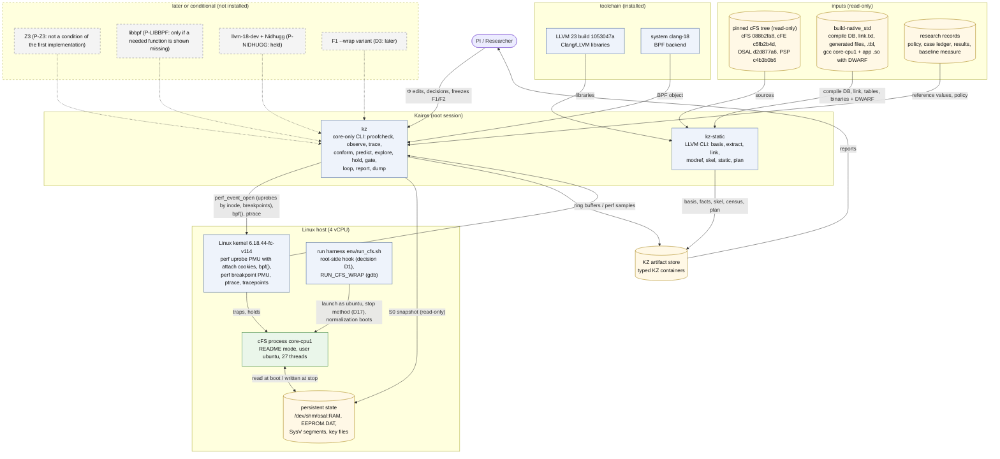
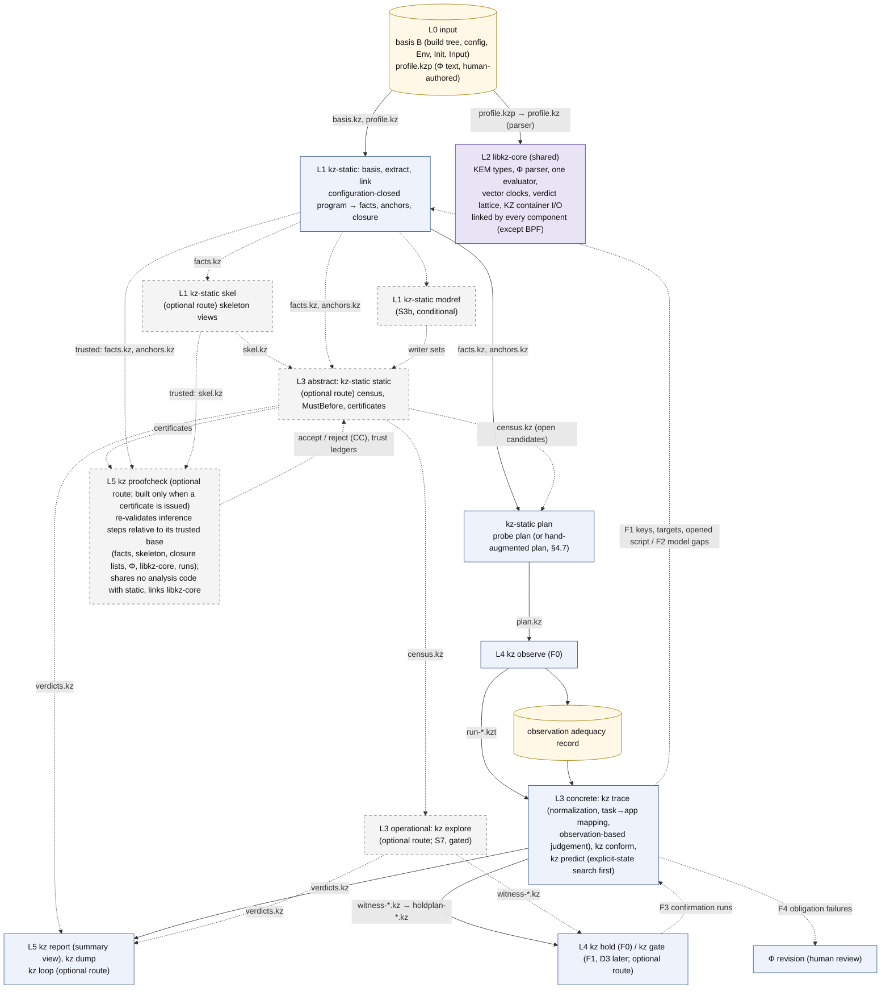
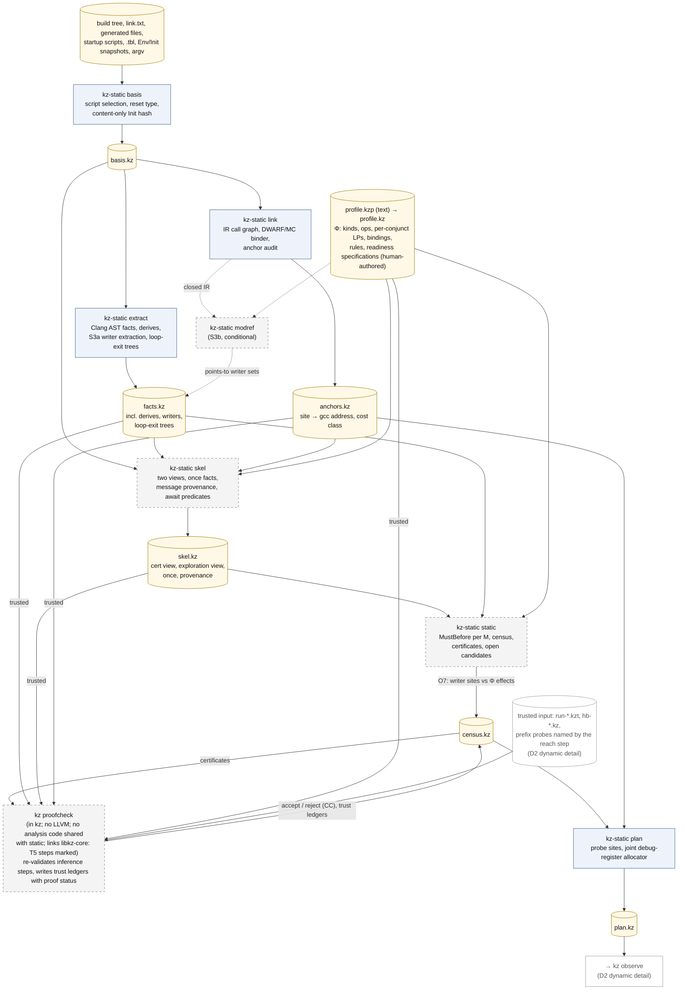
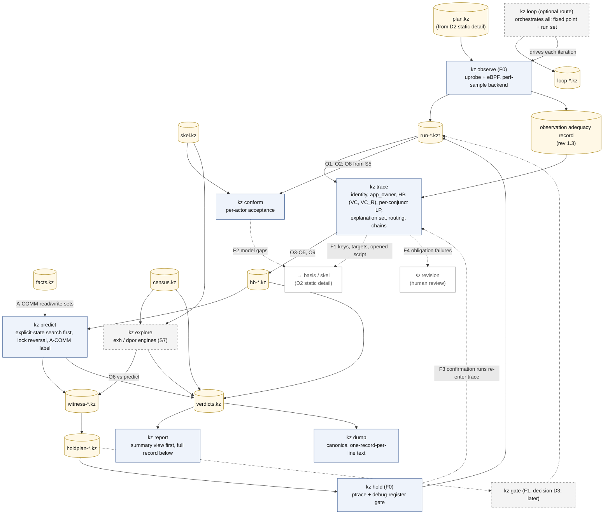

# 02 아키텍처: Kairos의 계층, 구성요소, 산출물, 계층 간 검사

이 문서는 Kairos(도구 접두어 `kz`)가 어떤 구성요소로 이루어지는지, 구성요소들이 어떤 typed 산출물을 주고받는지, 계층들이 서로를 어떻게 검사하는지를 설명한다. spec을 읽지 않은 연구자가 전체 구조를 한 번에 파악하는 것이 목적이다. 정의와 근거의 세부는 각 문장이 가리키는 spec 절에 있다.

상태: 설계 문서 — 구현·측정 전. 규범 원문: [spec/SPEC_FINAL.md](spec/SPEC_FINAL.md)(revision 1.3: 2026-10-22 PI 결정 D1–D5 반영, spec §0.12. revision 1.2: 2026-10-15 PI 결정, 용어 결정 T1, CORD 인용 정리 반영, spec §0.9–§0.11. revision 1.1: 외부 검토 EXT-20261012 반영, spec §0.7)

> **rev 1.3 반영 (2026-10-22).** 이 문서는 SPEC revision 1.3(spec §0.12; 변경표 `plan/REV13_CHANGE_TABLE.md`; 결정 기록 `spec/PI_DECISIONS_RESOLVED_20261022.md`) 가운데 이 문서가 풀어 쓰는 절의 변경을 반영했다. 반영한 변경표 행: C-01, C-03, C-05, C-10, C-13, C-15, C-16, C-17, C-18, C-19, C-21, C-22, C-23, C-24, C-25, C-26, C-27, C-28, C-29, C-30, C-31, C-32, C-36, C-41, C-42, C-43, C-46, C-48, C-49, C-50, C-51(C-52는 이 반영 자체다). 이 변경은 결정 [D]이고 결과가 아니다. 이 판을 위해 만들거나 실행한 것은 없고, 연구 조건도 정하지 않았다. **우선 규칙**(spec §0.12 "Precedence", ADR-053): revision 1.0–1.2를 위해 쓴 문장 가운데 certificate, explorer, 진행(progress) 결과, loop를 Kairos의 첫 산출물·필수 산출물·정의적 산출물로 부르는 것은 ADR-053에 따라 읽는다. 이 경로들은 쓰인 그대로 정의되어 있고 그 주장이 필요할 때 쓰며, 관측 기반 판정·한정 예측·제어 실행 확인의 전제 조건이 아니다. 아래에서 그런 문장 옆에는 "rev 1.3" 표시를 붙였다. 그림 D2의 코드 블록 세 개는 spec §12의 revision 1.3 지시(C-48)에 맞춰 고쳤다.

## 목차

1. [읽기 전에](#1-읽기-전에): 표기, 핵심 용어, 예로 쓰는 cFS 사례
2. [시스템 문맥](#2-시스템-문맥): Kairos 바깥에 무엇이 있는가 (그림 D1)
3. [계층 L0-L5](#3-계층-l0-l5): 여섯 계층과 세 해석기
4. [설계 원칙 여덟 가지](#4-설계-원칙-여덟-가지)
5. [구성요소](#5-구성요소): 역할, 언어, 입력→출력, 기술 선택 이유 (그림 D2 개요)
6. [두 실행 파일](#6-두-실행-파일): `kz-static`과 `kz`
7. [typed 산출물 형식](#7-typed-산출물-형식): KZ container, X-macro schema, Φ DSL, Python/JSON을 쓰지 않는 이유
8. [데이터 흐름 12단계](#8-데이터-흐름-12단계) (그림 D2 상세 1, 2)
9. [계층 간 일관성 의무 O1-O10과 CC](#9-계층-간-일관성-의무-o1-o10과-cc)
10. [기술 결정](#10-기술-결정): Clang은 분석 전용, gcc 바이너리 실행, MLIR 제외, SMT는 첫 구현의 조건이 아님, eBPF userland, 설치 없는 핵심
11. [이 문서가 주장하지 않는 것](#11-이-문서가-주장하지-않는-것)
12. [관련 문서](#12-관련-문서)

---

## 1. 읽기 전에

### 1.1 표기

spec은 근거의 종류를 표기한다(spec 머리말 L11). **[F]** 인용이 있는 사실, **[M]** 측정값, **[I]** 추론이나 설계 논증(실행해서 확인하지 않음), **[D]** 설계 결정(spec §11의 ADR이 기록), **[U]** 확인되지 않음. 이 문서의 [M]은 모두 spec이 인용한 **기존** 측정([R07], 연구 기록, 검토자가 잰 "[X3, here]")이다. Kairos 자체는 한 번도 실행된 적이 없다. 문헌 뒤의 [V-abs], [V-doc], [V-me], [P], UNVERIFIED는 [R04]/[R05]/[R06]이 그 문헌을 어디까지 확인했는지를 나타낸다. 이 문서는 문헌을 spec이 인용한 범위에서만 쓴다.

revision 1.2는 PI의 2026-10-15 결정을 반영한다(spec §0.10; 결정 원문은 `spec/PI_DECISIONS_RESOLVED_20261015.md`). 그 결정은 연구 계획·범위·표현에 대한 결정 [D]이고, 도구·논문·출처에 대한 사실도 실행 기록도 아니다. 폐기한 기록기 CORD의 결과는 이 문서에서 근거로 쓰지 않는다(PI 결정 D12). R2의 실행 근거는 gdb 원시 기록 `env/logs/r2_g1..3_*`와 `results/R2_gdb_v701.md`([R2g])다. 값이 reference에 없으면 고르지 않는다. 이 문서에는 실행 횟수 N, 작업량 상한, 감시 한도가 없다.

revision 1.3은 PI의 2026-10-22 결정 D1–D5를 반영한다(spec §0.12, §10.1 "Decisions of 2026-10-22"; ADR-053–ADR-058; 결정 원문은 `spec/PI_DECISIONS_RESOLVED_20261022.md`). 2026-10-22 결정 D1은 검토된 제안 문서 0.2(spec의 [P0.2])를 기초로 채택하고, 중심 주장을 "must-order certificate가 관측된 잘못된 방향의 위반을 `fixed-order`로 끌어올린다"에서 **불완전 관측 아래의 관측 기반 판정, 한정 예측, 제어 실행 확인**으로 옮긴다. MustBefore 고정점, certificate, `kz proofcheck`, explorer, 진행 결과는 그대로 정의된 **선택 경로**가 된다. 2026-10-22 결정 D2는 `PENDING`과 `OPEN`의 요약을 `INCONCLUSIVE(horizon-open)`으로, D3은 C1을 기여 증거의 첫 사례로, D4는 실행하지 못한 원 도구에 대한 주장을 문헌·코드 분석 결과 상태로, D5는 단계 B의 사례별 완료에 writer와 별칭을 덮는 닫힘을 요구하는 것으로 정했다. 같은 날 task→앱 매핑이 구현 범위로 확인되었다(ADR-056). 이 결정도 결정 [D]이고 결과가 아니다. spec §1의 정의, lemma와 증명 상태, 가정, 비교 집합(ADR-046), P-Z3, QT-4/QT-5/Q15, T1은 바뀌지 않았다.

**인용 형식과 이름이 겹치는 기호.** 인용 형식(설계안 [A]/[B]/[C], 심사 [J1]–[J3], 검토 [X1]–[X3], [X3, here], v0.1 등)은 [01_overview.md §0](01_overview.md#0-읽는-법)에 모아 두었다. 같은 기호가 여러 뜻으로 쓰이므로 이 문서는 앞에 종류를 붙인다: "PI 결정 D4"와 "그림 D4", "보장 G5"와 "gap G5", "단계 S0"와 "Init snapshot S0", HB stratum S/O와 cold/warm 층(stratum). 2026-10-22의 결정 D1–D5는 같은 번호의 이전 PI 결정(관측 hook의 D1, F1 gate 후순위의 D3, native σ_R1의 D4 등)과 다르므로 늘 "2026-10-22 결정"을 붙인다. 전체 목록은 [10_decisions_adr.md §0.2](10_decisions_adr.md#02-이름-충돌-주의)다.

### 1.2 핵심 용어

처음 보는 독자가 이 문서를 읽는 데 필요한 만큼만 적는다. 전체 용어집은 [10_decisions_adr.md §3](10_decisions_adr.md#3-용어집)이다(원문 spec §13).

| 용어 | 쉬운 설명 | spec |
|---|---|---|
| readiness specification (준비 상태 명세) | 어떤 framework 자원을 쓰는 지점(use)이 그 자원이 특정 lifecycle 상태에 있기를 요구한다는 규칙. 그 요구 조건이 준비 사전조건(readiness precondition, 기호 `Req`)이다. 처음 쓸 때는 근거 기록 준비 상태 명세라 하고, 그냥 "명세"라고 줄이지 않는다. "계약"은 문서화된 API 의미(API 계약)에만 남는다(용어 결정 T1 = (a), spec Appendix C). 예: EVS로 event를 보낼 때 함께 넘기는 AppId는 유효해야 한다 | §0.1, §1.6 |
| 준비 상태 위반 (readiness violation) | 범위 안의 VIOLATING 발생. 순서위반의 한 부류다. Allowed가 정해지지 않은 발생(NOT_READY_UNJUDGED)은 위반이라 부르지 않는다 | §1.6 |
| instance | 준비 상태 명세 하나를 코드의 한 사용 지점(호출 문맥까지 구분한 template)과 자원 key에 적용한 것. scope(발생이 종료 요청 전에 결정되었는지, 뒤면 K-TEARDOWN)도 instance의 일부다. Kairos는 instance마다 판정 기록을 만든다 | §1.6 |
| 판정 class | `inactive`, `protected`(↳`allowed-not-ready`), `fixed-order`, `no-final-status`, `schedule-dependent`(↳`timeout-dependent`), `ordinal-split`, `unknown(reason)`. class는 안전성 진술(`¬Bad_i`, `¬OK_i`, `¬NR_i`)로 이루어진 안전성 기록에서 나온다. 진술은 도달한 발생에 대한 것이고, 도달 여부는 class가 아니라 칸의 reach 축이 적는다. 그래서 `protected`는 "도달한 발생은 모두 나쁘지 않다"는 뜻이고, 언제나 reach·progress 값과 함께 보인다. **어떤 class도 "safe"를 뜻하지 않는다.** 경보가 없다는 것은 근거가 없다는 뜻이고 `unknown(reason)`이 된다. `schedule-dependent`에는 같은 발생 서수의 나쁜 witness와 좋은 witness가 필요하고, 서수가 다르면 `ordinal-split`이다 | §0.1, §1.10 |
| 진행(progress) 결과 | 영구 대기와 deadlock을 적는 칸별 결과: `stall-witness`, `no-stall-within(b)`, `unknown(reason)`(기본 `unknown(not_checked)`). class와 따로 적고, 어떤 값도 "live"나 "deadlock-free"를 뜻하지 않는다 | §1.8, §1.10 |
| 세 판단 | 준비되지 않은 사용을 framework 수준(공급자가 문서화한 결과: `fw_doc`, `fw_conf`), 호출자 수준(`appreq`와 Allowed: 상태와 class를 정한다), 관측된 결과(consequence)로 따로 판단한다 | §1.6, §1.10 |
| basis B | 스케줄만 빼고 모두 고정한 분석 기준: Build, Config, Init(실행 전 유지 상태), Env, Input. 설정이 바뀌면 새 basis B′이고, "새 버그"가 아니다 | §1.7 |
| profile Φ (Φ_cFS) | cFS framework 지식을 담은 선언형 텍스트. 자원 종류(kind)와 lifecycle, 연산과 효과, 순서 규칙, 준비 상태 명세를 적는다 | §0.2, §2.3 |
| KEM | Kairos Event Model. 모든 구성요소가 공유하는 한 가지 typed event 모형 | §0.2, §13 |
| linearization point (LP) | 연산의 효과가 "이 명령에서 일어났다"고 보는 한 지점. Kairos는 요구 조건의 conjunct(∧로 묶인 각 조건)마다 LP를 따로 둔다. 호출자가 인자 값을 미리 읽어 둔 load 지점은 **capture point**라 부른다 | §1.4 |
| happens-before (HB) | 한 실행 안에서 동기화(lock, message, thread 생성 등)로 정해지는 "먼저 일어남"의 부분 순서. **vector clock**은 thread마다 카운터 벡터를 들고 다니며 이 순서를 계산하는 자료 구조다(Lamport 1978; Fidge 1988; Mattern 1989 [V-abs]) | §1.9 |
| MustBefore (MB) | "모든 실행에서 a가 n보다 먼저 일어난다"는 정적 관계. 코드 구조만으로 계산한다 | §1.9, §4.4 |
| certificate | 안전성 진술 하나(fixed-order의 `¬OK_i`, protected의 `¬NR_i`)를 다른 프로그램(`kz proofcheck`)이 한 단계씩 다시 확인할 수 있게 적은 증명 기록. 검사기는 명시한 trusted base에 상대적으로 추론 단계를 다시 검증한다. 증명 상태가 붙는다. revision 1.3부터 보편 순서 주장이 필요할 때 쓰는 선택 경로다(ADR-053) | §4.5 |
| trust ledger | certificate와 판정 칸마다 붙는 네 부분 기록: 다시 검증한 단계, 추출 사실, 신뢰 항목(쓴 lemma와 그 증명 상태 포함), 관측으로 반박될 수 있지만 증명되지 않은 항목. revision 1.3부터 certificate 없는 관측 판정·예측·확인·정적 증명에도 붙고, 그때 부분 (i)은 비어 있을 수 있다(C-23) | §4.5.1 |
| 필수 경로 / 선택 경로 (rev 1.3) | 필수 경로: 닫힘과 추출 → probe 계획 → 관측 → 정규화(task→앱 매핑 포함) → 관측 기반 판정 → 한정 예측(명시적 상태 탐색 먼저) → 제어 실행 확인. 선택 경로: MustBefore·certificate·`kz proofcheck`, explorer, 진행 결과, loop. 선택 경로는 그대로 정의되어 있고 보편 순서 주장이나 진행 결과가 필요할 때 쓴다 | §2.2, ADR-053 |
| 관측 기반 판정 / 설명 집합 (rev 1.3) | 실제 기록 위에서 조건 instance를 판정하는 것. 판정은 기록과 양립하는 run의 모든 설명(설명 집합 `Cobs`)에서 성립할 때만 확정되고, 아니면 이유를 붙인 `INCONCLUSIVE`다. `Cobs`는 한 run의 모호성이고 예측한 스케줄이 아니다 | §4.8, ADR-055 |
| 요약 뷰 (rev 1.3) | 바뀌지 않은 상태 위에 계산하는 판정 요약: 관측(`OBSERVED_VIOLATION`, `NO_VIOLATION_IN_CHECKED_PREFIX`, `INCONCLUSIVE(reason)`, `NOT_APPLICABLE`), 예측(`MODEL_CANDIDATE`, `NONE_IN_SCOPE`, `INCONCLUSIVE(reason)`, `NOT_RUN`), 확인(`CONFIRMED`, `NOT_CONFIRMED(reason)`, `NOT_RUN`), 실행 관계. `PENDING`과 `OPEN`은 `INCONCLUSIVE(horizon-open)`이다(2026-10-22 결정 D2) | §1.10, ADR-054 |
| `app_owner` (소속 앱, rev 1.3) | actor instance를 만든 애플리케이션. 근거(생성 요청, 생성 호출 안의 kernel fork 기록, 자식이 알리는 OSAL id, 분석 대상이 아닐 때의 ES 기록)와 수준 `confirmed` / `inferred` / `undetermined`을 가진다. 분석하는 표 자체에서 얻지 않는다 | §1.2, §5.7, ADR-056 |
| 증명 상태 (proof status) | lemma·보장·certificate·판정 칸의 `proved` / `depends-on-stated-assumption` / `unproved`. 여러 lemma를 쓴 진술은 가장 약한 것을 따른다. 상태는 증명을 써 넣는 수정만 올리고, 실행·시험·통과한 obligation은 올리지 못한다. 첫 R2 결과의 certificate 칸은 모두 `unproved`다 | §6.2 |
| 근거 등급 (source tier) | 준비 상태 명세가 어떤 종류의 근거 위에 서는지: `contract-backed`, `requirement-derived`, `admitted`, `issue-derived`, `code-derived`, `researcher`, `unreferenced`. 보고 시점에 `prov` 기록에서 유도하고 기록 필드는 없다 | §1.6 |
| σ, M | σ는 스케줄 의미론이다. σ_U는 시간을 무시한 임의 interleaving, σ_U∞는 σ_U에서 시간 기반 전이(TB: 주기적이지 않은 timed wait의 timeout, 지연을 둔 retry의 마지막 시도의 실패, ES kill timer의 강제 종료)를 뺀 의미, σ_R1은 한 CPU의 고정 우선순위, σ_E는 실제 환경이다. M은 OSAL을 API 계약 수준(M_api)과 POSIX 구현 수준(M_impl) 중 어디까지 모형화하는지다 | §1.8, §1.4 |
| uprobe, eBPF | **uprobe**는 실행 파일을 고치지 않고 사용자 프로그램의 특정 명령 주소에 kernel이 거는 probe다. **eBPF**는 kernel이 안전성을 검증한 뒤 kernel 안에서 실행하는 작은 프로그램이다. Kairos는 uprobe가 걸릴 때마다 eBPF 프로그램이 인자와 순서 token을 기록하게 한다 | §5.1, §5.3 |
| DPOR | dynamic partial-order reduction. 의존하는(dependent) transition이 뒤바뀔 수 있는 곳에만 backtracking 지점(다른 순서를 시도하려고 되돌아갈 지점)을 두어, 독립 연산의 순서만 다른 interleaving의 탐색을 줄이는 체계적 탐색 기법이다([R05 §2.2]; DPOR POPL 2005 [V-abs; 보장 문구 UNVERIFIED]; source/optimal DPOR POPL 2014 [V-abs]). Kairos의 source-DPOR은 class(독립 연산의 순서만 다른 실행들의 동치류)당 실행 하나를 주장하지 않는다(spec §6.4 항목 9). | §1.11, §4.10, §6.4 |
| F0, F1 | 관측 충실도 등급([R07 §7]). F0는 수정하지 않은 기준 바이너리를 같은 사용자·같은 명령으로 실행하고 별도의 root 프로세스가 관측한다. "시간만 바뀐다"고는 주장하지 않고 관측 영향을 점검한다. F1은 같은 소스와 컴파일러로 링크 옵션만 바꾼다 | §5.1 |
| S0–S10 | 구현 단계. S8(MLIR)은 revision 1.2에서 제거되었고 번호를 다시 쓰지 않는다. thin MVC(S0+S1+S2+S3a)는 claims table과 자르는 순서를 부르는 이름이고 첫 완료 조건이 아니다(P-LADDER). revision 1.3에서 P-LADDER는 재정의되었다. 첫 rung은 V1′(R2 기반 검증)이고 V3(C1)이 병행한다(ADR-057; [§8.5](#85-예-r2가-흐름을-지나는-모습-기대-동작-실행한-적-없음)) | §9.3 |
| PI 결정 D1, D3, P-Z3 … | PI가 정한(또는 정할) 결정의 ID. 그림 D1–D10과 다른 번호 체계다. 2026-10-15에 대부분 정해졌고, D18(C1 부분 제외), P-TRACEFS, D8/P-RECALL의 세부는 열려 있다. 2026-10-22에 결정 D1–D5가 더해졌고, 같은 번호의 이전 결정과 구분해 "2026-10-22 결정"을 붙인다 | [PI_DECISIONS.md](spec/PI_DECISIONS.md), spec §10.1 |

### 1.3 예로 쓰는 cFS 사례

이 문서는 아래 네 가지를 반복해서 예로 든다. 모두 spec이 이미 다룬 것이다.

- **R2** (spec §1.2, §1.11, App. A.1). cFE core가 시작하는 동안 ES와 EVS task가 SB 코드를 실행하고, 그 코드가 SB가 아직 발행하지 않은 AppId(`CFE_SB_Global.AppId`, 초기값 0 = UNDEFINED)를 event에 찍는다. SB는 자기 task의 `cfe_sb_task.c:138`에 와서야 이 값을 쓴다. core serialization 규칙 R19(`cfe_es_start.c:835`) 때문에, 매 boot의 위반 use 24개는 모두 발행보다 **앞서도록 HB로 순서가 정해져 있다**([R2g §2]). 이 24개는 한 원인에서 나온 반복 호출이다(정적 위치 3곳, task × 함수 문맥 6개, [R2g §6]). "순서가 없는 두 접근"을 찾는 data-race 검출기는 이런 경우를 보고하지 않는다(spec §1.11). revision 1.3에서 R2는 관측 경로의 기반 검증이고 기여의 증거가 아니다(spec §8.2; 2026-10-22 결정 D3; C-41).
- **C1** (spec §1.11, App. A.4; [LED]). CF가 table에 적힌 이름으로 OSAL counting semaphore를 찾는데(lookup), 그것을 만드는 provider app과의 순서를 정하는 장치가 없다. create와 lookup은 같은 OSAL lock 아래에서 일어나므로 HB는 둘을 lock으로 순서 짓는다. default B에서는 이름이 비어 있어 이 경로가 실행되지 않는다(`inactive`). 이 경로가 실행되는 파생 구성 B′는 공개 BP 코드 기반이다(PI 결정 D22; spec App. A.4). revision 1.3에서 C1은 기여 증거의 첫 사례이고, 그 basis를 단계 B와 병행해 만든다. 경로는 버전별로 나눈다: CF `281a941`(재시도 없음)과 CF `833fdbb`(재시도 추가)(spec App. A.4 머리 주석; 2026-10-22 결정 D3; C-50).
- **OSAL RESERVED 구간** (spec §1.3, §1.4, App. A.4). OSAL 객체를 만드는 도중, 이름은 이미 보이지만 최종 ID는 아직 쓰이지 않은 구간이다(`osal.obj` 상태 RES_CN). M_api는 create를 원자적으로 보므로 이 구간이 없고, M_impl에서만 나타난다. 이름(by-name) lookup이 이 구간에 닿으면 기다리지 않고 바로 `OS_ERR_INCORRECT_OBJ_STATE`를 받는다(`osapi-idmap.c:401–404`). spec App. A.4는 C1의 파생 설정 B′에서 이것이 CF의 retry loop를 끝내고, countsem table lock이 잡힌 채 남아 provider가 막히는 경로를 M_impl의 기대 동작(implementation-defect candidate)으로 적는다 [I].
- **SB 구독 전 송신** (spec §1.11, §3.9, §3.15 RC5). 구독(route)이 생기기 전에 보낸 message는 `CFE_SUCCESS`를 돌려받으면서 조용히 사라진다(`NoSubscribersCounter++`, `SEND_NO_SUBS` event). R2의 24개 use 중 18개가 이런 `SEND_NO_SUBS` event의 사용이고, 그중 17개가 ES 문맥, 1개가 EVS 문맥이다 [M] ([R2g §2]; spec §1.6, App. A.1 steps 12, 13a). EVS 문맥 1개의 MsgId 귀속은 열려 있다 [U].

---

## 2. 시스템 문맥

Kairos는 cFS 프로세스 **바깥에서** 도는 두 개의 명령행 프로그램 `kz-static`과 `kz`다(spec §2.2). 기본 경로(F0)에서는 cFS 바이너리를 바꾸지 않고, 프로세스 안에서 어떤 lookup도 하지 않는다. identity 결합은 모두 나중에(offline) 한다. OSAL 이름 lookup을 부르는 계측 코드는 Kairos가 찾으려는 lock leak을 스스로 일으킬 수 있기 때문이다([R01 §6.3]; spec §5.7). revision 1.3에서 이 offline 결합은 모든 actor의 `app_owner`를 근거와 수준과 함께 낸다(spec §4.8 step 2, §5.7; ADR-056; C-05, C-32). 현재 관측기의 perf-sample backend는 생성자 쪽 out 매개변수를 읽지 못하므로, 같은 thread에서 생성 호출의 진입–반환 구간에 kernel fork 기록이 들어 있다는 것(A-CLK-PO 아래 한 시계의 근거)으로 결합한다. 그런 매핑은 `inferred`이고 `match-by-time`과 `id-unverified`로 표시된다(`kairos/docs/observer_smoke_run.md` §4.1). C1의 단계 B 전에 계획이 생성자 쪽 근거를 더한다. 미확정 소유는 그대로 두고 보류 사유가 되며, 분석하는 표의 조회로 풀지 않는다. 예외는 후순위로 미룬 F1 `kz gate`로, `__wrap_*` gate를 link한 변형 바이너리를 쓴다(PI 결정 D3, 2026-10-15). 현재의 사건 기반 hold로 필요한 확인이 되는지 먼저 평가하고, 부족한 질문이 확인될 때 추가한다(spec §4.13).

그림 D1의 요소는 다음과 같다(spec §12 D1).

| 요소 | 내용 | 근거 |
|---|---|---|
| 읽는 입력 | 고정된 cFS tree(읽기 전용: cFS `088b2fa8`, cFE `c5fb2b4d`, OSAL `d2d877a6`, PSP `c4b3b0b6`), build tree `build-native_std`(compile DB, `link.txt`, 생성 파일, `.tbl`, DWARF가 있는 gcc `core-cpu1`과 app `.so`), 연구 기록(정책, 사례 ledger, 결과) | spec 머리말, §1.7 |
| 관측 대상 | README 방식으로 사용자 `ubuntu`가 실행한 cFS 프로세스 `core-cpu1`. thread 27개([M] [BM §0]) | §1.7, §12 D1 |
| 닿는 경로 | Kairos는 root 쪽에서 Linux kernel 기능(perf uprobe PMU와 attach cookie, `bpf()`, perf breakpoint PMU, ptrace)을 통해서만 cFS 프로세스에 닿는다 | §5.1 |
| 실행 harness | 기존 `env/run_cfs.sh`가 계속 실행을 맡는다. Kairos는 root 쪽 observer hook 하나만 더한다(PI 결정 D1, [R07 §9 항목 1]). D1은 2026-10-15에 설명을 고쳐 승인됐다. cFS 사용자와 기준 바이너리를 유지하고, "시간만 바뀐다"고는 주장하지 않으며, 관측 영향을 점검한다(§5.1, spec §8.6) | §2.6, §5.1 |
| 유지 상태 | `/dev/shm/osal:RAM`, `EEPROM.DAT`, SysV segment, key file은 실행 사이에 남는다. Kairos는 실행마다 읽기 전용 Init snapshot S0(구현 단계 S0와 다른 뜻)를 떠서 B.Init으로 기록한다. 정상 종료와, 비정상 종료 뒤 정규화 부팅의 기준은 ES POWERON 재시작 명령이다(D17 (a)). POWERON이 모든 유지 파일·파일 캐시·공유 파일시스템을 초기화하지는 않으므로 초기 상태와 종료 기록을 남긴다(spec §6.4 항목 49) | §1.7 |
| 산출물 저장소 | 모든 결과는 typed KZ container로 저장되고, 보고서로 PI에게 간다 | §2.3 |
| 점선 상자 | 설치하지 않았고 첫 구현의 조건도 아닌 후순위·조건부 도구: Z3(P-Z3: 첫 구현의 조건이 아님), libbpf(P-LIBBPF: 필요한 기능이 모자란 것이 확인될 때만), `llvm-18-dev`+Nidhugg(P-NIDHUGG: 보류), F1 `--wrap` 변형(PI 결정 D3: 후순위). MLIR(D6), TSan 변형(P-TSAN), valgrind 기준점(P-VALGRIND)은 revision 1.2에서 제외되어 그림에서 뺐다. 핵심 기능은 이들 없이 돌도록 설계했다(원칙 7, [§10](#10-기술-결정)) | §10.1 |

**그림 D1. 시스템 문맥** (렌더링: [diagrams/D1_system_context.svg](diagrams/D1_system_context.svg); spec §12 D1; §2.2, §2.6, §5.1, §10.1)



읽는 법: 사각형은 구성요소, 원통은 산출물이나 저장소다. 점선 테두리와 점선 화살표는 후순위이거나 조건부인 도구다. 이 코드 블록은 revision 1.2에 맞췄다. `diagrams/`의 원본과 렌더링 파일은 그림 단계에서 같은 내용으로 맞춘다. `kz-static`은 소스와 build tree만 읽고, kernel과 이야기하는 것은 `kz`뿐이다.

---

## 3. 계층 L0-L5

Kairos는 여섯 계층으로 나뉜다(spec §2.1). 아래 계층은 위 계층에 사실을 공급하고, 위 계층의 관측은 아래 계층의 가정을 검사한다([§9](#9-계층-간-일관성-의무-o1-o10과-cc)).

| 계층 | 이름 | 들어 있는 것 | 하는 일 |
|---|---|---|---|
| L0 | 입력 | basis B(build tree, configuration, Env, Init, Input), profile Φ_cFS(사람이 쓴 텍스트) | 분석의 고정 조건과 framework 지식을 준다 |
| L1 | 정적 closure와 skeleton | `kz-static basis`, `extract`, `link`, `modref`(S3b, 조건부), `skel`. 모두 `libkz-llvm` 위에 있다 | 설정으로 닫힌(configuration-closed) 프로그램에서 사실(호출 지점, 인자, writer, `derives`)을 뽑고, actor마다 skeleton을 만든다 |
| L2 | formal core | `libkz-core`: KEM type, Φ parser, typed core expression evaluator(evaluator 하나, abstract domain 셋), rule engine, typestate, vector clock, verdict lattice, provenance, KZ container I/O. **LLVM에 의존하지 않는다** | 모든 구성요소가 event, 자원, 순서, 판정을 같은 뜻으로 다루게 한다 |
| L3 | 분석(세 해석기) | abstract: `kz-static static`(census, MustBefore, PWB/once, certificate). concrete: `kz trace`, `kz predict`, `kz conform`. operational: `kz explore`(늦은 단계, gated; `exh`·`dpor` engine) | 같은 Φ를 세 방식으로 해석한다 |
| L4 | 실제 바이너리 관측·제어 | `kz observe`(F0: perf-uprobe와 eBPF, 자체 raw loader, attach cookie / perf-sample 초기 backend), `kz hold`(F0: ptrace와 debug-register gate), `kz gate`(F1, 후순위: PI 결정 D3) | 수정하지 않은 gcc 바이너리를 관측하고, 확인 실행에서만 제어한다 |
| L5 | 조정과 보고 | `kz loop`(feedback 구동), `kz report`, `kz dump`, `kz proofcheck`(trusted base에 상대적인 독립 추론) | 반복을 돌리고, 판정을 보여 주고, certificate의 추론 단계를 명시한 trusted base에 상대적으로 다시 검증한다 |

typestate는 자원 종류마다 상태 기계(lifecycle automaton)를 두고 어떤 연산이 어떤 상태에서 허용되는지 추적하는 방법이다(Strom & Yemini 1986 [V-me]; spec §1.3). `kz-static plan`(probe 계획)은 spec §2.1의 계층 표에 따로 적혀 있지 않다. 그림 D2 개요는 revision 1.2까지 plan을 `static`과 함께 L3 abstract 상자에 두었고, revision 1.3의 그림에서는 필수 경로인 `plan`을 선택 경로인 `static`과 나눈다([§5](#5-구성요소)).

**rev 1.3: 계층 위의 필수 경로와 선택 경로** (spec §2.2 "Required and optional routes"; ADR-053; C-15). 계층 구성은 바뀌지 않는다. 바뀌는 것은 경로의 지위다. 필수 경로는 L1의 `basis`, `extract`, `link` → `plan`(또는 손으로 보강한 계획) → L4의 `observe` → L3 concrete의 `trace`(정규화, task→앱 매핑, 관측 기반 판정) → `predict`(명시적 상태 탐색 먼저) → L4의 `hold` → L5의 `report`다. L1의 `skel`, L3 abstract의 `static`(MustBefore, certificate), L5의 `proofcheck`, L3 operational의 `explore`, `conform`의 O8, `loop`, `gate`, 그리고 전과 같이 `modref`는 선택 경로다. `static`의 census와 `skel`의 view는 선택 경로나 닫힘 검사(spec §4.1)가 필요로 하는 곳에서 계속 쓴다.

### 3.1 세 해석기

L3의 핵심은 **같은 Φ를 같은 event type 위에서 세 방식으로 해석한다**는 것이다(spec §0.2 항목 2). static template과 관측 event가 같은 type이므로 정적, trace, model 계층이 검사기 하나를 공유한다(spec §1.5).

| 해석 | 무엇 위에서 | 무엇을 계산하나 | 구성요소 |
|---|---|---|---|
| abstract | 설정으로 닫힌 actor별 skeleton의 **certificate view**. 이 view는 횟수가 정해지지 않은 loop를 star-closure로 닫는다. 즉 loop head, back edge, 반복/탈출 선택만 남겨 몇 번을 돌든 포함하게 하고, horizon을 두지 않는다 | census, MustBefore, PWB, certificate, `inactive` | `kz-static static` |
| concrete | 수정하지 않은 gcc 바이너리의 trace | vector clock으로 HB 계산, 각 LP에서 준비 상태 검사, lock 순서를 뒤집는 예측 | `kz trace`, `kz predict`, `kz conform` |
| operational | 후보 하나에 닫힌 작은 model. skeleton의 **exploration view**(loop를 horizon h까지 펼치고 그 너머를 `TRUNC`로 표시)를 쓰고, 결과의 경계 b에 h가 들어간다 | 경계 b 안의 안전성 기록과 class, 발생 서수가 붙은 witness, reach, 진행 결과(stall witness의 종류·qualifier·progress chain). `exh`는 상태를 저장하는 전수 탐색이고, 진행 결과를 정하는 것은 `exh`뿐이다. `dpor`는 source-DPOR와 sleep set을 쓰고, 근거 정리(T-JACM)의 상태가 P이므로 "unverified"로 표시한다 | `kz explore` (S7, gated) |

**rev 1.3** (ADR-053; C-22, C-29). abstract 해석의 MustBefore와 certificate(spec §4.4–§4.5)는 보편 순서 진술이 필요할 때 쓰는 선택 경로이고, 관측 기반 판정·예측·확인의 전제 조건이 아니다. R2도 이것을 요구하지 않는다. 다시 적용할 때 보고서는 관계의 정의, 분석 영역, 전이 규칙의 단조성, 수렴 조건, 계산한 관계와 프로그램 순서 사이의 보존 논증을 밝히고, 수렴한 고정점 그 자체를 프로그램의 올바른 순서로 읽지 않는다. operational 해석의 explorer(spec §4.10)도 선택 경로다. 작은 유한 모형 위의 `exh`를 먼저 시험 T-13(예측 엔진과의 대조)의 독립 기준으로 쓰고, closed cone 위의 전체 explorer, 그 refinement와 진행 결과는 여전히 gate(spec §4.10 항목 9)를 거친다. concrete 해석의 관측 기반 판정과 예측은 필수 경로다.

PWB(precedes-whenever-both-occur)는 "둘 다 일어나는 실행에서는 항상 a가 먼저"라는 관계다(spec §1.9). 두 skeleton view의 자세한 차이는 [04_formal_model.md](04_formal_model.md)의 그림 D10이 다룬다.

---

## 4. 설계 원칙 여덟 가지

spec §2.1은 원칙 여덟 개를 설계 결정 [D]으로 둔다.

| # | 원칙 | 구체적 내용 | 무엇을 가능하게 하거나 막나 |
|---|---|---|---|
| 1 | 형식 핵심은 하나 | 모든 구성요소는 `libkz-core`를 통해 KEM type을 읽고 쓴다. event, 자원, edge, predicate, verdict를 따로 정의한 구성요소가 없다. Φ predicate의 evaluator는 하나다. 의도한 예외는 하나다: `kz proofcheck`는 코드에서 뽑은 대기 조건을 다시 유도하고 `Pred_code ⇒ C`를 자기 symbolic 절차로 판단한다. 검사기의 다른 Φ 평가(INIT 단계, T-OBS의 falsifier 조건)는 `libkz-core`의 evaluator를 부르므로, 그 evaluator는 검사기의 trusted base에 들고 그 단계는 trust ledger에 "via T5"로 표시된다 | 정적·trace·model 계층이 같은 뜻을 쓰므로 계층 간 검사 O1–O10이 가능하다(ADR-002) |
| 2 | profile은 코드가 아니라 데이터 | framework 지식은 provenance가 붙은 versioned Φ 파일에 있다. engine은 framework에 중립이다. lint가 engine 코드 안의 사례 식별자(예: `CFE_SB_Global`, `sem_name`, `C1`)를 막는다(spec §7.2, §9.2). 앱 고유 protocol은 따로 app-profile 계층에 두고 작성 비용을 잰다 | engine이 특정 사례에 맞춰지는 것을 막는다. 다른 cFS revision에는 Φ만 바꿔 쓴다는 것이 가설 H-V다(spec §3.17, §7.6; ADR-003) |
| 3 | 증명을 지닌 판정 | **certificate**는 규칙 instance, writer 항목(transition status와 key status 포함), once 사실, `derives` 사실, 코드에서 추출한 predicate의 목록이고, 항목마다 코드 위치를 단다. **검사기** `kz proofcheck`는 `kz-static static`과 분석 코드를 공유하지 않고, 두 쪽 모두 `libkz-core`를 link한다. 검사기는 각 추론 단계를 trusted base에 상대적으로 다시 검증한다: 추출 사실, skeleton, closure 목록, Φ, `libkz-core`, 그리고 reach에는 run과 prefix-probe 산출물. 그 추론은 `libkz-core`의 evaluator나 rule engine을 부르는 단계만 빼고 producer와 독립이고, 그 단계는 ledger에 표시한다. **trust ledger**는 certificate와 판정마다 다시 검증한 단계, 추출 사실, 신뢰 항목, 관측으로 반박될 수 있는 항목을 나누어 적는다(spec §4.5.1). **증명 상태**: certificate와 certificate 기반 판정 칸은 쓴 lemma의 증명 상태 가운데 가장 약한 것을 가지고(`proved`, `depends-on-stated-assumption`, `unproved`), 보고서가 진술 옆에 보인다(spec §6.2). **시험**: certificate 변이 시험이 검사기를 시험하고, program mutant(spec §8.5)가 분석을 시험한다 | 판정마다 다시 확인할 수 있는 증명이 붙고, 무엇을 믿었는지와 어느 lemma가 아직 증명되지 않았는지가 드러난다(ADR-006, ADR-041, ADR-045) |
| 4 | 관측이 먼저, 제어는 나중 | 기본은 수정하지 않은 gcc 바이너리의 F0 관측이다([R07 §7]). 제어는 확인에만 쓰고, hold는 모두 기록한다 | 바이너리와 실행 조건을 바꾸지 않는다. "시간만 바뀐다"고는 주장하지 않고, 관측 영향을 기준 실행과 견주어 점검한다(spec §5.1, §8.6). 흔든 양은 실행마다 기록한다(spec §4.13 perturbation accounting) |
| 5 | 계층이 서로 검사 | 의무 O1–O10 ([§9](#9-계층-간-일관성-의무-o1-o10과-cc)) | "model이 맞는지 어떻게 아는가"에 답한다(ADR-021) |
| 6 | 정직한 unknown | 빈틈은 모두 `unknown(reason)`이 된다 | "경보 없음"을 "안전"으로, 진행 결과가 없음을 "live"로 읽지 못하게 한다(spec §0.1) |
| 7 | 설치 없는 핵심 | 핵심 기능은 새 패키지 없이 돈다: perf-PMU uprobe, 손으로 쓴 helper prototype과 glibc `<elf.h>` ELF reader를 쓰는 raw `bpf()`, SMT는 첫 구현의 조건이 아니어서 명시적 탐색을 쓰고(P-Z3), MLIR은 쓰지 않는다(D6). 설치는 모두 PI 결정이다 | thin MVC와 S4–S6에는 설치가 필요 없다([PI_DECISIONS.md](spec/PI_DECISIONS.md) "Tool installs") |
| 8 | 결정적 분석 | 분석 예산은 모두 결정적인 **work unit** 수(확장한 상태, 실행한 transition, 탐색 node, fixpoint 갱신)이고 탐색 순서도 결정적이다. 벽시계 시간과 최대 메모리는 비용으로만 기록한다([X3-M10] 반영). 상한의 값은 이 문서에 없다. 각 단계의 파일럿 뒤에 동결하고, 초과는 `unknown(budget)`으로 보고한다(PI 결정 D15) | 저장된 trace에서 다시 돌리면 판정 저장소가 byte 단위로 같아야 하고, 이것 자체가 시험이다(spec §4.14; ADR-034) |

**rev 1.3과 원칙 3** (ADR-053; spec §4.5.1 "Results without a certificate"; C-22, C-23). 원칙 3의 certificate와 검사기는 그대로 정의되어 있지만, revision 1.3부터 보편 순서 주장이 필요할 때 쓰는 선택 경로다. 그래서 "판정마다 다시 확인할 수 있는 증명이 붙는다"는 certificate를 발행한 판정에만 해당한다. 나머지 판정에도 trust ledger는 언제나 붙는다. 모든 관측 기반 판정, 예측, 실행 확인, 정적 증명은 네 부분 ledger를 가진다: (i) 검사기가 실제로 다시 확인한 관계와 계산, (ii) 출처에서 믿은 코드·문서·모형 사실, (iii) 실행·관측·요약 가정(관측 기반 판정이면 A-OBS와 L-OBS, spec §6.1, §6.2), (iv) 증명되지 않은 의무와 지원하지 않는 경로. certificate가 없으면 (i)은 비어 있을 수 있고 나머지는 언제나 있다. ledger는 요약 뷰, 상태, 세 판단, 근거 등급, 모형 식별자(spec §1.8), 관측 적합성 기록([§7.2](#72-x-macro-schema)), 예측이면 값·경로 보존 검사(spec §4.9)에 이어진다. 어떤 결과도 무조건적인 탐지로 보이지 않는다.

---

## 5. 구성요소

그림 D2 개요는 계층별 구성요소와 주요 산출물 흐름을 보인다. 아래 표는 spec §2.2의 구성요소 표를 실행 파일별로 나누어 옮긴 것이다.

**그림 D2 개요. 구성요소와 산출물 흐름** (렌더링: [diagrams/D2_components_overview.svg](diagrams/D2_components_overview.svg); spec §12 D2; §2.1–2.4, §4.5.1)



읽는 법: 실선은 revision 1.3의 필수 경로의 산출물 흐름이다(spec §12 D2 revision 1.3 지시; ADR-053; C-48). 점선 테두리는 선택 경로(`skel`, `static`, `proofcheck`, `explore`)와 조건부 구성요소(`modref`, S3b)이고, 점선 화살표는 선택 경로의 흐름과 feedback F1–F4다. `kz gate`와 `kz loop`는 실선 상자 안에 있지만 선택 경로라 이름 옆에 적었다. `conform`의 O8도 선택 경로다. `observe`와 `trace` 사이의 원통은 revision 1.3에서 더한 관측 적합성 기록이고([§7.2](#72-x-macro-schema)), `report`는 요약 뷰를 보인다. 이 코드 블록은 revision 1.3에 맞췄다. `diagrams/`의 원본과 렌더링 파일은 그림 단계에서 같은 내용으로 맞춘다. `libkz-core`는 BPF 프로그램을 뺀 모든 구성요소가 link한다(spec §12 D2). `kz proofcheck`는 `static`과 분석 코드를 공유하지 않지만 `libkz-core`는 link하고, 명시한 trusted base(추출 사실, skeleton, closure 목록, Φ, `libkz-core`, reach 단계의 run)에 상대적으로 추론 단계를 다시 검증한다. "trusted" edge는 검사기가 다시 만들지 않고 믿는 입력이고, 되돌아가는 edge는 accept/reject(CC)와 trust ledger다(spec §4.5, §4.5.1; [§6](#6-두-실행-파일)의 T1–T6).

**rev 1.3: 구성요소의 지위** (spec §2.2 "Required and optional routes"; ADR-053; C-16). 필수 경로는 `basis`, `extract`, `link` → `plan`(또는 손으로 보강한 계획, spec §4.7) → `observe` → `trace`(정규화, task→앱 매핑, 관측 기반 판정) → `predict`(명시적 상태 탐색 먼저) → `hold` → `report`다. 선택 경로는 바뀌지 않은 채 정의되어 있고 그 주장이 필요할 때 쓴다: `skel`과 `static`(MustBefore, certificate), `proofcheck`, `explore`, `conform`의 O8, `loop`, `gate`, 그리고 전과 같이 `modref`. `static`의 census와 `skel`의 view는 선택 경로나 닫힘 검사(spec §4.1)가 필요로 하는 곳에서 계속 쓴다. `proofcheck`는 certificate를 발행할 때만 만든다. 아래 표의 구성요소 설명은 revision 1.2 그대로이고, 지위는 이 문단을 따른다.

### 5.1 공유 core

| 구성요소 | 실행 파일 | 언어·라이브러리 | 입력 → 출력 | 이 기술을 고른 이유 |
|---|---|---|---|---|
| `libkz-core` | 둘 다 | C++17, 표준 라이브러리만 | — | 공유 formal core다. LLVM에 의존하지 않는다 |

### 5.2 `kz-static`의 구성요소 (L1, L3 abstract, plan)

| 구성요소 | 언어·라이브러리 | 입력 → 출력 | 이 기술을 고른 이유 (측정 [M] 또는 논증) |
|---|---|---|---|
| `basis` | C++17 | build tree, `link.txt`, 생성 파일, startup script, `.tbl`, Env/Init snapshot, argv → `basis.kz` | startup script 선택 규칙과 reset type을 평가한다. Init hash는 내용만으로 계산한다(`EEPROM.DAT`의 mtime은 boot마다 바뀐다, spec §1.7) |
| `extract` | C++17, Clang LibTooling + ASTMatchers (LLVM 23 `1053047a`) | flight software compile 명령 448개 → `facts.kz` | [M] 448개 translation unit(TU)이 모두 10 s에 parse된다([R07 §3.3]). macro 출처를 안다(API 호출 지점 3,762개 중 467개가 macro 전개 안에 있다, [R07 §4.6]). 상수 평가, Doxygen 주석 추출. **S3a writer 추출과 `derives` 사실을 AST 수준에서 만든다.** 여기서는 struct field의 정체가 명시적이다([X3-M4] 반영). predicate 추출을 위해 loop 탈출 조건식을 직렬화한다 |
| `link` | C++17, LLVM IR linker semantics, DebugInfo/DWARF, Object, MC | unit별 bitcode, **gcc**로 빌드한 `core-cpu1`과 app `.so` → call graph, `anchors.kz`, anchor audit | [M] bitcode 4.4 s, 닫힌 `core-cpu1.bc` link 0.35 s([R07 §3.4]). IR은 **call graph에만** 쓴다. 쓰기 분석에 IR을 쓰게 되면 InstCombine과 SROA를 뺀 pass pipeline으로 고정한다. app unit link probe(spec §4.1 step 6)는 S3a 초기 항목이다([X3-m5] 반영). **rev 1.3**(2026-10-22 결정 D5; spec §3.1 "Closure record per case", §4.1 "Closure per case"; C-19, C-21, C-43): 사례마다 compile DB에 든 애플리케이션·library 코드와 뺀 코드, 풀리지 않은 간접 호출, 동적 load를 기록한다. 기본 closure는 core-cpu1과 startup script 애플리케이션이고, revision 1.2의 정적 추출은 core-cpu1만 덮는다(`kairos/docs/static_facts.md` §8 G1). C1(CF와 semaphore provider, D22의 BP basis), C2(역할에서 유도한 애플리케이션), C5(6.4.x 애플리케이션 생성 경로와 그 애플리케이션)에서는 이 app unit probe가 **필수**이고, 그 사례의 단계 B는 closure가 조건에 필요한 writer와 별칭을 덮을 때만 끝난다. R2의 조건은 core-cpu1 closure가 덮는다. 위치의 `writer-set-complete` 상태는 언제나 덮는 프로그램 범위, 뺀 코드, 기대는 가정과 함께 보고하고, cFS의 모든 쓰기를 찾았다는 뜻이 아니다 |
| `modref` (S3b) | C++17, LLVM IR | 닫힌 IR + Φ → points-to, writer 집합 | **조건부**: S3a의 O7 보고에서 `DISABLED` conjunct가 certificate를 막는 것이 보일 때만 만든다. 이득은 ablation 17로 잰다. Andersen 방식([V-abs, R05 §2.5])이다. SVF([V-abs])는 참고일 뿐 의존성이 아니다(SVF는 LLVM 21–22를 지원 범위로 적는다) |
| `skel` | C++17 | IR call graph + AST 사실 + closure + Φ → `skel.kz`(certificate view, exploration view, once 사실, message provenance) | spec §4.3 |
| `static` | C++17, `libkz-core` 위 | skeleton + writer 집합 + Φ → census, MustBefore, instance별 closed cone, certificate, 판정, open 후보, progress 후보 | spec §4.4–4.6, §4.10 항목 1. **rev 1.3**: MustBefore와 certificate는 선택 경로다(ADR-053). census는 선택 경로나 닫힘 검사가 필요로 하는 곳에서 쓴다 |
| `plan` | C++17, LLVM MC | open 후보 + 동기화 skeleton + anchor + calibration → `plan.kz` | 역어셈블로 probe 지점을 검증하고, thread별 debug register를 함께 배정한다 |

표에 나온 기술 용어:
- **Clang LibTooling / ASTMatchers**: Clang을 라이브러리로 써서 실제 compile 명령 그대로 소스를 parse하고, AST(추상 구문 트리)에서 원하는 모양의 node를 찾는 도구다.
- **LLVM IR / bitcode**: LLVM의 중간 표현과 그 파일 형식이다. LLVM 23 IR은 opaque pointer를 쓰므로 field 정체가 GEP의 원소 type에만 남고 정규화 pass 뒤에는 사라진다. `CFE_ES_AppId_t`는 IR에서 평범한 `i32`다([M] [X3, here]; spec §4.2). 그래서 writer 추출은 IR이 아니라 AST에서 한다.
- **DWARF / MC**: DWARF는 소스 줄과 함수를 기계어 주소에 잇는 debug 정보이고, MC는 LLVM의 기계어 계층으로 여기서는 명령을 역어셈블하는 데 쓴다. 이 둘이 모든 사실을 실제로 실행되는 gcc 바이너리의 명령에 묶는다(anchor).
- **points-to (Andersen)**: 포인터가 가리킬 수 있는 객체 집합을 포함 관계 제약으로 계산하는 정적 분석이다(Andersen 1994 [V-abs]).

### 5.3 `kz`의 구성요소 (L3 concrete·operational, L4, L5)

| 구성요소 | 언어·라이브러리 | 입력 → 출력 | 이 기술을 고른 이유 (측정 [M] 또는 논증) |
|---|---|---|---|
| `proofcheck` | C++17, 별도 module, `static`과 분석 코드 공유 없음, `libkz-core`는 link | certificate + `skel.kz` + `facts.kz` + `anchors.kz` + Φ + closure의 spawn 목록 + reach 단계가 가리키는 run·`hb-*.kz`·prefix-probe 산출물 → step마다 수락/거부, 그리고 그 certificate의 trust ledger(쓴 lemma의 증명 상태 포함)와 certificate의 `proof_status` | 추론 단계를 다시 검증한다: view, dominance, spawn 목록, once 사실, await predicate와 그 함축, `W_o` 재계산과 제외, `derives` 사슬, frontier no-path, scope, INIT 평가, badness 경로 검사, 상태 일관성, 칸별 조건이 붙은 reach. 이것은 검사기가 믿는 것에 **상대적**이다: 추출 사실, skeleton graph(LLVM을 link하지 않으므로 다시 만들지 않는다), Φ, closure 목록, `libkz-core`. INIT과 falsifier 단계는 `libkz-core`의 evaluator를 부르므로 "via T5"로 표시한다(spec §4.5). **rev 1.3**: 선택 경로이고, certificate를 발행할 때만 만든다(spec §2.2; C-16) |
| `observe` | C(phase마다 generic BPF 프로그램 하나, system clang-18 `-target bpf`), raw `bpf()`/`perf_event_open` 위의 C++17 loader, perf-sample backend | plan + 바이너리 → `run-*.kzt` | [M] entry+4 위치의 uprobe 0.57 µs([R07 §4.7]). perf-PMU uprobe는 tracefs 없이 동작하고, 파일이 mapping되기 전에 등록해도 hit를 센다([R07] L340; 주 바이너리에서만 확인, app `.so`는 S1에서 시험, spec §5.2). attach cookie용 kernel symbol이 **있다**([X3, here]; 존재만 확인, 기능은 미시험, spec §5.3) |
| `trace` | C++17 | trace + Φ + anchor → event, identity, `HB_π`, conjunct별 LP 상태, 관측된 위반, routing된 후보, 위반 사슬 | spec §4.8 |
| `conform` | C++17 | trace + skeleton → O1/O2. O8은 S5부터 S5의 engine 위에서 | spec §4.11 |
| `predict` | C++17, SMT-LIB2 emitter(선택) | trace cone + Φ + A-COMM 사실 → witness 또는 `unknown(budget)` | 명시적 탐색을 쓰고 solver를 쓰지 않는다(Z3 미설치, [R07 §2.4]). **rev 1.3**(P-Z3 유지; spec §4.9 "Revision 1.3 additions"; C-28): 첫 구현은 작은 유한 cone 위의 명시적 상태 탐색이고, reduction은 독립성이 정당화된 연산에만 쓴다. 관련 사건의 역방향 닫힘(MustBefore 고정점과 다른 worklist)으로 cone을 만들고, 기록된 연속을 새 실패 실행에 붙이지 않는다. 만족하는 linearization은 요약 `MODEL_CANDIDATE`(실행 가능성은 말하지 않는다), linearization 없음은 그 모형·구간·경로 범위의 `NONE_IN_SCOPE`, 한도·unknown·지원하지 않는 효과는 `INCONCLUSIVE`다 |
| `explore` | C++17 | 닫힌 후보 model + σ + M + b → b 안의 안전성 기록과 class, 발생 서수가 붙은 witness, reach, 종류·qualifier·progress chain이 붙은 진행 결과 | **rev 1.3**: 선택 경로다. 작은 유한 모형 위의 `exh`를 먼저 시험 T-13의 독립 기준으로 쓴다(spec §4.10 머리 주석; C-29). `exh`·`dpor` engine(spec §4.10). 설치 없이 이 LLVM에 맞는 외부 model checker가 없다. GenMC는 LLVM 19–22가 필요하고, Nidhugg의 README 지원 범위는 LLVM 8–19인데 LLVM 18은 **runtime만** 설치되어 있어 `llvm-18-dev` 설치가 필요하다([R05 F11]; [R07 §2]). P-NIDHUGG(2026-10-15)는 첫 구현에서 이를 보류했다 |
| `hold` | C++17, ptrace, x86 debug register | hold 계획 → 제어된 실행 + trace | [M] root에서 uid 1000 프로세스에 ptrace가 된다. #DB trap 약 34 µs, gdb breakpoint는 hit당 약 203 µs([R07 §4.7]) |
| `gate` (PI 결정 D3: 후순위) | cFS flag로 빌드한 C99 `__wrap_*` 객체, C++17 controller | 변형 link → gate를 건 실행 | [M] `--wrap`은 API 호출 지점 3,762개 중 같은 TU 안에서 부르는 88개를 놓친다([R07 §4.2]). 링크 옵션 deviation이다 |
| `loop` | C++17 | 모든 산출물 → 반복 기록, run 집합과 함께 고정점 | spec §4.14. **rev 1.3**: 선택 경로다 |
| `report`, `dump` | C++17 | 아무 산출물 → Markdown/CSV view, 정규화된 한 줄 한 record 텍스트 | 저장소는 binary이고 typed로 남는다. **rev 1.3**: 보고서는 요약 뷰로 시작하고, 그 아래에 판정 기록을 빠짐없이 둔다(spec §0.1) |

표에 나온 기술 용어:
- **entry+4**: gcc `-O0`은 함수 입구에 `endbr64; push %rbp; mov %rsp,%rbp`를 낸다. entry+4의 `push %rbp`에 건 uprobe는 kernel이 명령을 흉내 내서(emulate) 0.57 µs에 처리하고, 흉내 낼 수 없는 명령에서는 31.7 µs가 든다([M] [R07 §4.7, §5.1]; spec §5.1, §5.2).
- **attach cookie**: probe를 붙일 때 함께 넘기는 값이다. Kairos는 site id를 cookie로 넘기므로, ASLR(주소 공간 무작위화)로 실행 주소가 바뀌어도 BPF 프로그램이 실행 주소 대신 cookie로 지점을 알아본다(spec §5.3).
- **ptrace / debug register**: ptrace는 디버거가 쓰는 OS 기능이고, debug register(DR0–DR3)는 x86 CPU의 하드웨어 breakpoint 레지스터로 thread당 4개다. `kz hold`는 코드를 고치지 않고 debug register breakpoint로 한 thread만 멈춘다(spec §4.13).
- **`--wrap`**: 링커 옵션으로 함수 호출을 감싸는 함수(`__wrap_*`)로 돌린다. 앱을 다시 link해야 하므로 F1이다(spec §5.1).
- **A-COMM**: 예측한 witness마다 cone(후보에 관련된 actor와 객체의 닫힌 집합, spec §4.10) 안의 관측되지 않은 공유 읽기가 관측되었거나, 상수이거나, 유지된 outcome으로 덮이는지 보는 검사다. 실패하면 witness는 `predicted-modelled`(model 기반)로 표시된다(spec §4.9, §13).

---

## 6. 두 실행 파일

Kairos는 실행 파일 두 개로 나뉜다(spec §2.2; [X3-m7] 반영).

| | `kz-static` | `kz` |
|---|---|---|
| link하는 것 | `libkz-llvm`(정적 LibTooling link 하나, [M] 56.7 MB, [R07 §2.2])와 `libkz-core` | `libkz-core`만 |
| 하위 명령 | `basis`, `extract`, `link`, `modref`, `skel`, `static`, `plan` | `proofcheck`, `observe`, `trace`, `conform`, `predict`, `explore`, `hold`, `gate`, `loop`, `report`, `dump` |
| 계층 | L1 전부, L3 abstract(`static`), probe 계획(`plan`) | L3 concrete·operational, L4, L5 |
| 주로 만드는 산출물 | `basis.kz`, `facts.kz`, `anchors.kz`, `skel.kz`, `census.kz`, `plan.kz` | `run-*.kzt`, `hb-*.kz`, `witness-*.kz`, `holdplan-*.kz`, `loop-*.kz` |

판정 저장소 `verdicts.kz`는 여러 분석이 덧붙이는 append-only 저장소다(spec §2.3).

**왜 둘로 나누나.** spec이 적은 이유는 하나다. `kz proofcheck`가 Clang을 link하지 않고, certificate를 만든 쪽과 분석 코드를 공유하지 않게 하기 위해서다(spec §2.2). 다만 두 실행 파일 모두 `libkz-core`(Φ parser, evaluator, rule engine, container I/O)를 link한다. 이것은 producer와 검사기가 함께 믿는 trusted base다(가정 A-CORE) [D].

**검사기가 믿는 것**(spec §4.5 trusted base; ADR-041). 검사기의 독립성은 **추론**의 독립성이지 **사실**의 독립성이 아니다.

| | 믿는 것 | 가정 |
|---|---|---|
| T1 | `facts.kz`: AST 사실, `derives` 사슬, writer section(전이·key 상태와 전이 분류), ALLOCS, A-TYPE 목록, 직렬화한 loop 탈출식, INIT image, 상수 평가 | A-EXTRACT |
| T2 | `skel.kz`와 `anchors.kz`: `skel`이 만든 `Sk^cert` graph. 검사기의 dominator, 도달 가능성, once 루틴은 이 graph 위에서 돈다. 검사기는 graph를 다시 만들지 않는다 | A-SKEL |
| T3 | closure의 spawn-site 목록 | A3 |
| T4 | Φ: 규칙, 효과, binding, LP, T-TERM 선언, 준비 상태 명세와 Allowed 항목 | A1 |
| T5 | 공유 `libkz-core` | A-CORE |
| T6 | reach 단계가 가리키는 run, `hb-*.kz`, prefix-probe 산출물, 곧 recorder의 기록 | A2, A6 |

추출 오류, writer 집합의 완전성, `Sk^cert` graph, closure 목록, Φ, `libkz-core`의 오류는 검사기가 잡는 범위 밖이다. spec이 두는 방어 장치는 O1, O2, O4, O5, O7, O9, anchor audit, litmus 묶음, program mutant(spec §8.5)다(spec §4.5 "Not re-validated"). 모든 certificate와 판정 칸은 이 기반을 trust ledger에 적는다(spec §4.5.1). 검사기가 기대는 lemma의 증명 상태도 ledger에 적는다. "검사기가 받아들였다"는 말 뒤에는 늘 "신뢰 기반에 상대적으로"와 그 증명 상태가 따른다(spec §6.2 PS3).

**공학 규칙** (spec §9.2). 구성요소마다 library 하나와 얇은 CLI 하위 명령을 둔다. 구성요소끼리는 KZ container로만 소통한다. LLVM과 link하는 코드는 LLVM 관례를 따른다(예외 처리 끔, `LLVM_ENABLE_EH=OFF`, [R07 §2.1]).

계획된 디렉터리 구조(spec §9.1; **아직 아무것도 만들지 않았다**)에서 두 실행 파일은 다음과 같이 놓인다.

```
kairos/
  include/kz/schema/kz_schema.h      # 모든 record layout의 유일한 정의 (X-macro)
  lib/core/       # libkz-core: container I/O, Φ parser, evaluator(3 domains), rule engine, VC, verdicts
  lib/llvm/       # basis, extract, link, skel, modref (libkz-llvm)
  lib/static/  lib/proofcheck/  lib/trace/  lib/conform/  lib/predict/  lib/explore/  lib/confirm/
  probe/bpf/  probe/loader/  gate/
  tools/kz/         # core-only CLI
  tools/kz-static/  # LLVM CLI
  profiles/cfs-v7.0.1/*.kzp  profiles/apps/<app>/*.kzp  profiles/freeze/
```

(위 블록은 spec §9.1의 줄을 요약한 것이다. 원문은 spec §9.1을 본다.)

---

## 7. typed 산출물 형식

Kairos의 모든 산출물은 하나의 binary container 형식 **KZ**로 저장된다(spec §2.3; ADR-004).

### 7.1 KZ container

KZ container 하나는 세 부분으로 이루어진다(spec §2.3).

| 부분 | 내용 |
|---|---|
| header | magic, ABI version, B hash, Φ hash, tool hash, 그리고 **모든 부모 산출물의 hash**(Merkle 방식, [A §2.3]) |
| section table | section마다 자기 schema version을 가진다([X3-m6] 반영). 각 section은 고정 layout little-endian record의 배열이고 CRC가 붙는다 |
| string/blob pool | 문자열과 가변 길이 데이터 |

Merkle 방식이란 각 산출물이 자신을 만든 입력 산출물의 hash를 담는다는 뜻이다. 그래서 어떤 판정이 어느 basis, 어느 Φ, 어느 도구 버전, 어느 trace에서 나왔는지 hash 사슬로 거슬러 올라갈 수 있다. 산출물 사이의 참조도 typed다: `kz_ref = (artifact sha256, section type, index)`.

section type은 32개다: `STRINGS, BASIS, FACTS, DERIVES, SITES, ANCHORS, TEMPLATES, SKEL_CERT, SKEL_EXPL, ONCE, PROVENANCE_MSG, WRITERS, ALLOCS, ACTORS, RESOURCES, RAW_EVENTS, EVENTS, STACKS, EDGES, INSTANCES, CERTIFICATES, TRUST_LEDGERS, TRUST, WITNESSES, HOLDPLANS, VERDICTS, VERDICT_CELLS, BOUNDS, LOSS, RUNMETA, OBLIGATIONS, PERTURBATION`. `TRUST_LEDGERS`와 `TRUST`는 trust ledger를 담는다(spec §2.3, §4.5.1).

### 7.2 X-macro schema

record layout은 `include/kz/schema/kz_schema.h` 한 파일에 **X-macro field 목록**으로 한 번만 선언한다(spec §2.3). X-macro는 field 목록을 macro 하나로 적어 두고, 그 macro를 여러 번 다른 방식으로 펼쳐서 같은 목록에서 여러 코드를 얻는 C 전처리기 기법이다. 목록 하나가 네 가지로 펼쳐진다.

1. C struct
2. 정규화된 dump printer(`kz dump`가 쓴다)
3. 모든 field offset에 대한 `_Static_assert`
4. `sizeof`가 field 크기의 합과 같다는 assert. 즉 어떤 record에도 숨은 padding이 없다

정렬 때문에 생기는 틈은 명시적 `rsv` field로 채우고, 그 값은 0이어야 한다. writer는 record를 채우기 전에 전부 0으로 지운다. 생성되는 파일도, 외부 schema compiler도 없다. 이 header는 세 곳에 그대로 include된다: BPF 프로그램, gcc로 빌드하는 gate 객체(`gcc -std=c99 -pedantic -Wall -Werror`로 compile된다, [X3, here]), C++ 도구.

아래는 spec §2.3의 발췌다(원문 그대로). raw event record의 두 주석이 설계를 잘 보여 준다. 시각 `t_ns`는 근거와 탐색 heuristic일 뿐 **HB가 되지 않고**, `site`는 실행 주소가 아니라 **attach cookie**다(spec §5.8, §5.3).

```c
/* kz_schema.h (excerpt; layouts are reviewed at S0 and versioned per section afterwards) */
#define KZ_REF_FIELDS(X) \
  X(uint8_t,  artifact_sha256, [32]) X(uint32_t, section, ) X(uint32_t, index, )
#define KZ_RAW_EV_FIELDS(X)                                                                  \
  X(uint64_t, t_ns,   )   /* CLOCK_MONOTONIC: evidence and search heuristic only, never HB */ \
  X(uint32_t, tid,    )   /* kernel thread id */                                              \
  X(uint32_t, tseq,   )   /* per-thread sequence assigned in kernel: program order, loss */   \
  X(uint32_t, site,   )   /* site id = the uprobe's attach cookie (never the runtime IP) */   \
  X(uint16_t, phase,  )   /* ENTRY | POINT | RET | WATCH | GATE | MARK */                     \
  X(uint16_t, flags,  )   /* STR_FOLLOWS, STACK_FOLLOWS, TRUNC, OBJSEQ_VALID, ... */          \
  X(uint64_t, objseq, )   /* per-object token taken inside the critical section; 0 = none */  \
  X(uint64_t, a, [4])     /* raw values per site decoder: registers, stack slots, derefs */
```

같은 schema에서 몇 가지를 더 볼 수 있다(spec §2.3).
- certificate step record의 `view` field는 `VIEW_CERT`여야 한다. 다른 값이면 `kz proofcheck`가 거부한다. exploration view(horizon h로 자른 skeleton)의 node를 certificate에 쓰지 못하게 하는 장치다([X1-C1] 반영).
- certificate마다 `CERTIFICATES` section의 record(`KZ_CERT_FIELDS`)가 하나씩 있다. instance, 종류(`FIXED_ORDER|PROTECTED|INACTIVE`), M 수준(`M_API|M_IMPL`), flag(`DECIDES|CONTESTED`), 증명 상태 `proof_status`(그 ledger 부분 (iii)의 `LEMMA` 항목 가운데 가장 약한 상태: `PROVED|DEPENDS|UNPROVED`. `kz proofcheck`가 certificate를 받아들일 때 쓰고, 받아들였다고 올리지는 않는다), `contested_phi`, trust ledger 참조, `contested_by`(O10의 `exh` witness) 참조를 담는다. `CONTESTED` flag와 `contested_phi`가 O10의 지속되는 contested 표시이고, 같은 Φ hash의 이후 census는 이 표시를 이 record에서 읽어 유지한다(spec §2.3, §2.5 O10, §4.6, §4.12, §4.14).
- 판정 cell의 `cls` field 값은 `INACTIVE|PROTECTED|FIXED|NO_FINAL|SCHED_DEP|ORDINAL_SPLIT|CONTESTED|UNKNOWN`뿐이다. "safe"에 해당하는 값이 형식 자체에 없다. `unknown_reason`에는 `NO_DECISION_ROUTE`와 `HORIZON`이 있다(spec §1.10).
- 판정 cell은 class와 따로 `reach`(`PROVED|ASSUMED|MODEL_B|UNREACHED_B|CONTESTED`), `progress`(`P_UNKNOWN|P_STALL_WITNESS|P_NO_STALL_B|P_CONTESTED`)와 그 이유·harm·종류·flag(`TIMEOUT_MASKED_LIVENESS`, `TML_ROOT` 등), 세 진술의 경로 `safety_routes`(`¬Bad`, `¬OK`, `¬NR` 각각 `NONE|CERT|MODEL|TRANSFERRED`), framework 수준 `fw_conf`, trust ledger 참조, 그 칸의 진술이 쓴 lemma 가운데 가장 약한 증명 상태 `proof_status`(`PROVED|DEPENDS|UNPROVED|NA`)를 가진다. 예약 3바이트(`rsv2`)를 더해 record는 468바이트에서 472바이트가 되었다. "live"나 "deadlock-free"에 해당하는 값도 없다.
- 경계마다 `BOUNDS` section의 record(`KZ_BOUND_FIELDS`)가 하나씩 있다. 그 경계의 class, reach, progress, 경로, 서수가 붙은 나쁜·좋은·stall witness의 범위를 담는다. 판정 record(`KZ_VERDICT_FIELDS`)에는 결과 label과 framework 수준 `fw_doc`이 따로 있다.
- trust ledger는 `KZ_TRUST_LEDGER_FIELDS`(certificate와 판정 칸마다 하나; 네 부분의 크기, 항목 범위, facts·skel·anchors·profile·검사기 tool hash의 참조)와 `KZ_TRUST_FIELDS`(항목 하나; 부분 (i)–(iv), 종류, 상태 `ACCEPTED`/`ACCEPTED_VIA_T5` 또는 `NOT_RUN`/`NOT_REFUTED_ON_EXERCISED`/`REFUTED`)로 적는다. 부분 (iii)의 `LEMMA` 항목은 증명 상태 `proof`(`PROVED|DEPENDS|UNPROVED`)를 가진다. 값은 spec §6.2의 표에서 검사기를 만들 때 옮겨 온다.

**revision 1.3에서 더한 형식** [D] (spec §2.3 "Formats added in revision 1.3"; ADR-054–ADR-056; C-17). schema는 version을 올리고 이전 container를 읽는 reader와 함께 다음을 더한다.
- 판정 칸마다 spec §1.10의 **요약 뷰** field(종류, 값, 이유). 바뀌지 않은 상태, 판단, 근거 등급, 근거 field 옆에 둔다.
- 결과마다 spec §1.8의 **모형 식별자**(`model_id`, `model_level`, `schedule_profile_id`, `basis_id`, `scope_id`).
- 조건 instance마다 **관측 적합성 기록**(observation adequacy record): 시작 상태의 근거, 필요한 사건 종류, 실제로 붙은 probe와 그 활성 구간, 구간 안의 손실, 관측되지 않은 효과, 구간이 끝난 이유(spec §4.7, §4.8).
- actor instance마다 근거와 수준이 붙은 **`app_owner`**(ADR-056).
- certificate 없는 결과마다, 부분 (i)이 비어 있을 수 있는 trust ledger(spec §4.5.1).

손실이나 시작 상태 근거가 없는 이전 container는 그 field를 없음으로 표시해 읽고, 정상 값으로 채우지 않는다. `test_core_vocab`은 요약 어휘로 넓힌다. field 위치와 enum 값은 schema를 바꿀 때 정하고 여기서 정하지 않는다.

### 7.3 산출물 목록

| 산출물 | 만드는 쪽 → 쓰는 쪽 | 내용 |
|---|---|---|
| `basis.kz` | basis → 전부 | B의 각 항목(값, 출처, 정책 상태), 파일 hash, 선택된 script 경로와 reset type, euid, CWD, 정규화한 Init snapshot S0와 그 내용 hash, cold/warm 층(stratum) |
| `profile.kzp`(텍스트) → `profile.kz` | 사람 → `libkz-core` | Φ: kind, op, conjunct별 LP가 달린 effect, binding, 규칙, 준비 상태 명세, 상수, version guard. 항목마다 provenance와 작성 기록 |
| `facts.kz`, `anchors.kz` | extract, link | 호출 지점, 인자(상수, 기호, ⊤), guard, table 값, 문서 주석, `derives` 사실, 추상 위치별 writer 지점, escape와 cast 목록(A-TYPE), 직렬화한 loop 탈출식. 지점 → gcc 주소와 비용 등급. audit |
| `skel.kz` | skel | actor별 certificate view와 exploration view, once 사실, message provenance 집합, bound와 정책 상태가 달린 loop 요약, summary fallback |
| `census.kz` | static, proofcheck | instance, MustBefore(bitset), certificate와 그 trust ledger(`kz proofcheck`가 받아들일 때 쓴다), 판정, open 후보, progress 후보 |
| `plan.kz` | plan | probe 지점(파일 inode, offset, 명령 등급, decoder, cookie), watchpoint, gate, thread별 debug register 배정, 예상 비용. revision 1.3부터 손으로 보강한 계획(`profiles/<basis>/observe/sites.kzp`)도 쓸 수 있다([§8.1](#81-정적-쪽-단계-15)) |
| 관측 적합성 기록 (rev 1.3) | `observe`와 `trace` 사이(spec §12 D2의 위치) | 조건 instance마다 시작 상태 근거, 필요한 사건 종류, 실제 부착과 활성 구간, 손실, 관측되지 않은 효과, 구간 종료 이유. 계획과 따로 둔다(OB-04). 파일 이름은 spec이 정하지 않는다 |
| `run-<id>.kzt` | observe / hold / gate | raw event, 문자열, stack, 손실 표, 실행 metadata(B hash, plan hash, Init snapshot S0의 hash, cold/warm 층, hold, observer CPU 시간과 배치, harness version, kernel, backend) |
| `hb-<id>.kz` | trace | event, identity, tag가 달린 edge, conjunct별 LP 상태, routing된 후보, 위반 사슬 |
| `witness-<cand>.kz`, `holdplan-<cand>.kz` | predict / explore | realization label이 달린 schedule; hold 지점, 풀어 주는 event, 기준값이 달린 watchdog |
| `verdicts.kz` | 분석들 → report | append-only 판정 저장소. B, Φ, 도구 hash로 version을 매긴다 |
| `loop-<iter>.kz` | loop | run ID, B/plan/Φ/도구 hash, 변화량, 의무 검사 결과, 쓴 work unit |

### 7.4 profile 언어 Φ

Φ는 `libkz-core` 안의 손으로 쓴 recursive-descent parser가 읽고, **해석될 뿐 compile되지 않는다**(spec §2.3; ADR-003; [X3-M11], [X1-M8] 반영). 하위 언어 셋으로 이루어지고, 셋 모두 S0에서 고정한다.

| 하위 언어 | 무엇을 적나 | 제약 |
|---|---|---|
| 1. typed core expression language | 요구 조건의 conjunct, guard, falsifier 조건, HB 규칙 조건 | sort는 `Bool`, `Int`, `Key<K>`, `Id<K>`, `State<K>`(kind에 선언한 순서를 가진 enum), `Gen`. 항은 `state(r)`, `key(r)`, `gen(r)`, 묶인 매개변수(`arg.name`, `owner(exec)` 등), 비교와 논리 연산이다. 한정 기호 `forall`/`exists`는 **선언된 자원 kind 위에서만** 쓴다. C 배열, C 함수 호출, pointer 식은 없다 |
| 2. binding | C 메모리가 Φ에 들어오는 유일한 길. effect의 `bind` 선언으로 S3a 추상 위치 `(struct type, field)`나 전역 field를 자원의 한 성분에 묶는다. 예: `bind field CFE_ES_AppRecord_t.AppState as state(es.appstate(record))` | O7이 모든 binding을 검사한다: 묶인 위치에 대한 store는 모두 effect의 LP에 있어야 한다. oracle은 **C 함수의 집합**이고, 그 읽기 집합이 support location을 정한다. oracle을 실행하지는 않는다 |
| 3. AST-pattern language | 코드 지점을 줄 번호 대신 모양으로 가리킨다. 예: `fn("CFE_ES_GetAppID").call("CFE_ES_GetAppRecordByContext")` | match semantics가 정해져 있다. match가 정확히 하나면 묶이고, 0개나 여러 개면 anchor audit으로 간다. 같은 이름의 local 복사본은 DWARF compile unit으로 구분한다(spec §3.17; ADR-019) |

**evaluator 하나, domain 셋.** `libkz-core`는 core expression의 evaluator를 하나만 구현하고, abstract-domain interface 뒤에 세 instance를 둔다(spec §2.3). 예외는 하나다. `kz proofcheck`는 `Pred_code ⇒ C`를 자기 symbolic 절차로 판단하고, 다른 단계에서 Φ 식을 평가할 때는 이 evaluator를 불러 그 단계를 trust ledger에 "via T5"로 표시한다([§4](#4-설계-원칙-여덟-가지) 원칙 1).

| domain | 무엇을 평가하나 | 결과 |
|---|---|---|
| concrete | trace 상태 | true / false |
| abstract | spec §4.2 step 6의 domain: 상수, 구간, defined/undefined/reserved ID, record-type tag | {true, false, maybe} |
| operational | explorer 상태 | true / false |

작은 무작위 model에서 property test로 concrete와 operational 결과가 정확히 같고, abstract 결과가 항상 concrete 결과를 포함하는지 확인한다(spec §2.3, §9.2).

**예: R2에 쓰이는 항목** (spec §2.3 발췌, 원문 그대로). 블록 keyword `readiness`는 용어 결정 T1 전에는 `contract`였다(spec Appendix C). `requires`가 준비 사전조건 `Req`를 적는다.

```
op CFE_EVS_SendEventWithAppID(EventID, EventType, stamp AppID, Spec) {
  bind symbol "CFE_EVS_SendEventWithAppID";
  conjunct valid(arg.AppID)              lp capture;                             # T-DERIVE (§1.4)
  conjunct state(evs.reg(arg.AppID)) = REG lp at fn("CFE_EVS_SendEventWithAppID").call("EVS_AppDataIsMatch");  # cfe_evs.c:190 (slot read, §1.4)
  outcome CFE_EVS_APP_ILLEGAL_APP_ID : not_ready(valid);                         # cfe_evs.c:185-189
  outcome CFE_EVS_APP_NOT_REGISTERED : not_ready(evs.reg);                       # cfe_evs.c:190-194
}

rule CORE-SERIAL stratum S robust obs_fatal guard cfe >= "6.4.2" {
  observe loop poll in fn("CFE_ES_MainTaskSyncDelay")
          called at fn("CFE_ES_CreateObjects").call("CFE_ES_MainTaskSyncDelay");  # cfe_es_start.c:835
  predicate from code;                        # extracted by kz-static skel, re-derived by kz proofcheck
  else terminal call("CFE_PSP_Panic");        # cfe_es_start.c:838-846
  source code "cfe/modules/es/fsw/src/cfe_es_start.c:776-918";
}

readiness K-ID.send-with-appid {
  use op CFE_EVS_SendEventWithAppID;
  requires valid(arg.AppID) && state(evs.reg(arg.AppID)) = REG;
  oracle   fns { "EVS_GetAppDataByID", "EVS_AppDataIsMatch" };
  appreq   api_doc caller "cfe/modules/core_api/fsw/inc/cfe_evs.h:169-172" sha256 <h>;
  allowed  none;  harm event_request_rejected;
  source   api_doc caller "cfe/modules/core_api/fsw/inc/cfe_evs.h:168-172" sha256 <h>,
           api_doc supplier "cfe/modules/core_api/fsw/inc/cfe_evs.h:198-199" sha256 <h>;
  authored 2026-10-12 by <author> inspected { R2, C3 };
}
```

읽는 법:
- `op` 블록은 요구 조건의 두 conjunct에 LP를 따로 준다. AppId가 유효하다는 값 conjunct는 capture point(호출자가 값을 읽은 load)에서, 등록되어 있다는 registry conjunct는 EVS의 slot 검사에서 평가한다. 두 outcome code는 각각 어느 conjunct가 실패했는지를 나타낸다(spec §1.4).
- `rule CORE-SERIAL`(R19)은 loop의 위치, stratum, 실패 시 terminal 탈출만 Φ에 적는다. loop가 기다리는 predicate는 **코드에서 추출하고** `kz proofcheck`가 다시 유도한다(ADR-030).
- `readiness` 블록은 SB 전용이 아닌 **generic 준비 상태 명세**다. 출처는 API header 문서(`cfe_evs.h:168–172`)이고 근거 등급은 `contract-backed`이며, 작성 기록에 작성자가 어떤 사례(R2, C3)를 봤는지 남긴다. 이것이 사례에 맞춘 규칙을 걸러 내는 근거다(spec §7.2).
- 출처 기록마다 쪽(side)이 붙는다. `cfe_evs.h:168–172`는 호출자에게 주는 요구라서 `caller`이고, `\retval` 줄(`cfe_evs.h:198–199`)은 공급자가 돌려주는 결과라서 `supplier`다. `appreq`는 호출자 쪽 reference(`cfe_evs.h:169–172`)에서만 오고, `allowed none`은 `appreq`가 정해져 있을 때만 쓸 수 있다. `supplier` 기록은 framework 수준 판단(`fw_doc`)에 쓰이고 상태를 정하지 않는다(spec §1.6 "Three judgements"; ADR-043).

### 7.5 Python과 JSON을 쓰지 않는 이유

spec은 도구 안에서 Python과 JSON을 쓰지 않는다고 정한다(spec §2.6; ADR-001). 모든 구성요소는 C++17이고, BPF 프로그램과 gate 객체만 C다. JSON은 CMake가 만드는 입력 `compile_commands.json`으로만 등장한다. spec이 드는 근거는 다음과 같다.

| 근거 | 내용 | 출처 |
|---|---|---|
| 이전 시제품의 폐기 | 사용자가 Python/JSON 시제품(이름 CORD)을 폐기했다. 그 결과는 근거로 쓰지 않는다(PI 결정 D12) | ADR-001; [R06 K7] |
| layout 공유 | BPF 프로그램, gate 객체, C++ 도구가 같은 record layout을 써야 한다. C header 하나가 셋 모두에 들어가므로 layout 정의가 한 곳에만 있다 | ADR-004 |
| 안정된 hash | 숨은 padding이 없고 `rsv`가 0이므로 hash가 초기화되지 않은 byte에 좌우되지 않는다. 단계 S0의 통과 조건이 "container가 안정된 hash와 0으로 채운 padding으로 왕복한다"이다 | ADR-004; spec §9.3 |
| 생성 코드 없음 | schema compiler 대신 X-macro를 쓴다. BPF 쪽도 site마다 코드를 생성하지 않고 generic 프로그램 하나가 descriptor 데이터를 읽는다 | spec §9.2; [R06 K8] |
| byte 단위 재현 | 모든 분석은 저장된 산출물의 순수 함수이므로, 저장된 trace에서 다시 돌리면 판정 저장소가 byte 단위로 같아야 한다 | spec §4.14 |

사람이 읽을 때는 `kz dump`가 정규화된 한 줄 한 record 텍스트를 만들고, `kz report`가 Markdown/CSV view를 만든다. 저장소 자체는 binary이고 typed로 남는다(spec §2.2).

---

## 8. 데이터 흐름 12단계

spec §2.4는 데이터 흐름을 12단계로 정한다 [D]. 단계 1–5는 주로 `kz-static`의 정적 쪽이고, 단계 6–12는 `kz`의 동적 쪽이다. 아래 두 그림은 그림 D2의 상세판이다.

**rev 1.3** (spec §2.4 머리 주석; ADR-053; C-18). 관측 기반 판정은 certificate를 기다리지 않는다. 아래에서 certificate와 explorer 결과를 만들거나 검사하는 단계(단계 2의 skeleton, 단계 4의 `static`·`kz proofcheck`, 단계 9의 `kz explore`, 단계 12의 `kz loop`)는 ADR-053의 선택 경로다. 입력이나 상태 근거가 모자란 판정은 certificate가 생길 때까지 미루는 것이 아니라 보류한다(spec §4.8).

### 8.1 정적 쪽: 단계 1–5

**그림 D2 상세 1. `kz-static` 흐름과, trusted base에 상대적으로 추론 단계를 다시 검증하는 검사기(trust ledger)** (렌더링: [diagrams/D2_components_static_detail.svg](diagrams/D2_components_static_detail.svg); spec §12 D2; §4.1–4.7, §4.5.1)



읽는 법: `kz proofcheck`로 들어가는 "trusted" edge(`facts.kz`, `skel.kz`, `anchors.kz`, profile)와 run 쪽 입력 상자(reach 단계가 가리키는 run, `hb-*.kz`, prefix-probe 산출물)는 검사기가 다시 만들지 않고 믿는 입력이다([§6](#6-두-실행-파일)의 T1, T2, T4, T6). 검사기는 이것들과 `libkz-core`(T5)에 상대적으로 추론 단계를 다시 검증하고, accept/reject(CC)와 함께 trust ledger를 census에 돌려준다. `libkz-core`의 evaluator나 rule engine을 부른 단계는 ledger에 "via T5"로 표시된다(spec §4.5, §4.5.1, §12 D2). revision 1.3에 맞춰 `skel`, `static`, `kz proofcheck`는 선택 경로로 점선 테두리를 가진다(C-48). 필수 경로에서 `plan`은 `basis`, `extract`, `link`의 사실과 anchor 위에서, 또는 손으로 보강한 계획으로 만든다. 그림의 edge 구성은 revision 1.2 그대로다.

| 단계 | 누가 | 무엇을 하나 (spec §2.4) | 산출물 |
|---|---|---|---|
| 1 | `basis`, `extract`, `link` | `basis`가 B를 기록한다. `extract`와 `link`가 사실(`derives`, writer 지점, loop 탈출식 포함), 설정으로 해석한 call graph, gcc anchor 표를 만들고 anchor audit을 돌린다 | `basis.kz`, `facts.kz`, `anchors.kz` |
| 2 | `skel` | static actor마다 certificate view와 exploration view를 만들고, once 사실과 message provenance를 계산하고, await predicate를 추출한다 | `skel.kz` |
| 3 | (`extract`의 S3a, 조건부 `modref`) | Φ의 conjunct마다 S3a writer 지점(만들었다면 S3b까지)으로 writer 집합을 모으고, transition을 보고 거르고, key를 매기고, Φ와 대조한다(O7) | `facts.kz`의 writer section(`WRITERS`, `ALLOCS`) |
| 4 | `static`, `kz proofcheck` | `static`이 M마다 MustBefore를 계산하고, 모든 준비 상태 명세를 instance로 펼치고(census), instance마다 closed cone을 계산하고, certificate와 판정을 내고, open 후보와 progress 후보를 나열한다. closed cone은 explorer 밖에서도 쓴다(L-MLEVEL, 칸별 reach 검사, prefix probe, `timeout-exercised`). `kz proofcheck`가 모든 certificate의 추론 단계를 다시 검증하고 trust ledger와 증명 상태를 쓴다(CC) | `census.kz` |
| 5 | `plan` | probe를 고른다: 반드시 넣는 동기화 skeleton과 open 후보의 관측 의무. debug register를 배정한다 | `plan.kz` |

**계획의 손 보강** [D] (revision 1.3; spec §4.7 "Manual augmentation of the plan"; C-24). 합성이 갖춰질 때까지 계획을 손으로 쓰거나 넓힐 수 있다(`profiles/<basis>/observe/sites.kzp`). 그때 계획한 지점마다 어떤 요구를 채우는지 적고, 조건 instance마다 다음 목록과 대조한다.
1. 조건의 검사·capture·효과 지점, 그리고 instance와 그 actor를 정하는 생성·종료 사건(`app_owner` 근거 포함, ADR-056).
2. 관련된 상태, 등록, 이름, ID, 관계를 바꿀 수 있는 모든 writer, 별칭, 호출 경로(애플리케이션, core 서비스, OSAL). 풀리지 않은 호출과 외부 호출은 누락 가능성으로 기록한다.
3. 예측을 위해 cone이 필요로 하는 생성, lock 획득과 해제, semaphore와 barrier, 송신과 수신, 분기 결과 사건(spec §4.9). 조건이 이름을 대지 않아도 넣는다.
4. 소스와 바이너리 위치에 묶인 값, actor, 수명 capture. probe 예산 때문에 뺀 지점은 나열한다.
5. 실행 시점에: 부착 성공, 활성 구간, 수집기의 손실 보고, 새 task의 capture, 시작 상태 근거. 수집기가 보고하지 않는 종류의 손실이 없다고 가정하지 않는다.
6. 조건 instance마다 채운 요구와 채우지 못한 요구. 이것이 spec §4.8의 설명 집합으로 간다. writer나 분기가 더 필요한 후보는 그 instance의 계획을 넓힌다.

**OB-04.** 계획과 관측 적합성 기록([§7.2](#72-x-macro-schema))은 다른 산출물이다. 계획한 지점 하나가 관측되지 않은 쓰기를 배제하지는 않는다. 설명 집합은 5번이 probe의 부착, 활성, 보고된 손실 없음을 보인 곳에서만 좁아진다.

용어: **once(τ)**는 actor τ가 한 실행에서 많아야 한 번만 존재한다는 사실이다. 주장하지 않고 증명한다(spec §1.2). **message provenance**는 basis B 아래에서 어떤 pipe에 어떤 MsgId가 도달할 수 있는지의 집합이다(spec §4.3). **await predicate**는 poll loop가 빠져나오기 위해 기다리는 조건이다. 사람이 쓰지 않고 코드의 탈출 분기에서 추출한다(ADR-030).

### 8.2 동적 쪽: 단계 6–12

**그림 D2 상세 2. 관측, 해석, 확인, 판정, 반복** (렌더링: [diagrams/D2_components_dynamic_detail.svg](diagrams/D2_components_dynamic_detail.svg); spec §12 D2; §2.5, §4.8–4.14)



| 단계 | 누가 | 무엇을 하나 (spec §2.4) | 산출물 |
|---|---|---|---|
| 6 | `kz observe` | 수정하지 않은 바이너리를 B 아래에서 실행하고 trace를 쓴다. 비정상 종료 뒤에는 normalization boot(관측하지 않는 정리용 boot)가 따른다(spec §4.13) | `run-*.kzt` |
| 7 | `kz trace` | identity를 결합하고, `HB_π`를 만들고, 각 conjunct를 그 LP에서 평가하고, use마다 갈 길을 정한다(routing, [§8.3](#83-routing-네-갈래)) | `hb-*.kz` |
| 8 | `kz conform`, `kz trace` | `kz conform`이 모든 trace에서 O1/O2를 검사한다(O8은 S5부터). O3–O5와 O9는 `kz trace`에서 돈다. model 빈틈과 새 key는 단계 1–3으로 돌아간다(feedback F1/F2) | 의무 결과 |
| 9 | `kz predict`, `kz explore` | `kz predict`가 trace의 예측 model Pred(π)에서 순서 뒤집기를 찾는다. `kz explore`(S7, gated)가 닫힌 model에서 후보를 분류하고, certificate가 있는 instance(progress 후보)의 진행도 본다. O6이 둘을 비교하고, `exh`의 결과가 certificate의 진술과 어긋나면 O10이 그 경계를 다툰다 | `witness-*.kz` |
| 10 | `kz hold` / `kz gate` | witness를 hold 계획으로 바꾸고 `kz hold`(F0)나, 승인되면 `kz gate`(F1)로 실행한다. 확인 trace는 단계 7로 다시 들어간다(feedback F3) | `holdplan-*.kz`, `run-*.kzt` |
| 11 | (전체) | 불일치는 Φ, 추출기, model에 대한 발견, 즉 **도구에 대한** 발견으로 보고한다(feedback F4) | 보고 |
| 12 | `kz loop`, `kz report` | `kz loop`가 고정점에서 멈추고(spec §4.14) 그 run 집합을 기록한다. `kz report`가 판정을 보여 준다 | `loop-*.kz`, `verdicts.kz` |

이 코드 블록은 revision 1.3에 맞춰 관측 적합성 기록, `trace`의 `app_owner`와 설명 집합, 보고서의 요약 뷰를 더하고 `kz loop`를 선택 경로로 표시했다(C-48). `diagrams/`의 원본과 렌더링 파일은 그림 단계에서 맞춘다.

**rev 1.3에서 단계 7, 9, 10, 12에 더한 것.**
- **단계 7: 설명 집합** [D] (spec §4.8 "Explanation set of an incomplete record"; ADR-055; C-25). trace는 사건의 일부만 기록한다. 관측 기반 판정은 기록과 양립하는 run의 **모든** 설명에서 성립할 때만 확정된다. 기록의 제약 `Cobs`와 검사 구간의 조건 위반 `Vφ`로 `Qv = SAT(Cobs ∧ Vφ)`, `Qn = SAT(Cobs ∧ ¬Vφ)`를 보고, SAT/UNSAT이면 모든 설명에서의 위반(`VIOLATING`, 요약 `OBSERVED_VIOLATION`), UNSAT/SAT이면 모든 설명에서의 비위반(`READY` 또는 ACCEPT가 있는 `TOLERATED`, 요약 `NO_VIOLATION_IN_CHECKED_PREFIX`), SAT/SAT이면 `INCONCLUSIVE(explanation_ambiguous)`, UNSAT/UNSAT이면 분석 입력 오류, unknown이거나 끝나지 않았으면 다른 완전한 근거가 없는 한 `INCONCLUSIVE(limit)`다. 이것은 뜻을 정할 뿐 검사마다 solver를 두 번 부르라는 것이 아니다. `Cobs`는 한 run의 모호성이고 예측한 스케줄이 아니다. 기록된 쓰기만으로 자원을 갱신하려면 그 구간에서 writer·별칭·외부 효과가 덮이고, 시작 상태와 수명을 알고, probe가 제때 붙어 활성이었고, 손실 보고가 없어야 한다. 아니면 가능한 상태를 넓히거나 판정을 보류한다.
- **단계 7: 재생 규약** [D] (spec §4.8 "Replay convention for real records"; C-26). 나열되지 않은 자원을 초기 상태로, 나열되지 않은 위치를 0으로 두는 재생 규약(`phi_reference.md` §6)은 합성 trace와 INIT에만 맞다. 실제 기록을 재생할 때(OB-05)는 조건이 읽는 관측되지 않은 자원·위치마다 가능한 상태, 값, ID, 수명, 관계를 명시하고, 현재 영역으로 나타낼 수 없으면 그것에 기대는 결과를 보류한다.
- **단계 7: 보류 사유** [D] (spec §4.8 "Reasons for withholding"; C-27). `INCONCLUSIVE` 관측 결과는 `start_state_unknown`, `loss`, `resource_or_lifetime_unmatched`, `ownership_undetermined`, `effect_point_ambiguous`, `caller_requirement_absent`, `effect_unsupported`, `horizon-open`, `not_evaluated`, `explanation_ambiguous`, `limit` 가운데 적어도 하나를 밝힌다. 수치 신뢰도 점수가 확정 판정을 대신하지 않는다.
- **단계 9: 예측** [D] (spec §4.9 "Revision 1.3 additions"; P-Z3 유지; C-28). 명시적 상태 탐색이 먼저다. SMT는 같은 작은 모형에서 구체적 필요(상태 폭발, 명시적 탐색이 표현하지 못하는 제약, 탐색 비용)가 보일 때만 들이고, 그때 solver의 version, build, 설정, encoding revision, 입력 hash를 결과의 근거에 넣으며, SAT 모형은 재생해 조건을 다시 평가한다. solver의 사용은 기여로 주장하지 않는다. 관측된 동기화 사실, program order, 모형이 재배열할 수 있는 lock 순서는 다른 관계로 두고, 관측된 task 사이 edge를 예측의 불변식으로 옮기지 않는다. PR-01–PR-04: lock edge를 지우기만 해서는 아무것도 나오지 않고, 만족하는 linearization은 단계 4의 label과 A-COMM 결과를 지닌 `MODEL_CANDIDATE`이며, linearization 없음은 그 범위의 `NONE_IN_SCOPE`이고, 한도·unknown·지원하지 않는 효과는 `INCONCLUSIVE`로 놓친 수에서 숨기지 않는다.
- **단계 10: 확인의 재사용 조건** [D] (spec §4.13 "Reuse conditions and confirmation rules"; C-31). hold 메커니즘은 측정하지 않은 설계다. 작은 두 task 프로그램에서 개별 정지, 해제, 기다린 사건의 실제 도착, 교란을 먼저 확인하고 cFS로 간다. 해제는 자원, 호출, 수명, 결과가 맞는 사건을 기다린다. ptrace, hardware breakpoint, 새 task 자동 부착은 플랫폼 지원, slot 사용, signal 상호작용, 정지 부작용을 확인한 뒤에만 쓴다. watchdog은 reference의 timeout과 파일럿에서 잰 경과 시간에서 오고, 재시도 횟수 × 지연을 안전한 벽시계 한도로 보지 않는다. CF-01: `CONFIRMED`에는 제어한 run에서의 조건 위반이 필요하고 crash 하나로는 아무것도 확인하지 않는다. CF-02: 다른 자원·호출·경로의 위반은 별개의 발견이다. CF-03: 재현 실패나 시간 한도는 `NOT_CONFIRMED(reason)`이고 실행 불가능의 증명이 아니다. CF-04: 제어가 새 timeout이나 입력 차이를 만들어야 나오는 결과는 후보의 위반과 따로 둔다.
- **단계 12: 요약 뷰** [D] (spec §4.12 항목 10; ADR-054; C-30). 요약 값은 칸마다, 종류(관측, 예측, 확인)마다 기록에서 마지막에 계산한다. 관측, 예측, 확인은 따로 보고하고 따로 센다(OUT-01). instance의 실행 관계도 함께 보고하고, 어느 actor의 `app_owner`가 미확정이면 `ownership undetermined`다. `PENDING`과 `OPEN`은 `INCONCLUSIVE(horizon-open)`이다(2026-10-22 결정 D2). 상태와 요약의 대응 전체는 [01_overview.md §4.9](01_overview.md#49-요약-뷰와-불완전-기록-위의-판정-revision-13)에 있다.

### 8.3 routing 네 갈래

단계 7에서 `kz trace`는 각 use를 네 갈래 중 하나로 보낸다(spec §2.4 step 7, §4.8 step 5).

| 갈래 | 관측된 모습 | 다음 처리 | cFS 예 |
|---|---|---|---|
| conforming | 순서가 정해져 있고 모든 conjunct가 성립한다: READY(허용된 경우 TOLERATED) | 뒷받침 근거로만 쓴다 | — |
| wrong-way | 어떤 conjunct가 실패했고, 그 순서를 정한 edge가 모두 구조적(stratum S) edge다 | `static`에 그 template의 FIXED_ORDER certificate를 요청한다. trace 쪽 `VC_R` 순서는 값싼 사전 필터일 뿐이다 | R2 [I]: core serialization 규칙 R19(stratum S, robustness tag `obs_fatal`)가 use를 SB 발행보다 앞에 둔다 |
| O-ordered | 순서는 정해져 있지만, 그 순서에 관측된 동기화 edge(stratum O: lock, message, semaphore, soft poll, reads-from)가 하나 이상 들어간다 | 예측: 반대 순서가 실행 가능한가? | C1, C5([LED]), 두 App-record 구간: create/lookup이나 발행/`GetAppID`가 같은 lock 아래에 있다(spec §1.11) |
| unordered | conjunct의 LP와 상태를 정하는 lifecycle LP 사이에 HB 순서가 없다 | outcome code로 정해진 순서의 반대를 예측한다 | — |

stratum S는 "두 끝이 모두 있는 모든 실행에서 성립하는" 구조적 순서이고, stratum O는 "관측된 실행에서만 성립하는" 동기화 순서다(spec §1.9). 둘을 나누는 이유는, O edge는 예측에서 뒤집을 수 있지만 S edge는 뒤집을 수 없기 때문이다.

**rev 1.3** (ADR-053). wrong-way 갈래의 FIXED_ORDER certificate 요청은 선택 경로다. 관측 기반 판정은 그것을 기다리지 않고, certificate나 유한 모형의 완전한 분석이 없으면 그 칸은 "스케줄 의존성 미확정"으로 읽으며, 이것은 관측된 위반을 지우지 않는다(spec §1.10 "Fixed-order evidence and undetermined schedule dependence").

### 8.4 feedback F1–F4

| feedback | 어디서 → 어디로 | 무엇이 돌아가나 | 계기 |
|---|---|---|---|
| F1 | `kz trace` → `basis`/`skel` | 관측에서 배운 key, 대상, 실제로 열린 startup script | O5 실패: closure가 불완전 |
| F2 | `kz conform` → `skel` | model 빈틈 | O1/O2 실패 |
| F3 | `kz hold`/`kz gate` → `kz trace` | 확인 실행의 trace | 단계 10 |
| F4 | `kz trace` → Φ(사람의 검토) | 의무 실패. Φ, 추출기, model에 대한 발견으로 보고한다 | 규칙 정지(O3, O4, O9)가 일어나면 그 Φ version의 반복은 끝나고, 사람이 Φ를 고쳐 새 Φ hash로 새 반복을 시작한다(spec §4.14). O6 (b)와 O10은 경계 하나만 `contested`로 만들고 반복을 끝내지 않는다 |

반복(`kz loop`)은 단계적으로 갖춰진다. S4에는 `static`과 `trace`만 들어가고(O1–O7, O9), S5에 `predict`와 O8, S6에 `hold`, S7에 `explore`(kill criterion을 통과할 때만)와 explorer 기록에 대한 O6 (b), O10이 합류한다(spec §4.14). 고정점 판정은 instance마다, (σ, M) 칸과 경계마다 `BOUNDS` record의 field를 비교한다: 안전성 기록(진술과 그 경로, `¬OK_i`의 결정 경로, 나쁜·좋은 witness의 서수 집합)과 따라서 class, refinement, reach, 진행 값(stall 조항 집합, 종류, qualifier, 이유, harm, wait-for root 집합), flag `timeout-masked-liveness`와 `tml-root`, certificate의 contested 표시, provider 축, 근거 종류의 집합, key 해석, closure. 횟수(`n of N`), pool key, run ID, plan hash는 비교하지 않는다. 종료는 B와 Φ가 고정되면 반복이 유한한 lattice를 오르기만 한다는 논증에 기댄다 [I]. 판정 상태 기계는 [03_workflow.md](03_workflow.md)의 그림 D6이 다룬다.

### 8.5 예: R2가 흐름을 지나는 모습 (기대 동작, 실행한 적 없음)

spec App. A.1과 §9.3의 단계 통과 조건이 R2의 기대 동작을 적는다. 12단계 중 어디서 무엇이 나오는지만 짚는다. **아직 아무것도 실행하지 않았다.**

**rev 1.3** (spec App. A.1 머리 주석; ADR-053, ADR-057; C-49). R2는 관측 경로의 **기반 검증**(rung V1′)이고 기여의 증거가 아니다(spec §6.4 항목 58). 아래 표에서 단계 2–4의 certificate 행은 모든 도달한 발생이 위반이라는 보편 진술을 위한 선택 경로이고, 논문이 그 진술을 할 때만 쓴다. certificate가 없으면 R2의 칸은 "스케줄 의존성 미확정"으로 읽는다(spec §1.10).

| 단계 | R2에서 나오는 것 | 통과 조건 (spec §9.3) |
|---|---|---|
| 1 extract | SB event 지점마다 `derives` 사실과 capture point `c` | — |
| 2–3 skel, writer 집합 | 코드에서 뽑은 core 직렬화 predicate(`cfe_es_start.c:835`)와 writer `x`(`cfe_sb_task.c:138`) | — |
| 4 static, proofcheck (rev 1.3: 선택 경로) | ES·EVS 두 절반의 FIXED_ORDER certificate(M_api, M_impl). 절반과 M마다 네 부분 trust ledger가 붙고(App. A.1 step 9a), progress는 `unknown(not_checked)`다 | S3a: `kz proofcheck`가 trust ledger와 함께 받아들이고, early-return 회귀와 `:823`·once 사실 mutation 등 망가뜨린 certificate를 모두 거부. 증명 상태는 현재 분류에서 `unproved`다 |
| 6 observe | Kairos 자신의 recorder가 다시 관측한 R2 use 집합. (σ_U, M_impl) 칸의 reach가 `proved`가 된다 | S1: ENV basis의 기대는 24개(ES 20 + EVS 4)다. version table이 없는 basis의 수는 recorder가 정하고, 그 의존성은 설정에 대한 발견으로 기록한다. 어긋나면 조사해 보고하고 맞추려고 조정하지 않는다 |
| 7 trace | 각 use는 wrong-way로 routing된다 [I: spec §4.8 step 5의 routing 표를 R2에 적용한 것]. ES 문맥의 `SEND_NO_SUBS` use 17개는 K-ROUTE에 사슬로 이어진다(EVS 문맥의 1개는 MsgId 귀속이 열려 있다 [U], App. A.1 step 13a) | S2: 모든 R2 use가 분류됨 |
| 7 trace: 관측 기반 판정 (rev 1.3) [I] | S1-R2의 8개 지점 계획(`kairos/profiles/cfs-v7.0.1/observe/sites.kzp`)에서: `AppID` 인자가 0이고 반환이 `CFE_EVS_APP_ILLEGAL_APP_ID`인 24개 사용은 호출 시점에 `VIOLATING`(값 conjunct는 관측된 인자에서 capture), 요약 `OBSERVED_VIOLATION`, actor ES와 EVS의 `app_owner`는 `inferred`(`match-by-time`). SB 발행 뒤의 사용은 registry conjunct에 대해 `INCONCLUSIVE`(`start_state_unknown` / `effect_unsupported`: registry conjunct의 LP도 등록 writer도 계획에 없다). 결코 `VIOLATING`이 아니고, `NOT_EVALUATED`를 준비됨으로 읽지도 않는다. registry LP와 `register` 효과를 계획에 더하면(spec §4.7) `READY`로 예상한다. 24개가 저장보다 앞선다는 것은 HB edge나 certificate로 순서가 세워질 때까지 한 시계의 근거다(spec §5.8; `observer_smoke_run.md` §5) | V1′: R2의 동결된 기대표와 견준 관측, 정규화(task→앱 매핑 포함), 설명 집합을 쓴 판정, trust ledger(spec §9.3 "Ladder of revision 1.3"). 단계 B 완료에는 시험 T-05, T-17–T-20 통과도 든다 |

**rev 1.3의 사다리** [D] (spec §9.3 "Ladder of revision 1.3"; 2026-10-22 결정 D1, D3, D5; P-LADDER 재정의; ADR-057; C-42, C-43). 아래 문단(revision 1.2)과 다른 곳에서 이 문단이 우선한다. **V1′ R2 기반 검증**이 V1을 대신해 첫 rung이다. V1의 certificate 출구 항목(FIXED_ORDER, `kz proofcheck`, R2 certificate ledger)은 **선택**이고, 논문이 R2의 보편 진술을 할 때만 한다. V2(R2의 대조 basis)는 V1′ 뒤에 온다. **V3 C1(D22 basis)은 V1′와 병행한다**: 공개 BP basis의 구축, 애플리케이션 닫힘, C1의 관측 계획이 단계 B와 함께 시작한다. 사례별 단계 B의 완료에는 근거까지 거슬러 가는 실제 기록·올바른 대조 판정, 시험 T-05, T-17–T-20 통과, 조건에 필요한 writer와 별칭을 덮는 닫힘이 필요하다. 그래서 C1, C2, C5의 트랙에서 S3a의 app-unit link probe가 필수다. 사례의 조건이 덮이는 곳에서 S2는 S3a의 전체 추출을 기다리지 않는다. 제어 실행 확인(제안 0.2의 단계 D)은 R2의 관측만으로는 끝나지 않는다.

(revision 1.2의 기록; rev 1.3에서는 위 사다리가 우선한다.) 검증 사다리의 첫 목표 V1은 이 R2 사슬만 떼어 낸 하위 관문 S0-R2, S3a-R2, S1-R2, S2-R2로 이루어진다(spec §9.3; ADR-044). V1의 결과를 certificate라는 말로 적기 전에, 그 말이 쓰는 lemma 의무를 먼저 적고 검토한다(V0-P). PI는 2026-10-15에 이 사다리를 승인했다(P-LADDER). thin MVC 전체는 첫 완료 조건이 아니다. 첫 R2 결과의 모든 certificate 칸은 "lemma status: unproved"를 보이므로, 결과는 "신뢰 기반과 그 lemma에 상대적으로 검사기가 받아들였다"로 쓴다(ADR-045).

certificate의 형식 유도(MustBefore 사슬, FRONTIER, 검사기와 mutation test)는 [04_formal_model.md §10](04_formal_model.md#10-r2로-읽는-once-mustbefore-pwb-certificate)에, cFS 사실이 certificate의 어느 재료가 되는지와 그림 D8은 [05_cfs_mapping.md §7](05_cfs_mapping.md#7-r2-certificate-예-그림-d8)에 있다. certificate 경로(rev 1.3: 선택 경로)의 기대 판정은 `fixed-order(σ_U, M_api)`와 `fixed-order(σ_U, M_impl)`이다. 이것은 결정 경로가 있는 안전성 진술 `¬OK_i`이고, progress는 `unknown(not_checked)`다. 출처 회계는 "generic 준비 상태 명세 K-ID + framework 규칙 R19"다(spec App. A.1 steps 9–10).

---

<!-- 예전 제목 "O1-O9와 CC"의 anchor: 이 절로 오는 예전 링크(03_workflow.md, 08_roadmap.md)를 지킨다. -->
<a id="9-계층-간-일관성-의무-o1-o9와-cc"></a>

## 9. 계층 간 일관성 의무 O1-O10과 CC

사람이 쓴 규칙에는 "model이 맞는지 어떻게 아는가"라는 질문이 따른다([J1 §6]; ADR-021). Kairos는 한 계층의 주장을 다른 계층이 검사하는 의무 열 개(O1–O10)와 certificate 검사 하나로 답한다(spec §2.5). O10과 O6 (b)는 EXT-20261012 §4.2가 더했다. 실패는 조용히 해소되지 않는다.

| ID | 무엇을 확인하나 | 언제 | 실패의 뜻 | 조치 |
|---|---|---|---|---|
| O1 | 디코딩한 모든 event가 그 actor skeleton(certificate view)의 어떤 template을 구체화(concretize)한다 | 모든 trace | closure나 추출의 빈틈 | 그 actor에 닿는 instance는 `unknown(model_gap)`; feedback F2 |
| O2 | 각 actor의 관측된 event 순서를 그 actor의 certificate-view automaton이 받아들인다 | 모든 trace | 경로 추상화나 loop 요약이 틀림 | O1과 같고, 그 actor에 닿는 instance의 model 근거를 버린다 |
| O3 | 관측된 어떤 순서도 MustBefore 사실, once 사실, 관측 경로 위의 certificate step과 모순되지 않는다 | 모든 trace | S 규칙, writer 집합, binding, once 증명 중 하나가 무효 | 그 규칙을 정지(suspend)하고, 그 규칙을 쓴 certificate를 철회하고, `unknown(model_fault)`; **이 Φ version의 반복을 끝낸다** |
| O4 | (a) 각 use에서 프로그램이 받은 outcome code가 각 conjunct의 LP에서 계산한 상태와 일치한다. **점검력은 HB가 LP 순서를 정한 use에 대해서만 보고하고**, outcome code로 순서를 정한 use는 점검으로 세지 않는다([X1-m4] 반영). (b) PROTECTED certificate가 있는 instance에 미준비 발생이 없고(L-PR가 도달한 발생 중 미준비로 결정된 것이 없음을 증명하므로), certificate가 fixed-order라 한 instance에 READY나 TOLERATED 발생이 없다. (b)는 안전성 상태만 본다. NOT_EVALUATED 발생은 어느 쪽도 아니고, certificate가 있는 instance에서 막힌 thread는 O4(b) 실패가 아니라 진행 결과로 간다 | 모든 trace | 규칙, effect, LP, 준비 상태 명세, binding의 오류. **또는** 반박된 certificate가 M_api에서만 성립한다면 실제 backend의 이식성 위험([X1-C2] 반영) | (a)와 M_impl의 (b): O3과 같다. M_api 전용 (b): `portability-hazard-evidence` 기록; 정지 없음 |
| O5 | 관측된 모든 자원 key가 정적 key 집합 안에 있다. 실제로 연 startup script 경로가 `basis`가 고른 것과 같다. 관측된 모든 actor가 closure 안에 있다 | 모든 trace | closure가 불완전 | feedback F1 |
| O6 | (a) 예측한 witness를 explorer의 model이 받아들인다. cone 안의 관측 outcome class를 모두 유지하는 explorer witness를 Pred(π)가 받아들인다([X1-m4] 반영). (b) **model 경계 일관성**: 경계 b 안의 증거가 `exh`의 b 안 결과를 반박하지 않는다. 실현된 나쁜·좋은 witness가 `exh`만으로 세운 `¬Bad_i`·`¬OK_i`와, 실현된 stall이 `no-stall-within(b)`와, reach 증명이 `unreached(b)`와 어긋나지 않고, 모형 stall 상태로 가는 prefix가 실현된 뒤 witnessing actor가 진행하지 않는다 | (a) 둘 다 있을 때. (b) 실현된 witness의 conforming model prefix가 탐색한 경계 안에 있을 때마다 | model(closed cone, skeleton, reduction)이 너무 엄격하거나 predictor가 너무 느슨 | (a) 그 쌍은 `unknown(model_gap)`; 보고. (b) 그 경계의 해당 성분이 `contested`(`unknown(model_fault)`로 표시); 보고; 정지 없음 |
| O7 | 각 support location에 대해 S3a(와 S3b)가 찾은 writer 지점이 Φ effect·binding의 LP store와 같다(선언되지 않은 writer 없음, store 없는 선언 effect 없음). support type에 닿을 수 있는 `char*`, `void*`, cast write를 모두 나열한다(A-TYPE) | 모든 model build | Φ effect가 빠졌거나 틀림; type 없는 write | 그 conjunct의 writer 집합은 `DISABLED`(`unknown(writer_incomplete)`); 비활성화 수를 보고 |
| O8 | 전역 conformance: 어떤 model 실행의 projection이 관측된 actor별 순서와 outcome과 같다([A §4.8]). work-unit 상한(deviation) 안에서, 미리 등록한 표본에 대해 | S5부터(S5 engine 위의 trace 제약 탐색) | actor 사이의 불일치 | 그 영역에 닿는 판정은 `unknown(conformance)`; 상한 소진은 "conformance undecided" |
| O9 | 할당·소유 사실: 서로 다른 reservation node는 서로 다른 record를 할당한다(관측된 `PendingAppId` 값과 slot이 다르다: A-FRESH). 관측된 task → app identity 결합이 정적 OWNER-MAP과 같다([X1-M3] 반영) | 모든 trace | `DECLARED_TRUSTED`로 둔 할당·소유 항목이 틀림 | 그 항목을 쓰는 모든 certificate에 대해 O3과 같다 |
| O10 | **model–certificate 일치**: 같은 칸과 경계에서 `exh`의 결과가 certificate의 진술이나 certificate에서 옮긴 진술과 어긋나지 않는다(`¬Bad_i`에 맞선 `exh` 나쁜 witness, `¬OK_i`에 맞선 좋은 witness, `¬NR_i`에 맞선 미준비 발생). 한 σ의 `exh` 결과가 다른 σ에서 옮긴 `exh` 진술과 어긋나지도 않는다 | certificate가 있는 instance(progress 후보)나 옮긴 진술이 있는 칸에서 `exh`가 돌 때마다 | reduction(L1–L3), closed-cone 규칙, L-CONE-R1이나 L-REACH-CONE이 틀림; certificate를 잘못 받아들임; lemma sketch가 틀림 | 그 경계가 `contested`가 된다. directed check: (i) L1–L3을 끄고 다시 탐색한다(witness가 사라지면 그 instance에서 그 reduction을 끈다). (ii) `kz proofcheck`를 다시 돌린다(거부하면 certificate를 철회한다). (iii) 그래도 남으면 탐색한 경계는 `contested`(`unknown(model_fault)`로 표시)로 두고, certificate는 b = ∞ 기록을 유지한 채 이 Φ version 동안 contested 표시를 받으며, witness의 확인을 계획한다. 다른 경계는 낮추지 않는다. witness가 실현되지 않는 한 Φ 규칙을 정지하지 않는다(실현되면 O3/O4) |
| CC | 모든 certificate가 `kz proofcheck`를 통과한다 | 모든 census | certificate가 틀림 | 거부; 그 instance는 open으로 남는다 |

용어: **support location**은 conjunct의 oracle이 읽는 메모리, binding된 위치, `derives`의 위치다(spec §4.2 step 4). **A-TYPE**은 support location에 대한 모든 접근이 선언된 type을 거친다는 가정이고, **A-FRESH**와 **A-OWNER**는 할당의 새로움과 소유에 대한 가정이다(spec §6.1). `DECLARED_TRUSTED`는 분석이 검증하지 못하고 믿은 항목이며, 그것을 쓰는 모든 certificate에 나열된다(spec §4.2 step 7). O1, O2, O4, O5는 run에 기댄 simulation 주장(L-CONT (c), L-MAPI-CONE, L-REACH-CONE의 run 쪽 전제)을 반박할 수 있는 obligation이고, ledger 부분 (iv)에 적힌다. 통과한 obligation은 증명으로 적지 않으며 lemma의 증명 상태를 올리지 못한다(spec §4.5.1, §6.2 PS1).

### 9.1 실패가 낳는 세 가지 결과

| 결과 | 해당 의무 | 무엇이 일어나나 |
|---|---|---|
| 그 부분만 `unknown` | O1, O2, O6, O7, O8, O10, CC | 관련 instance가 `unknown(reason)`이나 open으로 남고, 필요하면 feedback으로 model을 넓힌다. O6 (b)와 O10은 탐색한 경계 하나만 `contested`(`unknown(model_fault)`로 표시)로 만든다. certificate의 b = ∞ 기록은 그대로 두고, O10은 directed check를 계획한다(spec §4.12 항목 5) |
| 규칙 정지와 반복 종료 | O3, O4(a), M_impl의 O4(b), O9 | 규칙을 정지하고, model-fault 기록을 쓰고, 관련 판정을 `unknown(model_fault)`로 내리고, 이 Φ version의 반복을 끝낸다. 정지는 단조(monotone)가 아니므로 같은 Φ version 안에서 반복을 이어 가지 않는다(spec §4.12 항목 5, §4.14) |
| closure 보강 | O5 | feedback F1로 key, 대상, script를 closure에 더한다 |

**예: OSAL RESERVED 구간와 O4(b).** M_api는 OSAL create를 lookup에 대해 원자적으로 본다. 실제 POSIX 구현에는 RESERVED 구간 안의 `INCORRECT_OBJ_STATE` 같은 동작이 있고, M_api는 이를 배제한다(spec §1.8). 그래서 M_api에서만 성립하는 certificate가 실제 바이너리의 관측과 어긋나면, 그것은 model fault가 아니라 `portability-hazard-evidence`다. 바이너리가 그 지점에서 API 계약 model 밖에 있다는 근거이기 때문이다(spec §1.4).

**예: O7과 binding.** Φ의 `bind field CFE_ES_AppRecord_t.AppState as state(es.appstate(record))`가 있으면, AST에서 찾은 `AppState` store는 모두 Φ effect의 LP에 있어야 한다. 선언되지 않은 store나 type 없는 write가 하나라도 있으면 그 conjunct의 writer 집합이 `DISABLED`가 되고, 그것에 기대는 instance는 certificate 없이 `unknown(writer_incomplete)`로 남는다(spec §2.3, §4.2 step 7).

**conformance는 필요조건일 뿐 충분조건이 아니다.** star-closure나 havoc처럼 넓게 잡은 model은 실제보다 많은 trace를 받아들인다([J1 X8]; spec §2.5). O1/O2/O8을 통과했다고 model이 맞다는 뜻은 아니다. 의무 실패 횟수는 model 충실도 지표로 보고한다(ADR-021). O8은 S5 이전에는 `NOT_RUN`으로 보고한다(spec §4.11).

---

## 10. 기술 결정

spec §2.6의 기술 결정을 정리한다. 각 결정의 배경과 대안은 spec §11의 ADR에 있다.

| 결정 | 내용 | 근거 | 기록 |
|---|---|---|---|
| Clang/LLVM은 분석 전용 | Clang은 macro 출처, 상수 평가, 소스 위치, S3a가 필요로 하는 명시적 field 정체를 준다. link unit 전체의 IR은 archive 의미를 지킨 call graph를 준다. DWARF와 MC는 모든 사실을 실제로 실행되는 gcc 바이너리에 묶는다. **Clang은 실행되는 바이너리를 빌드하지 않는다.** Clang parse에 쓰는 진단 전용 flag 조정 두 개(`-Wno-unknown-warning-option`, `-Wno-error`)는 분석 전용 변환으로 B에 기록한다 | spec §2.6, §4.1 step 2 | [D] ADR-023 |
| 실행되는 것은 gcc 바이너리 | gcc 13.3.0, `-O0 -g`([R06 K1]). 다시 compile한 객체는 build tree의 객체와 byte 단위로 같다([R07 §3.5]). 다른 컴파일러로 빌드한 실행(F3)은 하지 않는다 | spec §2.6, §5.1 | [F] |
| MLIR은 쓰지 않는다 | MLIR 단계(S8)와 G-MLIR gate는 이 로드맵에서 제외되었다(PI 결정 D6, 2026-10-15). 구성요소는 평범한 C++17과 C이고, MLIR dialect, ODS, TableGen을 계획하지 않는다. 그 단계를 필수나 선택 단계로 되살리지 않는다. S8 번호는 다시 쓰지 않는다 | spec §2.6, §9.3 | [D] ADR-051(ADR-018을 대체) |
| SMT solver는 첫 구현의 조건이 아니다 | SMT solver(정수 같은 이론이 들어간 논리식이 만족 가능한지 푸는 프로그램, 예: Z3)를 쓰지 않는다. `kz predict`는 명시적 상태 탐색으로 lock 순서를 뒤집는다. 명세의 예측·탐색 질문을 현재 구현으로 다룰 수 없는 구체적 이유가 확인될 때만 도입을 검토하고, 그때 SMT-LIB2 emitter는 교차 검사용이다(P-Z3, 2026-10-15). **rev 1.3**(spec §4.9; C-28): 필요성은 같은 작은 모형에서 보여야 한다(상태 폭발, 명시적 탐색이 표현하지 못하는 제약, 탐색 비용). 들인다면 encoding은 적어도 사건 위치와 순서 변수, 유한 상태·수명·버전별 값 영역(C 정수 폭이 중요하면 bit-vector), 값 출처에 묶인 읽기·분기·결과, lock 소유·재귀·해제 대응, 지원하는 의미론 안의 queue·counter·timeout을 덮고, solver의 version·build·설정·encoding revision·입력 hash를 결과의 근거에 넣는다. SAT 모형은 재생해 조건을 다시 평가하고, unknown과 한도 도달은 `INCONCLUSIVE`다. solver의 사용은 기여로 주장하지 않는다 | spec §2.6, §4.9 | [D] ADR-016; PI 결정 P-Z3 |
| eBPF userland | perf-PMU uprobe와 attach cookie, 자체 raw `bpf()` loader, 손으로 쓴 helper prototype, glibc `<elf.h>`로 BPF ELF parse. libbpf는 기존 환경에서 먼저 진행하는 동안 쓰지 않는다. 로더가 연구의 별도 대형 과제가 되지 않게 하고, 필요한 기능이 모자란 것이 확인되면 유지되는 공개 라이브러리를 검토하며 환경 변경을 기록한다(P-LIBBPF, 2026-10-15). perf-sample backend가 설치 없는 초기(bring-up) 경로다. tracefs dynamic event는 선택 사항이고(P-TRACEFS는 열려 있다), 쓰게 되면 spec §5.4의 규칙(전용 instance, 명시적 CPU 간 clock, 종료 시 event 삭제, host 상태 변경 기록)을 따른다 | spec §2.6, §5.3, §5.4 | [D] ADR-013, ADR-036; PI 결정 P-LIBBPF, P-TRACEFS |
| 도구 안에 Python·JSON 없음 | 모든 구성요소는 C/C++다. 기존 harness `env/run_cfs.sh`가 계속 실행을 맡고, Kairos는 root 쪽 observer hook 하나를 더한다 | spec §2.6; [R07 §9 항목 1] | [D] ADR-001; PI 결정 D1 |
| 설치 없는 핵심 | thin MVC(S0+S1+S2+S3a)와 S4–S6에는 아무것도 설치하지 않는다. 고정된 LLVM 23 build(Clang LibTooling, IR, DWARF, MC), system clang-18(BPF backend), gcc 13.3, kernel 기능이 이미 있다([R07 §2]) | spec §2.1 원칙 7 | [PI_DECISIONS.md](spec/PI_DECISIONS.md) "Tool installs" |

**ADR 번호.** 위 표는 spec §11에서 내용이 맞는 ADR 번호를 적었다. spec §2.6 본문이 eBPF userland 항목에서 가리키는 ADR-038은 §11의 내용(triage)과 맞지 않는다. 대조표는 [10_decisions_adr.md §1.12](10_decisions_adr.md#112-spec-안의-adr-번호-불일치)에 있다.

### 10.1 설치할 수 있는 것과 그 결정

설치는 모두 기록되는 package 결정이고, 기본값은 "설치하지 않음"이다. 2026-10-15의 결정은 다음과 같다. libbpf/bpftool(P-LIBBPF)은 기존 환경을 먼저 쓰고, Z3(P-Z3)는 첫 구현의 조건이 아니며, `llvm-18-dev`와 Nidhugg(P-NIDHUGG)는 보류하고, TSan 변형(P-TSAN)과 helgrind/DRD(P-VALGRIND)는 제외한다. GenMC는 LLVM 19–22를 요구해 쓸 수 없다. 표는 [10_decisions_adr.md §2.10](10_decisions_adr.md#210-설치-결정-요약)에 한 곳으로 모았다(출처: [PI_DECISIONS.md](spec/PI_DECISIONS.md) "Tool installs").

### 10.2 아직 확인하지 않은 기술 전제

설계는 다음 항목에 기대지만 아직 시험하거나 측정하지 않았다(spec §5.3 "Feasibility" [U], §5.11, §4.1). S1(app unit link는 S3a)이 하나씩 시험한다. 대비책은 항목마다 다르다.

| 항목 | 현재 상태 | 대비책 |
|---|---|---|
| attach cookie(`BPF_LINK_CREATE` 또는 `uprobe_multi`) | kernel symbol이 있다는 것만 확인 | perf-sample backend(event의 perf fd로 지점을 안다) |
| ring buffer, task storage, `bpf_get_stack` | 시험하지 않음 | register와 user stack을 담은 perf-sample record |
| app `.so`에 대한 inode 등록 uprobe | 주 바이너리에서만 확인 | 설계상 필요 없음. startup thread를 붙잡는 옛 방식은 쓰더라도 σ_E pool에서 뺀다 |
| BPF 본문 비용 `c_bpf`, 반환값 캡처 방식 R-a…R-e | 측정하지 않음 | S1의 보정표가 지점마다 정한다 |
| libbpf 없는 BPF ELF loading | 설계 추론 | 필요한 기능이 모자란 것이 확인되면 유지되는 공개 라이브러리 검토(P-LIBBPF) |
| app unit의 link | 측정하지 않음. revision 1.3에서 C1, C2, C5 트랙에는 필수(2026-10-22 결정 D5; spec §4.1 "Closure per case") | unit별로 정의되지 않은 symbol을 보고한다(spec §4.1 step 6) |

---

## 11. 이 문서가 주장하지 않는 것

- **구현과 측정.** Kairos는 아직 만들어지지도, 실행되지도 않았다. 이 문서의 [M] 값은 모두 spec이 인용한 기존 측정이다([R07], [BM], [R2g], [X3, here]). spec §9.3의 노력 추정은 설계자의 계획용 추측 [I]이고 연구 조건이 아니며, rung마다의 공수 추정은 없다(P-LADDER).
- **"안전" 판정.** 어떤 class도 "safe"를 뜻하지 않는다. 경보가 없다는 것은 근거가 없다는 뜻이고 `unknown(reason)`이 된다. 관측 횟수는 "no σ_E bad witness in n of N runs (pool key); σ_E class unknown"처럼 쓰고, "timing-protected"라고 쓰지 않는다(spec §0.1, §1.10, §4.12).
- **진행에 대한 주장.** 어떤 진행 값도 "live"나 "deadlock-free"를 뜻하지 않는다. certificate는 진행, 종료, 도달에 대해 아무것도 말하지 않으므로, certificate로 낸 판정의 진행 값은 `unknown(not_checked)`다. `no-stall-within(b)`는 `exh`의 경계 안, closed cone 모형에 대한 진술일 뿐이다(spec §6.4 항목 26, 29).
- **반복 실행에서 나온 보편 판정.** `protected`, `fixed-order`, `no-final-status`는 certificate, 경계 b 안의 전수 탐색, 또는 그것에서 옮긴 진술에서만 나온다. k번 중 k번 실패한 실행에서 `fixed-order`를 끌어내지 않는다(spec §1.10, §4.12).
- **"독립 검증".** `kz proofcheck`는 추출 사실, skeleton, closure 목록, Φ, `libkz-core`를 믿고, 그에 상대적으로 추론 단계를 다시 검증한다. "via T5" 단계는 공유 evaluator나 rule engine도 썼다. 이보다 강한 뜻으로 "독립 검증"이라 하지 않는다(spec §6.4 항목 31).
- **증명 상태.** "proved", "verified", "certified"는 증명 상태가 `proved`인 lemma에만 쓴다. 의무로만 나열된 lemma와 그것에 기댄 진술에는 쓰지 않고, `proved`를 이진 파일에 대한 진술로 읽지 않는다. `reach = proved`는 관측만으로 성립하지 않고 L-CONT (c) 등에 기댄다(spec §6.4 항목 45, 46).
- **관측 영향.** 관측이 시간만 바꾼다거나 영향이 없다고 하지 않는다. 기준 실행과 견준 점검이 있고, 기준 실행이 없는 내부 사건에는 "영향 없음"이라는 결론을 내리지 않는다(spec §6.4 항목 48).
- **R2 결과의 표현.** EVS가 거부한 이벤트 요청은 "이벤트 요청 거부"이고 잃어버린 packet이 아니다. gdb 로그만으로 시스템 호출의 유무를 말하지 않는다(spec §6.4 항목 22, 47).
- **비교.** 기존 Process-Level Race 연구 사이에 점수나 순위를 매기지 않는다. `NOT_RUN`은 미탐지가 아니다(spec §6.4 항목 14, 54). 빌드하거나 실행하지 않은 기존 도구에 대해 "탐지하지 못한다"고 쓰지 않고, 그 틈은 문헌·코드 분석 결과 상태로만 적는다(spec §6.4 항목 60; 2026-10-22 결정 D4, ADR-058).
- **요약 뷰와 세는 법** (rev 1.3; C-36). `PENDING`이나 `OPEN`에서 나온 `INCONCLUSIVE(horizon-open)`을 위반 없음이나 허용된 결과로 세지 않는다(항목 59). actor의 애플리케이션 소유가 미확정인 instance를 애플리케이션 사이의 결과로 세지 않는다(항목 61). R2의 관측 기반 결과를 기여의 증거로 쓰지 않는다(항목 58). 관측된 위반, 모형 후보, 확인된 실행을 한 탐지 수로 더하지 않는다(OUT-01, spec §1.10).
- **conformance의 충분성.** O1/O2/O8 통과는 필요조건일 뿐이다([§9.1](#91-실패가-낳는-세-가지-결과)).
- **`dpor`의 정확성.** `dpor` engine은 근거 정리의 상태가 P인 동안 "unverified"로 표시한다. 전수 탐색 engine `exh`는 영향을 받지 않는다(ADR-017).
- **새 기법.** spec은 개별 기법 어느 것도 새롭다고 주장하지 않는다. 주장할 수 있는 기여는 조합이다 [I] (spec §1.11). revision 1.3에서 기여는 시험할 가설과 그 반증 조건으로 적고(spec §1.11 "Contribution hypotheses and their falsification"; C-13; [01_overview.md §5.1](01_overview.md#51-기여-가설-i)), 불완전 기록 위의 보수적 판정, 애플리케이션 소유의 표시, SMT solver의 사용, certificate의 존재는 그 자체로 새로움으로 주장하지 않는다(spec §6.4 항목 62).

---

## 12. 관련 문서

이 폴더의 모든 문서는 아래 같은 문서 지도를 쓴다. 용어는 [10_decisions_adr.md §3 용어집](10_decisions_adr.md#3-용어집), 이름이 겹치는 기호는 [§0.2 이름 충돌 주의](10_decisions_adr.md#02-이름-충돌-주의), PI 결정 목록은 [§2](10_decisions_adr.md#2-pi가-내려야-할-결정)에 있다.

| 문서 | 내용 | spec |
|---|---|---|
| [README.md](README.md) | 폴더 입구: 읽는 순서, 문서별 한 줄 요약 | — |
| [01_overview.md](01_overview.md) | 문제, 네 가지 예(R2, C1, SB 구독 전 송신, OSAL RESERVED 구간), 기존 기법의 한계, 판정 체계, 기여 가설과 하지 않는 주장(그림 D0) | §0, §1, §6.4 |
| **02_architecture.md (이 문서)** | 계층 L0–L5, 구성요소, 두 실행 파일, typed 산출물, 데이터 흐름, obligation O1–O10(그림 D1, D2) | §2 |
| [03_workflow.md](03_workflow.md) | instance 하나의 분석 순서, feedback loop, 판정 상태 기계, 연구 단계 개요(그림 D3, D4 개요, D6, D7) | §4, §9.3 |
| [04_formal_model.md](04_formal_model.md) | 형식 모형: actor·자원·준비 상태 명세, 의미론 σ와 모형 수준 M, MustBefore·PWB·certificate의 형식 유도, 보장(그림 D10) | §1, §4.2–4.5, §6 |
| [05_cfs_mapping.md](05_cfs_mapping.md) | cFS 계층과 Φ_cFS의 대응, 준비 상태 명세 template K-*와 준비 범주 RC1–RC15, R2 certificate, 종료 범위(그림 D5, D8, D9) | §3, §7.3, App. A |
| [06_observation_confirmation.md](06_observation_confirmation.md) | 수정하지 않은 바이너리의 관측(`kz observe`)과 확인 실행(`kz hold`, `kz gate`), 비용 모형(그림 D7) | §4.13, §5 |
| [07_evaluation.md](07_evaluation.md) | 평가 계획: 연구 질문, 기준선, ablation, recall protocol, triage, perturbation 실험군, 통계(그림 D4 상세) | §7.2, §7.5, §8 |
| [08_roadmap.md](08_roadmap.md) | 구현 단계 S0–S10, 출구 조건, 공수 추정, 범위를 줄이는 순서, 위험(그림 D4 개요) | §9, §10.2 |
| [09_prior_work.md](09_prior_work.md) | 선행 연구와의 관계, 빌려 온 것과 새로움, [R04 §5]의 gap G1–G8(그림 D0) | §1.11, §0.3, §0.5, App. B |
| [10_decisions_adr.md](10_decisions_adr.md) | ADR 52개, PI 결정 목록(§2), 이름 충돌 주의(§0.2), 한국어 용어집(§3) | §10, §11, §13 |
| [diagrams/README.md](diagrams/README.md) | 그림 D0–D10 목록, 범례, 다시 렌더링하는 법 | §12 |
| [spec/SPEC_FINAL.md](spec/SPEC_FINAL.md) | 규범 원문(영문). 검토 쟁점 처리는 [spec/ISSUE_RESOLUTION.md](spec/ISSUE_RESOLUTION.md), PI 결정 원문은 [spec/PI_DECISIONS.md](spec/PI_DECISIONS.md) | — |
| [background/README.md](background/README.md) | 배경 보고서 [R01]–[R07]의 목록 | — |
| [history/](history/) | 설계 이력: 설계안 [A]/[B]/[C], 심사 [J1]–[J3], 검토 [X1]–[X3], SPEC v1 | — |

**이 문서와 특히 관련된 곳.**

- spec: 주로 §2(아키텍처)를 풀어 쓴 것이다.
- PI 결정: D1, D3, D6, P-Z3, P-LIBBPF 등([spec/PI_DECISIONS.md](spec/PI_DECISIONS.md)).
- 검토 쟁점: X3-m6(X-macro), X3-m7(두 실행 파일), X3-M11(Φ 하위 언어) 등([spec/ISSUE_RESOLUTION.md](spec/ISSUE_RESOLUTION.md)). 외부 검토 EXT-20261012의 처리는 spec §0.7과 ADR-039–ADR-044에 있고, 이 문서에는 trust ledger(ADR-041), O10과 O6 (b)(ADR-040), 세 판단(ADR-043)이 반영되어 있다. revision 1.2의 반영은 spec §0.9–§0.11과 ADR-045–ADR-052에 있다. 이 문서에는 증명 상태(ADR-045), 관측 영향 점검(ADR-049), MLIR 제외(ADR-051), 용어 결정 T1(ADR-052)이 반영되어 있다. revision 1.3의 반영은 spec §0.12와 ADR-053–ADR-058에 있다. 이 문서에는 필수 경로와 선택 경로(ADR-053), 요약 뷰(ADR-054), 설명 집합과 재생 규약(ADR-055), task→앱 매핑(ADR-056), 사다리 재정의와 사례별 닫힘(ADR-057), 실행하지 못한 도구에 대한 표현(ADR-058)이 반영되어 있다(머리의 "rev 1.3 반영" 참고).
- 배경: [background/07_env_feasibility.md](background/07_env_feasibility.md)([R07]). 이 문서의 측정값 대부분의 출처다.
