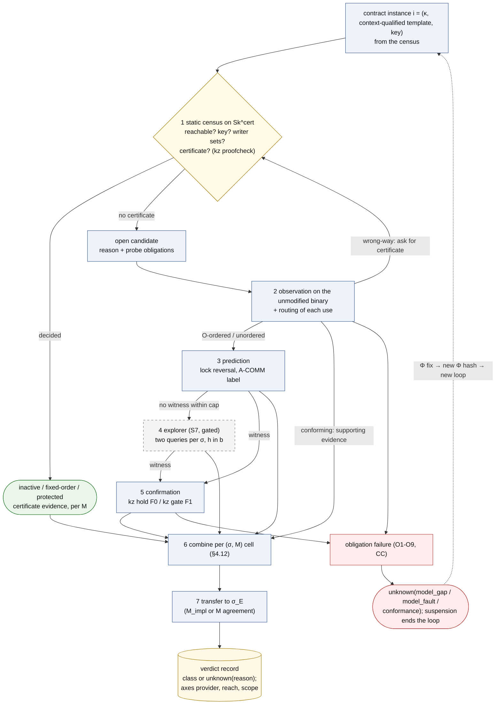
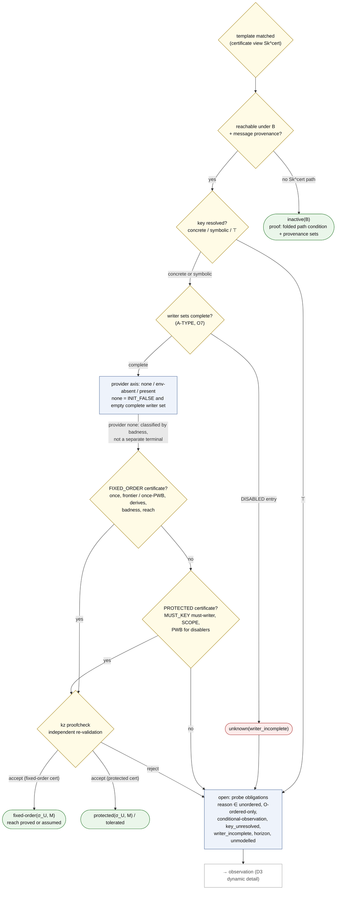
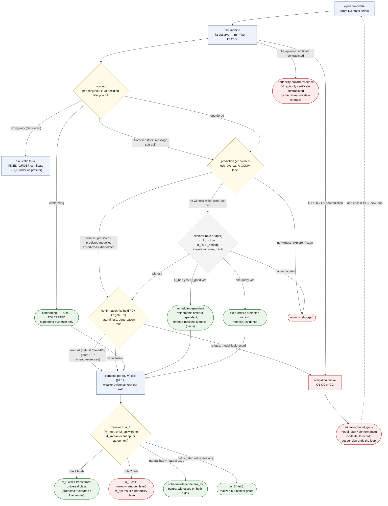
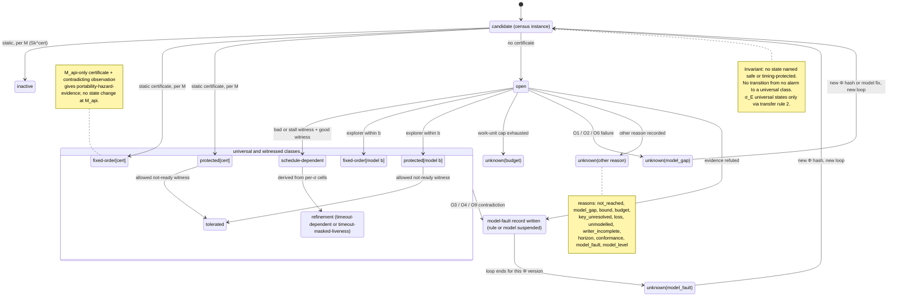
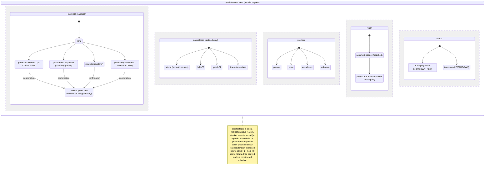
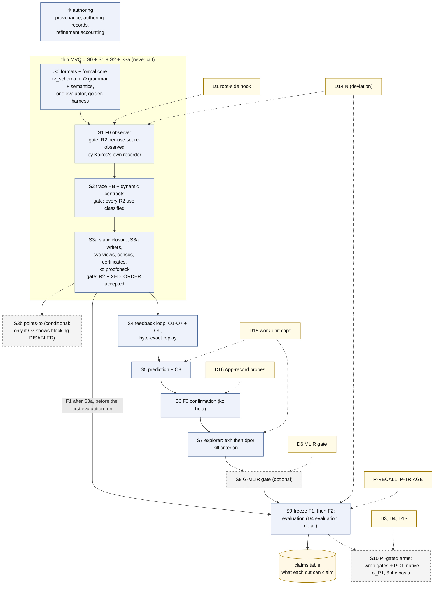
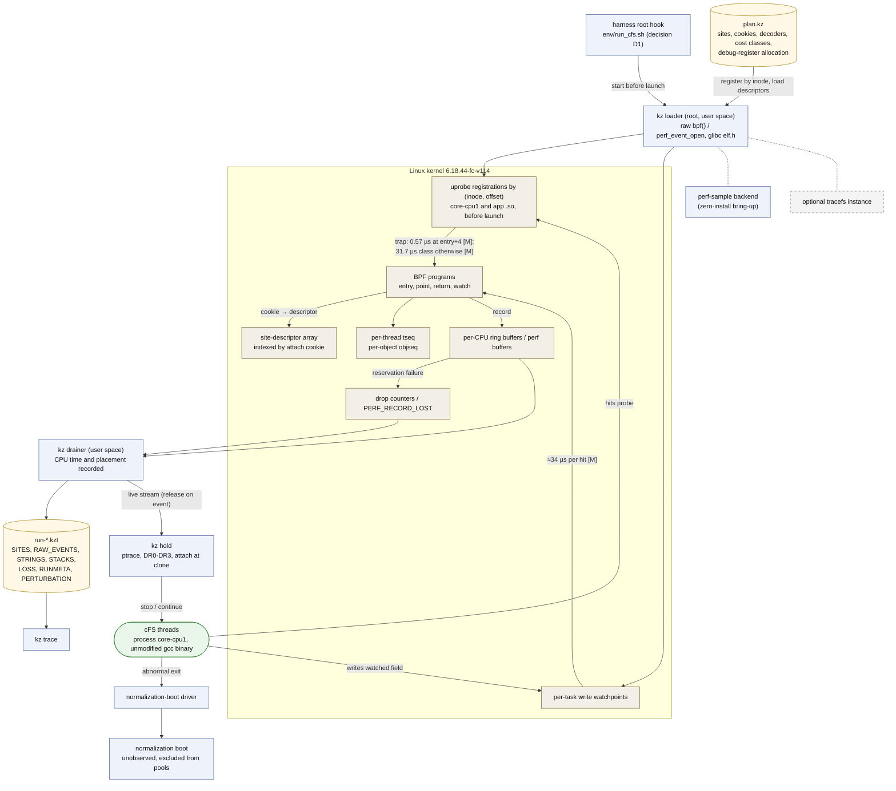

# 03 워크플로우: instance 분석, feedback loop, 판정 상태 기계, 연구 단계

이 문서는 Kairos가 계약 instance 하나를 어떤 순서로 판정하는지, feedback loop가 그 판정을 어떻게 고정점까지 끌고 가는지, 판정 기록이 어떤 상태를 지나는지, 그리고 도구를 만들고 동결하고 평가하는 연구 단계가 어떻게 이어지는지를 그림과 함께 설명한다.
spec을 읽지 않은 연구자가 "무엇이 어떤 순서로 일어나고, 어디서 멈추며, 무엇을 주장하지 않는가"를 15–25분 안에 파악하는 것이 목적이다. spec에 없는 설계 요소·수치·인용은 더하지 않는다.

상태: 설계 문서 — 구현·측정 전. 규범 원문: [spec/SPEC_FINAL.md](spec/SPEC_FINAL.md)

## 목차

0. [읽기 전에](#0-읽기-전에): 표기, 두 가지 워크플로우, 필요한 용어
1. [instance 하나의 분석 워크플로우](#1-instance-하나의-분석-워크플로우-spec-46413-그림-d3) (그림 D3): 정적 판정 → 관측 → routing → 예측 → 탐색 → 확인 → 결합 → σ_E 전이
2. [feedback loop: 반복, 종료, 재현성](#2-feedback-loop-반복-종료-재현성-spec-414) (spec §4.14)
3. [판정 상태 기계](#3-판정-상태-기계-그림-d6) (그림 D6): class 상태, 불변식, 병렬 축, unknown 이유
4. [연구 워크플로우](#4-연구-워크플로우-그림-d4) (그림 D4): 단계 S0–S10, Φ 작성과 반순환성, 평가 경로 요약(평가 계획의 상세는 [07_evaluation.md](07_evaluation.md))
5. [관측 파이프라인 개요](#5-관측-파이프라인-개요-그림-d7) (그림 D7)
6. [이 문서가 주장하지 않는 것](#6-이-문서가-주장하지-않는-것)
7. [관련 문서](#7-관련-문서)

---

## 0. 읽기 전에

### 0.1 표기

표기는 spec 머리말을 따른다(자세한 설명은 [01_overview.md §0](01_overview.md#0-읽는-법)).

| 표기 | 뜻 |
|---|---|
| [F] | 코드·기록·보고서 인용이 있는 사실 |
| [M] | 측정값. 이 문서의 [M]은 모두 spec이 인용한 **기존** 측정([R07], [BM], [R2g], [R2c])이다 |
| [I] | 추론 또는 설계상 추론. 실행하지 않았다 |
| [D] | 설계 결정. spec §11의 ADR이 기록한다 |
| [U] | 미확인 |

Kairos는 아직 한 번도 실행되지 않았다. 그래서 이 문서에서 cFS 예에 붙인 "기대 판정"은 모두 [I]다. spec 부록 A도 "nothing here was run"이라고 적는다(spec App. A).

인용 형식은 01과 같다. "(spec §4.4)"는 SPEC_FINAL.md의 절, "[R03 §4]"는 `background/`의 보고서, [LED]는 `cases/ledger.md`, [R2g]·[R2c]는 `results/`의 R2 기록, [BM]은 `env/BASELINE_MEASURE.md`, [POL]은 `CONDITIONS_POLICY.md`다. 코드 위치 `path:line`은 고정된 cFS tree(cFS `088b2fa8`) 기준이다.

**인용 형식과 이름이 겹치는 기호.** 인용 형식(설계안 [A]/[B]/[C], 심사 [J1]–[J3], 검토 [X1]–[X3], [X3, here], v0.1 등)은 [01_overview.md §0](01_overview.md#0-읽는-법)에 모아 두었다. 같은 기호가 여러 뜻으로 쓰이므로 이 문서는 앞에 종류를 붙인다: "PI 결정 D4"와 "그림 D4", "보장 G5"와 "gap G5", "단계 S0"와 "Init snapshot S0", HB stratum S/O와 cold/warm 층(stratum). 전체 목록은 [10_decisions_adr.md §0.2](10_decisions_adr.md#02-이름-충돌-주의)다.

### 0.2 두 가지 워크플로우

이 문서는 성격이 다른 두 흐름을 다룬다. 섞어 읽지 않도록 먼저 구분한다.

| | 분석 워크플로우 (§1–§3, §5) | 연구 워크플로우 (§4) |
|---|---|---|
| 묻는 것 | 고정된 basis B와 profile Φ 아래에서 instance 하나에 어떤 판정 기록을 주는가 | 도구를 어떤 순서로 만들고, 언제 동결하고, 무엇으로 평가하는가 |
| 단위 | instance × (σ, M) 칸 | 단계 S0–S10, freeze F1/F2 |
| 반복 | feedback loop(`kz loop`)가 고정점까지 돈다 | 단계마다 출구 조건(exit gate)이 있다 |
| 그림 | 그림 D3, D6, D7 | 그림 D4 개요(상세는 07) |
| spec | §1.8, §1.10, §4.6–4.14, §5 | §7.2, §7.5, §8, §9.3, §10.1 |

이 문서에서 "단계 1–7"은 instance 하나의 분석 단계(§1)를, "S0–S10"은 도구의 구현 단계(§4)를 가리킨다.

### 0.3 필요한 용어

이 문서를 읽는 데 필요한 만큼만 적는다. 전체 용어집은 [10_decisions_adr.md §3](10_decisions_adr.md#3-용어집)이다(원문 spec §13).

| 용어 | 쉬운 설명 | spec |
|---|---|---|
| instance | (계약 κ, 문맥까지 구분한 template t, key). 같은 SB 코드라도 ES의 TaskInit에서 inline된 것과 EVS의 TaskInit에서 inline된 것은 다른 template이다 | §1.6; App. A.1 step 1 |
| (σ, M) 칸 | σ는 스케줄 의미론이다. σ_U는 시간을 무시한 임의 interleaving, σ_U∞는 timeout이 없는 "참을성 있는" 의미, σ_R1[P_sched]는 한 CPU의 고정 우선순위, σ_E는 실제 환경이다. M은 OSAL을 API 계약 수준(M_api)과 POSIX 구현 수준(M_impl) 중 어디까지 모형화하는지다. instance마다 분석한 (σ, M) 조합별로 칸이 하나씩 있고, class는 칸마다 따로 정한다 | §0.1, §1.4, §1.8, §4.12 |
| class | `inactive`, `protected`(↳`tolerated`), `fixed-order`, `schedule-dependent`(↳`timeout-dependent`, `timeout-masked-liveness`), `unknown(reason)`. **"safe"라는 class는 없다** | §0.1, §1.10 |
| census | Φ의 모든 계약을 그것이 맞는 모든 문맥 위치에 instance로 펼치고, 각각에 class나 `unknown(reason)`을 주는 작업 | §4.6 |
| certificate | fixed-order나 protected 판정이 맞다는 것을 다른 프로그램(`kz proofcheck`)이 한 단계씩 다시 확인할 수 있게 적은 증명 기록 | §4.5 |
| `Sk^cert`, `Sk^h` | skeleton은 actor 하나의 control flow에서 판정에 필요한 사건만 남긴 요약이다. certificate view `Sk^cert`는 끝없는 loop를 "0회 이상 반복"(star-closure)으로 닫는다. exploration view `Sk^h`는 loop를 h번까지 펼치고 나머지에 `TRUNC`를 표시한다. 보편 판정과 `inactive`는 `Sk^cert`에서만 나온다 | §4.3; [04_formal_model.md](04_formal_model.md) (그림 D10) |
| linearization point (LP) | 연산의 효과가 "이 명령에서 한순간에 일어났다"고 보는 지점이다. Kairos는 요구 조건의 conjunct(∧로 묶인 조건 하나)마다 LP를 둔다. 호출자가 넘길 값을 미리 읽어 둔 load 지점은 **capture point**라 하고, 값 조건의 LP가 된다 | §1.4 |
| happens-before (HB), vector clock | HB는 한 실행 안에서 동기화(lock, message, thread 생성 등)로 정해지는 "먼저 일어남"의 부분 순서다. vector clock은 thread마다 카운터 벡터를 들고 다니며 이 순서를 계산하는 자료 구조다(Lamport 1978; Fidge 1988; Mattern 1989 [V-abs]) | §1.9 |
| stratum S / O | S(구조적) 순서는 두 끝이 모두 있는 모든 실행에서 성립한다. O(관측된 동기화) 순서는 관측한 실행에서만 성립하고, 예측에서 뒤집을 수 있다 | §1.9 |
| witness | 판정을 뒷받침하는 구체적 실행 하나(나쁜 실행, 좋은 실행, stall) | §1.10 |
| cone | 한 후보와 관련된 actor·위치·object를 닫은 집합. 예측과 탐색이 이 범위만 본다 | §4.9 항목 1, §4.10 항목 1 |
| work unit | 분석 예산을 세는 결정적 단위(확장한 상태 수, 탐색 노드 수 등). wall clock이 아니다 | §2.1 원칙 8 |
| deviation | 자원이 유한해서 사람이 고른 값(실행 횟수 N, work-unit 상한, 표본 크기). 이유·효과·필요성을 기록한다. reference(코드 상수나 고정 문서)에서 온 값은 `from-reference`, reference가 정하지 않았고 값도 고르지 않은 것은 `unspecified_by_reference`다 | spec 머리말; [POL] |

---

## 1. instance 하나의 분석 워크플로우 (spec §4.6–4.13, 그림 D3)

### 1.1 한 장으로 보기

계약 instance 하나는 최대 7단계를 지난다. 모든 instance가 모든 단계를 거치지는 않는다. 정적 단계에서 판정이 나면 곧바로 결합(단계 6)으로 간다. 관측에서 모든 조건이 성립하면 그 관측은 뒷받침 근거로만 결합에 들어간다. 단계 4(explorer)는 구현 단계 S7부터만, 그리고 kill criterion을 통과할 때만 쓰므로 점선 테두리로 그렸다.

**그림 D3 개요. 계약 instance 하나의 분석 순서** (렌더링: [diagrams/D3_analysis_overview.svg](diagrams/D3_analysis_overview.svg); spec §4.6, §4.8–4.13)



| 단계 | 구성요소 | 묻는 것 | 낼 수 있는 결과 | spec |
|---|---|---|---|---|
| 1 정적 census | `kz-static static`, `kz proofcheck` | 사용에 이르는 경로가 있는가, key가 정해지는가, certificate가 있는가 | `inactive`, `fixed-order[cert]`, `protected[cert]`, 또는 open(reason) | §4.5, §4.6 |
| 2 관측과 routing | `kz observe`, `kz trace`, `kz conform` | 수정하지 않은 바이너리에서 이 사용이 어떤 순서로, 어떤 결과로 일어났나 | conforming / wrong-way / O-ordered / unordered | §4.8, §4.11 |
| 3 예측 | `kz predict` | 관측한 trace를 바탕으로 반대 순서가 실행 가능한가 | witness(`predicted`, `predicted-modelled`, `predicted-extrapolated`) 또는 "상한 안에서 예측하지 못함" | §4.9 |
| 4 explorer | `kz explore` (S7, gated) | 닫힌 모형 안에서 나쁜 실행과 좋은 실행이 있는가 | 경계 b 안의 class(`model(b)`), `unknown(budget)` | §4.10 |
| 5 확인 | `kz hold` (F0), `kz gate` (F1, PI 결정 D3 뒤) | witness의 순서와 결과가 실제 gcc 바이너리에서 일어나는가 | `realized`(naturalness 표시), `refuted`, `inconclusive` | §4.13 |
| 6 칸별 결합 | verdict store | 모인 근거로 칸마다 어떤 class인가 | class 또는 `unknown(reason)`. 축마다 더 약한 근거를 남긴다 | §4.12 |
| 7 σ_E 전이 | verdict store | 그 class를 실제 환경 σ_E의 칸으로 옮길 수 있는가 | σ_E class, `σ_E(held)`, `unknown(model_level)` | §1.8, §4.12 |

**칸의 순서.** σ_U를 먼저, 그다음 σ_U∞를 계산하고, σ_R1[P_sched]는 요청이 있을 때만 계산한다. σ_E는 마지막이다(spec §4.12 항목 1). M_api는 항상 분석하고, M_impl은 cone에 M_impl-relevant 연산(두 수준에서 다르게 모형화되는 OSAL 연산: idmap 생성·조회·삭제·token 변환, task 생성·준비·삭제, binsem, queue 생성·put·get)이 있을 때 분석한다(spec §1.4, §4.6, §4.12 항목 7).

**흐름 전체에 걸린 두 규칙.**
- **관측은 보편 class를 만들지 않는다.** protected와 fixed-order에는 certificate(`Sk^cert` 위, b = ∞) 또는 경계 b 안의 전수 탐색이 필요하다. 관측은 뒷받침 근거일 뿐이다(spec §4.12 항목 2). 반복해서 실패한 실행으로 fixed-order를 내지 않고, trace 하나의 강건한 순서 사슬(`VC_R`)로도 내지 않는다(spec §6.4 항목 4–5).
- **obligation이 실패하면 빨간 경로로 빠진다.** 단계 2와 5에서 계층 간 검사가 어긋나면 그 판정은 `unknown(model_gap | model_fault | conformance)`가 되고, 경우에 따라 그 Φ version의 반복이 끝난다(§1.9).

### 1.2 단계 1: 정적 census (spec §4.5, §4.6)

census는 모든 판정의 출발점이다. Φ의 각 계약을 맞는 모든 문맥 위치에서 instance로 만들고, 아래 순서로 판단한다. 판단은 M마다 따로 한다(spec §4.6).

**그림 D3 상세 1. 정적 census 판단** (렌더링: [diagrams/D3_analysis_static.svg](diagrams/D3_analysis_static.svg); spec §12 D3; §4.2, §4.5, §4.6)



| 판단 | 내용 | 결과 |
|---|---|---|
| template 일치 | 계약의 사용 pattern U가 맞는 문맥 위치를 `Sk^cert`에서 찾는다 | instance |
| 도달 가능성 | B의 상수와 message provenance(어떤 handler가 어떤 입력 message로만 실행되는가)로 경로 조건을 접었을 때 `Sk^cert`에 경로가 없는가 | 없으면 `inactive(B)`. 증명은 접은 경로 조건과 쓴 provenance 집합이다(spec §4.5 INACTIVE) |
| key | 계약의 resource selector를 값 분석했을 때 key가 concrete, symbolic, ⊤(모름) 중 무엇인가 | ⊤면 open(`key_unresolved`)이고 probe plan으로 넘긴다. census는 kind별 key 비율을 보고한다(spec §4.6) |
| writer 집합 | conjunct마다 조건을 참으로 만드는 writer, 거짓으로 만드는 disabler, 각 항목의 transition 상태와 key 상태(`MUST_KEY`, `MAY_KEY`, `NO_KEY`) | 한 항목이라도 `DISABLED`면 `unknown(writer_incomplete)`로 open(obligation O7, spec §2.5, §4.2) |
| provider 축 | `none`(조건이 처음에 거짓이고 완전한 writer 집합이 비었다), `env-absent`, `present`, `unknown` | 별도 종착 상태가 아니다. provider `none`인 사용도 다른 사용처럼 badness 검사(Allowed)로 class를 정한다. 도달하는 실행이 모두 나쁘면 `fixed-order`, not-ready 결과가 허용되면 `tolerated`다(spec §1.10, §4.5 항목 3·5) |
| FIXED_ORDER certificate | 아래 설명 | 있으면 `fixed-order(σ_U, M)` |
| PROTECTED certificate | 아래 설명 | 있으면 `protected(σ_U, M)` |
| `kz proofcheck` | 모든 certificate를 저장 전에 독립 checker가 다시 확인한다 | 거부되면 open(CC) |
| 나머지 | — | open. 이유 ∈ {`unordered`, `O-ordered-only`, `conditional-observation`, `key_unresolved`, `writer_incomplete`, `horizon`, `unmodelled`}. probe obligation과 함께 plan으로 간다(spec §4.6, §4.7) |

**FIXED_ORDER certificate의 뼈대**(spec §4.5). 한 conjunct를 골라 다음을 모두 보인다.
1. 그 conjunct는 INIT(프로그램 시작 상태)에서 거짓이다.
2. writer 집합에 `DISABLED` 항목이 없다.
3. **frontier**: 사용하는 actor가 한 실행에 많아야 한 번 존재하고(once), 그 actor 안에서 사용으로 가는 경로가 없는 노드 m이 모든 writer의 MustBefore 집합에 있다. MustBefore(MB)는 "모든 실행에서 반드시 먼저 일어난다"는 정적 관계다(spec §4.4). 그러면 사용과 writer가 둘 다 일어나는 실행에서 사용이 항상 먼저다(PWB, precedes-whenever-both-occur).
4. **badness**: 사용의 모든 not-ready 결과가 계약의 Allowed(문서화된 허용 동작) 밖이다.
5. **reach**: 실제로 도달한 run이 있으면 `proved`, 없으면 `assumed`("도달한다면 fixed-order")다.

이 증명은 사용이 무엇을 지배(dominate)할 것을 요구하지 않으므로 early return 뒤의 사용도 덮는다(spec §4.5).

**PROTECTED certificate의 뼈대**(spec §4.5). 모든 conjunct에 대해 (a) INIT에서 참이고 모든 disabler가 제거되거나, (b) `MUST_KEY`인 must-writer x*가 사용의 LP의 MustBefore 집합에 있고, 남은 disabler는 모두 PWB로 x*보다 앞에 놓이거나 사용의 LP보다 뒤에 놓이거나, NO_KEY 또는 SCOPE로 제거된다. SCOPE는 종료 요청 뒤에만 올 수 있는 disabler를 "종료 전" 사용의 certificate에서 빼는 규칙이다.

**`kz proofcheck`**는 `static`과 코드를 공유하지 않고 LLVM도 링크하지 않는다. 추출 결과(`facts.kz`)만 믿고, view, dominance, spawn 목록, 코드에서 추출한 대기 조건, once 사실, `derives` 사슬, frontier, SCOPE, 상태 값을 스스로 다시 유도한다. certificate의 어느 단계라도 `Sk^h`나 `TRUNC` 노드를 가리키면 거부한다(spec §4.5, §2.2).

**cFS 예 (모두 [I]).**
- **R2**: ES·EVS init 안 SB 코드의 event 사용(계약 K-ID)은 ES 절반과 EVS 절반의 FIXED_ORDER certificate를 기대한다. 보고는 "generic 계약 K-ID + framework 규칙 R19(core serialization)"다(spec App. A.1 steps 9–10). 상세는 [05_cfs_mapping.md](05_cfs_mapping.md)(그림 D8).
- **C1, 기본 B**: CF의 조회는 비어 있지 않은 `sem_name` 검사 뒤에 있는데 기본 table의 두 항목이 모두 비어 있다 → `inactive(B)`(spec App. A.4 step 1).
- **timebase 조회**: TIME과 SCH_LAB의 `"cFS-Master"` 조회는 teardown 밖에서 protected다. 코드가 순서를 정한 곳에서 도구가 race를 지어내지 않는지 보는 calibration이다(spec App. A.7).
- **core task의 App-record 구간**: 사용과 발행(`cfe_es_start.c:818`)이 모두 ES lock 아래에 있어 어느 방향의 certificate도 없다 → open(spec App. A.2 step 2).

**두 가지 주의.** 관측되지 않았다는 이유로 `inactive`를 주지 않는다. 그것은 `unknown(not_reached)`다(spec §1.10). 실행되지 않는 latent instance도 "관측 안 됨"으로 끝나지 않고 모형 판정을 받는다(spec §4.6). 관측에서 새로 찾은 instance(outcome mining, key-pair enumeration)도 같은 census에 들어간다(spec §4.6, §7.1).

### 1.3 단계 2: 관측과 routing (spec §4.7, §4.8, §4.11)

open 후보는 관측으로 넘어간다. 아래 그림은 단계 2부터 7까지의 상세다.

**그림 D3 상세 2. open 후보에서 칸별 판정까지** (렌더링: [diagrams/D3_analysis_dynamic.svg](diagrams/D3_analysis_dynamic.svg); spec §12 D3; §1.8, §1.10, §4.8–4.13)



**probe plan.** `kz-static plan`은 모든 actor의 필수 동기화 skeleton(OSAL task·mutex·semaphore·queue·timer·module 연산, ES lock과 대기, SB 생성·구독·송신·수신, shutdown 저장)과 open 후보의 의무(conjunct별 LP 구간, capture 위치, 결과 코드, A-COMM 검사에 필요한 writer)를 덮는 probe를 고른다(spec §4.7). 필수 skeleton을 모두 남기는 이유는, 제3자 동기화를 잘라 내면 순서를 잘못 읽기 때문이다(spec §4.7; v0.1 §7.3).

**관측.** `kz observe`가 수정하지 않은 gcc 바이너리를 B 아래에서 실행하고 `run-*.kzt`를 쓴다. 파이프라인은 §5에서 다룬다.

**`kz trace`가 하는 일**(spec §4.8. 번호는 spec의 step 번호와 같다).
1. **decode와 loss.** thread별 순번(`tseq`)의 빈틈과 CPU별 drop counter로 기록 손실을 찾는다. 손실 구간에 기대는 판정은 `unknown(loss)`다. 손실을 "사건이 없었다"로 읽지 않는다(spec §5.6).
2. **identity 결합.** 실행 task, 소유 앱, 서비스, 찍힌 AppId를 오프라인에서 결합한다. 프로세스 안에서 아무것도 조회하지 않는다(spec §5.7).
3. **HB 계산.** `VC`는 모든 확정 edge로, `VC_R`은 `unconditional`·`obs-fatal` edge(구조적 S 순서)로만 계산한다. **looper rule**: 한 looper(message를 받아 handler로 나누어 실행하는 actor)의 두 handler 사이에는 HB edge를 두지 않는다(CAFA PLDI 2014 [V-abs]; DCatch ASPLOS 2017 [P]; spec §1.9).
4. **conjunct별 LP 구간.** 각 LP를 [그 actor의 직전 관측 사건, 직후 관측 사건] 구간으로 둔다. 두 LP의 구간이 HB로 순서 지어지면 HB-decided, Φ의 결과 대응표로만 정해지면 outcome-decided, 둘 다 아니면 ambiguous다.
5. **routing.** 아래 표.
6. **Allowed 평가.** 계약의 Allowed를 그 actor의 이어지는 실행에서 reference horizon 안에 평가한다. trace가 먼저 끝나면 `unknown(horizon)`이다.
7. **race coverage.** 어떤 짝을 뒤집으려면 ad hoc 동기화 짝을 먼저 뒤집어야 하면, 그 동기화 짝을 뿌리로 보고하고 종속 짝을 붙인다(EventRacer OOPSLA 2013 [V-abs]).
8. **위반 사슬.** frame 포함 관계와 Φ의 `emits` 표시로 사슬을 만든다. 예: R2의 `SEND_NO_SUBS` use 17개는 route가 없는 송신(K-ROUTE instance) 안에서 나온 event이므로 그 송신을 뿌리로 하는 사슬로 이어진다(K-ROUTE ⇝ K-ID; spec App. A.1 step 13).
9. **template 없는 출처.** outcome mining과 key-pair enumeration을 계산한다(spec §7.1 항목 2–3).
10. **obligation.** O3–O5, O9를 여기서 검사하고 O1/O2는 `kz conform`이 검사한다(spec §4.11).
11. **scope.** 관측된 종료 요청 LP 뒤의 발생은 K-TEARDOWN instance로 따로 센다(spec §3.5).

**routing 네 갈래**(spec §4.8 step 5). L⁻, L⁺, L∥는 사용 key에 대한 lifecycle LP 중 conjunct의 LP보다 앞선 것, 뒤인 것, 순서가 없는 것이다.

| 갈래 | 관측된 모습 | 다음 처리 | cFS 예 |
|---|---|---|---|
| conforming | L∥ = ∅이고 모든 conjunct가 성립한다: READY(허용된 경우 TOLERATED) | 뒷받침 근거로만 쓴다 | — |
| wrong-way | L∥ = ∅이고 어떤 conjunct가 실패했으며, 쓰인 순서 edge가 모두 S다(`VC_R` 순서) | `static`에 그 template의 FIXED_ORDER certificate를 요청한다. `VC_R` 순서는 값싼 사전 필터일 뿐이다 | R2 [I: 표를 R2에 적용한 것] |
| O-ordered | L∥ = ∅이지만 그 순서에 O edge(lock, message, semaphore, soft poll, reads-from)가 하나 이상 들어간다 | 예측: 반대 순서가 가능한가 | C1, C5, 두 App-record 구간(spec §4.8 표) |
| unordered | L∥ ≠ ∅ | 결과 코드로 정해진 순서의 반대를 예측한다 | — |

wrong-way가 관측에서 끝나지 않고 정적 단계로 되돌아가는 이유는, trace 하나에서 본 구조적 순서는 그 실행에 대한 사실일 뿐 모든 실행에 대한 주장이 아니기 때문이다(spec §1.9 항목 3: "never an Exec-level claim").

**결과 코드 일치(O4).** 프로그램 자신의 결과 코드(`ILLEGAL_APP_ID`, `NAME_NOT_FOUND`, `Q_FULL` 등)는 LP에서 계산한 상태와 맞아야 한다. 이 검사의 점검력은 HB-decided 사용에 대해서만 보고한다. outcome-decided 사용은 상태 자체를 검사 대상 코드에서 끌어냈으므로 점검으로 세지 않는다(spec §4.8 step 5).

### 1.4 단계 3: 예측 (spec §4.9)

**질문.** trace π와 routing된 후보(예: 발행자 p가 사용 u보다 lock으로 먼저 일어남)가 있을 때, u의 결정 conjunct LP가 p의 LP보다 먼저 오는 실행이 가능한가? 용량 계약이면 put이 넘치는 실행이 가능한가?

**모형 Pred(π)** (maximal causal models RV 2012; RVPredict PLDI 2014; GPredict ICSE 2015, 모두 [V-abs]).
- **cone**: actor별로 u와 p까지의 접두를 S edge와 제어에 관련된 reads-from으로 거꾸로 닫는다.
- **제약**: actor별 접두 순서(looper의 handler는 겹치지 않고, 같은 pipe의 message는 넣은 순서대로 꺼낸다), S edge, 제어에 관련된 사건은 관측된 결과 종류를 유지한다(성공한 조회는 앞선 발행이 필요하다; **acquire는 lock이 비어 있어야 한다**), Φ의 primitive 의미(상호 배제, binsem 포화, queue FIFO와 용량, MsgLim), 그리고 목표 순서. σ_R1의 우선순위 제약은 **넣지 않는다**.
- **lock 뒤집기를 허용한다.** critical section을 원자 블록으로, registry key를 충돌 대상으로 보고, 같은 lock의 두 critical section 순서를 제약이 허락하면 바꾼다. C1, C5, App-record 구간에 필요한 것이고, sync-preserving 예측이 금지하는 것이며, RVPredict/GPredict 방식의 처리다([R04 §2.5, L259, L492]).

**A-COMM 검사와 label.** Kairos의 trace는 동기화 skeleton과 LP 구간, 계약 위치의 결과만 담고 모든 공유 접근을 담지는 않는다. 그래서 witness에 `predicted`를 붙이기 전에, cone 안 actor가 관측 사건 사이에 읽을 수 있고 다른 cone actor가 쓸 수 있는 위치가 모두 (a) writer LP가 전부 관측된 Φ support location이거나, (b) cone 위에서 상수이거나, (c) witness가 유지하는 관측 결과로만 읽히는지 확인한다(spec §4.9 항목 4).

| label | 뜻 | 근거의 강도 |
|---|---|---|
| `predicted` | Pred(π) 안에 있고 A-COMM을 통과했다. 가정 A4(x86-64 TSO, `-O0`에서 사건 단위 순차 일관성)와 A7(manifest에서는 A7-impl·A7-api: OSAL과 그 아래 primitive의 Φ 의미가 실제 backend를 과대근사하거나 LP에서 linearizable하다는 가정; [04 §12.2](04_formal_model.md#122-가정-a-soundiness-manifest)), Φ primitive 의미에 상대적으로 trace-sound다. trace-sound는 "π를 낼 수 있고 cone 안의 관측하지 않은 공유 읽기가 A-COMM으로 덮이는 모든 프로그램에서 그 witness가 실행 가능하다"는 뜻이다(spec §6.2 L-PRED, §6.3 보장 G4) | 모형 근거보다 강하고 `realized`보다 약하다 |
| `predicted-modelled` | A-COMM이 실패했다. 실패한 위치를 나열하고, 다음 반복의 plan이 그 위치에 probe를 더한다 | 모형 근거 |
| `predicted-extrapolated` | 한 번 관측한 retry·poll을 유효 reference 경계까지 늘린 witness다. loop 요약이 O2를 통과한 곳에서만 쓴다 | 모형 근거 |

**탐색과 예산.** cone의 linearization을 깊이 우선으로 탐색한다. sleep set(이미 탐색한 분기와 독립인 전이를 다시 시도하지 않도록 표시해 두는 집합)으로 중복을 줄이고, 상태를 기억하며, 첫 witness에서 멈춘다. 예산은 결정적 work-unit 상한이고 deviation이다. 결과는 anytime curve(work unit에 따른 결정된 비율)로 보고한다(spec §4.9 항목 5, 8). 일반적으로 동기화 하나를 뒤집는 예측도 NP-complete다(SyncP [V-abs]; spec §4.9 Complexity).

**prefilter.** SHB, WCP, SyncP(모두 [V-abs])를 적용 범위가 맞는 곳에서 먼저 돌린다. 이들이 제안한 뒤집기는 위 제약으로 다시 검증하고(Vindicator의 후보·검증 분리, PLDI 2018 [V-abs]), **이들의 침묵은 아무 뜻도 없다**(spec §4.9 항목 6).

**결과.** witness 하나와 그 label, 또는 "π에서 상한 안에 예측하지 못함"이다. **둘 다 protected 판정이 아니다**(spec §4.9 항목 9; §6.3 보장 G4). SMT 교차 검사는 PI 결정 P-Z3 뒤의 선택 사항이고 주 경로에 없다(spec §4.9 항목 10).

**cFS 예 [I].** core task의 App-record 구간에서는 기본 boot trace에서 startup thread의 `cfe_es_start.c:816–818` critical section과 자식 task의 `GetAppID` critical section을 뒤집는다. task record가 먼저 채워졌으므로 자식의 poll은 성공 결과를 유지한다. witness가 나오면 `schedule-dependent(σ_U, M_api와 M_impl)`이고, A-COMM이 `predicted`와 `predicted-modelled`를 가른다(spec App. A.2 step 3).

### 1.5 단계 4: bounded explorer (spec §4.10; S7, gated)

explorer는 후보마다 닫힌 모형을 만들고 실행을 체계적으로 나열한다. 구현 단계 S7부터 쓰는 늦은 구성요소이고, kill criterion을 통과해야 쓴다.

**닫힌 모형.** cone(사용, writer, disabler, support object를 가진 actor와, cone 위치를 쓰거나 cone object로 동기화하는 actor, 그들에 이르는 spawn 사슬을 고정점까지 닫은 것), B의 상수, M 수준의 Φ 의미, σ에 따른 대기 의미, 유효 경계까지 펼친 retry, B.Input의 입력, exploration view `Sk^h`(h는 경계 b에 기록)로 이루어진다. σ_R1에서는 cone의 최소 우선순위 이상인 actor를 모두 넣는다(spec §4.10 항목 1).

**지역 선택.** 대기의 timeout 전이는 σ_U에서 항상 가능하고 σ_U∞에서는 불가능하다. 지연을 둔 retry의 마지막 실패는 σ_U∞에서 정지 상태(quiescence: 다른 전이가 하나도 가능하지 않은 상태)에서만 가능하다(spec §4.10 항목 2, §1.8).

**두 engine** [D](spec §4.10 항목 4). DPOR(dynamic partial-order reduction)은 의존하는(dependent) transition이 뒤바뀔 수 있는 곳에만 backtracking 지점(다른 순서를 시도하려고 되돌아갈 지점)을 두어, 독립 연산의 순서만 다른 interleaving의 탐색을 줄이는 체계적 탐색 기법이다([R05 §2.2]; DPOR POPL 2005 [V-abs; 보장 문구 UNVERIFIED]). Kairos의 source-DPOR은 class(독립 연산의 순서만 다른 실행들의 동치류)당 실행 하나를 주장하지 않는다(spec §6.4 항목 9).

| engine | 방식 | 정확성의 근거 |
|---|---|---|
| `exh` | 방문 상태 집합을 쓰는 상태 기반 전수 탐색. partial-order reduction 없음 | 유한 그래프의 도달 가능성. 경계 b 안의 모든 도달 상태를 방문한다 |
| `dpor` | source-DPOR + sleep set(Abdulla et al., POPL 2014 [V-abs]) | disabling이 있는 시스템에 대한 JACM 2017 정리가 필요하고 그 세부는 status P다([R05 §2.2]). P-PAPERS로 확인하기 전까지 `dpor` 결과의 보장 G5는 **unverified**로 표시한다. `exh`와의 차등 시험은 검증 증거일 뿐 증명이 아니다 |

Kairos는 "Mazurkiewicz 동치류마다 실행 하나"를 주장하지 않는다(spec §6.4 항목 9).

**두 질의**(spec §4.10 항목 7). `Q_bad`는 "u에 도달하고 나쁜(또는 u 전에 stall하는) 실행이 있는가", `Q_good`는 "u에 도달하고 좋은 실행이 있는가"다.

| (`Q_bad`, `Q_good`) | 결과 |
|---|---|
| (yes, no) | 경계 b 안에서 `fixed-order` |
| (no, yes) | 경계 b 안에서 `protected` |
| (yes, yes) | `schedule-dependent` |
| (no, no) | 모형에서 u에 도달하지 않는다. 정적 판정과 비교하고, 어긋나면 O6 |
| 상한 소진 | `unknown(budget)` |

두 질의를 σ_U와 σ_U∞에서, 요청이 있으면 σ_R1[P_sched]에서도 돌린다. **σ마다 class를 따로 계산**하고, refinement는 그 뒤 σ별 결과에서 유도해 자기 경계와 함께 저장한다.

**경계.** h는 고르지 않는다. 상한 안에서 끝낸 h마다 결과를 보고한다. work-unit 상한은 deviation이다(PI 결정 D15). 기본으로 선점 경계는 두지 않고, 쓴다면 BPOR(DPOR에 preemption bound를 붙일 때 생기는 unsoundness를 고친 기법, OOPSLA 2013 [V-abs])로 0부터 올린다(spec §4.10 항목 6).

**kill criterion.** S7 검토에서 certificate가 없는 개발 cone(두 App-record 구간, C1 파생 조회, K-PHASE(phase barrier·준비 선언 계약, [05 §2.6](05_cfs_mapping.md#26-es-phase-soft-barrier-core-직렬화-spec-36)) CF instance, `SBNSubPipe` K-CAP instance)에 PI가 정한 상한까지 explorer를 돌린다. 하나도 결정하지 못하거나 작은 모형에서 `dpor`와 `exh`가 어긋나면 explorer를 동결하고, 그 출력은 ablation으로만 보고한다(spec §4.10 항목 9).

**충실도.** explorer 판정의 realization은 `model(b)`이다. O1, O2, O6, O8에 기대며 `realized`라 부르지 않는다(spec §4.10 항목 10).

**cFS 예: C1 파생 구성 B′, M_api [I]**(spec App. A.4 step 3).
- σ_U: retry loop를 유효 `CF_STARTUP_SEM_MAX_RETRIES`까지 정확히 펼친다. 지연은 양보이므로 모든 시도가 생성보다 앞서는 실행이 있다 → `schedule-dependent(σ_U)`.
- σ_U∞: 지연을 둔 retry는 참을성이 있어 provider가 아직 실행될 수 있는 동안에는 소진되지 않는다. 좋은 실행만 남고, σ_U의 나쁜 실행은 모두 경계 뒤의 소진을 거친다 → refinement `timeout-dependent`.
- 한 번만 시도하던 수정 전 코드라면 σ_U∞에서도 `schedule-dependent`로 남는다. C1의 수정은 순서 논리의 위반을 timing 여유에 대한 의존으로 바꾸었다.

### 1.6 단계 5: 확인 (spec §4.13)

확인은 witness가 말하는 순서와 결과를 실제 gcc 바이너리에서 일으켜 보는 단계다. 기본 수단은 F0 `kz hold`다. ptrace로 한 thread만 멈추고, 실행 breakpoint를 debug register(x86의 DR0–DR3)에 걸어 코드 text를 고치지 않는다. F1 `kz gate`(`--wrap` gate와 PCT)는 PI 결정 D3 뒤에만 쓴다(spec §4.13).

이 분석 흐름에서 알아 둘 것은 셋이다.

- **무엇을 확인하나.** schedule-dependent와 timeout-dependent는 나쁜 witness를 directed로 확인하고, fixed-order(certificate)는 도달과 결과를 수동으로 관측만 한다([06 §12.1](06_observation_confirmation.md#121-어떤-판정을-확인하나)).
- **결과 label.** `realized`(naturalness `held-F0`, `gated-F1`, `timeout-exercised`; 구성한 스케줄이면 flag `derived`), `refuted`(순서는 일어났는데 결과가 좋음 → model-fault 기록), `inconclusive`다([06 §12.7](06_observation_confirmation.md#127-label)).
- **σ_E와의 관계.** hold나 gate로 얻은 witness는 σ_E class를 만들지 않는다(`σ_E(held)`). 실현된 witness마다 perturbation 비율을 문턱값 없이 붙인다([06 §12.8](06_observation_confirmation.md#128-perturbation-기록과-비율); spec §4.12 항목 8).

gate 위치 규칙 네 가지, 사건 기반 해제와 watchdog, wait-for oracle, normalization boot, 그리고 cFS 예(core task App-record 구간 확인, PI 결정 D16)는 [06_observation_confirmation.md §12](06_observation_confirmation.md#12-확인-실행-spec-413)에 있다.

### 1.7 단계 6: 칸별 결합 (spec §4.12)

| 규칙 | 내용 |
|---|---|
| 1 칸 | instance마다 분석한 (σ, M)마다 칸 하나. class는 칸마다 계산하고, refinement는 칸들에서 유도해 경계와 함께 저장한다 |
| 2 보편 class | `protected`, `fixed-order`는 certificate(b = ∞, `Sk^cert`) 또는 경계 b 안의 전수 탐색(`exh`, 또는 unverified로 표시한 `dpor`)이 필요하다. 관측은 뒷받침 근거일 뿐이다 |
| 3 schedule-dependent | 같은 칸에 나쁜(또는 stall) witness와 좋은 witness가 필요하다. 기록은 realization과 naturalness 축마다 **더 약한 쪽**을 남긴다 |
| 4 σ_E 칸 | §1.8 |
| 5 모순 | O3/O4/O9가 발동하면 규칙을 정지하고, model-fault 기록을 쓰고, 관련 판정을 `unknown(model_fault)`로 내리고, 이 Φ version의 반복을 끝낸다. M_api에서만 성립하는 certificate를 바이너리가 반박하면 `portability-hazard-evidence`다 |
| 6 harm | Allowed와 관측·모형 연속에서 나온다. Allowed가 `unspecified_by_reference`면 harm도 그렇고, route·용량 판정에는 LOSS-UNDER-ORDER를 붙인다 |
| 7 M 수준 | M_api는 항상, M_impl은 cone이 M_impl-relevant일 때. 두 수준이 다르면 `portability-hazard`나 `implementation-defect-candidate` |
| 8 perturbation | 실현된 witness마다 perturbation 비율을 붙이고 문턱값은 두지 않는다 |

### 1.8 단계 7: σ_E로 옮기기 (spec §1.8 전이 규칙, §4.12 항목 4)

σ_E는 실제 바이너리의 실행이다. Kairos는 σ_E를 모형화하지 않고 표본만 얻는다. 그래서 σ_E 칸은 두 길로만 채운다.

| 길 | 조건 | σ_E 칸 |
|---|---|---|
| 전이 규칙 2 | M_impl에서 증명했거나, M_api에서 증명했는데 (i) cone과 certificate에 M_impl-relevant 연산이 없거나 (ii) M_impl 결과가 있고 같다 | 옮겨 온 보편 class(protected / tolerated / fixed-order) |
| 규칙 2 실패 | 위 조건이 성립하지 않는다 | `unknown(model_level)`. M_api 결과는 이식성(portability) 주장으로 보고한다 |
| 자연 witness 양쪽 | hold·gate 없이 실현된 나쁜(또는 stall) witness와 좋은 witness가 각각 pool key와 함께 있다 | `schedule-dependent(σ_E)` |
| hold·gate witness만 | 실현됐지만 naturalness가 held 또는 gated다 | `σ_E(held)` |

σ_E의 protected나 fixed-order는 실행 횟수에서 **절대** 유도하지 않는다. 나쁜 실행을 보지 못했을 때의 기록 문구는 정확히 "no σ_E bad witness in n of N runs (pool key); σ_E class unknown"이다. "timing-protected"라고 쓰지 않는다(spec §1.10; §6.4 항목 3). 빈도는 같은 pool key(B hash, plan hash, stratum)끼리만 합치고 `σ_E(plan P)`로 표시한다(spec §4.12 항목 4).

**cFS 예 [I].**
- R2: σ_E 칸은 M_impl에서 전이 규칙 2로 "도달하는 곳에서" 옮겨 온다. S1이 실제 발생을 다시 관측하면 `reach = proved`가 된다(spec App. A.1 step 9).
- C1 파생 B′: cone이 M_impl-relevant이고 두 수준이 어긋나므로 M_api 결과를 σ_E로 옮기지 않는다(spec App. A.4 step 4).
- core task App-record 구간: 자연 실행에서 나쁜 witness를 기대하지 않는다. 기록은 "no σ_E bad witness in n of N runs (pool key); σ_E class unknown"이다(spec App. A.2 step 6).

### 1.9 obligation이 실패할 때 (spec §2.5, §4.12 항목 5)

계층 간 일관성 의무 O1–O9와 certificate 검사 CC는 [02_architecture.md §9](02_architecture.md#9-계층-간-일관성-의무-o1-o9와-cc)가 자세히 다룬다. 워크플로우에서는 결과가 세 갈래로 나뉜다는 것만 기억하면 된다.

| 결과 | 의무 | 워크플로우에서 일어나는 일 |
|---|---|---|
| 그 부분만 unknown | O1, O2, O6 → `unknown(model_gap)`; O7 → `unknown(writer_incomplete)`; O8 → `unknown(conformance)`; CC → 거부, open | 관련 instance만 내려가고 반복은 계속된다. O1/O2는 feedback F2로 모형을 넓힌다 |
| 정지와 반복 종료 | O3, O4(a), M_impl의 O4(b), O9 | 규칙을 정지하고 model-fault 기록을 쓰고 `unknown(model_fault)`. **그 Φ version의 반복이 끝난다.** 사람이 Φ를 고쳐 새 Φ hash로 새 반복을 시작한다 |
| 이식성 증거 | M_api에서만 성립하는 certificate의 O4(b) | `portability-hazard-evidence` 기록. 정지하지 않는다 |

예: OSAL RESERVED 구간에서 이름 조회가 `OS_ERR_INCORRECT_OBJ_STATE`를 받는 것은 M_impl에만 있는 동작이다. 이것이 M_api에서만 성립하는 certificate를 반박하면 model fault가 아니라 `portability-hazard-evidence`다(spec §1.4; App. A.8 L-MIMPL).

### 1.10 cFS 예가 워크플로우를 지나는 길 (모두 [I], 실행 전)

| instance | 1 정적 | 2 routing | 3–5 | 기대 기록 | 출처 |
|---|---|---|---|---|---|
| R2: ES·EVS init의 SB event 사용(K-ID) | FIXED_ORDER certificate(M_api, M_impl) | wrong-way [I] | 확인은 수동 관측(도달과 결과)만 | `fixed-order(σ_U)` 두 M 모두; σ_U∞·σ_R1은 규칙 1, σ_E는 M_impl에서 규칙 2; shape WRONG-WAY 또는 ABSENT; 17개는 K-ROUTE로 사슬 | spec App. A.1 |
| core task App-record 구간(K-SELF.es) | certificate 없음 → open | O-ordered(ES lock) | lock 뒤집기 예측; PI 결정 D16 hold(derived) | `schedule-dependent(σ_U, σ_U∞)` 두 M 모두; σ_R1[`P_sched^posix`]에서는 한 CPU에서 구간이 열리지 않는다 [I]; σ_E unknown | spec App. A.2 |
| C1 | 기본 B: `inactive(B)`. 파생 B′: open | B′: O-ordered(countsem table lock을 거친 reads-from) | explorer σ_U 대 σ_U∞; M_impl deadlock 검사; 선언한 실험의 hold | B′ M_api: σ_U `schedule-dependent`, σ_U∞ `timeout-dependent`. M_impl: implementation-defect candidate(OSAL F1). σ_E로 옮기지 않음 | spec App. A.4 |
| SB 구독 전 송신: SCH_LAB wakeup 대 늦은 구독자(K-ROUTE) | — | — | 예측; 구독자 hold | `schedule-dependent(σ_U)`, LOSS-UNDER-ORDER; 지금까지 "no σ_E bad witness in n of N runs" | spec §7.3 |
| 시작 폭주 `SBNSubPipe`(K-MODE + K-CAP + K-CAP.msglim) | backlog 경계가 용량 10을 넘어 protected certificate 없음 → open | — | 통제하지 않은 실행이 σ_E witness를 준다 | 두 결과가 자연 실행에서 다시 관측되면 `schedule-dependent(σ_E)`, LOSS-UNDER-ORDER, harm `unspecified_by_reference` | spec App. A.5 |

---

## 2. feedback loop: 반복, 종료, 재현성 (spec §4.14)

### 2.1 반복 한 번에 일어나는 일

`kz loop`는 §1의 단계들을 묶어 고정점까지 반복한다. 아래는 spec 원문의 의사 코드다.

```
fix (B, Φ, tool);  K0 := static closure of B;  census0 := kz-static static(K0)
i := 0
repeat
   plan_i   := kz-static plan(open instances of census_i ∪ mandatory sync skeleton ∪ A-COMM probes)
   runs_i   := kz observe(B, plan_i) × n_i      # n_i: deviation (PI-set, D14); run IDs; normalization boots
   check O1–O5, O9 (+ O8 on the sample, from S5); a suspension ENDS the loop for this Φ version
   K_{i+1}  := K_i ⊔ keys, targets and paths learned from runs_i                  # F1, F2
   census_{i+1} := kz-static static(K_{i+1}) ⊔ kz trace(runs_i)
                   [⊔ kz predict(runs_i)          from S5]
                   [⊔ kz explore(K_{i+1})          from S7, if not frozen]
   [for each witness w: π_w := kz hold/gate(B, holdplan(w)); census_{i+1} ⊔= kz trace(π_w)   from S6]  # F3
   write loop-i.kz: run IDs, B/plan/Φ/tool hashes, S0 hashes, deltas, obligation results, work units
   i := i + 1
until state(census_i) = state(census_{i-1}) and K_i = K_{i-1}
report the fixed point together with its run set ∪_i runs_i
```

우리말로 풀면 다음과 같다. ⊔(join)은 두 근거를 합쳐 둘 다보다 크거나 같은 쪽으로 올리는 연산이다.
1. B, Φ, 도구를 고정하고, B의 정적 closure K0에서 첫 census를 만든다.
2. open instance, 필수 동기화 skeleton, A-COMM probe를 덮는 plan을 만든다.
3. 그 plan으로 n_i번 관측한다. n_i는 PI가 정하는 deviation이다(PI 결정 D14). 비정상 종료 뒤에는 normalization boot를 한다.
4. obligation을 검사한다. 정지가 하나라도 생기면 이 Φ version의 반복은 여기서 끝난다.
5. 관측에서 배운 key, 간접 호출 대상, 경로를 closure에 더한다(feedback F1, F2).
6. 커진 closure로 정적 분석을 다시 하고, trace 분석(S5부터 예측, S7부터 explorer)의 결과를 합친다.
7. S6부터는 witness마다 hold plan을 실행하고 그 trace를 다시 분석한다(feedback F3).
8. 반복마다 `loop-i.kz`에 run ID, hash, 변화량, obligation 결과, work unit을 기록한다.
9. census 상태와 closure가 바뀌지 않으면 멈추고, 고정점을 **그 run 집합과 함께** 보고한다.

### 2.2 feedback 네 가지

| feedback | 무엇이 어디로 돌아가나 | 계기 |
|---|---|---|
| F1 | 관측에서 배운 key, 대상, 실제로 열린 startup script → `basis`/`skel` | O5 실패(closure 불완전) |
| F2 | 모형 빈틈 → `skel` | O1/O2 실패 |
| F3 | 확인 실행의 trace → `kz trace` | 단계 5 |
| F4 | obligation 실패를 Φ, 추출기, 모형에 대한 발견으로 보고 → 사람의 Φ 검토 | 정지(O3, O4, O9) |

상세는 [02_architecture.md §8.4](02_architecture.md#84-feedback-f1f4)와 spec §2.4.

### 2.3 단계적으로 합류하는 구성요소

반복은 처음부터 모든 구성요소를 쓰지 않는다(spec §4.14 Staged availability).

| 구현 단계 | 반복에 들어가는 것 | obligation |
|---|---|---|
| S4 | `static`, `trace` | O1–O7, O9 |
| S5 | + `predict` | + O8(미리 등록한 표본) |
| S6 | + `hold` | — |
| S7 | + `explore` (kill criterion을 통과할 때만) | + O6(예측 witness와 explorer 결과가 둘 다 있을 때) |

### 2.4 고정점 검사: 비교하는 것과 비교하지 않는 것

| 비교한다 (`state(census)`) | 비교하지 않는다 |
|---|---|
| instance마다 (σ, M)별 class와 refinement | 횟수 `n of N` |
| provider와 reach 축 | pool key |
| realization·naturalness 값의 **집합** | run ID |
| key 해석 | plan hash |
| closure K | (위 넷은 반복마다 바뀐다) |

횟수를 빼는 이유는, 실행을 더 할 때마다 바뀌는 값을 비교하면 고정점에 결코 이르지 못하기 때문이다(spec §4.14).

### 2.5 lattice와 종료 [I]

lattice는 "더 많이 안다"의 순서를 정한 구조다. Kairos의 칸은 아래 순서로만 움직인다(spec §4.14 Lattice).
- `unknown(·)`은 모든 class 아래에 있다. `inactive`, `protected`, `fixed-order`, `schedule-dependent`는 서로 비교할 수 없다. 그래서 한 칸은 **많아야 한 번**, unknown에서 class로 움직인다.
- 보편 class를 나중에 witness가 반박하면, 그것은 lattice의 한 걸음이 아니라 모순이다. O3/O4가 처리하고 정지로 이어진다.
- refinement, provider, reach는 "미설정 → 설정"으로만 움직인다(`reach`: `assumed < proved`). 근거 집합은 포함 관계로, key는 `⊤ < symbolic < concrete`로, closure K는 포함 관계로 커진다.
- 같은 Φ version 안에서 정지가 없는 반복은 올라가거나 그대로다.

**종료 논증** [I]. B와 Φ가 고정되면 위치, key(코드 상수와 유한 table에서 나온다), instance, 근거 값의 우주가 유한하다. 마지막이 아닌 반복은 lattice를 엄밀히 오르거나 멈춘다. 따라서 반복은 끝난다(spec §4.14; §6.3 보장 G8). 이것은 설계 논증이고 아직 시험하지 않았다.

**정지는 단조가 아니다.** 규칙을 정지하면 판정이 내려가므로 lattice 논증이 깨진다. 그래서 정지가 생기면 그 Φ version의 반복을 끝내고, 사람이 Φ를 고쳐 새 Φ hash로 새 반복을 시작한다(spec §4.14).

### 2.6 재현성

- 모든 분석은 저장된 산출물의 순수 함수다. 반복 순서를 정렬하고, 탐색 순서를 결정적으로 정하고, 예산을 work unit으로 세며, wall clock에 기대지 않는다. 그래서 저장된 trace에서 다시 돌리면 verdict store가 **byte 단위로 같아야** 한다. 이것 자체가 시험이다(spec §4.14 Reproducibility; §9.3 S4 출구 조건).
- wall-clock 상한으로 낸 결과가 있다면(PI 결정 D15가 허용할 때만) 표시하고 replay 시험에서 뺀다.
- σ_E 빈도는 같은 pool key끼리만 합친다.

**고정점의 뜻.** 고정점은 "이 B, Φ, 도구, run 집합으로는 더 배울 것이 없다"는 뜻이다. 모든 칸이 결정됐다는 뜻이 아니다. 고정점에서도 `unknown(reason)` 칸이 남을 수 있고, 이유와 함께 그대로 보고한다(spec §4.6: 모든 census instance는 class 또는 `unknown(reason)`을 받는다).

---

## 3. 판정 상태 기계 (그림 D6)

### 3.1 class 상태 기계

(σ, M) 칸 하나가 지날 수 있는 상태다. 모든 칸은 census의 candidate에서 출발한다.

**그림 D6 개요. 칸 하나의 판정 상태 기계** (렌더링: [diagrams/D6_verdict_overview.svg](diagrams/D6_verdict_overview.svg); spec §12 D6; §1.10, §4.12, §4.14)



| 전이 | 계기 | 워크플로우 단계 |
|---|---|---|
| candidate → `inactive` / `fixed-order[cert]` / `protected[cert]` | 정적 certificate 또는 경로 없음, M마다 | 1 |
| candidate → open | certificate 없음 | 1 |
| open → `schedule-dependent` | 나쁜(또는 stall) witness와 좋은 witness | 3–5 |
| open → `fixed-order[model b]` / `protected[model b]` | 경계 b 안의 explorer 결과 | 4 |
| `schedule-dependent` → refinement | σ별 칸에서 유도(`timeout-dependent`, `timeout-masked-liveness`) | 6 |
| `protected` → `tolerated` | 허용된 not-ready 발생의 witness | 2–5 |
| open → `unknown(budget)` | work-unit 상한 소진 | 3–4 |
| open → `unknown(model_gap)` | O1 / O2 / O6 실패 | 2, 4 |
| open → model-fault 기록 | 근거가 반박됨(`refuted`) | 5 |
| class → model-fault 기록 → `unknown(model_fault)` | O3 / O4 / O9 모순. 이 Φ version의 반복이 끝난다 | 2, 5 |
| `unknown(model_fault)` / `unknown(model_gap)` → candidate | 새 Φ hash(또는 모형 수정)로 새 반복 | — |
| (상태 변화 없음) | M_api 전용 certificate + 반박하는 관측 → `portability-hazard-evidence` | 2 |

`[cert]`와 `[model b]`는 같은 class의 다른 근거다. 앞은 `Sk^cert` 위 certificate(b = ∞), 뒤는 경계 b 안의 explorer 결과다(spec §4.12 항목 2).

**불변식**(spec §12 D6).
1. **"safe"나 "timing-protected"라는 상태는 없다.** 판정 기록에도 safe 필드가 없다(spec §1.10).
2. **"경보 없음"에서 보편 class로 가는 전이는 없다.** protected와 fixed-order로 들어가는 화살표는 certificate와 explorer에서만 나온다. 예측이 반대 순서를 찾지 못한 것, prefilter의 침묵, 경계 밖, obligation이 실패한 모형은 어느 것도 protected의 근거가 아니다(spec §6.4 항목 2).
3. **σ_E의 보편 상태는 전이 규칙 2로만 들어간다.** 자연 실행 n번에서 나쁜 실행이 없었다는 사실로는 들어가지 않는다(spec §1.10, §6.4 항목 3).

lattice(§2.5)와 맞춰 읽으면, 한 칸은 같은 Φ version 안에서 unknown에서 class로 많아야 한 번 움직인다. 정지가 없는 반복은 칸을 올리거나 그대로 두고, 보편 class가 반박되는 경우는 모순으로 처리되어 그 Φ version의 반복을 끝낸다(spec §4.14).

### 3.2 병렬 축

판정 기록에는 class와 별도로 다섯 축이 있다. 각 축은 class 상태 기계와 독립적으로 움직인다.

**그림 D6 상세. 판정 기록의 병렬 축** (렌더링: [diagrams/D6_verdict_axes.svg](diagrams/D6_verdict_axes.svg); spec §12 D6; §1.10, §4.13)



| 축 | 값 | 어디서 정해지나 |
|---|---|---|
| realization | `certificate(id)`, `model(b)`, `predicted`, `predicted-modelled`, `predicted-extrapolated`, `realized` | 단계 1(`certificate`), 3(`predicted` 계열), 4(`model(b)`), 5와 자연 관측(`realized`) |
| naturalness(`realized`만) | `natural`, `held-F0`, `gated-F1`, `timeout-exercised`; flag `derived` | 단계 5와 자연 관측 |
| provider | `present`, `none`, `env-absent`, `unknown` | 단계 1(env-absent는 O4 일치도 필요) |
| reach | `assumed`("도달한다면 …"), `proved`(run id 또는 확인된 모형 경로) | 단계 1, 2, 5 |
| scope | `in-scope`(종료 요청 전), `teardown`(K-TEARDOWN) | 단계 2 |

**"더 약하다"는 축마다 정한다**(spec §1.10). realization: `model(b)` ≈ `predicted-modelled` ≈ `predicted-extrapolated` < `predicted` < `realized`. naturalness: `timeout-exercised` < `gated-F1` ≈ `held-F0` < `natural`. `schedule-dependent` 기록은 나쁜 쪽과 좋은 쪽 중 축마다 더 약한 근거를 남긴다(spec §4.12 항목 3).

### 3.3 unknown의 12가지 이유와 생기는 곳

`unknown(reason)`은 "모른다"를 이유와 함께 적는 class다. 이유마다 워크플로우의 어느 지점에서 생기는지 정리한다.

| reason | 생기는 곳 | spec |
|---|---|---|
| `not_reached` | 관측되지 않았고 `inactive`도 증명되지 않은 사용 | §1.10 |
| `model_gap` | O1, O2, O6 실패 | §2.5 |
| `bound` | (1) 횟수 제한 retry의 bound가 build에서 상수로 평가되지 않음(그러면 정확히 펼칠 수 없다). (2) explorer가 펼친 깊이 h 안에서 한쪽을 결정하지 못함(예: litmus L-H2의 h = 1. litmus는 검토가 더한 작은 gcc C99 시험 프로그램으로, 실제 OSAL 위에서 σ와 M마다 기대 class를 정해 둔다; spec App. A.8, [04 §8.4](04_formal_model.md#84-그림-d10-두-skeleton-view)) | §4.3; §1.10; App. A.8 |
| `budget` | 예측·explorer의 work-unit 상한 소진 | §4.9 항목 8, §4.10 항목 7 |
| `key_unresolved` | key가 ⊤ | §4.6 |
| `loss` | trace 손실 구간에 기대는 판정 | §4.8 step 1, §5.6 |
| `unmodelled` | Φ 규칙이 없는 동기화(`unmodelled-sync` 표시, 예: FM의 parent–child queue)에 기대는 판정 | §1.9 |
| `writer_incomplete` | writer 집합의 `DISABLED` 항목(O7) | §2.5, §4.5 |
| `horizon` | Allowed horizon 전에 trace가 끝남 | §4.8 step 6 |
| `conformance` | O8 실패 | §2.5 |
| `model_fault` | O3, O4, O9 모순 | §2.5, §4.12 항목 5 |
| `model_level` | σ_E 전이 규칙 2 실패 | §1.8 |

---

## 4. 연구 워크플로우 (그림 D4)

### 4.1 단계 S0–S10

연구 워크플로우는 도구를 단계별로 만들고, 각 단계의 출구 조건을 통과해야 다음으로 간다. 각 단계는 따로 출판할 수 있게 설계했다(spec §9.3).

**그림 D4 개요. 연구 단계, 동결, PI 결정** (렌더링: [diagrams/D4_research_overview.svg](diagrams/D4_research_overview.svg); spec §12 D4; §9.3, §10.1)



| 단계 | 내용 | 출구 조건의 핵심 | PI 결정 |
|---|---|---|---|
| S0 | 형식과 formal core: `kz_schema.h`, KZ container, Φ 문법과 의미, 평가기 하나, 판정 기록, certificate 형식, lint, golden harness | container가 안정된 hash로 왕복한다. 평가기 일치 property test, 합성 trace 위 규칙 golden test가 통과한다. cFS는 쓰지 않는다 | — |
| S1 | F0 관측기 | **Kairos 자신의 recorder가 수정하지 않은 바이너리에서 R2의 use 집합을 다시 관측한다.** ENV의 version table이 있으면 24(ES 20 + EVS 4), 없으면 11이 기대값이다. 어긋나면 조사해 보고하고, 맞추려고 조정하지 않는다. 손실 0 또는 계산됨, 비용 측정, 실험군 A 재측정 | D1, D14(S1 몫) |
| S2 | trace HB와 동적 계약 검사 | 모든 R2 use가 분류된다. O3–O5, O9가 기본 trace에서 통과한다. `SEND_NO_SUBS` 17개가 K-ROUTE에 사슬로 이어진다 | — |
| S3a | 정적 closure, writer 추출, 두 view, census, certificate, `kz proofcheck` | **R2 FIXED_ORDER certificate가 M_api와 M_impl에서 받아들여지고**, early-return 회귀 등 망가뜨린 certificate가 모두 거부된다. timebase 조회 protected, CF 조회 inactive, litmus App. A.8 통과, O7 보고 | — |
| S3b | 조건부: Andersen 방식 points-to | S3a의 O7 보고가 `DISABLED` 항목이 certificate를 막는다고 보일 때만 만든다 | — |
| S4 | feedback loop(O1–O7, O9) | 기본 B에서 고정점과 run 집합, replay가 byte 단위로 같다 | — |
| S5 | 예측과 O8 | C1 파생 trace에서 뒤집기 witness; 두 App-record 구간에서 witness 또는 anytime curve와 함께 `unknown(budget)` | D15 |
| S6 | F0 확인(`kz hold`) | App-record 구간 probe를 사건 해제, reference watchdog, perturbation 비율과 함께 실행한다. 결과는 realized, refuted, inconclusive 중 하나이고 derived로 표시한다 | D16 |
| S7 | explorer(`exh` 다음 `dpor`) | 작은 모형에서 두 engine 일치, 개발 cone 두 질의 분류, O6, kill criterion 적용 | D15 |
| S8 | G-MLIR gate(선택) | 측정과 함께 결정 기록 | D6 |
| S9 | freeze F1 → F2, 평가 | template-only 실행을 refinement 전에 기록; held-out과 recall 항목은 F2 뒤에만 연다 | D8, D14, P-RECALL, P-TRIAGE |
| S10 | PI 결정 arm: `--wrap` gate와 PCT, native σ_R1, 6.4.x basis | 승인된 범위 | D3, D4, D13 |

출처: spec §9.3, §10.1. 공수 추정치는 spec §9.3에 [I](설계자의 계획용 추정, 연구 조건 아님)로 있고, [08_roadmap.md](08_roadmap.md)가 다룬다.

**thin MVC.** 최소 핵심은 S0 + S1 + S2 + S3a다. 이것과 그 층들의 recall protocol은 범위를 줄여도 자르지 않는다. 자르는 순서는 S8 → S10 → S3b → S7 → O8 → S6 → S5다(spec §9.3 Cut list).

**단계별로 주장할 수 있는 것** [I](spec §9.3 Claims).

| 여기까지 | 주장할 수 있는 것 |
|---|---|
| S0 + S1 | 수정하지 않은 gcc 바이너리용 설치 없는 F0 recorder; 비용·교란과 함께 R2 use 집합 재관측 |
| + S2 | conjunct별 LP와 handler 범위 HB를 쓴 동적 계약 검사; R2 use별 분류; 사슬; SB oracle과 함께 LOSS-UNDER-ORDER 수 |
| + S3a (thin MVC) | census; 독립 checker와 함께 R2 `fixed-order(σ_U, M_api와 M_impl)`; 구성 closure와 message provenance에서 나온 inactive·provider 판정; 정적·trace 층의 recall |
| + S4 | 재현 가능한 고정점; 모형 충실도(O1–O7, O9) |
| + S5 | App-record 구간과 C1 파생의 schedule-dependent witness; 예측 층의 recall |
| + S6 | perturbation 비율과 함께 실현된(held) witness |
| + S7 | 경계 b 안의 모형 class; certificate 너머의 σ_U∞ refinement |

### 4.2 Φ 작성과 반순환성 (spec §7.2)

계약을 사람이 쓰므로 "답을 알고 규칙을 맞춘 것 아닌가"라는 순환(circularity) 문제가 따른다. spec은 다음으로 대응한다.

- **두 oracle.** Φ가 선언한 effect·binding(작업 모형)과 framework 자신의 유효성 predicate(독립 oracle)를 따로 두고, 정적으로는 O7, 동적으로는 O4로 일치를 검사한다.
- **provenance.** Φ 항목마다 출처 종류(`api_doc`, `code_admission`, `code_pattern`, `issue`, `researcher`), `path:line`, 인용 문장의 sha256, 작성자, 작성 시각, 작성자가 그 API에 대해 이미 본 설계 사례를 적는다.
- **refinement accounting과 맹검의 범위.** 판정마다 사례를 알고 쓴 framework 규칙을 밝히고(R2는 "generic 계약 K-ID + framework 규칙 R19"), 맹검은 held-out 출처와 recall mutant에 대해서만 주장한다. 평가 쪽 설명은 [07_evaluation.md §3.5](07_evaluation.md#35-맹검에-대한-정직)에 있다.
- **app-profile 층과 lint.** 앱 내부 protocol은 engine에 넣지 않는다. 모형화한다면 `profiles/apps/<app>/`에 같은 provenance로 쓰고, 없으면 그것에 기대는 instance는 `unknown(unmodelled)`다. engine 코드에는 사례 식별자(`CFE_SB_Global`, `sem_name`, `C1` 등)를 금지하는 lint를 둔다. 작성 노력(person-hour, 항목 수, Φ 줄 수)은 층별로 측정해 보고한다.

### 4.3 평가 경로 요약 (spec §7.2, §8)

평가는 단계 S9에서 하고, 순서는 "언제 무엇을 동결하는가"로 정해진다. 동결(freeze)은 그 시점의 Φ, 도구, 규칙을 hash로 고정해 이후에 바꾸지 못하게 하는 것이다. 순서는 freeze F1(첫 평가 실행 전: Φ, 추출기, engine, 보정표, lint, 모든 비교 도구) → 사례 전용 항목 없는 template-only 실행 → `oracle refinement`로 표시한 보강(그것이 바꾼 판정은 따로 보고) → freeze F2(held-out 항목을 열기 전: recall protocol 포함)다. held-out 출처와 recall mutant는 F2 뒤에만 연다. 결과를 본 뒤 규칙이나 도구를 고치면 그 사실이 기록에 남는다(spec §7.2).

평가 계획의 내용은 [07_evaluation.md](07_evaluation.md)에만 둔다. 이 문서는 되풀이하지 않는다.

| 알고 싶은 것 | 07의 절 |
|---|---|
| 평가 경로 전체(그림 D4 상세) | [§1](07_evaluation.md#1-한-장으로-보기-평가-경로-그림-d4-상세) |
| 연구 질문 RQ1–RQ9 | [§2](07_evaluation.md#2-연구-질문-spec-81) |
| 개발 집합, held-out 출처 (a)–(e), 맹검의 범위 | [§3](07_evaluation.md#3-평가-대상-spec-82-75) |
| 기준선과 공통 지표 | [§4](07_evaluation.md#4-기준선과-비교-방법-spec-83) |
| ablation 22개 | [§5](07_evaluation.md#5-ablation-spec-84) |
| recall protocol, triage, 개방성 지표 | [§6](07_evaluation.md#6-지표-spec-85) |
| perturbation 실험군 A, B, C′, C, D, W와 통제 | [§7](07_evaluation.md#7-오버헤드와-perturbation-실험-spec-86) |
| 통계, N과 cap의 기록, 타당성 위협 | [§8](07_evaluation.md#8-통계와-재현성-spec-87)–[§10](07_evaluation.md#10-타당성-위협-spec-88) |

---

## 5. 관측 파이프라인 개요 (그림 D7)

관측은 분석 워크플로우 단계 2의 입력을 만든다. 원칙은 "관측이 먼저, 제어는 확인에만"이고, 기본은 수정하지 않은 gcc 바이너리의 F0 관측이다(spec §2.1 원칙 4). **uprobe**는 실행 파일을 고치지 않고 사용자 프로그램의 특정 명령 주소에 kernel이 거는 probe이고, **eBPF**는 kernel이 안전성을 검증한 뒤 kernel 안에서 실행하는 작은 프로그램이다. Kairos는 uprobe가 걸릴 때마다 eBPF 프로그램이 인자와 순서 token을 기록하게 한다(spec §5.1, §5.3).

흐름은 그림 하나로 요약된다. `plan.kz` → loader(inode 기준 uprobe 등록, write watchpoint) → BPF 프로그램(attach cookie로 site 조회, `tseq`/`objseq`) → ring buffer → drainer → `run-*.kzt` → `kz trace`(§1.3)다. `kz hold`는 live stream을 보고 thread를 멈추거나 풀고(§1.6), 비정상 종료 뒤에는 관측하지 않는 normalization boot가 따른다.

**그림 D7. 관측 파이프라인** (렌더링: [diagrams/D7_observation_pipeline.svg](diagrams/D7_observation_pipeline.svg); spec §12 D7; §5.1–5.7, §4.13)



그림의 각 노드가 하는 일은 [06_observation_confirmation.md §1](06_observation_confirmation.md#1-한-장으로-보기-관측-파이프라인-그림-d7)에 있다. 핵심 설계 결정은 06의 각 절이 다룬다: 함수 entry probe는 entry+4(§3.1), 손실은 사건 없음이 아니라 `unknown(loss)`(§6), 프로세스 안에서 조회하지 않고 identity를 오프라인에서 결합(§7), timestamp는 HB edge가 아님(§8). 아직 시험하지 않은 항목은 [06 §11](06_observation_confirmation.md#11-미시험-항목과-대안-spec-511-93)에 있다. 측정 전에는 overhead를 주장하지 않는다(spec §5.2).

---

## 6. 이 문서가 주장하지 않는 것

spec §6.4의 25개 항목 중 워크플로우와 직접 관련된 것만 묶었다.

- **경보 없음에서 안전을 말하지 않는다.** 경보 없음, 경계 밖 탐색, 예측·prefilter의 침묵, obligation이 실패한 모형은 "safe"나 "위반 없음"의 근거가 아니다(항목 2). σ_E에서는 "no σ_E bad witness in n of N runs (pool key); σ_E class unknown"만 쓰고 "timing-protected"라 하지 않는다(항목 3).
- **보편 class의 근거를 넓히지 않는다.** 반복 실패 실행이나 trace 하나의 `VC_R` 사슬에서 fixed-order를 내지 않는다(항목 4–5). h로 자른 view의 결과에는 h를 b에 적는다(항목 6). cone이 M_impl-relevant인 M_api 판정의 σ_E 타당성을 말하지 않는다(항목 7).
- **근거의 등급을 올려 부르지 않는다.** A-COMM이 실패한 witness는 trace-sound가 아니다(항목 8). T-JACM 확인 전의 `dpor`는 경계 안에서 정확하다고 하지 않는다(항목 9). hold·gate·timeout-exercised 실행은 σ_E class가 아니라 `σ_E(held)`다(항목 10).
- **평가 결과를 부풀리지 않는다.** `NOT_RUN`은 false negative가 아니다(항목 14). 파생·역할 파생·mutant·구성 변경 시험의 결과는 "새 버그"가 아니다(항목 16). recall 수치는 실제 순서 버그 일반의 recall이 아니다(항목 25).
- **실행 전의 것을 결과라 하지 않는다.** Kairos 자신의 recorder가 다시 관측하기 전의 R2 수치는 Kairos의 결과가 아니다(항목 21). OSAL F1, F7, timebase handshake 소실, App-record 구간은 확인 실행 전에는 버그가 아니다(항목 23). §1의 기대 판정과 §2.5의 종료 논증은 모두 [I]다.

---

## 7. 관련 문서

이 폴더의 모든 문서는 아래 같은 문서 지도를 쓴다. 용어는 [10_decisions_adr.md §3 용어집](10_decisions_adr.md#3-용어집), 이름이 겹치는 기호는 [§0.2 이름 충돌 주의](10_decisions_adr.md#02-이름-충돌-주의), PI 결정 목록은 [§2](10_decisions_adr.md#2-pi가-내려야-할-결정)에 있다.

| 문서 | 내용 | spec |
|---|---|---|
| [README.md](README.md) | 폴더 입구: 읽는 순서, 문서별 한 줄 요약 | — |
| [01_overview.md](01_overview.md) | 문제, 네 가지 예(R2, C1, SB 구독 전 송신, OSAL RESERVED 구간), 기존 기법의 한계, 판정 체계, 기여 가설과 하지 않는 주장(그림 D0) | §0, §1, §6.4 |
| [02_architecture.md](02_architecture.md) | 계층 L0–L5, 구성요소, 두 실행 파일, typed 산출물, 데이터 흐름, obligation O1–O9(그림 D1, D2) | §2 |
| **03_workflow.md (이 문서)** | instance 하나의 분석 순서, feedback loop, 판정 상태 기계, 연구 단계 개요(그림 D3, D4 개요, D6, D7) | §4, §9.3 |
| [04_formal_model.md](04_formal_model.md) | 형식 모형: actor·자원·계약, 의미론 σ와 모형 수준 M, MustBefore·PWB·certificate의 형식 유도, 보장(그림 D10) | §1, §4.2–4.5, §6 |
| [05_cfs_mapping.md](05_cfs_mapping.md) | cFS 계층과 Φ_cFS의 대응, 계약 template K-*와 RC1–RC15, R2 certificate, 종료 범위(그림 D5, D8, D9) | §3, §7.3, App. A |
| [06_observation_confirmation.md](06_observation_confirmation.md) | 수정하지 않은 바이너리의 관측(`kz observe`)과 확인 실행(`kz hold`, `kz gate`), 비용 모형(그림 D7) | §4.13, §5 |
| [07_evaluation.md](07_evaluation.md) | 평가 계획: 연구 질문, 기준선, ablation, recall protocol, triage, perturbation 실험군, 통계(그림 D4 상세) | §7.2, §7.5, §8 |
| [08_roadmap.md](08_roadmap.md) | 구현 단계 S0–S10, 출구 조건, 공수 추정, 범위를 줄이는 순서, 위험(그림 D4 개요) | §9, §10.2 |
| [09_prior_work.md](09_prior_work.md) | 선행 연구와의 관계, 빌려 온 것과 새로움, [R04 §5]의 gap G1–G8(그림 D0) | §1.11, §0.3, §0.5, App. B |
| [10_decisions_adr.md](10_decisions_adr.md) | ADR 38개, PI 결정 목록(§2), 이름 충돌 주의(§0.2), 한국어 용어집(§3) | §10, §11, §13 |
| [diagrams/README.md](diagrams/README.md) | 그림 D0–D10 목록, 범례, 다시 렌더링하는 법 | §12 |
| [spec/SPEC_FINAL.md](spec/SPEC_FINAL.md) | 규범 원문(영문). 검토 쟁점 처리는 [spec/ISSUE_RESOLUTION.md](spec/ISSUE_RESOLUTION.md), PI 결정 원문은 [spec/PI_DECISIONS.md](spec/PI_DECISIONS.md) | — |
| [background/README.md](background/README.md) | 배경 보고서 [R01]–[R07]의 목록 | — |
| [history/](history/) | 설계 이력: 설계안 [A]/[B]/[C], 심사 [J1]–[J3], 검토 [X1]–[X3], SPEC v1 | — |

**이 문서와 특히 관련된 곳.**

- spec: 주로 §4.6–4.14, §1.10, §7.2, §9.3을 풀어 쓴 것이다. 평가 계획(§7.5, §8)의 상세는 [07_evaluation.md](07_evaluation.md), 관측·확인의 상세는 [06_observation_confirmation.md](06_observation_confirmation.md)가 맡는다.
- PI 결정: D1, D3, D8, D13–D16, P-RECALL, P-TRIAGE, P-STATS 등 단계를 여는 결정([spec/PI_DECISIONS.md](spec/PI_DECISIONS.md)).
- 검토 쟁점: X1–X3의 57개 처리([spec/ISSUE_RESOLUTION.md](spec/ISSUE_RESOLUTION.md)).
