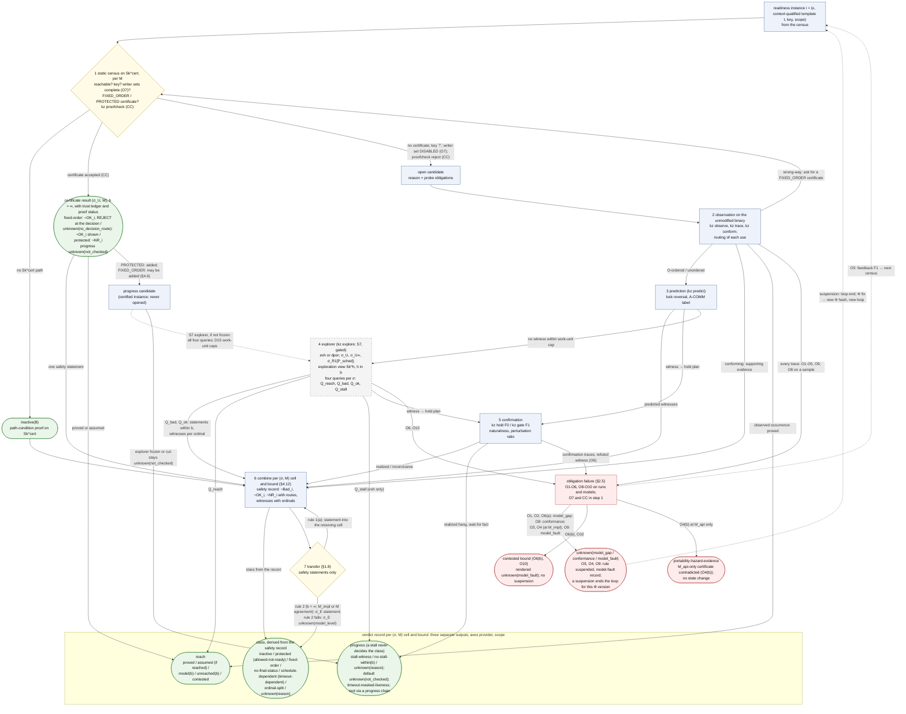
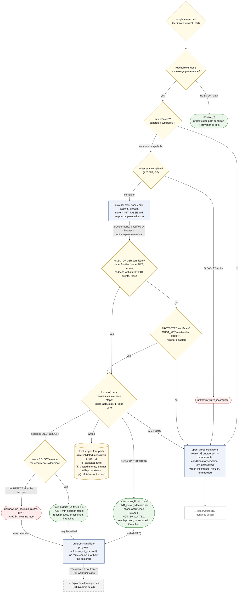
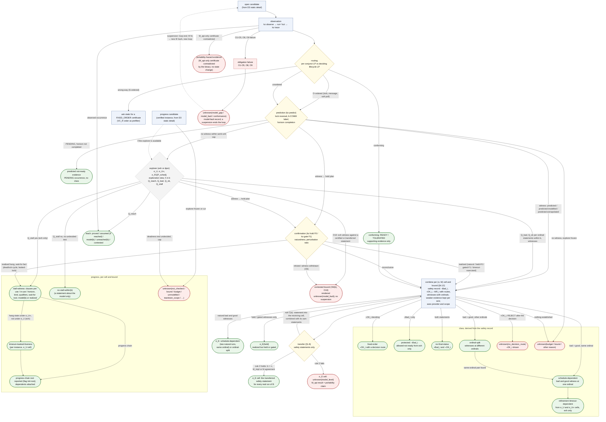

# 03 워크플로우: instance 분석, feedback loop, 판정 상태 기계, 연구 단계

이 문서는 Kairos가 준비 상태 명세 instance(이하 준비 instance) 하나를 어떤 순서로 판정하는지, feedback loop가 그 판정을 어떻게 고정점까지 끌고 가는지, 판정 기록이 어떤 상태를 지나는지, 그리고 도구를 만들고 동결하고 평가하는 연구 단계가 어떻게 이어지는지를 그림과 함께 설명한다.
spec을 읽지 않은 연구자가 "무엇이 어떤 순서로 일어나고, 어디서 멈추며, 무엇을 주장하지 않는가"를 15–25분 안에 파악하는 것이 목적이다. spec에 없는 설계 요소·수치·인용은 더하지 않는다.

상태: 설계 문서 — 구현·측정 전. 규범 원문: [spec/SPEC_FINAL.md](spec/SPEC_FINAL.md)(revision 1.3: 2026-10-22 PI 결정 D1–D5 반영, spec §0.12. revision 1.2: 2026-10-15 PI 결정, 용어 결정 T1, CORD 인용 정리 반영, spec §0.9–§0.11. revision 1.1: 외부 검토 EXT-20261012 반영, spec §0.7)

> **rev 1.3 반영 (2026-10-22).** spec 개정 1.3은 PI 결정 D1–D5(결정문 [spec/PI_DECISIONS_RESOLVED_20261022.md](spec/PI_DECISIONS_RESOLVED_20261022.md))를 변경표 [../plan/REV13_CHANGE_TABLE.md](../plan/REV13_CHANGE_TABLE.md)(행 C-01–C-52)를 거쳐 적용했다(spec §0.12, ADR-053–ADR-058). 모두 결정 [D]이고 결과가 아니다. 이 개정에서도 빌드·실행은 없었다. 이 문서에 옮긴 변경표 행: C-15·C-18(§1.1 필수 경로와 선택 경로), C-22(§1.2 머리), C-24(§1.3 plan의 수동 보강, OB-04), C-05(§1.3 step 2의 `app_owner`), C-25(§1.3 설명 집합, OB-01–OB-03), C-26(§1.3 재생 규약, OB-05), C-27(§1.3 보류 사유), C-28(§1.4 rev 1.3 추가), C-29(§1.5 머리), C-31(§1.6 재사용 조건, CF-01–CF-04), C-30(§1.7 규칙 10), C-49·C-50(§1.10 끝), C-42·C-43·C-45(§4.1 rev 1.3의 사다리, 시험 T-01–T-22), C-36(§6 항목 58–62), C-52(이 문서). **우선순위**(spec §0.12, ADR-053): 개정 1.0–1.2를 위해 쓴 문장이 certificate, explorer, progress 결과, loop를 Kairos의 첫 산출물, 필수 산출물, 정의하는 산출물로 말하면 ADR-053으로 읽는다. 그 경로는 쓰인 그대로 정의되어 있고 그 주장이 필요할 때 쓰며, 관측 판정·예측·확인의 전제 조건이 아니다. 이 문서에서는 §1.1–§1.2(정적 census와 certificate가 먼저인 순서), 그림 D3와 D4(아직 rev 1.2 판), §1.10의 R2 행, §4.1의 rung V1과 S3a 출구 조건이 그런 문장이다.

## 목차

0. [읽기 전에](#0-읽기-전에): 표기, 두 가지 워크플로우, 필요한 용어
1. [instance 하나의 분석 워크플로우](#1-instance-하나의-분석-워크플로우-spec-46413-그림-d3) (그림 D3): 정적 판정 → 관측 → routing → 예측 → 탐색 → 확인 → 결합 → σ_E 전이
2. [feedback loop: 반복, 종료, 재현성](#2-feedback-loop-반복-종료-재현성-spec-414) (spec §4.14)
3. [판정 상태 기계](#3-판정-상태-기계-그림-d6) (그림 D6): class 상태와 진행 영역, 불변식, 병렬 축, unknown 이유
4. [연구 워크플로우](#4-연구-워크플로우-그림-d4) (그림 D4): 단계 S0–S10, Φ 작성과 반순환성, 평가 경로 요약(평가 계획의 상세는 [07_evaluation.md](07_evaluation.md))
5. [관측 파이프라인 개요](#5-관측-파이프라인-개요-그림-d7) (그림 D7)
6. [이 문서가 주장하지 않는 것](#6-이-문서가-주장하지-않는-것)
7. [관련 문서](#7-관련-문서)

---

## 0. 읽기 전에

### 0.1 표기

표기는 spec 머리말을 따른다(자세한 설명은 [01_overview.md §0](01_overview.md#0-읽는-법)).

| 표기 | 뜻 |
|---|---|
| [F] | 코드·기록·보고서 인용이 있는 사실 |
| [M] | 측정값. 이 문서의 [M]은 모두 spec이 인용한 **기존** 측정([R07], [BM], [R2g])이다 |
| [I] | 추론 또는 설계상 추론. 실행하지 않았다 |
| [D] | 설계 결정. spec §11의 ADR이 기록한다 |
| [U] | 미확인 |

Kairos는 아직 한 번도 실행되지 않았다. 그래서 이 문서에서 cFS 예에 붙인 "기대 판정"은 모두 [I]다. spec 부록 A도 "nothing here was run"이라고 적는다(spec App. A).

revision 1.2는 PI의 2026-10-15 결정을 반영한다(spec §0.10). 그 결정은 연구 계획·범위·표현에 대한 결정 [D]이고, 도구·논문·출처에 대한 사실도 실행 기록도 아니다. 폐기한 기록기 CORD의 결과는 이 문서에서 근거로 쓰지 않는다(PI 결정 D12). 값이 reference에 없으면 고르지 않으며, 이 문서에는 실행 횟수 N, 작업량 상한, 감시 한도가 없다.

인용 형식은 01과 같다. "(spec §4.4)"는 SPEC_FINAL.md의 절, "[R03 §4]"는 `background/`의 보고서, [LED]는 `cases/ledger.md`, [R2g]는 `results/`의 gdb R2 기록, [BM]은 `env/BASELINE_MEASURE.md`, [POL]은 `CONDITIONS_POLICY.md`다. 코드 위치 `path:line`은 고정된 cFS tree(cFS `088b2fa8`) 기준이다.

**인용 형식과 이름이 겹치는 기호.** 인용 형식(설계안 [A]/[B]/[C], 심사 [J1]–[J3], 검토 [X1]–[X3], [X3, here], v0.1 등)은 [01_overview.md §0](01_overview.md#0-읽는-법)에 모아 두었다. 같은 기호가 여러 뜻으로 쓰이므로 이 문서는 앞에 종류를 붙인다: "PI 결정 D4"와 "그림 D4", "보장 G5"와 "gap G5", "단계 S0"와 "Init snapshot S0", HB stratum S/O와 cold/warm 층(stratum). 전체 목록은 [10_decisions_adr.md §0.2](10_decisions_adr.md#02-이름-충돌-주의)다.

### 0.2 두 가지 워크플로우

이 문서는 성격이 다른 두 흐름을 다룬다. 섞어 읽지 않도록 먼저 구분한다.

| | 분석 워크플로우 (§1–§3, §5) | 연구 워크플로우 (§4) |
|---|---|---|
| 묻는 것 | 고정된 basis B와 profile Φ 아래에서 instance 하나에 어떤 판정 기록을 주는가 | 도구를 어떤 순서로 만들고, 언제 동결하고, 무엇으로 평가하는가 |
| 단위 | instance × (σ, M) 칸 | 단계 S0–S10, freeze F1/F2 |
| 반복 | feedback loop(`kz loop`)가 고정점까지 돈다 | 단계마다 출구 조건(exit gate)이 있다 |
| 그림 | 그림 D3, D6, D7 | 그림 D4 개요(상세는 07) |
| spec | §1.8, §1.10, §4.6–4.14, §5 | §7.2, §7.5, §8, §9.3, §10.1 |

이 문서에서 "단계 1–7"은 instance 하나의 분석 단계(§1)를, "S0–S10"은 도구의 구현 단계(§4)를 가리킨다.

### 0.3 필요한 용어

이 문서를 읽는 데 필요한 만큼만 적는다. 전체 용어집은 [10_decisions_adr.md §3](10_decisions_adr.md#3-용어집)이다(원문 spec §13).

| 용어 | 쉬운 설명 | spec |
|---|---|---|
| instance | (준비 상태 명세 κ, 문맥까지 구분한 template t, key, scope). 같은 SB 코드라도 ES의 TaskInit에서 inline된 것과 EVS의 TaskInit에서 inline된 것은 다른 template이다. scope는 default 또는 teardown이다 | §1.6; App. A.1 step 1 |
| 발생, 서수, 상태 | 발생(occurrence)은 사용 지점의 한 번 실행이다. 호출에서 시작하고 늦어도 호출이 돌아올 때 결정된다. 서수 `(a, k)`는 actor instance `a`가 그 key로 시작한 k번째 발생이다. 상태는 NOT_EVALUATED(호출이 conjunct LP를 다 지나기 전에 돌아옴), READY, TOLERATED, VIOLATING, PENDING(horizon monitor가 아직 OPEN), NOT_READY_UNJUDGED다. PENDING은 TOLERATED로 세지 않는다 | §1.6 |
| (σ, M) 칸 | σ는 스케줄 의미론이다. σ_U는 시간을 무시한 임의 interleaving, σ_U∞는 σ_U에서 시간 기반 전이(주기적이지 않은 timeout, 지연을 둔 retry의 마지막 실패, 강제 종료)를 뺀 의미, σ_R1[P_sched]는 한 CPU의 고정 우선순위, σ_E는 실제 환경이다. M은 OSAL을 API 계약 수준(M_api)과 POSIX 구현 수준(M_impl) 중 어디까지 모형화하는지다. instance마다 분석한 (σ, M) 조합별로 칸이 하나씩 있고, 칸은 경계 b마다 안전성 기록, class, reach, 진행 결과를 따로 둔다 | §0.1, §1.4, §1.8, §4.12 |
| 안전성 기록, class | 칸과 경계마다 세운 진술 `¬Bad_i`(도달한 in-scope 발생 중 VIOLATING·NOT_READY_UNJUDGED가 없다), `¬OK_i`(READY·TOLERATED가 없다), `¬NR_i`(미준비로 결정된 것이 없다. 곧 결정된 발생이 모두 READY이거나 NOT_EVALUATED다)와 그 경로, 서수가 붙은 witness. 진술은 도달한 발생에 대한 것이고, 도달 여부는 reach 축이 따로 적는다. class는 이 기록의 함수다: `inactive`, `protected`(↳`allowed-not-ready`), `fixed-order`, `no-final-status`, `schedule-dependent`(↳`timeout-dependent`), `ordinal-split`, `unknown(reason)`. **"safe"라는 class는 없다** | §0.1, §1.10 |
| 진행(progress) 결과 | 영구 대기와 deadlock을 칸마다 따로 적는 결과: `stall-witness(S)`(S ⊆ {pre-use, in-use, horizon}), `no-stall-within(b)`(`exh`만), `unknown(reason)`(기본 `not_checked`). 진행 refinement `timeout-masked-liveness`와 flag `tml-root`가 있다. class를 바꾸지 않고, "live"를 뜻하는 값은 없다 | §1.8, §1.10 |
| reach | 칸과 경계마다: `proved`, `assumed`, `model(b)`, `unreached(b)`, 증거가 반박하면 `contested`. 보편 class는 언제나 reach·progress 값과 함께 보인다 | §1.10 |
| census | Φ의 모든 준비 상태 명세를 그것이 맞는 모든 문맥 위치에 instance로 펼치고, 각각에 class나 `unknown(reason)`을 주는 작업 | §4.6 |
| certificate, trust ledger | 안전성 진술 하나(fixed-order의 `¬OK_i`, protected의 `¬NR_i`)를 다른 프로그램(`kz proofcheck`)이 명시한 trusted base에 상대적으로 한 단계씩 다시 검증할 수 있게 적은 증명 기록 / certificate와 판정 칸마다 붙는 네 부분 기록(다시 검증한 단계, 추출 사실, 신뢰 항목, 관측으로 반박될 수 있는 항목) | §4.5, §4.5.1 |
| 증명 상태 (proof status) | lemma·보장·certificate·판정 칸의 `proved` / `depends-on-stated-assumption` / `unproved`. 여러 lemma를 쓴 진술은 가장 약한 것을 따르고, 상태는 증명을 써 넣는 수정만 올린다. 첫 R2 결과의 certificate 칸은 모두 `unproved`다 ([01_overview.md §3.3](01_overview.md#33-증명-동반-판정-proof-carrying-verdicts)) | §6.2 |
| 준비 상태 위반 | 범위 안의 VIOLATING 발생. 순서위반의 한 부류다. Allowed가 정해지지 않은 NOT_READY_UNJUDGED 발생은 위반이라 부르지 않는다 | §1.6 |
| `Sk^cert`, `Sk^h` | skeleton은 actor 하나의 control flow에서 판정에 필요한 사건만 남긴 요약이다. certificate view `Sk^cert`는 끝없는 loop를 "0회 이상 반복"(star-closure)으로 닫는다. exploration view `Sk^h`는 loop를 h번까지 펼치고 나머지에 `TRUNC`를 표시한다. 보편 판정과 `inactive`는 `Sk^cert`에서만 나온다 | §4.3; [04_formal_model.md](04_formal_model.md) (그림 D10) |
| linearization point (LP) | 연산의 효과가 "이 명령에서 한순간에 일어났다"고 보는 지점이다. Kairos는 요구 조건의 conjunct(∧로 묶인 조건 하나)마다 LP를 둔다. 호출자가 넘길 값을 미리 읽어 둔 load 지점은 **capture point**라 하고, 값 조건의 LP가 된다 | §1.4 |
| happens-before (HB), vector clock | HB는 한 실행 안에서 동기화(lock, message, thread 생성 등)로 정해지는 "먼저 일어남"의 부분 순서다. vector clock은 thread마다 카운터 벡터를 들고 다니며 이 순서를 계산하는 자료 구조다(Lamport 1978; Fidge 1988; Mattern 1989 [V-abs]) | §1.9 |
| stratum S / O | S(구조적) 순서는 두 끝이 모두 있는 모든 실행에서 성립한다. O(관측된 동기화) 순서는 관측한 실행에서만 성립하고, 예측에서 뒤집을 수 있다 | §1.9 |
| witness | 판정을 뒷받침하는 유한 실행 하나. 나쁜 witness와 좋은 witness는 발생 서수를 함께 적는다. stall witness는 진행 결과이고 class의 witness가 될 수 없다 | §1.6, §1.10 |
| cone | 한 후보와 관련된 actor·위치·object를 닫은 집합. 예측과 탐색이 이 범위만 본다 | §4.9 항목 1, §4.10 항목 1 |
| work unit | 분석 예산을 세는 결정적 단위(확장한 상태 수, 탐색 노드 수 등). wall clock이 아니다 | §2.1 원칙 8 |
| deviation | 자원이 유한해서 사람이 고른 값(실행 횟수 N, work-unit 상한, 표본 크기). 이유·효과·필요성을 기록한다. reference(코드 상수나 고정 문서)에서 온 값은 `from-reference`, reference가 정하지 않았고 값도 고르지 않은 것은 `unspecified_by_reference`다 | spec 머리말; [POL] |

---

## 1. instance 하나의 분석 워크플로우 (spec §4.6–4.13, 그림 D3)

### 1.1 한 장으로 보기

준비 instance 하나는 최대 7단계를 지난다. 모든 instance가 모든 단계를 거치지는 않는다. 정적 단계에서 certificate가 나오면 그 안전성 진술은 곧바로 결합(단계 6)으로 간다. 그 instance는 open되지 않으므로 progress 후보가 되고, explorer가 있으면 단계 4에서 진행을 본다(spec §4.6). 관측에서 모든 조건이 성립하면 그 관측은 뒷받침 근거로만 결합에 들어간다. 단계 4(explorer)는 구현 단계 S7부터만, 그리고 kill criterion을 통과할 때만 쓰므로 점선 테두리로 그렸다.

**rev 1.3: 필수 경로와 선택 경로** [D] (spec §2.2 "Required and optional routes", §2.4; ADR-053; C-15, C-18). 필수 경로는 `basis`, `extract`, `link` → `plan`(또는 손으로 보강한 plan, §1.3) → `observe` → `trace`(정규화, task–애플리케이션 매핑, 관측 판정) → `predict`(명시적 상태 탐색 먼저) → `hold` → `report`다. 선택 경로는 바뀌지 않은 채 정의되어 있고 그 주장이 필요할 때 쓴다: `skel`과 `static`(MustBefore, certificate), `proofcheck`, `explore`, `conform` O8, `loop`, `gate`. `modref`는 전과 같다. `static`의 census와 `skel`의 view는 선택 경로나 closure 검사(spec §4.1)가 필요로 하는 곳에서 여전히 쓴다. `proofcheck`는 certificate를 낼 때만 만든다. 관측 판정은 certificate를 기다리지 않는다. 입력이나 상태 근거가 모자란 판정은 certificate가 생길 때까지 미루지 않고 보류한다(spec §4.8; §1.3의 설명 집합). 그래서 아래 7단계에서 단계 1의 certificate 갈래와 단계 4(explorer)는 선택 경로로 읽는다. 아래 그림 D3는 아직 rev 1.2 판이다. spec §12 D3의 rev 1.3 고침(certificate 판단 앞에 "관측 판정(설명 집합) → 요약 뷰" 경로와 그 끝 노드 `OBSERVED_VIOLATION`, `NO_VIOLATION_IN_CHECKED_PREFIX`, `INCONCLUSIVE(reason)`(`horizon-open` 포함), `NOT_APPLICABLE`, 그리고 "예측 → `MODEL_CANDIDATE` / `NONE_IN_SCOPE` / `INCONCLUSIVE` → 확인 → `CONFIRMED` / `NOT_CONFIRMED`"을 더하고 certificate 갈래를 선택으로 표시)은 그림 쪽 단계에서 반영한다.

**그림 D3 개요. 준비 instance 하나의 분석 순서** (렌더링: [diagrams/D3_analysis_overview.svg](diagrams/D3_analysis_overview.svg); spec §12 D3 (rev 1.2); §1.8, §1.10, §2.5, §4.6, §4.8–4.14)



| 단계 | 구성요소 | 묻는 것 | 낼 수 있는 결과 | spec |
|---|---|---|---|---|
| 1 정적 census | `kz-static static`, `kz proofcheck` | 사용에 이르는 경로가 있는가, key가 정해지는가, certificate가 있는가 | `inactive`, `fixed-order[cert]`(결정 경로가 있을 때) 또는 `unknown(no_decision_route)`(`¬OK_i`는 보인다), `protected[cert]`(`¬NR_i`), 또는 open(reason). certificate 칸의 progress는 `unknown(not_checked)` | §4.5, §4.6 |
| 2 관측과 routing | `kz observe`, `kz trace`, `kz conform` | 수정하지 않은 바이너리에서 이 사용이 어떤 순서로, 어떤 결과로 일어났나 | conforming / wrong-way / O-ordered / unordered | §4.8, §4.11 |
| 3 예측 | `kz predict` | 관측한 trace를 바탕으로 반대 순서가 실행 가능한가 | witness(`predicted`, `predicted-modelled`, `predicted-extrapolated`), 예측된 미준비 근거(PENDING; witness가 아니고 class도 없다), 또는 "상한 안에서 예측하지 못함" | §4.9 |
| 4 explorer | `kz explore` (S7, gated) | 닫힌 모형 안에서 사용에 도달하는가, 나쁜 발생·좋은 발생이 있는가, stall 상태에 이르는가 | 경계 b 안의 안전성 기록과 class(`model(b)`), reach(`model(b)`, `unreached(b)`), 진행 결과(`stall-witness`, `no-stall-within(b)`), `unknown(budget)` | §4.10 |
| 5 확인 | `kz hold` (F0), `kz gate` (F1, 후순위: PI 결정 D3) | witness의 순서와 결과가 실제 gcc 바이너리에서 일어나는가 | `realized`(naturalness 표시), `refuted`, `inconclusive`. 확인할 수 있는 stall witness는 wait-for 사실로 `stall-witness(realized)` | §4.13 |
| 6 칸별 결합 | verdict store | 모인 근거로 칸과 경계마다 어떤 진술이 서는가 | 안전성 기록과 그것에서 나온 class 또는 `unknown(reason)`, reach, 진행 결과. 축마다 더 약한 근거를 남긴다 | §4.12 |
| 7 σ_E 전이 | verdict store | 안전성 진술을 실제 환경 σ_E의 칸으로 옮길 수 있는가 | σ_E 안전성 진술(b = ∞), `schedule-dependent(σ_E)`/`ordinal-split(σ_E)`, `σ_E(held)`, `unknown(model_level)` | §1.8, §4.12 |

**칸의 순서.** σ_U를 먼저, 그다음 σ_U∞를 계산하고, σ_R1[P_sched]는 요청이 있을 때만 계산한다. σ_E는 마지막이다(spec §4.12 항목 1). M_api는 항상 분석하고, M_impl은 cone에 M_impl-relevant 연산(두 수준에서 다르게 모형화되는 OSAL 연산: idmap 생성·조회·삭제·token 변환, task 생성·준비·삭제, binsem, queue 생성·put·get)이 있을 때 분석한다(spec §1.4, §4.6, §4.12 항목 7).

**흐름 전체에 걸린 세 규칙.**
- **관측은 보편 class를 만들지 않는다.** 보편 진술(`¬Bad_i`, `¬OK_i`)과 그래서 protected, fixed-order, no-final-status에는 certificate(`Sk^cert` 위, b = ∞), 경계 b 안의 전수 탐색, 또는 전이(§1.8)가 필요하다. 관측은 뒷받침 근거일 뿐이다(spec §4.12 항목 2). 반복해서 실패한 실행으로 fixed-order를 내지 않고, trace 하나의 강건한 순서 사슬(`VC_R`)로도 내지 않는다(spec §6.4 항목 4–5). rev 1.3의 관측 요약 `OBSERVED_VIOLATION`은 기록된 실행에 대한 것이고 보편 class가 아니다. 보편 근거가 없으면 칸은 "스케줄 의존성 미확정"으로 읽고, 그것은 관측된 위반을 지우지 않는다(spec §1.10; [04 §11.7](04_formal_model.md#117-고정-순서-근거와-미확정-스케줄-의존성-rev-13)).
- **안전성과 진행은 따로 간다.** class는 안전성 진술에서만 나오고, stall은 class를 정하지 않는다. 진행 결과는 `exh`(단계 4)나 실현된 wait-for 사실(단계 5)에서만 나오고, certificate는 진행을 말하지 않는다(spec §4.12 항목 9).
- **obligation이 실패하면 빨간 경로로 빠진다.** 단계 2와 5에서 계층 간 검사가 어긋나면 그 판정은 `unknown(model_gap | model_fault | conformance)`가 되고, 경우에 따라 그 Φ version의 반복이 끝난다. 모형 증거와의 불일치(O6 (b), O10)는 탐색한 경계만 `contested`로 만든다(§1.9).

### 1.2 단계 1: 정적 census (spec §4.5, §4.6)

census는 모든 판정의 출발점이다. Φ의 각 준비 상태 명세를 맞는 모든 문맥 위치에서 instance로 만들고, 아래 순서로 판단한다. 판단은 M마다 따로 한다(spec §4.6).

> **rev 1.3부터 선택 경로** [D] (spec §4.4 머리; ADR-053; C-22). 아래 FIXED_ORDER·PROTECTED certificate와 `kz proofcheck`(spec §4.4–§4.5)는 보편 순서 진술이 필요할 때 쓴다. 관측 판정(§1.3), 예측(§1.4), 확인(§1.6)의 전제 조건이 아니고, R2도 그것을 요구하지 않는다. 다시 적용할 때는 보고서가 관계의 정의, 분석 영역, 전이 규칙의 단조성, 수렴 조건, 그리고 계산한 관계와 프로그램 순서 사이의 보존 논증을 준다. 고정점이 수렴했다는 것만으로 그 관계가 프로그램의 올바른 순서라는 뜻은 아니며, certificate는 늘 그 전제, 모형 범위, 증명되지 않은 lemma와 함께 보고한다. census와 skeleton view는 선택 경로나 closure 검사(spec §4.1)가 필요로 하는 곳에서 그대로 쓴다. 아래 본문은 바뀌지 않았다.

**그림 D3 상세 1. 정적 census 판단** (렌더링: [diagrams/D3_analysis_static.svg](diagrams/D3_analysis_static.svg); spec §12 D3 (rev 1.2); §4.2, §4.5, §4.5.1, §4.6)



| 판단 | 내용 | 결과 |
|---|---|---|
| template 일치 | 준비 상태 명세의 사용 pattern U가 맞는 문맥 위치를 `Sk^cert`에서 찾는다 | instance |
| 도달 가능성 | B의 상수와 message provenance(어떤 handler가 어떤 입력 message로만 실행되는가)로 경로 조건을 접었을 때 `Sk^cert`에 경로가 없는가 | 없으면 `inactive(B)`. 증명은 접은 경로 조건과 쓴 provenance 집합이다(spec §4.5 INACTIVE) |
| key | 준비 상태 명세의 resource selector를 값 분석했을 때 key가 concrete, symbolic, ⊤(모름) 중 무엇인가 | ⊤면 open(`key_unresolved`)이고 probe plan으로 넘긴다. census는 kind별 key 비율을 보고한다(spec §4.6) |
| writer 집합 | conjunct마다 조건을 참으로 만드는 writer, 거짓으로 만드는 disabler, 각 항목의 transition 상태와 key 상태(`MUST_KEY`, `MAY_KEY`, `NO_KEY`) | 한 항목이라도 `DISABLED`면 `unknown(writer_incomplete)`로 open(obligation O7, spec §2.5, §4.2) |
| provider 축 | `none`(조건이 처음에 거짓이고 완전한 writer 집합이 비었다), `env-absent`, `present`, `unknown` | 별도 종착 상태가 아니다. provider `none`인 사용도 다른 사용처럼 결과로 class를 정한다. 도달한 발생 중 READY·TOLERATED가 있을 수 없고 결정 경로가 있으면 `fixed-order`다. REJECT가 소진 하나뿐인 retry는 그 REJECT가 결정 뒤에 있으므로, certificate만으로는 모든 σ에서 `unknown(no_decision_route)`(`¬OK_i`는 보인다)이고, `exh`로는 σ_U에서 fixed-order, 소진이 시간 기반이면 σ_U∞에서 `no-final-status`다. 허용된 미준비 결과가 있는 `allowed-not-ready`는 `exh`로만 얻는다(spec §1.10, §4.5 항목 3·5) |
| FIXED_ORDER certificate | 아래 설명 | 있으면 b = ∞의 진술 `¬OK_i`. REJECT가 결정 시점에 있으면 결정 경로가 있어 `fixed-order(σ_U, M)`, 없으면 `unknown(no_decision_route)`(진술은 보인다). reach는 `proved` 또는 `assumed`, progress는 `unknown(not_checked)` |
| PROTECTED certificate | 아래 설명 | 있으면 `protected(σ_U, M)`, 진술은 `¬NR_i`(따라서 `¬Bad_i`). progress는 `unknown(not_checked)`이고, instance는 progress 후보로 등록된다 |
| `kz proofcheck` | 모든 certificate를 저장 전에 검사기가 trusted base에 상대적으로 다시 검증하고 trust ledger를 쓴다 | 거부되면 open(CC) |
| 나머지 | — | open. 이유 ∈ {`unordered`, `O-ordered-only`, `conditional-observation`, `key_unresolved`, `writer_incomplete`, `horizon`, `unmodelled`}. probe obligation과 함께 plan으로 간다(spec §4.6, §4.7) |

**FIXED_ORDER certificate의 뼈대**(spec §4.5). 한 conjunct를 골라 다음을 모두 보인다.
1. 그 conjunct는 INIT(프로그램 시작 상태)에서 거짓이다.
2. writer 집합에 `DISABLED` 항목이 없다.
3. **frontier**: 사용하는 actor가 한 실행에 많아야 한 번 존재하고(once), 그 actor 안에서 사용으로 가는 경로가 없는 노드 m이 모든 writer의 MustBefore 집합에 있다. MustBefore(MB)는 "모든 실행에서 반드시 먼저 일어난다"는 정적 관계다(spec §4.4). 그러면 사용과 writer가 둘 다 일어나는 실행에서 사용이 항상 먼저다(PWB, precedes-whenever-both-occur).
4. **badness**: 사용의 모든 not-ready 결과가 호출자 수준 Allowed(받아들이는 미준비 결과) 밖이다. 곧 그 항목의 horizon monitor가 어느 `Sk^cert` 연속에서도 ACCEPT하지 않는다. certificate는 기대는 REJECT 사건을 적고, 각각이 발생의 결정 시점에 있는지 적는다. REJECT가 모두 결정 시점에 있을 때(`Allowed none`, `unspecified_by_reference`, 항목의 코드 밖 결과)만 `¬OK_i`에 결정 경로가 생긴다. retry 소진이나 오류 종료·반환처럼 결정 뒤의 REJECT는 그 길이 막힐 수 있으므로 결정 경로를 주지 않는다.
5. **reach**: 칸마다 정한다. 그 σ와 M의 조건을 만족하는 run(M_api에서는 cone actor의 M_api 적합성 검사, σ_U∞에서는 시간 기반 전이 없는 prefix)이나 확인된 모형 경로가 있으면 `proved`, 없으면 `assumed`("도달한다면 fixed-order")다.

이 증명은 사용이 무엇을 지배(dominate)할 것을 요구하지 않으므로 early return 뒤의 사용도 덮는다(spec §4.5).

**증명하는 것**(L-FO). σ_U의 모든 유한 실행에서, 도달한 in-scope 발생은 READY도 TOLERATED도 아니다(`¬OK_i`). 사용에 도달한다는 것, 모든 실행이 결정에 이른다는 것, 사용에 도달하지 않는 실행에 대해서는 아무것도 증명하지 않는다.

**PROTECTED certificate의 뼈대**(spec §4.5). 모든 conjunct에 대해 (a) INIT에서 참이고 모든 disabler가 제거되거나, (b) `MUST_KEY`인 must-writer x*가 사용의 LP의 MustBefore 집합에 있고, 남은 disabler는 모두 PWB로 x*보다 앞에 놓이거나 사용의 LP보다 뒤에 놓이거나, NO_KEY 또는 SCOPE로 제거된다. SCOPE는 종료 요청 뒤에만 올 수 있는 disabler를 "종료 전" 사용의 certificate에서 빼는 규칙이다.

**증명하는 것**(L-PR). σ_U의 모든 유한 실행에서, 결정된 in-scope 발생은 모두 READY이거나 NOT_EVALUATED다(`¬NR_i`, 따라서 `¬Bad_i`). 사용에 도달하지 않는 실행(deadlock, 영구 대기, 잃어버린 provider나 spawn), reach, horizon에 대해서는 아무것도 증명하지 않는다. READY를 증명하므로 refinement `allowed-not-ready`를 뒷받침하지 않는다. `allowed-not-ready`는 `exh`에서만 나온다. 결정된 발생이 READY 또는 NOT_EVALUATED라는 말은 조기 반환한 NOT_EVALUATED 발생이 있어도 거짓이 아니라는 뜻이고, 모든 발생이 READY라는 뜻은 아니다.

**`kz proofcheck`**는 `static`과 분석 코드를 공유하지 않고 LLVM도 링크하지 않는다. 두 쪽 모두 `libkz-core`를 link한다. 검사기는 certificate의 추론 단계를 **명시한 trusted base에 상대적으로** 다시 검증한다(spec §4.5; ADR-041).
- **믿는 것**: 추출 사실(`facts.kz`), skeleton(`skel.kz`, `anchors.kz`; 검사기는 다시 만들지 않는다), closure의 spawn 목록, Φ, 공유 `libkz-core`, 그리고 reach에는 그 단계가 가리키는 run·`hb-*.kz`·prefix-probe 기록, 곧 recorder의 기록.
- **스스로 다시 하는 것**: view, dominance, spawn 목록, 코드에서 추출한 대기 조건과 그 함축, `W_o` 재계산과 제외, once 사실, `derives` 사슬, frontier, SCOPE, INIT 평가, badness 경로 검사, 상태 일관성, 칸별 조건이 붙은 reach.
- **"via T5"**: INIT 평가와 falsifier 조건은 `libkz-core`의 evaluator를, 규칙 해석은 rule engine을 부른다. 이 단계들은 trust ledger에 "via T5"로 표시한다.
- certificate의 어느 단계라도 `Sk^h`나 `TRUNC` 노드를 가리키면 거부한다(spec §4.5, §2.2).
- 받아들인 certificate에는 네 부분 trust ledger를 쓴다: 다시 검증한 단계, 추출 사실, 신뢰 항목(Φ 항목, `DECLARED_TRUSTED`, 가정, 쓴 lemma와 그 증명 상태, 도구 기반), 관측으로 반박될 수 있지만 증명되지 않은 항목(spec §4.5.1). certificate 자기 칸에는 늘 L-MB, L-ONCE, L-PWB, L-DERIVE, L-FO 또는 L-PR, L1, L-STATUS가 들어가고, reach나 witness가 실제 run에 기대는 칸에는 certificate 자기 칸을 포함해 L-CONT (c)와 L-STATUS가 들어간다. 그 run 쪽 전제는 O1, O2, O4, O5로 반박할 수 있지만, 통과해도 증명이 되지 않는다.
- certificate와 그 칸은 쓴 lemma 가운데 가장 약한 증명 상태를 가지고(`KZ_CERT.proof_status`), 검사기가 받아들였다는 말은 늘 "신뢰 기반에 상대적으로"와 그 상태가 따른다. `kz proofcheck`가 받아들여도 상태는 올라가지 않는다(spec §4.5, §6.2 PS1·PS3).

**cFS 예 (모두 [I]).**
- **R2**: ES·EVS init 안 SB 코드의 event 사용(준비 상태 명세 K-ID)은 ES 절반과 EVS 절반의 FIXED_ORDER certificate를 기대한다. Allowed가 `none`이라 REJECT가 결정 시점에 있으므로 결정 경로가 있다. 절반과 M마다 trust ledger가 붙고, progress는 `unknown(not_checked)`다. 현재 분류에서 L-MB, L-ONCE, L-PWB, L-FO, L1이 `unproved`이므로 모든 R2 certificate 칸이 "lemma status: unproved"를 보인다(spec ADR-045). 보고는 "generic 준비 상태 명세 K-ID + framework 규칙 R19(core serialization)"다(spec App. A.1 steps 9–10). 상세는 [05_cfs_mapping.md](05_cfs_mapping.md)(그림 D8).
- **C1, 기본 B**: CF의 조회는 비어 있지 않은 `sem_name` 검사 뒤에 있는데 기본 table의 두 항목이 모두 비어 있다 → `inactive(B)`(spec App. A.4 step 1).
- **timebase 조회**: TIME과 SCH_LAB의 `"cFS-Master"` 조회는 teardown 밖에서 protected다. 도달한 조회는 모두 READY라는 안전성 진술이고, progress는 `unknown(not_checked)`다. 코드가 순서를 정한 곳에서 도구가 race를 지어내지 않는지 보는 calibration이다(spec App. A.7).
- **core task의 App-record 구간**: 사용과 발행(`cfe_es_start.c:818`)이 모두 ES lock 아래에 있어 어느 방향의 certificate도 없다 → open(spec App. A.2 step 2).

**세 가지 주의.** 관측되지 않았다는 이유로 `inactive`를 주지 않는다. 그것은 `unknown(not_reached)`다(spec §1.10). 실행되지 않는 latent instance도 "관측 안 됨"으로 끝나지 않고 모형 판정을 받는다(spec §4.6). 관측에서 새로 찾은 instance(outcome mining, key-pair enumeration)도 같은 census에 들어간다(spec §4.6, §7.1). 그리고 certificate가 있는 instance는 open되지 않으므로, 진행을 보는 길은 progress 후보로서 explorer(S7, 동결되지 않았을 때)를 도는 것뿐이다. explorer가 없으면 certified 판정은 모두 `progress = unknown(not_checked)`인 안전성 진술로 보고한다(spec §4.6 "Progress candidates").

### 1.3 단계 2: 관측과 routing (spec §4.7, §4.8, §4.11)

open 후보는 관측으로 넘어가고, certificate가 있는 instance는 progress 후보로서 explorer가 있을 때 단계 4로 간다(§1.2; spec §4.6). 아래 그림은 단계 2부터 7까지의 상세다.

**그림 D3 상세 2. open 후보와 progress 후보에서 칸별 기록까지** (렌더링: [diagrams/D3_analysis_dynamic.svg](diagrams/D3_analysis_dynamic.svg); spec §12 D3 (rev 1.2); §1.8, §1.10, §4.8–4.14)



**probe plan.** `kz-static plan`은 모든 actor의 필수 동기화 skeleton(OSAL task·mutex·semaphore·queue·timer·module 연산, ES lock과 대기, SB 생성·구독·송신·수신, shutdown 저장)과 open 후보의 의무(conjunct별 LP 구간, capture 위치, 결과 코드, A-COMM 검사에 필요한 writer)를 덮는 probe를 고른다(spec §4.7). 필수 skeleton을 모두 남기는 이유는, 제3자 동기화를 잘라 내면 순서를 잘못 읽기 때문이다(spec §4.7; v0.1 §7.3).

**칸별 reach를 위한 prefix probe**(spec §4.7 항목 6) [D]. (σ_U, M_impl) 밖의 칸에서 reach를 run으로 증명하려면 plan이 probe를 더한다. M_api에서는(L-MLEVEL이 적용되지 않으면) closed cone의 모든 actor가 발생까지의 prefix에서 부른 OSAL 호출의 반환값과, 돌아온 API가 type lock을 남겼는지를 본다. σ_U∞에서는 cone actor의 주기적이지 않은 timed wait와 지연을 둔 retry의 결과, kill timer 만료를 보고, M_impl에서는 OSAL RESERVED 대기의 반환 원인도 본다. hold·gate run에서는 같은 probe로 `timeout-exercised`를 정한다. 개수는 정하지 않았다. 이 probe가 생기기 전에는 그 칸의 run 기반 reach는 `assumed`다.

**plan의 수동 보강** [D] (rev 1.3; spec §4.7 "Manual augmentation of the plan"; [P0.2] §5.4; C-24). [P0.2]는 2026-10-22 사용자가 올린 제안 0.2로, 개정 1.3의 기초다(D1). 위의 합성(`kz-static plan`)이 생기기 전까지 plan은 손으로 쓰거나 늘릴 수 있다(`profiles/<basis>/observe/sites.kzp`). 그때 계획한 site마다 자기가 채우는 요구를 적고, plan을 조건 instance마다 아래 목록과 대조한다.
1. 조건의 검사·capture·효과 지점, 그리고 instance와 그 actor를 식별하는 생성·종료 event(`app_owner` 근거 포함, ADR-056).
2. 관련된 상태, 등록, 이름, ID, 관계를 바꿀 수 있는 모든 writer, 별칭, 호출 경로. 애플리케이션, core service, OSAL에 걸쳐 찾는다. 풀리지 않은 호출과 외부 호출은 누락 가능성으로 기록한다.
3. 예측을 위해, 조건이 이름을 대지 않더라도 cone이 필요로 하는 생성, lock 획득·해제, semaphore와 barrier, 송신·수신, 분기 결과 event(§1.4).
4. 소스와 바이너리 위치에 묶은 값·actor·수명 capture. probe 예산 때문에 뺀 site는 나열한다.
5. 실행 때: 부착 성공, 활성 구간, 수집기의 손실 보고, 새 task의 capture, 시작 상태 근거. 수집기가 보고하지 않는 종류의 손실에 대해 손실이 없다고 가정하지 않는다.
6. 조건 instance마다 충족·미충족 요구. 이것은 아래 설명 집합으로 간다. 후보에 writer나 분기가 더 필요하면 그 instance의 plan을 늘린다.

**OB-04.** plan과 관측 적합성 기록(spec §2.3)은 서로 다른 산출물이다. 계획한 site만으로는 관측되지 않은 쓰기를 배제하지 않는다. 설명 집합은 5번이 probe가 부착되었고 활성이었으며 손실이 보고되지 않았음을 보이는 곳에서만 좁아진다.

**관측.** `kz observe`가 수정하지 않은 gcc 바이너리를 B 아래에서 실행하고 `run-*.kzt`를 쓴다. 파이프라인은 §5에서 다룬다.

**`kz trace`가 하는 일**(spec §4.8. 번호는 spec의 step 번호와 같다).
1. **decode와 loss.** thread별 순번(`tseq`)의 빈틈과 CPU별 drop counter로 기록 손실을 찾는다. 손실 구간에 기대는 판정은 `unknown(loss)`다. 손실을 "사건이 없었다"로 읽지 않는다(spec §5.6).
2. **identity 결합.** 실행 task, 소유 앱, 서비스, 찍힌 AppId를 오프라인에서 결합한다. 프로세스 안에서 아무것도 조회하지 않는다(spec §5.7). rev 1.3(ADR-056; C-05): 결합은 모든 actor의 `app_owner`를 그 근거와 수준(`confirmed | inferred | undetermined`)과 함께 낸다([04 §1.4](04_formal_model.md#14-실행-관계와-생성-앱-rev-13)). 미확정 소유는 그대로 두고 보류 사유가 되며(아래 보류 사유), 분석하는 table의 조회로 결코 풀지 않는다.
3. **HB 계산.** `VC`는 모든 확정 edge로, `VC_R`은 `unconditional`·`obs-fatal` edge(구조적 S 순서)로만 계산한다. **looper rule**: 한 looper(message를 받아 handler로 나누어 실행하는 actor)의 두 handler 사이에는 HB edge를 두지 않는다(CAFA PLDI 2014 [V-abs]; DCatch ASPLOS 2017 [P]; spec §1.9).
4. **conjunct별 LP 구간.** 각 LP를 [그 actor의 직전 관측 사건, 직후 관측 사건] 구간으로 둔다. 두 LP의 구간이 HB로 순서 지어지면 HB-decided, Φ의 결과 대응표로만 정해지면 outcome-decided, 둘 다 아니면 ambiguous다.
5. **routing.** 아래 표.
6. **Allowed 평가.** 호출자 수준 Allowed를 §1.6의 horizon monitor로, 그 항목이 감시하는 actor(사용하는 actor, `defer_by_design`이면 미루는 actor)의 이어지는 실행 위에서 평가한다. monitor가 OPEN인 채 trace가 끝나면 그 발생은 PENDING이고 결과는 `unknown(horizon)`이다(rev 1.3 요약 뷰에서는 `INCONCLUSIVE(horizon-open)`이고 위반 없음으로 세지 않는다, D2; [04 §11.6](04_formal_model.md#116-요약-뷰-rev-13)). `caller` 기록이 없는 항목(`rule` 기록뿐이거나 `supplier` 기록뿐인 항목)과 정상 연속을 인용하지 않은 `returned_and_tested` 항목은 monitor가 없고, 그 발생은 NOT_READY_UNJUDGED다(QT-4, Q15 엄격한 대안). 코드 사실(상태 변화, 반환 코드, 오류 반환·종료, 추출한 `cont_candidate`)은 그 발생의 consequence에 적는다.
7. **race coverage.** 어떤 짝을 뒤집으려면 ad hoc 동기화 짝을 먼저 뒤집어야 하면, 그 동기화 짝을 뿌리로 보고하고 종속 짝을 붙인다(EventRacer OOPSLA 2013 [V-abs]).
8. **준비 상태 위반 사슬.** frame 포함 관계와 Φ의 `emits` 표시로 사슬을 만든다. 예: R2의 `SEND_NO_SUBS` use 17개는 route가 없는 송신(K-ROUTE instance) 안에서 나온 event이므로 그 송신을 뿌리로 하는 사슬로 이어진다(K-ROUTE ⇝ K-ID; spec App. A.1 step 13).
9. **template 없는 출처.** outcome mining과 key-pair enumeration을 계산한다(spec §7.1 항목 2–3).
10. **obligation.** O3–O5, O9를 여기서 검사하고 O1/O2는 `kz conform`이 검사한다(spec §4.11).
11. **scope.** 판정 사건(decision event)이 관측된 종료 요청 LP 뒤에 오는 발생은 K-TEARDOWN instance로 따로 센다. 그 전에 결정된 발생은, 뒤의 conjunct LP가 종료 요청 뒤에 와도 scope 안에 남는다(spec §1.6, §3.5).

**routing 네 갈래**(spec §4.8 step 5). L⁻, L⁺, L∥는 사용 key에 대한 lifecycle LP 중 conjunct의 LP보다 앞선 것, 뒤인 것, 순서가 없는 것이다.

| 갈래 | 관측된 모습 | 다음 처리 | cFS 예 |
|---|---|---|---|
| conforming | L∥ = ∅이고 모든 conjunct가 성립한다: READY(허용된 경우 TOLERATED) | 뒷받침 근거로만 쓴다 | — |
| wrong-way | L∥ = ∅이고 어떤 conjunct가 실패했으며, 쓰인 순서 edge가 모두 S다(`VC_R` 순서) | `static`에 그 template의 FIXED_ORDER certificate를 요청한다. `VC_R` 순서는 값싼 사전 필터일 뿐이다 | R2 [I: 표를 R2에 적용한 것] |
| O-ordered | L∥ = ∅이지만 그 순서에 O edge(lock, message, semaphore, soft poll, reads-from)가 하나 이상 들어간다 | 예측: 반대 순서가 가능한가 | C1, C5, 두 App-record 구간(spec §4.8 표) |
| unordered | L∥ ≠ ∅ | 결과 코드로 정해진 순서의 반대를 예측한다 | — |

wrong-way가 관측에서 끝나지 않고 정적 단계로 되돌아가는 이유는, trace 하나에서 본 구조적 순서는 그 실행에 대한 사실일 뿐 모든 실행에 대한 주장이 아니기 때문이다(spec §1.9 항목 3: "never an Exec-level claim").

**결과 코드 일치(O4).** 프로그램 자신의 결과 코드(`ILLEGAL_APP_ID`, `NAME_NOT_FOUND`, `Q_FULL` 등)는 LP에서 계산한 상태와 맞아야 한다(O4(a)). 이 검사의 점검력은 HB-decided 사용에 대해서만 보고한다. outcome-decided 사용은 상태 자체를 검사 대상 코드에서 끌어냈으므로 점검으로 세지 않는다(spec §4.8 step 5). PROTECTED certificate가 있는 instance에서 관측된 미준비 발생(TOLERATED, PENDING 포함)과 FIXED_ORDER certificate가 있는 instance에서 관측된 READY·TOLERATED 발생은 O4(b) 위반이다. NOT_EVALUATED 발생은 어느 쪽도 아니고, 막힌 thread는 O4(b)가 아니라 진행 결과로 간다(spec §2.5).

**불완전한 기록의 설명 집합** [D] (rev 1.3; spec §4.8 "Explanation set of an incomplete record"; ADR-055; [P0.2] §9.1–§9.3; C-25). trace는 event의 일부만 기록한다. 관측 판정은 **기록과 양립하는 실행의 모든 설명에서 성립할 때만 확정**이다. `Cobs`를 기록의 제약, `Vφ`를 검사한 구간에서 조건의 위반이라 하면, 판정은 `Qv = SAT(Cobs ∧ Vφ)`와 `Qn = SAT(Cobs ∧ ¬Vφ)`로 정한다.

| `Qv` | `Qn` | 결과 |
|---|---|---|
| SAT | UNSAT | 모든 설명에서 계산한 status(`VIOLATING`, 요약 `OBSERVED_VIOLATION`, spec §1.10) |
| UNSAT | SAT | 모든 설명에서 계산한 status(`READY`, 또는 ACCEPT를 가진 `TOLERATED`; 요약 `NO_VIOLATION_IN_CHECKED_PREFIX`) |
| SAT | SAT | `INCONCLUSIVE(explanation_ambiguous)` |
| UNSAT | UNSAT | 분석 입력 오류(spec §1.10) |
| unknown 또는 끝나지 않음 | 무엇이든 | 다른 완전한 근거가 정하지 않으면 `INCONCLUSIVE(limit)` |

이 표는 뜻을 정할 뿐, 검사마다 solver를 두 번 부르라는 요구가 아니다. 순서가 다 정해지고 다 덮인 구간은 재생이 바로 평가한다. 추상 영역의 가능한 상태 집합이 설명들을 대신할 수 있다(L-OBS, [04 §12.3](04_formal_model.md#123-lemma)). `Vφ`는 검사한 구간에 대한 것이고 미래에 대해서는 말하지 않는다. 열린 retry나 horizon 의무는 구간에 위반이 없어도 따로 보고한다. `Cobs`는 실행 **하나**의 모호함이고, 결코 예측한 다른 스케줄로 세지 않는다(§1.4).

`Cobs`의 구성:

| 정보 | 규칙 |
|---|---|
| 시작 상태 | INIT, 초기화 코드, 일관된 상태 capture로 정한다(IN-03, [04 §6](04_formal_model.md#6-분석-기준-b)). 모르는 값, 등록, 존재, 수명, 소유는 대안을 남긴다 |
| 관측된 event | 값, 연산, actor, 호출 관계는 관측된 곳에서만 고정한다. event는 관측됐지만 그 내부 효과 지점은 관측되지 않았으면 가능한 구간을 남긴다(EV-04) |
| 순서 | actor마다의 program order, 확인된 동기화 edge, 믿을 수 있는 관측 순서를 남긴다. 수집기의 병합 순서나 출력 순서를 결코 실행 순서로 쓰지 않는다(spec §5.8) |
| 관측된 효과 | 그 버전의 효과 의미와 capture 지점이 대응하는 곳에서만 상태 전이로 적용한다 |
| 관측되지 않은 효과 | 관련 자원, 값, 관계에 그것이 줄 수 있는 효과의 상위 근사를 넣는다. ID, 수명, 소유를 고정하지 않고 kind의 상태 집합을 넓힌다 |
| 판정 구간 | 조건의 시작, 결정, Allowed horizon을 밝힌다. 기록의 끝은 열린 의무를 닫지 않는다 |

**기록된 쓰기만으로** 자원을 갱신해도 되는 것은 다음이 모두 성립하는 구간뿐이다: 그 writer, 별칭, 외부 효과가 덮여 있다(위 수동 보강, spec §4.1 "Closure per case"); 시작 상태와 수명을 안다; 모든 효과의 probe가 맞는 지점에 부착되어 활성이었다; 그것에 대해 손실이 보고되지 않았다. 하나라도 성립하지 않으면 가능한 상태가 그 효과만큼 넓어지거나 판정을 보류한다. 순서 모호함은 writer 포괄과 따로 다룬다. 빠진 event의 수를 임의의 경계에서 잘라 다른 설명이 없다고 결론짓지 않는다. 유한 상태 요약이 지원하는 값·관계 영역에서 관련된 빠진 효과를 모두 덮지 못하면 결과는 `INCONCLUSIVE`다. 설명 집합을 예측 예산에 맞추려고 줄이지 않는다.

- **OB-01.** 합성 재생 시험의 초기 상태 규약(`phi_reference.md` §6–§7)은 실제 부분 관측과 따로 둔다. 합성 시험의 편의를 실제 실행에 적용하지 않는다.
- **OB-02.** 적용되지 않는 조건과 평가하지 않은 조건을 구분한다. 조기 반환으로 건너뛴 검사 지점은 통과한 검사가 아니다(`NOT_EVALUATED`). 그 반환 자체가 다른 조건을 위반하는지는 그 조건이 판정한다.
- **OB-03.** 빠진 정보는 그것이 관련된 instance와 구간에만 영향을 준다. 다른 task의 관련 없는 빠진 event 하나가 모든 위반을 지우거나 모든 결과를 보류하게 하지 않는다.

**실제 기록의 재생 규약** [D] (rev 1.3; spec §4.8 "Replay convention for real records"; ADR-055; C-26). 목록에 없는 자원은 그 kind의 초기 상태이고 목록에 없는 위치는 0이라는 재생기의 규약(`phi_reference.md` §6, 구체화 규칙 (2))은 합성 trace와 INIT에는 맞고, 실제 실행의 관측되지 않은 자원에는 **맞지 않는다**. **OB-05.** 실제 기록을 재생할 때, 조건이 읽는 관측되지 않은 자원이나 위치마다 가능한 상태, 값, ID, 수명, 관계를 명시적으로 준다. 모르는 자원 instance나 관계의 집합을 현재 영역에서 표현할 수 없으면 그것에 기대는 결과를 보류한다. 모든 상태 bit를 켜는 것만으로는 불확실성 전체를 나타내지 못한다(ID, 수명, 소유가 열려 있다).

**보류 사유** [D] (rev 1.3; spec §4.8 "Reasons for withholding"; [P0.2] §9.3; C-27). `INCONCLUSIVE` 관측 결과는 다음 중 적어도 하나를 적는다: `start_state_unknown`, `loss`, `resource_or_lifetime_unmatched`, `ownership_undetermined`(task–애플리케이션), `effect_point_ambiguous`, `caller_requirement_absent`, `effect_unsupported`, `horizon-open`, `not_evaluated`, `explanation_ambiguous`, `limit`. 숫자로 된 신뢰도 점수가 확정 판정을 대신하지 않는다.

**관측 판정의 검증** [D] (rev 1.3; spec §4.8 "Validation of the observation judgement"; [P0.2] §9.4). 작은 유한 기준 모형에서 구체적 실행을 독립적으로 나열한다. 그다음 event를 지우거나, 값을 모르게 하거나, 순서를 모호하게 만들고, 분석 결과를 그 부분 기록과 양립하는 구체적 실행의 집합과 견준다. 확정 판정은 그 집합 안에 반례가 없어야 하고, 추상화 때문에 생긴 보류는 따로 센다. 다루는 경우는 모르는 시작 상태, 빠진 writer, 실제 손실이 있는 계획된 probe, 별칭, ID 재사용, 조기 반환, 닫히지 않은 Allowed horizon이다(시험 T-17–T-20, spec §9.2). 이 시험과 evaluator agreement property test는 서로 다른 오류를 본다. 어느 것도 cFS에 대한 증명이 아니다.

### 1.4 단계 3: 예측 (spec §4.9)

**질문.** trace π와 routing된 후보(예: 발행자 p가 사용 u보다 lock으로 먼저 일어남)가 있을 때, u의 결정 conjunct LP가 p의 LP보다 먼저 오는 실행이 가능한가? 용량에 관한 준비 상태 명세이면 put이 넘치는 실행이 가능한가?

**모형 Pred(π)** (maximal causal models RV 2012; RVPredict PLDI 2014; GPredict ICSE 2015, 모두 [V-abs]).
- **cone**: actor별로 u와 p까지의 접두를 S edge와 제어에 관련된 reads-from으로 거꾸로 닫는다.
- **제약**: actor별 접두 순서(looper의 handler는 겹치지 않고, 같은 pipe의 message는 넣은 순서대로 꺼낸다), S edge, 제어에 관련된 사건은 관측된 결과 종류를 유지한다(성공한 조회는 앞선 발행이 필요하다; **acquire는 lock이 비어 있어야 한다**), Φ의 primitive 의미(상호 배제, binsem 포화, queue FIFO와 용량, MsgLim), 그리고 목표 순서. σ_R1의 우선순위 제약은 **넣지 않는다**.
- **lock 뒤집기를 허용한다.** critical section을 원자 블록으로, registry key를 충돌 대상으로 보고, 같은 lock의 두 critical section 순서를 제약이 허락하면 바꾼다. C1, C5, App-record 구간에 필요한 것이고, sync-preserving 예측이 금지하는 것이며, RVPredict/GPredict 방식의 처리다([R04 §2.5, L259, L492]).

**A-COMM 검사와 label.** Kairos의 trace는 동기화 skeleton과 LP 구간, 준비 상태 명세 위치의 결과만 담고 모든 공유 접근을 담지는 않는다. 그래서 witness에 `predicted`를 붙이기 전에, cone 안 actor가 관측 사건 사이에 읽을 수 있고 다른 cone actor가 쓸 수 있는 위치가 모두 (a) writer LP가 전부 관측된 Φ support location이거나, (b) cone 위에서 상수이거나, (c) witness가 유지하는 관측 결과로만 읽히는지 확인한다(spec §4.9 항목 4).

| label | 뜻 | 근거의 강도 |
|---|---|---|
| `predicted` | Pred(π) 안에 있고 A-COMM을 통과했다. 가정 A4(x86-64 TSO, `-O0`에서 사건 단위 순차 일관성)와 A7(manifest에서는 A7-impl·A7-api: OSAL과 그 아래 primitive의 Φ 의미가 실제 backend를 과대근사하거나 LP에서 linearizable하다는 가정; [04 §12.2](04_formal_model.md#122-가정-a-soundiness-manifest)), Φ primitive 의미에 상대적으로 trace-sound다. trace-sound는 "π를 낼 수 있고 cone 안의 관측하지 않은 공유 읽기가 A-COMM으로 덮이는 모든 프로그램에서 그 witness가 실행 가능하다"는 뜻이다(spec §6.2 L-PRED, §6.3 보장 G4) | 모형 근거보다 강하고 `realized`보다 약하다 |
| `predicted-modelled` | A-COMM이 실패했다. 실패한 위치를 나열하고, 다음 반복의 plan이 그 위치에 probe를 더한다 | 모형 근거 |
| `predicted-extrapolated` | 한 번 관측한 retry·poll을 유효 reference 경계까지 늘린 witness다. loop 요약이 O2를 통과한 곳에서만 쓴다 | 모형 근거 |

**탐색과 예산.** cone의 linearization을 깊이 우선으로 탐색한다. sleep set(이미 탐색한 분기와 독립인 전이를 다시 시도하지 않도록 표시해 두는 집합)으로 중복을 줄이고, 상태를 기억하며, 첫 witness에서 멈춘다. 예산은 결정적 work-unit 상한이고 deviation이다. 결과는 anytime curve(work unit에 따른 결정된 비율)로 보고한다(spec §4.9 항목 5, 8). 일반적으로 동기화 하나를 뒤집는 예측도 NP-complete다(SyncP [V-abs]; spec §4.9 Complexity).

**prefilter.** SHB, WCP, SyncP(모두 [V-abs])를 적용 범위가 맞는 곳에서 먼저 돌린다. 이들이 제안한 뒤집기는 위 제약으로 다시 검증하고(Vindicator의 후보·검증 분리, PLDI 2018 [V-abs]), **이들의 침묵은 아무 뜻도 없다**(spec §4.9 항목 6).

**horizon 완성**(spec §4.9 항목 7a) [D]. 예측한 뒤집기에서는 u의 결과가 미준비가 되므로, u 뒤의 연속은 π에 없다.
- horizon monitor가 사용 시점에 정해지면(Allowed `none`, `documented_drop`, `unspecified_by_reference`, 항목의 코드 밖 결과. 예: CF의 `OS_ERR_INCORRECT_OBJ_STATE`) 예측한 발생은 최종 상태를 가지고, 그 witness는 위 label이 붙은 나쁜 witness다.
- 그렇지 않으면 예측한 prefix에서 그 발생은 PENDING이다. 이것은 **예측된 미준비 근거**이고, witness가 아니며 class도 나오지 않는다. horizon을 완성해야 witness가 된다: 감시 actor의 u 뒤 연속을 `Sk^cert` 경로 검사로 잇거나, retry·poll이면 유효 경계까지 늘린다. 그 witness는 `predicted-extrapolated`(모형 근거)이고, 그 영역이 O2를 통과한 곳에서만 받는다. 나머지는 explorer가 완성한다.

**결과.** witness 하나와 그 label, 예측된 미준비 근거(PENDING; class 없음), 또는 "π에서 상한 안에 예측하지 못함"이다. **어느 것도 protected 판정이 아니다**(spec §4.9 항목 9; §6.3 보장 G4). SMT 교차 검사는 PI 결정 P-Z3 뒤의 선택 사항이고 주 경로에 없다(spec §4.9 항목 10).

**cFS 예 [I].** core task의 App-record 구간에서는 기본 boot trace에서 startup thread의 `cfe_es_start.c:816–818` critical section과 자식 task의 `GetAppID` critical section을 뒤집는다. task record가 먼저 채워졌으므로 자식의 poll은 성공 결과를 유지한다. witness가 나오면 `schedule-dependent(σ_U, M_api와 M_impl)`이다. label은 instance마다 정한다. 발생이 사용 시점에 정해지는 곳에서는 A-COMM이 `predicted`와 `predicted-modelled`를 가른다. 여기에는 core raise, 상태를 버리는 SB·TBL의 `GetAppID`, 그리고 엄격한 대안(Q15) 아래에서 `returned_and_tested` 항목이 연속을 인용하지 않아 사용 시점에 NOT_READY_UNJUDGED가 되는 EVS의 `GetAppID`와 TIME의 `CreateChildTask` 호출이 든다. REJECT가 결정 뒤에 오는 항목(연속을 인용한 `returned_and_tested`, `retry_until_ready`)에서는 예측한 뒤집기가 예측된 미준비 근거(PENDING)이고, horizon 완성으로만 witness가 되며 그때의 label은 `predicted-extrapolated`다. EVS 쪽 `GetAppID`(`cfe_evs_task.c:273`)는 검사된 상태를 `CFE_EVS_TaskInit`가 그대로 돌려주고(`:274–278`), 그 검사의 모든 post-dominator가 함수의 반환이므로 추출한 `cont_candidate`는 없다(§1.6). 이어서 `CFE_EVS_TaskMain`이 `CFE_ES_ExitApp(CORE_APP_INIT_ERROR)`를 부른다(`:215–220`). 이는 코드 사실이고 그 발생의 consequence로 남는다. EVS의 처리에 정상 연속을 인용한 reference가 없으므로 그 발생은 TOLERATED도 VIOLATING도 아니고 NOT_READY_UNJUDGED다(QT-4, Q15 엄격한 대안; spec App. A.2 step 3).

**rev 1.3 추가** [D] (spec §4.9 "Revision 1.3 additions"; [P0.2] §7.3, §10; P-Z3 유지; C-28).
- **engine.** 첫 구현은 작은 유한 cone 위의 명시적 상태 탐색(spec §4.9 step 5, 위 "탐색과 예산")이고, 기준 대조(시험 T-13)를 위해 reduction 없이 돈다. reduction은 독립성이 정당화된 연산에만 쓴다. SMT는 같은 작은 모형에서 구체적인 필요(상태 폭발, 명시적 탐색이 표현하지 못하는 제약, 탐색 비용)가 보일 때만 들인다. 그때 step 10이 교차 검사이고, 그 인코딩은 적어도 다음을 덮는다: event 위치와 순서 변수, actor마다의 prefix와 그 생성 제약; 유한 상태, 수명, 버전별 값 영역(C 정수 폭이 중요한 곳은 bit-vector); 값 출처에 묶인 읽기, 분기, 결과; lock 소유, 재귀, 해제 대응(상호 배제만으로는 방향이 결코 나오지 않는다); 지원하는 의미 안의 queue, counter, timeout(결코 빈 제약이 아니다). solver 버전, build, 설정, 인코딩 revision, 입력 hash를 결과의 근거에 넣는다. SAT 모델은 재생하고 그 조건을 다시 평가한다. unknown과 한도 도달은 `INCONCLUSIVE`다. solver 사용을 기여로 주장하지 않는다.
- **관련 event의 역방향 닫힘**(step 1의 cone을 worklist로 쓴 것이고, §1.2의 MustBefore 고정점과 다르다). (1) 조건의 결정 event, 그 자원에 대한 효과, Allowed horizon의 결정 구간에서 시작한다. (2) 각 event의 actor prefix와 생성 근거를 더하고, 생략한 영역은 검증된 효과 요약으로만 바꾼다. (3) 동기화 선행자, 제어에 관련된 읽기의 값 출처, 그 값에 영향을 줄 수 있는 쓰기와 별칭, lock 소유 구간, message 대응을 더한다. (4) 읽기의 출처가 여럿일 수 있으면 대안을 남기고, 다른 task가 관련 상태를 바꿀 수 있으면 그것을 더하거나 간섭 없음을 정당화한다. (5) 더할 것이 없을 때까지 되풀이한다. 풀리지 않은 호출, 외부 효과, 한도로 멈춘 닫힘은 그것이 영향을 주는 후보와 함께 불완전으로 표시한다. 관측된 동기화 사실, program order, 모형이 다시 배열할 수 있는 lock 순서는 서로 다른 관계로 둔다. 관측된 task 사이 edge를 예측에 불변식으로 베끼지 않는다.
- **값과 뒤 경로.** 순서를 바꾸면 조회 결과, 성공, 분기, 뒤 event가 바뀔 수 있다. 기록된 연속을 새 실패 실행에 붙이지 않는다. 목표 event까지는 필요한 값·제어 의존을 남긴다. 목표 event의 결과가 바뀌면 그 새 상태와 결과는 그 버전의 검토된 효과 의미로 계산한다. 실행 가능성을 계산하지 않은 연속은 거기서 후보를 끝낸다(또는 step 7a의 horizon 완성이 채운다). 그 구간 안에서 위반이 확립되지 않은 후보는 올리지 않는다. 새 분기나 retry 경로는 그 의미와 기록된 탐색 범위 변경과 함께만 들어온다. 효과, 메모리, 외부 호출 의미가 빠지면 예측을 보류한다.
- **PR-01–PR-04.** lock 뒤집기는 상호 배제, 소유, data 효과를 만족해야 한다(step 3). lock edge를 지우는 것만으로는 아무것도 나오지 않는다. 만족하는 linearization은 요약 뷰에서 `MODEL_CANDIDATE`이고, step 4의 label(`predicted`, `predicted-modelled`, `predicted-extrapolated`)과 A-COMM 결과를 그대로 지닌다. `MODEL_CANDIDATE`는 프로그램 위의 실행 가능성에 대해 아무것도 말하지 않는다. "linearization 없음"은 밝힌 모형, 구간, 경로 범위에 대해서만 `NONE_IN_SCOPE`다. 시간·메모리·event 한도, unknown, 지원하지 않는 효과는 `INCONCLUSIVE`이고 놓친 수에서 결코 숨기지 않는다. L-PRED와 보장 G4는 `unproved`로 남는다(spec §6.2).
- **내부 대조.** 단순 관측 검사와 자원 상태·연산 쌍 후보 방법이 이 engine과 같은 입력을 받는다(spec §8.4). 예측이 사례에 아무것도 더하지 않으면 그 근거로 방법을 단순화한다.

### 1.5 단계 4: bounded explorer (spec §4.10; S7, gated)

> **rev 1.3부터 선택 경로** [D] (spec §4.10 머리; ADR-053; C-29). 작은 유한 모형 위의 전수 모드 `exh`는 먼저 시험 T-13의 독립 기준(예측 engine과의 대조, §1.4)으로 쓴다. 닫힌 cone 위의 전체 explorer, 그 refinement, 그 진행 결과는 그대로 아래 kill criterion(spec §4.10 항목 9)에 묶여 있다.

explorer는 후보마다 닫힌 모형을 만들고 실행을 체계적으로 나열한다. 구현 단계 S7부터 쓰는 늦은 구성요소이고, kill criterion을 통과해야 쓴다.

**닫힌 모형.** closed cone, B의 상수, M 수준의 Φ 의미, σ에 따른 대기 의미, 유효 경계까지 펼친 retry, B.Input의 입력, exploration view `Sk^h`(h는 경계 b에 기록)로 이루어진다(spec §4.10 항목 1).
- **closed cone**은 다음을 고정점까지 닫은 것이다: 사용, writer, disabler, support object를 가진 actor; cone 위치를 쓰거나 cone object로 동기화하거나 cone 대기 조건의 support를 쓰는 actor; cone actor가 cone 연산까지, instance의 horizon 끝까지, spawn 지점까지 가는 길에서 잡거나 기다리는 동기화 object와 대기 조건; Allowed 항목이 감시하는 actor(아직 없어도)와 그 spawn 사슬. 이것이 빠지면 반대 순서로 lock을 잡는 actor를 놓쳐 deadlock을 못 보거나(litmus LP-DL), 거짓 horizon stall이나 거짓 pre-use stall이 생긴다.
- closed cone은 S3a에서 `static`과 `plan`이 `Sk^cert` 위에서 계산하므로 explorer 없이도 있다. L-MLEVEL, 칸별 reach 검사, prefix probe, `timeout-exercised` 판정이 그것을 다시 쓴다.
- σ_R1에서는 cone의 최소 우선순위 이상인 actor를 모두 넣는다.

**상태와 지역 선택.** 상태는 모형 상태와 instance monitor(종료 요청 여부, actor별 key당 발생 서수, capture 값, 열린 발생, PENDING 발생과 그 horizon monitor 상태)의 곱이다(spec §4.10 항목 2, §1.8).
- 대기의 timeout 전이는 σ_U에서 항상 가능하다. σ_U∞에서는 주기적 대기의 timeout만 남는다.
- 지연을 둔 retry의 마지막 실패는 σ_U∞에서 결코 일어나지 않는다. 마지막 시도가 M에서 전이 하나이면 성공할 수 있을 때까지 기다리고, 여러 전이이면 그 시도를 마친 뒤 actor가 남겨질(stranded) 수 있다.
- ES kill timer는 scan마다 `not-yet-expired`, `expire-stopped`, `expire-waiting` 중 하나다. σ_U∞는 강제 종료인 `expire-waiting`만 없앤다.
- `TRUNC` 노드에 있는 actor는 censored로 본다. 끝나지도 dead도 아니다.

**monitor 의존성.** `dpor`는 instance monitor가 읽는 순서도 의존으로 본다. 종료 요청 LP는 그 instance의 호출·conjunct LP와 의존이고, 발생의 판정 사건은 (사용하는 actor가 아닌) 감시 actor와 그 spawn 사슬의 전이와 의존이다(spec §4.10 항목 3).

**두 engine** [D](spec §4.10 항목 4). DPOR(dynamic partial-order reduction)은 의존하는(dependent) transition이 뒤바뀔 수 있는 곳에만 backtracking 지점(다른 순서를 시도하려고 되돌아갈 지점)을 두어, 독립 연산의 순서만 다른 interleaving의 탐색을 줄이는 체계적 탐색 기법이다([R05 §2.2]; DPOR POPL 2005 [V-abs; 보장 문구 UNVERIFIED]). Kairos의 source-DPOR은 class(독립 연산의 순서만 다른 실행들의 동치류)당 실행 하나를 주장하지 않는다(spec §6.4 항목 9).

| engine | 방식 | 정확성의 근거 |
|---|---|---|
| `exh` | 방문한 곱 상태(모형 상태 × instance monitor) 집합을 쓰는 상태 기반 전수 탐색. partial-order reduction 없음 | 유한 그래프의 도달 가능성. 경계 b 안의 모든 도달 상태를 방문한다. 진행 결과(`Q_stall`)를 정하는 것은 `exh`뿐이다. dead actor 판정에 도달 그래프 전체가 필요하기 때문이다 |
| `dpor` | source-DPOR + sleep set(Abdulla et al., POPL 2014 [V-abs]), monitor 의존성까지 넣은 의존 관계 | disabling이 있는 시스템에 대한 JACM 2017 정리가 필요하고 그 세부는 status P다([R05 §2.2]). P-PAPERS로 확인하기 전까지 `dpor` 결과의 보장 G5는 **unverified**로 표시한다. `Q_reach`, `Q_bad`, `Q_ok`만 정하고 `Q_stall`은 정하지 않는다. `dpor`가 찾은 stall 후보는 그 상태에서 `exh`로 확인한다. `exh`와의 차등 시험은 검증 증거일 뿐 증명이 아니다 |

Kairos는 "Mazurkiewicz 동치류마다 실행 하나"를 주장하지 않는다(spec §6.4 항목 9).

**네 질의**(spec §4.10 항목 7; EXT-20261012 §4.1–4.2로 고침). 닫힌 모형의 σ, M, b에서 묻는다.
- `Q_reach`: 결정되고 평가된(NOT_EVALUATED가 아닌) in-scope 발생을 가진 유한 실행이 있는가.
- `Q_bad`: VIOLATING(또는 NOT_READY_UNJUDGED) in-scope 발생을 가진 유한 실행이 있는가. 발생 서수마다도 답한다.
- `Q_ok`: READY나 TOLERATED in-scope 발생을 가진 유한 실행이 있는가. 발생 서수마다도 답한다.
- `Q_stall`: 그 instance의 stall 상태가 도달 가능한가. 종류와 qualifier도 적는다.

질의마다 칸의 기록에서 자기 성분을 정하고, class는 기록에서 나온다.

| 결과 | 칸의 기록 |
|---|---|
| `Q_bad` = no / `Q_ok` = no | 경계 b 안의 진술 `¬Bad_i` / `¬OK_i`. 단, censored나 stranded actor의 잘린 영역이 그 진술을 반박할 수 있으면(writer, ACCEPT·REJECT 사건, 사용 호출) 그 쪽은 `unknown(bound)`로 둔다(safety-side censoring) |
| (`Q_bad`, `Q_ok`) = (no, no) | `no-final-status` |
| (yes, no) | `fixed-order`(나쁜 witness가 결정 경로다) |
| (no, yes) | `protected`(TOLERATED 발생이 있으면 `allowed-not-ready`) |
| (yes, yes) | 어떤 서수에서 둘 다 yes면 `schedule-dependent`, 아니면 `ordinal-split` |
| `Q_reach` | yes → reach `model(b)`; no → reach `unreached(b)` |
| `Q_stall` | yes → `stall-witness`(가장 짧은 유한 실행, 종류, qualifier, choice support, wait-for root, progress chain); no이고 판정하지 못한 dead actor 검사가 없으면 → `no-stall-within(b)`; censored·stranded actor 때문에 판정하지 못하면 → `unknown(bound)` 또는 `unknown(unmodelled)` |
| 상한 소진 | 아직 정하지 못한 성분은 `unknown(budget)` |

stall은 안전성 기록을 정하지 않는다. 특히 나쁜 발생 없는 stall은 결코 fixed-order를 주지 않는다. 네 질의를 σ_U와 σ_U∞에서, 요청이 있으면 σ_R1[P_sched]에서도 돌린다. **σ마다 따로 계산**하고, refinement는 그 뒤 σ별 결과에서 유도해 자기 경계와 함께 저장한다. timeout-masked-liveness는 같은 곱 상태에서 σ_U와 σ_U∞의 hang 상태를 비교해서 정한다.

**progress 후보.** certificate가 있는 instance도 explorer가 있으면 네 질의를 모두 돈다. `exh`는 어느 질의에나 같은 도달 그래프를 방문하므로 안전성 질의는 따로 비용이 들지 않는다. 그 결과가 certificate와 어긋나면 O10이 그 경계를 다툰다(§1.9; spec §4.6).

**경계.** h는 고르지 않는다. 상한 안에서 끝낸 h마다 결과를 보고한다. work-unit 상한은 deviation이고, 각 상한의 값은 그 단계의 파일럿 뒤에 동결한다. 이 문서에 값이 없고 초과는 `unknown(budget)`이다(PI 결정 D15). 기본으로 선점 경계는 두지 않고, 쓴다면 BPOR(DPOR에 preemption bound를 붙일 때 생기는 unsoundness를 고친 기법, OOPSLA 2013 [V-abs])로 0부터 올린다(spec §4.10 항목 6).

**kill criterion.** S7 검토에서 certificate가 없는 개발 cone(두 App-record 구간, C1 파생 조회, K-PHASE(phase barrier·준비 선언 명세, [05 §2.6](05_cfs_mapping.md#26-es-phase-soft-barrier-core-직렬화-spec-36)) CF instance, `SBNSubPipe` K-CAP instance)에 explorer를 돌린다. 돌리는 범위는 **닫힌 cone**(closed cone)이다(PI 결정 D21, 2026-10-15). 더 작은 cone에서 얻은 결과를 같은 보장으로 쓰지 않는다. 상한은 결정적인 work unit(예측 노드, 탐색 상태, 전이 수)이고 각 상한은 그 단계의 파일럿 뒤에 동결한다. 값은 이 문서에 없고 초과는 `unknown(budget)`이다(D15). 개발 cone 다섯 중 C1 파생 조회와 K-PHASE CF instance는 C1의 공개 BP basis(D22)에만 있고, 그 basis는 아직 만들지 않았다. P-D18GATES (b)는 **예비 판단**과 **최종 판단**을 나눈다. 예비 검토는 그 시점에 있는 cone에서 explorer의 비용을 잴 수 있다. 줄인 집합(두 App-record 구간과 `SBNSubPipe`; 어느 것도 설계 사례의 instance가 아니다)을 쓰면 그 집합을 이름 붙여 밝힌다. 최종 keep-or-freeze 판단은 준비된 다섯 사례의 해당 범위를 포함한다(C1 cone, P-C2의 C2 역할 재구성, D13의 6.4.x 쌍에서 C3·C5 instance). 준비되지 않은 사례는 한계로 기록하고 다른 코드의 결과로 채우지 않는다. 최종 검토에서 이 cone이 하나도 없거나 작은 모형에서 `dpor`와 `exh`가 어긋나면 explorer를 동결하고, 그 출력은 ablation으로만 보고한다(spec §4.10 항목 9).

**explorer가 동결되거나 잘리면** 어떤 길도 모형 진행 결과를 정하지 않고, refinement도 성립하지 않는다. 모든 칸은 `progress = unknown(not_checked)`로 남는다. 예외는 wait-for 사실로 실현한 σ_E stall witness와, 그런 `deadlock-cycle`·`leaked-lock`이 L-DEAD로 옮기는 M_impl stall 상태다. 모든 protected 판정은 안전성 진술로만 보고한다. 이때 답할 수 없게 되는 칸(C1의 refinement와 진행 결과, C2의 refinement, C3·C5의 고쳐진 쪽)은 사례별로 밝힌다(spec §4.10 항목 9, §9.3).

**충실도.** explorer 판정의 realization은 `model(b)`이다. O1, O2, O6, O8에 기대고, 그 instance에 certificate나 certificate에서 옮긴 진술이 있으면 O10에도 기댄다. `realized`라 부르지 않는다(spec §4.10 항목 10).

**cFS 예: C1의 공개 BP 기반 B′(D22), M_api [I]**(spec App. A.4 step 3). 이 retry 항목이 상태를 정하는 것은 CF의 인정 주석(`cf_cfdp.c:1272–1278`)이 `caller` 기록일 때다 [I]. 기록이 `rule`(인식한 loop)뿐이면 항목은 `unspecified_by_reference`이고 미준비 시도는 모두 NOT_READY_UNJUDGED다. 아래 class는 `caller` 기록이 있을 때의 것이다.
- σ_U: retry loop를 유효 `CF_STARTUP_SEM_MAX_RETRIES`까지 정확히 펼친다. 이 값은 선택한 CF 버전의 소스에서 읽고 모든 버전에 고정하지 않는다. 지연은 양보이므로 모든 시도가 생성보다 앞서는 실행이 있다 → `schedule-dependent(σ_U)`.
- σ_U∞: loop는 지연을 둔 retry이고, M_api에서 마지막 시도는 전이 하나(조회)다. σ_U∞는 마지막 시도의 실패를 없애므로, provider가 아직 실행될 수 있는 동안 나쁜 유한 실행이 없다. 미준비 시도의 monitor(`retry_until_ready`)는 뒤의 시도가 READY일 때 ACCEPT하거나 OPEN으로 남을 뿐이다. 그 REJECT인 소진이 시간 기반이기 때문이다. 그래서 `¬Bad_i(σ_U∞)`이고, σ_U∞에서 사용에 도달하면 refinement는 `timeout-dependent`다. 이것은 `exh`가 정한다.
- 한 번만 시도하던 수정 전 코드(CF `281a941`)에서는 조회 실패 뒤 오류가 반환되고 CF는 `APP_ERROR`로 끝난다. 이 처리를 허용된 회복으로 인용한 reference도 정상 연속을 이름 붙인 reference도 없으므로 발생은 NOT_READY_UNJUDGED이고(Q15·QT-4), 시간 기반 전이 없이 나쁘다. 그래서 σ_U∞에서도 `schedule-dependent`로 남는다. 나중에 `caller` 기록이 생기면 label이 바뀔 뿐 class는 바뀌지 않는다. C1의 수정은 순서 논리 속 준비 상태 위반을 timing 여유에 대한 의존으로 바꾸었다. 수정 전 코드의 구조와 줄 번호는 `281a941`에서 anchor audit이 다시 읽는다 [U].
- provider가 끝내 실행되지 않는 경우는 cFS basis가 아니라 litmus L-PATIENT variant 2로만 본다. 소진이 결정 뒤의 REJECT이므로 b = ∞에서는 모든 σ에서 `unknown(no_decision_route)`(`¬OK_i`는 보인다)이고, `exh`로는 σ_U에서 fixed-order, σ_U∞에서 `no-final-status`다. σ_U∞에서 retry하는 actor가 마지막 시도의 호출 지점에서 dead이므로 `stall-witness({pre-use, horizon})`이고, σ_U는 소진으로만 빠져나가므로 timeout-masked-liveness다.
- M_impl에서는 조회가 여러 전이다. 마지막 조회가 실패한 뒤 CF는 type lock을 풀고 남겨지며(stranded), CF와 CF가 깨울 수 있는 actor의 진행은 `unknown(unmodelled)`다.

### 1.6 단계 5: 확인 (spec §4.13)

확인은 witness가 말하는 순서와 결과를 실제 gcc 바이너리에서 일으켜 보는 단계다. 기본 수단은 F0 `kz hold`다. ptrace로 한 thread만 멈추고, 실행 breakpoint를 debug register(x86의 DR0–DR3)에 걸어 코드 text를 고치지 않는다. F1 `kz gate`(`--wrap` gate와 PCT)는 후순위다(PI 결정 D3: 현재의 사건 기반 hold로 필요한 확인이 되는지 먼저 평가하고, 부족한 질문이 확인될 때 추가한다; spec §4.13).

이 분석 흐름에서 알아 둘 것은 넷이다.

- **무엇을 확인하나**(spec §4.13; [06 §12.1](06_observation_confirmation.md#121-어떤-판정을-확인하나)).
  - schedule-dependent와 timeout-dependent는 나쁜 witness를 directed로 확인한다. 자연 실행이 나쁜 순서만 보이면 좋은 witness도 확인한다.
  - fixed-order(certificate)는 도달과 결과를 수동으로 관측만 한다. protected는 안전성 진술에 대해 conformance 밖의 확인을 하지 않는다.
  - ordinal-split은 해당 서수를 수동으로 관측만 한다. 어떤 한 발생이 스케줄에 의존한다고 주장하지 않기 때문이다. 나중에 같은 서수의 짝이 나오면 class가 schedule-dependent로 옮긴다.
  - no-final-status는 class를 확인하지 않고, reach와 진행 결과를 함께 보고한다.
  - `unknown(no_decision_route)`(`¬OK_i`가 보이는 칸)은 그 칸의 나쁜 witness를 directed로 찾는다. 나쁜 witness가 나와야 fixed-order가 된다.
  - 진행의 모형 stall witness는 **확인할 수 있는**(confirmable) 것만 확인한다: 종류가 `deadlock-cycle`이나 `leaked-lock`이고, `idle`도 `terminal-pending`도 아닌 것. oracle은 timeout이 아니라 wait-for 사실이고, run은 harness kill과 normalization boot로 끝난다. 실현되지 않으면 witness는 "not realized in run R"과 함께 `model(b)`로 남는다. 이것은 반박이 아니다. prefix가 실현된 뒤 witnessing actor가 진행해야만 반박이다(O6, 그 경계가 `contested`).
- **결과 label.** `realized`(naturalness `held-F0`, `gated-F1`, `timeout-exercised`; 구성한 스케줄이면 flag `derived`), `refuted`(순서는 일어났는데 결과가 좋음: 그 witness를 낸 모형이나 요약이 그 prefix에서 틀렸다. witness를 거두고 O6으로 보고하며, `exh` witness였으면 탐색한 경계가 `contested`가 된다. 규칙은 정지하지 않는다), `inconclusive`다([06 §12.7](06_observation_confirmation.md#127-label)). `timeout-exercised`는 hold 중이나 hold 뒤 witness의 판정 사건 전에 cone actor에 시간 기반 전이가 일어났다는 뜻이고, prefix probe로 정한다.
- **σ_E와의 관계.** hold나 gate로 얻은 witness는 σ_E class를 만들지 않는다(`σ_E(held)`). 실현된 witness마다 perturbation 비율을 문턱값 없이 붙인다([06 §12.8](06_observation_confirmation.md#128-perturbation-기록과-비율); spec §4.12 항목 8).
- **보류의 기준과 표시**(P-C1HOLD, D1 [D]). hold는 사건 기반으로 푼다. C1의 실패 경로는 provider를 생성 직전에 보류하고, CF의 재시도 종료나 최종 초기화 결과라는 사건에서 푼다. 재시도 수와 지연은 선택한 CF 버전의 소스에서 읽고, 그 곱을 벽시계상의 안전한 상한으로 간주하지 않는다. 감시 한도(watchdog)와 중단 조건은 본실험 전에 기록한다. 보류로 만든 실패는 자연 실행과 구분해 표시하고, timeout 관측만으로 영구 교착이라 판정하지 않는다. RESERVED 구간 실험은 다섯 사례 밖의 후속 OSAL 결함 후보 항목이다. hold·정지·해제를 쓴 통제 run은 관측만 한 run과 구분해 표시하고 관측 영향 점검(spec §8.6)에서 섞지 않는다.
- **재사용 조건과 확인 규칙** [D] (rev 1.3; spec §4.13 "Reuse conditions and confirmation rules"; [P0.2] §11.1–§11.1.1; C-31). 위 기제는 측정하지 않은 설계다(spec §5.11). 다음 조건에서 쓴다.
  - 먼저 작은 두 task 프로그램에서 검증하고(개별 정지, 해제, 기다리는 event의 실제 도착, 교란), 그다음 cFS에서 쓴다.
  - gate 위치는 gate 위치 규칙(아래 06 §12)을 따른다. 어느 쪽에도 안전한 지점이 없으면 그 후보는 현재 기제로 확인할 수 없다고 보고한다.
  - 해제는 자원, 호출, 수명, 결과가 맞는 event를 기다린다. 오류나 종료 시의 해제와 관측을 포기하는 조건은 plan과 함께 기록한다. C1의 해제는 `plan/C1_basis_plan.md`를 따른다(P-C1HOLD).
  - ptrace, hardware breakpoint, 새 task에 대한 자동 부착은 그 플랫폼 지원, slot 사용, signal 상호작용, 정지 부작용을 확인한 뒤에만 쓴다. 설계가 그것을 이름으로 든다는 것은 동작한다는 근거가 아니다.
  - watchdog은 reference의 timeout과 파일럿에서 잰 경과 시간에서 온다. retry 수 곱하기 지연을 그것만으로 안전한 벽시계 한도로 쓰지 않는다.
  - 자연 실행, 순서를 정한 실행, 제어가 timeout을 일으킨 실행, 코드·구성 변경 실험을 따로 둔다. 비정상 종료 뒤에는 다음 실행의 초기 상태와 유지 자원을 확인한다(normalization).
  - **CF-01.** `CONFIRMED`에는 통제 실행에서의 조건 위반이 필요하다. crash 하나만으로는 아무것도 확인하지 않는다.
  - **CF-02.** 다른 자원, 호출, 경로의 위반은 따로 된 발견이고, 결코 그 후보의 재현이 아니다.
  - **CF-03.** 재현 실패나 시간 한도는 `NOT_CONFIRMED(reason)`(도달 못함, 제어 실패, 상태 불일치)이고, 결코 실행 불가능의 증명이 아니다.
  - **CF-04.** 제어가 새 timeout이나 입력 차이를 만들어야 나오는 결과는 후보의 위반과 따로 둔다. 코드 변경이 필요한 결과는 mutant나 재구성 실험이다. 모형은 같은 실행 조건을 만족하고 예측과 모순되는 관측으로만 반박된다(위 `refuted` label).

gate 위치 규칙 네 가지, 사건 기반 해제와 watchdog, wait-for oracle, normalization boot, 그리고 cFS 예(core task App-record 구간 확인, PI 결정 D16)는 [06_observation_confirmation.md §12](06_observation_confirmation.md#12-확인-실행-spec-413)에 있다.

### 1.7 단계 6: 칸별 결합 (spec §4.12)

| 규칙 | 내용 |
|---|---|
| 1 칸 | instance마다 분석한 (σ, M)마다 칸 하나. 안전성 기록, class, reach, 진행 결과는 칸과 경계마다 계산하고, refinement는 칸들에서 유도해 경계와 함께 저장한다 |
| 2 보편 진술 | `¬Bad_i`, `¬OK_i`(따라서 `protected`, `fixed-order`, `no-final-status`)에는 certificate(b = ∞, `Sk^cert`), 경계 b 안의 전수 탐색(`exh`, 또는 unverified로 표시한 `dpor`), 또는 전이(§1.8)가 필요하다. certificate는 진술 하나를 증명하고, `exh`는 b 안에서 두 진술과 reach, 진행을 정한다. 같은 σ와 M에 두 길이 다 있으면, 탐색한 경계 안에서 두 진술이 맞아야 한다. certificate 진술에 맞선 `exh` witness는 O10으로 간다. class는 경계마다 다를 수 있다(예: b = ∞에서는 certificate의 protected, b 안에서는 `exh`의 no-final-status). 보고서는 두 경계를 함께 보인다. `allowed-not-ready`와 모형 진행 결과는 `exh`에서만 나온다. 관측은 그 밖에는 뒷받침 근거일 뿐이다 |
| 3 schedule-dependent | 같은 칸과 경계에서 **같은 발생 서수**의 나쁜 witness와 좋은 witness가 필요하다(최종 상태를 가진 서로 다른 두 유한 실행). 서수가 다르면 `ordinal-split`이다. 기록은 realization과 naturalness 축마다 **더 약한 쪽**을 남긴다. stall witness는 진행 결과이고 나쁜 witness를 대신하지 못한다 |
| 4 σ_E 칸 | §1.8 |
| 5 모순과 불일치 | **모순**: 같은 (σ, M)과 진술의 경계 안에서, 실제 run의 증거가 certificate(또는 그것을 옮긴) 진술과 어긋나는 것(`¬Bad_i`에 맞선 실현된 나쁜 witness, `¬OK_i`에 맞선 실현된 좋은 witness, `¬NR_i`에 맞선 관측된 미준비 발생). O3/O4/O9가 발동하여 규칙을 정지하고, model-fault 기록을 쓰고, 관련 판정을 `unknown(model_fault)`로 내리고, 이 Φ version의 반복을 끝낸다. M_api에서만 성립하는 certificate를 바이너리가 반박하면 `portability-hazard-evidence`다. **model–certificate 불일치**(O10): `exh`의 결과가 certificate 진술과 어긋나면 탐색한 경계만 `contested`가 되고 directed check를 한다. 반복은 끝나지 않는다. **model 경계 충돌**(O6 (b)): 실현된 witness가 `exh`만으로 세운 진술과 어긋나면 그 경계의 해당 성분이 `contested`가 된다. **모순이 아닌 것**: stall witness는 어떤 class와도 모순이 아니다. class는 안전성 진술이기 때문이다 |
| 6 세 판단 | harm(호출자 수준)은 호출자 수준 Allowed와 관측·모형 연속에서 나온다. 호출자 수준 Allowed가 `unspecified_by_reference`면 harm도 그렇고, route·용량 판정에는 LOSS-UNDER-ORDER를 붙인다. 다만 must-deliver `appreq`(이 use가 반드시 전달되어야 한다고 말하는 `appreq`, [04_formal_model.md §5.8](04_formal_model.md#58-세-판단-framework-수준-caller-수준-관측된-결과))가 `caller` 항목과 충돌해서 판정을 보류하고 Allowed가 정해지지 않은 경우(QT-5)는 예외이고, 그때는 `not-ready-unjudged`다(spec §1.10). `fw_doc`과 `fw_conf`(framework 수준)는 op의 결과 대응표, O4(a), SB counter oracle, trace에서 나온다. consequence(관측된 결과)는 Allowed가 정해지지 않았어도 언제나 연속과 oracle에서 적는다. 셋을 합치는 규칙은 없다 |
| 7 M 수준 | M_api는 항상, M_impl은 cone이 M_impl-relevant일 때. 두 수준이 다르면 `portability-hazard`나 `implementation-defect-candidate` |
| 8 perturbation | 실현된 witness마다 perturbation 비율을 붙이고 문턱값은 두지 않는다 |
| 9 진행 | `exh`(§1.5)나 wait-for 사실이 있는 실현된 hang(§1.6)에서만 나온다. certificate, 예측, σ 사이의 전이로는 정하지 않는다(`deadlock-cycle`, `leaked-lock` stall 상태는 예외). 기본값은 `unknown(not_checked)`, K-TEARDOWN instance는 `unknown(teardown_scope)`다. 딸린 진행 결과는 progress chain으로 뿌리에 붙이고, 보고는 뿌리를 한다 |
| 10 요약 뷰 (rev 1.3) | 요약 값([04 §11.6](04_formal_model.md#116-요약-뷰-rev-13))은 마지막에, 칸마다 그리고 종류(관측, 예측, 확인)마다 기록에서 계산한다. 관측, 예측, 확인은 따로 보고하고 따로 센다(OUT-01). instance의 실행 관계(spec §1.1)를 함께 보고하고, 어떤 actor의 `app_owner`가 미확정이면 `ownership undetermined`다(spec §4.12 항목 10; ADR-054; C-30) |

### 1.8 단계 7: σ_E로 옮기기 (spec §1.8 전이 규칙, §4.12 항목 4)

σ_E는 실제 바이너리의 실행이다. Kairos는 σ_E를 모형화하지 않고 표본만 얻는다. 그래서 σ_E 칸은 두 길로만 채운다.

| 길 | 조건 | σ_E 칸 |
|---|---|---|
| 전이 규칙 2 | b = ∞의 안전성 진술을 M_impl에서 세웠거나, M_api에서 세웠는데 (i) cone과 certificate에 M_impl-relevant 연산이 없거나 (ii) M_impl 결과가 있고 같다 | 옮겨 온 안전성 진술. 실제 run의 **결정된** in-scope 발생에 대해, VIOLATING·NOT_READY_UNJUDGED가 없다(`¬Bad_i`), READY·TOLERATED가 없다(`¬OK_i`), 미준비로 결정된 것이 없다(`¬NR_i`. 곧 결정된 발생이 모두 READY이거나 NOT_EVALUATED). run이 끝날 때 아직 열린 발생은 세 진술 밖에 있다. 조기 반환한 NOT_EVALUATED 발생은 세 진술이 모두 허용하므로 그런 발생이 있는 run은 반례가 아니다. 모든 in-scope 발생이 READY라거나 도달·진행은 말하지 않는다. class는 그 기록에서 나온다(protected / fixed-order / no-final-status) |
| 규칙 2 실패 | 위 조건이 성립하지 않는다 | `unknown(model_level)`. M_api 결과는 이식성(portability) 주장으로 보고한다 |
| 자연 witness 양쪽, 같은 서수 | hold·gate 없이 실현된 서로 다른 두 run이 **같은 발생 서수**에서 나쁜 발생과 좋은 발생을 보인다. 각각 pool key와 함께 있다 | `schedule-dependent(σ_E)` |
| 자연 witness 양쪽, 다른 서수 | 나쁜 발생과 좋은 발생이 다른 서수에만 있다(run 하나에서도 생긴다) | `ordinal-split(σ_E)` |
| hold·gate witness만 | 실현됐지만 naturalness가 held 또는 gated다 | `σ_E(held)` |
| σ_E 진행 | 영구성을 보이는 wait-for 사실(`deadlock-cycle`, 또는 holder가 끝났거나 같은 lock에 막힌 `leaked-lock`) | `stall-witness(realized)`. 그 밖에는 `unknown(not_checked)`이고, σ_E에 `no-stall-within(b)`는 없다 |

σ_E로는 빈도, 존재하는 class, reach 값, 진행 결과가 전이로 들어오지 않는다(spec §1.8 규칙 4). σ_E의 protected, fixed-order, no-final-status는 실행 횟수에서 **절대** 유도하지 않는다. 나쁜 실행을 보지 못했을 때의 기록 문구는 정확히 "no σ_E bad witness in n of N runs (pool key); σ_E class unknown"이다. "timing-protected"라고 쓰지 않는다(spec §1.10; §6.4 항목 3). 빈도는 같은 pool key(B hash, plan hash, stratum)끼리만 합치고 `σ_E(plan P)`로 표시한다(spec §4.12 항목 4).

**cFS 예 [I].**
- R2: σ_E 칸은 M_impl에서 전이 규칙 2로 옮겨 온다. 실제 run의 결정된 in-scope 발생 가운데 READY나 TOLERATED가 없다는 진술(`¬OK_i`, 결정 경로가 있다)이다. 조기 반환한 NOT_EVALUATED 발생은 허용된다. S1이 결정되고 평가된 발생을 다시 관측하면 `reach = proved`가 된다. 이 reach는 L-CONT (c)를 거치고 ledger에 그 lemma의 증명 상태가 보인다(spec App. A.1 step 9, 9a).
- C1 파생 B′: cone이 M_impl-relevant이고 두 수준이 어긋나므로 M_api 결과를 σ_E로 옮기지 않는다(spec App. A.4 step 4).
- core task App-record 구간: 자연 실행에서 나쁜 witness를 기대하지 않는다. 기록은 "no σ_E bad witness in n of N runs (pool key); σ_E class unknown"이다(spec App. A.2 step 6).

### 1.9 obligation이 실패할 때 (spec §2.5, §4.12 항목 5)

계층 간 일관성 의무 O1–O10과 certificate 검사 CC는 [02_architecture.md §9](02_architecture.md#9-계층-간-일관성-의무-o1-o9와-cc)가 자세히 다룬다. 워크플로우에서는 결과가 네 갈래로 나뉜다는 것만 기억하면 된다.

| 결과 | 의무 | 워크플로우에서 일어나는 일 |
|---|---|---|
| 그 부분만 unknown | O1, O2, O6 (a) → `unknown(model_gap)`; O7 → `unknown(writer_incomplete)`; O8 → `unknown(conformance)`; CC → 거부, open | 관련 instance만 내려가고 반복은 계속된다. O1/O2는 feedback F2로 모형을 넓힌다 |
| 그 경계만 contested | O6 (b)(실현된 증거가 `exh`만으로 세운 b 안의 결과와 어긋남), O10(`exh` 결과가 certificate나 그것을 옮긴 진술과 어긋남) | 그 경계의 해당 성분이 `contested`가 되고 `unknown(model_fault)`로 보인다. 다른 경계는 낮추지 않는다. O10은 directed check를 한다: reduction L1–L3을 끄고 다시 탐색하고, 그래도 남으면 `kz proofcheck`를 다시 돌리고(거부하면 certificate 철회), 그래도 남으면 certificate의 b = ∞ 기록은 두고 contested 표시를 붙인 뒤 witness의 확인을 계획한다. 정지하지 않고 반복도 끝나지 않는다. witness가 실현되면 그때는 O3/O4의 모순이다 |
| 정지와 반복 종료 | O3, O4(a), M_impl의 O4(b), O9 | 규칙을 정지하고 model-fault 기록을 쓰고 `unknown(model_fault)`. **그 Φ version의 반복이 끝난다.** 사람이 Φ를 고쳐 새 Φ hash로 새 반복을 시작한다 |
| 이식성 증거 | M_api에서만 성립하는 certificate의 O4(b) | `portability-hazard-evidence` 기록. 정지하지 않는다 |

예: OSAL RESERVED 구간에서 이름 조회가 `OS_ERR_INCORRECT_OBJ_STATE`를 받는 것은 M_impl에만 있는 동작이다. 이것이 M_api에서만 성립하는 certificate를 반박하면 model fault가 아니라 `portability-hazard-evidence`다(spec §1.4; App. A.8 L-MIMPL).

### 1.10 cFS 예가 워크플로우를 지나는 길 (모두 [I], 실행 전)

| instance | 1 정적 | 2 routing | 3–5 | 기대 기록 | 출처 |
|---|---|---|---|---|---|
| R2: ES·EVS init의 SB event 사용(K-ID) | FIXED_ORDER certificate(M_api, M_impl), 결정 경로 있음, trust ledger | wrong-way [I] | 확인은 수동 관측(도달과 결과)만 | `fixed-order(σ_U)` 두 M 모두(안전성 진술 `¬OK_i`); σ_U∞·σ_R1은 규칙 1(a)로 같은 진술, σ_E는 M_impl에서 규칙 2; reach는 칸마다; progress는 모든 칸 `unknown(not_checked)`; shape WRONG-WAY 또는 ABSENT; 17개는 K-ROUTE로 사슬; 증명 상태는 모든 certificate 칸에서 `unproved` | spec App. A.1 |
| core task App-record 구간(K-SELF.es) | certificate 없음 → open | O-ordered(ES lock) | lock 뒤집기 예측; PI 결정 D16 hold(derived) | `schedule-dependent(σ_U, σ_U∞)` 두 M 모두(refinement 없음); σ_U∞ 진행: raise가 빠지면 뒤의 instance들이 timeout-masked-liveness로 이 instance(`tml-root`)에 사슬로 붙는다; σ_R1[`P_sched^posix`]에서는 한 CPU에서 구간이 열리지 않는다 [I]; σ_E unknown | spec App. A.2 |
| C1 | 기본 B: `inactive(B)`. 공개 BP 기반 B′(D22): open | B′: O-ordered(countsem table lock을 거친 reads-from) | explorer σ_U 대 σ_U∞; M_impl deadlock 검사; 선언한 실험의 hold | B′ M_api: σ_U `schedule-dependent`, σ_U∞에서 `¬Bad_i`이므로 refinement `timeout-dependent`(`exh`). 수정 전(CF `281a941`)의 발생은 NOT_READY_UNJUDGED이고 σ_U∞에서도 schedule-dependent다. M_impl: CF의 retry 항목이 `caller` 기록을 가질 때 [I] `INCORRECT_OBJ_STATE`는 결정 시점의 REJECT라 VIOLATING(그 기록이 없으면 NOT_READY_UNJUDGED; refinement 없음), 남은 lock 뒤의 actor들은 `leaked-lock` 진행 결과로 CF의 시도에 사슬; implementation-defect candidate(OSAL F1). σ_E로 옮기지 않음 | spec App. A.4 |
| SB 구독 전 송신: SCH_LAB wakeup 대 늦은 구독자(K-ROUTE) | — | — | 예측; 구독자 hold | `schedule-dependent(σ_U)`, 호출자 수준 LOSS-UNDER-ORDER(framework 수준 cSB4305.5 `documented-not-error`는 따로); 지금까지 "no σ_E bad witness in n of N runs" | spec §7.3 |
| 시작 폭주 `SBNSubPipe`(K-MODE + K-CAP + K-CAP.msglim) | backlog 경계가 용량 10을 넘어 protected certificate 없음 → open | — | 통제하지 않은 실행이 σ_E witness를 준다 | 같은 put 서수가 한 자연 run에서 전달되고 다른 자연 run에서 넘치면 `schedule-dependent(σ_E)`, 한 run 안의 앞뒤 put만이면 `ordinal-split(σ_E)`; LOSS-UNDER-ORDER, harm `unspecified_by_reference` | spec App. A.5 |

**rev 1.3** [D] (ADR-053, ADR-057; spec App. A.1, A.4 머리; C-49, C-50).
- **R2.** 위 표의 R2 행은 선택 경로인 certificate를 쓸 때의 기대 기록이다. R2는 관측 경로의 **기반 검증**(rung V1′, §4.1)이고 기여의 증거가 아니다(spec §6.4 항목 58). certificate는 논문이 "도달한 모든 발생이 VIOLATING"이라는 보편 진술을 할 때만 쓰고, 그것이 없으면 R2의 칸은 "스케줄 의존성 미확정"으로 읽는다(spec §1.10). **관측 판정의 기대 결과** [I] (S1-R2의 8-site plan, `kairos/profiles/cfs-v7.0.1/observe/sites.kzp`): `AppID` 인자가 0이고 반환이 `CFE_EVS_APP_ILLEGAL_APP_ID`인 사용 24개는 그 호출에서 `VIOLATING`이고(value conjunct는 관측되는 인자에서 capture한다) 요약은 `OBSERVED_VIOLATION`이며, actor ES와 EVS의 `app_owner`는 `inferred`(`match-by-time`)다. 발행 뒤의 사용은 registry conjunct에 대해 `INCONCLUSIVE`(`start_state_unknown` / `effect_unsupported`: registry conjunct의 LP도 등록 writer도 계획되지 않았다)이고, 결코 `VIOLATING`이 아니며 `NOT_EVALUATED`를 준비됨으로 읽지도 않는다(ADR-055). registry LP와 `register` 효과를 plan에 더하면(§1.3 수동 보강) 그 사용들은 `READY`로 기대한다. 24개가 store보다 앞선다는 것은 HB edge나 certificate로 순서가 확립될 때까지 단일 시계의 근거다(spec §5.8).
- **C1**은 기여 증거의 첫 사례다(D3; spec §8.2). 경로는 버전으로 나눈다. CF `281a941`(retry 없음)에서는 실패한 조회 한 번이 CF의 초기화를 끝낸다. CF `833fdbb`(retry 추가)에서는 앞의 실패 시도가 그 revision으로 다시 묶은 CF 시작 인정의 `caller` record를 거쳐서만 허용되고(anchor audit이 C1의 첫 출력의 전제 조건이다), 소진은 따로 된 결과다. OSAL 내부 object 상태와 lock에 기대는 경로(`OS_ERR_INCORRECT_OBJ_STATE`, K-LOCKBAL)는 다른 결함 후보이고 다섯 사례의 수에 더하지 않는다(P-C1HOLD). C1을 retry 소진으로 줄이지 않는다(spec §1.8). 표의 C1 행에서 수정 전 발생이 NOT_READY_UNJUDGED인 것은, rev 1.3이 App. A.4 step 6의 이전 label "VIOLATING"을 QT-4/Q15 엄격한 대안을 적용한 step 3 쪽으로 정리한 것과 같다. 둘 다 bad이므로 class는 같다.

---

## 2. feedback loop: 반복, 종료, 재현성 (spec §4.14)

### 2.1 반복 한 번에 일어나는 일

`kz loop`는 §1의 단계들을 묶어 고정점까지 반복한다. 아래는 spec 원문의 의사 코드다.

```
fix (B, Φ, tool);  K0 := static closure of B;  census0 := kz-static static(K0)
i := 0
repeat
   plan_i   := kz-static plan(open instances of census_i ∪ mandatory sync skeleton ∪ A-COMM probes)
   runs_i   := kz observe(B, plan_i) × n_i      # n_i: deviation (decided per purpose at S1 and frozen, D14); run IDs; normalization boots
   check O1–O5, O9 (+ O8 on the sample, from S5; + O6 (b) and O10 on the explorer's records, from S7); a suspension (O3/O4/O9) ENDS the loop for this Φ version, while O6 (b) and O10 only contest a bound
   K_{i+1}  := K_i ⊔ keys, targets and paths learned from runs_i                  # F1, F2
   census_{i+1} := kz-static static(K_{i+1}) ⊔ kz trace(runs_i)
                   [⊔ kz predict(runs_i)          from S5]
                   [⊔ kz explore(K_{i+1})          from S7, if not frozen]
   [for each witness w: π_w := kz hold/gate(B, holdplan(w)); census_{i+1} ⊔= kz trace(π_w)   from S6]  # F3
   write loop-i.kz: run IDs, B/plan/Φ/tool hashes, S0 hashes, deltas, obligation results, work units
   i := i + 1
until state(census_i) = state(census_{i-1}) and K_i = K_{i-1}
report the fixed point together with its run set ∪_i runs_i
```

우리말로 풀면 다음과 같다. ⊔(join)은 두 근거를 합쳐 둘 다보다 크거나 같은 쪽으로 올리는 연산이다.
1. B, Φ, 도구를 고정하고, B의 정적 closure K0에서 첫 census를 만든다.
2. open instance, 필수 동기화 skeleton, A-COMM probe를 덮는 plan을 만든다.
3. 그 plan으로 n_i번 관측한다. n_i는 deviation이다. 값은 S1에서 목적별로 정하고 본실험 전에 동결하며 이 문서에는 없다(PI 결정 D14). 비정상 종료 뒤에는 normalization boot를 한다.
4. obligation을 검사한다(S5부터 O8, S7부터 explorer 기록에 대한 O6 (b)와 O10). 정지(O3, O4, O9)가 하나라도 생기면 이 Φ version의 반복은 여기서 끝난다. O6 (b)와 O10은 경계 하나를 `contested`로 만들 뿐 반복을 끝내지 않는다.
5. 관측에서 배운 key, 간접 호출 대상, 경로를 closure에 더한다(feedback F1, F2).
6. 커진 closure로 정적 분석을 다시 하고, trace 분석(S5부터 예측, S7부터 explorer)의 결과를 합친다.
7. S6부터는 witness마다 hold plan을 실행하고 그 trace를 다시 분석한다(feedback F3).
8. 반복마다 `loop-i.kz`에 run ID, hash, 변화량, obligation 결과, work unit을 기록한다.
9. census 상태와 closure가 바뀌지 않으면 멈추고, 고정점을 **그 run 집합과 함께** 보고한다.

### 2.2 feedback 네 가지

| feedback | 무엇이 어디로 돌아가나 | 계기 |
|---|---|---|
| F1 | 관측에서 배운 key, 대상, 실제로 열린 startup script → `basis`/`skel` | O5 실패(closure 불완전) |
| F2 | 모형 빈틈 → `skel` | O1/O2 실패 |
| F3 | 확인 실행의 trace → `kz trace` | 단계 5 |
| F4 | obligation 실패를 Φ, 추출기, 모형에 대한 발견으로 보고 → 사람의 Φ 검토 | 정지(O3, O4, O9). O6 (b)와 O10은 보고하되 정지하지 않는다 |

상세는 [02_architecture.md §8.4](02_architecture.md#84-feedback-f1f4)와 spec §2.4.

### 2.3 단계적으로 합류하는 구성요소

반복은 처음부터 모든 구성요소를 쓰지 않는다(spec §4.14 Staged availability).

| 구현 단계 | 반복에 들어가는 것 | obligation |
|---|---|---|
| S4 | `static`, `trace` | O1–O7, O9 |
| S5 | + `predict` | + O8(미리 등록한 표본) |
| S6 | + `hold` | — |
| S7 | + `explore` (kill criterion을 통과할 때만) | + O6 (a)(예측 witness와 explorer 결과가 둘 다 있을 때), O6 (b)와 O10(explorer 기록에 대해) |

### 2.4 고정점 검사: 비교하는 것과 비교하지 않는 것

고정점 검사는 instance마다, (σ, M) 칸과 경계마다 `BOUNDS` record의 field를 비교한다(spec §4.14).

| 비교한다 (`state(census)`) | 비교하지 않는다 |
|---|---|
| 안전성 기록: 진술과 그 경로, `¬OK_i`의 결정 경로, 나쁜 witness와 좋은 witness의 서수 집합. 따라서 class | 횟수 `n of N` |
| refinement | pool key |
| reach | run ID |
| 진행 값과 그 stall 조항 집합, 종류, qualifier, 이유, harm, wait-for root 집합; flag `timeout-masked-liveness`, `tml-root` | plan hash |
| certificate의 contested 표시, provider 축 | (위 넷은 반복마다 바뀐다) |
| realization·naturalness 값의 **집합**, key 해석, closure K | |

횟수를 빼는 이유는, 실행을 더 할 때마다 바뀌는 값을 비교하면 고정점에 결코 이르지 못하기 때문이다(spec §4.14).

### 2.5 lattice와 종료 [I]

lattice는 "더 많이 안다"의 순서를 정한 구조다. Kairos의 칸은 경계마다 아래 순서로만 움직이고, 경계끼리는 서로 독립이다(spec §4.14 Lattice).
- **안전성 기록.** 진술(`¬Bad_i`, `¬OK_i`, `¬NR_i`)과 `¬OK_i`의 결정 경로는 "미설정 → 설정"으로만 움직이고, witness 집합은 포함 관계로 커진다. 그래서 class는 `unknown < protected, fixed-order < no-final-status`와 `unknown < ordinal-split < schedule-dependent`의 순서로 움직인다. `unknown(no_decision_route)`(결정 경로 없는 `¬OK_i`)는 fixed-order와 no-final-status 아래에 있다. `contested`는 그 경계의 모든 class 위에 있다. `inactive`는 정적 class다.
- **모순은 lattice의 한 걸음이 아니다.** certificate(또는 그것을 옮긴) 진술을 같은 경계에서 실현된 witness가 반박하면 O3/O4가 처리하고 정지로 이어진다. `exh` witness가 그 진술과 어긋나면 탐색한 경계만 맨 위 `contested`로 간다(O10). certificate의 b = ∞ 기록은 낮추지 않고, contested 표시가 그 Φ version 동안 census가 그 경계에 다른 값을 다시 내지 않게 한다. `exh`만으로 세운 진술을 실현된 witness가 반박하면 그 경계의 기록이 `contested`로 간다(O6 (b)).
- **refinement와 provider**는 "미설정 → 설정"으로만 움직인다.
- **reach.** b = ∞에서는 `assumed < proved`. 경계 b에서는 `assumed < model(b)`, `assumed < unreached(b)`이고, 둘 다 맨 위 `contested` 아래에 있다.
- **진행.** `unknown(·) < stall-witness`, `unknown(·) < no-stall-within(b)`이고, 둘 다 맨 위 `contested` 아래에 있다. `stall-witness[model b] < stall-witness[realized]`다. stall witness는 class를 움직이지 않는다.
- 근거 집합은 포함 관계로, key는 `⊤ < symbolic < concrete`로, closure K는 포함 관계로 커진다.
- 같은 Φ version 안에서 정지가 없는 반복은 올라가거나 그대로다. 한 Φ version 안에서 contested가 된 경계를 다시 낮추지 않는지 시험한다.

**종료 논증** [I]. B와 Φ가 고정되면 위치, key(코드 상수와 유한 table에서 나온다), instance, 근거 값의 우주가 유한하다. 마지막이 아닌 반복은 lattice를 엄밀히 오르거나 멈춘다. 따라서 반복은 끝난다(spec §4.14; §6.3 보장 G8). 이것은 설계 논증이고 아직 시험하지 않았다.

**정지는 단조가 아니다.** 규칙을 정지하면 판정이 내려가므로 lattice 논증이 깨진다. 그래서 정지가 생기면 그 Φ version의 반복을 끝내고, 사람이 Φ를 고쳐 새 Φ hash로 새 반복을 시작한다(spec §4.14).

### 2.6 재현성

- 모든 분석은 저장된 산출물의 순수 함수다. 반복 순서를 정렬하고, 탐색 순서를 결정적으로 정하고, 예산을 work unit으로 세며, wall clock에 기대지 않는다. 그래서 저장된 trace에서 다시 돌리면 verdict store가 **byte 단위로 같아야** 한다. 이것 자체가 시험이다(spec §4.14 Reproducibility; §9.3 S4 출구 조건).
- wall-clock 상한으로 낸 결과가 있다면(PI 결정 D15가 허용할 때만) 표시하고 replay 시험에서 뺀다. D15(2026-10-15)는 분석의 상한을 결정적인 work unit으로 정했다. wall-clock 감시 한도는 hold 같은 실행 제어에만 있고 본실험 전에 기록한다(P-C1HOLD).
- σ_E 빈도는 같은 pool key끼리만 합친다.

**고정점의 뜻.** 고정점은 "이 B, Φ, 도구, run 집합으로는 더 배울 것이 없다"는 뜻이다. 모든 칸이 결정됐다는 뜻이 아니다. 고정점에서도 `unknown(reason)` 칸이 남을 수 있고, 이유와 함께 그대로 보고한다(spec §4.6: 모든 census instance는 class 또는 `unknown(reason)`을 받는다).

---

## 3. 판정 상태 기계 (그림 D6)

### 3.1 class 상태 기계

(σ, M) 칸 하나가 경계마다 지날 수 있는 상태다. 모든 칸은 census의 candidate에서 출발한다. class 영역의 상태는 안전성 기록에서 나오고, 진행 결과는 따로 움직이는 병렬 영역이다(§3.2; spec §12 D6).

**그림 D6 개요. 칸 하나의 판정 상태 기계(class 영역)** (렌더링: [diagrams/D6_verdict_overview.svg](diagrams/D6_verdict_overview.svg); spec §12 D6 (rev 1.2); §1.10, §4.12, §4.14)

```mermaid
stateDiagram-v2
    direction LR
    %% D6 overview - class region of the verdict state machine for one (σ, M) cell and bound. Source: spec §12 D6 (rev 1.2); §1.10, §4.12, §4.14.
    %% The class is a safety classification, a function of the safety record (¬Bad_i, ¬OK_i, ¬NR_i, witnesses with ordinals).
    %% Parallel regions (evidence, naturalness, provider, reach, scope, progress, trust ledger): D6_verdict_axes.mmd.

    state "candidate (census instance)" as candidate
    state "open" as open
    state "inactive (static: no Sk^cert path under B)" as inactive
    state "unknown(no_decision_route), certified ¬OK_i shown" as unkNDR
    state "unknown(budget)" as unkBudget
    state "unknown(model_gap)" as unkGap
    state "unknown(other reason)" as unkOther
    state "unknown(model_fault): rule suspended, loop ends" as unkFault
    state "contested (rendered unknown(model_fault))" as contested
    state "model-fault record" as mfr

    state "classes derived from the safety record (per cell and bound)" as classes {
        state "protected[cert]: ¬NR_i, b = ∞, every decided occurrence READY or NOT_EVALUATED" as protCert
        state "fixed-order[cert]: ¬OK_i with decision route, b = ∞" as fixCert
        state "protected[model b]: ¬Bad_i within b" as protModel
        state "allowed-not-ready[model b]" as tolModel
        state "fixed-order[model b]: ¬OK_i and a bad witness within b" as fixModel
        state "no-final-status: ¬Bad_i and ¬OK_i" as nfs
        state "ordinal-split: bad and good at different ordinals" as ordSplit
        state "schedule-dependent: bad and good at the same ordinal" as schedDep
        state "refinement timeout-dependent" as refine
        protCert --> nfs : ¬OK_i established (exh or transfer)
        fixCert --> nfs : ¬Bad_i established (exh or transfer)
        ordSplit --> schedDep : same-ordinal pair found
        schedDep --> refine : derived from per-σ cells (exh only)
    }

    [*] --> candidate
    candidate --> inactive : static, per M
    candidate --> fixCert : FIXED_ORDER certificate, REJECT at the decision
    candidate --> unkNDR : FIXED_ORDER certificate, REJECT after the decision
    candidate --> protCert : PROTECTED certificate, per M
    candidate --> open : no certificate
    unkNDR --> fixCert : later bad witness in the cell
    unkNDR --> nfs : ¬Bad_i established
    open --> schedDep : bad and good witness at the same ordinal
    open --> ordSplit : bad and good witnesses at different ordinals
    open --> fixModel : exh (Q_bad yes, Q_ok no)
    open --> protModel : exh (Q_bad no, Q_ok yes)
    open --> tolModel : exh (no, yes) with a TOLERATED occurrence
    open --> nfs : exh (Q_bad no, Q_ok no)
    open --> unkBudget : work-unit cap exhausted
    open --> unkGap : O1 / O2 / O6(a) failure
    open --> unkOther : other reason recorded
    open --> mfr : evidence refuted
    classes --> unkFault : O3 / O4 / O9 against a certified statement
    classes --> contested : O6(b) or O10 within the bound
    unkFault --> candidate : new Φ hash, new loop
    unkGap --> candidate : new Φ hash, new loop

    note right of candidate
        Invariants.
        No state is named safe, timing-protected, live or deadlock-free.
        No transition goes from no alarm to a universal class or to no-stall-within(b).
        σ_E universal (safety) states arise only via transfer rule 2 with b = ∞.
        A stall witness never moves this region.
        Every non-suspending transition moves up within its bound.
    end note

    note left of candidate
        A certificate gives one safety statement; progress stays unknown(not_checked) unless exh runs.
        There is no protected[cert] to allowed-not-ready transition.
        A universal class is rendered with its reach and progress, e.g. protected: every decided occurrence READY or NOT_EVALUATED (certificate, b = ∞), reach proved, progress not checked, lemma status: unproved.
    end note

    note right of contested
        O6(b): a realized witness within b against an exh-only statement.
        O10: an exh witness within b against a certified or certificate-transferred statement. Only the explored bound becomes contested; the b = ∞ record keeps its state with a persistent contested mark; directed check.
        No loop end unless the witness is realized.
    end note

    note left of unkFault
        An M_api-only certificate contradicted by an observation gives portability-hazard-evidence; no state change at M_api.
    end note

    note right of unkOther
        Other reasons: not_reached, bound, key_unresolved, loss, unmodelled, writer_incomplete, horizon, horizon_static, one_sided, unordered, O-ordered-only, conditional-observation, conformance, model_level.
    end note
```



**class 영역의 전이**(spec §12 D6). 상태는 `candidate`, `open`, `inactive`, `protected[cert]`, `protected[model b]`, `allowed-not-ready[model b]`, `fixed-order[cert]`, `fixed-order[model b]`, `no-final-status`, `ordinal-split`, `schedule-dependent`(refinement `timeout-dependent`), `contested`(`unknown(model_fault)`로 보인다), 그리고 이유가 붙은 `unknown(·)`이다.

| 전이 | 계기 | 워크플로우 단계 |
|---|---|---|
| candidate → `inactive` / `fixed-order[cert]` / `protected[cert]` | 정적 certificate 또는 경로 없음, M마다. progress는 `unknown(not_checked)`로 남는다 | 1 |
| candidate → open | certificate 없음 | 1 |
| open → `schedule-dependent` | 같은 발생 서수의 나쁜 witness와 좋은 witness | 3–5 |
| open → `ordinal-split` | 서수가 다른 나쁜 witness와 좋은 witness | 3–5 |
| `ordinal-split` → `schedule-dependent` | 같은 서수의 짝이 나중에 나옴 | 3–5 |
| open → `fixed-order[model b]` / `protected[model b]` / `allowed-not-ready[model b]` / `no-final-status` | 경계 b 안의 `exh` 결과. (`Q_bad`, `Q_ok`) = (no, no)이면 no-final-status | 4 |
| certified `¬OK_i`(결정 뒤의 REJECT만 있음, 자기 칸이든 옮긴 칸이든) → `unknown(no_decision_route)`(진술은 보인다) | 결정 경로가 없음. 그 칸의 나쁜 witness가 나오면 fixed-order로, `¬Bad_i`가 서면 no-final-status로 옮긴다 | 1, 3–5 |
| `protected` 또는 `fixed-order` → `no-final-status` | 다른 진술이 `exh`나 전이로 섬 | 4, 6 |
| `schedule-dependent` → refinement | σ별 칸에서 유도(`timeout-dependent`; `exh`만) | 6 |
| open → `unknown(budget)` | work-unit 상한 소진 | 3–4 |
| 아무 상태 → `unknown(model_fault)` | certificate 진술에 맞선 O3 / O4 / O9 모순. 이 Φ version의 반복이 끝난다 | 2, 5 |
| model만으로 세운 진술 → `contested` | 그 경계 안에서 진술을 반박하는 실현된 witness(O6 (b)). 반복은 끝나지 않는다 | 2, 5 |
| certificate나 그것을 옮긴 진술이 있는 칸의 탐색 경계 → `contested` | 그 경계 안에서 진술과 어긋나는 `exh` witness(O10). directed check를 하고, certificate의 b = ∞ 기록은 상태를 유지한 채 contested 표시를 받는다. witness가 실현되지 않는 한 반복은 끝나지 않는다 | 4 |
| open → model-fault 기록 | 근거가 반박됨(`refuted`) | 5 |
| `unknown(model_fault)` / `unknown(model_gap)` → candidate | 새 Φ hash(또는 모형 수정)로 새 반복 | — |
| (상태 변화 없음) | M_api 전용 certificate + 반박하는 관측 → `portability-hazard-evidence` | 2 |

`protected[cert]`에서 `allowed-not-ready`로 가는 전이는 없다. PROTECTED certificate는 결정된 발생이 모두 READY(또는 NOT_EVALUATED)임을 증명하므로, `allowed-not-ready`는 `exh`(`allowed-not-ready[model b]`)에서만 나온다. `[cert]`와 `[model b]`는 같은 class의 다른 근거다. 앞은 `Sk^cert` 위 certificate(b = ∞), 뒤는 경계 b 안의 explorer 결과다(spec §4.12 항목 2).

**진행 영역의 전이**(spec §12 D6).

| 전이 | 계기 |
|---|---|
| `unknown(not_checked)` → `stall-witness` / `no-stall-within(b)` | `exh`의 `Q_stall` |
| `unknown(not_checked)` → `unknown(bound | budget | unmodelled | model_gap)` | 판정하지 못한 dead actor 검사, 상한 소진, 모형 빈틈 |
| `unknown(not_checked)` → `stall-witness[realized]` | σ_E에서 영구성을 보이는 wait-for 사실(모형 witness 없이) |
| `stall-witness[model b]` → `stall-witness[realized]` | wait-for oracle로 확인. 확인할 수 있는 종류만 |
| `stall-witness[model b]` → `contested` | stall 상태까지의 prefix가 실현된 뒤 witnessing actor가 진행함(O6) |
| `no-stall-within(b)` → `contested` | 경계 b 안에서 실현된 stall(O6) |
| (K-TEARDOWN) | 언제나 `unknown(teardown_scope)` |

certificate에서 진행 영역으로 가는 전이는 없다. flag `timeout-masked-liveness`와 `tml-root`, stall 조항 집합, 종류, qualifier, wait-for root, progress chain은 진행 영역에 적는다.

**불변식**(spec §12 D6).
1. **"safe", "timing-protected", "live", "deadlock-free"라는 상태는 없다.** 판정 기록에도 그런 필드가 없다(spec §1.10).
2. **"경보 없음"에서 보편 class나 `no-stall-within(b)`로 가는 전이는 없다.** protected, fixed-order, no-final-status로 들어가는 화살표는 certificate, explorer, 전이에서만 나온다. 예측이 반대 순서를 찾지 못한 것, prefilter의 침묵, 경계 밖, obligation이 실패한 모형은 어느 것도 protected의 근거가 아니다(spec §6.4 항목 2).
3. **σ_E의 보편(안전성) 상태는 b = ∞의 전이 규칙 2로만 들어간다.** 자연 실행 n번에서 나쁜 실행이 없었다는 사실로는 들어가지 않는다(spec §1.10, §6.4 항목 3).
4. **stall witness는 class 영역을 움직이지 않는다.**
5. **정지가 없는 전이는 모두 자기 경계 안에서 위로만 움직인다.**

lattice(§2.5)와 맞춰 읽으면, 같은 Φ version 안에서 정지가 없는 반복은 칸을 경계마다 올리거나 그대로 둔다. class는 unknown에서 protected·fixed-order로, 다시 no-final-status로, 또는 ordinal-split에서 schedule-dependent로 오를 수 있다. 보편 진술을 실현된 증거가 반박하는 경우는 모순으로 처리되어 그 Φ version의 반복을 끝내고, 모형 증거와의 불일치는 그 경계를 `contested`로 올린다(spec §4.14).

### 3.2 병렬 축

판정 기록에는 class와 별도로 여러 축이 있다: realization, naturalness, provider, reach, scope, 진행(progress), 그리고 certificate에 기댄 상태에 붙는 trust ledger. 각 축은 class 상태 기계와 독립적으로 움직인다(spec §12 D6).

**그림 D6 상세. 판정 기록의 병렬 축** (렌더링: [diagrams/D6_verdict_axes.svg](diagrams/D6_verdict_axes.svg); spec §12 D6 (rev 1.2); §1.8, §1.10, §4.5.1, §4.12–4.14)

```mermaid
stateDiagram-v2
    %% D6 detail - parallel regions of one verdict cell, per (σ, M) and bound. Source: spec §12 D6 (rev 1.2); §1.8, §1.10, §4.5.1, §4.12-4.14.
    %% Each region evolves independently of the class region in D6_verdict_overview.mmd. A stall witness never moves the class region.

    state "verdict cell: parallel regions (per (σ, M) and bound)" as axes {
        state "evidence realization" as realization {
            state "none" as rNone
            state "predicted-modelled (A-COMM failed)" as rPM
            state "predicted-extrapolated (summary-guided)" as rPE
            state "model(b) (explorer)" as rModel
            state "predicted (trace-sound under A-COMM)" as rPred
            state "realized (order and outcome on the gcc binary)" as rReal
            [*] --> rNone
            rNone --> rPM
            rNone --> rPE
            rNone --> rModel
            rNone --> rPred
            rPM --> rReal : confirmation
            rPE --> rReal : confirmation
            rModel --> rReal : confirmation
            rPred --> rReal : confirmation
        }
        --
        state "naturalness (realized only)" as naturalness {
            direction LR
            state "natural (no hold, no gate)" as nNat
            state "held-F0" as nHeld
            state "gated-F1" as nGated
            state "timeout-exercised (time-based transition of a cone actor)" as nTO
            [*] --> nNat
            [*] --> nHeld
            [*] --> nGated
            [*] --> nTO
        }
        --
        state "provider" as provider {
            direction LR
            state "present" as pPresent
            state "none" as pNone
            state "env-absent" as pEnv
            state "unknown" as pUnk
            [*] --> pPresent
            [*] --> pNone
            [*] --> pEnv
            [*] --> pUnk
        }
        --
        state "reach (existence, never part of a class)" as reach {
            state "assumed: a universal class reads if reached" as reAssumed
            state "proved (b = ∞): run id or confirmed model path" as reProved
            state "model(b): exh found a decided in-scope occurrence" as reModel
            state "unreached(b): reads if reached, not reached within b" as reUnreached
            state "contested (bounded b)" as reContested
            [*] --> reAssumed
            reAssumed --> reProved : finite execution of that σ at that M
            reAssumed --> reModel : exh, Q_reach yes
            reAssumed --> reUnreached : exh, Q_reach no
            reUnreached --> reContested : reach proof within b (O6)
        }
        --
        state "scope" as scope {
            direction LR
            state "in-scope (decided before SHUTDOWN_REQ)" as sIn
            state "teardown (K-TEARDOWN)" as sTd
            [*] --> sIn
            [*] --> sTd
        }
        --
        state "progress (safety and progress are separate)" as progress {
            state "unknown(not_checked)" as gNC
            state "unknown(teardown_scope) (K-TEARDOWN)" as gTD
            state "unknown(bound / budget / unmodelled / model_gap)" as gUnk
            state "stall-witness[model b]" as gSWM
            state "stall-witness[realized]" as gSWR
            state "no-stall-within(b) (a statement about the model only)" as gNS
            state "contested (rendered unknown(model_fault))" as gCont
            [*] --> gNC
            [*] --> gTD
            gNC --> gUnk : exh, a deadness test undecided or cap exhausted
            gNC --> gSWM : exh, Q_stall yes
            gNC --> gNS : exh, Q_stall no
            gNC --> gSWR : σ_E wait-for fact that shows permanence
            gSWM --> gSWR : wait-for oracle, confirmable kinds only
            gSWM --> gCont : O6, prefix realized, a witnessing actor proceeds
            gNS --> gCont : realized stall within b (O6)
        }
        --
        state "trust ledger (certificate-based states): four parts, all present" as ledger {
            direction LR
            state "(i) re-validated inference steps, ACCEPTED or ACCEPTED_VIA_T5, correct relative to (ii) and (iii)" as l1
            state "(ii) extracted facts: typed references with artifact hashes" as l2
            state "(iii) trusted entries: Φ entries, DECLARED_TRUSTED, assumptions, lemmas with proof status, tool base" as l3
            state "(iv) refutable, not proved: entries of (ii) or (iii) with obligation, status, exercised-path limit" as l4
        }
    }

    note right of axes
        certificate(id) is also a realization value (§1.10).
        Weaker per axis: model(b) ≈ predicted-modelled ≈ predicted-extrapolated, below predicted, below realized; timeout-exercised below gated-F1 ≈ held-F0, below natural. Flag derived marks a constructed schedule.
        Transfer: safety statements go down, good and bad witnesses go up; reach and progress are computed per σ, except that deadlock-cycle and leaked-lock stall states hold in every σ where their finite execution is admissible (L-DEAD (c), (d)).
    end note

    note left of axes
        Progress record: the set of stall clauses (pre-use, in-use, horizon), kind (deadlock-cycle, leaked-lock, other), qualifiers (idle, terminal-pending, choice-dependent), wait-for root set, harm and progress chain; flags timeout-masked-liveness (per instance) and tml-root.
        No transition goes from a certificate into the progress region. No progress value means live or deadlock-free.
        Trust ledger: derived per cell (transfer lemmas added); part (i) is empty for a verdict without a certificate; passing an obligation is never recorded as proof.
        Proof status: the weakest status among the lemmas the cell's statements use (proved above depends-on-stated-assumption above unproved); only a written proof raises it.
    end note
```



| 축 | 값 | 어디서 정해지나 |
|---|---|---|
| realization | `certificate(id)`, `model(b)`, `predicted`, `predicted-modelled`, `predicted-extrapolated`, `realized` | 단계 1(`certificate`), 3(`predicted` 계열), 4(`model(b)`), 5와 자연 관측(`realized`) |
| naturalness(`realized`만) | `natural`, `held-F0`, `gated-F1`, `timeout-exercised`; flag `derived` | 단계 5와 자연 관측 |
| provider | `present`, `none`, `env-absent`, `unknown` | 단계 1(env-absent는 O4 일치도 필요) |
| reach(칸과 경계마다) | b = ∞: `assumed`("도달한다면 …") → `proved`(그 σ, 그 M의 run id 또는 확인된 모형 경로). 경계 b: `assumed` → `model(b)` 또는 `unreached(b)` → `contested` | 단계 1, 2, 5(`proved`), 4(`model(b)`, `unreached(b)`) |
| scope | `in-scope`(판정 사건이 종료 요청 전), `teardown`(K-TEARDOWN) | 단계 2 |
| 진행(칸과 경계마다) | `unknown(not_checked)` → `stall-witness(S)`(종류, qualifier, wait-for root, harm, progress chain) / `no-stall-within(b)` / `unknown(bound | budget | unmodelled | model_gap)`; `contested`; K-TEARDOWN은 `unknown(teardown_scope)`. flag `timeout-masked-liveness`, `tml-root` | 단계 4(`exh`), 5(wait-for 사실) |
| trust ledger | 다시 검증한 단계, 추출 사실, 신뢰 항목(쓴 lemma와 그 증명 상태 포함), 관측으로 반박될 수 있는 항목(각 obligation의 상태와 함께) | 단계 1(certificate), 그리고 칸마다 유도(전이 lemma, run 기록) |
| 증명 상태 | `proved`, `depends-on-stated-assumption`, `unproved`. certificate 기반 진술이 없는 칸은 `NA` | 칸마다. 그 칸의 진술이 쓴 `LEMMA` 항목 가운데 가장 약한 것. 증명을 써 넣는 수정만 올린다(PS1) |

**"더 약하다"는 축마다 정한다**(spec §1.10). realization: `model(b)` ≈ `predicted-modelled` ≈ `predicted-extrapolated` < `predicted` < `realized`. naturalness: `timeout-exercised` < `gated-F1` ≈ `held-F0` < `natural`. `schedule-dependent` 기록은 나쁜 쪽과 좋은 쪽 중 축마다 더 약한 근거를 남긴다(spec §4.12 항목 3).

<a id="33-unknown의-13가지-이유와-생기는-곳"></a>
### 3.3 unknown의 이유 18가지와 생기는 곳

`unknown(reason)`은 "모른다"를 이유와 함께 적는 class다. 이유마다 워크플로우의 어느 지점에서 생기는지 정리한다. `no_decision_route`는 EXT-20261012가 더했다.

| reason | 생기는 곳 | spec |
|---|---|---|
| `not_reached` | 관측되지 않았고 `inactive`도 증명되지 않은 사용 | §1.10 |
| `model_gap` | O1, O2, O6 (a) 실패 | §2.5 |
| `bound` | (1) 횟수 제한 retry의 bound가 build에서 상수로 평가되지 않음(그러면 정확히 펼칠 수 없다). (2) explorer가 펼친 깊이 h 안에서 한쪽을 결정하지 못함. censored나 stranded actor의 잘린 영역이 진술을 반박할 수 있으면 그 쪽 진술을 보류한다(safety-side censoring; 예: litmus L-H2의 h = 1. litmus는 검토가 더한 작은 gcc C99 시험 프로그램으로, 실제 OSAL 위에서 σ와 M마다 기대 class를 정해 둔다; spec App. A.8, [04 §8.4](04_formal_model.md#84-그림-d10-두-skeleton-view)) | §4.3; §4.10 항목 7; App. A.8 |
| `budget` | 예측·explorer의 work-unit 상한 소진 | §4.9 항목 8, §4.10 항목 7 |
| `key_unresolved` | key가 ⊤ | §4.6 |
| `loss` | trace 손실 구간에 기대는 판정 | §4.8 step 1, §5.6 |
| `unmodelled` | Φ 규칙이 없는 동기화(`unmodelled-sync` 표시, 예: FM의 parent–child queue)에 기대는 판정 | §1.9 |
| `writer_incomplete` | writer 집합의 `DISABLED` 항목(O7) | §2.5, §4.5 |
| `horizon` | horizon monitor가 OPEN인 채 trace가 끝남(그 발생은 PENDING) | §4.8 step 6 |
| `horizon_static` | trace 없는 census의 정적 경우. FIXED_ORDER 항목 5가 horizon 안의 연장 중 일부만 허용되지 않음을 찾아 class가 열린 채 남음 | §4.5, §4.6 |
| `no_decision_route` | `¬OK_i`는 섰지만 결정 경로가 없음(예: REJECT가 retry 소진뿐인 certificate). 진술은 그대로 보인다 | §1.10 |
| `one_sided` | 진술 없이 한쪽 witness만 있음(`¬OK_i` 없는 나쁜 witness, 또는 `¬Bad_i` 없는 좋은 witness). witness는 그대로 보인다 | §1.10 |
| `unordered`, `O-ordered-only`, `conditional-observation` | census에서 instance가 open이 된 이유(순서 없음, 관측된 순서가 O edge뿐, 조건부 관측). 경로가 결정할 때까지 `unknown(이유)`로 보인다 | §1.10, §4.6 |
| `conformance` | O8 실패 | §2.5 |
| `model_fault` | O3, O4, O9 모순. `contested` 경계(O6 (b), O10)도 이렇게 보인다 | §2.5, §4.12 항목 5 |
| `model_level` | σ_E 전이 규칙 2 실패 | §1.8 |

진행 결과의 `unknown` 이유는 따로 있다: `not_checked`(어떤 길도 돌지 않음; 기본값), `bound`(censored), `budget`, `unmodelled`(stranded, 또는 그 closure 안), `teardown_scope`, `model_gap`, `model_fault`(spec §1.8).

---

## 4. 연구 워크플로우 (그림 D4)

### 4.1 단계 S0–S10

연구 워크플로우는 도구를 단계별로 만들고, 각 단계의 출구 조건을 통과해야 다음으로 간다. 단계마다 자기 출구 조건과 자기 주장이 있다. 잘린 지점의 결과를 출판할 수 있는지는 끝낸 단계 수가 아니라 차별성과 평가에 달려 있다(spec §9.3; EXT-20261012 §9).

**첫 목표: 검증 사다리**(validation ladder; spec §9.3; ADR-044; P-LADDER는 2026-10-15에 승인) [D]. 사다리 V0–V4와 사례별 경로가 채택됐다. R2 처리 경로를 먼저 끝까지 구현하면서 다른 사례의 reference 원문과 구성을 병행해 준비한다. 앞서의 큰 최소 묶음 전체는 첫 완료 조건이 아니고, thin MVC는 주장 표와 자르는 순서의 이름이다. 첫 목표는 thin MVC 전체가 아니라 사다리의 rung V1이다. 사다리는 단계 의존성, 입력, 결정에 따라서만 순서를 정한다. 단계(S0–S10)는 무엇을 만드는지, rung은 무엇을 끝에서 끝까지 확인하는지를 말한다.

**rev 1.3의 사다리** [D] (spec §9.3 "Ladder of revision 1.3", §9.4 머리; D1, D3, D5; P-LADDER 재정의; ADR-057; C-42, C-43). 사다리를 다음처럼 다시 정한다. 서로 다른 곳에서는 이 문단이 이 절의 다른 문단, 아래 사다리 표와 단계 표, 그림 D4(아직 rev 1.2 판)보다 앞선다.
- **V1′ R2 기반 검증**이 V1을 대신해 첫 rung이 된다. ENV basis에서 관측(S1), task–애플리케이션 매핑을 포함한 정규화, 설명 집합을 가진 관측 판정(S2, §1.3), 신뢰 장부를 R2의 동결된 기대표(spec App. A.1의 rev 1.3 주석, §1.10 끝)와 대조한다. V1의 certificate 출구 항목(FIXED_ORDER, `kz proofcheck`, R2 certificate 장부)은 **선택**이고, 논문이 R2의 보편 진술을 할 때만 쓴다. V2(R2의 대조 basis)는 V1′ 뒤에 온다.
- **V3, 곧 D22 basis 위의 C1은 V1′와 병행한다.** 공개 BP basis 구축, 애플리케이션 닫힘(spec §4.1 "Closure per case"), C1의 관측 계획(§1.3)은 단계 B와 함께 시작한다. C1의 예측, 확인, 기여 증거가 뒤따른다(spec §8.2).
- **[P0.2]의 단계 A–F**는 rung에 대응한다. A(자산과 사양의 대응; 다섯 사례가 모두 나타남) = V0와 paper track. B(실제 기록 판정) = V1′와, V3, VP-D3, VP-D4의 관측 부분. C(한정 예측) = V3에서 먼저 S5. D(실행 확인) = V3에서 먼저 S6이고, **R2의 관측만으로는 끝나지 않는다**. E(동결 뒤 독립 평가) = V4b. F(논문 주장) = spec §1.11의 기여 가설과 함께 V4a.
- **사례마다 단계 B의 완료(D5)**에는 다음이 필요하다: 근거까지 추적할 수 있는 실제 기록 판정과 올바른 대조 판정; 시험 T-05, T-17–T-20 통과; 그 사례의 조건이 필요로 하는 writer와 별칭을 그 사례의 닫힘이 덮는 것(spec §4.1). 그래서 C1, C2, C5에는 애플리케이션 닫힘이 필요하고, 그 track에서는 S3a의 app-unit link probe가 필수다(C-43). 사례의 조건이 덮이는 곳에서는 S2가 S3a의 전체 추출을 기다리지 않는다.
- 실행할 수 있는 사례부터 구현을 시작해도 되지만, 다른 네 사례의 표현을 미룬 채 한 사례용 engine을 완성하지 않는다. "다섯 사례를 검토했다"는 결코 "다섯 사례를 탐지했다"가 아니고, 원래 사례와 그 재구성을 한 결과로 더하지 않는다.
- **만드는 순서**(spec §9.4 머리): R2에서 spec §2.2의 필수 경로를 만들고(V1′), C1의 basis, 닫힘, 관측 계획을 병행한다(V3). certificate 경로는 보편 순서 주장을 할 때만 만든다.
- **시험 T-01–T-22**(spec §9.2 "Tests added in revision 1.3"; [P0.2] §15.1; C-45)가 단위, golden, litmus 수준에 더해진다. T-05, T-17, T-18, T-19, T-20은 trace 판정(단계 B)의 완료 조건이다. 각 시험의 구성과 기대 결과는 spec §9.2의 표에 있다.

| rung·track | 확인하는 것 | 필요한 결정 |
|---|---|---|
| V0 | 형식 수정(ADR-039–ADR-043). litmus LP-DL과 LP-TW의 기대 결과, 열린 lemma 의무 목록, D20 결정(A, 2026-10-15). **V0-P**: V1의 결과를 certificate나 전이로 적기 전에 그 말이 쓰는 lemma 의무를 적고 검토한다. 그런 lemma는 각각 증명 상태를 달고(spec §6.2), 문구는 가장 약한 상태를 따르며(PS3), 상태는 써 넣은 증명만 올린다(PS1) | D20(A, 결정); QT-2–QT-5, QT-9, Q15(2026-10-15 결정; ADR-048) |
| V1 | ENV basis에서 R2의 K-ID 사슬 끝에서 끝까지. 단계 출구 조건에서 R2 사슬에 필요한 항목만 뗀 하위 관문 S0-R2, S3a-R2, S1-R2, S2-R2. R2의 basis 안 음성 대조(E-post, E-TBL)에 FIXED_ORDER가 없어야 한다 | D1, D17, D14(S1 몫), P-LADDER(모두 2026-10-15 결정) |
| V1b | thin MVC의 나머지 출구 조건. v7.0.1 대응물 위의 일반 층 결과이고 사례 증거가 아니다 | D1, D17, D14, D11, D9 |
| V2 | R2의 순서를 고친 대조 basis B′에서 fixed-order가 철회되는지(V3와 병렬). P-R2CTRL(2026-10-15)은 (c2) `b9bec567^`/`b9bec567`를 먼저, (c1) 번들 tag `v7.0.0` → v7.0.1을 두 번째로, (b) PR #2820의 변경을 변화 없는 대조로 적용하는 것을 선택으로 정했다 | P-R2CTRL(결정); 실행에는 D1, D17, D14 |
| V3 | C1의 B′(D22: 공개 BP basis)에서 C1 자신의 현상(V2와 병렬). 공개 통합의 버전 호환성을 먼저 확인하고, 다른 버전으로 옮기면 모든 차이를 기록한다 | D22(결정: 공개 BP basis), P-C1HOLD(결정), D15, D21, P-D18GATES (a) |
| V4a | F1 뒤, 기존 Process-Level Race 연구와의 비교(분석 질문 여섯 개와 (도구, 사례)마다 결과 상태 하나) | P-STATS, P-CLASSGT, P-PAPERS(접근 경로 먼저), P-F1GATE |
| V4b | F2 뒤, held-out과 수정 전후 쌍(확장 평가) | D8/P-RECALL, P-TRIAGE, P-STATS, D14, P-CLASSGT |
| 사례 track | 다섯 사례 모두 지금 고정한 revision을 읽고 기대표를 동결한다. C3·C5는 6.4.x 쌍(VP-D3, D13), C2는 역할 파생(VP-D4, P-C2), A.3 선은 `58abd38d`(VP-D5, P-RGIT) | 사례별(D13, Q16, P-C2, Q22, P-RGIT는 2026-10-15 결정) |

V2와 V3는 서로 기다리지 않는다. rung마다의 공수 추정은 없다(`unspecified_by_reference`, P-LADDER (b)). 사다리와 사례별 경로·대조의 상세는 [08_roadmap.md](08_roadmap.md)가 다룬다.

**그림 D4 개요. 검증 사다리, 사례 track, 연구 단계, 동결, PI 결정** (렌더링: [diagrams/D4_research_overview.svg](diagrams/D4_research_overview.svg); spec §12 D4 (rev 1.2); §9.3, §9.4, §10.1; ADR-044)

```mermaid
flowchart TD
    %% D4 overview - research workflow: validation ladder (first target: rung V1), case tracks, stages, freezes, PI decisions.
    %% Source: spec §12 D4 (rev 1.2); §9.3, §9.4, §10.1; ADR-044. Detail: D4_research_evaluation.mmd (evaluation path).
    %% Dashed border = conditional, later or not yet built (its basis or arm exists only after the work its decision names). Dashed edge = a decision gating a rung, track or stage (most are decided on 2026-10-15; the values are in spec §10.1), or a conditional path.
    %% No edge between V2 and V3: the order of EXT-20261012 §7 (step 3, then step 4) is a reporting order. No effort estimate exists for any rung.

    PHI["Φ authoring<br/>provenance, authoring records,<br/>refinement accounting"]

    subgraph LAD["validation ladder (ADR-044, approved as P-LADDER): the first target is rung V1, not the whole thin MVC"]
        V0["V0 formal fixes<br/>definitions of ADR-039 to ADR-043;<br/>litmus LP-DL, LP-TW"]
        V0P["V0-P lemma obligations written<br/>before any certificate or transfer wording"]
        V1["V1 R2's K-ID chain end to end, ENV basis<br/>sub-gates S0-R2, S3a-R2, S1-R2, S2-R2"]
        V1B["V1b the rest of the thin MVC gates<br/>(results on counterparts are not case evidence)"]
        V2["V2 R2's control basis B′"]
        V3["V3 C1 on its B′ (public BP basis, D22)"]
        V4A["V4a comparison with existing<br/>process-level race work<br/>(in S9, after F1)"]
        V4B["V4b held-out and pre/post-fix pairs<br/>(extended evaluation, in S9, after F2)"]
    end

    subgraph TRK["case tracks (beside the ladder)"]
        PAP["paper track, all five cases<br/>reading at pinned revisions;<br/>expectation sheets frozen before tool output"]
        VPD3["VP-D3 C3 and C5<br/>on the 6.4.x pair"]
        VPD4["VP-D4 C2 role-derived"]
        VPD5["VP-D5 the A.3 line"]
    end

    subgraph MVC["thin MVC = S0 + S1 + S2 + S3a (never cut; its full gates are rung V1b)"]
        S0["S0 formats + formal core<br/>kz_schema.h, Φ grammar + semantics,<br/>one evaluator, golden harness"]
        S1["S1 F0 observer<br/>gate: R2 per-use set re-observed<br/>by Kairos's own recorder"]
        S2["S2 trace HB + dynamic readiness checking<br/>gate: every R2 use classified"]
        S3A["S3a static closure, writers, two views,<br/>census, certificates, kz proofcheck<br/>gate: R2 FIXED_ORDER accepted, with trust<br/>ledger and progress unknown(not_checked)"]
    end

    subgraph LATER["later stages"]
        S3B["S3b points-to (conditional:<br/>only if O7 shows blocking DISABLED)"]
        S4["S4 feedback loop, O1-O7 + O9,<br/>byte-exact replay"]
        S5["S5 prediction + O8"]
        S6["S6 F0 confirmation (kz hold)"]
        S7["S7 explorer: exh then dpor<br/>kill criterion"]
        S10["S10 arms: --wrap gates + PCT (D3, later),<br/>native σ_R1 (D4, model first),<br/>6.4.x basis (before F1, D13)"]
    end

    subgraph EVL["S9 freezes and evaluation (D4 evaluation detail)"]
        EXR[("exposure and freeze record")]
        F1{{"freeze F1 (by hash)<br/>evaluation engine and rules, any re-implementation<br/>of a process-level technique, evaluation criteria,<br/>expectation-sheet hashes (each sheet frozen<br/>before its case's first output)"}}
        TO["template-only development runs"]
        REF["labelled refinements"]
        F2{{"freeze F2 (by hash)<br/>incl. recall protocol, exposure record"}}
        HO["held-out sources (a)-(e);<br/>recall mutants, pre/post-fix pairs<br/>(extended evaluation)"]
        EVA["comparison among existing process-level race work,<br/>ablations (24, descriptive), sampled triage (extended);<br/>perturbation groups, normalization boots"]
        STAT["descriptive statistics (P-STATS)<br/>(N per purpose frozen; caps as deviations)"]
    end

    CLAIMS[("claims table")]
    DEV[("deviation records<br/>(every deviation)")]

    PHI --> S0
    S0 --> S1 --> S2 --> S3A --> S4 --> S5 --> S6 --> S7
    S3A -.-> S3B
    S1 -->|"perturbation groups"| EVA
    S7 -->|"stage outputs"| EVA
    S3A --> F1 --> TO --> REF --> F2 --> HO
    EXR --> F1
    EXR --> F2
    HO --> EVA --> STAT --> CLAIMS
    STAT -->|"N and caps"| DEV

    V0 --> V1
    V0P -->|"V1's certificate wording"| V1
    MVC -->|"sub-gates"| V1
    MVC -->|"full gates"| V1B
    V1 --> V2
    V1 --> V3
    V1B -->|"the App. A.2 instance"| V2
    V1B -->|"app-unit closure, app .so probes"| V3
    S5 -->|"classes"| V3
    S6 -->|"holds"| V3
    S7 -->|"classes"| V3
    F1 --> V4A --> F2
    F2 --> V4B

    PAP -->|"sheets frozen before tool output"| V1
    PAP --> VPD3
    PAP --> VPD4
    PAP --> VPD5
    VPD3 -->|"template-only on own basis,<br/>or a recorded reason"| F1
    VPD4 --> F1
    VPD5 --> F1
    VPD3 -.->|"in S10, placed before F1<br/>(D13 (c))"| S10

    DLAD["P-LADDER<br/>(ladder approved)"]
    D20["D20 = A (decided)<br/>(certificates prove safety statements only)"]
    D1["D1 root-side hook,<br/>D17 stop method"]
    D14["D14 N per purpose<br/>(deviation, frozen)"]
    DR2["P-R2CTRL<br/>(c2) first, (c1), (b) optional"]
    DC1["D22 public BP basis,<br/>P-C1HOLD C1 holds"]
    D13["D13 6.4.x platform<br/>(with Q16)"]
    DC2["P-C2 role-derived pair"]
    DRG["P-RGIT A.3 pair"]
    D15["P-D18GATES,<br/>D15 work-unit caps"]
    D16["D16 App-record probes"]
    DF1["P-F1GATE"]
    DS9["P-RECALL, P-TRIAGE,<br/>P-STATS, P-CLASSGT"]
    D34["D3 --wrap and PCT (later),<br/>D4 native σ_R1 (model first)"]

    DLAD -.-> V1
    D20 -.-> V0
    D1 -.-> S1
    D14 -.-> S1
    D14 -.-> EVL
    DR2 -.-> V2
    DC1 -.-> V3
    D13 -.-> VPD3
    DC2 -.-> VPD4
    DRG -.-> VPD5
    D15 -.-> S5
    D15 -.-> S7
    D16 -.-> S6
    DF1 -.-> F1
    DS9 -.-> EVL
    D34 -.-> S10

    classDef comp fill:#eef3fb,stroke:#3b5b92,color:#111
    classDef gated fill:#f4f4f4,stroke:#777,stroke-dasharray:5 5,color:#111
    classDef dec fill:#fffbe6,stroke:#a07a00,color:#111
    classDef art fill:#fff8e6,stroke:#a07a00,color:#111
    classDef frz fill:#e9e4f5,stroke:#5b3f99,color:#111
    class PHI,S0,S1,S2,S3A,S4,S5,S6,S7,V0,V0P,V1,V1B,V4A,V4B,PAP,TO,REF,HO,EVA,STAT comp
    class S3B,S10,V2,V3,VPD3,VPD4,VPD5 gated
    class DLAD,D20,D1,D14,DR2,DC1,D13,DC2,DRG,D15,D16,DF1,DS9,D34 dec
    class CLAIMS,DEV,EXR art
    class F1,F2 frz
```



| 단계 | 내용 | 출구 조건의 핵심 | PI 결정 |
|---|---|---|---|
| S0 | 형식과 formal core: `kz_schema.h`, KZ container, Φ 문법과 의미, 평가기 하나, 판정 기록, certificate 형식, lint, golden harness | container가 안정된 hash로 왕복한다. 평가기 일치 property test, 합성 trace 위 규칙 golden test가 통과한다. cFS는 쓰지 않는다 | — |
| S1 | F0 관측기 | **Kairos 자신의 recorder가 수정하지 않은 바이너리에서 R2의 use 집합을 다시 관측한다.** ENV basis의 기대값은 24(ES 20 + EVS 4)다([R2g §2]). 생성된 module version table이 없는 basis에서는 recorder가 개수를 정하고, 그 의존은 구성에 관한 발견으로 기록하며 가정하지 않는다. 어긋나면 조사해 보고하고, 맞추려고 조정하지 않는다. 손실 0 또는 계산됨, 비용 측정, 실험군 A를 `-fc-v114`에서 층(strata)과 함께 재측정(D11)한 뒤 관측 영향 비교(D1; spec §8.6). S1의 N은 목적별(기능 확인, 관측 영향 비교, 발생 빈도)로 pilot과 자원 예산을 보고 deviation으로 정하고 해당 본실험 전에 동결한다(D14) | D1, D17, D14(S1 몫), D11, P-LIBBPF(필요한 기능이 기존 환경에 없을 때만; 모두 2026-10-15 결정) |
| S2 | trace HB와 동적 준비 상태 검사 | 모든 R2 use가 분류된다. 뒤의 use는 모두 순서가 정해지고, 시스템 상태 대기로만 순서가 정해지는 use가 있다면 그것도 포함한다(있는지는 Kairos 자신의 trace로 보인다 [I]). O3–O5, O9가 기본 trace에서 통과한다. ES 문맥의 `SEND_NO_SUBS` use 17개가 K-ROUTE에 사슬로 이어진다. EVS 문맥의 18번째 use는 사슬로 이어지거나, MsgId 귀속이 열린 채 [U]로 보고된다(spec App. A.1 step 13a) | — |
| S3a | 정적 closure, writer 추출, 두 view, census와 instance별 closed cone, certificate, `kz proofcheck` | **R2 FIXED_ORDER certificate가 M_api와 M_impl에서 네 부분 trust ledger와 함께 받아들여지고**, progress는 `unknown(not_checked)`다. early-return 회귀와 `:823`·once 사실 mutation 등 망가뜨린 certificate가 모두 거부된다. timebase 조회가 종료 밖에서 protected(안전성 진술, progress `unknown(not_checked)`), CF 조회 inactive, litmus App. A.8 통과, O7 보고 | — |
| S3b | 조건부: Andersen 방식 points-to | S3a의 O7 보고가 `DISABLED` 항목이 certificate를 막는다고 보일 때만 만든다 | — |
| S4 | feedback loop(O1–O7, O9) | 기본 B에서 고정점과 run 집합, replay가 byte 단위로 같다 | — |
| S5 | 예측과 O8 | C1 파생 trace에서 뒤집기: M_api에서는 예측된 미준비 근거(`retry_until_ready` 아래에서 시도가 PENDING), M_impl에서는 `predicted` 나쁜 witness(`OS_ERR_INCORRECT_OBJ_STATE`가 바로 결정), retry 요약이 O2를 통과한 곳에서는 `predicted-extrapolated` 나쁜 witness. 두 App-record 구간에서 witness 또는 anytime curve와 함께 `unknown(budget)` | D15; C1 항목은 C1의 basis(D22, 결정, 구축 예정) 또는 P-D18GATES (a)(2026-10-15 결정: 작은 C1 예는 개발 시험으로 허용되고 실제 C1의 검증을 대신하지 않는다) |
| S6 | F0 확인(`kz hold`) | App-record 구간 probe를 사건 해제, reference watchdog, perturbation 비율과 함께 실행한다. 결과는 realized, refuted, inconclusive 중 하나이고 derived로 표시한다 | D16(2026-10-15 승인: derived 표시의 probe; C5의 원래 현상을 먼저 검증하고 현재의 잔여 창은 따로 검증하며, C1의 hold와 섞지 않는다) |
| S7 | explorer(`exh` 다음 `dpor`) | 작은 모형(litmus LP-SCOPE2, LP-ALLOW (d) 포함)에서 `dpor`(확장한 의존 관계)와 `exh`가 `Q_reach`, `Q_bad`, `Q_ok`에 대해 일치한다(`Q_stall`은 `exh`만). 개발 cone을 곱 상태와 closed cone 위에서 네 질의로 분류한다. O6, kill criterion 적용 | D15, D21, P-D18GATES (b) |
| S8 | revision 1.2에서 삭제: MLIR 단계와 G-MLIR gate는 로드맵에서 제외한다(D6, 2026-10-15 결정). 번호는 다시 쓰지 않는다 | — | — |
| S9 | freeze F1; 다섯 사례 평가와 기존 Process-Level Race 연구와의 비교(V4a); F2 뒤의 확장 평가(recall protocol, held-out 출처, triage; V4b) | template-only 실행을 refinement 전에 기록; spec §8 실행; 설계 사례마다 자기 현상의 결과를 보고하고, 하지 못한 사례는 이유와 연구 범위의 한계를 보고하며 다른 코드로 채워 완료하지 않는다(P-F1GATE); held-out과 recall 항목은 F2 뒤에만 연다 | D8, D14, P-RECALL, P-TRIAGE, P-STATS, P-CLASSGT, P-F1GATE |
| S10 | arm: `--wrap` gate와 PCT(D3: 현재의 사건 기반 hold의 평가보다 나중), native σ_R1(D4: 첫 해석은 한 코어에서의 모형 기반이고, 실제 우선순위 실행은 자기 구성과 조건을 가진 나중의 arm), H-V와 C3·C5를 위한 6.4.x basis(사례 track VP-D3; **F1 앞에 둔다**, D13 (c)) | 6.4.x basis arm은 VP-D3의 basis 항목을 갖춘다. 다른 arm은 더해질 때 | D3, D4, D13(2026-10-15 결정) |

출처: spec §9.3, §10.1. 공수 추정치는 spec §9.3에 [I](설계자의 계획용 추정, 연구 조건 아님)로 있고, [08_roadmap.md](08_roadmap.md)가 다룬다. S9의 추정은 비교 도구 판 S9에 대해 쓴 것이고 revision 1.2에서 다시 추정하지 않았다. 사다리의 rung에는 공수 추정이 없다.

**thin MVC.** 최소 핵심은 S0 + S1 + S2 + S3a다. 이것과 그 층들의 recall protocol은 범위를 줄여도 자르지 않는다. 사다리의 V1과 다섯 사례의 paper track도 자르지 않는다. 자르는 순서는 S10의 D3·D4 arm → S3b → S7 → O8 → S6 → S5다. recall protocol은 확장 평가(D8/P-RECALL)에 속하며 다섯 사례 검증과 따로 일정을 잡는다. S7을 자르면 refinement도 모형 진행 결과도 없고, wait-for 사실로 실현한 σ_E stall witness만 남는다. 잘림마다 그것이 없애는 사례 증거를 함께 보고하고, R2만 남기는 잘림은 단일 사례 결과로 보고한다. S10의 6.4.x basis arm을 자르면 C3·C5의 도구 수준 증거와 C2의 6.4.2 행이 없어지고 연구 범위의 한계로 보고한다. F1 gate나 native σ_R1 arm을 자르면 사례 증거는 없어지지 않는다(spec §9.3 Cut list).

**단계별로 주장할 수 있는 것** [I](spec §9.3 Claims).

| 여기까지 | 주장할 수 있는 것 |
|---|---|
| S0 + S1 | 수정하지 않은 gcc 바이너리용 설치 없는 F0 recorder; 비용·교란과 함께 R2 use 집합 재관측 |
| + S2 | conjunct별 LP와 handler 범위 HB를 쓴 동적 준비 상태 검사; R2 use별 분류; 사슬; SB oracle과 함께 LOSS-UNDER-ORDER 수 |
| + S3a (thin MVC) | census; V0-P 뒤에는 안전성 진술로서의 R2 `fixed-order(σ_U, M_api와 M_impl)`. 그 추론 단계는 명시한 trusted base(추출 사실, skeleton, closure 목록, Φ, `libkz-core`)에 상대적으로 독립적으로 다시 검증했고(trust ledger), 각 lemma의 증명 상태를 함께 출력한다(spec §6.2). V0-P 전에는 "`kz proofcheck`가 받아들였고, 아직 적지 않은 lemma 의무에 조건부"로만 쓴다; 구성 closure와 message provenance에서 나온 inactive·provider 판정; 정적·trace 층의 recall |
| + S4 | 재현 가능한 고정점; 모형 충실도(O1–O7, O9) |
| + S5 | App-record 구간의 schedule-dependent witness(`predicted` / `predicted-modelled`); C1 파생 instance에서는 M_impl의 `predicted` 나쁜 witness와 관측된 좋은 run으로 schedule-dependent, M_api에서는 예측된 미준비 근거뿐(또는 retry 요약이 O2를 통과한 곳의 `predicted-extrapolated` witness); 예측 층의 recall |
| + S6 | perturbation 비율과 함께 실현된(held) witness |
| + S7 | 경계 b 안의 안전성 기록과 class(`no-final-status`, `ordinal-split` 포함); σ_U∞ refinement(S7 없이는 하나도 없다); 모형 진행 결과(종류·qualifier·progress chain이 붙은 stall witness, `no-stall-within(b)`) |

### 4.2 Φ 작성과 반순환성 (spec §7.2)

준비 상태 명세를 사람이 쓰므로 "답을 알고 규칙을 맞춘 것 아닌가"라는 순환(circularity) 문제가 따른다. spec은 다음으로 대응한다.

- **두 oracle.** Φ가 선언한 effect·binding(작업 모형)과 framework 자신의 유효성 predicate(독립 oracle)를 따로 두고, 정적으로는 O7, 동적으로는 O4로 일치를 검사한다.
- **provenance.** Φ 항목마다 출처 종류(`api_doc`, `requirement`, `code_admission`, `code_pattern`, `issue`, `researcher`), 쪽(side: `supplier`, `caller`, `rule`), `path:line` 또는 요구사항 ID, 인용 문장의 sha256, 작성자, 작성 시각, 작성자가 그 API에 대해 이미 본 설계 사례를 적는다. 상태를 정하는 것은 호출자 수준의 기록뿐이고, `supplier` 기록은 framework 수준 판단에 쓰인다(세 판단; spec §1.6). `rule` 기록만으로는 발생이 받아들여진 것이 되지 않고, 원문 근거가 없는 항목은 판단하지 않는다(QT-4의 strict 대안). 근거 등급(source tier)은 이 기록에서 보고 시점에 유도하며 판정마다 함께 보인다(spec §7.2).
- **refinement accounting과 맹검의 범위.** 판정마다 사례를 알고 쓴 framework 규칙을 밝힌다(R2는 "generic 준비 상태 명세 K-ID + framework 규칙 R19"). 수정·issue 텍스트는 정답의 출처일 뿐 맹검의 근거가 아니다. 맹검은 노출·동결 기록(exposure and freeze record)이 그 항목을 지배하는 동결 전에 아무도 노출되지 않았음을 보일 때만 주장한다. 저자들은 다섯 사례와 두 App-record 구간을 알므로 개발 집합의 실행은 모두 맹검이 아니다. 평가 쪽 설명은 [07_evaluation.md §3.5](07_evaluation.md#35-맹검에-대한-정직)에 있다.
- **app-profile 층과 lint.** 앱 내부 protocol은 engine에 넣지 않는다. 모형화한다면 `profiles/apps/<app>/`에 같은 provenance로 쓰고, 없으면 그것에 기대는 instance는 `unknown(unmodelled)`다. engine 코드에는 사례 식별자(`CFE_SB_Global`, `sem_name`, `C1` 등)를 금지하는 lint를 둔다. 작성 노력(person-hour, 항목 수, Φ 줄 수)은 층별로 측정해 보고한다.

### 4.3 평가 경로 요약 (spec §7.2, §8)

평가는 단계 S9에서 하고, 순서는 "언제 무엇을 동결하는가"로 정해진다. 동결(freeze)은 그 시점의 Φ, 도구, 규칙을 hash로 고정해 이후에 바꾸지 못하게 하는 것이다. 순서는 freeze F1(주 평가 전: 평가 engine과 규칙, 곧 Φ, 추출기, engine, 보정표, lint, 기존 process-level 기법의 재구현(작성 기록과 함께), 평가 기준(점수 규칙과 보고 항목, class 라벨 규칙 P-CLASSGT, 단위 규칙, 통계 가정), 사례별 기대표의 hash) → 사례 전용 항목 없는 template-only 실행 → `oracle refinement`로 표시한 보강(그것이 바꾼 판정은 따로 보고) → freeze F2(held-out 항목을 열기 전: recall protocol, history 질의, 기대 판정 규칙, 제외 규칙, 노출 기록 포함)다. held-out 출처와 recall mutant는 F2 뒤에만 연다. 결과를 본 뒤 규칙이나 도구를 고치면 그 사실이 기록에 남는다(spec §7.2). 사례의 기대표는 그 사례의 첫 도구 출력 전에 hash로 동결한다. F1을 기다리지 않으므로, F1을 기다리다가 사례의 첫 출력 전에 기록해야 할 것을 놓치는 일이 없다(spec §7.2). F1은 D13, D22, P-C2의 선택과 필요한 세부가 기록되고, 다섯 사례 각각이 자기 reference 구성, 기대표, 필요한 구현 기능, 검증 단계를 갖추거나 하지 못한 사례의 이유와 연구 범위의 한계가 기록될 때까지 기다린다. 사례를 하지 않는다는 기록이 다섯 사례 검증을 완료시키지 않고, 어떤 사례도 다른 코드의 결과로 완료하지 않는다(P-F1GATE, 2026-10-15 승인; spec §7.2, §9.3).

평가 계획의 내용은 [07_evaluation.md](07_evaluation.md)에만 둔다. 이 문서는 되풀이하지 않는다.

| 알고 싶은 것 | 07의 절 |
|---|---|
| 평가 경로 전체(그림 D4 상세) | [§1](07_evaluation.md#1-한-장으로-보기-평가-경로-그림-d4-상세) |
| 연구 질문 RQ1–RQ9(필수: RQ2, RQ4, RQ6, RQ7, RQ8; 확장 평가: RQ1, RQ3, RQ5, RQ9) | [§2](07_evaluation.md#2-연구-질문-spec-81) |
| 개발 집합, held-out 출처 (a)–(e), 맹검의 범위 | [§3](07_evaluation.md#3-평가-대상-spec-82-75) |
| 기존 Process-Level Race 연구와의 비교(분석 질문 여섯 개, 결과 상태)와 Kairos의 세 부분 보고(탐지·분류·근거) | [§4](07_evaluation.md#4-기준선과-비교-방법-spec-83) |
| ablation 24개(기술적 보고) | [§5](07_evaluation.md#5-ablation-spec-84) |
| recall protocol과 triage(확장 평가), 개방성 지표 | [§6](07_evaluation.md#6-지표-spec-85) |
| perturbation 실험군 A, B, C′, C, D, W와 통제 | [§7](07_evaluation.md#7-오버헤드와-perturbation-실험-spec-86) |
| 기술 통계(P-STATS), N과 cap의 기록, 타당성 위협 | [§8](07_evaluation.md#8-통계와-재현성-spec-87)–[§10](07_evaluation.md#10-타당성-위협-spec-88) |

---

## 5. 관측 파이프라인 개요 (그림 D7)

관측은 분석 워크플로우 단계 2의 입력을 만든다. 원칙은 "관측이 먼저, 제어는 확인에만"이고, 기본은 수정하지 않은 gcc 바이너리의 F0 관측이다(spec §2.1 원칙 4). **uprobe**는 실행 파일을 고치지 않고 사용자 프로그램의 특정 명령 주소에 kernel이 거는 probe이고, **eBPF**는 kernel이 안전성을 검증한 뒤 kernel 안에서 실행하는 작은 프로그램이다. Kairos는 uprobe가 걸릴 때마다 eBPF 프로그램이 인자와 순서 token을 기록하게 한다(spec §5.1, §5.3).

흐름은 그림 하나로 요약된다. `plan.kz` → loader(inode 기준 uprobe 등록, write watchpoint) → BPF 프로그램(attach cookie로 site 조회, `tseq`/`objseq`) → ring buffer → drainer → `run-*.kzt` → `kz trace`(§1.3)다. `kz hold`는 live stream을 보고 thread를 멈추거나 풀고(§1.6), 비정상 종료 뒤에는 관측하지 않는 normalization boot가 따른다(D17: ES POWERON 재시작 명령).

**그림 D7. 관측 파이프라인** (렌더링: [diagrams/D7_observation_pipeline.svg](diagrams/D7_observation_pipeline.svg); spec §12 D7; §5.1–5.7, §4.13)


그림의 각 노드가 하는 일은 [06_observation_confirmation.md §1](06_observation_confirmation.md#1-한-장으로-보기-관측-파이프라인-그림-d7)에 있다. 핵심 설계 결정은 06의 각 절이 다룬다: 함수 entry probe는 entry+4(§3.1), 손실은 사건 없음이 아니라 `unknown(loss)`(§6), 프로세스 안에서 조회하지 않고 identity를 오프라인에서 결합(§7), timestamp는 HB edge가 아님(§8). 아직 시험하지 않은 항목은 [06 §11](06_observation_confirmation.md#11-미시험-항목과-대안-spec-511-93)에 있다. 측정 전에는 overhead를 주장하지 않는다(spec §5.2). 관측만 하는 실행과 hold·stop·release를 쓰는 실행은 구분해 라벨을 붙이고, 관측 영향은 관측하지 않은 기준 실행과 견주어 점검한다(PI 결정 D1; spec §5.1, §8.6).

---

## 6. 이 문서가 주장하지 않는 것

spec §6.4의 62개 항목 중 워크플로우와 직접 관련된 것만 묶었다. 항목 26–43은 EXT-20261012가, 항목 44–57은 revision 1.2(2026-10-15)가, 항목 58–62는 revision 1.3(2026-10-22)이 더했다.

- **경보 없음에서 안전을 말하지 않는다.** 경보 없음, 경계 밖 탐색, 예측·prefilter의 침묵, obligation이 실패한 모형은 "safe"나 "위반 없음"의 근거가 아니다(항목 2). σ_E에서는 "no σ_E bad witness in n of N runs (pool key); σ_E class unknown"만 쓰고 "timing-protected"라 하지 않는다(항목 3).
- **보편 class의 근거를 넓히지 않는다.** 반복 실패 실행이나 trace 하나의 `VC_R` 사슬에서 fixed-order를 내지 않는다(항목 4–5). h로 자른 view의 결과에는 h를 b에 적는다(항목 6). cone이 M_impl-relevant인 M_api 판정의 σ_E 타당성을 말하지 않는다(항목 7). fixed-order instance의 모든 실행이 결정에 이른다고 말하지 않는다(항목 35).
- **진행을 주장하지 않는다.** certificate에서 진행, 종료, deadlock 없음, 도달을 끌어내지 않는다(항목 26). "stall 없음", "deadlock-free", "live"는 `exh`의 경계 안 closed cone 모형에 대해서만 말하고, livelock·starvation·divergence는 말하지 않는다(항목 29). K-TEARDOWN의 진행(항목 32), `other` 종류나 `idle`·`terminal-pending`·`choice-dependent` 모형 stall witness를 바이너리의 hang이라 부르는 것, explorer 없는 refinement(항목 33), 사용하는 actor가 발생 없이 끝나거나 panic으로 끝나는 실행(항목 34)도 말하지 않는다.
- **σ 사이에서 옮기지 않는 것.** 극대 실행의 포함(항목 27). reach, witness(따라서 `allowed-not-ready`, `schedule-dependent`, `ordinal-split`), stall witness(deadlock 순환과 남은 lock 제외), 진행 결과의 전이, 경계가 있는 진술의 σ_E 전이(항목 28). `ordinal-split` instance가 스케줄에 의존한다는 것(항목 30). Φ가 선언하지 않은 포기가 σ_U∞에 없다는 것(항목 36).
- **σ_E 전이 칸을 READY의 보증으로 읽지 않는다.** 전이로 얻은 σ_E 칸은 실제 실행의 모든 in-scope 발생이 `READY`라고 말하지 않는다. 결정된 발생에 대한 `¬Bad_i`, `¬OK_i`, `¬NR_i`를 말하며, `NOT_EVALUATED`인 조기 return은 세 진술 모두에서 허용된다(항목 44; spec §1.8 규칙 2).
- **증명 상태를 올려 부르지 않는다.** 증명 상태가 `proved`가 아닌 lemma, 의무로 나열만 한 lemma, 그것에 기대는 진술에는 판정, 보고, ledger 표시, 논문 문장 어디에서도 "proved", "verified", "certified"를 쓰지 않는다. `proved`를 바이너리에 관한 진술로 읽지 않는다(항목 45). `reach = proved`는 관측만으로 서지 않고 L-CONT (c)에, 칸이 필요로 하면 L-MLEVEL, L-MAPI-CONE, L-REACH-CONE에 기대며, 그 증명 상태는 칸의 ledger에 보인다(항목 46).
- **근거의 등급을 올려 부르지 않는다.** A-COMM이 실패한 witness는 trace-sound가 아니다(항목 8). T-JACM 확인 전의 `dpor`는 경계 안에서 정확하다고 하지 않는다(항목 9). hold·gate·timeout-exercised 실행은 σ_E class가 아니라 `σ_E(held)`다(항목 10). `kz proofcheck`의 검증은 추출 사실, skeleton, closure 목록, Φ, `libkz-core`에 상대적인 추론 단계의 재검증보다 강한 뜻의 "독립 검증"이 아니다(항목 31).
- **평가 결과를 부풀리지 않는다.** `NOT_RUN`은 false negative가 아니다(항목 14). 파생·역할 파생·mutant·구성 변경 시험의 결과는 "새 버그"가 아니다(항목 16). recall 수치는 실제 순서 버그 일반의 recall이 아니다(항목 25). 노출·동결 기록 없이 맹검을 말하지 않는다(항목 39). 한 사례의 결과를 다른 사례의 증거로 쓰거나 다섯 사례를 독립 표본으로 세지 않는다(항목 43).
- **실행 전의 것을 결과라 하지 않는다.** Kairos 자신의 recorder가 다시 관측하기 전의 R2 수치는 Kairos의 결과가 아니다. "24"는 생성된 module version table이 입력인 ENV basis에만 쓰고 다른 basis에는 쓰지 않는다(항목 21). OSAL F1, F7, timebase handshake 소실, App-record 구간은 확인 실행 전에는 버그가 아니다(항목 23). §1의 기대 판정과 §2.5의 종료 논증은 모두 [I]다.
- **관측과 실행 조건을 과장하지 않는다.** 관측자가 시간만 바꾼다거나 관측에 영향이 없다고 말하지 않는다. 관측 영향은 관측하지 않은 기준 실행과 견주어 점검하고, 그런 기준이 없는 내부 사건에는 영향에 대한 결론을 내리지 않는다(항목 48; D1). POWERON 재시작이 유지 파일, 파일 캐시, 공유 파일시스템을 모두 초기화한다고 말하지 않는다. shm segment를 지우며, 초기 상태는 깨끗하다고 가정하지 않고 기록한다(항목 49; D17 (a)). R2의 거부된 event 요청을 "events lost"나 "packets lost"라 하지 않는다. EVS가 packet을 만들기 전에 거부하므로 정확한 말은 "event requests rejected"(이벤트 요청 거부)다. debugger log만으로 system call을 했다거나 하지 않았다고 말하지 않는다(항목 22, 47).
- **사례의 범위를 넓히지 않는다.** C2의 비공개 시스템을 재현했다고 하지 않는다. 결과는 C2 기제의 역할 기반 검증이고, 공급자의 늦은 초기화가 실패하지 않는다는 가정은 재구성에만 적용되며 2 × 2의 네 칸은 독립된 실제 결함 네 개가 아니다(항목 50; P-C2, Q22). 이 container의 32-bit header로 한 analysis-only parse에서 C3·C5의 원래 6.4.1 플랫폼 실행을 재현했다고 하지 않고, header에 민감한 결과는 그 민감성이 풀리기 전에 쓰지 않는다(항목 51; D13). RESERVED 구간·lock 누수 실험을 C1 검증이나 다섯 사례의 결과로 세지 않고, hold가 만든 실패를 자연 실행의 실패로 부르지 않으며, 시간 초과 관측만으로 영구 deadlock이라 하지 않는다(항목 52; P-C1HOLD).
- **판정의 근거를 만들지 않는다.** `rule` 기록만으로, 또는 추출한 후보 continuation만으로 발생이 받아들여졌다거나 `TOLERATED`라거나 harm이라고 하지 않는다. 어떤 reference도 정하지 않은 상충하는 reference 문서 사이의 우선순위를 만들지 않는다. K-SPAWN.osal과 K-LOCKBAL을 준비 상태 위반(호출자 요구사항의 위반)으로 만드는 연구자 작성 요구사항을 두지 않는다(항목 53; QT-4, Q15, QT-5, QT-9).
- **비교와 통계의 범위를 넘기지 않는다.** 기존 process-level 도구 사이의 점수나 순위를 매기지 않고, `NOT_RUN` 칸을 놓친 것으로 세지 않으며, 확인하지 않은 `REPORTED` 칸을 사례 탐지로 세지 않는다. 재구현의 결과를 원래 도구의 결과로 쓰지 않고, 읽지 않은 도구의 표현력이나 관측 범위를 검색 발췌에서 말하지 않는다(항목 54; spec §8.3, P-PAPERS). 다섯 사례를 독립 표본으로 삼는 유의성 검정, 일반 비율, 구간을 만들지 않고, 출처의 "race"라는 말에서 도구 class 라벨을 자동으로 만들지 않으며, 독립 평가자 두 명이 생기기 전에 독립 검토를 했다고 하지 않고, 변형 예제의 결과를 변형 집합 밖의 결과로 쓰지 않는다(항목 55; P-STATS, P-CLASSGT, P-TRIAGE, D8/P-RECALL). 모형 기반 σ_R1(D4)에서 실제 실시간 실행 결과를 말하지 않으며, 후순위인 F1 `--wrap` gate와 PCT의 결과는 없다(항목 56). 사례를 하지 않는다는 기록이나 다른 코드의 결과로 다섯 사례 검증을 완료했다고 하지 않는다(항목 57; P-F1GATE, P-D18GATES (b)). MLIR은 로드맵에서 제외했으므로 MLIR 표현에 대해서는 아무것도 주장하지 않는다(항목 15; D6).
- **rev 1.3에서 더한 것** [D] (C-36). R2의 관측 판정 결과를 기여의 증거로 쓰지 않는다. R2는 관측 경로의 기반 검증이다(항목 58; ADR-057). `PENDING`·`OPEN` 발생에서 나온 `INCONCLUSIVE(horizon-open)`을 위반 없음이나 허용된 결과로 세지 않는다(항목 59; D2). 빌드하거나 실행하지 않은 기존 도구를 "탐지하지 못한다"고 쓰거나 놓친 것으로 세지 않고, 그 부족분은 문헌·코드 분석의 결과 상태로만 말한다(항목 60; D4, ADR-058). 애플리케이션 소유가 미확정인 instance의 결과를 앱 간 결과로 내지 않는다(항목 61; ADR-056). 불완전한 기록 위의 보수적 판정, SMT solver 사용, 애플리케이션 소유 표시, certificate의 존재를 그 자체로 새로움이라 주장하지 않는다(항목 62).

---

## 7. 관련 문서

이 폴더의 모든 문서는 아래 같은 문서 지도를 쓴다. 용어는 [10_decisions_adr.md §3 용어집](10_decisions_adr.md#3-용어집), 이름이 겹치는 기호는 [§0.2 이름 충돌 주의](10_decisions_adr.md#02-이름-충돌-주의), PI 결정 목록은 [§2](10_decisions_adr.md#2-pi가-내려야-할-결정)에 있다.

| 문서 | 내용 | spec |
|---|---|---|
| [README.md](README.md) | 폴더 입구: 읽는 순서, 문서별 한 줄 요약 | — |
| [01_overview.md](01_overview.md) | 문제, 네 가지 예(R2, C1, SB 구독 전 송신, OSAL RESERVED 구간), 기존 기법의 한계, 판정 체계, 기여 가설과 하지 않는 주장(그림 D0) | §0, §1, §6.4 |
| [02_architecture.md](02_architecture.md) | 계층 L0–L5, 구성요소, 두 실행 파일, typed 산출물, 데이터 흐름, obligation O1–O10(그림 D1, D2) | §2 |
| **03_workflow.md (이 문서)** | instance 하나의 분석 순서, feedback loop, 판정 상태 기계, 연구 단계 개요(그림 D3, D4 개요, D6, D7) | §4, §9.3 |
| [04_formal_model.md](04_formal_model.md) | 형식 모형: actor·자원·준비 상태 명세, 의미론 σ와 모형 수준 M, MustBefore·PWB·certificate의 형식 유도, 보장(그림 D10) | §1, §4.2–4.5, §6 |
| [05_cfs_mapping.md](05_cfs_mapping.md) | cFS 계층과 Φ_cFS의 대응, 준비 상태 명세 template K-*와 준비 범주 RC1–RC15, R2 certificate, 종료 범위(그림 D5, D8, D9) | §3, §7.3, App. A |
| [06_observation_confirmation.md](06_observation_confirmation.md) | 수정하지 않은 바이너리의 관측(`kz observe`)과 확인 실행(`kz hold`, `kz gate`), 비용 모형(그림 D7) | §4.13, §5 |
| [07_evaluation.md](07_evaluation.md) | 평가 계획: 연구 질문, 기존 Process-Level Race 연구와의 비교, ablation, recall protocol과 triage(확장 평가), perturbation 실험군, 기술 통계(그림 D4 상세) | §7.2, §7.5, §8 |
| [08_roadmap.md](08_roadmap.md) | 구현 단계 S0–S10(S8은 삭제), 출구 조건, 공수 추정, 범위를 줄이는 순서, 위험(그림 D4 개요) | §9, §10.2 |
| [09_prior_work.md](09_prior_work.md) | 선행 연구와의 관계, 빌려 온 것과 새로움, [R04 §5]의 gap G1–G8(그림 D0) | §1.11, §0.3, §0.5, App. B |
| [10_decisions_adr.md](10_decisions_adr.md) | ADR 52개, PI 결정 목록(§2), 이름 충돌 주의(§0.2), 한국어 용어집(§3) | §10, §11, §13 |
| [diagrams/README.md](diagrams/README.md) | 그림 D0–D10 목록, 범례, 다시 렌더링하는 법 | §12 |
| [spec/SPEC_FINAL.md](spec/SPEC_FINAL.md) | 규범 원문(영문). 검토 쟁점 처리는 [spec/ISSUE_RESOLUTION.md](spec/ISSUE_RESOLUTION.md), PI 결정 원문은 [spec/PI_DECISIONS.md](spec/PI_DECISIONS.md) | — |
| [background/README.md](background/README.md) | 배경 보고서 [R01]–[R07]의 목록 | — |
| [history/](history/) | 설계 이력: 설계안 [A]/[B]/[C], 심사 [J1]–[J3], 검토 [X1]–[X3], SPEC v1 | — |

**이 문서와 특히 관련된 곳.**

- spec: 주로 §4.6–4.14, §1.10, §7.2, §9.3을 풀어 쓴 것이다. 평가 계획(§7.5, §8)의 상세는 [07_evaluation.md](07_evaluation.md), 관측·확인의 상세는 [06_observation_confirmation.md](06_observation_confirmation.md)가 맡는다.
- PI 결정: D1, D3, D8, D13–D17, D20–D22, P-LADDER, P-D18GATES, P-F1GATE, P-RECALL, P-TRIAGE, P-STATS, P-CLASSGT 등 단계와 rung을 여는 결정. 2026-10-15에 결정된 값은 spec §10.1에 있다([spec/PI_DECISIONS.md](spec/PI_DECISIONS.md)). 열린 채 남은 것은 D18(C1 부분 제외), P-TRACEFS, D8/P-RECALL의 세부다.
- revision 1.2: 2026-10-15 결정의 반영은 spec §0.9–§0.11과 ADR-045–ADR-052에 있다. 용어 결정 T1은 ADR-052이고, 이름의 대응은 spec Appendix C에 있다.
- revision 1.3: 2026-10-22 결정(D1–D5)의 반영은 spec §0.12와 ADR-053–ADR-058에 있다(결정문 [spec/PI_DECISIONS_RESOLVED_20261022.md](spec/PI_DECISIONS_RESOLVED_20261022.md), 변경표 [../plan/REV13_CHANGE_TABLE.md](../plan/REV13_CHANGE_TABLE.md)). 요약 뷰, 고정 순서 근거, `app_owner`, A-OBS·L-OBS는 [04_formal_model.md](04_formal_model.md) §1.4, §11.6–§11.8, §12에 있다.
- 검토 쟁점: X1–X3의 57개 처리([spec/ISSUE_RESOLUTION.md](spec/ISSUE_RESOLUTION.md)). 외부 검토 EXT-20261012의 처리는 spec §0.7과 ADR-039–ADR-044에 있다. 이 문서의 안전성·진행 분리, 발생 서수, 네 질의, O10, 검증 사다리가 그 반영이다.
