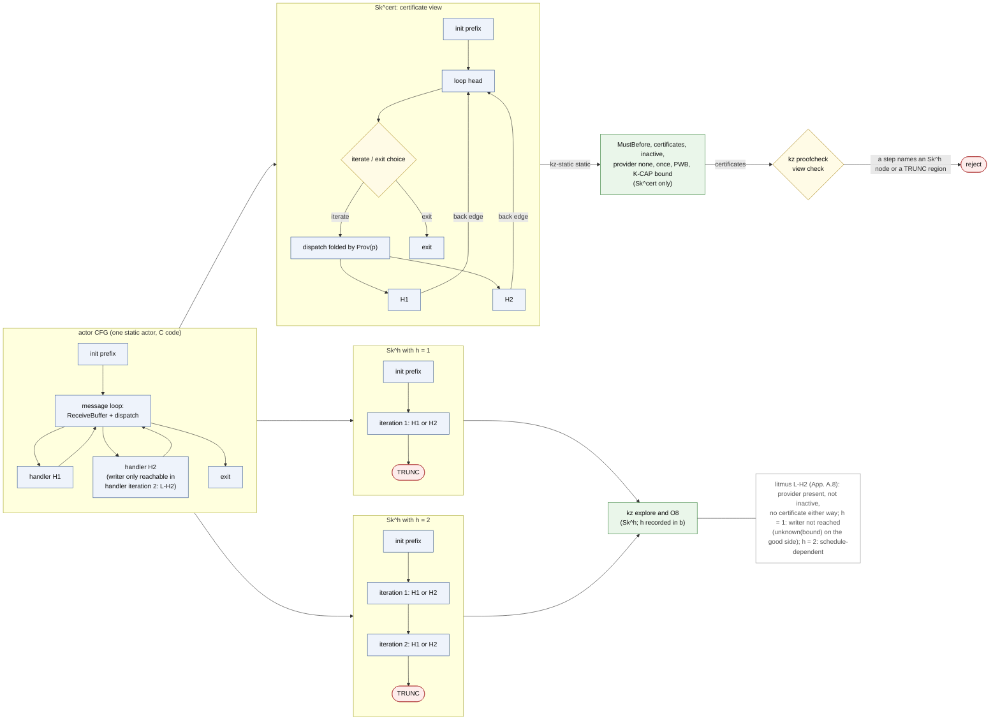

# 04 형식 모델: actor, 자원, 계약, 의미론, 순서 관계, 보장

이 문서는 Kairos가 판정의 근거로 삼는 형식 모델을 설명한다. 실행의 주체(actor)와 대상(자원), 준비 계약과 instance, 실행 집합을 정하는 기준 B·의미론 σ·모델 수준 M, 그 위에서 계산하는 순서 관계, 판정 기록, 그리고 보장과 가정을 다룬다. spec §1.2–1.10, §4.2–4.5의 핵심, §6을 spec을 읽지 않은 연구자가 따라올 수 있게 풀어 쓴다.

상태: 설계 문서 — 구현·측정 전. 규범 원문: [spec/SPEC_FINAL.md](spec/SPEC_FINAL.md)

## 목차

- [0. 읽기 전에](#0-읽기-전에): 표기, 예로 쓰는 사례, 모델의 뼈대
- [1. Actor, instance, once(τ), 네 가지 identity](#1-actor-instance-onceτ-네-가지-identity) (spec §1.2)
- [2. 자원: kind, lifecycle automaton, generation, key](#2-자원-kind-lifecycle-automaton-generation-key) (spec §1.3)
- [3. 연산, effect, LP, capture point, 모델 수준 M](#3-연산-effect-lp-capture-point-모델-수준-m) (spec §1.4)
- [4. Event, template, trace](#4-event-template-trace) (spec §1.5)
- [5. 준비 계약](#5-준비-계약) (spec §1.6)
- [6. 분석 기준 B](#6-분석-기준-b) (spec §1.7)
- [7. 스케줄·시간 의미 σ와 containment](#7-스케줄시간-의미-σ와-containment) (spec §1.8)
- [8. Skeleton의 두 view](#8-skeleton의-두-view) (spec §4.3, 그림 D10)
- [9. 순서 관계: strata, MustBefore, PWB, HB](#9-순서-관계-strata-mustbefore-pwb-hb) (spec §1.9, §4.2, §4.4, §4.5)
- [10. R2로 읽는 once, MustBefore, PWB, certificate](#10-r2로-읽는-once-mustbefore-pwb-certificate) (spec App. A.1)
- [11. 판정 기록](#11-판정-기록) (spec §1.10)
- [12. 보장과 가정](#12-보장과-가정) (spec §6)
- [13. 관련 문서](#13-관련-문서)

---

## 0. 읽기 전에

### 0.1 표기

근거 표기는 spec 머리말을 따른다. 자세한 설명은 [01_overview.md §0](01_overview.md#0-읽는-법)에 있다.

| 표기 | 뜻 |
|---|---|
| [F] | 코드·기록·보고서 인용이 있는 사실 |
| [M] | 측정값. 이 문서의 [M]은 모두 spec이 인용한 **기존** 측정이다([BM], [R07], [R2g], [R2c]) |
| [I] | 추론 또는 설계상 추론. 실행해서 확인하지 않았다 |
| [D] | 설계 결정. spec §11의 ADR이 기록한다 |

- 문헌은 [R04]·[R05]·[R06]이 확인한 범위에서만 쓰고 상태 표지를 붙인다. V-doc은 원문 확인, V-abs는 서지·초록 수준 확인, V-me는 보고서 작성자가 검색으로 서지·초록 수준을 확인한 것, P는 일부 확인이다.
- "(spec §4.4)"는 SPEC_FINAL.md의 절이고, "[R03 §4]"는 `background/`의 보고서다. 코드 위치 `path:line`은 고정된 cFS tree(cFS `088b2fa8`) 기준이다.
- **Kairos는 아직 한 번도 실행되지 않았다.** R2·C1에 대해 "판정이 나온다"고 쓴 것은 모두 spec App. A의 기대 동작이다 [I]. App. A의 제목 자체가 "expected behaviour; nothing here was run"이다.

### 0.2 예로 쓰는 사례

| 사례 | 한 줄 요약 | 이 문서에서 보여 주는 것 |
|---|---|---|
| **R2** | cFE core가 시작하는 동안 ES와 EVS task가 SB 코드를 실행한다. 그 코드는 `CFE_EVS_SendEventWithAppID`에 SB의 AppId(`CFE_SB_Global.AppId`)를 넘긴다. 이 값은 SB task가 `cfe_sb_task.c:138`에서 쓰기 전까지 0(UNDEFINED)이다. 기존 기록에서 매 boot의 위반 사용 24개(ENV의 version table이 있는 basis)는 모두 HB상 게시보다 **앞서도록 순서가 정해져** 있었다([R2g §2]; [R2c §7]; spec §1.11) | 네 가지 identity, capture point, once, MustBefore, PWB, certificate |
| **C1** | CF가 table에 적힌 이름으로 OSAL counting semaphore를 조회한다. 그것을 만드는 provider 앱과의 순서를 정하는 장치가 없다. default B에서는 이름이 비어 있어 이 경로가 실행되지 않는다([LED]; spec App. A.4) | `inactive`, 지연 retry, σ_U∞, timeout-dependent, M_impl |
| **SB subscribe-before-send** | 구독(route)이 생기기 전에 보낸 message는 success를 돌려받으면서 조용히 사라진다(spec §1.11) | Allowed가 정해지지 않은 계약, LOSS-UNDER-ORDER, 위반 사슬 |
| **OSAL RESERVED window** | OSAL object 생성 도중, 이름은 이미 보이지만 최종 ID는 아직 쓰이지 않은 구간이다(spec §1.3, §3.2) | lifecycle 상태 RES_CN, M_api와 M_impl의 차이 |

### 0.3 모델의 뼈대

각 줄은 앞줄의 개념을 쓴다.

| 개념 | 한 줄 정의 | 절 |
|---|---|---|
| actor | 실행 흐름 하나(OSAL task, raw thread, 외부 입력 근원) | §1 |
| 자원 | framework가 관리하는 대상. kind마다 lifecycle 상태 기계가 있다 | §2 |
| 연산과 effect | actor가 부르는 API. 자원 상태를 바꾸거나(lifecycle) 자원을 쓴다(use). 효과마다 일어나는 지점(LP)이 있다 | §3 |
| event, trace | LP에서 일어난 효과 하나 / actor별 program order를 지키는 event 열 | §4 |
| 준비 계약 | "이 사용 지점에서 이 자원은 이 상태여야 한다"와 허용되는 not-ready 행동 | §5 |
| B, σ, M | 실행 집합 `Exec(B,σ,M)`을 정한다 | §6, §7 |
| skeleton view | 정적 분석이 실행 집합을 근사하는 actor별 자동자 | §8 |
| 순서 관계 | MustBefore, PWB, trace의 HB | §9, §10 |
| 판정 기록 | instance마다 (σ, M) 칸별 class와 근거 축 | §11 |
| 보장 | 위 모두와 가정 A에 상대적인 진술 | §12 |

---

## 1. Actor, instance, once(τ), 네 가지 identity

### 1.1 Actor의 세 부류

Actor 집합은 `T = T_osal ∪ T_raw ∪ T_env`다 [F] (spec §1.2; [R01 §2.6]; [R02 §1.1]).

| 부류 | 무엇인가 | cFS 예 |
|---|---|---|
| `T_osal` | `OS_TaskCreate`로 만든 task | cFE core main task, 앱 main task, child task(`ES_BG_TASK`, TIME의 tone·local child, FM의 child) |
| `T_raw` | OSAL task record가 없는 thread | PSP main thread(`CFE_ES_Main`을 돌리는 "ES startup thread", 나중에 `OS_Application_Run`), console writer, timebase thread `cFS-Master`, signal handler 문맥 |
| `T_env` | 환경 근원 | ground 명령, SBN peer, stop 명령. 들어오는 HB edge가 없다([R04 §4 row 17]) |

**static actor** τ는 closure 항목 하나, 즉 생성 지점(spawn site)과 entry 함수의 쌍이다(spec §3.1). **actor instance**는 `(τ, generation)`이다. skeleton(§8)의 노드는 static actor에 속한다.

### 1.2 once(τ): "이 actor는 한 실행에 많아야 하나다"

§9.6의 순서 증명(frontier 규칙, ONCE-PWB)은 "그 actor의 **유일한** 실행 흐름"을 근거로 삼는다. 같은 entry의 instance가 둘이면 한 instance의 지점이 다른 instance의 지점 뒤에 올 수 있어 논증이 깨진다. 그래서 once는 **가정하지 않고 증명한다** [D] (spec §1.2; [X1-M2] 수정).

- PSP main thread는 정의상 once다(process entry, 가정 A3).
- 생성 지점이 `s_1 … s_k`인 actor는 다음이 모두 성립할 때만 once다.
  1. 모든 `s_i`가 once actor 안에 있다.
  2. 어떤 `s_i`도 certificate view(§8)의 star-closed loop 영역, 즉 "몇 번이든 반복"으로 닫은 loop 안에 있지 않다.
  3. 생성 지점들이 서로 배타적이다. 모두 같은 once actor 안에 있고, 어느 두 지점 사이에도 어느 방향으로든 skeleton 경로가 없다. actor의 실행 하나는 경로 하나이므로 배타적인 두 지점은 함께 실행될 수 없다.
- 환경 근원과 비동기 문맥(signal handler, 예외 경로, callback 문맥)은 결코 once가 아니다(spec §1.2, §3.1).
- **노드의 once**: 노드 `n`은 actor가 once이고 `n`이 star-closed 영역 밖이면 once다. 그러면 `n`은 한 실행에 많아야 한 번 일어난다.

once 사실은 그것을 쓰는 certificate에 유도 과정과 함께 적고, 독립 검사기 `kz proofcheck`가 다시 확인한다. once가 아닌 actor에는 frontier·once-PWB 논증을 쓰지 않는다. 재시작 시나리오 `B_restart`에서는 skeleton을 generation `g ∈ {0, 1}`마다 복제해 각 복제본이 once가 되게 한다.

**R2의 예** (spec App. A.1 step 7, [I]). core object table loop는 반복 횟수가 상수라 정확히 펼친다(spec §3.1). 그러면 ES main과 EVS main은 각각 생성 노드가 하나뿐이고, 그 노드는 once인 startup thread 위, star-closed 영역 밖에 있다. 따라서 `once(ES main)`, `once(EVS main)`이다.

**반례** (litmus L-ONCE, spec App. A.8). loop 안의 생성 지점이 같은 entry의 instance 둘을 만들면 once가 성립하지 않는다. frontier와 once-PWB가 금지되고, 기대 class는 schedule-dependent다.

### 1.3 Identity와 네 가지 identity 필드

instance마다 identity record `⟨kind, osal_id, serial, tid, name, creator_event, generation⟩`를 둔다. OSAL ID는 `(type << 16) | serial`이라 실행마다 바뀌므로, 실행 사이 대응은 `(type, name, creator, creation ordinal)`로 맺는다 [F] ([R01 §1.2, §6.2 item 3]).

event마다 identity 필드 넷을 두고 **결코 합치지 않는다**(spec §1.2; [R06 F1]).

| 필드 | 정의 | 따로 두는 이유 (cFS 사실) |
|---|---|---|
| `exec(e)` | `e`를 실행하는 actor instance | SB 코드는 호출자의 task에서 돈다([R02 §2.4, §2.8]) |
| `owner(e)` | 그 시점에 `exec(e)`를 task 집합에 가진 ES 앱(generation 구분). raw thread는 `⊥` | 앱 하나에 main task와 child task가 있다([R02 §1.12]) |
| `svc(e)` | 활성 frame의 stack: API frame(SB, EVS, TBL, …)과 on-behalf frame `cb(registrant)` | TIME synch callback은 등록한 앱을 위해 TIME task에서, FS callback은 SB/TBL을 위해 `ES_BG_TASK`에서, OSAL timer callback은 timer 생성자를 위해 timebase thread에서 돈다([R02 §5.3, §6.1]; [R01 §3]) |
| `stamp(e)` | 코드가 명시적으로 넘기거나 저장하는 identity 값(`CFE_EVS_SendEventWithAppID`의 `AppID` 인자, `CFE_SB_CreatePipe`가 저장하는 pipe 소유자) | R2: ES task가 SB 코드를 실행하며 SB의 게시되지 않은 AppId를 찍는다([R2g §2]) |

R2의 사용 하나에 정의를 적용하면 네 필드가 모두 다르다. `exec`는 ES main task, `owner`는 ES 앱, `svc`에는 SB API frame이 있고, `stamp`는 SB의 AppId 값이다. thread identity 하나만 보는 검출기는 이 구분을 표현하지 못한다(spec §1.11 G6 행).

---

## 2. 자원: kind, lifecycle automaton, generation, key

### 2.1 자원의 네 요소

자원은 `r = ⟨kind, scope, key, gen⟩`이다(spec §1.3).

- `scope ∈ {process, persistent}`. persistent 자원은 process가 끝나도 남는다(CDS, boot record, reset area, `/dev/shm/osal:RAM`의 파일, `EEPROM.DAT`, [R01 §5.3]).
- `key`는 kind 안에서 자원을 가리키는 값이다. 이름, 숫자 ID, `(MsgId, pipe)`, slot 번호, 경로, scope가 붙은 symbol, 또는 **할당 기록** `ρ(n)`(§2.4)이다. 정적 분석에서는 symbolic일 수 있고(예: "CF table 필드 `chan[i].sem_name`의 문자열"), 모르면 `⊤`다.
- `gen`은 OSAL serial, cFE resource-ID serial, 또는 재시작 generation이다.

### 2.2 Lifecycle automaton (typestate)

kind `k`마다 lifecycle automaton `A_k = (Q_k, q0_k, Σ_k, δ_k)`, 즉 상태 집합, 초기 상태, 행동 집합, 전이 함수가 있다. 이 방식을 **typestate**라 한다. 객체의 현재 상태가 허용되는 연산을 정한다는 개념이다(Strom & Yemini, IEEE TSE 1986 [V-me]). 주요 kind는 다음과 같다. 전체 표는 spec §1.3이다.

| kind | 상태 | 게시 지점 (LP) |
|---|---|---|
| `osal.obj<T>` | FREE → ALLOC → RES_C(이름 안 보임) → RES_CN(이름 보임, RESERVED, type lock **안** 잡음) → LIVE → RES_D → FREE | type lock 아래 최종 ID 쓰기 `osapi-idmap.c:1092`, unlock `:1105` |
| `es.app` / `es.task` / `es.lib` | FREE → RESERVED → LIVE → RESERVED(정리 중) → FREE | core 앱: 예약 `cfe_es_start.c:803`, 게시 `:818`, 실패 시 지움 `:823`. script 앱: 예약 `cfe_es_apps.c:821`, 게시 `:869`, 실패 시 해제 `:893` |
| `es.self(exec)` | ABSENT → LIVE(실행 task의 task record와 owner의 App record가 모두 조회됨) | 위의 게시. `CFE_ES_GetAppRecordByContext`가 읽는다 |
| `cell(loc)` | INVALID → VALID | `loc` 값을 유효하게 만드는 store. 예: `CFE_ES_GetAppID(&CFE_SB_Global.AppId)`(`cfe_sb_task.c:138`) |
| `evs.reg(slot)` | UNREG → REG. `CFE_EVS_Register`는 먼저 slot을 memset한다(`cfe_evs.c:56`) | store `cfe_evs.c:106`, lock 없음 |
| `sb.route(m,p)` | NONE ↔ ROUTED | SB lock 아래 `CFE_SB_SubscribeFull` |
| `sb.queue(p)` | 깊이 `0..cap_B(p)`. `cap_B(p) = min(요청, msg_max)`는 euid ≠ 0일 때만 | [M] `msg_max` 10, pipe 26개 중 22개가 잘림([BM §3.1]) |
| `es.shutdown` | RUN → SHUTDOWN_REQ → TEARDOWN | `ShutdownReq = true`(`cfe_psp_support.c:87`); `OS_DeleteAllObjects`(`cfe_psp_start.c:507`) |

**OSAL RESERVED window**는 `osal.obj<T>`의 RES_CN 상태다. 이 구간에서 by-name 조회는 기다리지 않고 곧바로 `OS_ERR_INCORRECT_OBJ_STATE`를 받는다(`osapi-idmap.c:401–404`). by-ID 조회는 제한된 횟수만큼 기다린다(spec §3.2). 게시 LP는 unlock 뒤에 도는 생성 callback이 아니라 lock 아래 최종 ID 쓰기다([R01 §6.1]). 이 구간은 모델 수준 M_impl에만 나타난다(§3.5).

### 2.3 `cell(loc)`: 일반 kind

`cell(loc)`은 값이 자원 identity인 공유 위치를 다루는 **일반** kind다(spec §1.3). R2의 `CFE_SB_Global.AppId`는 `cell(CFE_SB_Global.AppId)`다. `svc.identity(SB)` 같은 이름은 표시일 뿐 Φ 항목이 아니다. 그래서 R2에는 SB 전용 kind도 계약도 필요 없다(spec App. A.1 step 1).

### 2.4 할당 기록 `ρ(n)`

**할당 기록** `ρ(n)`은 펼친 **예약 노드** `n`이 할당하는 추상 record다 [D] (spec §4.2 step 8). 예약 노드는 빈 record를 골라 사용 중으로 표시하는 호출이다. core loop 반복마다의 `SetUsed(RESERVED)`(`cfe_es_start.c:803`)와 script 줄마다의 `cfe_es_apps.c:821`이 예다. 두 가정이 붙는다. 둘 다 `DECLARED_TRUSTED`(분석이 검증하지 못하고 믿은 항목)이고 관측으로 반박할 수 있다(O9).

- **A-FRESH**: 서로 다른 예약 노드는 서로 다른, 전에 쓰인 적 없는 record를 할당한다.
- **A-OWNER**: `StartAppTask(…, ParentAppId)`로 만든 task가 조회하는 App record는 `PendingAppId`가 `ParentAppId`로 흘러간 예약 노드의 `ρ(n)`이다. 흐름 자체는 def-use로 계산하고, task record → App record 단계만 믿는다.

---

## 3. 연산, effect, LP, capture point, 모델 수준 M

### 3.1 연산과 effect

연산 `op ∈ Φ.ops`는 binding(symbol 또는 AST pattern, 줄 번호가 아님), 역할이 붙은 인자(name, id, out-id, AppId, stamp, buffer, msg), 결과 code → `{ready, not_ready(q), error}`의 outcome map, 그리고 effect 목록을 가진다(spec §1.4). effect는 `lifecycle(r, a) when guard`(상태를 바꿈), `use(r)`(계약의 대상), `sync(obj, role)`(acq, rel, give, take, put, get, create, start, join, observe, timeout 등), `env(input)`, `mark(handler_begin | handler_end)`다.

### 3.2 LP: 효과가 "여기서 일어났다"고 보는 지점

**linearization point(LP)**는 시간이 걸리는 연산의 효과가 한순간에 원자적으로 일어났다고 볼 수 있는 한 지점이다. Kairos는 이것을 코드의 구체적 명령 위치로 정한다.

**요구 조건의 conjunct마다 LP를 따로 둔다** [D] (spec §1.4; [X1-M1] 수정). conjunct는 `P_1 ∧ … ∧ P_n`에서 ∧로 묶인 각 조건이다.

- lifecycle effect의 LP는 API 안에서 그 효과가 실제로 일어나는 명령 수준 event다.
- use의 conjunct는 프로그램이 그 상태를 **읽는** 지점을 LP로 선언한다.
  - **registry conjunct**(상태가 framework table에 있음): API 안의 읽기. 예: EVS의 slot 검사.
  - **value conjunct**(호출자가 넘기는 값에 대한 요구, role `stamp`/`key`/`id`): 아래의 **capture point**.

### 3.3 Capture point와 T-DERIVE

**capture point**는 호출자가 인자 값을 공유 위치에서 읽어 온 load 지점이다.

- `kz-static extract`는 AST 수준 def-use(정의–사용 연결) 분석으로 `derives(arg, loc, site)`를 낸다. 인자 값이 공유 위치 `loc`을 `site`에서 읽은 값의 복사 사슬(load, store, 인자 전달, 산술 없는 cast)일 때다.
- 그러면 conjunct를 `site`에서 `cell(loc)` 위로 평가한다. 이것이 번역 규칙 **T-DERIVE**다. 일반 규칙이고 SB에 대한 지식이 없다.
- 유일한 `derives` 사실이 없으면 capture point는 호출 자체이고, 그것이 필요한 certificate는 보류되어 `unknown(writer_incomplete)`가 된다.

**왜 필요한가** (R2, litmus L-CAPTURE). SB 코드는 `CFE_SB_Global.AppId`를 인자 평가 때 읽고(`cfe_sb_api.c:226–228`), EVS는 그 복사본을 나중에 검사한다(`cfe_evs.c:185–194`). 읽은 뒤 검사 전에 SB가 값을 게시해도 검사되는 것은 옛 값이다. 그래서 결과는 capture point의 순서를 따른다. spec은 검사 LP를 겨냥한 예측기라면 거짓 good witness를 받아들일 것이라고 적는다(spec App. A.8).

### 3.4 LP의 예

[F] (spec §1.4)

| API | effect / conjunct | LP |
|---|---|---|
| `OS_*Create` | 이름 보임 / 게시 | `OS_OBJECT_INIT`의 `name_entry` 쓰기(type lock 풀림) / type lock 아래 최종 ID 쓰기 `osapi-idmap.c:1092` |
| `OS_*GetIdByName` | `use(osal.obj(name))` | type lock 아래 이름 검색 |
| `CFE_ES_GetAppID` | `use(es.self(exec))` | ES lock 아래 `CFE_ES_GetAppRecordByContext()`(`cfe_es_api.c:748–763`) |
| `CFE_SB_TransmitMsg` | `use(sb.route(hdr.MsgId, ·))` | SB lock 아래 route_lookup(`cfe_sb_priv.c:1007–1104`), 그 뒤 lock 밖에서 목적지마다 put LP(`:1177–1216`) |
| `CFE_EVS_SendEventWithAppID` | `valid(arg.AppID)` (value) | `derives`가 준 capture point(예: `cfe_sb_api.c:226–228`) |
| | `evs.reg(arg.AppID) ∈ {REG}` (registry) | slot 검사 `cfe_evs.c:185–194` |

**outcome code는 검산이다.** 준비 여부는 conjunct마다 LP에서 평가한다. 사용 지점에서 프로그램이 받은 결과 code는 계산한 상태에 대한 일관성 검사(obligation O4)다. K-ID에서는 `ILLEGAL_APP_ID`가 value conjunct 실패와, `NOT_REGISTERED`가 registry conjunct 실패와 동치다(spec §1.4).

### 3.5 모델 수준 M_api와 M_impl

OSAL을 어디까지 펼쳐 모델링하는지가 두 수준으로 나뉜다 [D] (spec §1.4; [X1-C2] 수정).

| 수준 | 정의 | 판정의 뜻 |
|---|---|---|
| **M_api** | OSAL API 하나가 주 LP에서의 원자적 전이 하나다. create는 lookup에 대해 원자적이고, lookup은 found 또는 not found다 | "OSAL API 계약을 원자적으로 따르는 **가상의** backend"에 대한 주장, 즉 이식성 주장이다. POSIX 바이너리에 대한 주장이 아니다 |
| **M_impl** | OSAL idmap, task, binsem, queue 경로를 더 낮은 어휘 Φ_L-1(pthread mutex·condvar, `sem_*`, `mq_*`, `clock_nanosleep`, `pthread_create/cancel/join`)로 투영한다. API가 LP에서 쪼개지고, RESERVED window, 두 깨움 원인(broadcast, timeout)을 가진 RESERVED 대기, lock 누수 경로가 나타난다 | POSIX 구현까지 반영한 주장. σ_E로 옮기는 경로가 이쪽이다(§7.5) |

- OSAL 내부 lock은 M_impl에서만 interleaving을 제약하고, 어느 수준에서도 shape용 HB edge를 만들지 않는다.
- **M_impl-relevant 연산**은 두 수준이 다르게 모델링하는 연산이다: idmap 생성·조회·삭제·token 변환, task 생성·준비·삭제, binsem, queue 생성·put·get. cone(한 후보와 관련된 actor와 object를 닫은 집합, spec §4.10)이나 certificate에 이런 연산이 있으면 그것도 M_impl-relevant다.
- **두 수준이 다르면 그대로 보고한다.** M_impl에서 protected인데 M_api에서 위반 가능하면 **portability hazard**다. M_impl에서만 위반 가능하면 고정 판 OSAL POSIX의 **implementation-defect candidate**다. M_api 전용 certificate를 실제 바이너리 관측이 반박하면 **portability-hazard-evidence**이고, model fault가 아니다.

**예** ([I], spec App. A.4 step 4). C1의 파생 설정 B′에서 by-name 조회가 RESERVED window에 닿으면, M_impl에서는 `INCORRECT_OBJ_STATE`가 CF의 retry loop를 끝내고 countsem table lock이 잡힌 채 남아 provider가 막힌다. implementation-defect candidate(F1)다. cone이 M_impl-relevant이고 두 수준이 다르므로 M_api 결과는 σ_E로 옮기지 않는다.

---

## 4. Event, template, trace

**event**는 `e = ⟨id, actor, seq, op, phase, args, outcome, keys, site, ι(e), lp_intervals, t⟩`다(spec §1.5).

- `seq`는 actor 안의 순번, 즉 program order token이다. `phase`는 `call`, `return`, `point` 중 하나다.
- `outcome`은 프로그램 **자신이** 받은 결과다([R06 F11]). `ι(e)`는 §1.3의 identity 네 필드다.
- `lp_intervals`는 conjunct마다 LP를 관측된 두 지점 사이에 끼운 구간이다(spec §4.8).
- `t`는 timestamp이고 **근거로만** 보관한다. 물리 시간은 HB를 주지 않는다(Lamport, CACM 1978 [V-abs]).

**trace** π는 각 actor의 event가 program order대로 나타나는 event 열이다.

**static template**은 같은 type을 가지지만 필드가 symbolic이고 경로 조건이 붙는다. template은 `(static actor, inline된 호출 문자열, site)`로 **문맥을 구분한다** [D]. `CFE_ES_TaskInit`에서 도달한 `CFE_SB_CreatePipe` 안의 SB event site와 ES 명령 loop에서 도달한 같은 site는 다른 template이다. 재귀가 있으면 그 요약은 `unknown`이다.

**구체화** `t ⊒ e`는 `e`의 actor와 호출 문자열이 `t`와 맞고, site가 같고, 필드가 `t`의 제약을 만족한다는 뜻이다. 정적 층, trace 층, 모델 층이 이 하나의 type 덕분에 검사기 하나를 공유한다.

---

## 5. 준비 계약

### 5.1 계약의 요소

계약은 `κ = ⟨id, U, sel, Req, Oracle, Allowed, harm, prov, authored, guard, scope⟩`다(spec §1.6).

| 요소 | 뜻 | 예 |
|---|---|---|
| `U` | 사용 pattern: 연산과 site 조건 | `CFE_EVS_SendEventWithAppID` 호출 |
| `sel` | event 필드에서 key를 고르는 selector | `evs.reg(arg.AppID)`, `osal.countsem(arg.name)` |
| `Req` | conjunct `P_1 ∧ … ∧ P_n`. 각각 core expression 언어로 쓰고 자기 LP를 가진다 | `valid(arg.AppID) ∧ state(evs.reg(arg.AppID)) = REG` |
| `Oracle` | conjunct마다 **framework 유효성 predicate**. Kairos는 실행하지 않는다. 정적으로는 그 읽기 집합이 conjunct의 **지원 위치**(support location)를 정하고, 동적으로는 프로그램의 결과 code가 conjunct의 관측된 모습이다(O4) | `CFE_ES_AppRecordIsMatch(CFE_ES_LocateAppRecordByID(a), a)` |
| `Allowed` | 문서화된 not-ready 행동과 그 horizon(§5.2) | `none`, `retry_until_ready(…)` |
| `harm` | 결과가 허용되지 않을 때의 효과 종류(§5.3) | `event_lost_silently` |
| `prov`, `authored` | 출처 `(kind, path:line, 인용 문장의 sha256)`; 작성 시각, 작성자, 작성자가 미리 본 설계 사례 | `cfe_evs.h:168–172` |
| `guard` | profile을 판끼리 재사용하기 위한 version guard | `cfe ≥ 6.6.0` |
| `scope` | 암묵적 conjunct "종료 요청 전"(§5.4) | — |

### 5.2 Allowed와 horizon

**horizon**은 not-ready 결과가 허용되는지 판단하려고 사용 뒤를 어디까지 보는가다. 연구자가 고르지 않고 reference에서 가져온다 [D] (spec §1.6; [J1 X2]). 정적·trace·explorer 쪽 검사 방법은 spec §1.6 표에 있다.

| Allowed 항목 | 뜻 | horizon |
|---|---|---|
| `none` | 어떤 not-ready 결과도 허용하지 않는다 | 사용 자체 |
| `documented_drop(src)` | API가 문서화된 설계로 요청을 조용히 버린다. EVS own-ID guard(`cfe_evs_utils.c:613–623`), SB의 event 재귀 guard와 task record 없음 drop(`cfe_sb_priv.c:305–328, 773–790`) | 사용 자체 |
| `returned_and_tested(codes)` | 문서화된 code를 돌려주고, 호출자가 분기해 정상 연속에 이른다 | 같은 actor의 같은 자원에 대한 다음 연산, 또는 actor 종료. trace가 먼저 끝나면 `unknown(horizon)` |
| `retry_until_ready(codes, bound)` | 호출자가 재시도한다 | build에서 상수 평가한 loop bound(예: CF의 실효 `CF_STARTUP_SEM_MAX_RETRIES`) |
| `fallback(op′)` | 문서화된 대안을 쓴다 | actor의 다음 연산 |
| `defer_by_design(src)` | reference가 연기를 문서화했다(TO_LAB은 OPERATIONAL 뒤 구독, `to_lab_app.c:64–66`) | 문서화된 연기 지점 |
| `exit(code, src)` | 문서화된 종료 | actor 종료 |
| `unspecified_by_reference` | reference가 허용 여부를 말하지 않는다 | — |

`unspecified_by_reference`이면 harm도 `unspecified_by_reference`다. 전달을 요구하는 reference가 없는 route·용량 계약에는 결과 label **LOSS-UNDER-ORDER**가 붙는다. **SB subscribe-before-send**(K-ROUTE)는 TO_LAB처럼 연기가 문서화된 곳에서는 `defer_by_design`, 그 밖에서는 `unspecified_by_reference`와 LOSS-UNDER-ORDER다(spec §3.15 RC5). Kairos는 이 손실을 "위반"이라고 단정하지 않고, reference가 판단 근거를 주지 않는다는 사실을 label로 남긴다.

### 5.3 harm

어휘는 `event_lost_silently`, `status_ignored`, `wrong_identity_stamped`, `message_lost`, `app_error_exit`, `app_zombie`(record를 영원히 쓰고 정리하지 않음), `service_task_absent`(core task가 끝났는데 시스템은 계속 돎), `task_never_runs`, `processor_reset_requested`, `process_abort`, `panic`, `hang_or_deadlock`, `unspecified_by_reference`다(spec §1.6).

### 5.4 scope: 종료 요청 전까지

모든 계약에는 암묵적 conjunct **"사용의 LP보다 앞선 `es.shutdown`의 SHUTDOWN_REQ LP가 없다"**가 붙는다 [D] (spec §1.6; [X1-M6], [X2-04] 수정). 범위 밖 발생은 별도 family **K-TEARDOWN**의 instance로 따로 분류·보고한다. 실험의 stop 방법이 ES POWERON 재시작 명령이므로, 관측한 모든 실행은 teardown으로 끝나고 그 구간의 사용은 K-TEARDOWN instance다(spec §3.5).

### 5.5 Instance와 발생별 결과

**instance**는 `i = (κ, t, key)`다. `t`는 `U`에 맞는 문맥 구분 template이다.

실행의 linearization λ(한 실행의 모든 event를 한 줄로 세운 순서)를 생각하자. `state_λ(r, P_j, u)`는 사용 발생 `u`에서 conjunct `P_j`의 LP보다 앞선 LP를 가진 같은 generation의 lifecycle effect를 모두 적용한 뒤의 `A_k` 상태다. 범위 안 발생 하나의 결과는 넷 중 하나다(spec §1.6).

| 결과 | 조건 |
|---|---|
| `READY` | 모든 conjunct가 자기 LP에서 성립한다 |
| `TOLERATED` | ready가 아니고, 결과와 연속이 horizon 안에서 `Allowed`를 만족한다 |
| `VIOLATING` | ready가 아니고 허용되지 않는다 |
| `NOT_READY_UNJUDGED` | ready가 아니고 `Allowed = unspecified_by_reference`다 |

실행이 `i`에 대해 **bad**라는 것은 범위 안 어떤 발생이 `VIOLATING`이거나, Allowed가 미지정일 때 `NOT_READY_UNJUDGED`라는 뜻이다. 어느 뜻인지는 결과 label이 말한다.

### 5.6 위반 사슬

`i₁ ⇝ i₂`는 `u₂`의 발생이 `u₁`의 not-ready 결과 **때문에만** 존재할 때다. 사슬은 결과의 갈래를 **모두** 기록한다([X2-02] 수정). 예 [F]: R2의 identity 사용 24개 중 17개는 route가 생기기 전에 송신된 ES의 EVS packet(MsgId 0x808)에 대한 `SEND_NO_SUBS` event다([R2g §2]). R2 instance가 SB subscribe-before-send instance(K-ROUTE)로 이어지는 사슬이다(spec App. A.1 step 13).

### 5.7 R2의 계약

(spec App. A.1 steps 1–2, 8)

- 계약은 generic `K-ID.send-with-appid`(출처 `cfe_evs.h:168–172`)이고, 모든 문맥별 `CFE_EVS_SendEventWithAppID` site에 instance를 만든다. SB site 39개는 `CFE_SB_Global.AppId`를 `stamp`로 넘긴다([R2c §2]).
- `Req = valid(arg.AppID) ∧ state(evs.reg(arg.AppID)) = REG`. value conjunct `V`는 capture point `c`에서 `cell(CFE_SB_Global.AppId)` 위로 평가한다. registry conjunct는 여기서 역할이 없다. EVS가 index 유효성을 먼저 검사하고(`cfe_evs.c:185–189`) `V`가 이미 실패하기 때문이다.
- `Allowed = none`이다(header가 대안으로 든 system log는 다른 API다). harm은 `event_lost_silently`이고, SB 호출자는 모두 `ILLEGAL_APP_ID`를 버린다.

---

## 6. 분석 기준 B

`B = ⟨Build, Config, Init, Env, Input⟩`는 스케줄을 뺀, 실행을 정하는 모든 것이다. 각 항목은 값, 출처, 정책 상태와 함께 기록한다(spec §1.7).

| 항목 | 내용과 cFS 예 |
|---|---|
| **Build** | commit, gcc 13.3.0과 flag, `link.txt` archive 의미, 생성 파일 hash. `cfe_static_module_list.c`가 core 순서를 정한다. 생성 module version table이 없으면 R2의 위반 수가 24에서 11로 바뀐다([R2c §4.2, §7]) |
| **Config** | startup script 선택 규칙(PROCESSOR reset이면 휘발성 `/ram/cfe_es_startup.scr` 먼저, POWERON이면 생성 script, `cfe_es_apps.c:130–168`), `.tbl`과 소스 초기값의 byte 대조, platform 상수, PSP module 목록 |
| **Init** | 실행 전 유지 상태(boot record, CDS·reset area SysV segment, `/dev/shm/osal:RAM`, `EEPROM.DAT`, 해독한 CDS와 critical table image). 실행마다 snapshot S0. hash는 내용만 본다(`EEPROM.DAT` mtime은 boot마다 바뀜, [BM]) |
| **Env** | kernel, 4 vCPU, 스케줄링([M] 27개 thread 모두 `SCHED_OTHER`, [BM §0]), affinity, euid(queue 잘림을 정함), CWD, 실효 queue 깊이, platform 기능(`/proc/schedstat` 없음), cold/warm 층([M] OPERATIONAL까지 2570 ms 대 1613–1633 ms, [BM]) |
| **Input** | event 기반 trigger를 단 외부 명령, reset 종류 입력(`-R` 또는 boot record의 `NextResetType`), stop 방법(PI 결정 D17) |

**INIT** [D] (spec §1.7; [X1-m1], [X2-12] 수정)은 **프로그램 진입 상태**다. process scope 위치는 정적 초기값 image, persistent scope 위치는 해독한 S0다. EarlyInit의 store(예: `memset(&CFE_SB_Global, 0, …)` `cfe_sb_init.c:50`)는 INIT이 아니라 평범한 writer 항목이다. R2에서 `CFE_SB_Global`은 0으로 초기화되는 전역이므로(`cfe_sb_task.c:40`) INIT에서 `AppId = 0 = UNDEFINED`이고, value conjunct `V`는 INIT에서 거짓이다(`INIT_FALSE(V)`).

**실행 열과 generation.** 실행 사이 계약(K-PERSIST)에서는 실행 *n*의 끝 상태가 `B_{n+1}.Init`이 된다. 한 실행 안의 재시작·재적재는 generation을 만든다(`B_restart`). `CFE_PSP_Restart(POWERON)`로 끝나지 않은 실행 뒤에는 관측하지 않는 normalization boot를 한 번 해서 Init을 정규 S0로 되돌린다(spec §1.7, §4.13).

**구성 변형은 새 basis B′이고, 결코 "새 버그"가 아니다**([R06 §5.4]). 모든 판정은 B의 hash를 지닌다.

---

## 7. 스케줄·시간 의미 σ와 containment

### 7.1 실행 집합

`Exec(B, σ, M)`은 maximal 실행(더 이어 갈 수 없을 때까지 간 실행)의 집합이다. 전이는 LP 단위의 effect다 [D]. interleaving은 여러 actor의 전이를 한 줄로 끼워 넣은 순서다. 모든 의미론은 **certificate view**(§8) 위에서 정의한다. explorer는 exploration view를 탐색하고, 그 결과는 b에 h를 지닌다(spec §1.8; [X1-C1] 수정).

### 7.2 네 의미론

| σ | 정의 | 역할 |
|---|---|---|
| **σ_U** (untimed) | 가능한 전이의 임의 interleaving이다. `OS_TaskDelay`는 양보(yield)다. timeout 있는 대기(soft barrier, poll, OSAL RESERVED 대기)는 시작 뒤 언제든 timeout될 수 있다. 횟수 제한 retry는 **reference 횟수를 다 쓴 뒤에만** 소진된다. 우선순위와 affinity는 아무것도 강제하지 않는다. `CFE_PSP_Panic`은 끝(terminal)이고, `CFE_PSP_Restart`는 **호출자에게** 끝이다(돌아오지 않고 지연 뒤 `abort()`, `cfe_psp_support.c:60–107`). 다른 actor는 계속 돈다 | certificate와 모델 분류의 기준 |
| **σ_U∞** (patient) | σ_U에서 timeout 전이를 없앤 것이다. **지연 retry**(반복 사이에 Φ delay 연산이 있는 횟수 제한 loop)의 마지막 시도 실패는 **quiescence**(다른 어떤 전이도 가능하지 않은 상태, 즉 조건이 영원히 거짓)에서만 가능하다. 그 전까지 마지막 시도는 조건이 성립할 때까지 기다렸다 성공한다. 스케줄은 **강한 공정성**(strong fairness: 무한히 자주 가능해지는 전이는 무한히 자주 실행된다)을 가진다(Musuvathi & Qadeer PLDI 2008 [V-abs]) | "timeout 때문에만 위반되는가"와 "순서 논리가 위반되는가"를 가른다. timeout이 가리는 liveness 실패를 드러낸다 |
| **σ_R1[P_sched]** | 한 CPU의 고정 우선순위 선점. 인용한 scheduling profile `P_sched`(정책, 우선순위 대응, root thread 우선순위, priority inheritance)로 매개변수화한다. 지연은 막고(block) 이산 시간으로 깨우며, 막는 지점 사이 계산은 시간 0이다(가정 A-ZT) | 우선순위가 순서를 정하는 플랫폼(예: 6.4.1의 C3). 기본은 모델로만 |
| **σ_E** | 기록된 Env에서 실제 바이너리의 실행. 모델링하지 않고 관측·확인 실행으로 표본만 얻는다 | 실제 witness와 빈도 |

`P_sched^posix` [F]: OSAL은 Linux에서 `SCHED_RR`를 고르고, `CFE_ES_Main`을 돌리는 root thread가 가장 높은 우선순위를 받으며, mutex는 `PTHREAD_PRIO_INHERIT`다(`os-impl-tasks.c:348–365, 391–409`; `os-impl-mutex.c:82`). RTEMS·VxWorks profile은 backend 소스가 basis에 들어오기 전까지 `unspecified_by_reference`이고 σ_R1 판정을 내지 않는다(D13). [I] `P_sched^posix`에서는 startup thread가 실행 가능한 동안 core App-record window가 한 CPU에서 열릴 수 없다.

### 7.3 실행의 결과: good, bad, stall

instance `i`에 대해 maximal 실행의 결과는 다음과 같다(spec §1.8; [X1-M5] 수정).

- `good`: `u`에 범위 안에서 도달하고 모든 발생이 READY 또는 TOLERATED다.
- `bad`: 어떤 발생이 VIOLATING이다(Allowed 미지정이면 NOT_READY_UNJUDGED도).
- `stall`: `u`에 도달하지 못하고 quiescent 상태로 끝난다. `u`의 actor나 그것이 이행적으로 기다리는 actor가 거짓인 조건에 막혀 있다. harm은 `task_never_runs` 또는 `hang_or_deadlock`이다.
- 다른 이유로 `u`에 도달하지 않는 실행은 `i`와 무관하다.

### 7.4 Refinement: timeout이 하는 역할

refinement는 σ마다 따로 계산하고 자기 경계와 함께 저장한다 [D] (spec §1.8).

| refinement | 조건 |
|---|---|
| **timeout-dependent** | class(σ_U) = schedule-dependent이고, **모든** bad σ_U 실행이 timeout 전이(timed wait의 timeout, 또는 bound 뒤 소진된 지연 retry)를 거치며, 첫 timeout 직전 상태부터 σ_U∞로 이어 가면 `good`만 나온다 |
| **timeout-masked-liveness** | 위와 같지만 그런 σ_U∞ 연속 중 하나가 `stall`에 이른다. timeout이 순서·liveness 결함을 가린다 |
| (없음) | σ_U∞에도 bad 실행이 있으면 위반은 순서 논리 안에 있다 |
| **timeout-rescued** (good 쪽 flag) | 모든 good σ_U 실행이 timeout을 거치고 σ_U∞에는 good 실행이 없다. 어떤 대기가 포기했기 때문에만 good이다 |

**C1로 본 뜻** ([I], spec App. A.4 step 3, 파생 B′, M_api).
- σ_U에서는 CF의 retry를 모두 provider의 생성보다 앞에 둔 실행이 있다. 지연은 양보일 뿐이기 때문이다. 그래서 schedule-dependent다.
- σ_U∞에서는 지연 retry가 참을성 있게 기다리므로 provider가 돌 수 있는 동안 소진이 불가능하다. good만 남으므로 **timeout-dependent**다.
- 수정 전 판(시도 한 번)은 timeout 없이 위반되므로 σ_U∞에서도 schedule-dependent다. 즉 C1의 수정은 순서 논리의 위반을 timing 여유에 대한 의존으로 바꾸었다.
- provider가 결코 돌 수 없다면 σ_U∞는 `stall`에 이르고 **timeout-masked-liveness**다(litmus L-PATIENT).

확인 실행에서 hold(실행을 멈춰 세우는 제어) 때문에 프로그램 timeout이 발동했으면 `timeout-exercised`를 붙이고, 자연 σ_E로 세지 않는다.

### 7.5 Containment와 전이 규칙

**containment**는 한 의미론의 실행이 다른 의미론의 실행에 모두 포함된다는 관계다. 판정을 의미론 사이에서 옮기는 근거이며, spec은 이것을 **모델 수준별로** 말한다(Lemma L-CONT; [X1-C2] 수정). 가정 A7-impl, A7-api, A3, A4, A9, A-SKEL(§12.2) 아래에서:

- 각 M에 대해 `Exec(B,σ_U∞,M) ⊆ Exec(B,σ_U,M)`, `Exec(B,σ_R1,M) ⊆ Exec(B,σ_U,M)`.
- `Exec(B,σ_E) ⊆ Exec(B,σ_U,M_impl)`.
- `Exec(B,σ_E) ⊆ Exec(B,σ_U,M_api)`는 **주장하지 않는다.** M_api는 RESERVED window의 `INCORRECT_OBJ_STATE`, type lock 누수, 조용한 task 손실 같은 실제 POSIX 행동을 설계상 제외한다.
- cone에 M_impl-relevant 연산이 없으면 두 수준의 cone 투영이 같다(Lemma L-MLEVEL [I], 아직 증명할 의무).

**전이 규칙** [D] (spec §1.8)

1. σ_U에서 수준 M, 경계 b로 증명한 보편 class(protected, tolerated, fixed-order)는 σ_U의 부분집합인 σ′에서 **같은 M, 같은 b로** 성립한다. σ′의 어떤 실행도 사용에 도달하지 않으면 `inactive_σ′`다.
2. **σ_E로는** M_impl에서만 옮긴다. M_api에서는 (i) cone과 certificate에 M_impl-relevant 연산이 없거나 (ii) M_impl 결과가 있고 같을 때만 옮긴다. 그 밖에는 σ_E 칸이 `unknown(model_level)`이고, M_api 결과는 이식성 주장으로 보고한다.
3. 어느 σ′의 witness(판정을 뒷받침하는 구체적 실행)는 같은 M의 σ_U에서도 witness다.
4. 빈도나 class가 σ_E **안으로** 옮겨 가는 일은 없다. σ_E class에는 자연 실행의 witness가 필요하다(§11.4).
5. "σ 사이에 아무것도 옮기지 않는다"는 너무 약하고, trace 하나의 certificate를 옮기는 것은 너무 강해서 둘 다 버렸다.

---

## 8. Skeleton의 두 view

### 8.1 Skeleton과 두 view

정적 분석은 C 코드 전체가 아니라 **skeleton** 위에서 일한다. static actor마다 문맥을 구분해 inline한 CFG(control-flow graph, 제어 흐름 그래프)를 관련 노드(conjunct별 LP의 effect와 capture point, 지원 위치의 load·store, 생성 지점, terminal 연산, handler 표시, loop head, local choice)만 남기도록 투영한 것이다 [D] (spec §4.3). 연산 결과 분기는 결과 label이 붙은 전이가 되고, B 상수 분기는 접히며(CF의 빈 `sem_name`은 조회를 도달 불가로 만든다), 나머지 data 분기는 명시적 local choice(과대 근사)가 된다.

view는 둘이다 [D] (spec §4.3; [X1-C1] 수정).

- **Certificate view `Sk^cert`.** reference bound까지 정확히 펼치지 않는 loop는 모두 **star-closed**다. star-closure는 loop를 "0번 이상 몇 번이든 반복"으로 닫는 것으로, loop head, back edge, 명시적 반복/탈출 선택으로 표현한다. message loop의 dispatch는 message provenance(§8.3)로 접는다. horizon도 잘림도 없다. `inactive`, provider `none`, MustBefore, once, PWB, frontier 규칙, K-CAP bound(용량 계약의 backlog 상한)는 **이 view에서만** 계산한다.
- **Exploration view `Sk^h`.** star-closed loop를 h번까지 펼치고, 그 너머는 `TRUNC`로 표시한다. explorer와 O8만 쓰고, 여기서 나온 판정은 b에 h를 지닌다. `kz proofcheck`는 `Sk^h` 노드나 `TRUNC` 영역을 가리키는 certificate 단계를 거부한다.

**왜 둘인가.** 이전 판(v1)은 loop를 h에서 잘랐다. h 너머 반복에서만 닿는 writer가 있으면 잘린 그래프의 "경로 없음"이나 "writer 없음"은 실제 실행에 대해 거짓이 된다. MustBefore 증명의 T-PO 단계가 바로 여기서 깨졌다([X1-C1]; spec §6.2 L-MB). 그래서 보편 주장은 어떤 반복 횟수도 포함하는 view에서만 하고, 잘린 view는 유한 탐색에만 쓴다.

**가정 A-SKEL.** `Sk^cert`는 B 아래 각 actor instance의 투영된 event 열을 과대 근사한다. obligation O1/O2가 모든 trace에서 이것을 시험한다. `Sk^h`는 h 너머에서 과소 근사이므로 보편 주장에 쓰지 않는다.

### 8.2 Loop 처리

임의로 펼치지 않는다(spec §4.3).

| loop 종류 | 처리 |
|---|---|
| **poll loop**(pattern으로 인식 [D], [X1-M8] 수정): body가 Φ delay 연산을 부르고, 탈출이 공유 load·Φ 연산 결과·예산을 검사 | `await(Pred_code) {success} {timeout}`. `Pred_code`는 "조건 성립으로 탈출" 분기를 symbolic하게 평가해 **코드에서 뽑는다.** 형태: (a) 공유 load나 Φ 결과의 직접 검사, (b) 상수 횟수 loop 뒤 counter가 0인지 검사(`∀ i < N: ¬φ(i)`), (c) 그 Boolean 조합. 그 밖은 `unmodelled-sync`. 요약은 Lemma L1의 전제(body가 관련 위치를 바꾸지 않음; 검사가 한 critical section 안이거나 원자적 읽기)가 성립할 때만 유효하다 |
| **횟수 제한 retry** | build에서 **상수 평가한 bound**까지 정확히 펼친다(CF: 실효 `CF_STARTUP_SEM_MAX_RETRIES`; OSAL: 5회, `osapi-idmap.c:475–480`). 반복 사이에 delay가 있으면 **delay-paced**로 표시한다. bound가 상수가 아니면 `unknown(bound)` |
| **상수 횟수 loop** | 펼친다(core object table loop, startup script, record table scan) |
| **message loop**와 그 밖의 loop | `Sk^cert`에서는 star-closed(message loop는 `handler_begin/end`를 단 handler 자동자), `Sk^h`에서는 h까지 펼침 |

호출 문자열을 모두 inline하는 것은 최악의 경우 호출 깊이에 지수적이다. actor의 skeleton 구성이 work unit 상한(deviation)을 넘으면 원인 함수를 (actor, 함수)별 요약으로 바꾼다. 잃는 정밀도는 모두 건전한 쪽이다. MB가 작아지고, 공유 body의 노드는 once가 아니게 되며, R2 같은 certificate가 보류될 수 있다(spec §4.3; [X1-m7]).

### 8.3 Message provenance

`Sk^cert`가 handler를 어떻게 접는지 정한다 [D] (spec §4.3; [X1-M7] (a) 수정). pipe `p`마다 `Prov(p) = (Routes_B(p) ∩ Tx_B) ∪ Input_B(p)`다. `Routes_B(p)`는 도달 가능한 구독 지점이 `p`에 구독한 MsgId, `Tx_B`는 도달 가능한 송신 지점의 key(`⊤`이면 어디엔가 route된 모든 MsgId), `Input_B(p)`는 B.Input 중 `p`로 가는 MsgId다. 도달 가능성과 `Prov`는 서로 의존하므로 **최소 고정점**으로 계산한다. 최종 `Prov` 밖의 handler는 두 view 모두에서 접는다. 이것은 가정 A9(B.Input이 외부 event의 전부다) 아래에서 건전하다. litmus L-PROV는 명령으로만 닿는 handler가 B.Input이 비면 inactive, 명령 하나가 있으면 active가 되는지 본다.

### 8.4 그림 D10: 두 skeleton view

아래 그림은 handler H1, H2를 가진 message loop actor 하나를 두 view로 옮긴 모습이다. `Sk^cert`는 loop를 반복/탈출 선택으로 닫고, `Sk^h`는 h = 1, 2까지 펼친 뒤 `TRUNC`로 끝낸다. 정적 분석은 `Sk^cert`만, explorer와 O8은 `Sk^h`만 쓴다. `kz proofcheck`는 `Sk^h` 노드를 가리키는 certificate 단계를 거부한다.

렌더링: [diagrams/D10_skeleton_views.svg](diagrams/D10_skeleton_views.svg)

**litmus L-H2로 읽기** (spec App. A.8, 기대 결과 [I]). looper의 M1 handler가 flag를 켜고, M2 handler는 flag가 켜졌을 때만 자원 R을 만든다. 다른 actor가 M1, M2를 차례로 보내고, 소비자가 R을 조회한다. R의 writer는 handler 반복 2에서만 닿는다.

- `Sk^h`(h = 1)만 보면 writer가 보이지 않는다. 여기서 provider `none`이나 `inactive`를 낸다면 거짓 주장이다.
- `Sk^cert`에서는 loop가 닫혀 있어 writer가 보인다. provider는 `present`이고 `inactive`가 아니다. 어느 방향의 certificate도 나오지 않는다.
- explorer는 h = 1에서 writer에 닿지 못한다(결과는 h = 1을 지니고, good 쪽은 `unknown(bound)`). h = 2에서는 schedule-dependent다.
- `kz proofcheck`는 h 너머 노드를 가리키도록 조작한 certificate를 거부해야 한다.

---

## 9. 순서 관계: strata, MustBefore, PWB, HB

### 9.1 HB 규칙과 세 stratum

**happens-before(HB)**는 한 실행 안에서 program order와 동기화(lock 해제 → 다음 획득, message 송신 → 수신, task 생성 → 자식 시작 등)로 정해지는 "먼저 일어남"의 부분 순서다(Lamport 1978 [V-abs]). Φ의 HB 규칙은 추론 규칙 `e₁ → e₂`이고, 각각 matching 조건, stratum, robustness tag, 코드 인용을 가진다(spec §1.9). stratum은 그 순서가 어느 범위의 실행에서 성립하는가에 따른 층이다 [D].

| stratum | 뜻 | 쓰임 |
|---|---|---|
| **S** (구조적) | 두 끝점을 모두 가진 **모든** 실행에서 성립한다: actor 안 program order(looper에서는 한 handler 안), task 생성 → 자식 시작, join, script 순서, 그리고 **guard된 관측 edge**(writer 집합이 완전하고, predicate를 코드에서 뽑았고, 다른 연속이 terminal뿐일 때) | MustBefore와 certificate |
| **O** (관측된 동기화) | 관측한 실행에서만 성립한다: mutex 해제 → 다음 획득, semaphore give → take, 전달된 queue/SB message, soft한 대안을 가진 poll 탈출, timer → callback, 결과가 함의하는 reads-from 등 | trace의 HB. 예측에서는 primitive 의미를 지키는 한 뒤집을 수 있다 |
| **C_σ** (스케줄 제약) | `P_sched` 아래 고정 우선순위 선점, affinity | σ_R1 실현 가능성에만, explorer에서만 쓴다. **결코 HB edge가 아니다**([R04 §4 row 20]; [R05 §2.7]) |

cFS 예(spec §3.16): R1 program order(S), P-TASK 생성 → 자식 첫 event(S), R4 mutex(O), R7 SB put → receive(O), **R19 core serialization(S, obs-fatal)**, SR 종료 요청 → teardown(S, obs-fatal). 우선순위, sleep, timeout된 barrier, `volatile`만으로 된 flag, handler 사이 program order는 edge를 **만들지 않는다**고 명시한다.

**looper 규칙** [D] ([X1-M7] (b) 수정). looper(`ReceiveBuffer`로 돌며 dispatch하는 actor)에서 program order는 한 handler 안, 그리고 init prefix에서 모든 handler로만 성립한다. **같은 looper의 두 handler 사이에는 HB edge가 없다**(CAFA PLDI 2014 [V-abs]; DCatch ASPLOS 2017 [P]). handler가 차례로 돈다는 사실은 예측의 제약으로만 남는다. handler는 겹치지 않고, 같은 pipe의 message는 FIFO 순서로 처리된다.

**robustness tag**(trace 쪽): `unconditional`(관측이 필요 없는 S), `obs-fatal`(terminal 탈출을 가진 관측, S), `obs-soft`(log 후 계속하는 탈출, O), `schedule-chosen`(lock, semaphore, message, O), `assumed`(가정 A4 아래에서만: volatile flag, seqlock 등).

### 9.2 MustBefore: "모든 실행에서 반드시 먼저"

**정의** (spec §1.9, §4.4). `a ∈ MB(n)`은 `Exec(B,σ_U,M)`의 모든 실행에서 `n`이 일어날 때마다 그 전에 `a`가 일어났다는 뜻이다. MB는 must 분석이다. 모든 실행에서 성립하는 순서만 결론으로 낸다. certificate view 위에서 **S 규칙만** 써서 M마다 계산하며, σ_R1의 우선순위 규칙은 넣지 않는다.

**최대 고정점(greatest fixpoint)** [D] ([A §4.4]; [J1-1], [J2-2], [X1-m2], [X2-01] 수정). MB는 아래 등식의 해 가운데 가장 큰 것이다.

- **기저**: 시작 actor(PSP main), 환경 근원, 모델 안에 등록 지점이 없는 비동기 문맥, 모델 안에 생성 지점이 없는 actor의 entry는 `∅`에서 시작한다. 나머지 노드는 `⊤`(모든 노드)에서 시작한다.
- **반복**: 규칙이 허락하지 않는 원소를 지우고, 더 지울 것이 없으면 멈춘다. 집합은 줄기만 하므로 반복은 끝난다.
- **왜 기저가 ∅인가**: 빈 교집합을 ⊤로 두면 "아무것도 앞서지 않는 노드 앞에 모든 것이 앞선다"는 거짓이 나온다. T-SPAWN의 빈 교집합도 ∅다.

| 규칙 | 등식 기여 | 근거 |
|---|---|---|
| **T-PO** | `in_PO(n) = ∩_{p ∈ pred(n)} (MB(p) ∪ {p})`. `Sk^cert`의 모든 선행 노드(back edge 포함)에 대한 교집합. terminal 연산에는 후속이 없다 | program order. terminal 갈래를 뺀 지배(dominance: 시작점에서 `n`에 이르는 모든 경로가 `a`를 지남) |
| **T-SPAWN** | actor entry에서 `∩_{c ∈ SpawnSites(τ)} (MB(c) ∪ {c})`. **모든** 생성 지점(callback은 등록 지점)에 대한 교집합. 해결되지 않은 생성 지점이 있으면 `∅` | `OS_TaskCreate` → 자식 시작 |
| **T-OBS** | 관측 탈출 `o`에서 `in_PO(o) ∪ ∩_{w ∈ W_o(MB)} (MB(w) ∪ {w})`. §9.3의 조건이 모두 성립할 때만 | reads-from: `f`와 `o` 사이의 어떤 writer가 조건을 참으로 만들었다 |
| **T-TERM** | terminal 연산에는 후속 edge가 없다 | panic과 재시작 요청자의 끝(spec §3.5) |
| (없음) | **lock 획득만으로는 must-order가 생기지 않는다** | lock은 원자성을 주지, 순서를 주지 않는다([R04 L5]) |

### 9.3 T-OBS와 writer 집합

T-OBS는 "기다리다 빠져나온 관측이 순서를 준다"는 규칙이고, R2의 core serialization(R19)이 이 규칙으로 들어온다. 재료는 다음과 같다(spec §4.2, §4.4).

**writer 집합.** conjunct `C`의 지원 위치에 쓰는 store를 AST 수준에서 모두 찾고(S3a, 가정 A-TYPE 아래), 전이를 고려해 거른다. `W`는 `C`를 참으로 만들 **수 있는** store, `W^must`는 **반드시** 참으로 만드는 store, `D`(disabler)는 거짓으로 만들 수 있는 store다. 항목마다 상태가 둘 붙는다.

- **transition status**: `COMPUTED`(분석이 확인, Φ와 일치), `DECLARED_VERIFIED`(Φ guard를 분석이 확인), `DECLARED_TRUSTED`(분석이 배제하지 못한 site를 Φ guard가 배제; certificate마다 나열, O3/O4/O9로 반박 가능), `DISABLED`(타입 없는 쓰기, 탈출 주소, `unknown_effect`, 선언되지 않은 writer). `DISABLED`가 있으면 그 conjunct에서 T-OBS를 끄고 관련 instance는 `unknown(writer_incomplete)`다.
- **key status**: `MUST_KEY`(같은 상수, 같은 symbolic 값, 같은 할당 기록), `MAY_KEY`(같을 수 있음), `NO_KEY`(다름이 증명됨). `NO_KEY` 항목은 instance의 writer 집합에서 뺀다.

**INIT_FALSE와 falsifier.** `INIT_FALSE(P_j)`는 conjunct가 INIT에서 거짓이라는 뜻이다. **falsifier** `f`는 관측 `o`의 actor 안에서 `o`를 지배하고(terminal 갈래 제외), 관측되는 conjunct를 그 key에 대해 **확실히** 거짓으로 만드는 event다. 예: `cfe_es_start.c:803`의 `SetUsed(ρ(f), RESERVED)`는 `ρ(f)`를 사용 중으로 만들지만 그 `AppState`는 아직 UNDEFINED다.

**적용 조건.** `W_C`에 `DISABLED`가 없고, 코드에서 뽑은 `Pred_code`가 `C`를 함의하며, `f` 직후(falsifier가 없으면 INIT에서) `C`가 거짓이어야 한다.

**관측의 writer 집합 `W_o(MB)`.** `W_C`의 모든 writer site의 모든 문맥 노드에서, 아래 네 규칙으로 제거되는 것만 뺀다. 각 제거는 `kz proofcheck`가 다시 확인한다.

| 제거 규칙 | 조건 | 쉬운 말 |
|---|---|---|
| **OWN-NOPATH** ([X2-01] 수정) | `w`가 `o`와 같은 actor에 있고, `once(actor(o))`이고, `Sk^cert`에 `w →* o` 경로가 없다 | 그 actor의 유일한 실행에서 `w`가 `f`와 `o` 사이에 일어났다면 skeleton에 `w`에서 `o`로 가는 경로가 있어야 한다 |
| **PWB-before-falsifier** | `PWB_MB(w, f)` | `w`는 언제나 `f`보다 먼저다 |
| **PWB-after-observation** | `PWB_MB(o, w)` | `w`는 언제나 `o`보다 뒤다 |
| **KEY-SEP** | `w`의 key status가 `NO_KEY` | 다른 record에 쓴다 |

`W_o`는 **반복마다** 현재 MB로 다시 계산한다. MB가 줄면 PWB 사실이 줄고, `W_o`가 커지고, 교집합은 작아진다. 그래서 연산자는 단조이고 ⊤에서 시작한 반복은 최대 고정점으로 수렴한다(spec §4.4).

### 9.4 PWB: "둘 다 일어나면 언제나 a가 먼저"

**정의** (spec §1.9). `PWB(a, b)`는 `a`와 `b`를 모두 가진 모든 실행에서 `a`의 모든 발생이 `b`의 모든 발생보다 앞선다는 뜻이다.

**왜 MB만으로는 부족한가.** MB(n)은 "n 앞에 무엇이 있는가"만 말한다. R2에서 보여야 할 것은 반대 방향이다. 사용 `c`가 writer `x`보다 **언제나 먼저**라는 것이다. MB는 "모든 `x` 앞에 어떤 지점 `m`이 있다"를 준다. 여기서 "모든 `c`가 `m`보다 먼저"를 끌어내려면 `m`이 `c` 앞에 올 수 없다는 논증이 필요하다. PWB 규칙 둘이 그 논증이다 [D] (spec §4.5; [X1-M2] 수정). `Anc(x)`는 `x`의 actor에서 `Sk^cert` 경로로 `x`에 닿는 노드의 집합(`x` 포함)이다.

| 규칙 | 조건 | 결론 | lemma |
|---|---|---|---|
| **FRONTIER** | `once(actor(a))`이고, `a`의 actor에 `m`이 있어 `m ∉ Anc(a)`, `m ∈ MB(b)` | `PWB(a, b)` | L-PWB |
| **ONCE-PWB** | `once(a)`이고 `a ∈ MB(b)` | `PWB(a, b)` | L-ONCE |

- **FRONTIER를 쉬운 말로.** `m`은 `b`가 일어날 때마다 그 전에 일어난다(MB). `m`에서 `a`로 가는 경로는 없다. 만약 `a`가 `m` 뒤에 일어난 적이 있다면 그 actor의 **유일한** 실행에 `m … a`가 있어야 하고, A-SKEL에 따라 skeleton에도 `m →* a` 경로가 있어야 한다. 그런 경로가 없으므로 `a`는 언제나 `m`보다 먼저이고, 따라서 `b`보다 먼저다. once가 없으면 `m`과 `a`가 다른 instance에 있을 수 있어 논증이 깨진다.
- **ONCE-PWB를 쉬운 말로.** `a`는 모든 `b` 앞에 있고(MB), 많아야 한 번 일어난다. 그러면 그 한 번이 모든 `b`보다 앞선다.

### 9.5 Trace의 HB와 vector clock

trace π의 `HB_π`는 S edge와 O edge(looper 규칙 적용)의 이행적 폐포이고, **vector clock**으로 계산한다(Fidge 1988; Mattern 1989 [V-abs]). vector clock은 actor마다 "지금까지 아는 각 actor의 진행 정도"를 정수 벡터로 들고 다니며, 동기화 edge를 따라 벡터를 합쳐 HB를 계산하는 자료 구조다. event마다 시계가 둘이다. `VC`는 확정된 모든 edge, `VC_R`은 `unconditional`·`obs-fatal` edge만 쓴다. `a ≺_R b`는 정적 certificate를 요청할지 고르는 값싼 prefilter일 뿐이고, 실행 집합 수준의 주장이 결코 아니다(spec §1.9; [J1 X5]).

### 9.6 모델에 없는 규칙

Φ에 없는 규칙은 **unmodelled**로 나열한다. predicate를 뽑지 못한 poll loop나 Φ 규칙이 없는 앱 전용 protocol(예: FM의 parent–child queue, `fm_child.c:65–100, 162`)은 `unmodelled-sync`가 되고, 그것에 결정이 달린 instance는 `unknown(unmodelled)`다. ordering 장치 하나를 빠뜨린 HB 모델은 거짓 경보를 쏟아 낸다는 KCSAN의 교훈을 따른 것이다(`kcsan.rst` L366–373 [V-doc], [R04 §2.4]).

---

## 10. R2로 읽는 once, MustBefore, PWB, certificate

spec App. A.1의 R2 certificate를 위의 개념으로 따라간다. 모두 **기대 동작**이며 실행한 것은 없다 [I]. 코드 위치는 [F]다. 같은 내용의 그림은 [diagrams/D8_r2_certificate_overview.svg](diagrams/D8_r2_certificate_overview.svg)에 있다(05_cfs_mapping 수록).

### 10.1 증명할 것

- 사용: ES와 EVS의 `*_TaskInit` 안에 inline된 SB event site. 각 site의 capture point `c`는 `CFE_SB_Global.AppId`를 읽는 load다.
- value conjunct `V`: "읽은 AppId가 유효하다". `INIT_FALSE(V)`다(§6).
- writer: `V`를 참으로 만들 수 있는 것은 SB task의 writer `x`(`cfe_sb_task.c:138`, `GetAppID`의 성공 갈래 out-pointer store, `COMPUTED`, `MUST_KEY`)뿐이다. 실패 갈래의 `UNDEFINED` store와 EarlyInit memset은 중립이다. A-TYPE 검사가 타입 없는 쓰기나 탈출 주소를 찾으면 writer 집합이 `DISABLED`이고 certificate는 보류된다(spec App. A.1 step 3).
- 목표: **모든 실행에서 모든 `c`가 모든 `x`보다 먼저**, 즉 `PWB(c, x)`다. 그러면 `V`는 모든 사용에서 거짓이고, `Allowed = none`이므로 사용에 도달하는 실행은 모두 bad, 즉 `fixed-order`다.

data-race 검출기는 여기서 할 말이 없다. 기존 기록에서 위반 사용은 HB상 게시보다 **앞서도록** 순서가 정해져 있었다. 순서 없는 두 접근을 찾는 기법은 이것을 보고하지 않는다(spec §1.11). Kairos는 "순서는 있는데 방향이 틀렸다"를 모든 실행에 대해 증명하려 한다.

### 10.2 MustBefore 사슬

R19(core serialization, `cfe_es_start.c:776–847`)는 startup thread가 core 항목마다 하는 일을 적는다(spec §3.6): 예약(`:803`, falsifier `f`, 할당 기록 `ρ(f)`) → `StartAppTask`(`:810`) → 게시(`:818`) 또는 실패 시 `memset`(`:823`, 뒤에는 panic뿐) → `MainTaskSyncDelay(RUNNING, …)`(`:835`, 관측 `o`) → 실패하면 `CFE_PSP_Panic`. 관측의 predicate는 코드에서 뽑는다: `Pred_code = ∀ r ∈ AppTable: ¬(IsUsed(r) ∧ r.AppState < RUNNING)`.

ES 쪽 사슬(spec App. A.1 steps 4, 6):

| 단계 | 사실 | 규칙 |
|---|---|---|
| 1 | `m_ES`(`CFE_ES_TaskInit` 호출의 반환, `cfe_es_task.c:114`)는 ES main의 raise(`cfe_es_task.c:134`) 앞이다: `m_ES ∈ MB(raise_ES)` | T-PO |
| 2 | `o_ES`(ES 반복의 `:835` 성공 탈출)의 writer 집합에서 남는 것은 raise다. `ExitApp`의 STOPPED store는 남든 빠지든 raise와 `m_ES` 뒤다. 나머지는 아래 표처럼 제거된다. 결과: `m_ES ∈ MB(o_ES)`, `raise_ES ∈ MB(o_ES)` | T-OBS |
| 3 | `o_ES`에서 startup thread를 따라 SB 반복의 생성 지점 `spawn_SB`까지. panic 갈래는 후속이 없고, `:823`을 거치는 실패 갈래는 panic으로만 간다 | T-PO, T-TERM |
| 4 | SB main의 생성 지점은 하나이고 `once(SB main)`이다. SB entry 앞에 `spawn_SB`가 있다 | T-SPAWN |
| 5 | SB entry에서 `x`까지 | T-PO |
| 결론 | `m_ES ∈ MB(x)` | |

`W_o(o_ES)`의 처리(spec App. A.1 step 4). 네 제거 규칙이 모두 쓰인다.

| writer | 처리 | status |
|---|---|---|
| ES main의 raise | 남김. `m_ES ∈ MB` (T-PO) | `COMPUTED` |
| `ExitApp` STOPPED (`cfe_es_api.c:399`) | 남기든 빼든 raise와 `m_ES` 뒤 | — |
| scan WAITING (`cfe_es_apps.c:1144`) | 중립(같은 record guard) | `COMPUTED` |
| `CleanUpApp` record 해제 | 제외(관계 guard: `AppState > RUNNING`인 외부 앱만) | **`DECLARED_TRUSTED`** |
| 실패 시 `memset` (`:823`, ES 반복) | **OWN-NOPATH**(뒤에 panic만) | `COMPUTED` |
| EarlyInit `memset` (`cfe_es_start.c:82`) | **ONCE-PWB**(w, `f_ES`) | `COMPUTED` |
| startup thread의 나중 writer(이후 반복의 `:823`, script 예약 등) | OWN-NOPATH(core loop를 펼쳤으므로 `o_ES`로 돌아오는 경로가 없다) | `COMPUTED` |
| EVS, SB, TBL, TIME, script 앱과 그 자식의 writer | **FRONTIER**: `PWB(o_ES, w)`. 모두 `o_ES` 뒤에 생성된다 | `COMPUTED` |

**EVS 쪽**도 같은 모양이다. `m_EVS`(`cfe_evs_task.c:213`)가 `o_EVS`를 거쳐 `x` 앞에 온다. 생성된 core 순서에서 EVS 반복이 SB 반복보다 앞이기 때문이다([R02 §1.3]). 눈여겨볼 점은 셋이다(spec App. A.1 step 5).
- ES main의 raise는 **ONCE-PWB**로 빠진다. `once(raise_ES)`이고 `raise_ES ∈ MB(o_ES) ⊆ MB(f_EVS)`이므로 `PWB(raise_ES, f_EVS)`다. ES의 raise는 EVS record가 예약되기 전에 이미 끝난다.
- ES main의 `ExitApp` STOPPED store는 A-OWNER 아래에서 빠진다(owner record `ρ_ES`는 `Type = CORE`이고 store의 guard는 `Type != CORE`). 그래서 `DECLARED_TRUSTED`(A-OWNER)다.
- `f_EVS` 직후 `AppState(ρ_EVS) = 0`이라는 사실 자체가 A-FRESH와 A-OWNER를 필요로 한다. ES 쪽 `f_ES`에는 필요 없다. 그 전에는 task가 없고, 앞설 수 있는 `AppState` writer는 `:82`의 memset뿐이다.

### 10.3 Frontier와 once로 PWB(c, x)를 얻는다

(spec App. A.1 step 7; FIXED_ORDER certificate item 4, spec §4.5)

- `once(ES main)`(§1.2).
- `m_ES ∉ Anc(c)`. `CFE_ES_TaskInit`은 message loop 전에 한 번 불리고, `Sk^cert`에서 loop의 back edge는 `m_ES` 뒤의 loop head로 돌아간다. 그래서 `m_ES`에서 `c`로 가는 경로가 없다.
- `m_ES ∈ MB(x)`(§10.2).
- FRONTIER(L-PWB)에 따라 `PWB(c, x)`. 모든 `c`가 모든 `x`보다 먼저다.

**early return은 상관없다.** `CFE_ES_TaskInit`은 실패하면 L340, L371, L381, L393에서 돌아오지만 `CFE_ES_TaskMain`은 L134에서 raise한다. 이 증명은 사용이 raise를 지배할 것을 요구하지 않는다. 이전 판의 지배 기반 FIXED_ORDER가 바로 이 early return에서 실패했다([J2-1]; spec §0.4).

### 10.4 결론, 신뢰 항목, 출처 회계

(spec App. A.1 steps 8–10, 14)

- **판정.** `fixed-order(σ_U, M_api)`와 `fixed-order(σ_U, M_impl)`. certificate에 task 생성(M_impl-relevant)이 있으므로 M_impl certificate는 M_impl skeleton에서 따로 계산하며, 거기서도 T-SPAWN이 성립한다. σ_U∞·σ_R1 칸은 전이 규칙 1(같은 M, b = ∞), σ_E 칸은 M_impl에서 전이 규칙 2로 얻고 "도달하는 곳에서"라는 단서가 붙는다. reach는 S1이 발생을 다시 관측하면 `proved`가 된다. shape는 SB가 나중에 게시하는 곳에서 WRONG-WAY, SB 자신의 App-record window에 걸린 곳에서 ABSENT다.
- **신뢰 항목.** ES 쪽은 `CleanUpApp` 관계 guard. EVS 쪽은 A-FRESH, A-OWNER, `CleanUpApp` guard. 모두 certificate에 나열하고(G10), O9와 O3/O4로 반박할 수 있다.
- **출처 회계.** "generic contract K-ID + framework rule R19". R19는 `:835`의 loop, 그 stratum, terminal 탈출을 묶는다. predicate는 코드에서 뽑고 검사기가 다시 유도한다. R19는 사례를 아는 상태에서 쓴 framework 규칙이고, 판정은 이것을 밝힌다(spec §7.2).
- **하지 않는 주장.** R2가 race라는 것, S1 전에 어떤 개수를 Kairos 결과로 내는 것, 반복 실행에서 결정성을 끌어내는 것, certificate가 framework 규칙을 쓰지 않는다는 것.

### 10.5 Certificate와 독립 검사기

**certificate**는 판정이 맞다는 것을 다른 프로그램이 한 단계씩 다시 확인할 수 있게 적은 증명 기록이다. FIXED_ORDER certificate는 INIT_FALSE 증명, (value conjunct이면) `derives` 사실, transition·key status가 붙은 `W_j`, 사용한 once 사실, frontier 노드와 no-path 증명(또는 ONCE-PWB 사실), writer마다 MB 유도(T-OBS의 writer 제외 포함), badness 증명, reach를 담는다(spec §4.5).

**`kz proofcheck`**는 producer와 코드를 공유하지 않고 LLVM도 link하지 않는다. 추출된 사실만 믿고 각 단계를 스스로 다시 유도한다. view(모든 노드가 `Sk^cert`), T-PO(자기 지배 루틴), T-SPAWN(생성 지점 목록이 closure와 같음), T-OBS(`Pred_code`를 자기 symbolic evaluator로 다시 유도, L1 전제, `W_o`와 각 제외), ONCE, DERIVES, FRONTIER, SCOPE, T-TERM, status, reach를 확인한다.

**certificate-mutation test**는 올바른 certificate를 일부러 망가뜨려 검사기가 모두 거부하는지 본다. R2의 S3a 출구 mutation(spec App. A.1 step 11): `m_ES`를 `Anc(c)` 안 노드로 바꾸기, `once(ES main)` 지우기, `raise_ES`의 ONCE-PWB 지우기, `:823`을 OWN-NOPATH 증명 없이 `W_o(o_ES)`에 다시 넣기, predicate를 "RESERVED도 사용 중"을 잊은 것으로 바꾸기, `derives` 지우기, 단계 하나를 `TRUNC` 영역으로 옮기기. 이 test는 검사기를 시험한다. 분석 자체는 program mutant로 시험한다(spec §8.5).

### 10.6 PROTECTED, INACTIVE, provider, SCOPE

(spec §4.5)

- **PROTECTED certificate.** 모든 conjunct `P_j`에 대해 (a) `P_j`가 INIT에서 참이고 모든 disabler가 NO_KEY·SCOPE로 제거되었거나 MB상 도달 불가이거나, (b) `MUST_KEY`이고 `COMPUTED`/`DECLARED_VERIFIED`인 must-writer `x*`가 `MB(ℓ_j)`에 있고, 남은 disabler `d`마다 `PWB(d, x*)` 또는 `PWB(ℓ_j, d)`가 성립하거나 NO_KEY·SCOPE로 제거된다. `DISABLED` writer가 있으면 안 된다.
- **예: timebase 조회** ([I], spec App. A.7). `cFS-Master`의 게시 LP `x*`는 PSP main thread에서 `CFE_ES_Main` 전에 일어나므로, T-PO와 T-SPAWN으로 모든 cFE task entry의 MB에 든다. disabler `OS_DeleteAllObjects`는 SCOPE로 제외된다. 그래서 TIME과 SCH_LAB의 조회는 teardown 밖에서 protected다. 코드가 순서를 정한 곳에서 race를 지어내지 않는지 보는 calibration이다.
- **SCOPE 제외** [D]. `SHUTDOWN_REQ ∈ MB(d)`인 writer·disabler `d` 뒤에는 범위 밖 발생만 올 수 있으므로, 범위 안 발생의 certificate는 `d`를 뺀다(L-SCOPE). SCOPE는 T-OBS 안에서는 쓰지 않는다. MB 사실은 teardown을 포함한 모든 실행에 대해 성립해야 하기 때문이다.
- **INACTIVE.** B 상수와 message provenance 아래에서 어떤 actor entry에서도 template에 이르는 `Sk^cert` 경로가 없다. 증명은 접힌 경로 조건과 provenance 집합이다. 예: C1의 default B에서 CF의 조회는 `sem_name` 검사 뒤에 있고(`cf_cfdp.c:1270`) 기본 항목이 둘 다 비어 있으므로(`cf_def_config.c:60, 78`) `inactive(B)`다(spec App. A.4 step 1).
- **provider 축.** `none`은 `P_j`가 INIT_FALSE이고 `W_j = ∅`이며 `DISABLED`가 없을 때다. `env-absent`는 `W_j`가 모두 B.Env가 거짓으로 기록한 `env` 조건에 묶인 Φ effect이고 관측이 일치할 때다(O4).

---

## 11. 판정 기록

### 11.1 Class

instance `i`, B, σ, M, 경계 b를 고정한다. `E_i`는 `u`의 범위 안 발생이 있는 maximal 실행, `S_i`는 `i`에 대해 `stall`인 실행이다(spec §1.10).

| class | 정의 | 증명 의무 |
|---|---|---|
| `inactive(B)` | 어떤 실행도 사용에 도달하지 않는다 | **certificate view**에서 도달 불가. **관측되지 않은 사용은 inactive가 아니라 `unknown(not_reached)`다** |
| `protected(B,σ,M,b)` | `E_i ≠ ∅`, bad 실행이 없고 `S_i = ∅` | certificate(b = ∞) 또는 b 안의 전수 탐색 |
| ↳ `tolerated` | protected이고 어떤 실행에 TOLERATED 발생이 있다 | 위 + tolerated witness |
| `fixed-order(B,σ,M,b)` | `E_i ≠ ∅`이고 모든 실행이 bad | certificate 또는 전수 탐색. **k번 중 k번 실패한 실행으로는 결코 내지 않는다** |
| `schedule-dependent(B,σ,M,b)` | good 실행이 있고, bad 실행이 있거나 `S_i ≠ ∅` | witness 둘. 축마다 더 약한 근거를 기록 |
| ↳ refinement | `timeout-dependent`, `timeout-masked-liveness` (§7.4) | σ마다, 자기 경계와 함께 |
| `unknown(reason)` | 위 어느 것도 성립하지 않았다 | `not_reached`, `model_gap`, `bound`, `budget`, `key_unresolved`, `loss`, `unmodelled`, `writer_incomplete`, `horizon`, `conformance`, `model_fault`, `model_level` |

### 11.2 축과 shape

- **provider** ∈ {`present`, `none`, `env-absent`, `unknown`}. provider `none`인 사용도 결과로 분류한다. 예: HS의 `linux_sysmon`은 provider `env-absent`, class `fixed-order`, 결과 label `not-ready-unjudged`이고, 순서 문제가 아니므로 따로 보고한다(spec App. A.6).
- **reach** ∈ {`proved(run | 확인된 모델 경로)`, `assumed`}. `assumed`이면 "… 도달한다면"으로 읽는다.
- **scope** ∈ {`in-scope`, `teardown`}.
- **shape**(bad 발생 `u`와, 실패한 conjunct를 참으로 만들 첫 전이 `p*`의 관계; looper 규칙과 API 수준 edge만 사용): WRONG-WAY(`u →hb p*`), UNORDERED(`u ∥hb p*`), ABSENT(`p*` 없음), STALE(한때 참이었다가 사용 전에 꺼짐).

### 11.3 Evidence 두 축

([R06 S1]; spec §1.10)

| 축 | 값 (약한 쪽 → 강한 쪽) |
|---|---|
| **realization** | `model(b)` ≈ `predicted-modelled`(A-COMM 실패) ≈ `predicted-extrapolated`(요약 기반 외삽) < `predicted`(A-COMM 아래 trace-sound) < `realized`(gcc 바이너리에서 실제로 일어남). 별도로 `certificate(id)` |
| **naturalness** (realized만) | `timeout-exercised` < `gated-F1` ≈ `held-F0` < `natural`. flag `derived`(스케줄을 구성함) |

### 11.4 σ_E class와 "경보 없음 ≠ 안전"

- σ_E class는 **실현된 자연 witness**로만 정한다. `schedule-dependent(σ_E)`에는 자연 bad(또는 stall) witness와 자연 good witness가 pool key와 함께 필요하다. hold·gate가 개입했으면 `σ_E(held)`다.
- σ_E의 protected·fixed-order는 실행에서 결코 유도하지 않고, 전이 규칙 2로만 얻는다.
- 관측 횟수는 정확히 "no σ_E bad witness in n of N runs (pool key); σ_E class unknown"으로 쓴다. 결코 "timing-protected"라고 쓰지 않는다.
- 판정 기록(`kz_verdict`와 (σ, M)별 `kz_verdict_cell`)에는 instance id, 축, 칸별 class·refinement·bound 참조(h 포함)·근거 집합·`n of N`, shape, 결과 label(`violation`, `LOSS-UNDER-ORDER`, `not-ready-unjudged`, `liveness`), consequence, harm, 사슬, unknown 이유, B·Φ·tool hash, sub-label(`portability-hazard`, `implementation-defect-candidate`, `assumed-visibility`, `trusted:<n>` 등)이 들어간다. **"safe" 필드는 결코 없다**(spec §1.10; 그림 [D6](diagrams/D6_verdict_overview.svg)의 불변식).

---

## 12. 보장과 가정

### 12.1 보장은 상대적이다

모든 진술은 basis B, profile Φ(hash가 붙고 모든 규칙에 인용이 있음), 모델 수준 M, 의미론 σ, 경계 b, skeleton view, 그리고 아래 가정 A에 상대적이다(spec §6). "M과 A에 상대적으로 과대 근사한다", "b까지 완전하다"처럼 쓰고, 맨 "sound"는 쓰지 않는다([R05 §0.5]). 이 설계는 Livshits et al.(CACM 2015 [V-abs])이 말하는 뜻에서 **soundy**하다. 알려진 가정과 제외를 명시적으로 나열하고, 그 밖에서 건전하도록 만든 분석이라는 뜻이다. 아래 표가 그 목록(soundiness manifest)이다.

### 12.2 가정 A (soundiness manifest)

(spec §6.1)

| ID | 가정 | 어기면 / 어떻게 드러나나 |
|---|---|---|
| A1 | 규칙 타당성: Φ의 규칙, effect, binding이 고정 판에 대해 옳다 | 틀린 edge·effect / 인용, O3·O4·O7이 반박, certificate가 쓴 규칙 나열 |
| A2 | binding 정확성: Clang site와 AST pattern이 gcc 바이너리 명령에 대응한다 | 틀린 probe / anchor audit, DWARF compile unit binding |
| A3 | closure: actor는 B가 고른 startup script, 생성된 object table, `CreateChildTask` site, OSAL timebase/timer와 내부 thread, PSP thread, 환경 입력에서만 온다. 남은 간접 호출은 `unknown_effect` | actor 누락 / closure boot(O5); `unknown_effect` → T-SPAWN ∅, writer 집합 `DISABLED` |
| A4 | 메모리 모델: `-O0` x86-64 TSO에서 event 단위 순차 일관성. ad hoc flag 동기화는 assumed-visibility edge | weak memory 효과 누락 / `assumed` tag와 sub-label |
| A5 | shape에는 API 수준 edge만. OSAL 내부 lock은 M_impl에서만 interleaving 제약 | ablation 11 |
| A6 | 계획한 site의 관측 완전성, 손실 회계 포함 | event 누락 / `tseq` 틈, `unknown(loss)` |
| A7-impl | Φ_L-1 의미가 M_impl 경로에서 kernel, libc, OSAL POSIX를 LP 단위로 과대 근사한다(`mq`의 같은 우선순위 FIFO는 UNVERIFIED) | containment 실패 / 실제 OSAL litmus suite, O4 |
| A7-api | M_impl이 다루지 않는 OSAL primitive는 실제 backend에서 LP에서 linearizable하다 | containment 실패 / litmus, O4 |
| A8 | 모델 밖: inline assembly, PSP 예외 경로와 `SIGUSR1` 밖의 signal, ISR, DMA, weak memory | 나열 |
| A9 | B.Input이 외부 event의 전부다(message provenance가 기댐) | handler가 잘못 접힘 / 시나리오 family를 B′로, O5 |
| A10 | M_impl은 OSAL idmap, task, binsem, queue 경로만 다룬다 | 나열; A7-api |
| A11 | table 값: POWERON은 `.tbl`, PROCESSOR reset의 critical table은 CDS image, 실행 중 적재는 B.Input으로만 | table 대조, CDS 해독 |
| A12 | process 하나. SBN peer와 cpu2는 모델 밖 | 나열 |
| A-SKEL | `Sk^cert`가 각 actor instance의 투영된 행동을 과대 근사한다 | O1, O2, O8 |
| A-WS | writer 집합 완전성: S3a(와 S3b)가 A-TYPE 아래 모든 writer를 찾고, 모든 `DECLARED_TRUSTED` guard가 옳다 | T-OBS가 건전하지 않음 / O7, 신뢰 항목 나열, O3·O4·O9, ablation 17 |
| A-TYPE | 지원 위치 접근이 모두 선언된 type을 거친다 | 타입 없는 쓰기·주소 탈출 목록, 걸리면 `DISABLED` |
| A-FRESH, A-OWNER | 할당 신선도, 소유 관계(§2.4) | 사용마다 `DECLARED_TRUSTED`, O9 |
| A-COMM | 예측 witness마다: cone의 관측되지 않은 코드가 다른 cone actor가 쓸 수 있는 위치를 읽으면, 그 위치는 관측되었거나 상수이거나 유지된 결과로만 읽힌다 | 실패하면 `predicted-modelled` |
| A-API | 추상 trace가 SHB/WCP/SyncP의 건전성을 옮길 만큼 충실하다 | prefilter 제안은 항상 다시 검증 |
| A-CLK-PO | tracefs 선택지에서만: CPU 사이 일관 시계 | eBPF·perf-sample backend는 이 가정이 없다 |
| A-ZT | σ_R1에서만: 막는 지점 사이 계산은 시간 0 | sub-label |
| L1, L2, L3 | lemma 의무(뽑은 predicate의 await 요약, 무관한 critical section 제거, mover 축약) | instance마다 끌 수 있고 ablation; L1 전제는 `kz proofcheck`가 확인; 증명은 F1 전에 씀 |
| T-JACM | disabling으로 확장한 source-DPOR + sleep set의 정확성 정리(JACM 2017), 상태 P | `dpor` 판정은 unverified; `exh` 모드 제공 |

### 12.3 Lemma

수준 M의 모델은 actor별 certificate view skeleton 자동자와 Φ 의미를 합친 것이다. spec §6.2는 아래 lemma와 **증명 스케치**를 준다.

| lemma | 진술 (쉬운 말) | 상태 |
|---|---|---|
| **L-MB** | `a ∈ MB(n)`이면 모든 실행에서 `n`의 모든 발생 앞에 `a`의 발생이 있다. 발생 위치에 대한 귀납이고, 경우는 기저(∅), T-PO(`Sk^cert`에서는 실제 선행이 모두 skeleton 선행, A-SKEL), T-SPAWN(A3), T-OBS(L1, A-WS, 네 제거 규칙)다. lock은 기여하지 않는다 | 스케치 |
| **L-ONCE** | `once(a)`, `a ∈ MB(b)`이면 `PWB(a, b)` | 스케치 |
| **L-PWB** | FRONTIER 조건이면 `PWB(a, b)`. once가 전제다 | 스케치 |
| **L-SCOPE** | `SHUTDOWN_REQ ∈ MB(d)`이면 `d` 뒤의 사용 발생은 모두 범위 밖이다 | 스케치 |
| **L-DERIVE** | `derives(arg, loc, c)`이면 API가 검사하는 값은 `c`에서의 `loc` 값과 같다 | 스케치 |
| **L-FO** | FIXED_ORDER certificate가 있으면 범위 안 모든 사용 발생에서 `P_j`는 거짓이다. 사용의 지배는 필요 없다 | 스케치 |
| **L-PR** | PROTECTED certificate가 있으면 `P_j`는 참이다 | 스케치 |
| **L-CONT** | σ_U∞와 σ_R1은 같은 M에서 σ_U의 제한이고, `Exec(B,σ_E) ⊆ Exec(B,σ_U,M_impl)`이다. M_api는 주장하지 않는다. 전이 규칙이 여기서 나온다 | 스케치 |
| **L-MLEVEL** | cone과 certificate에 M_impl-relevant 연산이 없으면 두 수준의 cone 투영이 같다 | **[I], 논문에서 증명할 의무.** 그 전까지 전이 규칙 2(i)에 sub-label `mlevel-lemma` |
| **L-REF** | refinement는 잘 정의된다. 참을성 있는 retry는 조건이 참이 될 수 있는 동안 actor를 전이 없이 두지 않는다 | 스케치 |
| **L-DPOR** | `exh`는 b 안 도달 가능 상태를 모두 방문하므로 b 안에서 정확하다. `dpor`는 JACM 2017 정리가 성립**하면** bad·good이 있는 동치류를 모두 대표한다 | `exh`: 외부 정리 불필요. `dpor`: **unverified**(T-JACM 상태 P, PI 결정 P-PAPERS). "동치류마다 실행 하나"는 주장하지 않는다 |
| **L1** | 전제를 만족하는 poll loop의 조건 탈출은 `await(Pred_code)` 성공에, 예산 탈출은 timeout 전이에 대응한다 | 스케치. 추출은 검사기가 다시 유도. 전체 증명은 F1 전 |
| **L2, L3** | 무관한 critical section 제거 / 조건(오른쪽 mover acquire, 왼쪽 mover release, non-mover 많아야 하나, 모든 경로에서 release, 중첩 blocking acquire 없음)을 만족하는 critical section의 원자 블록 축약 | 증명 전까지 **가정**. ablation. L3의 축약 정리 인용은 open literature check |
| **L-PRED** | `predicted` witness는 A-COMM을 통과한 Pred(π)의 linearization이고 A4, A7, Φ primitive 의미 아래 실현 가능하다(maximal causal models RV 2012; RVPredict PLDI 2014 [V-abs]) | 스케치 |
| **L-LOOP** | (B, Φ, tool)을 고정하면 feedback loop는 끝난다 | 스케치 |

`mover`는 다른 actor의 전이와 순서를 바꿔도 결과가 같은 전이다(오른쪽 mover는 뒤로, 왼쪽 mover는 앞으로 옮길 수 있다). **DPOR**(dynamic partial-order reduction)은 순서만 다르고 결과가 같은 interleaving을 한 번만 탐색하도록 줄이는 체계적 탐색 기법이다(source/optimal DPOR POPL 2014 [V-abs]; JACM 확장 P).

### 12.4 보장 문장

(spec §6.3)

| ID | 보장 |
|---|---|
| **G1** census 과대 근사 | `Sk^cert`에서 도달 가능한 모든 계약 사용은 분석한 (σ, M)마다 class나 `unknown(reason)`을 가진 instance가 된다. `inactive`는 `Sk^cert`에서만 낸다. closure 밖 instance는 세어서 나열한다 |
| **G2** certificate 판정(M별) | `certificate` 판정은 A 아래 `Exec(B,σ_U,M)`의 모든 범위 안 실행에서 성립하고(L-FO/L-PR), L-CONT로 같은 M, b의 σ_U∞·σ_R1에도 성립한다. **σ_E에서는 M = M_impl이거나, M_api이고 cone에 M_impl-relevant 연산이 없거나 M_impl 판정이 같을 때만 성립한다.** 그 밖에는 OSAL API 계약에 대한 주장이다. 모든 certificate는 `kz proofcheck`를 통과했고 view, M, 신뢰 항목을 밝힌다 |
| **G3** 관측된 위반 | HB로 순서가 정해진 lifecycle LP로 계산한 LP 상태가 Req 밖이고 **동시에** 프로그램의 결과 code가 일치할 때만 보고한다. 계약이 "옳은" 요구라는 주장은 하지 않고 출처를 보인다 |
| **G4** 예측 건전성 | `predicted` witness는 Pred(π)에 있고 A-COMM을 통과했다. 예측은 maximal하지 않다. **"예측 불가"는 결코 "protected"가 아니다** |
| **G5** 경계 안 모델 분류 | 닫힌 모델, σ, M, b 안에서 `exh` class는 정확하다. `dpor` class는 T-JACM이 성립하면 성립하고, 그때까지 unverified다 |
| **G6** 확인 | `realized` 판정은 B의 gcc 바이너리에서 선언한 제어 아래 재현되었고, 계약 oracle 평가, naturalness label, perturbation ratio를 가진다. σ_E class에는 양쪽 모두 자연 witness가 필요하다 |
| **G7** PCT | PI 결정 D3로 F1 gate가 승인될 때만: F1 실행 하나가 깊이 d의 bug를 gate된 스케줄 지점에 대해 확률 `1/(n·k^(d−1))` 이상으로 찾는다. PCT는 스케줄을 무작위로 골라 깊이가 정해진 bug를 확률적으로 찾는 시험 기법이다(ASPLOS 2010 [V-abs; mechanism P]) |
| **G8** loop 종료와 재현성 | (B, Φ, tool)이 고정되면 loop는 끝나고, 저장된 산출물에서 다시 돌리면 판정 저장소가 byte 단위로 재현된다(예산이 결정적 work unit이므로) |
| **G9** 불일치 표면화 | 층 사이 모순(O1–O9, CC)은 모두 보고하고 관련 규칙·모델을 정지·강등한다. 조용히 해소하지 않는다 |
| **G10** 신뢰 사실의 투명성 | 모든 certificate는 writer 항목과 status, once 사실, `derives` 사실, 뽑은 predicate, 모든 `DECLARED_TRUSTED` 항목을 나열한다 |

### 12.5 하지 않는 주장

spec §6.4의 25개 항목 중 이 문서와 직접 이어지는 것을 묶는다. 괄호 안은 §6.4의 항목 번호다.

- **안전과 완전성.** 단서 없이 "sound", "complete", "모든 race를 찾는다", "거짓 경보 없음"이라고 하지 않는다 (1). **경보가 없다는 것에서 "safe"나 "위반 없음"을 끌어내지 않는다.** 경계 너머, 예측·prefilter의 침묵, obligation이 실패한 모델에서도 마찬가지다 (2). 나쁜 실행이 없었다는 것에서 "timing-protected"나 어떤 σ_E class도 끌어내지 않는다 (3).
- **판정의 근거.** 반복된 실패 실행에서 fixed-order나 결정성을 끌어내지 않는다 (4). VC_R 사슬만으로 fixed-order를 내지 않는다 (5). h-cut view에서 b에 h 없이 보편 판정을 내지 않는다 (6). cone이 M_impl-relevant인 M_api 전용 판정의 σ_E 타당성을 주장하지 않는다 (7). A-COMM에 실패한 witness를 trace-sound라 하지 않는다 (8). T-JACM 미검증 동안 `dpor`의 정확성을, 그리고 "동치류마다 실행 하나"를 주장하지 않는다 (9). σ_U 예측·모델 witness에서 σ_E 빈도·class를, hold·gate 실행에서 σ_E class를 끌어내지 않는다 (10, 11).
- **R2와 사례.** "R2는 race다"라고 하지 않는다. 근거와 증명 모양으로 보아 fixed-order 의존성 오류이고, certificate는 generic K-ID **와** framework 규칙 R19를 쓴다 (12). Kairos recorder가 재현하기 전에는 R2의 개수를 Kairos 결과로 내지 않는다 (21). 다섯 설계 사례에서 일반성을, 파생·mutant·구성 변경 시험에서 "새 버그"를 주장하지 않는다 (16). 확인 실행 전에는 OSAL F1, F7, App-record window를 bug라 하지 않는다 (23).
- **기법의 새로움.** HB/vector clock, DPOR, PCT, lockset, 예측 분석, key 충돌 lock 반전(RVPredict/GPredict), 늦은 등록 손실(InitRacer), 예측된 use-before-init(ExceptioNULL)을 기법으로서 새롭다고 하지 않는다. 새로움은 cFS 의미를 둘러싼 조합에만 주장한다 (18). ad hoc 동기화의 메모리 모델 정확성은 A4로 가정할 뿐이다 (20).

나머지 항목은 spec §6.4 원문을 본다.

---

## 13. 관련 문서

| 알고 싶은 것 | 문서 |
|---|---|
| 전체 개요, 판정 체계 요약 | [01_overview.md](01_overview.md) (D0) |
| 구성요소, 산출물, obligation O1–O9 | [02_architecture.md](02_architecture.md) (D1, D2) |
| instance 하나의 분석 순서, 판정 상태 기계 | [03_workflow.md](03_workflow.md) (D3, D6, D7) |
| cFS 계층과 Φ_cFS의 대응, R2 certificate 그림, 종료 범위 | [05_cfs_mapping.md](05_cfs_mapping.md) (D5, D8, D9) |
| 그림 목록과 범례 | [diagrams/README.md](diagrams/README.md) |
| 규범 원문 | [spec/SPEC_FINAL.md](spec/SPEC_FINAL.md) §1, §4.2–4.5, §6, App. A |
| 검토 쟁점과 처리, PI 결정 | [spec/ISSUE_RESOLUTION.md](spec/ISSUE_RESOLUTION.md), [spec/PI_DECISIONS.md](spec/PI_DECISIONS.md) |
