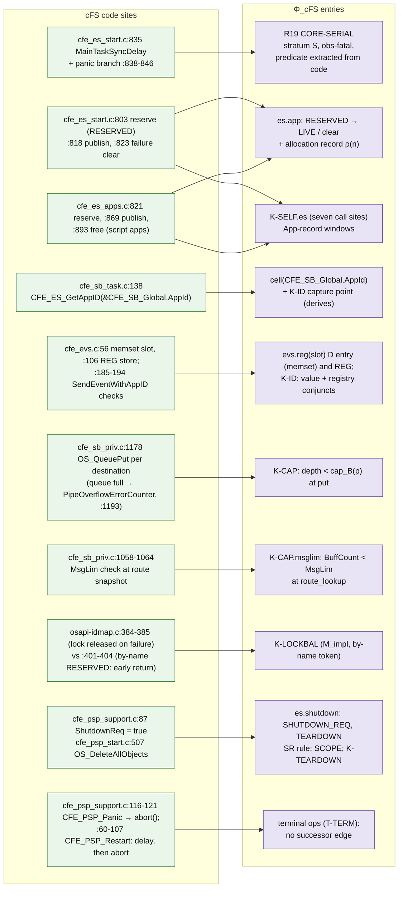
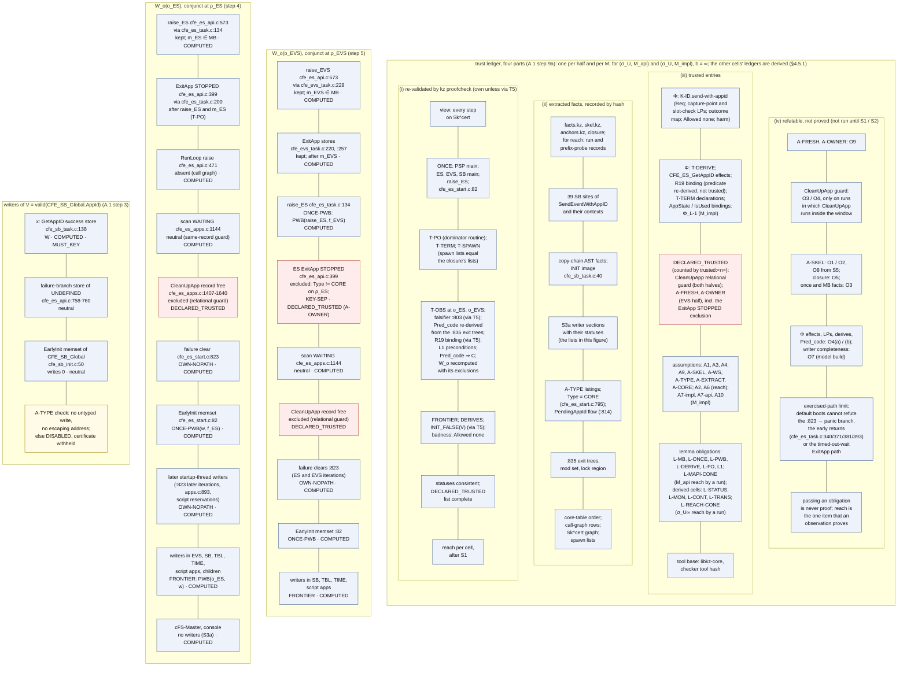
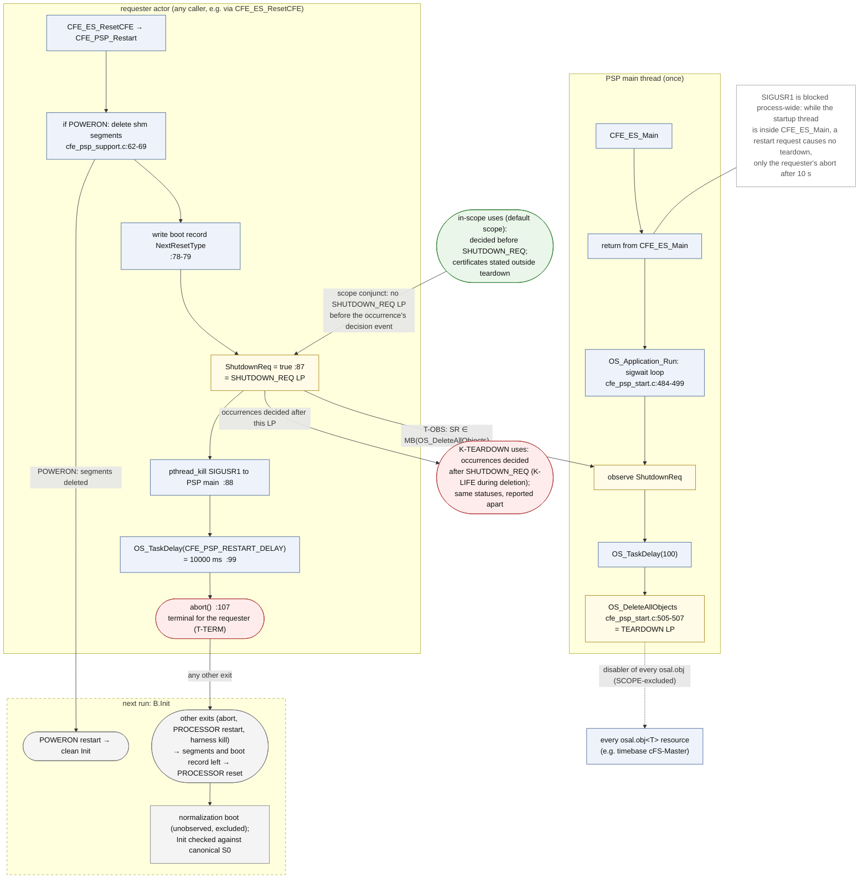

```mermaid
flowchart LR
    %% D5 overview - which cFS layer becomes which Φ_cFS entries. Source: spec §12 D5; §1.3, §3.1-3.16.
    %% Detail with code sites: D5_cfs_mapping_detail.mmd.

    subgraph CFS["cFS v7.0.1 (pinned tree)"]
        PSP["PSP<br/>main thread → OS_Application_Run, soft_timebase / cFS-Master,<br/>reset decision + boot record, persistence areas,<br/>CFE_PSP_Panic, CFE_PSP_Restart, exception ring"]
        OSAL["OSAL<br/>idmap (by-ID / by-name tokens, timed waits), tasks,<br/>mutex (PI), binsem, countsem, queues (msg_max, euid),<br/>timebase / timers, modules / symbols with scope, files"]
        ES["cFE ES<br/>startup thread, CreateObjects, script selection,<br/>AppCreate, trampoline, App / Task / Lib records,<br/>SystemState, WaitForSystemState, MainTaskSyncDelay,<br/>background task, CleanUpApp"]
        EVS["cFE EVS<br/>register with memset, SendEventWithAppID<br/>(two conjuncts), own-ID guard"]
        SB["cFE SB<br/>pipes, routes, route_lookup + puts, MsgLim, receive,<br/>subscription reporting in SB's task, header MsgIds,<br/>recursion guard"]
        TBL["cFE TBL<br/>register, share, GetAddress, load paths"]
        TIME["cFE TIME<br/>1 Hz chain, seqlock, synch slots by index"]
        FSCDS["FS background, CDS"]
        APPS["apps (15) with tables<br/>+ the selected startup script"]
    end

    subgraph PHI["Φ_cFS (profile, data not code)"]
        KPSP["es.shutdown; terminal ops Panic, Restart (T-TERM);<br/>SR rule; K-TEARDOWN; persistent-scope resources"]
        KOSAL["osal.obj#60;T#62;, loader.sym, queue cap_B (msg_max, euid);<br/>P-* rules (P-TASK, P-TASK-JOIN, P-MUT, P-BIN, P-CNT,<br/>P-Q, P-TB, P-MOD);<br/>M_api / M_impl; K-REG.osal, K-SPAWN.osal, K-LOCKBAL"]
        KES["es.app / es.task / es.lib, es.self, es.phase, es.appstate;<br/>R3, R5, R6, R15, R18, R19;<br/>K-SELF.es, K-SPAWN, K-PHASE, K-REG.es,<br/>K-LIFE, K-GEN, K-LOCK.cancel"]
        KEVS["evs.reg(slot); K-ID (value + registry conjuncts);<br/>own-ID guard = documented_drop"]
        KSB["sb.pipe, sb.route, sb.queue, sb.msglim,<br/>sb.mode.subreport; R7, R8 (state, not edge);<br/>K-ROUTE, K-CAP, K-CAP.msglim, K-MODE,<br/>K-REG.sb-pipe-name, K-LIFE.sb-buffer"]
        KTBL["tbl.table; R11, R12, R13;<br/>K-TBL.share, K-TBL.getaddr, K-ATOM.tbl-load"]
        KTIME["time.synchcb; R14; K-LIFE.callback, K-ATOM.synchcb"]
        KFS["es.cds (persistent); R16; K-PERSIST"]
        KAPP["actor classes T_osal / T_raw / T_env;<br/>K-HANDOFF; app-profile layer (optional)"]
        KX["cross-cutting: per-conjunct LPs + capture points,<br/>cell(loc), R1 program order (looper rule), RF rule,<br/>P_sched profiles (σ_R1)"]
    end

    PSP --> KPSP
    OSAL --> KOSAL
    ES --> KES
    EVS --> KEVS
    SB --> KSB
    TBL --> KTBL
    TIME --> KTIME
    FSCDS --> KFS
    APPS --> KAPP
    OSAL --> KX

    classDef cfs fill:#eaf6ea,stroke:#2e7d32,color:#111
    classDef phi fill:#e9e4f5,stroke:#5b3f99,color:#111
    class PSP,OSAL,ES,EVS,SB,TBL,TIME,FSCDS,APPS cfs
    class KPSP,KOSAL,KES,KEVS,KSB,KTBL,KTIME,KFS,KAPP,KX phi
```

# 05 cFS 대응: Φ_cFS 프로파일, 준비 상태 명세 coverage, R2 certificate, 종료 범위

이 문서는 Kairos의 cFS 프로파일 Φ_cFS가 cFS v7.0.1의 실제 구조(PSP, OSAL, cFE의 ES·EVS·SB·TBL·TIME·FS·CDS, 앱)를 어떤 resource kind·HB 규칙·준비 상태 명세로 옮기는지 설명한다. R03이 찾은 15개 범주(spec의 준비 범주 RC1–RC15)의 coverage, 다섯 설계 사례와 그 밖의 후보가 들어가는 자리와 사례별 기대 판정, R2 certificate의 모양과 신뢰 장부, SB 손실의 세 판단, 종료(teardown) 범위도 다룬다. spec에 없는 설계 요소·수치·인용은 더하지 않으며, 세부는 spec의 해당 절로 넘긴다. 기준은 spec 개정 1.3이다. 개정 1.1은 외부 검토 EXT-20261012에 답한 것이고(spec §0.7, ADR-039–ADR-044), 개정 1.2는 2026-10-15의 PI 결정(결정문 [spec/PI_DECISIONS_RESOLVED_20261015.md](spec/PI_DECISIONS_RESOLVED_20261015.md))을 반영하고 형식 정정 둘(σ_E 진술, 신뢰 장부)과 증명 상태를 더했다(spec §0.9–§0.11, ADR-045–ADR-052). 개정 1.3은 2026-10-22의 PI 결정 D1–D5(결정문 [spec/PI_DECISIONS_RESOLVED_20261022.md](spec/PI_DECISIONS_RESOLVED_20261022.md))를 반영했다(spec §0.12, ADR-053–ADR-058; 변경표 [../plan/REV13_CHANGE_TABLE.md](../plan/REV13_CHANGE_TABLE.md)). 개정 1.2에서 바뀐 곳은 §0.4에, 개정 1.3에서 바뀐 곳은 §0.5에 모았다.

상태: 설계 문서 — 구현·측정 전. 규범 원문: [spec/SPEC_FINAL.md](spec/SPEC_FINAL.md)

**rev 1.2·1.3 반영.** rev 1.2: 용어 T1 = (a)(준비 상태 명세, 준비 사전조건, 준비 상태 위반, 준비 범주, `allowed-not-ready`)를 문서 전체에, CORD 인용 제거(§0.11 항목 1의 규칙: gdb 기록이 직접 뒷받침하는 것만 남김)를 §2.3·§6.2·§7에, QT-4 엄격 대안을 §2.2·§3(RC1)·§6.4에, D17 (a)를 §8.1·§8.2에, D19를 §2.9에, D22·P-C1HOLD를 §6.1·§6.3·§6.4에, P-R2CTRL·P-C2·D13·P-RGIT·D9를 §6.2·§6.3에, R2 표현(`event_request_rejected`)과 증명 상태·L-CONT (c)를 §7에 옮겼다(§0.4). rev 1.3: 사례별 closure 기록(C-19)을 §2.1에, `app_owner`에 쓰는 생성 사건(C-20)을 §2.3에, R2 = 기반 검증과 certificate의 선택 경로화(D1, C-49)를 §6.1·§6.3·§7에, C1 = 첫 기여 근거 사례와 버전별 경로 분리(D3, C-50)를 §6.1·§6.4에, C2의 세 구성(§8.2 개정 1.3)을 §6.3에, 신뢰 장부의 일반화(C-23)를 §7.4에 옮겼다(§0.5). 본문에 그대로 옮긴 그림 D7·D8·D9의 Mermaid 사본은 `diagrams/`의 원본과 같게 두었고, 바뀐 spec 내용은 그림 아래 글에 적었다.

## 목차

- [0. 읽기 전에](#0-읽기-전에): 표기, Φ_cFS가 담는 것, 필요한 용어, 개정 1.2에서 바뀐 곳, 개정 1.3에서 바뀐 곳
- [1. 한 장으로 보기 (그림 D5)](#1-한-장으로-보기-그림-d5): cFS 계층과 Φ_cFS 항목의 대응
- [2. 계층별 대응](#2-계층별-대응): actor, OSAL, task 생성과 App-record 구간, PSP, ES, 앱 적재, 재시작, SB, EVS, TBL, CDS, TIME, ad hoc 동기화 (spec §3.1–3.14)
- [3. 준비 상태 명세 catalogue와 15개 준비 범주](#3-준비-상태-명세-catalogue와-15개-준비-범주) (spec §3.15)
- [4. HB 규칙 목록](#4-hb-규칙-목록) (spec §3.16)
- [5. site binding과 version guard](#5-site-binding과-version-guard) (spec §3.17)
- [6. 다섯 사례의 자리와 그 밖의 후보](#6-다섯-사례의-자리와-그-밖의-후보): 사례별 기대 판정과 대조, R2의 음성 대조 E-post/E-TBL, C1의 결과 (spec §7.3, §8.2, §9.3, App. A.4)
- [7. R2 certificate 예 (그림 D8)](#7-r2-certificate-예-그림-d8): 신뢰 장부와 증명 상태, 사슬의 세 판단 포함 (spec App. A.1)
- [8. 종료 범위 (그림 D9)](#8-종료-범위-그림-d9) (spec §3.5, §1.6, §4.5, App. A.7)
- [9. 이 문서가 주장하지 않는 것](#9-이-문서가-주장하지-않는-것)
- [10. 관련 문서](#10-관련-문서)

---

## 0. 읽기 전에

### 0.1 표기

근거 표기는 spec 머리말을 따른다. 자세한 설명은 [01_overview.md §0](01_overview.md#0-읽는-법)에 있다.

| 표기 | 뜻 |
|---|---|
| [F] | 코드·기록·보고서 인용이 있는 사실 |
| [M] | 측정값. 누가 측정했는지 출처를 붙인다([BM], [R07], [R2g] 등). Kairos가 직접 측정한 값은 아직 없다 |
| [I] | 추론 또는 설계상 추론. 실행하지 않았다 |
| [D] | 설계 결정. spec §11의 ADR이 기록한다 |
| [U] | 미확인 |
| **코드 해석, 미실행** | 배경 보고서([R01], [R02] 등)나 검토·ledger가 코드를 읽고 낸 결함 후보다. 실행으로 확인한 적이 없고, 확인 실행 전에는 버그라고 부르지 않는다(spec §6.4 항목 23) |

- 코드 위치 `path:line`은 고정된 cFS tree(cFS `088b2fa8`; cFE `c5fb2b4d`, OSAL `d2d877a6`, PSP `c4b3b0b6`) 기준이다(spec 머리말). 파일 이름 없이 적은 줄 번호(예: `:818`)는 바로 앞에 적은 파일의 줄이다.
- "(spec §3.3)"은 SPEC_FINAL.md의 절이다. [R01]–[R07]은 `background/`의 보고서, [LED]는 `cases/ledger.md`, [R2g]는 `results/R2_gdb_v701.md`의 R2 gdb 기록(`env/logs/r2_g1..3_*`), [BM]은 `env/BASELINE_MEASURE.md`다. [A]·[B]·[C]는 `history/`의 설계 제안, [X1]–[X3]·[J1]–[J3]은 같은 곳의 검토·심사다. 퇴역한 recorder CORD의 결과는 현재 문서의 근거가 아니어서 인용하지 않는다(PI 결정 D12, spec §0.11).
- 문헌은 [R04]·[R05]·[R06]이 확인한 상태 표지(V-doc, V-abs, V-me, P, UNVERIFIED)와 함께만 인용한다.
- **경보 없음 ≠ 안전.** 이 문서의 어떤 표도 "안전"을 뜻하지 않는다. 근거가 없는 칸은 `unknown(reason)`이 된다(spec §0.1, §1.10).

**인용 형식과 이름이 겹치는 기호.** 인용 형식(설계안 [A]/[B]/[C], 심사 [J1]–[J3], 검토 [X1]–[X3], [X3, here], v0.1 등)은 [01_overview.md §0](01_overview.md#0-읽는-법)에 모아 두었다. 같은 기호가 여러 뜻으로 쓰이므로 이 문서는 앞에 종류를 붙인다: "PI 결정 D4"와 "그림 D4", "보장 G5"와 "gap G5", "단계 S0"와 "Init snapshot S0", HB stratum S/O와 cold/warm 층(stratum). 전체 목록은 [10_decisions_adr.md §0.2](10_decisions_adr.md#02-이름-충돌-주의)다.

### 0.2 Φ_cFS가 담는 것

Kairos는 cFS에 대한 지식을 분석 엔진 코드에 넣지 않는다. 작은 선언형 언어로 쓴 데이터인 **framework profile Φ**에 넣는다(spec §0.2 항목 1; ADR-003). Φ_cFS는 v7.0.1용 Φ다. cFS의 메커니즘 하나는 다음 네 종류의 Φ 항목이 된다(spec §3 머리말).

| Φ 항목 | 뜻 | cFS 예 |
|---|---|---|
| resource kind와 lifecycle automaton | 자원 종류마다 생애주기 상태 기계를 둔다. 이 방식을 **typestate**라 한다. 객체의 현재 상태가 어떤 연산을 허용하는지 정한다는 개념이다(Strom & Yemini 1986 [V-me]; spec §1.3) | `sb.route(m,p)`: NONE ↔ ROUTED |
| operation | API 하나의 binding(코드의 어느 지점인가), 효과, 결과 코드의 뜻, 조건마다의 LP | `CFE_SB_TransmitMsg`: route_lookup LP 하나와 목적지마다 put LP 하나(spec §1.4) |
| HB 규칙 | "e₁이 e₂보다 먼저"를 정하는 추론 규칙이다. stratum과 robustness tag를 가진다 | R19 CORE-SERIAL (S, obs-fatal) |
| 준비 상태 명세 (readiness specification) | 사용 지점이 요구하는 자원 상태(준비 사전조건 `Req`, readiness precondition), 판정 oracle, 호출자 쪽 근거가 받아들이는 not-ready 결과(Allowed), 이 사용이 이루어야 할 것의 근거(`appreq`), 해(harm), 출처(provenance)를 묶는다. 출처마다 `supplier`·`caller`·`rule` 가운데 어느 쪽인지 적는다(spec §1.6). 이름은 PI 결정 T1 = (a)로 정했다(spec 부록 C) | K-ID: `CFE_EVS_SendEventWithAppID`에 넘긴 AppId가 유효하고 EVS에 등록돼 있어야 한다 |

**규칙 이름의 출처.** R1–R19는 [R02 §8.1]의 규칙 번호이고, P-*는 [R01 §3, §6.1]의 OSAL 기본 연산 규칙이다(spec §3 머리말). **규칙 R2(task 생성 → 자식의 첫 사건)는 사례 R2(cFE #2663)와 다르다.** 이 문서는 규칙을 항상 "규칙 R2" 또는 "P-TASK / R2"로 적는다.

**두 원칙**이 §3 전체에 걸린다(spec §3 머리말, §1.4).
- bad 사용의 shape(0.3)를 정하는 edge는 API 수준 edge뿐이다.
- OSAL 내부 lock은 M_impl에서 interleaving을 제약할 뿐이다. 어느 수준에서도 shape용 HB edge를 만들지 않는다.

### 0.3 필요한 용어

자세한 정의는 [04_formal_model.md](04_formal_model.md)와 용어집 [10_decisions_adr.md §3](10_decisions_adr.md#3-용어집)에 있다(원문 spec §13).

| 용어 | 이 문서에서의 뜻 |
|---|---|
| happens-before (HB) | 한 실행 안에서 동기화가 정하는 사건 사이의 순서다(Lamport 1978 [V-abs]). 물리 시각은 HB를 만들지 않는다(spec §1.5) |
| linearization point (LP) | 연산의 효과가 한순간에 일어났다고 보는 코드 지점이다. 요구 조건이 여러 conjunct(그리고로 묶인 조건)로 되어 있으면 conjunct마다 LP를 따로 둔다(spec §1.4) |
| capture point | 호출자가 넘길 값을 공유 위치에서 미리 읽어 둔 load 지점이다. 값 조건의 LP가 된다. 이 연결은 `derives` 사실과 번역 규칙 T-DERIVE가 만든다(spec §1.4) |
| stratum S / O / C_σ | S(구조적)는 두 끝이 모두 있는 모든 실행에서 성립하는 순서로, 정적 증명에 쓴다. O(관측 동기화)는 관측한 실행에서만 성립하고 예측에서 뒤집을 수 있다. C_σ는 σ_R1의 우선순위 제약이며 HB가 아니다(spec §1.9) |
| robustness tag | trace 쪽 edge의 강도 표시다. `unconditional`, `obs-fatal`(실패하면 종료뿐인 관측), `obs-soft`(timeout 뒤 기록만 하고 계속하는 관측), `schedule-chosen`(lock, semaphore, 메시지), `assumed`(가정 A4 아래에서만 성립)(spec §1.9) |
| M_api / M_impl | OSAL을 API 계약 수준(각 API가 원자적)으로 볼지, POSIX 구현 수준(RESERVED 구간과 lock 누수 경로가 보임)까지 펼칠지다(spec §1.4) |
| σ_U, σ_U∞, σ_R1, σ_E | 스케줄 의미론이다. σ_U는 시간을 무시한 임의 interleaving(지연은 양보, timeout은 언제든 가능)이다. σ_U∞는 σ_U에서 **시간 기반 전이**(주기적이지 않은 대기의 timeout, 지연 간격 재시도의 마지막 시도 실패, Φ가 선언한 강제 kill)를 뺀 의미다. σ_R1[P_sched]는 한 CPU의 고정 우선순위(projection으로 σ_U와 잇는 별도 전이 체계), σ_E는 실제 바이너리다(spec §1.8) |
| 유한 실행, 실제 실행 | 판정은 유한 실행(prefix) 위에서 정의한다. containment도 prefix containment다: σ_U∞의 유한 실행은 시간 기반 전이가 없는 σ_U의 유한 실행이고, 모든 유한 실제 실행은 (σ_U, M_impl)의 유한 실행이다. maximal 실행의 containment는 주장하지 않는다. 실제 실행은 maximal일 필요가 없다(spec §1.8) |
| basis B / B′ | 스케줄을 뺀, 실행을 정하는 모든 것(Build, Config, Init, Env, Input)이다. 구성이나 입력을 바꾸면 새 basis B′이고, B′에서만 나온 결과는 기본 구성의 "새 버그"가 아니다(spec §1.7) |
| Allowed / harm | 호출자 수준에서 받아들이는 not-ready 결과(유한 어휘: `none`, `documented_drop`, `returned_and_tested`, `retry_until_ready`, `fallback`, `defer_by_design`, `exit`, `unspecified_by_reference`)와, 허용되지 않을 때의 효과 분류다. 공급자의 문서화된 결과는 framework 수준 판단(`fw_doc`, `fw_conf`)으로 따로 적는다(spec §1.6, §1.10) |
| 세 판단 | not-ready 사용을 세 번 따로 판단한다. framework 수준(공급자가 문서화한 결과와 실제 동작, `fw_doc`·`fw_conf`), 호출자 수준(`appreq`와 호출자 수준 Allowed. 상태, class, 결과 label, harm은 이것만 정한다), 관측된 결과(consequence와 관측 횟수)다. framework 수준 판단은 발생을 TOLERATED로 만들지 않는다(spec §1.6 "Three judgements"; ADR-043) |
| safety와 progress | class는 유한 실행 위의 safety 진술 `¬Bad_i`, `¬OK_i`, `¬NR_i`에서 나온다. 영원한 대기와 deadlock은 class가 아니라 칸마다의 **progress 결과**다: `stall-witness`, `no-stall-within(b)`, `unknown(reason)`, 기본값 `unknown(not_checked)`(spec §0.7 item 1, §1.8, §1.10) |
| 신뢰 장부 (trust ledger) | certificate와 판정 칸마다 붙는 네 부분 기록이다. (i) `kz proofcheck`가 다시 확인한 추론 단계, (ii) 추출된 사실, (iii) 믿은 항목(쓴 lemma의 증명 상태 포함), (iv) 반박할 수 있지만 증명되지 않은 항목(spec §4.5.1). 7.4가 R2의 장부를 보인다 |
| 준비 상태 위반 | 범위 안 발생이 준비 사전조건을 만족하지 못하고 호출자 수준 Allowed가 그 결과를 받아들이지 않을 때(`VIOLATING`)다. 상태를 만들 provider가 있는 곳에서는 순서 위반의 하위 부류다. 호출자 수준 Allowed가 `unspecified_by_reference`인 발생은 `NOT_READY_UNJUDGED`이고 위반이라 부르지 않는다(spec §1.6) |
| 근거 등급 (source tier) | 준비 상태 명세 뒤에 어떤 종류의 근거가 있는지다: `contract-backed`, `requirement-derived`, `admitted`, `issue-derived`, `code-derived`, `researcher`, `unreferenced`. 보고할 때 `prov` 기록에서 유도하고 저장 field는 없다(spec §1.6) |
| 증명 상태 (proof status) | lemma와 보장마다 `proved`, `depends-on-stated-assumption`, `unproved` 가운데 하나다. 의무로만 적힌 lemma를 "증명됨"으로 출력하지 않는다(spec §6.2, PS1–PS4) |
| shape | bad 사용의 모양이다. WRONG-WAY(공급이 사용 뒤에 오고 사용이 HB상 앞), UNORDERED(HB상 순서 없음), ABSENT(witness의 어떤 연장에도 공급이 올 수 없음), NOT-OBSERVED(실행과 기록된 연장에 공급이 없지만 ABSENT는 보이지 못함), STALE(한때 참이었다가 무효화됨)(spec §1.10) |
| provider 축 | `present`, `none`(초기에 거짓이고 writer가 하나도 없음), `env-absent`(환경 능력이 없어 공급이 막힘), `unknown`(spec §1.10) |
| census | 모든 준비 상태 명세를 모든 문맥 위치(context-qualified site)에 instance로 만들고, 각각에 class나 `unknown(reason)`을 주는 정적 작업이다(spec §4.6) |
| skeleton, certificate view `Sk^cert` | skeleton은 actor의 제어 흐름 그래프를 관련 사건만 남겨 투영한 것이다. certificate view는 상한이 없는 loop를 "0회 이상 반복"(star-closed)으로 닫은 skeleton이다. 보편 판정과 `inactive`는 이 view에서만 나온다(spec §4.3) |
| looper | `ReceiveBuffer`로 메시지를 받아 handler로 나눠 주는 loop를 도는 actor다(spec §1.9) |
| 예측 / explorer | 예측은 관측한 trace에서 다른 순서가 가능한지 찾는 단계다(spec §4.9). explorer는 후보 하나의 작은 모형 위에서 실행을 체계적으로 탐색하는 단계이며, 늦은 단계 S7의 조건부(gated) 구성요소다(spec §4.10) |
| hold, F0, derived | hold는 확인 실행에서 한 thread를 지정한 지점에 붙잡아 두는 방법이다. F0는 기준 바이너리를 같은 cFS 사용자와 같은 명령으로 실행하고, 별도의 root 프로세스가 그 프로세스에 hook을 거는 수준이다. "시간만 바뀐다"고 쓰지 않고, 관측 영향은 점검한다(PI 결정 D1; spec §5.1, §8.6). 구성한 스케줄로 얻은 확인에는 `derived` 표시를 단다(spec §1.10, §4.13, §5.1) |
| `n of N`, pool key | 자연 실행 N번 중 n번에서 관측했다는 기록과, 같은 조건이라 한데 모아 센 실행 묶음의 식별자다(spec §1.10, §2.3) |
| `app_owner` (소속 앱) | actor instance마다 붙는, 그 actor를 만든 애플리케이션이다. 수명, 근거, 근거 수준 `confirmed`·`inferred`·`undetermined`를 함께 적는다. 순서를 분석하는 바로 그 table(ES task·App record)이 분석 대상인 곳에서는 그 table 조회로 정하지 않는다(EV-03). 개정 1.3에서 필수 산출물이 되었다(spec §1.2 "Creating application", ADR-056) |

### 0.4 개정 1.2에서 바뀐 곳

spec 개정 1.2가 이 문서의 범위에 준 변경이다. 모두 [D]다. PI 결정은 연구 계획, 범위, 용어에 대한 결정이고 사실이나 실행 결과가 아니다. 이 개정에서도 빌드·설치·실행은 없었고 Kairos의 결과는 없다. 정정 전후의 문장과 손으로 계산한 최소 예제는 [../plan/formal_corrections.md](../plan/formal_corrections.md), R2 첫 결과의 증명 상태표는 [../plan/proof_status_R2.md](../plan/proof_status_R2.md)에 있다.

| 바뀐 것 | 이 문서 | spec |
|---|---|---|
| R2 표현: 거부된 이벤트 요청은 "이벤트 요청 거부"다. harm `event_lost_silently`를 `event_request_rejected`로 바꿨다. 시스템 호출이 있었다거나 없었다는 주장은 debugger 로그가 아니라 코드 분석이나 시스템 호출 관측에 기댄다 | §2.9, §7.1, §7.3, §9 | §0.9 항목 4, §6.4 항목 47, A.1 step 8·13a |
| 신뢰 장부에 L-CONT (c)와 L-STATUS를 넣었다. reach나 witness가 실행에 기대는 모든 칸, certificate 자신의 칸도 포함한다. 그 실행 쪽 전제는 O1, O2, O4, O5가 반박한다 | §7.4, §7.6 | §4.5.1, A.1 step 9a, §0.9 항목 2, ADR-045 |
| 증명 상태 `proved` / `depends-on-stated-assumption` / `unproved`를 lemma와 보장마다 둔다. 의무로만 적힌 lemma를 "증명됨"으로 출력하지 않는다(PS1–PS4). R2 첫 결과의 모든 certificate 칸은 "lemma status: unproved"를 출력한다 | §0.3, §7.1, §7.3, §7.4, §7.6 | §6.2, §6.4 항목 45·46, §0.9 항목 3, ADR-045 |
| σ_E 진술을 L-FO·L-PR이 증명하는 꼴로 정정했다. 판정된 범위 안 발생에 대한 진술이고 `NOT_EVALUATED` 조기 반환을 허용한다 | §7.3, §7.6, §8.3 | §1.8 전이 규칙 2, A.1 step 9, A.7, §0.9 항목 1, §6.4 항목 44 |
| caller 수준 판단: 규칙만으로는 받아들이지 않고(QT-4), 정상 연속은 인용한 노드이며(Q15), 충돌은 판정을 보류하고(QT-5), K-SPAWN.osal·K-LOCKBAL은 구현 결함 계열이다(QT-9). EVS의 `GetAppID` 발생, TIME의 `CreateChildTask` 호출, C1의 수정 전 발생은 NOT_READY_UNJUDGED다 | §2.2, §2.3, §2.9, §3, §6.2, §6.4 | §1.6, §3.3, §3.15, A.2, A.4, §6.4 항목 53, ADR-043(개정), ADR-048 |
| C1 기준 구성 D22: 공개 BP 기반, 후보 쌍 CF `281a941` → `833fdbb`. 공개 값과 원 보고자 환경을 구분한다. 재시도 상수는 선택한 소스에서 읽는다 | §6.1, §6.3, §6.4 | §0.9 항목 5, A.4 step 2·3·6, §9.3, ADR-044, ADR-050 |
| 사례별 대조와 기준: P-R2CTRL(c2 먼저), P-C1HOLD(생성 직전 보류. RESERVED 구간 실험은 후속 항목), P-C2·Q22, D13·Q16, P-RGIT, P-CLASSGT | §6.1, §6.3, §6.4, §7.5 | §8.2, §9.3, A.1 step 15, A.4 step 5, ADR-050 |
| D17 (a): POWERON 재시작은 shm segment를 지우지만 모든 유지 파일, file cache, 공유 file system을 초기화하지 않는다 | §8.1, §8.2 | §3.5, §4.13, §6.4 항목 49, ADR-049 |
| 용어 T1 = (a): 준비 상태 명세, 준비 사전조건, 준비 상태 위반, 근거 등급, `allowed-not-ready`, 준비 범주 | 문서 전체, §3 | §0.11, 부록 C, ADR-052 |
| CORD 인용 정리(D12): R2의 실행 근거는 gdb 기록뿐이다. 11개 구성, 범위 211–229, 사용 집합의 CORD 대조를 지웠다 | §0.1, §2.3, §6.2, §7.1, §7.3, §7.5 | §0.11, 머리말 |
| D19: `msg_max` 기준값 10을 유지하고 queue 손실은 구성과 함께 기록한다 | §2.9 | §9.3 S6, §7.4 |
| D9: §7.3의 후보는 모형 입력과 확장 평가 자료다. 첫 논문의 독립 목표도, 설계 사례의 대체물도 아니다 | §6.2 | §7.3 |

### 0.5 개정 1.3에서 바뀐 곳

spec 개정 1.3이 이 문서의 범위에 준 변경이다. 모두 [D]이거나 설계 요구이고, 결과·수치·연구 조건을 더하지 않았다(spec §0.12). 여기서 D1–D5는 **2026-10-22의 결정**이다. 2026-10-15의 D1(root 쪽 hook), D3(F1 gate) 등과 이름이 같으므로 이 문서는 날짜를 붙여 구별한다. 행 끝의 C-번호는 변경표 [../plan/REV13_CHANGE_TABLE.md](../plan/REV13_CHANGE_TABLE.md)의 행이다.

| 바뀐 것 | 이 문서 | spec |
|---|---|---|
| D1(2026-10-22): 중심 주장이 관측 판정 + 한정 예측 + 실행 확인으로 옮겨졌다. MustBefore, certificate, `kz proofcheck`, explorer, progress, loop는 정의를 그대로 둔 **선택 경로**이고, 보편 순서 주장을 할 때만 쓴다. 보편 `fixed-order` 주장에는 여전히 certificate나 완전한 유한 모형 분석이 필요하고, 그것이 없으면 칸은 "schedule dependence undetermined"다 | §6.1, §6.3, §7 | §0.12, §1.10 "Fixed-order evidence", §4.4, ADR-053 [C-22, C-49] |
| 사례별 closure 기록(D5, IN-02): 기본 closure는 core-cpu1과 startup script 앱이다. 사례마다 compile DB에 넣은 앱 코드와 뺀 코드를 기록한다 | §2.1 | §3.1 [C-19] |
| `app_owner`에 쓰는 생성 사건: ES 요청, `CFE_ES_StartAppTask`의 `ParentAppId`, `OS_TaskCreate`의 entry·return과 그 안의 kernel fork 기록, 자식의 첫 사건. ES task·App record가 분석 대상인 곳에서는 근거로 쓰지 않는다 | §0.3, §2.3 | §1.2, §3.3, §5.7, ADR-056 [C-05, C-20] |
| D3(2026-10-22): R2는 관측 경로의 **기반 검증**(rung V1′)이고 기여 근거가 아니다. C1이 기여 근거의 첫 사례이고, D22 공개 BP 기반을 단계 B와 병행해 만든다 | §6.1, §6.3, §7 | §8.2, §9.3, App. A.1, App. A.4, §6.4 항목 58, ADR-057 [C-41, C-42, C-49, C-50] |
| C1의 경로를 버전별로 나눈다: `281a941`(재시도 없음)과 `833fdbb`(재시도 있음). OSAL 내부 상태·lock에 기대는 경로는 다른 결함 후보이고 다섯 사례 수에 넣지 않는다. 수정 전 갈래의 표지는 NOT_READY_UNJUDGED로 정리되었다 | §6.4 | App. A.4 [C-50] |
| C2는 2 × 2가 아니라 **세 구성**(A, C, D)의 비교다 | §6.3 | §8.2 개정 1.3 문단 |
| 신뢰 장부를 certificate 없는 관측 판정·예측·확인 결과로 일반화했다. 그런 결과는 (i)부가 비어도 나머지 부분을 기록한다 | §7.4 | §4.5.1 "Results without a certificate" [C-23] |
| R2의 관측 판정 기대: 8-site plan에서 위반 사용 24개가 `VIOLATING`, 요약 `OBSERVED_VIOLATION`, actor ES·EVS의 `app_owner`는 `inferred`(`match-by-time`). 발행 뒤 사용은 등록 conjunct에 대해 `INCONCLUSIVE` | §7 머리 | App. A.1 개정 1.3 문단 [C-49] |

---

## 1. 한 장으로 보기 (그림 D5)

그림 D5는 두 장이다. 개요는 cFS 계층마다 Φ_cFS의 어떤 kind·규칙·준비 상태 명세가 생기는지 보이고, 상세는 대표 코드 위치가 어떤 Φ 항목이 되는지 보인다(spec §12 D5).

**그림 D5 개요. cFS 계층과 Φ_cFS 항목의 대응** (렌더링: [diagrams/D5_cfs_mapping_overview.svg](diagrams/D5_cfs_mapping_overview.svg); spec §12 D5; §1.3, §3.1–3.16)



**그림 D5 상세. 코드 위치와 Φ 항목** (렌더링: [diagrams/D5_cfs_mapping_detail.svg](diagrams/D5_cfs_mapping_detail.svg); spec §12 D5; §3.2–3.9)



같은 내용을 표로 줄이면 다음과 같다. 각 줄의 세부는 2절의 해당 소절에 있다.

| cFS 계층 | 주요 kind | HB 규칙 | 주요 준비 상태 명세 | 이 문서 / spec |
|---|---|---|---|---|
| PSP | `es.shutdown`, 유지(persistent) 자원, 종료 연산 Panic·Restart | SR | K-TEARDOWN | 2.5, 8 / §3.5 |
| OSAL | `osal.obj<T>`, `loader.sym`, queue 용량 `cap_B` | P-TASK, P-TASK-JOIN, P-MUT, P-BIN, P-CNT, P-Q, P-TB, P-MOD | K-REG.osal, K-SPAWN.osal, K-LOCKBAL, K-REG.unique, K-LIFE.osal | 2.2–2.4 / §3.2–3.4 |
| ES | `es.app`·`es.task`·`es.lib`, `es.self`, `es.phase`, `es.appstate` | R3, R5, R6, R15, R18, R19 | K-SELF.es, K-SPAWN, K-PHASE, K-REG.es, K-LIFE, K-GEN, K-LOCK.cancel | 2.3, 2.6–2.8 / §3.3, §3.6–3.8 |
| EVS | `evs.reg(slot)` | — | K-ID(값 조건 + 등록 조건) | 2.10 / §3.10 |
| SB | `sb.pipe`, `sb.route`, `sb.queue`, `sb.msglim`, `sb.mode.subreport` | R7, R8(상태) | K-ROUTE, K-CAP, K-CAP.msglim, K-MODE, K-REG.sb-pipe-name, K-LIFE.sb-buffer | 2.9 / §3.9 |
| TBL | `tbl.table` | R11, R12, R13 | K-TBL.share, K-TBL.getaddr, K-ATOM.tbl-load | 2.11 / §3.11 |
| CDS, counter | `es.cds`(persistent) | — | K-PERSIST, K-REG.es-counter | 2.12 / §3.12 |
| TIME, FS | `time.synchcb` | R14, R16 | K-LIFE.callback, K-ATOM.synchcb | 2.13 / §3.13 |
| 앱(15개)과 table | actor 분류 `T_osal`/`T_raw`/`T_env` | — | K-HANDOFF, 선택적 app-profile 층 | 2.1, 2.14 / §3.1, §3.14, §7.2 |
| 공통 | conjunct별 LP와 capture point, `cell(loc)` | R1(looper 규칙), RF | — | 0.3, 4 / §1.4, §3.16 |

---

## 2. 계층별 대응

이 절은 spec §3.1–3.14를 계층마다 줄여 옮긴다. 코드 위치와 세부 조건은 spec 원문에 모두 있다.

### 2.1 actor 목록과 closure (spec §3.1)

**actor**는 실행 흐름 하나다. 세 집합이 있다(spec §1.2). `T_osal`은 `OS_TaskCreate`로 만든 core·앱·child task, `T_raw`는 OSAL task record가 없는 thread(PSP main thread, console writer, timebase thread `cFS-Master`, signal 문맥), `T_env`는 지상 명령·SBN peer·정지 명령 같은 외부 입력 근원이다. `T_env`에는 들어오는 HB edge가 없다.

정적 분석은 먼저 basis B의 구성에서 실행될 수 있는 actor와 코드를 모두 찾아 닫는다. 이것을 **configuration closure**라 한다(spec §3.1, §4.1).

| actor 분류 | 어디서 오나, entry를 찾는 법 |
|---|---|
| ES startup thread (PSP main) | `CFE_PSP_MAIN_FUNCTION`. `CFE_ES_Main`이 돌아오면 `OS_Application_Run`을 돈다(`cfe_psp_start.c:452–508`). 정의상 once |
| core main task (ES, EVS, SB, TBL, TIME) | 생성 파일 `cfe_static_module_list.c`. `CFE_ES_CreateObjects`의 table loop(횟수 상수)를 정확히 펼쳐 반복마다 spawn 노드 하나를 둔다 |
| 앱 main task (15개) | **B가 고른** startup script. entry symbol을 module `.so` 안의 정의로 푼다(`dlsym`의 정적 대응, [R05 §2.5 항목 1]). 관측한 `OS_ModuleSymbolLookup`으로 확인한다 |
| child task | 상수 함수 인자를 가진 `CFE_ES_CreateChildTask` 호출. 예: TIME의 tone·local task(`cfe_time_task.c:160, 173`), `ES_BG_TASK`(`cfe_es_backgroundtask.c:214`), FM의 자식(`fm_child.c:86`). owner는 만든 앱이다 |
| timebase `cFS-Master` | PSP `soft_timebase` module(`cfe_psp_soft_timebase.c:53`). 관측은 `OS_TimeBase_CallbackThread`(`osapi-timebase.c:365`) |
| 자기 조회 handshake를 하는 OSAL 내부 thread | 자기 object에 `OS_ObjectIdGetById`를 부르는 OSAL 내부 thread entry를 pattern으로 찾는 일반 규칙([X2-03]) |
| callback 문맥 | `OS_TimerAdd`/`Set`, `CFE_TIME_RegisterSynchCallback`, FS 백그라운드 요청, TBL validation 함수. **등록 호출을 spawn site로 하는 비동기 actor**이고 결코 once가 아니다 |
| console writer, signal 문맥, 환경 근원 | 정적. 모형 안 spawn site가 없는 signal 문맥과 환경 근원은 `MB(entry) = ∅` |

- 관측 기준점은 주로 `CFE_ES_StartAppTask` 안의 `OS_TaskCreate`와 자식의 `OS_TaskEntryPoint`(`osapi-task.c:124`)다. callback은 사용자 stack의 **on-behalf frame**으로 잡는다. on-behalf frame은 어떤 thread가 다른 앱을 대신해 코드를 실행 중이라는 표시다(spec §1.2).
- **간접 호출** 110곳([R07 §4.2])은 구성(task entry, trampoline의 `RealEntryFunc`, core `TaskMain`/`EarlyInit`, `CFE_Config_IterateAll` callback, SBN module ops) → 등록 위치 → struct type 계층(MLTA, CCS 2019 [V-abs]) → `unknown_effect` 순으로 푼다. closure 보고서는 규칙마다 푼 개수를 적는다.
- **once와 generation.** once(τ)는 actor τ가 한 실행에 많아야 하나 존재한다는 사실이다. 주장하지 않고 증명한다(spec §1.2). 기본 B에서는 모든 정적 actor를 once로 검사한다. 재시작 시나리오 `B_restart`에서는 재시작된 앱(과 그 자식)의 skeleton을 generation 1용으로 복제하고, 그 spawn site를 background scan의 재시작 경로로 둔다(spec §3.1, §3.8).
- **사례별 closure 기록** [D] (개정 1.3; 2026-10-22 결정 D5, IN-02; spec §3.1). 위의 기본 closure는 core-cpu1과, 동적으로 적재되는 startup script 앱이다. 개정 1.2의 정적 추출은 core-cpu1만 덮는다(`kairos/docs/static_facts.md` §8 G1). 사례마다 compile DB에 넣은 앱 코드와 뺀 코드를 기록한다.

  | 사례 | closure에 넣는 코드 |
  |---|---|
  | R2 | core-cpu1(그 조건에는 이것으로 충분하다) |
  | C1 | D22 공개 BP 기반의 CF와 semaphore provider(`plan/C1_basis_plan.md`) |
  | C2 | 역할에서 끌어낸 provider 앱과 호출자 앱(P-C2) |
  | C5 | 6.4.x의 앱 생성 경로와 그것으로 시작한 앱(D13) |

  writer나 alias가 뺀 코드에 있을 수 있는 결과는 그 코드를 이름으로 밝히고, 그것이 결과를 좌우하는 곳에서는 판정을 보류한다(spec §4.8).

### 2.2 OSAL ID map: 생성과 조회 (spec §3.2)

여기가 **OSAL RESERVED 구간** 예의 자리다.

OSAL object의 kind는 `osal.obj<T>`이고, 상태는 FREE → ALLOC → RES_C(이름 안 보임) → RES_CN(이름 보임, RESERVED, type lock 안 잡힘) → LIVE → RES_D → FREE다(spec §1.3). 발행 LP는 type lock 아래의 최종 ID 쓰기(`osapi-idmap.c:1092`, unlock `:1105`)다. unlock 뒤에 도는 `OS_EVENT_RESOURCE_CREATED` callback(`:858–865`)이 아니다 [F] ([R01 §6.1]).

- **M_api**: 생성은 한 번의 전이 ABSENT → LIVE이고, 이름 조회는 FOUND 또는 `NAME_NOT_FOUND`다.
- **M_impl** ([R01 §1.5–1.8]): type lock 아래 ALLOC → `ConvertToken(EXCLUSIVE)`가 RESERVED를 표시하고 lock을 **푼다** → `OS_OBJECT_INIT`이 이름을 보이게 한다 → 구현 호출(`pthread_create`, `mq_open` 등) → `FinalizeNew`가 다시 잠그고 발행한다. 이 사이에 조회 token이 RESERVED record를 만나면 token 종류에 따라 갈린다 [F].

| token | RESERVED record를 만났을 때 | Φ 준비 상태 명세 |
|---|---|---|
| by-name, search | `OS_ERR_INCORRECT_OBJ_STATE`로 즉시 실패하는데, unlock 로직 **전에** return한다(`osapi-idmap.c:401–404`). header는 "실패하면 OS_LOCK_MODE_NONE이 아닌 모든 lock mode에서 전역 table lock을 항상 푼다"고 적는다(`:384–385`) | **K-LOCKBAL**: API는 type lock을 푼 채 돌아와야 한다. 문서화된 불변식에서 끌어낸 공급자 쪽 postcondition이다(문서화된 API 의미, API 계약). QT-9에 따라 구현 결함 계열이다 |
| by-ID (`OS_ObjectIdGetById`) | 제한된 대기에 들어간다. 시도 k는 type unlock의 broadcast(모든 type unlock이 broadcast한다, `os-impl-idmap.c:106–129`) 또는 timeout k² × 10 ms로 깬다(`posix/src/os-impl-idmap.c:138–170`). 다섯 번째 시도는 `OS_ERR_OBJECT_IN_USE`로 실패한다(`osapi-idmap.c:475–480`) | **K-SPAWN.osal**(2.3) |

- timeout으로 깨는 것은 **timeout 전이**다. σ_U에서는 언제든 가능하고 σ_U∞에서는 없다. broadcast로 깨는 것은 모든 σ에 남는다. [I] σ_U에서 timeout 네 번은 실제 시간(σ_E 기준)으로 10 + 40 + 90 + 160 = 300 ms이므로, task 소실(F7)에는 그 정도의 생성자 지연이면 충분하다.
- **관측**: 각 `OS_*Create`·`OS_*GetIdByName`·`OS_*Delete`의 entry와, 발행 구간을 잡는 `OS_ObjectIdFinalizeNew` entry. 반환값은 준비 상태 명세 사용 지점(readiness use site), 결과가 edge를 정하는 지점, 칸별 reach를 위한 prefix 지점(spec §4.7 item 6)에서만 잡는다(spec §5.2).
- **규칙 RF (O)**: 성공한 조회는 같은 generation의 발행을 읽은 것이다. timestamp로 순서를 정하지 않는다([A §5.6]).
- **준비 상태 명세**: `K-REG.osal-lookup`(준비 사전조건 LIVE. 호출자 수준 Allowed는 `caller` 기록이 받아들이는 곳에서만 정한다. 재시도 loop가 있고 호출자 쪽 기록이 있으면 그 경계의 `retry_until_ready`(CF는 호출자 쪽 `code_admission`), 그 밖에는 `unspecified_by_reference`다. `returned_and_tested`는 reference가 호출자의 처리와 정상 연속을 인용한 곳에서만 쓴다. 추출한 `cont_candidate`, error 반환, exit는 사실로 보고한다(QT-4, Q15). framework 수준은 `@retval` 목록(`osapi-countsem.h:157–160`)의 `documented-result`다; spec §3.2, §3.15 RC1), `K-LOCKBAL`(M_impl, by-name/search), `K-REG.unique`(동시 생성의 중복 이름, [R01] F2), `K-LIFE.osal`(삭제와 동시인 NONE-mode 사용, [R01] F4). rwlock과 condvar는 test 밖 호출자가 없어 모형에 넣지 않는다.
- [R01]의 F1(lock 누수), F2, F4, F7은 **코드 해석으로 낸 후보이고 실행하지 않았다**([R01 §1.8, §2.2]).

### 2.3 task 생성, ES handshake, App-record 구간, K-SELF.es (spec §3.3)

**규칙 P-TASK / R2 (S, unconditional).** 생성자가 `OS_TaskCreate` 호출 전에 한 사건은 모두 자식의 첫 사건보다 먼저다([R01 §2.2]).

**K-SPAWN.osal (M_impl).** 아직 RESERVED인 자기 record에 by-ID 자기 조회 handshake를 하는 thread는 모두 instance다([X2-03]).
- 자식 task의 `OS_TaskPrepare`: 2.2의 대기 시도가 소진되면, 생성자는 `OS_SUCCESS`를 받았는데 entry는 실행되지 않는다. 결과는 task 소실([R01]의 F7)이다. harm은 `unspecified_by_reference`이고, `task_never_runs`는 reference에서 온 `appreq`가 기록된 곳에서만이다(spec §3.3).
- timebase callback thread(`osapi-timebase.c:383–390`): 실패하면 조용히 `return`한다. `cFS-Master`가 callback을 하나도 보내지 않아 1 Hz 사슬이 시작되지 않는다(TIME tone 없음, SCH_LAB wakeup 없음). 이 결과는 progress 축에서 `Local1HzTask`의 사용과 SCH_LAB loop의 `idle` pre-use stall로 나타나고, progress 사슬로 이 발생에 붙는다 [I] (2.13; spec §3.13, §7.3).
- closure가 pattern으로 찾는 그 밖의 OSAL 내부 thread(2.1).
- **harm의 판단 수준** (spec §1.6 harm; QT-9, 2026-10-15 [D]). K-SPAWN.osal과 K-LOCKBAL의 `none`은 공급자 쪽 글에만 기댄다. 그래서 그 발생은 NOT_READY_UNJUDGED이고 harm은 `unspecified_by_reference`이며, 효과(task 소실, lock 누수)는 consequence로 남는다. PI는 이 둘을 구현 결함 계열(implementation-defect family)로 정했다. 호출자 요구 위반으로 만들려고 연구자가 작성한 `appreq`를 더하지 않고, 순서 위반과 이어지는 부분만 자기 근거로 보고한다. `task_never_runs`는 self 조회가 실패한 VIOLATING 발생의 harm일 수 있지만, 그러려면 reference에서 온 `appreq`가 있어야 한다.

**ES task-record handshake (O, 조건부. guard된 부분은 S).** `CFE_ES_StartAppTask`는 ES lock을 잡기 **전에** task를 만들고(`cfe_es_apps.c:664–672`) task record는 그 **뒤에** 채운다(`:694–703`). 자식은 `CFE_ES_GetTaskFunction`에서 50 ms 지연과 lock 아래 확인을 되풀이하며, 예산은 `CFE_PLATFORM_ES_STARTUP_SCRIPT_TIMEOUT_MSEC` = 1000 ms, 즉 최대 21번이다(`:559–596`). 시간이 다 되면 entry는 불리지 않는다 [F].

**App-record 구간.** `CFE_ES_GetAppRecordByContext`는 호출자의 App record가 최종 상태여야 한다. 그런데 trampoline(진짜 entry를 부르기 전에 거치는 공통 진입 함수, 2.7)은 task record만 확인한다. 두 생성 경로가 같은 구조를 가진다([LED §3.4]).

| 경로 | 예약 → task 시작 → 발행 | 구간 안에서 생기는 일 |
|---|---|---|
| script 앱 | `cfe_es_apps.c:821` → `:848–854` → `:869`(ES lock 아래, `:861–869`) | 50 ms 간격 poll이 이미 성공했을 수 있다([R02 §1.6]). 동료 앱의 `CFE_ES_GetAppIDByName`은 `CFE_SUCCESS`와 함께 `0xFFFFFFFF`를 돌려준다(`cfe_es_api.c:637–656`). 준비 상태 명세의 oracle(`CFE_ES_AppRecordIsMatch`)이 이 성공을 not-ready로 판정한다 |
| core 앱 | `cfe_es_start.c:803` → `:810` → `:818` | core task의 `*_TaskInit`이 `:818` 전에 `GetAppID`를 부를 수 있다. EVS는 첫 동작으로 부른다(`cfe_evs_task.c:273`) |

- **child task도 피하지 못한다.** 부모의 구간 안에서 만든 자식(TIME, `ES_BG_TASK`, FM)은 아직 최종이 아닌 같은 App record로 풀린다([X2-02]).
- **두 구간 모두 O-ordered다.** 사용의 LP와 발행이 모두 ES lock 아래에 있으므로 trace는 둘을 lock edge로 순서 짓는다. 반대 순서가 가능한지는 lock을 뒤집는 예측(spec §4.9)이나 explorer(§4.10)가 정한다. 이전 제안의 "순서 없음" 분류는 spec §0.5가 정정했다.

**K-SELF.es [D].** generic 준비 상태 명세 `es.self(exec) = LIVE`를 `GetAppRecordByContext`/`GetTaskRecordByContext`의 **모든** 호출자에 instance로 만든다. 호출자마다 문서화된 not-ready 동작이 다르다(줄은 `cfe_es_api.c`).

| 호출자 (위치) | not-ready일 때의 결과 | Allowed |
|---|---|---|
| `CFE_ES_ExitApp` (`:312`) | 조용한 no-op: unlock 후 return | `unspecified_by_reference` |
| `CFE_ES_RunLoop` (`:463`) | `false` 반환 | `unspecified_by_reference` |
| `CFE_ES_WaitForSystemState` (`:533`) | raise를 건너뛰고 대기는 계속 | `unspecified_by_reference` |
| `CFE_ES_GetAppID` (`:750`) | `CFE_ES_ERR_RESOURCEID_NOT_VALID`, 출력 `UNDEFINED` | 호출자마다(상태를 검사하거나 무시) |
| `CFE_ES_GetTaskID` (`:785`) | 오류 코드 | 호출자마다 |
| `CFE_ES_CreateChildTask` (`:1262`) | 오류 코드, 자식 없음(task 소실). 호출자 수준 Allowed가 정해진 호출자에서만 harm `task_never_runs`다 | 호출자마다 |
| `CFE_ES_ExitChildTask` (`:1459`) | 오류 경로(record 해제 안 됨) | `unspecified_by_reference` |

Allowed가 `unspecified_by_reference`인 행은 harm도 `unspecified_by_reference`다(spec §1.6). 그 사슬의 효과는 관측된 consequence이고, 기록된 `appreq`가 harm을 줄 때만 harm이 된다(spec §3.3).

**결과 사슬.** 사슬은 한 갈래가 아니라 **모든 갈래**를 기록한다(spec §1.6). 실행 전이므로 모두 코드에서 추론한 것이다 [I] (spec §3.3; [X2-02]). 갈래는 뿌리 발생의 관측된 consequence로 기록하고, 뿌리의 호출자 수준 Allowed가 정해진 곳에서만 갈래가 harm 이름을 가진다. EVS 사슬의 뿌리는 EVS의 `GetAppID` 발생이다. 그 `returned_and_tested` 항목이 연속을 인용하지 않으므로 엄격한 대안(QT-4, Q15)에서 이 발생은 NOT_READY_UNJUDGED이고, 아래 갈래는 그 발생의 consequence이며 harm은 `unspecified_by_reference`다. 갈래에 쓴 이름(`service_task_absent`, `panic`, `process_abort`)은 관측될 consequence의 이름이고, 기록된 `appreq`가 harm을 줄 때 harm이 된다(spec §3.3, App. A.2 step 3). 아래 표는 갈래마다 조건, 결과, 그 이름을 한 줄씩 적는다.

| 상황 | 조건 | 결과 | consequence의 이름 |
|---|---|---|---|
| core 구간 안의 EVS: `GetAppID` 실패 → `CFE_ES_ExitApp(CORE_APP_INIT_ERROR)` | (a1) `ExitApp` 때 구간이 열려 있고(no-op), raise 때는 닫힘 | raise는 일어난다. loop 조건이 거짓이라 `ExitApp(RUNTIME_ERROR)` → `OS_TaskExit`. 시스템이 EVS task 없이 돈다 | `service_task_absent` |
| 〃 | (a2) `ExitApp` 때도, raise 때도 구간이 열려 있음 | raise를 건너뛴다. core sync가 `CFE_PLATFORM_CORE_MAX_STARTUP_MSEC` = 30000 ms를 기다린 뒤 `CFE_PSP_Panic` | `panic` |
| 〃 | (b) 첫 `ExitApp` 전에 구간이 닫힘 | `CFE_ES_ResetCFE(PROCESSOR)` → `CFE_PSP_Restart`. 요청자인 EVS task가 `CFE_PSP_RESTART_DELAY` = 10000 ms 뒤 `abort()`. 정상 종료는 없다(§8.1). 30 s panic보다 먼저다 | `process_abort` |
| script 앱이 자기 구간 안: `RunLoop`이 false | `ExitApp` 때 구간이 열려 있음 | loop 이탈 → `ExitApp` no-op → task return. record가 `AppState ≤ RUNNING`인 채 남는데 scan은 `> RUNNING`만 처리한다(`cfe_es_apps.c:1112–1146`). 두 soft barrier가 각각 timeout된다 | `app_zombie` |
| 〃 | `ExitApp` 전에 구간이 닫힘 | STOPPED로 정리된다 | `app_error_exit` |
| core task(ES, SB, TBL, TIME)의 raise가 구간 안 | 다시 raise하지 않음 | raise를 건너뛰어 30 s 뒤 panic | `panic` |
| SB·TBL의 `GetAppID`가 구간 안(`cfe_sb_task.c:138`, `cfe_tbl_task.c:196`, 둘 다 상태 무시) | — | identity 셀이 그 실행 내내 `UNDEFINED`가 되고, 이후 모든 SB/TBL `SendEventWithAppID` 사용이 shape ABSENT로 bad다. 이 뿌리 하나에 사슬로 묶는다 | 사용마다 |

마지막 행의 보고 방식은 EventRacer식 race coverage(OOPSLA 2013 [V-abs])를 따른다. 어떤 짝을 뒤집으려면 ad hoc 동기화 짝을 먼저 뒤집어야 할 때 그 동기화 짝을 뿌리로 보고하고, 종속 사용(발행과 SB 등록 뒤의 SB 호출자 사용. gdb 기록에서 부팅마다 199 / 205 / 205개였다 [M], [R2g §2])은 붙여 둔다(spec §4.8 step 7).

- EVS의 `GetAppID`(`cfe_evs_task.c:273`)는 status를 검사하지만, not-ready 갈래는 `CFE_EVS_TaskInit`에서 `Status`를 돌려준다(`:274–278`). 검사의 모든 post-dominator가 status를 돌려주는 함수 반환이므로 추출한 후보 연속 `cont_candidate`는 none이다(spec §1.6). 이어서 `CFE_EVS_TaskMain`이 `CFE_ES_ExitApp(CORE_APP_INIT_ERROR)`를 부른다(`:215–220`). 이것들은 코드 사실이어서 그 발생의 consequence로 기록한다. EVS의 처리에 연속을 인용한 reference가 없으므로 이 발생은 TOLERATED도 VIOLATING도 아닌 NOT_READY_UNJUDGED다 [I] (엄격한 대안 QT-4, Q15; spec App. A.2 step 3).
- 표의 panic과 abort는 그 발생의 관측된 consequence다. 뿌리 발생의 호출자 수준 Allowed가 정해지지 않았으므로 harm이 아니다. progress 결과가 아니고, 어떤 horizon도 정하지 않는다(spec §1.6, §3.3, App. A.2 step 3).

**삭제와 종료 (P-TASK-JOIN / R17, S).** `OS_TaskDelete`는 취소한 뒤 join한다(`os-impl-tasks.c:693–723`). 지연 취소(deferred cancellation)는 피해 task가 취소 지점에서 program lock을 잡고 있으면 그 lock을 남긴다([R01 §2.4]). 그래서 ES lock 아래에서 삭제하는 `CFE_ES_DeleteChildTask`(`cfe_es_api.c:1348, 1383`)에 **K-LOCK.cancel**을 둔다.

**`app_owner`에 쓰는 생성 사건** [D] (개정 1.3; ADR-056; spec §3.3). v7.0.1에서 task→앱 매핑은 만든 task마다 다음을 잇는다(spec §5.7 항목 1–4; 관측 쪽은 [06_observation_confirmation.md §7](06_observation_confirmation.md#7-getappid-없이-identity-bootstrap-spec-57)).

| 근거 | 무엇을 알려 주나 |
|---|---|
| ES 요청: startup script 앱은 `CFE_ES_AppCreate`, child task는 `CFE_ES_CreateChildTask`, core task는 `CFE_ES_CreateObjects`의 core object loop | 앱이나 부모의 이름 |
| `CFE_ES_StartAppTask`의 `ParentAppId` 인자 | 만든 앱 |
| `OS_TaskCreate`의 entry와 return, 그 사이의 kernel fork 기록 | 생성 호출과 새 thread |
| 자식의 첫 사건 `OS_TaskEntryPoint(osal_id)` | 새 task의 OSAL id |

- ES task·App record 자체가 분석하는 자원인 곳(이 절의 App-record 구간, 6.4.x의 C5)에서는 그 record를 매핑의 근거로 쓰지 않는다.
- v7.0.1의 정확한 줄은 anchor audit(5절, spec §3.17)가 묶으며 spec은 여기서 다시 적지 않는다.

### 2.4 OSAL 기본 연산 (spec §3.4)

| 기본 연산 | 규칙 (stratum, tag) | 짝짓는 조건과 비고 |
|---|---|---|
| mutex(재귀, `PTHREAD_PRIO_INHERIT`) | P-MUT / R4 (O, schedule-chosen) | 가장 바깥 release → 같은 id+generation의 다음 가장 바깥 acquire. 순서는 `OS_MutSemGive` entry에서 kernel이 임계 구역 안에서 매기는 `objseq`로 잡는다 |
| binary semaphore | P-BIN / R9 (O) | give → 그것을 소비한 take(보수적으로 마지막 소비 take 이후 give들의 join). flush → 깨어난 각 take. timeout → 없음 |
| counting semaphore | P-CNT / R10 (O) | 이전 give들의 보수적 join. 정확한 개수는 예측에서 쓴다 |
| queue(26개 모두 SB pipe [M] [BM §0]) | P-Q (O) | 같은 8 byte descriptor의 put(d) → get(d), queue마다 FIFO. `OS_QUEUE_FULL`은 **drop 결과이고 edge가 없다** |
| timebase, timer | P-TB | 등록 → callback은 callback actor의 T-SPAWN을 통한 S. 같은 timebase thread 안의 callback k → k+1은 S, 다른 timer의 callback 사이는 O. callback은 timer 생성자의 것으로 본다 |
| module, symbol | P-MOD (O, reads-from) | `OS_ModuleLoad` 성공 → **그 module의 scope 안에서** 성공한 symbol 조회(2.7) |
| socket | P-NET (O) | datagram send → receive. 외부 송신자는 `T_env` |
| file, path | 없음(공유 상태) | path가 자원이다. `OS_FileOpenCheck`는 check-then-act다 |
| `OS_printf`, `OS_TaskDelay` | **없음** | `OS_printf`는 구현 수준 직렬화일 뿐이다. `OS_TaskDelay`는 σ_U에서 양보, σ_R1에서 blocking 지연이다. 시간에 기댄 protocol은 race의 징후다 |
| condvar, rwlock | 모형 없음 | test 밖 호출자가 없다. 관측되면 `unknown(unmodelled)` |

probe는 기본적으로 함수 entry+4에 둔다. **uprobe**는 실행 파일을 바꾸지 않고 사용자 프로그램의 명령 주소에 거는 kernel probe다. gcc `-O0`의 함수 머리 `endbr64; push %rbp; mov %rsp,%rbp`에서 entry+4는 `push %rbp` 자리이고, 인자 register가 그대로 남아 있다(spec §5.2). 관측 설계는 [06_observation_confirmation.md](06_observation_confirmation.md)가 다룬다.

### 2.5 PSP: 시작, 유지 상태, panic (spec §3.5)

- **시작 순서(PSP main thread의 program order, S)** [F] ([R01 §5.1]): `OS_API_Init` → event handler 등록 → reserved memory → `OS_FileSysAddFixedMap` → `CFE_PSP_ModuleInit`(`cFS-Master` 생성·시작) → `sleep(1)` → reset 종류 결정(`cfe_psp_start.c:411–434`) → `CFE_PSP_InitProcessorReservedMemory` → `CFE_ES_Main` → `OS_Application_Run`. 그래서 `cFS-Master`는 어떤 cFE task보다 먼저 LIVE다.
- **task 시작 hook.** `OS_EVENT_TASK_STARTUP`에서 PSP는 `OS_GetResourceName`을 부르고(task table lock을 쓰므로 F7의 시도를 소비할 수 있다), `CFE_*` task를 CPU 0에 고정한다(`cfe_psp_start.c:174, 184–189`). 고정은 아직 측정할 Env 사실이다.
- **panic은 종료 연산이다.** `CFE_PSP_Panic` → `abort()`(`cfe_psp_support.c:116–121`). ES는 먼저 `CFE_ES_PANIC_DELAY` = 500 ms를 기다리고, 그동안 다른 thread는 계속 돈다([J1 §1 check 1]). 규칙 T-TERM(종료 연산 뒤에는 후속 edge가 없다)은 panic하는 thread의 종료 갈래만 잘라 낸다.
- **process를 끝내는 terminal 단계** [D] (spec §1.8). Φ는 process를 끝내는 terminal 선언을 `process_terminal`로 표시한다. pc-linux에서는 `abort`, `CFE_PSP_Panic`(`cfe_psp_support.c:120`의 `abort()`), `CFE_PSP_RESTART_DELAY` 뒤 재시작 요청자의 `abort()`(`:107`), teardown 뒤 PSP main thread가 `main`에서 돌아오는 것(`bsp_start.c:247`)이다. 모형은 terminal 단계 뒤에도 다른 actor를 계속 돌리지만, 그 상태는 stall 평가에서 빠지고(excluded, sink) 그 안에서는 어떤 status나 horizon도 정하지 않는다. 실제 실행에는 이 단계 뒤의 사건이 없다(spec §1.6).
- **재시작과 종료**는 세 효과로 모형화한다. 8절에서 그림 D9와 함께 설명한다.
- **유지 상태 (scope = persistent).** boot record, CDS, reset area, user-reserved shm, `/dev/shm/osal:RAM`, `EEPROM.DAT`다([R01 §5.3]). 실행마다 Init snapshot S0(구현 단계 S0와 다른 뜻)를 찍고 내용만으로 정규화한다(spec §1.7).
- **비동기 PSP 경로**(경쟁을 인정한 exception ring, `cfe_psp_exception.c:72–86` → `SIGUSR1` → ES)는 첫 범위 밖이다. 다만 kind와 edge를 Φ에 넣어 두어 "순서 없음"으로 조용히 처리되지 않게 한다.

### 2.6 ES: phase, soft barrier, core 직렬화 (spec §3.6)

**core object 순서**는 생성 파일 `cfe_static_module_list.c`(CONFIG, ES, EVS, FS, SB, TBL, TIME, MSG, SBR, RESOURCEID)에서 온다. `cfe_es_objtab.c`가 아니다([R02 §1.3]). `MISSION_CORE_MODULES`를 바꾸면 새 B다. 모든 `EarlyInit`은 첫 core task 생성 전에 startup thread에서 돌고(`cfe_es_start.c:752–773`), 그 store는 일반 writer로 다룬다.

**R19 CORE-SERIAL (S, obs-fatal).** `TaskMain`이 있는 core 항목마다 startup thread가 다음을 한다(`cfe_es_start.c:776–847`).

1. lock 아래에서 예약한다(`:795`에서 `Type = CORE`, `:803`에서 `SetUsed(RESERVED)`). 이것이 falsifier `f`이고 record `ρ(f)`의 할당 노드다.
2. `StartAppTask`(`:810`).
3. 발행 `SetUsed(AppRecPtr, PendingAppId)`(`:818`). 실패하면 `memset(AppRecPtr, 0, …)`(`:823`)으로 되돌리고, 그 뒤에는 panic 갈래만 있다.
4. `MainTaskSyncDelay(RUNNING, CFE_PLATFORM_CORE_MAX_STARTUP_MSEC)`(`:835`). 이것이 관측 `o`다.
5. 어떤 실패든 `CFE_PSP_Panic`(`:838–846`).

**falsifier**는 관측 `o`와 같은 actor에서 `o`를 지배하고 관측 조건을 확실히 거짓으로 만드는 사건이다. **할당 기록 `ρ(n)`**은 예약 노드 `n`이 고른 record를 가리키는 추상 record다(spec §4.2 steps 8–9).

**관측 조건은 코드에서 뽑는다** [D] ([X1-M8]). `MainTaskSyncDelay`는 pattern(지연 + 탈출 검사)으로 poll loop로 인식한다. 탈출 갈래는 ES lock 아래에서 `AppTable` 전체를 도는 고정 횟수 loop 뒤에 `AppNotReadyCounter == 0`을 검사한다(`cfe_es_start.c:860–918`). 여기서 다음 predicate가 나온다.

```
Pred_code = ∀ r ∈ AppTable: ¬(IsUsed(r) ∧ r.AppState < AppStateId)     (:835에서 AppStateId = RUNNING)
```

falsifier `f`에 대해 관측하는 conjunct는 `ρ(f)`에서의 instance `C = ¬(IsUsed(ρ(f)) ∧ ρ(f).AppState < RUNNING)`다. Φ는 규칙 이름, stratum, 종료 탈출만 이 loop에 묶는다. predicate는 Φ 작성자가 쓰지 않는다. **C의 writer 집합**(raise, `ExitApp`의 STOPPED store, scan의 WAITING store, `CleanUpApp`의 record 해제, startup thread의 un-use store `:823`·`cfe_es_apps.c:893`, EarlyInit memset `:82`)과 각 처리는 7절과 그림 D8 상세에 있다. 하나만 미리 적는다. script `AppCreate` 실패 경로의 `cfe_es_apps.c:893`은 script phase 관측으로 가는 경로가 **있어서** 그 writer 집합에 남는다. script phase barrier가 O-edge인 이유가 하나 더 생긴다.

**`CFE_ES_WaitForSystemState(s, T)`는 두 효과다** ([R02 §1.7]).
1. ES lock 아래의 raise(`cfe_es_api.c:573`). 수준은 호출자 종류와 요청 상태로 정한다(`:536–563`). core 앱은 `s ≥ CORE_READY`이면 RUNNING, 외부 앱은 EARLY_INIT, LATE_INIT(APPS_INIT), RUNNING(OPERATIONAL), STOPPED(SHUTDOWN)다.
2. lock 없는 `SystemState` polling(`:585`). edge R5/R6(O, obs-soft, 가시성 가정)는 startup thread의 store `SystemState ≥ s` → 대기자의 **`CFE_SUCCESS` 반환**이다. timeout으로 돌아오면 edge가 없다. `CFE_ES_WaitForStartupSync`는 void를 반환한다(`:616–619`).

**script phase barrier**는 각각 `CFE_PLATFORM_ES_STARTUP_SCRIPT_TIMEOUT_MSEC` 뒤에 부드럽게 timeout되고 기록만 남긴다(`cfe_es_start.c:210–213, 225–228`, "soft limit"). 그래서 O, obs-soft다. **OPERATIONAL 뒤에는** 모든 대기가 즉시 돌아오므로, 재시작·재적재·명령으로 시작한 앱은 시작 순서 보장을 받지 못한다.

**K-PHASE: 소비자 쪽, 수준별 instance [D]** ([X1-m9], [X2-11]).
- 출처는 `cfe_es.h:400–403`("이 API는 호출자도 기다리는 전역 상태를 만족할 만큼 초기화되었다고 가정한다")이다.
- instance `(κ_phase, u, r)`: 소비자의 사용 `u`가 앱 `a`의 자원 `r`을 쓰고, 소비자의 성공한 `WaitForSystemState(s)` 뒤에 온다. OPERATIONAL은 모든 앱이 RUNNING이기를, APPS_INIT은 LATE_INIT이기를 요구한다. `a`의 선언은 올린 수준이 그 barrier 수준 이상일 때만 센다.
- 공급과 사용 사이의 S/O 순서는 barrier 사슬(`a`의 선언 → `MainTaskSyncDelay` 성공 → `SystemState` store → 소비자의 대기 성공)뿐이다. `a`가 선언 **뒤에** 공급하면 사슬은 공급을 `u` 앞에 놓지 못하고, instance는 예측과 explorer로 간다. timeout에 기댄 경우는 σ_U∞가 갈라내는데, explorer로만 한다(spec §1.8: `exh` 없이는 refinement가 없다).
- 트리 안의 일탈([R03 §4 RC7]): SBN은 실제 init 전에 선언하고, CS는 init 실패 뒤에도 선언하며, 오류로 종료한 앱은 STOPPED가 되어 barrier를 통과한다.

이 2단계 barrier(APPS_INIT/LATE_INIT)는 사례 C2의 수정으로 들어왔고([LED §1b]), Φ에서는 version guard `cfe >= 6.6.0`을 단다(5절).

### 2.7 script 앱, library, trampoline, loader (spec §3.7)

- **script 해석.** 한 줄씩 읽고, 반환 상태를 무시하며(`cfe_es_apps.c:313`), 항목 사이에 동기화가 없다. 어느 script를 읽을지는 B가 정한다. PROCESSOR reset이면 `/ram`의 volatile script를 먼저 시도하고, POWERON이면 생성된 script(library 2개 + 앱 15개)를 쓴다(spec §1.7).
- **R3 SCRIPT-SEQ (S).** library init *k*는 Lib record가 RESERVED인 동안 startup thread에서 동기적으로 돌고, 이후 모든 항목보다 먼저다. `AppCreate(k)` → `AppCreate(k+1)`은 **생성만** 순서 짓는다. init 완료는 script 순서와 다르게 섞인다([R03 §6.1]).
- **앱 생성**(`cfe_es_apps.c:733–902`): 예약(`:821`) → `CFE_ES_LoadModule`(`dlopen`, `dlsym`) → `StartAppTask`(`:848–854`) → 발행(`:861–869`) 또는 실패 시 해제(`:893`).
- **loader symbol scope** [F] ([X2-10]; spec §0.5). ES는 **앱을 LOCAL symbol로**, **library를 GLOBAL symbol로** 적재한다(`cfe_es_apps.c:470–491`; POSIX `RTLD_LOCAL`/`RTLD_GLOBAL`). kind는 `loader.sym(name, scope)`다. 전역 조회 `OS_SymbolLookup`(MD `md_utils.c:214`, MM `mm_cmds.c:143`, `mm_utils.c:525`)은 GLOBAL scope symbol만 본다. 그래서 앱 symbol을 전역 조회하는 instance는 provider `none`이다.
- **trampoline.** `CFE_ES_TaskEntryPoint`(`:613–641`) → `CFE_ES_GetTaskFunction`(2.3) → 저장된 함수 포인터로 실제 entry.
- **child task**는 main task만 만들 수 있고 같은 `StartAppTask`를 쓴다. 부모의 App-record 구간 안에서 만든 자식은 그 구간을 본다(2.3).

### 2.8 재시작, 재적재, 삭제 (spec §3.8)

- **R15 CTRL-REQ (O).** ES lock 아래에서 쓴 요청 → 앱의 `RunLoop`이 읽음 → `ExitApp` → scan이 STOPPED를 봄. 앱 동작 없이 scan timer로 오는 kill 경로(RUNNING + 요청 → kill timer 5 × 1000 ms의 WAITING, `cfe_es_apps.c:1139–1146`)에는 edge가 없다.
- **`CFE_ES_CleanUpApp`**(`:1407–1640`): record를 RESERVED로 표시 → core module의 `Cleanup` hook을 **생성된 core object table 순서로**, ES lock 없이 실행(`:1525–1545`. 순서는 하드코딩이 아니라 B에서 온다) → task 삭제(자식 먼저) → pool 삭제 → module unload → record 해제. **앱의 task는 module cleanup이 끝난 뒤까지 계속 돈다.** 이 구간이 K-LIFE 구간이다([X2-14 (d)]).
- **준비 상태 명세.** `K-LIFE`(퇴역 뒤 사용: 삭제된 pipe에 `ReceiveBuffer`, RESERVED task record로 `GetAppID`, module unload 뒤의 TIME synch callback, K-LIFE 구간 안의 사용), `K-GEN`(동료가 이전 generation의 ID나 주소를 들고 있음: CF의 semaphore ID, MD가 풀어 둔 주소, SBN module symbol; [R03 §4 RC15]), generation을 건너는 `K-PERSIST`(2.12).
- **시나리오 family.** `B_restart(app, request)`는 B.Input에 한 앱에 대한 문서화된 제어 요청 **하나**를 넣고 사건(OPERATIONAL 관측)으로 촉발한다. 경로를 지나는 최소 경우다. 더 긴 요청 순서는 `unspecified_by_reference`이고 길이를 고르지 않는다. `B_stop`은 정지 명령과 그것이 일으키는 teardown이다(8절).

### 2.9 Software Bus (spec §3.9)

SB는 cFS 앱 사이 통신의 중심이다. 구독 전 송신 손실과 용량 손실이 여기서 생긴다.

| 메커니즘 | Φ 항목 |
|---|---|
| pipe 생성 | `sb.pipe`: 예약(`cfe_sb_api.c:153`) → OSAL queue를 lock 밖에서 만들고 이름 붙임(`:163`) → commit(`:185–203`, 발행 LP). `CFE_SB_GetPipeIdByName`은 commit 전에 OSAL queue를 찾고 오류 event와 함께 실패한다(`:802–839`) → **K-REG.sb-pipe-name** |
| pipe 소유 | owner는 `GetAppID`의 AppId이고 상태는 무시한다(`:120`). subscribe와 delete에서는 검사하지만 receive에서는 하지 않는다 → 저장된 owner에 대한 K-ID instance |
| **송신, 두 단계** ([X2-06]) | (1) **route_lookup LP**(`cfe_sb_priv.c:989–1104`, SB lock 아래): 호출자 문맥의 `CFE_ES_GetAppID`(`:1004`, K-SELF.es instance), route snapshot, 목적지마다 **MsgLim 검사**(`:1058–1064`)와 깊이 counter의 **낙관적 계산**(`:1071–1073`). route가 없으면 `NoSubscribersCounter++`, `SEND_NO_SUBS` event, 그리고 `CFE_SUCCESS` 반환. (2) **목적지마다 put LP 하나**(lock 밖 `OS_QueuePut`, `:1178`). 실패하면 계산을 되돌리고 queue full이면 `PipeOverflowErrorCounter++`(`:1193`), 다른 오류(예: snapshot 뒤 pipe 삭제)면 `InternalErrorCounter++`(`:1199`) |
| R7 SB-DELIVER (O) | pipe p에 descriptor d를 넣은 put → p에서 d를 꺼낸 `ReceiveBuffer`. pipe마다 FIFO. drop된 메시지에는 edge가 없다 |
| 메시지 key ([X2-09]) | `CFE_SB_TransmitMsg`에는 MsgId 인자가 없다. Φ는 메시지 buffer의 추상 위치 `msg.hdr.MsgId`와 MSG module 함수의 encode/decode 요약을 두고, AST 수준 값 분석이 init 지점의 상수를 송신 지점까지 옮긴다. table에 저장된 명령 packet(SC, HS, LC, SCH_LAB schedule)은 DWARF layout으로 해독한다. census는 key가 concrete, symbolic, ⊤(모름)인 비율을 보고한다 |
| 구독 전 송신 | `sb.route(m,p)`. **R8은 edge가 아니라 상태다.** route_lookup 때 route가 있거나 없다. 목적지는 snapshot되고 늦게 합류한 pipe에는 전달되지 않는다 |
| 메시지 provenance ([X1-M7 (a)]) | pipe p마다 `Prov(p) = (Routes_B(p) ∩ Tx_B) ∪ Input_B(p)`를 handler 도달성에 대한 최소 고정점으로 계산한다. `Prov(p)` 밖의 dispatch 갈래는 두 skeleton view 모두에서 접어 버린다(spec §4.3) |
| looper 규칙 | handler 안의 program order만 두고, **handler 사이에는 HB edge가 없다.** 예측에서 FIFO 제약으로만 남는다(CAFA PLDI 2014 [V-abs]; DCatch ASPLOS 2017 [P]) |
| buffer 수명 | 같은 pipe의 다음 `ReceiveBuffer`나 pipe 삭제까지 유효하다(`cfe_sb.h:449–464`) → `K-LIFE.sb-buffer` |
| 호출자 대신 내는 event | SB API 코드는 호출자의 task 안에서 `CFE_SB_Global.AppId`를 stamp로 event를 낸다(`cfe_sb_priv.c:786`) → K-ID instance. **사례 R2가 여기다.** **문서화된 drop**(`documented_drop`, 사용하는 코드는 SB 자신의 event 코드)은 하나다. 호출자의 task별 재귀 bit가 서 있는 경우다(`cfe_sb_priv.c:305–328, 773–790`; "This prevents recursive events from occurring", `cfe_sb_priv.h:550–558`; 호출자 쪽 `caller`, `code_admission`). **문서화되지 않은 drop**: 호출자에게 ES task record가 없으면 SB의 event 코드는 자기 `CFE_ES_GetTaskID` 호출의 status를 무시하고(`cfe_sb_priv.c:773`, K-SELF.es instance, spec §3.3), 이어 `CFE_ES_TaskID_ToIndex`가 실패해 event가 버려진다(`cfe_sb_priv.c:315–318, 784`). 이 drop을 문서화한 주석이 없고 이를 받아들이는 Kairos 규칙도 없으므로 Allowed 항목이 아니다. 그래서 그 K-SELF.es instance의 호출자 수준 Allowed는 `unspecified_by_reference`이고(NOT_READY_UNJUDGED; harm `unspecified_by_reference`; 결과는 effect lost silently, 곧 event가 버려진다), SB의 `appreq`가 기록되면 `none`(VIOLATING)이다(spec §1.6 `appreq` step (1)). SB가 버린 event를 보내라는 cSB 요구(cSB4305.3–.5)는 SB의 event site에서 호출자 쪽 글이다. 그것을 그 site의 `appreq`로 기록할지는 열려 있다(PI). 기록하면 spec §1.6이 충돌로 적고 판정을 보류하므로(QT-5), 재귀 guard의 허용은 그것과 충돌한다(충돌을 적은 NOT_READY_UNJUDGED, 우선순위를 정하지 않는다). 기록하지 않으면 재귀 guard drop은 TOLERATED다(spec §3.9; [X2-14 (a)]) |
| 구독 보고 mode ([X2-05]) | SBN은 `ENABLE_SUB_REPORTING`과 `SEND_PREV_SUBS` 명령을 **보낼 뿐이다**(`sbn_subs.c:43–60`). mode 변경(LP `cfe_sb_task.c:1224–1227`)과 재전송 송신 loop(`:1169`)는 **SB 자신의 main task**가 한다. 구독자 task는 SB unlock 뒤 lock 없이 flag를 읽는다(`:659`, `assumed`). K-MODE는 SB 명령 pipe 위의 R7로 이어지고, 그 pipe에도 K-CAP과 K-CAP.msglim instance가 있다 |
| 용량, 두 수준 | `sb.queue(p)`의 `cap_B(p)` → **K-CAP**. `cap_B(p) = min(요청 깊이, msg_max)`는 euid ≠ 0일 때만 맞다(spec §1.3; [M] `msg_max` 10, 26개 pipe 중 22개가 잘림, [BM §3.1]). 기준값 10은 유지하고 queue 손실은 구성과 함께 기록한다. 손실이 목표 경로를 막으면 민감도 구성을 따로 설계하고, 값을 조용히 바꾸지 않는다(PI 결정 D19, 2026-10-15). `sb.msglim(m,p)`의 한도는 각 `Subscribe` 지점의 `MsgLim` 인자를 상수 평가한다(기본 4) → **K-CAP.msglim**. 1단계 상한은 certificate view의 MB 순서 위에서 put과 get의 maximum-weight closure로 구한다(표준 알고리즘 사실, 인용은 미확인). star-closed loop 안의 put은 무게가 무한이므로 protected certificate가 없다 |

**Allowed와 세 판단** [D] (spec §1.6 "Three judgements", §3.9; ADR-043). route와 용량 준비 상태 명세의 손실은 세 판단으로 따로 기록하고, 어느 규칙도 셋을 합치지 않는다(spec §4.12 item 6).

| 판단 | 무구독 손실 (구독 전 송신, K-ROUTE) | 용량 손실 (queue full, MsgLim; K-CAP, K-CAP.msglim) |
|---|---|---|
| framework 수준 (`fw_doc` instance마다, `fw_conf` 칸마다) | cSB4305.5(`cFE_FunctionalRequirements.csv:352`)가 SB의 무구독 결과를 정한다. shall 문장은 counter를 올리고 event를 보내라는 것이고, SB는 송신자에게 `CFE_SUCCESS`도 돌려준다(`cfe_sb_priv.c:1082–1087`). 근거 문장이 이것을 오류로 보지 않는다고 하므로 `fw_doc` = {`documented-not-error`}다 | cSB4305.3과 cSB4305.4(`:350–351`)가 overflow와 MsgLim 결과("그 pipe로의 송신을 멈추고, event를 내고, 계속한다")를 정한다. `fw_doc` = {`documented-result`}다 |
| 호출자 수준 (Allowed, 결과 label, harm) | 소비자나 임무의 reference(`appreq`, 또는 TO_LAB의 연기 `to_lab_app.c:64–68`처럼 호출자 쪽 항목, 이 경우 `defer_by_design`)가 말하지 않으면 Allowed = `unspecified_by_reference`다. bad 실행에는 결과 label **LOSS-UNDER-ORDER**와 harm `unspecified_by_reference`가 붙는다 | 같다. 전달을 요구하는 `appreq`가 없으면 LOSS-UNDER-ORDER, harm `unspecified_by_reference` |
| 관측된 결과 (consequence) | "message lost"(route 없음)와 counter 증가량 | "message lost"(queue full 또는 MsgLim 도달)와 counter 증가량 |

- SB 쪽 reference는 framework 수준이다. 어느 것도 route·용량 발생을 TOLERATED로 만들거나 `appreq`를 채우지 않는다. 그래서 무구독 손실은 `documented_drop`이 아니다. `documented_drop`은 사용하는 코드가 자기 요청을 버리는 경우이고, 공급자가 호출자의 요청을 문서대로 버리는 것은 op의 outcome map에 있는 framework 수준 정보다(spec §1.6 Allowed 표).
- 프레임워크가 어떤 반환 결과를 문서화해 허용한다고 해서 호출자의 요구 충족까지 인정되지 않는다(QT-3). 구독자 없는 송신에 대한 SB 규정(cSB4305.5)과 R2의 `ILLEGAL_APP_ID`(EVS API가 유효하지 않은 AppId에 돌려주는 오류, `cfe_evs.h:169–172`)는 서로 다른 API에 대한 다른 진술이고, 어느 쪽도 다른 쪽의 근거가 아니다(QT-2; spec §1.6).
- 전달을 요구하는 `appreq`(예: 임무 요구)가 소비자의 호출자 쪽 항목(예: TO_LAB의 연기)과 충돌하면 충돌을 적고 판정을 보류한다(QT-5, 2026-10-15). 문서의 버전·대상·적용 범위를 먼저 확인하고, 충돌이 풀리지 않으면 우선순위를 만들지 않는다. 그 발생은 충돌을 적은 NOT_READY_UNJUDGED이고, 결코 조용히 TOLERATED가 되지 않는다.
- `documented-not-error` 결과도 호출자 수준에서 LOSS-UNDER-ORDER나 `violation`을 지닐 수 있다(spec §1.10). 손실은 판정의 consequence로 counter 증가량과 함께 남는다.
- **oracle** ([J2-12]; [X2-06]). 정지 때 memory에서 읽는 네 counter(`NoSubscribersCounter`, `PipeOverflowErrorCounter`, `MsgLimitErrorCounter`, `InternalErrorCounter`; [BM §2.3]의 방법)와 trace의 put별 결과다. `PeakQueueDepth`는 put 성공 전에 세므로 실제 `mq` 용량을 넘을 수 있어, **SB가 계산한 깊이**라는 label을 단다. 실제 깊이는 put/get 결과로 다시 만든다.

**예: SB 구독 전 송신.** route가 없으면 SB는 `SEND_NO_SUBS` event를 내고 송신자에게는 성공을 돌려준다 [F] (spec §3.9). 그래서 송신자는 손실을 모르고, SB는 counter와 event로 기록한다. 사례 R2의 ES 사용 20개 중 17개가 `SEND_NO_SUBS` event의 사용이다 [M] ([R2g §2]). 이 17건이 ES가 init 중에, 아직 아무도 구독하지 않은 EVS event packet(MsgId 0x808)을 보낼 때 이 경로에서 생긴다는 귀속은 기록의 추론이다 [I] ([R2g §2]는 이 귀속을 event ID와 뒤의 콘솔 줄 "No subscribers for MsgId 0x808"에서 끌어낸 추론으로 적는다; spec App. A.1 step 13). EVS 문맥에도 `SEND_NO_SUBS` 사용이 1개 있어 합계 18개이고 [M], 그 1건의 MsgId 귀속은 정해지지 않았다 [U]. 기본 bundle에서 `NoSubscribersCounter`는 부팅마다 15–26이었다 [M] ([BM §0]; spec §8.1 RQ5).

R2 구간에서 이 손실의 세 판단은 다음과 같다 [I] (spec App. A.1 step 13a; 실행한 것은 없다).
- **framework 수준.** `fw_doc` = {`documented-not-error`}(cSB4305.5의 근거 문장). 이 구간의 칸과 실행에서 `fw_conf` = `deviates`다. cSB4305.5의 shall 문장이 요구하는 `SEND_NO_SUBS` event를 EVS가 `ILLEGAL_APP_ID`로 거절하기 때문이다(ES 문맥에서 17개 [M], [R2g §2]). 이 구간의 `NoSubscribersCounter` 증가는 SB가 나중에 HK packet을 초기화할 때 지워진다(`cfe_sb_task.c:164–166`; `CFE_MSG_Init`이 message를 지운다, `cfe_msg_init.c:45`) [I]. shall 문장은 증가만 요구하므로 이것은 이탈이 아니라 관측된 결과로 적는다.
- **호출자 수준.** 소비자 TO_LAB의 `defer_by_design`이 적용되는 곳은 7.5의 사슬처럼 PENDING → TOLERATED 또는 VIOLATING이다. 소비자 reference가 말하지 않는 곳에서는 LOSS-UNDER-ORDER다.
- **관측된 결과.** "message lost"와 "event rejected"다. 이 구간에서는 손실이 구간 뒤에 남는 흔적을 남기지 않는다 [I].

### 2.10 Event Services (spec §3.10)

- `CFE_EVS_Register`는 먼저 **slot을 memset**하고(`cfe_evs.c:56`), 마지막에 lock 없이 REG를 발행한다(LP `:106`). "slot마다 writer 하나"는 재시작이 없을 때만 맞다. `B_restart`에서는 이 memset이 이전 generation 등록의 disabler(조건을 다시 거짓으로 만드는 사건)다([X2-14 (b)]).
- `CFE_EVS_SendEvent`는 호출자의 AppId를 스스로 푼다(K-SELF.es 사용). `CFE_EVS_SendEventWithAppID`는 넘겨받은 AppId를 믿고, 조건이 둘이다(spec §1.4; [R02 §3.2]).

| conjunct | LP | 실패 결과 코드 |
|---|---|---|
| 값 조건 `valid(arg.AppID)` | capture point(호출자가 AppId를 읽은 load, 예: `cfe_sb_api.c:226–228`) | `ILLEGAL_APP_ID` |
| 등록 조건 `state(evs.reg(arg.AppID)) = REG` | slot 검사(`cfe_evs.c:185–194`) | `NOT_REGISTERED` |

- EVS 자신의 identity는 마지막에 발행하고(`cfe_evs_task.c:311–312`) 사용 지점에서 guard한다(`cfe_evs_utils.c:613–623`). guard된 이른 사용은 `documented_drop`이다. 호출자 쪽 근거다: guard와 그 주석(`cfe_evs_utils.c:613–615`)은 사용자인 EVS 자신의 event 코드에 속한다. 그 발생은 결정에서 TOLERATED다. refinement `allowed-not-ready`는 certificate 경로가 없으므로 `exh`에서만 나온다(spec §1.10, §3.10).
- lock 없는 filter counter와 `EVS_NotRegistered` 갱신은 class **M**(memory 수준 data race)이다. 순서 위반으로 세지 않는다(spec §1.1).

### 2.11 Table Services (spec §3.11)

| 메커니즘 | Φ 항목 |
|---|---|
| 등록 | owner 문맥 필요(K-SELF.es). registry lock 아래에서 `OwnerAppId`를 마지막에 설정(`cfe_tbl_api.c:145–149`) → REGISTERED. critical table은 `ALREADY_EXISTS`이면 CDS에서 복원(`:117–131`) |
| 공유 / 주소 얻기 | 이름으로 못 찾으면 `CFE_TBL_ERR_INVALID_NAME` → **K-TBL.share**. 소유 안 됨·적재된 적 없음이면 `ERR_UNREGISTERED`·`ERR_NEVER_LOADED`(`cfe_tbl_registry.c:182–196`) → **K-TBL.getaddr**. R11 lock flag protocol(O) |
| 적재 경로 | owner의 `CFE_TBL_Load`는 `LoadInProgress`의 check-then-claim 전에 registry lock을 푼다(`cfe_tbl_api.c:305–309`). 지상 `LoadCmd`는 lock 아래에서 한다(`cfe_tbl_task_cmds.c:423–431`) → **K-ATOM.tbl-load**. 기본 B에는 적재 명령을 보내는 지점이 없어 메시지 provenance로 **inactive**다 |
| 검증·활성화 | R12(O): lock 아래의 요청 → 그것을 보는 owner의 `Manage`. R13: lock 없는 결과 flag → 가시성 가정 |
| critical table | registry lock → CDS mutex(교착 검사에 쓰는 lock 순서 사실. 교착은 class가 아니라 progress 결과로 판단한다: spec §1.8, 보장 G11) |
| TBL identity | `CFE_ES_GetAppID(&CFE_TBL_Global.TableTaskAppId)`(`cfe_tbl_task.c:196`, 상태 무시) → `cell(…)`. `tbl/fsw/src`의 `SendEventWithAppID` 20곳([R06 §5.5]) → capture point가 있는 K-ID instance |

### 2.12 CDS와 generic counter (spec §3.12)

- `CFE_ES_RegisterCDS`는 유효한 호출자 AppId가 필요하고(K-SELF.es), 연산 내내 CDS mutex를 잡는다. 중복 이름은 재사용하고 `CFE_ES_CDS_ALREADY_EXISTS`로 알린다. 이것이 복원 경로다(`es/cfe_es_cds.c:311–477`).
- kind `es.cds`는 persistent다. **K-PERSIST**는 사용 전 복원과 reset 종류 의존성을 실행 순서열에 걸쳐, **그리고 한 실행 안의 generation에 걸쳐**(`B_restart`; `cfe_es_cds.c:342–348`) 검사한다([X2-12]).
- generic counter는 RESERVED 단계가 없는 이름 기반 registry이고, `GetGenCount`는 lock 없이 읽는다 → **K-REG.es-counter**.

### 2.13 Time Services와 FS 백그라운드 쓰기 (spec §3.13)

- `CFE_TIME_TaskInit`은 EVS 등록, semaphore와 자식 둘 생성(TIME의 App-record 구간 안, 2.3), 구독, `cFS-Master`에 1 Hz OSAL timer 추가를 한다([R02 §5.1]).
- **1 Hz pipeline**은 실제 edge의 사슬이다: timer callback(timebase thread) → `OS_BinSemGive(LocalSemaphore)` → `Local1HzTask` → SB → TIME main → `Tone1HzISR` → `Tone1HzTask` → SB → TIME main. 그 안의 instance는 safety 진술로서 protected로 분류될 것으로 기대한다. 이것은 calibration, 즉 코드가 순서를 정한 곳에서 도구가 race를 지어내지 않는지 보는 검사다. progress는 주장하지 않는다. `Local1HzTask`는 loop 머리에서 timeout 없이 `OS_BinSemTake`(`cfe_time_tone.c:1266`)로 기다리고, 그 semaphore는 `CFE_TIME_Local1HzISR`만 준다(`:1245`). 그래서 M_impl에서 timebase handshake를 잃으면(K-SPAWN.osal, 2.3; `osapi-timebase.c:386–390`) 이 task는 사용(`:1282`, `:1290`) 전에 영원히 막힌다. 이것은 그 instance들의 pre-use stall 상태이고, qualifier는 `idle`(그 대기가 반복마다의 첫 대기)이며, timebase thread의 K-SPAWN.osal 발생에 progress 사슬로 붙는다 [I]. SCH_LAB의 main loop(`sch_lab_app.c:98`의 `OS_CountSemTake`)도 같다. TaskInit과 AppInit에서 `OS_TimerAdd` 전에 도는 App. A.7의 조회는 영향받지 않는다(8.3).
- `ReferenceState[4]`와 `LastVersionCounter`는 `volatile`만 쓰는 seqlock 비슷한 단일 writer buffer다(`cfe_time_utils.c:538–656`). seqlock은 reader가 version counter를 앞뒤로 읽어 일관된 사본을 얻었는지 확인하는 기법이다. R14(O, assumed). 추측성 reader load는 보고하지 않는다(Boehm, MSPC 2012, [R02 §10]이 인용한 대로).
- **synch callback** ([X2-14 (c)]). `time.synchcb`의 key는 **앱 index이고 generation이 없다.** 등록은 lock 없는 check-then-set이고(`cfe_time_api.c:628–640`), 정리는 module unload 전에 index로 지운다(`cfe_time_utils.c:1026–1034`) → `K-LIFE.callback`과 `K-ATOM.synchcb`(`B_restart`에서 한 index에 등록 둘) 후보다. callback은 등록한 앱을 대신해 TIME 문맥에서 돈다(on-behalf frame).
- **FS 백그라운드 요청**은 FS mutex를 통한 생산자–소비자 edge(R16)이고, 요청자의 callback은 `ES_BG_TASK`에서 돈다([R02 §6.1]).

### 2.14 ad hoc 동기화와 memory model 가정 (spec §3.14)

ad hoc 동기화는 lock·semaphore 같은 정식 기본 연산 없이 flag polling이나 재시도로 순서를 맞추는 코드다(Xiong et al. OSDI 2010 [V-abs]). Kairos는 poll·retry loop를 목록이 아니라 **pattern**으로 인식한다. 본문에 Φ 지연 연산이 있고, 탈출 edge가 공유 load, Φ 연산 결과, 횟수·시간 예산을 검사하는 loop다(spec §4.3; [X1-M8]). 알려진 위치의 처리는 다음과 같다([R02 §8.3]; [R03]).

| 위치 | 처리 |
|---|---|
| `WaitForSystemState`의 `volatile` `SystemState` polling, `MainTaskSyncDelay`와 `GetTaskFunction`의 ES lock 아래 polling | 코드에서 뽑은 predicate의 await. 조건 탈출에 edge. `SystemState`는 `assumed`(A4). `MainTaskSyncDelay`는 core phase에서 S·obs-fatal, script phase에서 O·obs-soft. `MainTaskSyncDelay`의 검사 read는 ES lock 임계 구역 하나 안에 있어 L1이 요약하므로 한 전이다. 그래서 σ_U∞에서 predicate가 참이 될 수 없으면 startup thread는 stranded가 아니라 dead다. L1을 끄면 stranded다(spec §1.8) |
| CF semaphore 재시도(`cf_cfdp.c:1270–1301`) | 지연 간격·횟수 제한 재시도. 유효 경계까지 정확히 펼친다. 결과는 FOUND, 다른 code → break(`retry_until_ready`의 REJECT), 소진의 셋이다. M_api에서는 마지막 시도가 한 전이(조회)이므로 σ_U∞에서 조회가 성공할 수 있을 때까지 기다린다. M_impl에서는 조회가 LP에서 나뉘므로 σ_U∞가 빼는 전이는 마지막 반복에서 `NAME_NOT_FOUND`로 `:1285`의 갈래를 타는 것이고, 그 뒤 CF는 stranded일 수 있다(spec §1.8, §3.14) |
| OSAL by-ID RESERVED 대기(M_impl) | broadcast 또는 timeout으로 깨는 시도(2.2) |
| SB unlock 뒤의 `SubscriptionReporting` 읽기(`cfe_sb_task.c:659`) | `sb.mode.subreport`의 **use**이고 `assumed`(A4) 표시가 붙는다. edge가 아니다([X2-05] 반영) |
| TBL `ValidationResults.State` / `DumpCtrl.State` 결과 flag | O-edge, 가시성 가정(A4) |
| TIME seqlock | 규칙 R14, 가시성 가정(A4) |
| FS `IsPending` 사전 검사 | 무해한 사전 검사, edge 없음(실제 edge는 FS mutex) |
| ES `AppTimerMsec` 감소 | 추상화한다. scan마다 timer는 결과 label이 붙은 세 전이 중 하나를 탄다: `not-yet-expired`, `expire-stopped`(scan이 STOPPED를 읽음), `expire-waiting`(scan이 WAITING을 읽음). 0인 timer는 곧바로 만료한다. **강제 kill**인 `expire-waiting`만 Φ가 선언한 시간 기반 전이(TB)다: σ_U에서는 비결정이고 σ_U∞에는 없다(ES가 앱이 끝나기를 기다린다). `expire-stopped`(자발적 `CFE_ES_ExitApp` 뒤, timer 0)는 시간 기반이 아니어서 σ_U∞에 남는다. 그래서 정리, 재시작, K-LIFE 구간은 σ_U∞에서도 일어난다(spec §1.8, §3.14) |
| SCH_LAB 첫 tick이 init 뒤 ≥ 1 s | 첫 1 Hz packet의 메시지 edge만 있다. 여유([M] 13번 부팅에서 0.12–0.9 s, [R03 §6.3])는 σ_E 증거일 뿐 edge가 아니다 |
| FM parent ↔ child queue(`fm_child.c:65–100, 162`) | framework 규칙이 없는 앱 전용 protocol → `unmodelled-sync` → 이것에 기댄 instance는 `unknown(unmodelled)`. 출처를 단 app-profile 항목을 쓰면 예외다(spec §7.2; [X2-13]) |

**가정 A4.** 가시성 가정 edge는 "x86-64 TSO, `-O0`에서 사건 단위 sequential consistency"라는 가정 A4 아래에서만 유효하다. Kairos는 이 위치들을 결함으로 보고하지 않는다. memory model 분석은 범위 밖이다([R06 T8]). 이런 edge를 쓰는 certificate의 판정에는 `assumed-visibility`가 붙는다.

---

## 3. 준비 상태 명세 catalogue와 15개 준비 범주

(spec §3.15)

[R03 §4]는 cFS core와 앱에서 15개 범주를 찾았다([R03]의 이름은 "readiness-contract kinds"이고, spec은 이것을 준비 범주 RC1–RC15라 부른다). spec §3.15는 Φ_cFS의 준비 상태 명세 template이 각 범주를 얼마나 덮는지 적는다.

- **full**: 기본 B나 선언한 variant에서 instance가 만들어지고, 분류되고, 관측 가능하다. **partial**: 무엇이 빠졌는지 적는다.
- v1 설계는 [X2 §C] 검토에서 15개 범주 중 약 6개만 full이었다. 아래는 수정 뒤의 평가이며, **census를 실행하기 전까지 모두 [I]다**.

| RC | 범주 | template | coverage [I] |
|---|---|---|---|
| RC1 | 이름으로 찾는 OSAL/PSP object | K-REG.osal, K-REG.psp-dev, K-LOCKBAL | full(2.2와 종료 범위가 전제). HS device는 provider `env-absent` |
| RC2 | 정상 운용 중 ES 이름 조회 | K-REG.es(앱, lib, counter). **task 이름 조회는 `K-REG.osal<task>`와 K-LOCKBAL로 재분류**(`CFE_ES_GetTaskIDByName` → `OS_TaskGetIdByName`, `cfe_es_api.c:716–717`) | 순서는 full. harm은 partial(HS AppMon이 not-found를 "진행 없음"으로 셈) |
| RC3 | 이름으로 table 공유 | K-TBL.share, K-TBL.getaddr | full(CS는 기본 table로는 latent) |
| RC4 | 이름으로 symbol·module 조회 | K-REG.loader(scope 포함) | scope 수정 뒤 full. 전역 조회의 앱 symbol은 provider `none`(MD, MM) |
| RC5 | MsgId 구독-후-첫-송신 | K-ROUTE | **partial**: 송신 지점 key의 concrete/symbolic/⊤ 비율을 측정할 때까지 |
| RC6 | identity·등록 발행 | K-ID(capture point), K-SELF.es, K-SPAWN | full(App. A.1의 수리된 certificate와 2.3이 전제) |
| RC7 | phase barrier / 준비 선언 | K-PHASE(소비자 쪽, 수준별) | 소비자 쪽으로 옮기고 수준별로 나눈 뒤 full |
| RC8 | reset을 건너는 유지 상태 복원 | K-PERSIST(실행과 generation에 걸쳐) | **partial**: crash 지점 탐색(FCatch식, ASPLOS 2018 [V-abs])은 첫 범위 밖(PI 결정 D9) |
| RC9 | parent ↔ child 인계 | K-HANDOFF, class M | **partial**: 앱 전용 protocol(2.14) |
| RC10 | timer callback → task | K-HANDOFF.timer | full(생성 순서 sem → timer add → set, `sch_lab_app.c:168, 184, 303`의 certificate) |
| RC11 | client 전에 library | K-REG.lib | full(R3 certificate, protected 기대: calibration) |
| RC12 | file object 인계(TOCTOU) | K-ATOM.file | **partial**: 입력이 필요하고 file 내용 의미는 최소 |
| RC13 | 전역 SB mode 변경 | K-MODE + K-ROUTE + K-CAP(SB 명령 pipe) | SB actor로 귀속을 고친 뒤 full |
| RC14 | burst 아래 bounded queue 용량 | K-CAP, K-CAP.msglim | 두 수준 모형 뒤 full(B에 의존) |
| RC15 | owner 재시작 뒤 낡은 참조 | K-GEN | **partial**: B′에 재시작 입력이 필요 |

- **TOCTOU**(time-of-check to time-of-use)는 검사와 사용 사이에 상태가 바뀌는 문제다. RC12는 선언한 transaction의 serializability(다른 연산과 섞여 실행되어도 어떤 순차 실행과 같은 결과를 내는 성질)로 판정한다(Velodrome PLDI 2008, AVIO ASPLOS 2006 [V-abs]). **latent**는 기본 구성에서는 실행되지 않는 경로라는 뜻이다.
- 각 범주의 준비 사전조건(`Req`), Allowed(출처 포함), 판정 경로, oracle은 spec §3.15 원표에 있다.
- **Allowed의 쪽과 framework 수준** (spec §3.15; §1.6 "Three judgements"). 원표의 Allowed 열은 이제 출처의 쪽과 framework 수준 판단을 함께 적는다.

| RC | 호출자 수준 Allowed (쪽) | framework 수준 |
|---|---|---|
| RC1 | CF의 `retry_until_ready`(유효 경계, 호출자 쪽 `code_admission`). 그 밖에는 `unspecified_by_reference`이고, reference가 호출자의 처리와 그 연속을 인용한 곳에서만 `returned_and_tested`다. 추출한 `cont_candidate`, error 반환, exit는 사실로 보고한다(엄격한 대안 QT-4, Q15, 2026-10-15) | `@retval` 목록(`osapi-countsem.h:157–160`), `documented-result` |
| RC5 | TO_LAB의 `defer_by_design`(`to_lab_app.c:64–68`, 호출자 쪽). 그 밖에는 `unspecified_by_reference` → LOSS-UNDER-ORDER | cSB4305.5, `documented-not-error` |
| RC6 | `none`(`cfe_evs.h:168–172`가 드는 `CFE_ES_WriteToSysLog`는 다른 API). EVS own-ID guard와 SB 재귀 guard는 `documented_drop`(호출자 쪽: 사용하는 코드가 EVS나 SB 자신이고 guard 주석이 그 코드에 속함) | — |
| RC7 | 소비자 reference마다. 없으면 `unspecified_by_reference` | barrier의 soft timeout 문서("soft limit"; `CFE_ES_WaitForStartupSync`의 timeout 설명; cES1335)는 framework 수준일 뿐이고 소비자 발생을 TOLERATED로 만들지 않는다. timeout 의존은 explorer로만 가린다 |
| RC14 | `unspecified_by_reference` → LOSS-UNDER-ORDER | cSB4305.3/.4, `documented-result` |

**개수 [I].** full 10개 범주(RC1, RC2(harm 요소는 partial), RC3, RC4, RC6, RC7, RC10, RC11, RC13, RC14), partial 5개 범주(RC5(key 비율 측정 전), RC8, RC9, RC12, RC15)다.

**15개 범주 밖의 template.** [R01]/[R02]의 발견과 검토에서 나온 `K-SPAWN`(timebase thread를 포함한 OSAL handshake, ES task record, ES App record의 script·core 경로), `K-SELF.es`, `K-LIFE`, `K-LOCKBAL`, `K-ATOM.tbl-load`, `K-ATOM.synchcb`, `K-LOCK.cancel`, `K-REG.unique`, `K-TEARDOWN`이 있다. spec은 "조용히 버린 것은 없다"고 적는다.

**사례에 맞추지 않는다** (spec §7.1–7.2).
- 준비 상태 명세는 사례가 아니라 **API와 resource kind마다** 쓴다. census가 cFE core와 15개 앱의 모든 문맥 위치에 instance로 만든다.
- 후보는 14개 발견 출처의 합집합에서 온다. 예: not-ready 결과 코드 mining, 재시도 loop에서 끌어낸 후보 준비 상태 명세(그 Allowed 항목은 `caller` 기록이 재시도를 받아들이는 곳에서만 `retry_until_ready`이고, pattern만으로는 `unspecified_by_reference`다. QT-4), 생애주기 대칭(create와 delete가 있는 kind는 자동으로 K-REG, K-LIFE, K-GEN), API header의 `\par Assumptions` 138개, 순서 가정을 밝힌 코드 주석, belief deviance(대부분의 호출 지점이 상태를 검사하는 API에서 검사하지 않는 지점의 순위; 판정이 아니라 순위일 뿐이다, Engler et al. SOSP 2001 [V-me]).
- Φ 항목마다 출처 종류(`api_doc`, `requirement`, `code_admission`, `code_pattern`, `issue`, `researcher`)와 쪽(`supplier`, `caller`, `rule`), `path:line`이나 요구 ID, 인용 문장의 sha256, 작성자와 작성 시각, 작성자가 그 API에 대해 본 설계 사례를 기록하고, freeze F1·F2로 hash를 고정한다. **근거 등급**(source tier)은 보고할 때 이 기록에서 유도하고 판정마다 함께 보인다(spec §7.2, §1.6).

---

## 4. HB 규칙 목록

(spec §3.16)

HB 규칙은 "e₁ → e₂"를 정하는 추론 규칙이다. 각 규칙은 짝짓는 조건, stratum, robustness tag, 코드 인용을 가진다(spec §1.9). trace 위에서는 HB를 vector clock으로 계산한다. **vector clock**은 사건마다 "각 actor의 사건 중 몇 번째까지가 이 사건보다 앞서는가"를 담은 벡터로, 두 사건의 HB 순서를 비교하게 해 준다(Fidge 1988; Mattern 1989 [V-abs]). Kairos는 사건마다 clock 둘을 둔다. 모든 확정 edge의 `VC`와, `unconditional`·`obs-fatal` edge만 쓰는 `VC_R`이다.

| ID | 규칙 | stratum / tag | 짝짓는 조건 | 출처 |
|---|---|---|---|---|
| R1 | program order | S / unconditional. actor의 init 접두부 안과 handler 하나 안에서만. **looper의 handler 사이에는 edge 없음** | 같은 actor instance | [R02 §8.1]; CAFA, DCatch |
| R2 / P-TASK | task 생성 호출 → 자식의 첫 사건 | S / unconditional | `OS_TaskCreate` → `OS_TaskEntryPoint` | [R01 §2.2] |
| R3 | startup script 순서 | S / unconditional | lib init k → 이후 항목. `AppCreate(k)` → `AppCreate(k+1)`(생성만) | [R02 §1.5] |
| R4 / P-MUT | mutex 가장 바깥 release → 다음 acquire | O / schedule-chosen | 같은 mutex, `objseq` | [R01 §3] |
| R5 | polling flag barrier | O / obs-soft(`SystemState`는 assumed도) | 쓰기 관측 → 코드에서 뽑은 조건으로 탈출. timeout이면 없음 | [R02 §8.1] |
| R6 | app state 쓰기 → barrier 해제(합성) | script phase는 O / obs-soft | raise → `MainTaskSyncDelay` 성공 → `SystemState` store → 대기자 성공 | [R02 §8.1] |
| R7 | SB put → receive | O / schedule-chosen | 같은 descriptor와 pipe, 전달된 것만 | [R02 §2.6] |
| R8 | 구독 → 이후 routing | **edge가 아니라 상태** | route_lookup 때 route가 있음 | [R02 §8.1] |
| R9 / P-BIN, R10 / P-CNT | semaphore give → take | O | 2.4 | [R01 §3] |
| R11, R12, R13 | TBL lock flag, 요청 → owner, 결과 flag | O(R13은 assumed) | 2.11 | [R02 §4] |
| R14 | TIME reference 발행 | O / assumed | 검증하는 reader | [R02 §5.2] |
| R15 | ES 제어 요청 → 종료·정리 | O | 2.8. timer 경로는 edge 없음 | [R02 §1.11] |
| R16 | FS 요청 → background → 완료 | O | FS mutex | [R02 §6.1] |
| R17 / P-TASK-JOIN | task 삭제·종료 | S / unconditional | 삭제자의 반환 | [R01 §2.4] |
| R18 | EarlyInit → 모든 task | S / unconditional | — | [R02 §1.3] |
| R19 | core 직렬화 | S / obs-fatal | 완전한 writer 집합과 코드에서 뽑은 predicate의 T-OBS + T-TERM(2.6, 7) | [R02 §1.3]; `cfe_es_start.c:835, 838–846` |
| SR | shutdown 요청 → teardown | S / obs-fatal(PSP main thread) | `ShutdownReq` 관측 → `OS_DeleteAllObjects` | `cfe_psp_start.c:484–507` |
| P-TB | timer add/set → callback | callback actor의 T-SPAWN으로 S. 다른 timer의 callback 사이는 O | `handler_mutex` | [R01 §3] |
| P-Q | queue put → get | O | payload, FIFO. drop은 edge 없음 | [R01 §3] |
| P-MOD | module 적재 → symbol 조회 | O(reads-from) | 성공 결과, 같은 scope | [R01 §4] |
| RF | 결과가 함축하는 reads-from | O | 성공한 사용 ← 같은 generation의 발행 | DefUse [V-abs] |
| — | 우선순위, sleep, 실행 순서로서의 script 순서, timeout된 barrier, `volatile`만 있는 것, 사용 지점 guard, console 순서, (shape용) OSAL 내부 lock, **handler 사이 program order** | **없음** | 실수로 더하지 않도록 나열해 둔다 | [R02 §8.2]; [R01 §3] |

- **마지막 줄이 중요하다.** 위 항목들은 순서처럼 보이지만 HB edge가 아니다. 예를 들어 6.4.1의 C3에서 나쁜 순서를 만든 것은 우선순위였다([LED §1a]). Kairos는 우선순위를 HB가 아니라 σ_R1의 C_σ 제약으로만 다루고, C_σ는 explorer에서만 쓰며 trace 예측에는 결코 쓰지 않는다(spec §1.9, §4.9).
- **모형에 없는 규칙.** Φ에 없는 규칙은 unmodelled로 나열하고, 그것에 결정이 달린 instance는 `unknown(unmodelled)`가 된다. ordering 장치 하나를 빠뜨린 HB 모형은 거짓 경보를 쏟아 낸다는 KCSAN 문서의 교훈을 따른 것이다(`kcsan.rst` L366–373 [V-doc], [R04 §2.4]; spec §1.9).

---

## 5. site binding과 version guard

(spec §3.17)

Φ의 operation과 준비 상태 명세는 코드의 특정 지점에 묶여야 한다. 이 묶음을 **site binding**이라 한다.

- **줄 번호 probe를 쓰지 않는다** [D] (ADR-019; [J2-9]). 줄 번호는 revision마다 바뀐다. 내부 지점은 모두 **AST pattern**으로 묶는다. AST(abstract syntax tree)는 compiler가 소스를 구조로 나타낸 트리다. pattern 언어(spec §2.3)는 `fn(함수).call(callee, 인자 조건)`, `.store(TYPE.FIELD)`, `.memset(TYPE)`, `.load(TYPE.FIELD)`, `.loop(poll)`, `.return` 같은 모양이고, match가 정확히 하나일 때만 묶인다.
- **바이너리로 푸는 법.** `kz-static link`가 pattern을 basis 자신의 gcc 바이너리 명령으로 푼다. **DWARF**(compiler가 바이너리에 남기는 디버그 정보 형식으로, 소스 줄·함수·inline 정보를 담는다)의 line table과 subprogram·inlined-subroutine 항목을 쓰고, LLVM MC로 역어셈블해 명령과 그 비용 등급을 얻는다.
- **이름이 같은 local 사본.** `-O0`에서는 `static inline` helper의 같은 이름 local 사본이 여럿 생긴다. [M] `core-cpu1`에서 `CFE_ES_AppRecordSetUsed` 사본 2개와 `CFE_ES_AppRecordIsMatch` 사본 4개가 확인됐다([X3]). 이것들은 DWARF compile unit으로 구별해 묶고, 각 사본에서 entry+4 probe가 동작한다([X3-m3]). 예를 들어 core 발행 지점(`cfe_es_start.c:818`)은 다음 pattern이고, `cfe_es_start.c`의 compile unit에 있는 사본에 묶인다.

```
fn("CFE_ES_CreateObjects").call("CFE_ES_AppRecordSetUsed", arg[1] != CFE_RESOURCEID_RESERVED)
```

- **anchor audit.** match가 여럿이거나 없는 지점은 anchor audit 목록에 오른다([R06 T7]). 묶이지 않은 지점에 기댄 instance는 관측 쪽에서 `unknown(model_gap)`이다. 정적 certificate는 그래도 적용된다.
- **version guard.** Φ의 모든 규칙과 효과에 version guard를 단다. 예: R19는 `cfe >= 6.4.2`, 2단계 barrier는 `cfe >= 6.6.0`이다([LED §3.3]). spec §2.3의 Φ 발췌에도 `rule CORE-SERIAL stratum S robust obs_fatal guard cfe >= "6.4.2"`로 적혀 있다.
- **가설 H-V(진술하되 주장하지 않는다).** 다른 revision용 profile은 Φ와 scheduling profile `P_sched`만 바꾼다. 시험: Φ_6.4.x, 6.4.x backend의 인용한 `P_sched`, 바꾸지 않은 엔진으로, C3(6.4.1)의 사슬로 묶인 두 instance(TIME의 `CFE_SB_CreatePipe` event의 K-ID 사용, TIME 문맥의 EVS 자기 AppID 사용)는 각각 σ_R1에서 fixed-order(`exh`만, S7)이고 σ_U에서 schedule-dependent로, C5(6.4.1)는 schedule-dependent로 분류되어야 한다. Φ_6.4.x가 6.4.1 reference를 인용하기 전까지 Allowed는 `unspecified_by_reference`이고, 잘못된 identity 갈래가 READY인 것은 K-ID가 표현하지 못하는 것, 곧 준비 상태 명세의 적합성 빈틈이지 엔진 변경이 아니다. 엔진을 바꿔야 하면 강한 형태의 H-V는 반증된다. 인용한 `P_sched`가 없으면 σ_R1 주장은 하지 않는다(spec §7.6; PI 결정 D13).

---

## 6. 다섯 사례의 자리와 그 밖의 후보

### 6.1 다섯 설계 사례가 들어가는 곳

다섯 사례는 설계 중 개발 사례로 썼다([LED]). 아래 표는 각 사례가 Φ_cFS의 어느 준비 범주·template에 들어가고 어떤 basis에서 다뤄지는지 보인다. 사례 설명은 [01_overview.md §1.3–1.4](01_overview.md#13-네-가지-구체-예)에 있다. 기대 판정은 모두 [I]이고 실행 전이다. 사례마다 자기 basis에서, 자기 현상에 대해, 자기 대조와 함께 평가한다(6.3; spec §8.2, §9.3).

| 사례 | 준비 범주와 template | 쓰는 Φ 항목 | basis와 결정 | 기대 판정 [I] | spec |
|---|---|---|---|---|---|
| **R2** (cFE #2663): SB의 AppId가 발행 전에 쓰인다 | RC6. generic 준비 상태 명세 `K-ID.send-with-appid`(출처 `cfe_evs.h:168–172`) | R19 CORE-SERIAL, `cell(CFE_SB_Global.AppId)`와 capture point(`derives`), T-SPAWN | ENV basis(v7.0.1)의 기본 B. 자기 instance에는 새 결정이 필요 없다(실행에는 D1). 대상 revision에서 재현된 유일한 자연 사례다. reference의 class 진술은 없고, fixed-order 읽기는 코드 읽기에 기댄다(spec §8.2) | ES와 EVS 두 절반에서 `fixed-order(σ_U, M_api)`, `fixed-order(σ_U, M_impl)`. b = ∞의 safety 진술 `¬OK_i`이고, `Allowed = none`이 결정에서 정하므로 decision route가 있다. σ_U∞·σ_R1 칸은 전이 규칙 1(a), σ_E 칸은 M_impl에서 규칙 2로 온다. reach는 칸마다 따로, progress는 모든 칸에서 `unknown(not_checked)`. 출처 회계는 "generic 준비 상태 명세 K-ID + framework 규칙 R19". 음성 대조 E-post/E-TBL에는 fixed-order가 없다(6.3). **개정 1.3**: R2는 관측 경로의 기반 검증(rung V1′)이고 기여 근거가 아니다. 이 certificate는 보편 진술을 할 때만 쓰는 선택 경로이고, 쓰지 않으면 칸은 "schedule dependence undetermined"다. 관측 판정 기대는 7절 머리 | App. A.1; §8.2; §9.3; 이 문서 7절 |
| **C1** (CF #184): CF가 다른 앱이 만들 counting semaphore를 이름으로 찾는다 | RC1. `K-REG.osal`(spec §2.3 발췌의 `K-REG.osal-countsem-lookup`, Allowed `retry_until_ready`(호출자 쪽 `cf_cfdp.c:1272–1278`), 경계는 유효 `CF_STARTUP_SEM_MAX_RETRIES`). M_impl에서 `K-LOCKBAL`. phase 쪽은 K-PHASE(6.2) | P-CNT, RF, M_impl의 by-name token | 기본 B: 조회가 비어 있지 않은 `sem_name` 검사 뒤에 있는데 기본 항목이 둘 다 비어 있다(`cf_cfdp.c:1270`; `cf_def_config.c:60, 78`). B′: 공개 코드에서 파생(nasa/bp, [LED §1a]). B′는 PI 결정 D22(D18의 C1 몫과 함께)다 | 기본 B: `inactive(B)`(증명은 `Sk^cert`의 접힌 경로 조건). B′ M_api: σ_U에서 schedule-dependent. σ_U∞에서는 provider가 아직 돌 수 있으면 `¬Bad_i`이므로, 사용에 도달하면 refinement `timeout-dependent`(`exh`만). B′ M_impl: RESERVED 구간의 by-name 조회가 `OS_ERR_INCORRECT_OBJ_STATE`로 결정에서 VIOLATING이고, 시간 기반 전이가 필요 없어 refinement가 없다. type lock 누수로 `leaked-lock` stall witness가 사슬로 붙는다. 구현 결함 후보(F1). 상세와 결과 구분 A1–A5는 6.4 | App. A.4; §8.2; §9.3 |
| **C2** (cFE #198): late init이 끝나기 전에 다른 앱이 진행했다 | RC7. K-PHASE(소비자 쪽, 수준별) | R5/R6, script phase barrier(O, obs-soft), 2단계 barrier의 version guard `cfe >= 6.6.0` | 역할 파생(role-derived): 구성한 앱 쌍, synthetic control. 원 시스템은 비공개다. PI 결정 P-C2(6.4.2 행에는 D13도) | template-only 결과(`unknown(unmodelled)`)를 먼저 기록한다. class는 Q22(provider의 late init이 실패할 수 있는가)의 두 경우를 모두 보고한다. 같은 모양의 litmus LP-CASE-C2에 대한 기대: 옛 설계(선언이 late init 앞)는 σ_U와 σ_U∞에서 schedule-dependent, refinement 없음. 고친 설계는 σ_U에서 schedule-dependent, σ_U∞에서 `¬Bad_i`이고 도달하면 timeout-dependent. late init이 실패할 수 있으면 STOPPED store가 barrier를 통과시키는 시간 기반 전이 없는 bad 실행이 있어 refinement가 없다. litmus는 정의에 대한 근거이지 사례 근거가 아니다 | §3.6; §8.2; §9.3; App. A.8 |
| **C3** (cFE #73): 6.4.1에서 우선순위 때문에 TIME이 먼저 실행되어 core 시작 중 crash | R2와 같은 자원 가족(SB AppId)이라 독립 사례로 세지 않는다(spec §8.2; [LED §3.1]). spec §2.3 발췌에서 `K-ID.send-with-appid`의 작성 기록은 `inspected { R2, C3 }`다 | σ_R1[P_sched], R19의 version guard `cfe >= 6.4.2` | 6.4.1 tarball, 공유 파생 6.4.x 플랫폼(PI 결정 D13 (a)–(c), Q16) | H-V 시험. 사슬로 묶인 instance 둘(TIME의 `CFE_SB_CreatePipe` event의 K-ID 사용, TIME 문맥의 EVS 자기 AppID 사용)이 σ_R1에서 fixed-order(`exh`만, S7), σ_U에서 schedule-dependent. Φ_6.4.x가 6.4.1 reference를 인용하기 전까지 Allowed는 `unspecified_by_reference`. 잘못된 identity 갈래는 READY인데 K-ID가 표현하지 못한다(계약의 적합성 빈틈이지 엔진 변경이 아니다) | §7.6; §8.2; §9.3 |
| **C5** (cFE #72): 6.4.0/6.4.1의 `AppCreate`가 lock을 푼 채 task를 만들고 나중에 등록했다 | RC6. K-SELF.es, K-SPAWN(App record). v7.0.1의 두 App-record 구간이 C5 모양의 잔여 후보다 [I] | ES task-record handshake, App-record 구간(O-ordered, 2.3) | 6.4.1 tarball(PI 결정 D13, Q16). v7.0.1의 두 구간은 기본 부팅에서 예측하고 확인은 derived(PI 결정 D16). A.3 선은 #72와 따로 둔다(P-RGIT) | 6.4.1: schedule-dependent(H-V; instance 셋). v7.0.1의 두 구간: σ_U와 σ_U∞에서 schedule-dependent(6.2) | §3.3, §7.3, §7.6, §8.1 RQ2, §9.3, App. A.2–A.3 |

- 다섯 사례는 개발용이다. 일반성, C3·C5의 v7.0.1 재현, C1·C2의 v7.0.1 기본 구성 재현, R2가 race라는 것은 주장하지 않는다(9절).
- 엔진 코드에는 사례 식별자나 사례 전용 symbol(예: `CFE_SB_Global`, `sem_name`, `C1`)을 두지 않는다. `profiles/`와 `tests/` 밖에서는 lint가 막는다(spec §7.2).
- 저자들은 R2, C1, C2, C3, C5와 두 App-record 구간을 이미 안다. 그래서 개발 사례의 모든 실행은 맹검(blind)이 아니다. 거기서 순환성을 막는 것은 header 출처, 코드에서 뽑은 predicate, template-only 우선 규칙이다. blind는 노출·동결 기록이 그 항목을 정하는 동결 전에 노출이 없었음을 보일 때만 주장한다(spec §7.2, §7.5 item 5).
- **reference의 class 진술.** C1, C2, C3, C5는 reference가 race라고 한다(issue 글, 6.4.2 VDD, CF의 v7.0.1 주석 `cf_cfdp.c:1273`, C1의 수정 commit). R2는 class 진술이 없다. 그것을 (σ, M) 칸의 class에 대응시키는 법은 PI 결정 P-CLASSGT다. 그 전에는 F1에서 동결한 기대표와의 일치를 보고하고, reference 진술과의 일치·불일치는 결과로만 적으며 정확도로 채점하지 않는다. C3는 둘이 어긋날 수 있는 사례다(reference는 race, H-V는 σ_R1 fixed-order)(spec §8.2, §6.4 항목 41).
- **사례는 독립 표본이 아니다.** C3와 R2는 자원 가족을, C3와 C5는 수정 release를, C5와 App-record 구간은 모양을, C1·C5·R2는 reserve-then-finalize 모양을 다른 층에서 공유한다([LED §3.6], 모두 가설). 한 사례의 결과는 다른 사례의 근거가 아니다(spec §8.2, §6.4 항목 43).
- **R2 밖의 확인 범위.** 세 판단과 판정 정의를 C1, C2, C3, C5와 App. A의 예에 대입한 것은 코드와 문서를 읽은 기대 [I]일 뿐이다. v7.0.1에서 경로 실행 근거가 있는 것은 R2뿐이다([R2g]). D13, D22, P-C2가 없으면 사례 자신의 현상에 대한 도구 수준 근거는 R2뿐이고, 그것은 숨기지 않고 단일 사례 결과로 보고한다(spec §0.7 item 5, §9.3, P-F1GATE).

### 6.2 그 밖의 후보 (spec §7.3)

spec §7.3의 규칙: 모든 줄은 사례 지식이 아니라 census가 적용한 generic template에서 나온다. loop가 증거를 낼 때까지 **후보**다. 구성한 스케줄이 필요한 확인은 derived로 표시한다. 기대 판정은 모두 [I]다.

"근거 상태" 열은 이 문서가 붙인 것이다. **코드 해석, 미실행**은 [R01]/[R02] 같은 배경 보고서나 검토·ledger가 코드를 읽고 낸 후보로, 실행 확인이 없다는 뜻이다. [M]은 Kairos 이전 harness의 측정이고, 이전 관측으로만 인용한다(PI 결정 D12).

| 후보 | template | 출처 | 근거 상태 | 기대 첫 판정 [I] | 증거 경로 |
|---|---|---|---|---|---|
| **core-task App-record 구간** (EVS, ES, SB, TBL, TIME과 TaskInit 자식, `cfe_es_start.c:818` 전) | K-SELF.es(7 호출자), K-SPAWN.app-record | 2.3; [J1 §1.1]; [LED §3.4] | 코드 해석, 미실행 | O-ordered(ES lock) → 예측/explorer. `schedule-dependent(σ_U, M_api와 M_impl)`이고 σ_U∞에서도 그렇다(50 ms 양보만이 둘을 가른다; refinement 없음). σ_U∞의 progress: `CFE_ES_MainTaskSyncDelay`(`cfe_es_start.c:860–918`)에 L1을 적용하면, 건너뛴 raise가 startup thread를 `cfe_es_start.c:835`에서, 이미 만든 core task를 `CORE_READY` poll에서 dead로 만든다. 거기서 hang 상태를 가진 뒤 instance들은 timeout-masked-liveness를 지니고 이 instance에 사슬로 붙으며, 이 instance가 `tml-root`를 지닌다. σ_R1[`P_sched^posix`]: 한 CPU에서 `exh`로 b 안의 protected를 기대한다(startup thread가 task보다 우선순위가 높다; 거기에는 certificate나 전이 경로가 없다). σ_E: 자연 bad witness는 기대하지 않는다 → "no σ_E bad witness in n of N runs (pool key); σ_E class unknown"(N번 중 n번 실행에서 σ_E bad witness 없음, σ_E class 모름) | 기본 부팅에서 lock 뒤집기 예측. `:810` 반환과 `:818` 사이의 derived F0 hold(PI 결정 D16) |
| **SB/TBL identity가 발행되지 않음** (위 구간의 결과; `cfe_sb_task.c:138`, `cfe_tbl_task.c:196`에서 상태 무시) | K-ID, shape ABSENT. 사슬 뿌리는 구간 instance | spec §0.5; `cfe_sb_task.c:138`, `cfe_tbl_task.c:196` | 코드 해석, 미실행 | 발행 뒤의 SB-AppId 사용(부팅마다 순서가 정해진 211–229개 [M], [R2c §7])과 TBL identity 사용: protected certificate 없음. schedule-dependent(σ_U), ABSENT, 사슬. 이 두 집합이 R2의 음성 대조 E-post와 E-TBL이다(6.3) | 위와 같음. K-ID oracle(이후 모든 SB event의 `ILLEGAL_APP_ID`) |
| script 앱 App-record 구간. `GetAppIDByName`의 `0xFFFFFFFF` 성공. `RunLoop` false → zombie | K-SELF.es, K-REG.es | 2.3; [R02 §1.6] | 코드 해석, 미실행 | O-ordered → 예측. K-SELF.es는 ordinal 1에서 `schedule-dependent(σ_U, σ_U∞)`(`RunLoop`는 반복마다 돌아 ordinal이 여럿이지만 구간에 걸리는 것은 ordinal 1뿐). 주기적으로 `GetAppIDByName`을 부르는 동료의 K-REG.es(HS AppMon `hs_monitors.c:69`, table이 활성일 때; CS `cs_compute.c:307`, 켜져 있을 때 [I])는 구간에 걸리는 ordinal이 실행마다 달라서, 어떤 k에서 같은 ordinal 짝이 있어야 schedule-dependent이고 아니면 `ordinal-split`이다. harm은 갈래마다. σ_U∞에서는 soft barrier가 timeout되지 않으므로, zombie 갈래에서 startup thread의 barrier poll과 `WaitForStartupSync`의 모든 앱이 dead다(그때 TO_LAB의 연기된 K-ROUTE 발생은 horizon stall, harm `hang_or_deadlock`). 그 뒤 instance들은 hang 상태를 가져 각자 timeout-masked-liveness를 지니고 이 instance에 사슬로 붙는다(이 instance가 `tml-root`) [I] | App. A.3 |
| RESERVED record를 by-name 조회하면 type lock이 남는다 (OSAL F1) | K-LOCKBAL(M_impl) + K-REG.osal | `osapi-idmap.c:384–385` 대 `:401–404`; [R01 §1.8] | **코드 해석, 미실행** | 도달 가능하면 M_impl의 구현 결함 후보. 생성이 더 일찍 certified된 짝은 safety 진술로 protected이고, 그 progress는 열려 있다. 누수된 lock은 확인할 수 있는 `leaked-lock` stall witness로 나타난다. wait-for root는 그 type lock 하나다. 대상은 LP가 그 뒤에 있는 모든 instance다: 생성자의 뒤 사용(`FinalizeNew`에서 dead), 그 type lock을 잡는 뒤 연산(create, delete, by-name 조회, GLOBAL·EXCLUSIVE mode의 by-ID 조회, 모든 type의 lock을 GLOBAL mode로 잡는 `OS_ForEachObject*`, `osapi-idmap.c:1246–1256, 1360–1367`; countsem의 `Give`, `Take`, `TimedWait`은 `OS_LOCK_MODE_NONE`이라 아니다, `osapi-countsem.c:147, 168, 189`), 누수자 자신의 재진입(다른 호출 문맥이면 별도 instance), 끝난 누수자 앱을 정리하는 `ES_BG_TASK`(`CFE_ES_CleanupTaskResources` → `OS_ForEachObject`, `cfe_es_apps.c:1565, 1759`; 그 뒤로는 어떤 앱도 정리·재시작·재적재되지 않는다). 모두 누수한 조회의 not-ready 발생에 사슬로 붙는다 | explorer(`exh`, progress). 선언 실험 hold + wait-for oracle(App. A.4). litmus LP-LEAK |
| OSAL 제한 대기 뒤 조용한 task 소실 (OSAL F7) | K-SPAWN.osal(M_impl) | `osapi-idmap.c:475–480`; `os-impl-idmap.c:138–170`; [R01 §2.2] | **코드 해석, 미실행** | σ_U에서 schedule-dependent. σ_U∞에서도 무관한 task table unlock의 broadcast 네 번으로 도달 가능 → timeout 의존이 아니다 | 생성자를 thread 생성과 finalize 사이에 붙잡아, 자식의 준비가 실패할 때까지 둔다 |
| **timebase callback thread의 handshake 실패** | K-SPAWN.osal(M_impl) | `osapi-timebase.c:383–390`; [X2-03] | 코드 해석, 미실행 | open. K-SPAWN.osal 발생의 harm `task_never_runs`는 self 조회가 실패하므로 safety 결과다(`appreq`가 지정될 때. 그 전에는 그 consequence를 적은 NOT_READY_UNJUDGED; spec §1.6, PI 항목 QT-9). progress 축의 결과: `Local1HzTask`의 사용(`cfe_time_tone.c:1266`, loop 머리의 timeout 없는 take)과 SCH_LAB loop(`sch_lab_app.c:98`)의 `idle` pre-use stall이 progress 사슬로 이 발생에 붙는다. App. A.7의 조회는 영향받지 않는다 | `OS_TimeBaseCreate`의 생성자를 RESERVED 구간에 붙잡는 선언 실험 |
| program lock을 잡은 채 취소 | K-LOCK.cancel | `cfe_es_api.c:1348, 1383`; [R01 §2.4] | **코드 해석, 미실행** | open. 삭제 입력이 필요하다(B′). L3가 숨기지 않는다(spec §4.10) | `B_restart` family |
| descriptor commit 전에 SB pipe 이름이 보인다 | K-REG.sb-pipe-name | `cfe_sb_api.c:153, 163, 190–194, 802–839`; [R02 §1.16, §2.2] | **코드 해석, 미실행** | 이름 조회가 있는 곳에서 open | 관측, 예측 |
| route snapshot과 put 사이에 SB pipe가 삭제된다 | K-LIFE.sb-put | `cfe_sb_priv.c:1195–1200`; [R02 §2.4] | **코드 해석, 미실행** | open. 삭제 입력이 필요하다 | `B_restart`, `InternalErrorCounter` |
| TBL owner 적재 대 지상 적재의 claim | K-ATOM.tbl-load | `cfe_tbl_api.c:305–309`; `cfe_tbl_task_cmds.c:423–431`; [R02 §4.4] | **코드 해석, 미실행** ([R02]가 "발견이 아니라 후보"로 기록) | 기본 B에서 `inactive`(메시지 provenance) | 입력 variant B′ |
| module unload 뒤의 TIME synch callback. 한 index에 등록 둘 | K-LIFE.callback, K-ATOM.synchcb | `cfe_time_api.c:628–640`; `cfe_time_utils.c:1026–1034`; `cfe_es_apps.c:1525–1545`; [R02 §5.3] | **코드 해석, 미실행** | open. 재시작 family | `B_restart` |
| OPERATIONAL 뒤 burst: SB의 구독 재전송(SBN 명령이 촉발) 대 TO_LAB의 구독 37개 | K-MODE + K-CAP + K-CAP.msglim | 2.9; [R03 §5.2]; `SBNSubPipe`가 M1 실행 6번 중 5번 넘쳤다 [M] ([BM §3.3]) | 넘침은 측정 [M](M1 harness). burst 귀속은 [R03 §5.2]의 추론이고 census가 확인한다 | 어떤 put ordinal에서 한 자연 실행은 그 put을 전달하고 다른 자연 실행은 넘치면 `schedule-dependent(σ_E)`. 넘친 실행 하나만으로는 `ordinal-split(σ_E)`. 호출자 수준 LOSS-UNDER-ORDER, framework 수준 cSB4305.3 `documented-result`, 관측된 결과는 실행마다의 `PipeOverflowErrorCounter` 값(App. A.5) | 통제 없는 실행의 σ_E witness. App. A.5 |
| SCH_LAB wakeup 대 늦은 구독자 | K-ROUTE | 첫 송신이 init 뒤 ≥ 1 s. 여유 0.12–0.9 s [M] ([R03 §6.3]) | 여유는 측정 [M]. 위반은 관측된 적 없다 | schedule-dependent(σ_U), LOSS-UNDER-ORDER. 지금까지 "no σ_E bad witness in n of N runs (pool key); σ_E class unknown" | 예측. 구독자 hold |
| K-PHASE: CF의 재시도 구간 대 soft startup barrier | K-PHASE + K-REG.osal | [R03 §2.6]; `cfe_es_start.c:210–228` | 코드 해석, 미실행 | C1 파생 B′에서, `exh`가 `¬Bad_i(σ_U∞)`를 보이고(위반에 soft barrier timeout이나 재시도 소진이 필요) σ_U∞에서 사용에 도달하면 timeout-dependent. 시간 기반 전이 없는 bad 경로가 있으면 아니다(M_impl의 `OS_ERR_INCORRECT_OBJ_STATE`; STOPPED store로 barrier를 만족시키는 실패한 provider, `cfe_es_start.c:882`). explorer 없이는 schedule-dependent일 뿐이다 | σ_U 대 σ_U∞ explorer |
| HS AppMon이 "이름 없음"을 "진행 없음"으로 센다 / HS XCT task 이름 조회 | K-REG.es / `K-REG.osal<task>` + K-LOCKBAL | `hs_monitors.c:69–160`; `hs_cmds.c:148`; [R03 §2.10] | 코드 해석, 미실행 | 기본 table에서 `inactive`(AppMon은 모두 `NOACT`, table 해독으로 확인; XCT도 기본 table에서 inactive [I]). AppMon의 table variant B′에서는 그 countdown(`hs_monitors.c:107–160`)이 Φ가 시간 기반으로 선언하지 않은 포기이므로 σ_U∞ 결과에 `tb-undeclared`가 붙는다(spec §1.8) | table variant B′ |
| MD/MM의 앱 symbol 조회 | K-REG.loader, 전역 scope | `md_utils.c:214`; `mm_cmds.c:143`; `mm_utils.c:525` | 코드 해석, 미실행 | 앱 symbol(LOCAL)은 provider `none`. FIXED_ORDER item 5에 따라, Allowed 항목의 monitor가 결코 ACCEPT할 수 없을 때 certificate가 있다. 그 항목이 not-ready 발생을 결정에서 정하면(`none`, code 밖 결과) fixed-order다. REJECT가 뒤에 오면(예: 검사한 조회 뒤의 error exit) bad witness가 생길 때까지 `¬OK_i`를 보인 `unknown(no_decision_route)`다. monitor가 ACCEPT할 수 있으면 certificate가 없고, `tolerated`는 `exh`에서만 나온다 | census, table variant |
| HS system monitor device 시작 실패 | (outcome mining) | `hs_sysmon.c:50–72`; `psp_module_list.cmake:9` | 결과는 측정 [M] ([BM §0]) | provider `env-absent`(App. A.6은 class `fixed-order`, 결과 label `not-ready-unjudged`로 적는다). reach는 칸마다: (σ_U, M_impl)은 관측한 실패로 proved, M_api는 닫힌 cone actor prefix의 M_api 적합성 검사로만(L-MAPI-CONE), σ_U∞는 cone actor prefix에 barrier timeout과 (M_impl에서) OSAL 내부 timed wake가 없을 때만, 아니면 `assumed`. 순서 문제가 아니므로 따로 보고한다 | App. A.6 |

- 위 후보 중 OSAL F1, F7, timebase handshake 소실, 두 App-record 구간은 확인 실행 전에는 버그라고 주장하지 않는다. derived 확인은 derived로 표시한다(spec §6.4 항목 23).
- variant B′에서만 나온 것은 기본 구성의 "새 버그"가 아니다(spec §7.4). 어느 variant를 먼저 돌릴지는 PI 결정 D18이다.
- held-out 결과(다른 revision, 다른 구성, 고정한 query로 찾은 issue, 프로그램 mutant, 설계 중 쓰지 않은 코드 주석)는 따로 센다(spec §7.5).

**후보와 다섯 설계 사례** [I] (spec §7.3; EXT-20261012 §7; ADR-044). 위 후보는 어느 것도 설계 사례가 아니고, 후보의 결과는 사례의 근거가 아니다. 다만 ENV basis에서는 몇 후보가, 사례가 자기 basis에서 필요로 하는 메커니즘을 사례 basis가 생기기 전에 먼저 시험한다.

| 메커니즘 | 자기 basis에서 그것이 필요한 사례 | 먼저 시험하는 ENV 후보 (사례 근거 아님) |
|---|---|---|
| A-COMM label이 붙은 lock 뒤집기 예측, 같은 ordinal 짝의 schedule dependence, hold 확인(S5, S6) | C1(D22); C3, C5(D13) | 두 App-record 구간(App. A.2, A.3): 기본 부팅에서 예측, D16 아래 hold |
| explorer의 bounded class, `unreached(b)`, kill criterion(S7) | C1, C2, C3, C5 | App-record 구간과 `SBNSubPipe`(C1 파생 cone 둘은 D22가 필요) |
| M_api/M_impl 불일치, K-LOCKBAL, `leaked-lock` stall witness | M_impl의 C1 | 위의 OSAL lock 누수 행(F1) |
| PROTECTED certificate | 다섯 사례의 issue instance에는 없음. 조건부로 C3의 6.4.1 census의 EVS 자기 identity 문맥(D13)과 A.3 선의 `58abd38d^`(P-RGIT) | App. A.7의 timebase 조회; RC10, RC11(3절) |
| 증명이 붙은 `inactive(B)` | 기본 B의 C1(C1이 잠복한 동안의 구성 closure) | `K-ATOM.tbl-load`; 기본 table의 HS 행 |
| `none` 밖의 Allowed | C1(`retry_until_ready`); Φ_6.4.x가 전파 항목을 쓰면 C5 (a)(Q16) | TO_LAB의 `defer_by_design`(App. A.1 step 13); EVS own-ID guard(`documented_drop`) |
| barrier 의미, K-PHASE, app-profile 층 | C2(P-C2) | 2.6의 트리 안 K-PHASE 일탈(SBN, CS; C2를 알고 찾은 개발 항목이므로 census가 다시 찾아야 한다) |
| 한 ordinal에서 두 결과를 다 담을 수 있는 자연 실행 | 다섯 사례에는 없음 | `SBNSubPipe`(App. A.5) |

어떤 ENV 후보도 시험하지 않는 메커니즘은 사례 basis에서만 시험하고, 그 전에는 App. A.8의 litmus로만 시험한다. litmus는 정의에 대한 근거이지 사례에 대한 근거가 아니다. 그런 메커니즘은 HB상 순서 없는 짝의 단순 재배열과 외삽(C2, C1), σ_U∞를 양의 구별자로 쓰는 것(`timeout-dependent`: C1, 그리고 provider의 late init이 실패할 수 없을 때만 C2, Q22), 인용한 `P_sched`로 정하는 σ_R1(6.4.1의 C3), key마다 ordinal을 가진 symbolic key(C1), 병합된 수정의 전후 쌍(C1, C3, C5; C2의 2 × 2), version 전이(H-V: C3, C5), 잘못된 identity의 적합성 빈틈(C3, C5)이다.

### 6.3 사례별 기대 판정과 대조, R2의 음성 대조 E-post/E-TBL

(spec §8.2, §9.3)

사례마다 자기 현상을 자기 basis에서, 자기 대조와 함께 평가한다. v7.0.1에 있는 C1, C2, C3, C5의 대응물은 일반 층만 시험하고, 그 사례의 근거로 보고하지 않는다. 기대 이동은 모두 실행 전의 [I]다. 어느 칸도 "안전"이라는 읽기가 아니다. 단계, rung, track의 전체 경로는 [08_roadmap.md](08_roadmap.md)와 spec §9.3 "Per-case paths and controls"에 있다.

| 사례 | 사례 자신의 기대 판정 [I] | v7.0.1 대응물 (사례 근거 아님) | 대조와 기대 이동 [I] | 필요한 결정 |
|---|---|---|---|---|
| **R2** | rung V1(ENV basis): ES와 EVS 두 절반에 FIXED_ORDER((σ_U, M_api), (σ_U, M_impl)), E-post와 E-TBL에는 없음. 이것은 R2의 근거**다** | 없다. R2는 대상 revision에 있다. basis 안 음성 대조 E-post/E-TBL이 R2 근거의 일부다 | **병합된 수정이 없다** [F]: #2663은 열려 있고 그것을 가리키는 nasa/cFE commit이 없다. 대체물(P-R2CTRL의 선택지): `b9bec567^`/`b9bec567`(ES 절반의 자연 회귀 쌍, 수정의 역), bundle tag `v7.0.0` → v7.0.1, PR #2820 head(바뀌지 않아야 하는 대조), 구성한 core 순서. 순서를 고친 절반에서는 fixed-order가 나오지 않고 protected도 그 자리에 오지 않는다(7.5) | 자기 instance에는 새 결정이 없다(실행에 D1; V1에는 D17, D14의 S1 몫, P-LADDER도). 대조는 P-R2CTRL(rung V2; 선택지 (c3), (d)에는 D18도) |
| **C1** | rung V3(v7.0.1 B′): App. A.4 step 6의 각 갈래 A1–A5를 관측하거나, 표시한 hold 아래 실현하거나, 예측하거나, 이유와 함께 실현하지 못했다고 기록한다(6.4). schedule dependence는 한 build·구성·의미론에서 한 ordinal의 good·bad witness로만 | 기본 B에서 두 CF 조회의 `inactive(B)`(S3a gate 항목). C1이 잠복한 동안의 구성 closure를 시험한다 | CF `281a941` → `833fdbb`(수정과 그 부모 [F], [LED §1b]). (σ_U∞, M_api) 칸에서만 refinement 없음 → `timeout-dependent`로 움직이고, 최종 실패의 naturalness가 `held-F0` → `timeout-exercised`로 움직인다. S7 없이는 보이지 않는다. core 짝짓기에 C1 D3가 필요하다 | D22(D18의 C1 몫과 함께), C1 D2–D4, P-C1HOLD, D15, D21, P-D18GATES (a) |
| **C2** | VP-D4(역할 파생 쌍): template-only `unknown(unmodelled)`을 먼저 기록하고, class는 Q22 있음·없음으로 보고한다. 합성 대조이고 #198의 재현이 아니다 | phase 2 conjunct의 writer 집합(`ExitApp`의 STOPPED store `cfe_es_api.c:399` 포함)과 일반 K-PHASE census. C2 자신의 instance는 v7.0.1에 없다 | 쌍이 아니라 **2 × 2**: 단일 OPERATIONAL counter barrier(6.4.2, 6.5.0a) 대 2단계 barrier(6.6.0a)와 옛 provider 대 새 역할 파생 provider. 어느 대비를 셀지와 옛·새 설계를 가를 수 있는지(provider의 late init이 실패할 수 있는가)는 P-C2다 | P-C2(VP-D4에는 D15도); 6.4.2 행에 D13 |
| **C3** | VP-D3(6.4.1/6.4.2 쌍): 6.1의 H-V 기대(σ_R1 fixed-order는 `exh`만, σ_U schedule-dependent, 잘못된 identity 갈래는 K-ID의 적합성 빈틈) | TIME과 TBL의 SB stamp 문맥. E-post 안에 있어 R2와 함께 센다. 독립 C3 근거가 아니다 | 6.4.1 → 6.4.2: 다섯 중 가장 깨끗한 쌍이지만 그 diff에 Trac #40, #41, #42가 함께 있다([LED §3.3]). schedule-dependent → b 안 protected의 이동은 `exh`로만 보인다. 양쪽 모두 certificate가 없다 | D13 (a)–(c), Q16(VP-D3에는 D15, D4도) |
| **C5** | VP-D3(#72): 6.4.1에서 schedule-dependent(H-V). A.3 선은 VP-D5로 따로 보고한다 | App. A.3 census: certificate 보류, open. MB는 task record 채움을 담지만 App record 발행은 담지 않는다(App. A.2 step 2의 형태). A.3는 잔여 후보이고 #72와 따로 둔다 | 6.4.1 → 6.4.2, lock 범위 확장(Trac #41) [LED §1b, §3.3]. `exh`로만 움직이고, S7 없이는 protected가 아니라 `unknown`으로 움직인다. Trac #41만 떼려면 diff의 일부를 구성해야 하고 그것은 deviation이다. `58abd38d^`/`58abd38d`는 #72가 아니라 A.3 선에 있고, 거기서 PROTECTED certificate가 생겼다가 사라질 것으로 기대한다(P-RGIT) | D13, Q16; A.3 선은 P-RGIT |

**R2의 basis 안 음성 대조: E-post와 E-TBL** [D] (spec §9.3; ADR-044).
- **E-post**는 기본 B에서 value conjunct가 SB의 identity 셀 `CFE_SB_Global.AppId`를 SB의 발행(`cfe_sb_task.c:138`) **뒤에** 읽는 K-ID instance의 집합이다. TBL, TIME, SB 자신, 앱에 있다. 6.2 "SB/TBL identity가 발행되지 않음" 행의 "발행 뒤의 SB-AppId 사용"이다.
- **E-TBL**은 value conjunct가 TBL의 identity 셀(`cfe_tbl_task.c:196`에서 발행)을 읽는 K-ID instance의 집합이다. 같은 행의 "TBL identity 사용"이다.
- **기대** [I]: 어느 쪽에도 fixed-order 판정이 없다. 둘 다 open이고 App. A.2 뿌리(core-task App-record 구간)에 사슬로 붙는다(spec §7.3). R2의 두 절반과 같은 template(K-ID.send-with-appid)인데 결과가 다르다는 것이 대조의 뜻이다.
- **C3와의 관계.** C3의 v7.0.1 자리(TIME과 TBL의 TaskInit에서 SB가 stamp를 찍는 event)는 E-post 안에 있고 R2와 함께 센다(spec §8.2). E-TBL은 다른 셀이고 C3 instance를 담지 않는다.
- **목록.** template마다 나열하고 셀마다 나눈다. C3의 부분 집합은 표시한다.
- **gate.** rung V1의 S3a-R2 하위 관문은 E-post나 E-TBL의 어떤 K-ID instance에도 FIXED_ORDER가 없기를 요구한다. 셀별로 나눈 E-post/E-TBL 목록과 음성 대조의 PROTECTED 방향은 rung V1b가 맡는다(spec §9.3).

### 6.4 C1의 결과 (spec App. A.4)

C1은 기본 B에서 잠복한다. 사례 자신의 현상은 파생 구성 B′(PI 결정 D22)에서만 나온다. 아래는 모두 기대 동작 [I]이고 실행한 것은 없다.

**B′가 reference에서 가져오는 것과 가져오지 못하는 것** (spec App. A.4 step 2; [LED §1a]; spec §10.1 D22).
- reference에서 [F]: 이름 `BP0_tsem`/`BP1_tsem`(nasa/bp `b051eb0`; 다른 CF revision과 table layout용); provider 규약은 init에서 생성(`BP_FlowInit`의 `OS_CountSemCreate`, 초기 count 10); BP의 CI script에서 CF가 provider보다 앞; v7.0.1의 CF `15a871e`은 재시도 25 × 100 ms(`cf_internal_cfg.h` L172–L173, L184–L185); ENV startup 항목의 CF 우선순위 70.
- `unspecified_by_reference`(v7.0.1에서): provider의 build(nasa/bp는 TinyCBOR 설치, 바뀌는 PSP branch, bplib가 필요) 또는 역할 파생 provider의 코드·이름·entry·stack·우선순위·script 위치; channel 수; RT 강제, CPU 수, affinity; provider 지연(사건 기반 hold만); step 5 선언 실험의 hang 한도. 값을 고르지 않는다. D22는 아직 아무것도 고르지 않았고, reference가 없는 값은 기록된 deviation이거나 `unspecified_by_reference`로 남는다(spec §10.1, §10.2).
- 두 앱 모두 phase를 기다리지 않으므로 MB 관계가 없고 instance는 open이다. 관측은 성공(provider 발행에서 오는 결과 함의 reads-from, countsem table lock을 지나는 O-edge)이나 `NAME_NOT_FOUND` 뒤 재시도를 보인다.

**칸별 기대** [I].

| 칸 / 조건 | 기대 | 근거 |
|---|---|---|
| 기본 B | `inactive(B)`. 증명은 `Sk^cert`의 접힌 경로 조건 | step 1 |
| M_api, σ_U | 재시도 loop를 유효 `CF_STARTUP_SEM_MAX_RETRIES`까지 정확히 펼친다. 소진은 마지막 시도 뒤에만 닿는다. explorer는 모든 시도가 생성보다 앞선 실행을 찾는다(지연은 양보) → `CF_INIT_SEM_ERR_EID`, engine 초기화 실패 → `schedule-dependent(σ_U)`. 예측이 관측한 재시도를 유효 경계까지 늘린 witness는 `predicted-extrapolated`다 | step 3 |
| M_api, σ_U∞, provider가 아직 돌 수 있음 | 마지막 시도의 실패 결과는 시간 기반 전이라 빠진다. 시도는 한 전이(조회)이므로 조회가 성공할 때만 마지막 시도가 가능하다. not-ready 시도의 monitor(`retry_until_ready`)는 ACCEPT하거나 OPEN으로 남을 뿐이다. 그래서 `¬Bad_i(σ_U∞)`(`exh`가 b 안에서 정함)이고, σ_U에서 schedule-dependent이며 σ_U∞에서 사용에 도달하므로 refinement **timeout-dependent**다. explorer 없이는 refinement가 없다 | step 3 |
| 버그 revision(CF `2a024d8`, 시도 한 번, 파생 basis) | Allowed는 `returned_and_tested`. 검사(`cf_cfdp.c:1016` @2a024d8)는 정확히 펼친 channel loop 안에 있고, not-ready 갈래는 `CF_EID_ERR_INIT_SEM`을 내고 `err_out: return ret;`로 간다(`:1018–1021, 1052–1053` @2a024d8). 성공 갈래도 거기로 가고 `ret`을 돌려주므로 기본 정상 연속이 없다. error 반환이 REJECT이고 CF는 `APP_ERROR`로 끝난다([LED §1a]): 시간 기반 전이 없이 VIOLATING이다. 모든 항목이 연속을 인용해야 한다는 엄격한 읽기(Q15)에서는 항목이 `unspecified_by_reference`이고 발생은 NOT_READY_UNJUDGED이며 class는 같다. σ_U∞에서도 schedule-dependent로 남는다. C1의 수정([LED §1b])은 순서 논리의 위반을 timing 여유에 대한 의존으로 바꾸었다 | step 3 |
| provider가 전혀 돌지 않음 | 이런 cFS basis는 쓰지 않는다(reference가 없다). litmus L-PATIENT 변형 2가 결과를 보인다: certificate의 REJECT(소진)가 결정 뒤에 있어 b = ∞에서 class는 `unknown(no_decision_route)`이고 모든 σ에서 `¬OK_i`를 보인다. b 안의 `exh`로는 σ_U에서 fixed-order(소진하는 실행이 bad witness), σ_U∞에서 `no-final-status`다. σ_U∞에서 재시도 actor는 마지막 시도의 호출 노드에서 dead이고(`stall-witness({pre-use, horizon})`, hang), σ_U는 소진으로만 빠져나가므로 **timeout-masked-liveness**다 | step 3 |
| M_impl, σ_U∞, `NAME_NOT_FOUND` 경로 | 조회가 여러 전이이므로 시간 기반 전이는 마지막 반복에서 `NAME_NOT_FOUND`로 `cf_cfdp.c:1285`의 갈래를 타는 것이다. 마지막 조회가 실패하면 CF는 type lock을 놓은 뒤 stranded가 된다. CF와 CF가 가능하게 할 수 있는 actor(startup thread의 script barrier)의 progress는 `unknown(unmodelled)`다. F7로 잃은 provider spawn도 이 경로다. M_impl에서 timeout-masked-liveness는 세워지지 않는다 | step 3, 4 |
| 이른 조회 한 번 | `tolerated`(`retry_until_ready`, `exh`에서) | step 3 |
| M_impl, RESERVED 구간 | 아래 "M_impl의 lock 누수 경로" | step 4 |

**M_impl의 lock 누수 경로** [I] (spec App. A.4 step 4; [R01 §1.8]).
- loop를 요약하지 않고 펼친다. `OS_CountSemGetIdByName`은 **by-name** token을 쓰므로, 이름이 보이는 RESERVED 구간에서 기다리지 않고 곧바로 `OS_ERR_INCORRECT_OBJ_STATE`를 돌려준다(`osapi-idmap.c:401–404`). 이것이 CF의 loop를 끝낸다(`cf_cfdp.c:1285–1288`).
- K-LOCKBAL에 따라 countsem table lock이 잡힌 채 남는다(문서화된 불변식 `:384–385`와 반대). provider는 `FinalizeNew`에서 막힌다.
- CF의 not-ready 결과는 `retry_until_ready`의 code 밖이므로 monitor가 결정에서 REJECT한다: `VIOLATING`(safety). 시간 기반 전이가 필요 없으므로 M_impl에서 `Bad_i(σ_U∞)`가 성립하고 거기에는 timeout-dependent refinement가 없다.
- CF는 init 실패 경로로 끝나거나(`CFE_ES_ExitApp`가 STOPPED를 저장하고 `OS_TaskDelay`로 돈다, `cfe_es_api.c:399, 410–413`), B.Input에 재연결 명령이 있으면 같은 lock을 잡는 API에 다시 들어간다(`CF_CmdEnableEngine` 경로; 다른 호출 문맥이므로 별도 instance). 어느 쪽이든 lock은 누수된다. CF 자신의 instance에는 누수에서 오는 stall 상태가 없다. CF는 lock을 쥐고 있고 그것을 기다리지 않는다.
- deadness 검사가 찾는 종속 결과는 wait-for root 하나(countsem type lock)로 CF의 VIOLATING 시도에 사슬로 붙는다: `FinalizeNew`에서 dead인 provider; countsem type lock을 잡는 모든 뒤 연산(create, delete, by-name 조회, GetInfo, 객체 반복 `OS_ForEachObject*`; `OS_CountSemGive`, `Take`, `TimedWait`은 아니다)이 LP 전에 막힌 것, 예를 들어 `:176`의 조회를 앞에 둔 SCH_LAB의 `OS_CountSemCreate`(`sch_lab_app.c:167`); STOPPED store 뒤 CF를 정리하다 `CFE_ES_CleanupTaskResources`에서 dead가 되는 `ES_BG_TASK`(`expire-stopped`. `cfe_es_apps.c:1249`의 `CFE_ES_CleanUpApp`이 ES lock 밖 `:1508, 1565`에서 그 함수를 부르고, 그 함수가 `:1759`에서 `OS_ForEachObject`를 부른다). 그 뒤로는 어떤 앱도 정리·재시작·재적재되지 않는다.
- 모두 확인할 수 있는 `leaked-lock` stall witness이고 harm은 `hang_or_deadlock`이다(litmus LP-LEAK, LP-CASE-C1).
- 결과는 **구현 결함 후보**(F1)다. 이 instance의 M_api 결과는 σ_E로 옮기지 않는다(cone이 M_impl-relevant이고 두 수준이 어긋난다). 위반이 M_impl에만 있으므로 `portability-hazard` label도 아니다.

**결과 구분 A1–A5** (key마다; ordinal (CF, k) = k번째 시도; rung V3; spec App. A.4 step 6).

| 갈래 | 내용 | 상태 |
|---|---|---|
| A1 | 곧바로 성공 | (CF, 1) READY |
| A2 | 재시도 뒤 성공 | (CF, 1 … k−1) TOLERATED, (CF, k) READY, k ≤ 25 |
| A3 | 늦은 provider와 최종 실패 | (CF, 1 … 25) VIOLATING. 모두 소진(`CF_INIT_SEM_ERR_EID`, `cf_cfdp.c:1295`)으로 REJECT된다 |
| A4 | 그 이름의 provider가 없는 최종 실패 | **reference가 있는 basis가 없다**(reference provider는 설정된 두 이름을 모두 만든다). litmus L-PATIENT 변형 2와 LP-CASE-C1(provider가 전혀 돌지 않음)로 보이거나 "실현 안 됨: reference가 있는 구성 없음"으로 기록한다. PI가 D22 아래 기록된 deviation으로 정한 basis에서만 실현되고, 정적으로는 그 key의 provider `none`으로 구별된다 |
| A5 | M_impl만: RESERVED 구간에 걸림 | `OS_ERR_INCORRECT_OBJ_STATE`가 loop를 곧바로 끝낸다(`cf_cfdp.c:1285–1288`). 결정에서 VIOLATING이고 위의 lock 누수 경로가 따른다 |

- 한 ordinal의 READY와 TOLERATED는 둘 다 good이다. schedule dependence는 한 build, 구성, 의미론에서 한 ordinal의 good witness와 bad witness가 있어야 한다.
- **단계마다 정하는 것.** S3a는 census(open)와, D22 basis가 실현할 때만 A4. S1 + S2는 ordinal마다의 자연 상태(갈래마다 `n of N`)이고 class는 없다. S5는 S5 gate의 뒤집기 근거. S6는 hold 아래 A3(`held-F0`, `timeout-exercised`, `σ_E(held)`)와 선언 실험의 A5(P-C1HOLD). S7은 위 표의 class와 refinement, 그리고 lock 누수의 stall.
- **확인 계획**(spec App. A.4 step 5)은 [06_observation_confirmation.md §12.10](06_observation_confirmation.md#1210-cfs-예-core-task-app-record-구간-확인-i)의 두 번째 예에 있다. 선언 실험은 CF의 VIOLATING 발생과 누수된 lock(safety 결과)을 확인한다. 실현된 progress `stall-witness`가 되는 것은 영속성도 보일 때뿐이다: CF가 끝났거나, CF 자신이 같은 lock을 잡으려다 막혔을 때다.

---

## 7. R2 certificate 예 (그림 D8)

이 절은 spec App. A.1을 cFS 쪽에서 읽는다. 모두 **기대 동작**이고 실행한 것은 없다 [I]. 코드 위치는 [F]다. 형식 개념으로 한 단계씩 따라가는 설명은 [04_formal_model.md §10](04_formal_model.md#10-r2로-읽는-once-mustbefore-pwb-certificate)에 있다.

### 7.1 무엇을 증명하려는가

- **현상.** ES와 EVS task가 `*_TaskInit` 안에서 SB API(pipe 생성, 구독, 송신)를 부르면, SB 코드가 호출자 task 안에서 `CFE_EVS_SendEventWithAppID(CFE_SB_Global.AppId, …)`를 부른다. 그때 SB의 AppId는 아직 0(= `CFE_ES_APPID_UNDEFINED`)이므로 EVS는 `ILLEGAL_APP_ID`를 돌려주고, SB 호출자는 이 상태를 버린다. event는 조용히 사라진다(spec App. A.1 steps 2–3, 8).
- **data race 도구로는 안 되는 이유.** 기존 기록에서 위반 사용 24개(ES 20, EVS 4)는 모두 HB상 SB의 발행보다 **앞서 순서가 정해져** 있었다 [M] ([R2g §2]; [R2c §7]). 순서 없는 충돌 접근만 보고하는 기법(FastTrack PLDI 2009, ThreadSanitizer 등 [V-abs])은 이것을 보고하지 않는다(spec §1.11).
- **목표.** "순서는 있는데 방향이 틀렸다"를 관측한 몇 번의 실행이 아니라 **모든 유한 실행**에 대해 증명한다. 증명하는 것은 safety 진술 `¬OK_i`(도달한 범위 안 발생 가운데 READY나 TOLERATED가 없다)와 그 decision route다. 반복 실행에서 매번 실패했다는 것만으로는 fixed-order라고 하지 않는다(spec §6.4 항목 4). certificate는 사용에 도달한다는 것도, progress도 주장하지 않는다. reach는 칸마다 따로 적고, progress는 `unknown(not_checked)`다(spec §1.10, §6.4 항목 26).

증명에 쓰는 개념은 다음과 같다(spec §1.9, §4.4, §4.5).

| 개념 | 뜻 |
|---|---|
| MustBefore (MB) | `a ∈ MB(n)`이면, `n`이 일어나는 모든 실행에서 `n`의 모든 발생 앞에 `a`가 있다. certificate view에서 최대 고정점으로 계산한다 |
| PWB | precedes-whenever-both-occur. 둘 다 일어나는 실행에서는 `a`의 모든 발생이 `b`의 모든 발생보다 앞선다 |
| FRONTIER 규칙 | `a`의 actor가 once이고, 그 actor 안에 `a`로 가는 경로가 없는 노드 `m`이 있으며 `m ∈ MB(b)`이면 `PWB(a, b)`다. `Anc(a)`는 `a`의 actor에서 `a`로 가는 경로가 있는 노드 집합이다 |
| ONCE-PWB | `a`가 많아야 한 번 일어나고 `a ∈ MB(b)`이면 `PWB(a, b)`다 |
| T-PO, T-SPAWN, T-OBS, T-TERM | MB를 전파하는 규칙이다. 각각 program order, task 생성, 관측(writer 집합이 완전한 poll 탈출), 종료 연산(후속 없음)이다 |
| writer 제외 규칙 | OWN-NOPATH(관측과 같은 once actor 안에 있고 관측으로 가는 경로가 없는 writer), PWB-before-falsifier, PWB-after-observation, KEY-SEP(다른 record를 쓰는 것이 증명된 writer) |
| certificate | 위 증명을 적은 기록이다. LLVM을 링크하지 않고 생산자와 분석 코드를 공유하지 않는 검사기 `kz proofcheck`가 추론 단계를 다시 확인한다. 독립성은 추론의 독립이고, 신뢰 기반(추출된 사실, skeleton, closure 목록, Φ, 공유 `libkz-core`)에 상대적이다. 공유 evaluator나 rule engine을 부른 단계는 "via T5"로 표시한다. 무엇을 다시 확인했고 무엇을 믿었는지는 네 부분 신뢰 장부가 적는다(7.4; spec §4.5, §4.5.1, §6.4 항목 31) |

### 7.2 certificate의 두 절반 (그림 D8 개요)

**그림 D8 개요. R2 certificate의 두 절반** (렌더링: [diagrams/D8_r2_certificate_overview.svg](diagrams/D8_r2_certificate_overview.svg); spec §12 D8; App. A.1; §4.4, §4.5)


읽는 법:
- 가운데 상자는 startup thread가 펼친 core loop다. ES 반복(`f_ES` → `o_ES`)과 EVS 반복(`f_EVS` → `o_EVS`) 뒤에 SB 반복의 spawn이 온다.
- ES main 상자와 EVS main 상자는 각각 capture point `c`, frontier 노드 `m`, raise를 가진다.
- `--x` 화살표는 "경로 없음" 또는 "writer 집합에서 제외"이고, 화살표 위 글자가 그것을 증명하는 규칙이다.
- 결론 상자: `m_ES ∈ MB(x)`, `m_EVS ∈ MB(x)`, `m ∉ Anc(c)`이므로 FRONTIER로 `PWB(c, x)`이고, 따라서 fixed-order다.

### 7.3 cFS 사실이 certificate의 어느 재료가 되는가

| 단계 (App. A.1) | cFS 사실 → certificate 재료 |
|---|---|
| 1. census | `K-ID.send-with-appid`(출처 `cfe_evs.h:168–172`)를 모든 문맥 위치의 `CFE_EVS_SendEventWithAppID`에 instance로 만든다. SB 지점 39곳이 `CFE_SB_Global.AppId`를 stamp로 넘긴다([R2c §2]). `CFE_ES_TaskInit`과 `CFE_EVS_TaskInit`에서 inline된 문맥은 서로 다른 template다(ADR-012). **SB 전용 계약은 없다** |
| 2. conjunct와 T-DERIVE | 각 SB event 지점에서 `derives(arg AppID, (CFE_SB_Global_t, AppId), c)`가 성립한다. `c`는 인자 평가 때의 load다(예: `cfe_sb_api.c:226–228`). 값 조건 V는 `c`에서 `cell(CFE_SB_Global.AppId)` 위에서 평가한다. 등록 조건은 역할이 없다. EVS가 index 유효성부터 검사하고(`cfe_evs.c:185–189`) V가 이미 실패하기 때문이다 |
| 3. INIT와 V의 writer | `CFE_SB_Global`은 0으로 초기화되는 전역이다(`cfe_sb_task.c:40`) → `INIT_FALSE(V)`. writer `x`는 `cfe_sb_task.c:138`의 `GetAppID` 성공 갈래 out-pointer store다(W, COMPUTED, MUST_KEY). 실패 갈래의 `UNDEFINED` store와 EarlyInit `memset(&CFE_SB_Global, 0, …)`(`cfe_sb_init.c:50`)은 중립이다. 가정 A-TYPE의 두 목록(타입 없는 쓰기, 탈출하는 주소)이 비어 있어야 하며, 아니면 writer 집합이 DISABLED가 되고 certificate는 보류된다 |
| 4. 관측 `o_ES` | ES 반복의 `MainTaskSyncDelay` 성공 탈출(`cfe_es_start.c:835`). 관측 conjunct는 predicate를 `ρ_ES`(falsifier `f_ES` = `:803`이 할당한 record)에 적용한 것이다. `f_ES` 전에는 task가 없고, 그 전에 올 수 있는 `AppState` writer는 `:82`의 zeroing memset뿐이라 새 record 가정이 필요 없다 → `m_ES ∈ MB(o_ES)`, `raise_ES ∈ MB(o_ES)` |
| 5. 관측 `o_EVS` | EVS 반복의 `:803`이 `f_EVS`, record는 `ρ_EVS`다. `f_EVS` 직후 `AppState(ρ_EVS) = 0`이려면 **A-FRESH**(`ρ_EVS`는 `ρ_ES`와 다르고 전에 쓰인 적 없다)와 **A-OWNER**(ES main과 `ES_BG_TASK`의 `AppState` writer는 `ρ_ES`를 겨눈다)가 필요하다 → `m_EVS ∈ MB(o_EVS)` |
| 6. MB 사슬 | `m_ES`(`CFE_ES_TaskInit` 호출의 반환, `cfe_es_task.c:114`) → T-PO → raise → T-OBS → `o_ES` → startup thread의 T-PO(panic 갈래는 T-TERM으로 잘림, `:823` 실패 갈래는 panic으로만 감) → SB 반복의 spawn → T-SPAWN(spawn site 하나, `once(SB main)`) → SB entry → T-PO → `x`. 그래서 `m_ES ∈ MB(x)`다. EVS 쪽도 `m_EVS`(`cfe_evs_task.c:213`)가 `o_EVS`를 거쳐 같다. 생성된 core 순서에서 EVS 반복이 SB 반복보다 앞이다([R02 §1.3]) |
| 7. frontier와 once | `once(ES main)`, `once(EVS main)`: 펼친 core loop에 spawn 노드가 각각 하나이고, once인 startup thread 위에 있다. `TaskInit`은 message loop 전에 한 번 불리므로 `m_ES ∉ Anc(c)`다 → FRONTIER로 `PWB(c, x)`. **early return은 상관없다.** `CFE_ES_TaskInit`이 실패로 일찍 돌아와도 `CFE_ES_TaskMain`은 `cfe_es_task.c:134`에서 raise한다. 증명은 사용이 raise를 지배할 것을 요구하지 않는다([J2-1]) |
| 8. badness, 세 판단 | **호출자 수준**: `appreq` = `cfe_evs.h:169–172`(호출자 쪽), `Allowed = none`이다. header가 대안으로 드는 system log는 다른 API다. harm `event_lost_silently`. **framework 수준**: `CFE_EVS_APP_ILLEGAL_APP_ID`는 `\retval`로 문서화되어 있고(`cfe_evs.h:199`) error 심각도이며(`cfe_error.h:115–119, 267`), counter도 event도 없다(`cfe_evs.c:186–189`). 그래서 `fw_doc` = {`documented-result`}. `fw_conf`는 실행이 뒷받침하는 칸에서 `as-documented`(위반 사용마다 그 결과가 따른다, [R2g §7])이고 M_api에서는 `unknown`이다. **관측된 결과**: SB 호출자는 모두 `ILLEGAL_APP_ID`를 버린다. consequence는 "status ignored and effect lost silently"다. caller 수준의 `violation`이 `as-documented`로 일어난 `documented-result` 위에 선다 |
| 9. 판정 | **σ_U**: `fixed-order(σ_U, M_api)`와 `fixed-order(σ_U, M_impl)`. b = ∞의 safety 진술 `¬OK_i`이고, `Allowed = none`이 발생에서 정하므로 decision route가 있다. L-FO에 따라 도달한 범위 안 발생은 모두 capture point에서 `V`가 거짓이라 호출에서 결정되어 `VIOLATING`이다. ES 문맥의 `SEND_NO_SUBS` 사용은 template 다섯에서 나온다: version-event loop template은 reference version table이 있을 때 부팅마다 ordinal 13개(`CFE_Config_IterateAll` loop의 module version event마다 하나, `cfe_config_get.c:180–187`; `cfe_es_task.c:235–241, 265, 466`; [R2g §7]), INIT_INF, INITSTATS, Mission-version, BUILD_INF event(EID 1, 2, 91, 92; `cfe_es_task.c:442, 449, 259, 287`)는 ordinal 하나씩인 template 넷이다. 추출기가 loop의 간접 callback 호출(`cfe_config_get.c:184`)을 같은 호출 문자열로 푸는지는 [U]다. frontier가 모든 template의 모든 발생을 `cfe_sb_task.c:138`의 store 앞에 두므로 ordinal-split은 없다. certificate에 task 생성(M_impl 관련 연산)이 있으므로 M_impl certificate는 M_impl skeleton에서 따로 계산한다. **σ_U∞·σ_R1**: 전이 규칙 1(a)(같은 M, b = ∞)로 같은 진술을 받고 flag `SAFETY_TRANSFERRED`를 단다. 결정에서의 REJECT는 시간 기반 전이가 아니므로 계속 decision route가 있다. **σ_E**: M_impl에서 전이 규칙 2로 온다. 어떤 실제 실행에서도 범위 안 발생이 `READY`가 아니다(7.6). **reach**(칸마다): (σ_U, M_impl)은 S1이 발생을 담은 실행을 보이면 `proved`. (σ_U, M_api)는 cone에 task 생성이 있어 L-MLEVEL을 못 쓰므로, 닫힌 cone 모든 actor의 prefix가 M_api 적합성 검사(`OS_ERR_INCORRECT_OBJ_STATE` 없음, 잃은 task 없음, 누수된 type lock 없음)를 통과할 때만 `proved`이고 아니면 `assumed`. σ_U∞(두 M)는 더하여 cone actor의 prefix에 시간 기반 전이(soft barrier·poll timeout, 소진된 지연 재시도, M_impl의 OSAL 내부 timed wake)가 없어야 한다. ES, EVS, SB 자식의 `OS_TaskPrepare` self 조회가 그런 wake를 탈 수 있고 prefix probe만 그것을 보인다. σ_R1은 `assumed`. **progress**: 모든 칸에서 `unknown(not_checked)`. explorer를 돌리면 M_api σ_U∞의 stall 상태는 건너뛴 core raise 뒤에서만 예상되고(`CFE_ES_MainTaskSyncDelay`에 L1 적용) App. A.2 뿌리(`tml-root`)에 붙는다. M_impl에서는 F7로 잃은 core task 뒤에서도 생기고(`osapi-task.c:128–137`) 그 task의 K-SPAWN.osal 발생에 붙는다. 이것은 R2의 발견이 아니고 기본 B에 상대적이다 [I]. **근거**: realization `certificate`, 여기에 pool key를 가진 `realized/natural` 관측 `n of N`. **shape**: witness나 그 기록된 실행에서 SB가 나중에 발행하면 WRONG-WAY. SB 자신의 구간에 걸리면 ABSENT다. `cfe_sb_task.c:138`의 `GetAppID`는 once 노드이고 그 실패 갈래를 이미 지났으므로 어떤 연장에도 성공 store가 없다. 둘 다 bad다 |
| 10. 출처 회계 | "generic 계약 K-ID + framework 규칙 R19". R19는 `:835`의 loop, stratum, 종료 탈출을 묶는다. predicate는 코드에서 뽑고, `kz proofcheck`가 추출기의 직렬화된 `:835` exit tree에서 다시 유도한다(신뢰 장부 (ii)부) |

용어: **MUST_KEY**는 writer가 instance와 확실히 같은 key(같은 상수, 같은 symbolic 값, 같은 할당 기록)를 쓴다는 key status다. **COMPUTED**는 분석의 단계 2–6이 세웠고 Φ도 동의하는 transition status다. **DECLARED_TRUSTED**는 단계 6이 배제하지 못하는 site를 Φ의 guard가 배제한 항목이다(예: `CleanUpApp`의 관계 guard). 그 항목을 쓰는 certificate마다 나열되고 O3/O4/O9로 반박될 수 있다(spec §4.2 steps 7–8).

### 7.4 writer 목록과 신뢰 항목 (그림 D8 상세)

그림 D8 상세는 spec §12 D8이 요구한 두 상자를 보인다. 하나는 "writer 목록 상자"로, V의 writer, `W_o(o_ES)`, `W_o(o_EVS)`의 각 항목을 transition·key status와 함께 보인다. 다른 하나는 신뢰 장부 상자로, App. A.1 step 9a의 네 부분((i) `kz proofcheck`가 다시 확인한 단계, (ii) 추출된 사실, (iii) 믿은 항목, (iv) 반박할 수 있지만 증명되지 않은 항목)을 보인다. 장부는 절반마다, M마다 하나이고 (σ_U, M_api)와 (σ_U, M_impl), b = ∞ 칸의 것이며, 다른 칸의 장부는 이것에서 유도한다(spec §4.5.1). 빨간 상자가 `DECLARED_TRUSTED` 항목이다.

**그림 D8 상세. R2 certificate의 writer 목록과 신뢰 항목** (렌더링: [diagrams/D8_r2_certificate_writers.svg](diagrams/D8_r2_certificate_writers.svg); spec §12 D8; App. A.1 steps 3–5, 9, 9a; §4.2, §4.4, §4.5.1)



- **`DECLARED_TRUSTED` 항목.** ES 절반은 `CleanUpApp`의 관계 guard 하나, EVS 절반은 A-FRESH, A-OWNER, `CleanUpApp`의 관계 guard다. 모두 certificate에 나열되고(보장 G10), 관측(O9, O3/O4)으로 반박될 수 있으며, 관측으로 증명되지는 않는다. sub-label `trusted:<n>`이 이것을 센다(spec App. A.1 step 9). 그림 D8 상세의 빨간 상자는 이 항목만 보인다. certificate가 믿는 것은 이보다 넓고, 그 전체는 그림의 신뢰 장부 상자와 아래 신뢰 장부 표가 적는다.

**R2의 신뢰 장부** [D] (spec App. A.1 step 9a, §4.5.1; EXT-20261012 §4.3; ADR-041). 내용은 기대 [I]이고 실행한 것은 없다. 장부는 절반마다, M마다 하나씩이고, 칸은 (σ_U, M_api)와 (σ_U, M_impl), b = ∞다. 다른 칸(σ_U∞, σ_R1, σ_E)의 장부는 이것에서 유도한다. 형식 쪽의 같은 장부는 [04_formal_model.md §10.7](04_formal_model.md#107-신뢰-장부trust-ledger)에 있다. 아래 표는 cFS 쪽에서 무엇이 어느 부분에 드는지를 보인다.

| 부분 | R2에서 담는 것 (cFS 쪽) |
|---|---|
| (i) `kz proofcheck`가 다시 확인한 추론 단계 ("own", 또는 공유 evaluator·rule engine을 부르면 "via T5") | view(모든 단계가 `Sk^cert` 위). once 사실: once(PSP main)은 정의상; once(ES main), once(EVS main), once(SB main)은 각자 펼친 core loop 안, once startup thread 위, star-closed 영역 밖에 생성 노드가 하나뿐이고 세 생성 노드는 서로 달라 차례로 돈다; once(`raise_ES`), once(`cfe_es_start.c:82`). T-PO(검사기의 지배 routine): `m_ES ∈ MB(raise_ES)`, `m_EVS ∈ MB(raise_EVS)`(`cfe_evs_task.c:229`); 남긴 `ExitApp` store(ES main의 `cfe_es_task.c:200` 경유, EVS main의 `cfe_evs_task.c:220, :257`); panic 갈래를 자른 `o_ES`(또는 `o_EVS`)에서 `spawn_SB`까지의 startup thread 사슬; SB entry → `x`; FRONTIER 제외마다의 startup thread 경로. T-TERM: pc-linux의 `CFE_PSP_Panic`과 `abort` 선언(참인지는 Φ 항목으로 믿는다). T-SPAWN: SB main과 FRONTIER로 writer를 뺀 actor(EVS, SB, TBL, TIME, script 앱과 자식)마다 spawn 목록이 closure 목록과 같고 site가 `o_ES`(또는 `o_EVS`) 뒤에 있다. T-OBS(`o_ES`, `o_EVS`): `:803`의 falsifier 조건(via T5); 직렬화된 `:835` exit tree에서 `Pred_code`(form (b)) 재유도(own); R19의 binding·stratum·terminal 탈출 풀이(via T5) [I]; L1 전제; `Pred_code ⇒ C`; `W_o` 재계산과 그 제외(`:823`과 뒤 startup thread writer는 OWN-NOPATH, `:82`와 EVS 절반의 `raise_ES`는 ONCE-PWB, 뒤에 생긴 actor는 FRONTIER, EVS 절반의 `NO_KEY` 일관성은 KEY-SEP). FRONTIER: 모든 capture point `c`에 대해 `m_ES →* c`(또는 `m_EVS →* c`) 경로 없음. DERIVES: stamp 인자에서 `(CFE_SB_Global_t, AppId)`까지의 복사 사슬(예: `cfe_sb_api.c:226–228`). INIT_FALSE(V)(via T5). badness: `Allowed = none`이므로 모든 not-ready 발생이 결정에서 VIOLATING. status: transition·key status가 writer 절과 일관하고 `DECLARED_TRUSTED` 목록이 완전함. reach: S1 뒤 실행이 있고 발생을 담으며, (σ_U, M_api) 칸이면 cone actor 모두 M_api 적합성 검사를 통과함. cone actor의 시간 기반 전이 없음은 유도된 σ_U∞ 칸의 장부에서 본다 |
| (ii) 추출된 사실 (hash로 기록) | SB의 `SendEventWithAppID` site 39개와 `CFE_ES_TaskInit`/`CFE_EVS_TaskInit` 문맥([R2c §2]); 복사 사슬 AST 사실; INIT image(`CFE_SB_Global`은 0으로 초기화, `cfe_sb_task.c:40`); `(CFE_SB_Global_t, AppId)`와 `AppState`/`IsUsed`의 S3a writer 절(`x`는 W, COMPUTED, MUST_KEY, `cfe_sb_task.c:138`; 중립은 `cfe_es_api.c:758–760`, `cfe_sb_init.c:50`, `cfe_es_apps.c:1144`); A-TYPE 목록(타입 없는 쓰기 없음, `&CFE_SB_Global.AppId`는 `:138`에서만); record tag `Type = CORE`(`cfe_es_start.c:795`)와 `PendingAppId` 흐름(`:814`); mod set·lock 영역을 가진 직렬화된 `:835` exit tree; 생성된 core table 순서(B, `cfe_static_module_list.c`); call graph 기반 행(`RunLoop` raise는 동시 actor에 없음, `cFS-Master`와 console은 writer 없음); `Sk^cert` 그래프(펼친 core loop, star-closed message loop, inline된 TaskInit 문맥); SB main과 FRONTIER로 이름이 나온 actor의 closure spawn 목록. reach에는 실행과 prefix probe record도 |
| (iii) 믿은 항목 | **Φ**: `K-ID.send-with-appid`(Req; capture point와 slot 검사 LP; outcome map `cfe_evs.c:185–189`; `Allowed none`; harm `event_lost_silently`), T-DERIVE, `CFE_ES_GetAppID`의 effect, R19(`:835` loop의 binding, stratum S, `obs_fatal`, terminal 탈출. predicate 자체는 다시 유도하므로 믿지 않는다), `CFE_PSP_Panic`과 `abort`의 pc-linux T-TERM 선언, `AppState`/`IsUsed` binding, M_impl certificate에는 Φ_L-1. **`DECLARED_TRUSTED`**: `CleanUpApp` 관계 guard(두 절반), EVS 절반의 A-FRESH와 A-OWNER(`ExitApp` STOPPED 제외 포함). **가정**: A1, A3, A4, A9, A-SKEL, A-WS, A-TYPE, A-EXTRACT, A-CORE; reach에 A2와 A6; M_impl certificate에 A7-impl, A7-api, A10. **lemma 의무**: L-MB, L-ONCE, L-PWB, L-DERIVE, L-FO, L1. SCOPE 제외는 쓰지 않을 것으로 본다 [I]. 실행으로 (σ_U, M_api) reach를 증명하면 L-MAPI-CONE. 유도된 칸에는 L-STATUS, L-MON, L-CONT, L-TRANS, 실행으로 reach를 증명한 σ_U∞ 칸에는 L-REACH-CONE. cone이 M_impl-relevant이므로 L-MLEVEL은 쓰지 않고 σ_E 칸은 M_impl에서 온다. **도구 기반**: `libkz-core`(Φ parser, "via T5" 단계의 evaluator, container I/O)와 검사기 tool hash |
| (iv) 반박할 수 있지만 증명되지 않음 (S1/S2 전까지 모두 `not run`) | A-FRESH, A-OWNER는 O9. `CleanUpApp` guard는 O3/O4인데, 구간 안에서 `CleanUpApp`이 도는 실행에서만이고 기본 부팅에는 그런 실행이 없을 것으로 본다 [I]. A-SKEL은 모든 trace의 O1/O2와 S5부터의 O8. closure는 O5. once·MB 사실은 O3. Φ effect, LP, `derives`, `Pred_code`는 O4(a)/(b)이고, `x` 전에 성공하는 SB-AppId 사용이 하나라도 있으면 certificate가 반박된다. writer 완전성은 O7(모형 build 때)과 spec §8.5의 program mutant. A-CORE는 evaluator agreement property test와 golden test. **실행된 경로의 한계** [I]: 기본 부팅은 성공 경로만 지난다. 그래서 `:823` → panic 갈래, `cfe_es_task.c:340/371/381/393`의 early return, timeout된 대기 뒤의 `ExitApp` 경로(step 5)는 기본 부팅의 obligation으로 반박할 수 없다 |

- obligation 통과는 결코 증명으로 기록하지 않는다. 관측이 증명하는 유일한 항목은 reach다(spec §4.5.1).
- `kz report`는 이 장부를 판정과 함께 출력하고, 네 부분의 크기를 label `ledger:<i>/<ii>/<iii>/<iv>`로 보인다. S3a gate와 rung V1의 S3a-R2 하위 관문은 이 장부를 요구한다(spec §9.3).
- 그림 D8 상세의 신뢰 장부 상자는 이 표의 네 부분을 줄여 보인다(spec §12 D8). 이 절의 Mermaid 원본은 `diagrams/D8_r2_certificate_writers.mmd`와 같은 사본이므로, 그림을 고칠 때 함께 고친다.
- **EVS 쪽 writer 처리** (step 5). ES main의 raise가 ONCE-PWB로 빠지는 이유, `ExitApp` STOPPED store가 A-OWNER 아래에서만 빠지는 이유, `f_EVS` 직후의 사실에 A-FRESH와 A-OWNER가 필요한 이유는 [04_formal_model.md §10.2](04_formal_model.md#102-mustbefore-사슬)가 형식 규칙으로 설명한다.

### 7.5 그 밖에 이 예가 보여 주는 것

- **checker 시험 (S3a 출구, step 11).** 일곱 가지 certificate 변형을 `kz proofcheck`가 모두 거부해야 한다. 목록은 [04_formal_model.md §10.5](04_formal_model.md#105-certificate와-독립-검사기)에 있다.
- **기대하는 사용 집합 (step 12).** basis 민감도와 S1 관문의 검사이지 새 증거가 아니다. ENV의 version table이 있는 basis에서 부팅마다 ES 20개(`SEND_NO_SUBS` 17 + `SUBSCRIPTION_RCVD` 2 + `PIPE_ADDED` 1)와 EVS 4개(`SEND_NO_SUBS` 1 + `SUBSCRIPTION_RCVD` 2 + `PIPE_ADDED` 1), 합계 24개다([R2g §2]; [R2c §7]). EVS의 나눔은 측정한 값이다 [M] ([R2g] L47–49; ES 순서로 읽은 예전의 "2 + 1 + 1"은 그것과 어긋났다). ES의 `SEND_NO_SUBS` 17개는 문맥이 구분된 template 다섯에서 나온다: version-event loop에서 13개, EID 1, 2, 91, 92에서 하나씩([R2g] L101). version table이 NULL인 basis에서는 11개(ES 7, EVS 4)다([R2c §4.2]).
- **사슬 (step 13).** `SEND_NO_SUBS` 사용 17개(version-event loop template에서 13개, ordinal 하나씩인 template 넷에서 하나씩)는 ES event packet(MsgId 0x808)에 대한 K-ROUTE instance에 묶인다. 이 packet들이 어떤 구독보다 먼저 송신된다는 귀속은 [R2g §2]의 추론이다 [I].
  - 소비자는 TO_LAB의 telemetry pipe다. TO_LAB은 table에서 `CFE_EVS_LONG_EVENT_MSG_MID`를 구독한다(`to_lab_sub.c:50`; 이 MID가 0x808이라는 것은 [I]). 그 연기는 문서화되어 있어(TO_LAB은 `CFE_ES_WaitForStartupSync` 뒤에 구독한다, `to_lab_app.c:64–68`) `defer_by_design`이다(3절 RC5).
  - monitor가 지켜보는 actor는 TO_LAB의 main task이고, ES가 송신할 때는 아직 없다. 그래서 각 발생은 송신에서 PENDING이고, TO_LAB이 구독하면 TOLERATED다. TO_LAB이 먼저 끝나거나 더는 먼저 구독할 수 없으면 같은 ordinal에서 VIOLATING이다. 예를 들어 TO_LAB 자신의 App-record 구간이 `TO_LAB_init`의 `CFE_EVS_Register`를 실패시키는 경우다(`to_lab_app.c:134`; App. A.3). 그래서 이 K-ROUTE instance는 schedule-dependent이고 그 구간의 발생에 사슬로 붙는다 [I]. panic은 이 발생들 가운데 어느 것도 정하지 않는다(spec §1.6).
  - 문서화된 연기가 없는 소비자의 K-ROUTE instance는 `Allowed = unspecified_by_reference`이고 label LOSS-UNDER-ORDER, harm 미지정이다. ES의 version-event packet용 K-ROUTE template은 `CFE_Config_IterateAll` loop에서 module version event마다 한 번 닿으므로(`cfe_config_get.c:180–187`; `cfe_es_task.c:235–241, 265, 466`) 부팅마다 ordinal이 여럿이고 ordinal마다 분류한다. 연기가 문서화되지 않은 소비자에서는 route 없이 이른 발생과 route 있는 늦은 발생이 `ordinal-split`을 줄 뿐이고, 같은 ordinal 짝을 보여야 schedule-dependent다.
- **사슬의 세 판단 (step 13a).** framework 수준 `documented-not-error`(cSB4305.5)와 이 구간의 `fw_conf` = `deviates`, 호출자 수준 `defer_by_design` 또는 LOSS-UNDER-ORDER, 관측된 결과 "message lost"와 "event rejected"다. 상세는 2.9의 "예: SB 구독 전 송신"에 있다.
- **주장하지 않는 것 (step 14).** R2가 race라는 것, S1 전에 어떤 개수든 Kairos의 결과라는 것, 반복 실행에서 결정성을 끌어내는 것, certificate가 framework 규칙 없이 나온다는 것, 모든 실행에서 사용에 도달한다는 것(reach는 따로 둔 축이다), 어떤 progress 진술, 검사기가 추출된 사실이나 skeleton을 검증했다는 것.
- **순서를 고친 대조에서의 기대 기록 (step 15; rung V2; 실행 전에 미리 등록 [I]).** SB의 발행이 한 절반의 사용보다 앞서도록 만든 basis(P-R2CTRL 선택지 (c1)–(d))에서는 그 절반의 FIXED_ORDER item 4가 실패한다. SB의 `CFE_ES_GetAppID` 호출(`cfe_sb_task.c:138`)의 성공 store가 이제 사용보다 앞서기 때문이다. 그래서 **fixed-order는 나오지 않는다**. PROTECTED (b)도 실패한다. `CFE_ES_GetAppID`의 실패 갈래가 `UNDEFINED`를 저장하고 SB가 반환값을 무시하기 때문이다(어느 조항이 실패하는지는 S3a에서 정한다). 그래서 판정은 **protected도 아니다**. 그 호출은 open인 App. A.2의 K-SELF.es instance이므로, 그 절반은 **open이고 App. A.2 뿌리에 사슬로 붙는다**. class는 S5/S7까지 `unknown`이고, 그 뒤에는 shape ABSENT의 schedule-dependent(σ_U)를 기대한다. 자연 실행은 "no σ_E bad witness in n of N runs; σ_E class unknown"을 준다.
  - 순서가 바뀌지 않은 절반에서는 fixed-order를 다시 기대하고, 바뀌는 것이 없는 대조(선택지 (b))에서는 fixed-order가 유지된다.
  - 줄 번호는 v7.0.1의 것이다(실패 store `cfe_es_api.c:758–760`). basis마다 anchor audit가 다시 묶는다(`v7.0.0`에서는 그 store가 `cfe_es_api.c:741`에 있다).
  - 선택지 (e)(지연 풀이 변경)의 기대는 코드가 생긴 뒤에만 쓰고 동결한다. 그것이 움직이는 절반과 App. A.2 사슬의 유무가 쓴 코드에 달려 있기 때문이다. 선택지 (f)(모형 수준 mutant)에는 정적 부분만 적용된다(실행, O4, reach는 없다).
  - 이런 결과는 모두 구성이나 revision에 대한 민감도이고, 결코 스케줄의 근거나 기본 구성이 race라는 근거가 아니다.

### 7.6 σ_E 칸: 실제 실행은 유한 실행이다

(spec §1.8 "Real runs", 전이 규칙 2–4; App. A.1 step 9)

R2의 σ_E 칸은 실행에서 세지 않고 M_impl certificate에서 옮겨 온다. 옮길 수 있는 이유는 prefix containment다 [D].
- **실제 실행.** 실제 실행은 gcc 바이너리의 유한한 LP 단위 사건 열이다. 끝나는 방법은 정지 방법(PI 결정 D17), `abort()`(`cfe_psp_support.c:107, :120`), teardown 뒤 `main`의 반환, harness kill, watchdog이다. 실제 실행은 유한 실행이고 maximal일 필요가 없다. 어떤 주장도 실행이 maximal인지에 기대지 않는다. 실행의 끝 상태는 아직 σ_U 전이를 허락할 수 있다.
- **prefix containment** (L-CONT (c)). 모든 유한 실제 실행을 LP 단위 사건으로 투영하면 `Pref(B,σ_U,M_impl)`에 든다. (σ_U, M_impl)의 FIXED_ORDER certificate는 그 모든 유한 실행에서 `¬OK_i`를 증명하므로, 전이 규칙 2에 따라 σ_E 칸은 "어떤 실제 실행에서도 범위 안 발생이 `READY`나 `TOLERATED`가 아니다"를 말한다. M_api 결과는 σ_E로 바로 옮기지 않는다. R2의 cone에는 task 생성(M_impl-relevant)이 있기 때문이다.
- **옮기는 것은 b = ∞의 safety 진술뿐이다.** reach, witness, progress, 빈도는 σ_E로 옮기지 않는다. σ_E의 reach는 S1이 관측한 발생으로 `proved`가 된다. σ_E의 progress는 wait-for 사실 없이는 `unknown(not_checked)`다.
- **실행이 맞설 때.** 같은 칸과 bound 안에서 실현된 good witness(범위 안 READY 발생)가 나오면 O4(b)의 모순이다. rule이 정지되고 영향받은 판정은 `unknown(model_fault)`가 된다(spec §4.12 item 5).
- **teardown.** 실험의 정지 방법이 ES POWERON 재시작 명령이므로, 정지 방법으로 끝나는 실행은 teardown으로 끝난다. 결정 event가 종료 요청 뒤에 오는 발생은 K-TEARDOWN instance로 따로 센다(8.2). process를 끝내는 terminal 단계 뒤의 발생은 status가 없다(2.5).
- 관측과 확인 쪽에서 실행이 끝나는 법, normalization boot, σ_E 칸의 나머지 규칙은 [06_observation_confirmation.md §12.11](06_observation_confirmation.md#1211-실제-실행이-끝나는-법과-σ_e-칸-spec-18-412)에 있다.

---

## 8. 종료 범위 (그림 D9)

(spec §3.5, §1.6, §4.5, App. A.7)

pc-linux에서 종료는 모든 OSAL object를 지우는 `OS_DeleteAllObjects`로 끝난다. 이 연산은 모든 `osal.obj` 자원의 disabler다(App. A.7). Kairos는 모든 계약에 "종료 요청 전"이라는 **범위(scope)**를 붙이고, 결정 event가 종료 요청 뒤에 오는 발생은 별도 family로 따로 분류·보고한다(spec §1.6, §3.5). 그림 D9가 pc-linux의 실제 종료 모형과 그 범위를 보인다. 이 그림에서만 점선 화살표는 spec 표기 "⇢"(SCOPE로 제외되는 disabler 관계)이고, 점선 테두리는 다음 실행이다.

**그림 D9. 종료 범위** (렌더링: [diagrams/D9_teardown_scoping.svg](diagrams/D9_teardown_scoping.svg); spec §12 D9; §3.5, §1.6, §4.5, §4.13)



### 8.1 pc-linux의 재시작은 세 효과다

kind는 `es.shutdown`이고 상태는 RUN → SHUTDOWN_REQ → TEARDOWN이다(spec §1.3). 재시작과 종료는 세 효과로 모형화한다 [D] [F] (spec §3.5; [X1-M6], [X2-04]; 줄은 `psp/fsw/pc-linux/src`).

1. **요청자**(`CFE_PSP_Restart`를 부르는 아무 actor. 예: `CFE_ES_ResetCFE`를 통해). POWERON이면 shm segment를 지운다(`cfe_psp_support.c:62–69`). boot record의 `NextResetType`을 쓴다(`:78–79`). `ShutdownReq = true`를 저장한다(`:87`). 이것이 **SHUTDOWN_REQ LP**다. PSP main thread에 `SIGUSR1`을 보내고(`:88`), `CFE_PSP_RESTART_DELAY` = 10000 ms를 기다린 뒤(`:99`) `abort()`한다(`:107`). 요청자는 **돌아오지 않는다.** `CFE_PSP_Restart`는 호출자에게 종료 연산이다(지연 뒤 T-TERM).
2. **PSP main thread**, `CFE_ES_Main`이 돌아온 뒤에만. `OS_Application_Run`이 `ShutdownReq`를 볼 때까지 `sigwait`로 돌고(`cfe_psp_start.c:484–499`), `OS_TaskDelay(100)` 뒤 `OS_DeleteAllObjects`(`:505–507`)를 한다. 이것이 **TEARDOWN LP**다. `SIGUSR1`은 process 전체에서 막혀 있으므로(`os-impl-tasks.c:262–291`), startup thread가 아직 `CFE_ES_Main` 안에 있으면 재시작 요청은 teardown을 일으키지 않고 10 s 뒤 요청자의 abort만 남긴다. 2.3의 EVS 갈래 (b)가 이 경우다.
3. **다음 실행.** `CFE_PSP_Restart(POWERON)`은 shm segment를 지우므로 다음 실행의 B.Init이 깨끗하다. 다른 종료(abort, PROCESSOR 재시작, harness kill)는 segment를 남기고, 다음 부팅은 PROCESSOR reset이 된다(spec §1.7, §4.13).

### 8.2 범위 조건과 SCOPE 제외

- **SR 규칙.** `ShutdownReq`의 writer 집합은 위 store 하나다(`psp/fsw/pc-linux/src`에 다른 writer가 없다). skeleton에서 `OS_DeleteAllObjects` 앞에는 `ShutdownReq` 관측이 있으므로, T-OBS가 `SHUTDOWN_REQ ∈ MB(OS_DeleteAllObjects)`를 준다.
- **범위 conjunct.** 모든 계약에는 "`es.shutdown`의 SHUTDOWN_REQ LP가 발생의 **결정 event**보다 앞서지 않는다"라는 암묵적 조건이 붙는다. 발생의 readiness가 정해질 때 정하고, 결정 뒤의 conjunct LP는 상관없다. conjunct가 하나인 계약에서는 "사용의 LP보다 앞서지 않는다"와 같다(spec §1.6 scope; EXT-20261012 §4.1).
- **SCOPE 제외 [D].** `SHUTDOWN_REQ ∈ MB(d)`인 writer나 disabler `d` 뒤에는 범위 밖 발생만 올 수 있다. 그래서 범위 안 발생에 대한 certificate는 **conjunct마다** `d`를 뺀다(spec §4.5). 발생의 결정 이전에 있는 conjunct LP 앞에 `d`가 일어나면 그 발생은 범위 밖이다. scope는 결정 event에서 정하기 때문이다(L-SCOPE). SCOPE는 T-OBS 안에서는 쓰지 않는다. MB 사실은 teardown을 포함한 모든 실행에서 성립하기 때문이다.
- **결과.** 기본 B의 certificate는 **"teardown 밖에서"**로 진술한다. 결정 event가 종료 요청 뒤에 오는 발생은 기본 범위의 여집합인 별도 family **K-TEARDOWN**(삭제 중의 K-LIFE)이 되어 같은 상태로 분류하고 따로 보고한다. trace에서는 결정 event가 관측한 SHUTDOWN_REQ LP 뒤에 오는 발생이 K-TEARDOWN instance다. 그 앞에서 결정된 발생은 뒤의 conjunct LP가 그 뒤에 와도 범위 안에 남는다(spec §4.8 step 11). K-TEARDOWN instance의 progress는 `unknown(teardown_scope)`이고, 기본 범위 instance의 stall 평가에서는 SHUTDOWN_REQ LP 뒤의 상태가 빠진다(spec §1.8).
- **실험의 정지 방법.** 실험을 멈추는 방법이 ES POWERON 재시작 명령이다(CI 단계 `build-run-app-reusable.yml` L209–214, [BM]의 E11(a); PI 결정 D17의 후보). 그래서 관측하는 모든 실행은 teardown으로 끝나고, 그 안에서 결정된 발생은 K-TEARDOWN instance가 된다. 실제 실행이 끝나는 다른 방법(`abort()`, harness kill, watchdog)과 그 뒤의 처리는 7.6과 [06_observation_confirmation.md §12.11](06_observation_confirmation.md#1211-실제-실행이-끝나는-법과-σ_e-칸-spec-18-412)에 있다.
- **normalization boot.** POWERON 재시작으로 끝나지 않은 실행은 SysV segment와 `NextResetType = PROCESSOR`인 boot record를 남긴다. 그래서 다음 pool 실행 전에 관측하지 않는 normalization boot를 한 번 하고, Init을 정규 S0와 대조한다(spec §1.7, §4.13).

### 8.3 calibration 예: timebase 조회는 teardown 밖에서 protected (App. A.7)

이 예는 코드가 순서를 정한 곳에서 도구가 race를 지어내지 않는지 보는 검사다. 모두 [I]이다.

- `cFS-Master`는 PSP의 module init이 main thread에서 `CFE_ES_Main` 전에 만들고 시작한다(2.5). 그 발행 LP `x*`(이름 상수 `"cFS-Master"`)는 `W^must`(조건을 확실히 참으로 만드는 writer) 항목이며 MUST_KEY, COMPUTED다. PSP main thread의 T-PO와 T-SPAWN으로 모든 cFE task entry의 MB에 들어간다.
- `osal.obj<timebase>("cFS-Master")`의 disabler는 `OS_DeleteAllObjects`(`cfe_psp_start.c:507`)뿐으로 기대한다. 이것은 `SHUTDOWN_REQ ∈ MB`이므로 **SCOPE로 제외**된다. census가 `OS_TimeBaseDelete` 지점을 찾으면(기본 B에서는 없을 것으로 기대한다) PWB로 순서가 정해져야 하고, 아니면 certificate를 보류한다.
- 그래서 TIME과 SCH_LAB의 조회(`cfe_time_task.c:311`, `sch_lab_app.c:176`)는 safety 진술로 `protected(σ_U, M_api)`다. 조회가 돌 때 record가 이미 LIVE이므로(`x*`가 최종 발행) `protected(σ_U, M_impl)`이기도 하다(`¬NR_i`: 도달한 모든 조회가 READY). σ_U∞와 σ_R1 칸은 전이 규칙 1(a)로, σ_E 칸은 M_impl에서 전이 규칙 2로 온다. 모두 **teardown 밖에서**로 진술한다.
- **progress는 주장하지 않는다.** certificate가 낸 모든 칸에서 `unknown(not_checked)`다. explorer를 M_api에서 돌리면 이 조회들의 σ_U∞ stall 상태는 건너뛴 core raise 뒤에서만 닿는다. 그때 startup thread는 `cfe_es_start.c:835`에서 dead이고 TIME과 SCH_LAB의 spawn은 앞에 남는다(`CFE_ES_MainTaskSyncDelay`에 L1 적용; L1을 끄면 `unknown(unmodelled)`). 이 stall은 `tml-root`를 지닌 App. A.2 뿌리에 사슬로 붙는다. M_impl에서는 F7로 잃은 core task 뒤에서도 닿고(`osapi-task.c:128–137`), 그 task의 K-SPAWN.osal 발생에 붙는다 [I].
- 이 진술은 기본 B에 상대적이다. C1의 B′ M_impl에서는 SCH_LAB의 조회가 누수된 countsem type lock 뒤에도 있다(`sch_lab_app.c:167`의 `OS_CountSemCreate`). 그것은 CF의 VIOLATING 시도에 사슬로 붙는 `leaked-lock` stall이다(6.4).
- timebase handshake를 잃어도 이 조회에는 영향이 없다. 두 조회는 TaskInit과 AppInit에서 `OS_TimerAdd` 전에 돌고 callback을 기다리지 않는다. 영향은 1 Hz pipeline과 SCH_LAB의 loop에만 간다(2.13).
- SCH_LAB의 조회는 soft timeout을 지나 `CFE_ES_Main`이 돌아온 뒤에 돌 수도 있다(`cfe_es_start.c:225–228`). 그래도 범위 안이고 protected다. teardown에는 종료 요청이 필요하기 때문이다. 명령으로 촉발한 reset도 특별히 다룰 필요가 없다. 그 teardown disabler도 SCOPE로 빠지고, B.Input이 비어 있으면 reset handler는 메시지 provenance로 inactive다.
- timebase thread 자신의 handshake(K-SPAWN.osal, 2.3)는 별개 instance다.

**litmus L-SCOPE** (App. A.8). 종료 요청 store 뒤에만 도는 disabler가 있고, store 앞의 사용과 뒤의 사용이 하나씩 있는 작은 C 프로그램이다. 기대 결과는 앞의 사용이 teardown 밖에서 protected, 뒤의 사용이 K-TEARDOWN instance인 것이다.

---

## 9. 이 문서가 주장하지 않는 것

spec §6.4 중 이 문서와 관련된 항목이다.

- 경보가 없다는 것에서 "안전"이나 "위반 없음"을 끌어내지 않는다(항목 2). 실행에서 bad가 없었다는 것에서 σ_E class를 끌어내지 않는다. 쓸 수 있는 말은 정확히 "no σ_E bad witness in n of N runs (pool key); σ_E class unknown"뿐이다(N번 중 n번 실행에서 σ_E bad witness 없음, σ_E class 모름; 항목 3).
- 반복 실패 실행에서 "fixed-order"나 "결정적"을 끌어내지 않는다(항목 4).
- R2가 race라고 하지 않는다. R2 certificate가 generic template만으로 나온다고 하지 않는다. generic 계약 K-ID와 framework 규칙 R19를 함께 쓴다(항목 12).
- C3·C5를 v7.0.1에서 재현했다고 하지 않는다(항목 13). 기존 도구가 C1–R2에서 실패한다고 하지 않는다(항목 14).
- 다섯 사례로 일반성을 주장하지 않는다. derived, role-derived, 변형, mutant, 구성 변경 시험의 결과를 "새 버그"라 하지 않는다(항목 16).
- Linux `SCHED_OTHER`, permissive mode에서 비행 대표 timing이나 overhead를 주장하지 않는다. RTEMS/VxWorks profile이 생기기 전에는 그 RT 판정도 하지 않는다(항목 17).
- F Prime 등 다른 framework에 대해서는 가설 H-F 밖의 아무것도 주장하지 않는다. 그 메커니즘은 R01–R07에서 검토하지 않았다(항목 19; spec §7.6).
- ad hoc 동기화 위치의 memory model 정확성을 주장하지 않는다(가정 A4, 항목 20).
- Kairos의 recorder가 사용 집합을 재현하기 전에는 R2의 어떤 개수도 Kairos의 결과가 아니다. "24"는 ENV의 version table이 있는 basis에서만 맞다(항목 21).
- 거절된 event 요청을 "잃어버린 packet"이라 하지 않는다. EVS는 packet을 만들기 전에 거절한다(항목 22).
- OSAL F1, F7, timebase handshake 소실, 두 App-record 구간을 확인 실행 전에 버그라 하지 않는다(항목 23).
- certificate에서 progress, 종료, deadlock 없음, 도달을 끌어내지 않는다. certified protected나 fixed-order는 사용에 닿지 않는 실행, 사용 전·안·뒤의 영원한 대기와 deadlock, 잃은 provider나 spawn, Allowed horizon이 닫히는지에 대해 아무것도 말하지 않는다(항목 26). K-TEARDOWN instance의 progress도 말하지 않는다(항목 32).
- maximal 실행의 containment를 주장하지 않는다. 실제 실행은 유한 실행이지 maximal 실행이 아니다(항목 27). reach, witness(그래서 `tolerated`, `schedule-dependent`, `ordinal-split`), progress를 σ 사이에서 옮기지 않는다(deadlock 순환과 누수된 lock의 stall만 예외). σ_E로 옮긴 progress 진술이나 bounded 진술도 없다(항목 28).
- `kz proofcheck`의 "독립 검증"을, 신뢰 기반에 상대적으로 추론 단계를 다시 확인했다는 것보다 강한 뜻으로 쓰지 않는다(항목 31).
- `ordinal-split`인 instance가 스케줄에 달려 있다고 하지 않는다(항목 30). 모형 stall witness가 kind `other`이거나 `idle`, `terminal-pending`, `choice-dependent`이면 바이너리의 hang이라 하지 않는다. explorer 없이 refinement가 있다고 하지 않는다(항목 33).
- 사용의 actor instance나 그 spawn 사슬의 actor가 발생 없이 끝나는 실행(F7로 잃은 task, timebase thread의 조용한 return)과 panic으로 끝나는 실행에 대해서는 아무것도 주장하지 않는다. 그 기록은 그곳으로 이끈 not-ready 뿌리 발생의 safety 결과와 그 사슬의 harm뿐이다(항목 34).
- σ_U∞에 Φ가 시간 기반으로 선언하지 않은 포기(HS의 application monitor, TIME의 flywheel 진입)가 없다고 하지 않는다. 그런 결과에는 `tb-undeclared`를 단다(항목 36).
- reference의 class 진술 없이 class 정확도를 말하지 않는다(항목 41). C1, C2, C3, C5를 v7.0.1 기본 구성에서 "재현했다"고 하지 않는다(항목 42). 한 설계 사례의 결과를 다른 사례의 근거로 쓰거나 다섯 사례를 독립 표본으로 세지 않는다. TIME/TBL 문맥의 R2 template 결과는 C3의 결과가 아니고, A.3의 결과는 C5의 결과가 아니며, 기본 B의 C1 `inactive(B)`와 K-PHASE census는 C1, C2의 결과가 아니다(항목 43).
- SB 무구독 손실의 framework 수준 `documented-not-error`를 호출자 수준 판정과 합치지 않는다. 그것만으로 손실이 허용되었다고 하지 않는다. 전달을 요구하는 reference가 없으면 호출자 수준 label은 `violation`이 아니라 LOSS-UNDER-ORDER다(2.9; spec §1.6, §1.10, §4.12 item 6).
- 3절의 coverage 개수(full 10, partial 5)는 census 전의 [I]다. 6절의 기대 판정도 모두 [I]다.

---

## 10. 관련 문서

이 폴더의 모든 문서는 아래 같은 문서 지도를 쓴다. 용어는 [10_decisions_adr.md §3 용어집](10_decisions_adr.md#3-용어집), 이름이 겹치는 기호는 [§0.2 이름 충돌 주의](10_decisions_adr.md#02-이름-충돌-주의), PI 결정 목록은 [§2](10_decisions_adr.md#2-pi가-내려야-할-결정)에 있다.

| 문서 | 내용 | spec |
|---|---|---|
| [README.md](README.md) | 폴더 입구: 읽는 순서, 문서별 한 줄 요약 | — |
| [01_overview.md](01_overview.md) | 문제, 네 가지 예(R2, C1, SB 구독 전 송신, OSAL RESERVED 구간), 기존 기법의 한계, 판정 체계, 기여 가설과 하지 않는 주장(그림 D0) | §0, §1, §6.4 |
| [02_architecture.md](02_architecture.md) | 계층 L0–L5, 구성요소, 두 실행 파일, typed 산출물, 데이터 흐름, obligation O1–O10(그림 D1, D2) | §2 |
| [03_workflow.md](03_workflow.md) | instance 하나의 분석 순서, feedback loop, 판정 상태 기계, 연구 단계 개요(그림 D3, D4 개요, D6, D7) | §4, §9.3 |
| [04_formal_model.md](04_formal_model.md) | 형식 모형: actor·자원·계약, 의미론 σ와 모형 수준 M, MustBefore·PWB·certificate의 형식 유도, 보장(그림 D10) | §1, §4.2–4.5, §6 |
| **05_cfs_mapping.md (이 문서)** | cFS 계층과 Φ_cFS의 대응, 계약 template K-*와 RC1–RC15, R2 certificate, 종료 범위(그림 D5, D8, D9) | §3, §7.3, App. A |
| [06_observation_confirmation.md](06_observation_confirmation.md) | 수정하지 않은 바이너리의 관측(`kz observe`)과 확인 실행(`kz hold`, `kz gate`), 비용 모형(그림 D7) | §4.13, §5 |
| [07_evaluation.md](07_evaluation.md) | 평가 계획: 연구 질문, 기준선, ablation, recall protocol, triage, perturbation 실험군, 통계(그림 D4 상세) | §7.2, §7.5, §8 |
| [08_roadmap.md](08_roadmap.md) | 구현 단계 S0–S10, 출구 조건, 공수 추정, 범위를 줄이는 순서, 위험(그림 D4 개요) | §9, §10.2 |
| [09_prior_work.md](09_prior_work.md) | 선행 연구와의 관계, 빌려 온 것과 새로움, [R04 §5]의 gap G1–G8(그림 D0) | §1.11, §0.3, §0.5, App. B |
| [10_decisions_adr.md](10_decisions_adr.md) | ADR 44개, PI 결정 목록(§2), 이름 충돌 주의(§0.2), 한국어 용어집(§3) | §10, §11, §13 |
| [diagrams/README.md](diagrams/README.md) | 그림 D0–D10 목록, 범례, 다시 렌더링하는 법 | §12 |
| [spec/SPEC_FINAL.md](spec/SPEC_FINAL.md) | 규범 원문(영문). 검토 쟁점 처리는 [spec/ISSUE_RESOLUTION.md](spec/ISSUE_RESOLUTION.md), PI 결정 원문은 [spec/PI_DECISIONS.md](spec/PI_DECISIONS.md) | — |
| [background/README.md](background/README.md) | 배경 보고서 [R01]–[R07]의 목록 | — |
| [history/](history/) | 설계 이력: 설계안 [A]/[B]/[C], 심사 [J1]–[J3], 검토 [X1]–[X3], SPEC v1 | — |

**이 문서와 특히 관련된 곳.**

- spec: 주로 §3, §7.3, §8.2, §9.3(사례별 경로와 대조, E-post/E-TBL), App. A.1(신뢰 장부 step 9a, 세 판단 step 13a, 대조 step 15), A.4, A.7을 따른다. R2 certificate의 형식 유도(MustBefore 사슬, FRONTIER, 검사기, 신뢰 장부)는 [04_formal_model.md §10](04_formal_model.md#10-r2로-읽는-once-mustbefore-pwb-certificate)에 있다.
- PI 결정: D9, D12, D13, D16, D17, D18 등([spec/PI_DECISIONS.md](spec/PI_DECISIONS.md)). EXT-20261012로 새로 요청한 결정(D22, P-R2CTRL, P-C2, P-C1HOLD, P-RGIT, P-CLASSGT, P-F1GATE, QT-4, QT-9 등)은 spec §10.1에 있다.
- 검토 쟁점: 이 문서에 나온 [X2-01]–[X2-14] 등의 출처([spec/ISSUE_RESOLUTION.md](spec/ISSUE_RESOLUTION.md)).
