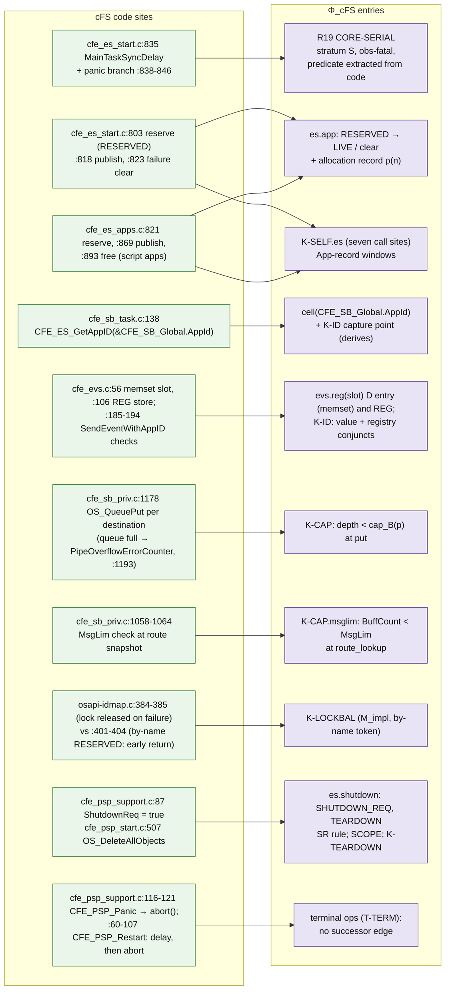
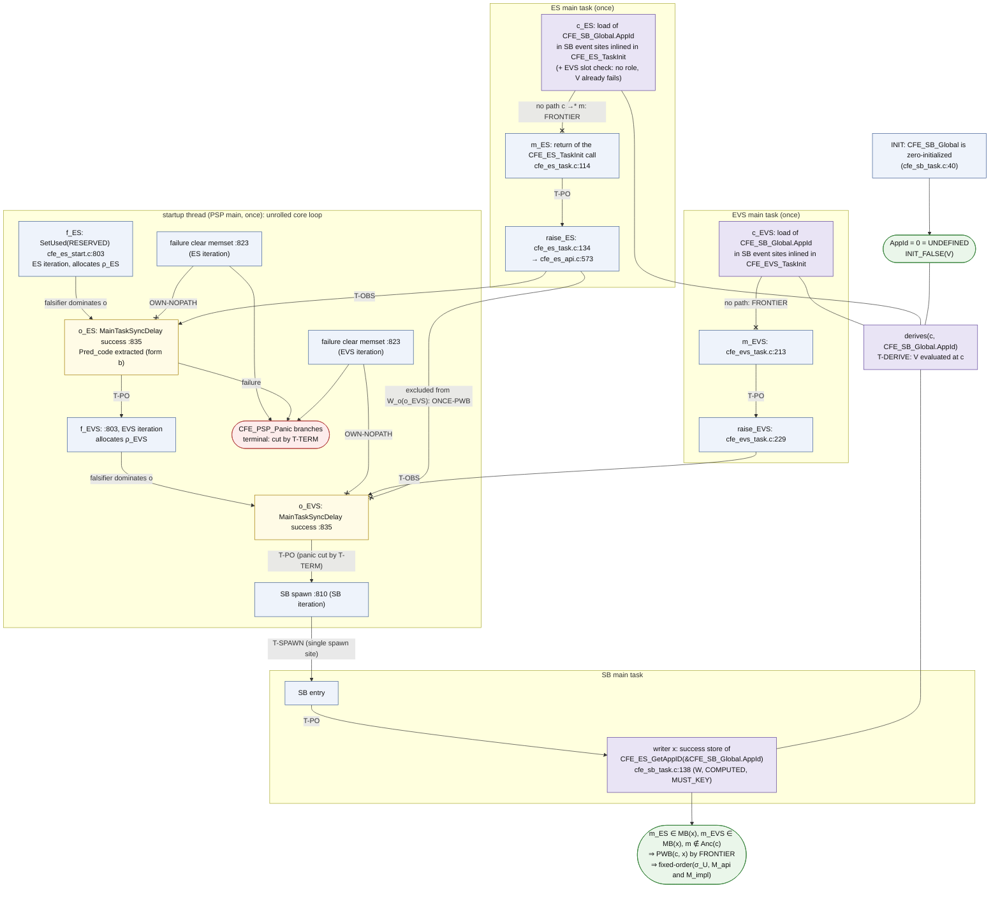
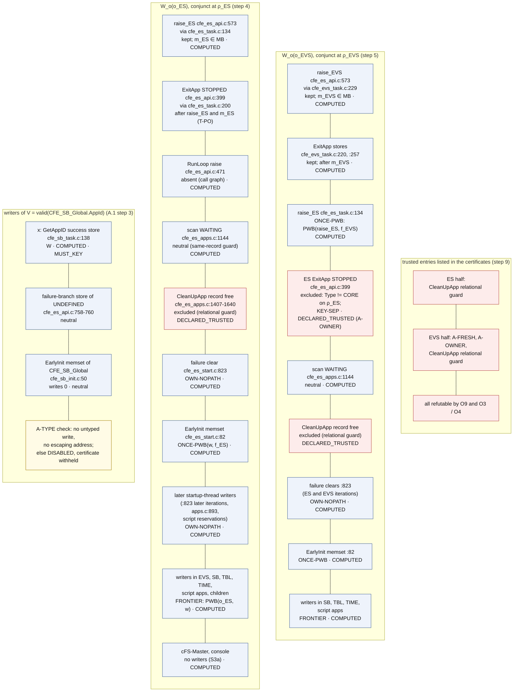
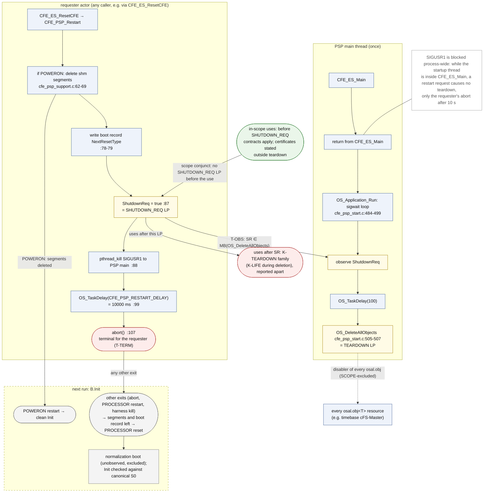

# 05 cFS 대응: Φ_cFS 프로파일, 계약 coverage, R2 certificate, 종료 범위

이 문서는 Kairos의 cFS 프로파일 Φ_cFS가 cFS v7.0.1의 실제 구조(PSP, OSAL, cFE의 ES·EVS·SB·TBL·TIME·FS·CDS, 앱)를 어떤 resource kind·HB 규칙·계약으로 옮기는지 설명한다. R03이 찾은 15개 계약 종류의 coverage, 다섯 설계 사례와 그 밖의 후보가 들어가는 자리, R2 certificate의 모양, 종료(teardown) 범위도 다룬다. spec에 없는 설계 요소·수치·인용은 더하지 않으며, 세부는 spec의 해당 절로 넘긴다.

상태: 설계 문서 — 구현·측정 전. 규범 원문: [spec/SPEC_FINAL.md](spec/SPEC_FINAL.md)

## 목차

- [0. 읽기 전에](#0-읽기-전에): 표기, Φ_cFS가 담는 것, 필요한 용어
- [1. 한 장으로 보기 (D5)](#1-한-장으로-보기-d5): cFS 계층과 Φ_cFS 항목의 대응
- [2. 계층별 대응](#2-계층별-대응): actor, OSAL, task 생성과 App-record 구간, PSP, ES, 앱 적재, 재시작, SB, EVS, TBL, CDS, TIME, ad hoc 동기화 (spec §3.1–3.14)
- [3. 계약 라이브러리와 15개 계약 종류](#3-계약-라이브러리와-15개-계약-종류) (spec §3.15)
- [4. HB 규칙 목록](#4-hb-규칙-목록) (spec §3.16)
- [5. site binding과 version guard](#5-site-binding과-version-guard) (spec §3.17)
- [6. 다섯 사례의 자리와 그 밖의 후보](#6-다섯-사례의-자리와-그-밖의-후보) (spec §7.3)
- [7. R2 certificate 예 (D8)](#7-r2-certificate-예-d8) (spec App. A.1)
- [8. 종료 범위 (D9)](#8-종료-범위-d9) (spec §3.5, §1.6, §4.5, App. A.7)
- [9. 이 문서가 주장하지 않는 것](#9-이-문서가-주장하지-않는-것)
- [10. 관련 문서](#10-관련-문서)

---

## 0. 읽기 전에

### 0.1 표기

근거 표기는 spec 머리말을 따른다. 자세한 설명은 [01_overview.md §0](01_overview.md#0-읽는-법)에 있다.

| 표기 | 뜻 |
|---|---|
| [F] | 코드·기록·보고서 인용이 있는 사실 |
| [M] | 측정값. 누가 측정했는지 출처를 붙인다([BM], [R07], [R2g] 등). Kairos가 직접 측정한 값은 아직 없다 |
| [I] | 추론 또는 설계상 추론. 실행하지 않았다 |
| [D] | 설계 결정. spec §11의 ADR이 기록한다 |
| **코드 해석, 미실행** | 배경 보고서([R01], [R02] 등)나 검토·ledger가 코드를 읽고 낸 결함 후보다. 실행으로 확인한 적이 없고, 확인 실행 전에는 버그라고 부르지 않는다(spec §6.4 항목 23) |

- 코드 위치 `path:line`은 고정된 cFS tree(cFS `088b2fa8`; cFE `c5fb2b4d`, OSAL `d2d877a6`, PSP `c4b3b0b6`) 기준이다(spec 머리말). 파일 이름 없이 적은 줄 번호(예: `:818`)는 바로 앞에 적은 파일의 줄이다.
- "(spec §3.3)"은 SPEC_FINAL.md의 절이다. [R01]–[R07]은 `background/`의 보고서, [LED]는 `cases/ledger.md`, [R2g]·[R2c]는 `results/`의 R2 기록(gdb, CORD), [BM]은 `env/BASELINE_MEASURE.md`다. [A]·[B]·[C]는 `history/`의 설계 제안, [X1]–[X3]·[J1]–[J3]은 같은 곳의 검토·심사다.
- 문헌은 [R04]·[R05]·[R06]이 확인한 상태 표지(V-doc, V-abs, V-me, P, UNVERIFIED)와 함께만 인용한다.
- **경보 없음 ≠ 안전.** 이 문서의 어떤 표도 "안전"을 뜻하지 않는다. 근거가 없는 칸은 `unknown(reason)`이 된다(spec §0.1, §1.10).

### 0.2 Φ_cFS가 담는 것

Kairos는 cFS에 대한 지식을 분석 엔진 코드에 넣지 않는다. 작은 선언형 언어로 쓴 데이터인 **framework profile Φ**에 넣는다(spec §0.2 item 1; ADR-003). Φ_cFS는 v7.0.1용 Φ다. cFS의 메커니즘 하나는 다음 네 종류의 Φ 항목이 된다(spec §3 머리말).

| Φ 항목 | 뜻 | cFS 예 |
|---|---|---|
| resource kind와 lifecycle automaton | 자원 종류마다 생애주기 상태 기계를 둔다. 이 방식을 **typestate**라 한다. 객체의 현재 상태가 어떤 연산을 허용하는지 정한다는 개념이다(Strom & Yemini 1986 [V-me]; spec §1.3) | `sb.route(m,p)`: NONE ↔ ROUTED |
| operation | API 하나의 binding(코드의 어느 지점인가), 효과, 결과 코드의 뜻, 조건마다의 LP | `CFE_SB_TransmitMsg`: route_lookup LP 하나와 목적지마다 put LP 하나(spec §1.4) |
| HB 규칙 | "e₁이 e₂보다 먼저"를 정하는 추론 규칙이다. stratum과 robustness tag를 가진다 | R19 CORE-SERIAL (S, obs-fatal) |
| 계약 (readiness contract) | 사용 지점이 요구하는 자원 상태, 판정 oracle, 문서가 허용한 not-ready 결과(Allowed), 해(harm), 출처(provenance)를 묶는다 | K-ID: `CFE_EVS_SendEventWithAppID`에 넘긴 AppId가 유효하고 EVS에 등록돼 있어야 한다 |

**규칙 이름의 출처.** R1–R19는 [R02 §8.1]의 규칙 번호이고, P-*는 [R01 §3, §6.1]의 OSAL 기본 연산 규칙이다(spec §3 머리말). **규칙 R2(task 생성 → 자식의 첫 사건)는 사례 R2(cFE #2663)와 다르다.** 이 문서는 규칙을 항상 "규칙 R2" 또는 "P-TASK / R2"로 적는다.

**두 원칙**이 §3 전체에 걸린다(spec §3 머리말, §1.4).
- 위반의 shape(0.3)를 정하는 edge는 API 수준 edge뿐이다.
- OSAL 내부 lock은 M_impl에서 interleaving을 제약할 뿐이다. 어느 수준에서도 shape용 HB edge를 만들지 않는다.

### 0.3 필요한 용어

자세한 정의는 [04_formal_model.md](04_formal_model.md)와 spec §13에 있다.

| 용어 | 이 문서에서의 뜻 |
|---|---|
| happens-before (HB) | 한 실행 안에서 동기화가 정하는 사건 사이의 순서다(Lamport 1978 [V-abs]). 물리 시각은 HB를 만들지 않는다(spec §1.5) |
| linearization point (LP) | 연산의 효과가 한순간에 일어났다고 보는 코드 지점이다. 요구 조건이 여러 conjunct(그리고로 묶인 조건)로 되어 있으면 conjunct마다 LP를 따로 둔다(spec §1.4) |
| capture point | 호출자가 넘길 값을 공유 위치에서 미리 읽어 둔 load 지점이다. 값 조건의 LP가 된다. 이 연결은 `derives` 사실과 번역 규칙 T-DERIVE가 만든다(spec §1.4) |
| stratum S / O / C_σ | S(구조적)는 두 끝이 모두 있는 모든 실행에서 성립하는 순서로, 정적 증명에 쓴다. O(관측 동기화)는 관측한 실행에서만 성립하고 예측에서 뒤집을 수 있다. C_σ는 σ_R1의 우선순위 제약이며 HB가 아니다(spec §1.9) |
| robustness tag | trace 쪽 edge의 강도 표시다. `unconditional`, `obs-fatal`(실패하면 종료뿐인 관측), `obs-soft`(timeout 뒤 기록만 하고 계속하는 관측), `schedule-chosen`(lock, semaphore, 메시지), `assumed`(가정 A4 아래에서만 성립)(spec §1.9) |
| M_api / M_impl | OSAL을 API 계약 수준(각 API가 원자적)으로 볼지, POSIX 구현 수준(RESERVED 구간과 lock 누수 경로가 보임)까지 펼칠지다(spec §1.4) |
| σ_U, σ_U∞, σ_R1, σ_E | 스케줄 의미론이다. σ_U는 시간을 무시한 임의 interleaving(지연은 양보, timeout은 언제든 가능), σ_U∞는 timeout이 없고 지연 간격을 둔 재시도가 끈질긴 의미, σ_R1[P_sched]는 한 CPU의 고정 우선순위, σ_E는 실제 바이너리다(spec §1.8) |
| basis B / B′ | 스케줄을 뺀, 실행을 정하는 모든 것(Build, Config, Init, Env, Input)이다. 구성이나 입력을 바꾸면 새 basis B′이고, B′에서만 나온 결과는 기본 구성의 "새 버그"가 아니다(spec §1.7) |
| Allowed / harm | 문서가 허용한 not-ready 결과(유한 어휘: `none`, `documented_drop`, `returned_and_tested`, `retry_until_ready`, `fallback`, `defer_by_design`, `exit`, `unspecified_by_reference`)와, 허용되지 않을 때의 효과 분류다(spec §1.6) |
| shape | bad 사용의 모양이다. WRONG-WAY(사용이 HB상 공급보다 앞), UNORDERED(HB상 순서 없음), ABSENT(그 실행에 공급이 없음), STALE(한때 참이었다가 무효화됨)(spec §1.10) |
| provider 축 | `present`, `none`(초기에 거짓이고 writer가 하나도 없음), `env-absent`(환경 능력이 없어 공급이 막힘), `unknown`(spec §1.10) |
| census | 모든 계약을 모든 문맥 위치(context-qualified site)에 instance로 만들고, 각각에 class나 `unknown(reason)`을 주는 정적 작업이다(spec §4.6) |
| skeleton, certificate view `Sk^cert` | skeleton은 actor의 제어 흐름 그래프를 관련 사건만 남겨 투영한 것이다. certificate view는 상한이 없는 loop를 "0회 이상 반복"(star-closed)으로 닫은 skeleton이다. 보편 판정과 `inactive`는 이 view에서만 나온다(spec §4.3) |
| looper | `ReceiveBuffer`로 메시지를 받아 handler로 나눠 주는 loop를 도는 actor다(spec §1.9) |
| 예측 / explorer | 예측은 관측한 trace에서 다른 순서가 가능한지 찾는 단계다(spec §4.9). explorer는 후보 하나의 작은 모형 위에서 실행을 체계적으로 탐색하는 단계이며, 늦은 단계 S7의 조건부(gated) 구성요소다(spec §4.10) |
| hold, F0, derived | hold는 확인 실행에서 한 thread를 지정한 지점에 붙잡아 두는 방법이다. F0는 바이너리와 실행 조건을 바꾸지 않고 timing만 교란하는 수준이다. 구성한 스케줄로 얻은 확인에는 `derived` 표시를 단다(spec §1.10, §4.13, §5.1) |
| `n of N`, pool key | 자연 실행 N번 중 n번에서 관측했다는 기록과, 같은 조건이라 한데 모아 센 실행 묶음의 식별자다(spec §1.10, §2.3) |

---

## 1. 한 장으로 보기 (D5)

D5는 두 장이다. 개요는 cFS 계층마다 Φ_cFS의 어떤 kind·규칙·계약이 생기는지 보이고, 상세는 대표 코드 위치가 어떤 Φ 항목이 되는지 보인다(spec §12 D5).

**D5 개요** — 렌더링: [diagrams/D5_cfs_mapping_overview.svg](diagrams/D5_cfs_mapping_overview.svg)

```mermaid
flowchart LR
    %% D5 overview - which cFS layer becomes which Φ_cFS entries. Source: spec §12 D5; §1.3, §3.1-3.16.
    %% Detail with code sites: D5_cfs_mapping_detail.mmd.

    subgraph CFS["cFS v7.0.1 (pinned tree)"]
        PSP["PSP<br/>main thread → OS_Application_Run, soft_timebase / cFS-Master,<br/>reset decision + boot record, persistence areas,<br/>CFE_PSP_Panic, CFE_PSP_Restart, exception ring"]
        OSAL["OSAL<br/>idmap (by-ID / by-name tokens, timed waits), tasks,<br/>mutex (PI), binsem, countsem, queues (msg_max, euid),<br/>timebase / timers, modules / symbols with scope, files"]
        ES["cFE ES<br/>startup thread, CreateObjects, script selection,<br/>AppCreate, trampoline, App / Task / Lib records,<br/>SystemState, WaitForSystemState, MainTaskSyncDelay,<br/>background task, CleanUpApp"]
        EVS["cFE EVS<br/>register with memset, SendEventWithAppID<br/>(two conjuncts), own-ID guard"]
        SB["cFE SB<br/>pipes, routes, route_lookup + puts, MsgLim, receive,<br/>subscription reporting in SB's task, header MsgIds,<br/>recursion guard"]
        TBL["cFE TBL<br/>register, share, GetAddress, load paths"]
        TIME["cFE TIME<br/>1 Hz chain, seqlock, synch slots by index"]
        FSCDS["FS background, CDS"]
        APPS["apps (15) with tables<br/>+ the selected startup script"]
    end

    subgraph PHI["Φ_cFS (profile, data not code)"]
        KPSP["es.shutdown; terminal ops Panic, Restart (T-TERM);<br/>SR rule; K-TEARDOWN; persistent-scope resources"]
        KOSAL["osal.obj#60;T#62;, loader.sym, queue cap_B (msg_max, euid);<br/>P-* rules (P-TASK, P-TASK-JOIN, P-MUT, P-BIN, P-CNT,<br/>P-Q, P-TB, P-MOD);<br/>M_api / M_impl; K-REG.osal, K-SPAWN.osal, K-LOCKBAL"]
        KES["es.app / es.task / es.lib, es.self, es.phase, es.appstate;<br/>R3, R5, R6, R15, R18, R19;<br/>K-SELF.es, K-SPAWN, K-PHASE, K-REG.es,<br/>K-LIFE, K-GEN, K-LOCK.cancel"]
        KEVS["evs.reg(slot); K-ID (value + registry conjuncts);<br/>own-ID guard = documented_drop"]
        KSB["sb.pipe, sb.route, sb.queue, sb.msglim,<br/>sb.mode.subreport; R7, R8 (state, not edge);<br/>K-ROUTE, K-CAP, K-CAP.msglim, K-MODE,<br/>K-REG.sb-pipe-name, K-LIFE.sb-buffer"]
        KTBL["tbl.table; R11, R12, R13;<br/>K-TBL.share, K-TBL.getaddr, K-ATOM.tbl-load"]
        KTIME["time.synchcb; R14; K-LIFE.callback, K-ATOM.synchcb"]
        KFS["es.cds (persistent); R16; K-PERSIST"]
        KAPP["actor classes T_osal / T_raw / T_env;<br/>K-HANDOFF; app-profile layer (optional)"]
        KX["cross-cutting: per-conjunct LPs + capture points,<br/>cell(loc), R1 program order (looper rule), RF rule,<br/>P_sched profiles (σ_R1)"]
    end

    PSP --> KPSP
    OSAL --> KOSAL
    ES --> KES
    EVS --> KEVS
    SB --> KSB
    TBL --> KTBL
    TIME --> KTIME
    FSCDS --> KFS
    APPS --> KAPP
    OSAL --> KX

    classDef cfs fill:#eaf6ea,stroke:#2e7d32,color:#111
    classDef phi fill:#e9e4f5,stroke:#5b3f99,color:#111
    class PSP,OSAL,ES,EVS,SB,TBL,TIME,FSCDS,APPS cfs
    class KPSP,KOSAL,KES,KEVS,KSB,KTBL,KTIME,KFS,KAPP,KX phi
```



**D5 상세** — 렌더링: [diagrams/D5_cfs_mapping_detail.svg](diagrams/D5_cfs_mapping_detail.svg)



같은 내용을 표로 줄이면 다음과 같다. 각 줄의 세부는 2절의 해당 소절에 있다.

| cFS 계층 | 주요 kind | HB 규칙 | 주요 계약 | 이 문서 / spec |
|---|---|---|---|---|
| PSP | `es.shutdown`, 유지(persistent) 자원, 종료 연산 Panic·Restart | SR | K-TEARDOWN | 2.5, 8 / §3.5 |
| OSAL | `osal.obj<T>`, `loader.sym`, queue 용량 `cap_B` | P-TASK, P-TASK-JOIN, P-MUT, P-BIN, P-CNT, P-Q, P-TB, P-MOD | K-REG.osal, K-SPAWN.osal, K-LOCKBAL, K-REG.unique, K-LIFE.osal | 2.2–2.4 / §3.2–3.4 |
| ES | `es.app`·`es.task`·`es.lib`, `es.self`, `es.phase`, `es.appstate` | R3, R5, R6, R15, R18, R19 | K-SELF.es, K-SPAWN, K-PHASE, K-REG.es, K-LIFE, K-GEN, K-LOCK.cancel | 2.3, 2.6–2.8 / §3.3, §3.6–3.8 |
| EVS | `evs.reg(slot)` | — | K-ID(값 조건 + 등록 조건) | 2.10 / §3.10 |
| SB | `sb.pipe`, `sb.route`, `sb.queue`, `sb.msglim`, `sb.mode.subreport` | R7, R8(상태) | K-ROUTE, K-CAP, K-CAP.msglim, K-MODE, K-REG.sb-pipe-name, K-LIFE.sb-buffer | 2.9 / §3.9 |
| TBL | `tbl.table` | R11, R12, R13 | K-TBL.share, K-TBL.getaddr, K-ATOM.tbl-load | 2.11 / §3.11 |
| CDS, counter | `es.cds`(persistent) | — | K-PERSIST, K-REG.es-counter | 2.12 / §3.12 |
| TIME, FS | `time.synchcb` | R14, R16 | K-LIFE.callback, K-ATOM.synchcb | 2.13 / §3.13 |
| 앱(15개)과 table | actor 분류 `T_osal`/`T_raw`/`T_env` | — | K-HANDOFF, 선택적 app-profile 층 | 2.1, 2.14 / §3.1, §3.14, §7.2 |
| 공통 | conjunct별 LP와 capture point, `cell(loc)` | R1(looper 규칙), RF | — | 0.3, 4 / §1.4, §3.16 |

---

## 2. 계층별 대응

이 절은 spec §3.1–3.14를 계층마다 줄여 옮긴다. 코드 위치와 세부 조건은 spec 원문에 모두 있다.

### 2.1 actor 목록과 closure (spec §3.1)

**actor**는 실행 흐름 하나다. 세 집합이 있다(spec §1.2). `T_osal`은 `OS_TaskCreate`로 만든 core·앱·child task, `T_raw`는 OSAL task record가 없는 thread(PSP main thread, console writer, timebase thread `cFS-Master`, signal 문맥), `T_env`는 지상 명령·SBN peer·정지 명령 같은 외부 입력 근원이다. `T_env`에는 들어오는 HB edge가 없다.

정적 분석은 먼저 basis B의 구성에서 실행될 수 있는 actor와 코드를 모두 찾아 닫는다. 이것을 **configuration closure**라 한다(spec §3.1, §4.1).

| actor 분류 | 어디서 오나, entry를 찾는 법 |
|---|---|
| ES startup thread (PSP main) | `CFE_PSP_MAIN_FUNCTION`. `CFE_ES_Main`이 돌아오면 `OS_Application_Run`을 돈다(`cfe_psp_start.c:452–508`). 정의상 once |
| core main task (ES, EVS, SB, TBL, TIME) | 생성 파일 `cfe_static_module_list.c`. `CFE_ES_CreateObjects`의 table loop(횟수 상수)를 정확히 펼쳐 반복마다 spawn 노드 하나를 둔다 |
| 앱 main task (15개) | **B가 고른** startup script. entry symbol을 module `.so` 안의 정의로 푼다(`dlsym`의 정적 대응, [R05 §2.5 item 1]). 관측한 `OS_ModuleSymbolLookup`으로 확인한다 |
| child task | 상수 함수 인자를 가진 `CFE_ES_CreateChildTask` 호출. 예: TIME의 tone·local task(`cfe_time_task.c:160, 173`), `ES_BG_TASK`(`cfe_es_backgroundtask.c:214`), FM의 자식(`fm_child.c:86`). owner는 만든 앱이다 |
| timebase `cFS-Master` | PSP `soft_timebase` module(`cfe_psp_soft_timebase.c:53`). 관측은 `OS_TimeBase_CallbackThread`(`osapi-timebase.c:365`) |
| 자기 조회 handshake를 하는 OSAL 내부 thread | 자기 object에 `OS_ObjectIdGetById`를 부르는 OSAL 내부 thread entry를 pattern으로 찾는 일반 규칙([X2-03]) |
| callback 문맥 | `OS_TimerAdd`/`Set`, `CFE_TIME_RegisterSynchCallback`, FS 백그라운드 요청, TBL validation 함수. **등록 호출을 spawn site로 하는 비동기 actor**이고 결코 once가 아니다 |
| console writer, signal 문맥, 환경 근원 | 정적. 모형 안 spawn site가 없는 signal 문맥과 환경 근원은 `MB(entry) = ∅` |

- 관측 기준점은 주로 `CFE_ES_StartAppTask` 안의 `OS_TaskCreate`와 자식의 `OS_TaskEntryPoint`(`osapi-task.c:124`)다. callback은 사용자 stack의 **on-behalf frame**으로 잡는다. on-behalf frame은 어떤 thread가 다른 앱을 대신해 코드를 실행 중이라는 표시다(spec §1.2).
- **간접 호출** 110곳([R07 §4.2])은 구성(task entry, trampoline의 `RealEntryFunc`, core `TaskMain`/`EarlyInit`, `CFE_Config_IterateAll` callback, SBN module ops) → 등록 위치 → struct type 계층(MLTA, CCS 2019 [V-abs]) → `unknown_effect` 순으로 푼다. closure 보고서는 규칙마다 푼 개수를 적는다.
- **once와 generation.** once(τ)는 actor τ가 한 실행에 많아야 하나 존재한다는 사실이다. 주장하지 않고 증명한다(spec §1.2). 기본 B에서는 모든 정적 actor를 once로 검사한다. 재시작 시나리오 `B_restart`에서는 재시작된 앱(과 그 자식)의 skeleton을 generation 1용으로 복제하고, 그 spawn site를 background scan의 재시작 경로로 둔다(spec §3.1, §3.8).

### 2.2 OSAL ID map: 생성과 조회 (spec §3.2)

여기가 **OSAL RESERVED 구간** 예의 자리다.

OSAL object의 kind는 `osal.obj<T>`이고, 상태는 FREE → ALLOC → RES_C(이름 안 보임) → RES_CN(이름 보임, RESERVED, type lock 안 잡힘) → LIVE → RES_D → FREE다(spec §1.3). 발행 LP는 type lock 아래의 최종 ID 쓰기(`osapi-idmap.c:1092`, unlock `:1105`)다. unlock 뒤에 도는 `OS_EVENT_RESOURCE_CREATED` callback(`:858–865`)이 아니다 [F] ([R01 §6.1]).

- **M_api**: 생성은 한 번의 전이 ABSENT → LIVE이고, 이름 조회는 FOUND 또는 `NAME_NOT_FOUND`다.
- **M_impl** ([R01 §1.5–1.8]): type lock 아래 ALLOC → `ConvertToken(EXCLUSIVE)`가 RESERVED를 표시하고 lock을 **푼다** → `OS_OBJECT_INIT`이 이름을 보이게 한다 → 구현 호출(`pthread_create`, `mq_open` 등) → `FinalizeNew`가 다시 잠그고 발행한다. 이 사이에 조회 token이 RESERVED record를 만나면 token 종류에 따라 갈린다 [F].

| token | RESERVED record를 만났을 때 | Φ 계약 |
|---|---|---|
| by-name, search | `OS_ERR_INCORRECT_OBJ_STATE`로 즉시 실패하는데, unlock 로직 **전에** return한다(`osapi-idmap.c:401–404`). header는 "실패하면 OS_LOCK_MODE_NONE이 아닌 모든 lock mode에서 전역 table lock을 항상 푼다"고 적는다(`:384–385`) | **K-LOCKBAL**: API는 type lock을 푼 채 돌아와야 한다. 문서화된 불변식에서 끌어낸 계약이다 |
| by-ID (`OS_ObjectIdGetById`) | 제한된 대기에 들어간다. 시도 k는 type unlock의 broadcast(모든 type unlock이 broadcast한다, `os-impl-idmap.c:106–129`) 또는 timeout k² × 10 ms로 깬다(`posix/src/os-impl-idmap.c:138–170`). 다섯 번째 시도는 `OS_ERR_OBJECT_IN_USE`로 실패한다(`osapi-idmap.c:475–480`) | **K-SPAWN.osal**(2.3) |

- timeout으로 깨는 것은 **timeout 전이**다. σ_U에서는 언제든 가능하고 σ_U∞에서는 없다. broadcast로 깨는 것은 모든 σ에 남는다. [I] σ_U에서 timeout 네 번은 실제 시간(σ_E 기준)으로 10 + 40 + 90 + 160 = 300 ms이므로, task 소실(F7)에는 그 정도의 생성자 지연이면 충분하다.
- **관측**: 각 `OS_*Create`·`OS_*GetIdByName`·`OS_*Delete`의 entry와, 발행 구간을 잡는 `OS_ObjectIdFinalizeNew` entry. 반환값은 계약 사용 지점에서만 잡는다(spec §5.2).
- **규칙 RF (O)**: 성공한 조회는 같은 generation의 발행을 읽은 것이다. timestamp로 순서를 정하지 않는다([A §5.6]).
- **계약**: `K-REG.osal-lookup`(Req LIVE. Allowed는 재시도 loop가 있으면 그 경계의 `retry_until_ready`, 없으면 `returned_and_tested`), `K-LOCKBAL`(M_impl, by-name/search), `K-REG.unique`(동시 생성의 중복 이름, [R01] F2), `K-LIFE.osal`(삭제와 동시인 NONE-mode 사용, [R01] F4). rwlock과 condvar는 test 밖 호출자가 없어 모형에 넣지 않는다.
- [R01]의 F1(lock 누수), F2, F4, F7은 **코드 해석으로 낸 후보이고 실행하지 않았다**([R01 §1.8, §2.2]).

### 2.3 task 생성, ES handshake, App-record 구간, K-SELF.es (spec §3.3)

**규칙 P-TASK / R2 (S, unconditional).** 생성자가 `OS_TaskCreate` 호출 전에 한 사건은 모두 자식의 첫 사건보다 먼저다([R01 §2.2]).

**K-SPAWN.osal (M_impl).** 아직 RESERVED인 자기 record에 by-ID 자기 조회 handshake를 하는 thread는 모두 instance다([X2-03]).
- 자식 task의 `OS_TaskPrepare`: 2.2의 대기 시도가 소진되면, 생성자는 `OS_SUCCESS`를 받았는데 entry는 실행되지 않는다. harm `task_never_runs`([R01]의 F7).
- timebase callback thread(`osapi-timebase.c:383–390`): 실패하면 조용히 `return`한다. `cFS-Master`가 callback을 하나도 보내지 않아 1 Hz 사슬이 시작되지 않는다(TIME tone 없음, SCH_LAB wakeup 없음).
- closure가 pattern으로 찾는 그 밖의 OSAL 내부 thread(2.1).

**ES task-record handshake (O, 조건부. guard된 부분은 S).** `CFE_ES_StartAppTask`는 ES lock을 잡기 **전에** task를 만들고(`cfe_es_apps.c:664–672`) task record는 그 **뒤에** 채운다(`:694–703`). 자식은 `CFE_ES_GetTaskFunction`에서 50 ms 지연과 lock 아래 확인을 되풀이하며, 예산은 `CFE_PLATFORM_ES_STARTUP_SCRIPT_TIMEOUT_MSEC` = 1000 ms, 즉 최대 21번이다(`:559–596`). 시간이 다 되면 entry는 불리지 않는다 [F].

**App-record 구간.** `CFE_ES_GetAppRecordByContext`는 호출자의 App record가 최종 상태여야 한다. 그런데 trampoline(진짜 entry를 부르기 전에 거치는 공통 진입 함수, 2.7)은 task record만 확인한다. 두 생성 경로가 같은 구조를 가진다([LED §3.4]).

| 경로 | 예약 → task 시작 → 발행 | 구간 안에서 생기는 일 |
|---|---|---|
| script 앱 | `cfe_es_apps.c:821` → `:848–854` → `:869`(ES lock 아래, `:861–869`) | 50 ms 간격 poll이 이미 성공했을 수 있다([R02 §1.6]). 동료 앱의 `CFE_ES_GetAppIDByName`은 `CFE_SUCCESS`와 함께 `0xFFFFFFFF`를 돌려준다(`cfe_es_api.c:637–656`). 계약 oracle(`CFE_ES_AppRecordIsMatch`)이 이 성공을 not-ready로 판정한다 |
| core 앱 | `cfe_es_start.c:803` → `:810` → `:818` | core task의 `*_TaskInit`이 `:818` 전에 `GetAppID`를 부를 수 있다. EVS는 첫 동작으로 부른다(`cfe_evs_task.c:273`) |

- **child task도 피하지 못한다.** 부모의 구간 안에서 만든 자식(TIME, `ES_BG_TASK`, FM)은 아직 최종이 아닌 같은 App record로 풀린다([X2-02]).
- **두 구간 모두 O-ordered다.** 사용의 LP와 발행이 모두 ES lock 아래에 있으므로 trace는 둘을 lock edge로 순서 짓는다. 반대 순서가 가능한지는 lock을 뒤집는 예측(spec §4.9)이나 explorer(§4.10)가 정한다. 이전 제안의 "순서 없음" 분류는 spec §0.5가 정정했다.

**K-SELF.es [D].** generic 계약 `es.self(exec) = LIVE`를 `GetAppRecordByContext`/`GetTaskRecordByContext`의 **모든** 호출자에 instance로 만든다. 호출자마다 문서화된 not-ready 동작이 다르다(줄은 `cfe_es_api.c`).

| 호출자 (위치) | not-ready일 때의 결과 | Allowed |
|---|---|---|
| `CFE_ES_ExitApp` (`:312`) | 조용한 no-op: unlock 후 return | `unspecified_by_reference` |
| `CFE_ES_RunLoop` (`:463`) | `false` 반환 | `unspecified_by_reference` |
| `CFE_ES_WaitForSystemState` (`:533`) | raise를 건너뛰고 대기는 계속 | `unspecified_by_reference` |
| `CFE_ES_GetAppID` (`:750`) | `CFE_ES_ERR_RESOURCEID_NOT_VALID`, 출력 `UNDEFINED` | 호출자마다(상태를 검사하거나 무시) |
| `CFE_ES_GetTaskID` (`:785`) | 오류 코드 | 호출자마다 |
| `CFE_ES_CreateChildTask` (`:1262`) | 오류 코드, 자식 없음(harm `task_never_runs`) | 호출자마다 |
| `CFE_ES_ExitChildTask` (`:1459`) | 오류 경로(record 해제 안 됨) | `unspecified_by_reference` |

**결과 사슬.** 사슬은 한 갈래가 아니라 **모든 갈래**를 기록한다(spec §1.6). 실행 전이므로 모두 코드에서 추론한 것이다 [I] ([X2-02]).
- **core 구간 안의 EVS.** `GetAppID` 실패 → `CFE_ES_ExitApp(CORE_APP_INIT_ERROR)`. (a) 구간이 아직 열려 있으면 `ExitApp`은 no-op이다. 그 뒤 raise 때 구간이 닫혔으면 EVS task가 결국 종료하고 시스템은 EVS 없이 돈다(`service_task_absent`). 아직 열려 있으면 raise를 건너뛰어 30000 ms 뒤 core sync가 panic한다(`panic`). (b) 첫 `ExitApp` 전에 구간이 닫혔으면 `CFE_ES_ResetCFE(PROCESSOR)` → `CFE_PSP_Restart`다. EVS task가 10000 ms 뒤 `abort()`하고, 정상 종료는 없다(8.1). 30 s panic보다 먼저다(`process_abort`).
- **script 앱이 자기 구간 안.** `RunLoop` false → loop 이탈 → `ExitApp` no-op → task return. record가 `AppState ≤ RUNNING`인 채 남는데 scan은 `> RUNNING`만 처리한다(`cfe_es_apps.c:1112–1146`). 두 soft barrier가 각각 timeout된다(`app_zombie`). 구간이 먼저 닫히면 STOPPED로 정리된다(`app_error_exit`).
- **core task(ES, SB, TBL, TIME)의 raise가 구간 안.** raise를 건너뛰어, 다시 raise하지 않으면 30 s 뒤 panic이다.
- **SB·TBL의 `GetAppID`가 구간 안**(`cfe_sb_task.c:138`, `cfe_tbl_task.c:196`, 둘 다 상태 무시). identity 셀이 그 실행 내내 `UNDEFINED`가 되고, 이후 모든 SB/TBL `SendEventWithAppID` 사용이 shape ABSENT로 bad다. 이 뿌리 하나에 사슬로 묶는다. EventRacer식 race coverage(OOPSLA 2013 [V-abs])에 따라 뿌리를 보고하고, 종속 사용(기존 기록에서 부팅마다 순서가 정해진 211–229개 [M], [R2c §7])은 붙여 둔다. race coverage는 어떤 짝을 뒤집으려면 ad hoc 동기화 짝을 먼저 뒤집어야 할 때 그 동기화 짝을 뿌리로 보고하는 방식이다(spec §4.8 step 7).

**삭제와 종료 (P-TASK-JOIN / R17, S).** `OS_TaskDelete`는 취소한 뒤 join한다(`os-impl-tasks.c:693–723`). 지연 취소(deferred cancellation)는 피해 task가 취소 지점에서 program lock을 잡고 있으면 그 lock을 남긴다([R01 §2.4]). 그래서 ES lock 아래에서 삭제하는 `CFE_ES_DeleteChildTask`(`cfe_es_api.c:1348, 1383`)에 **K-LOCK.cancel**을 둔다.

### 2.4 OSAL 기본 연산 (spec §3.4)

| 기본 연산 | 규칙 (stratum, tag) | 짝짓는 조건과 비고 |
|---|---|---|
| mutex(재귀, `PTHREAD_PRIO_INHERIT`) | P-MUT / R4 (O, schedule-chosen) | 가장 바깥 release → 같은 id+generation의 다음 가장 바깥 acquire. 순서는 `OS_MutSemGive` entry에서 kernel이 임계 구역 안에서 매기는 `objseq`로 잡는다 |
| binary semaphore | P-BIN / R9 (O) | give → 그것을 소비한 take(보수적으로 마지막 소비 take 이후 give들의 join). flush → 깨어난 각 take. timeout → 없음 |
| counting semaphore | P-CNT / R10 (O) | 이전 give들의 보수적 join. 정확한 개수는 예측에서 쓴다 |
| queue(26개 모두 SB pipe [M] [BM §0]) | P-Q (O) | 같은 8 byte descriptor의 put(d) → get(d), queue마다 FIFO. `OS_QUEUE_FULL`은 **drop 결과이고 edge가 없다** |
| timebase, timer | P-TB | 등록 → callback은 callback actor의 T-SPAWN을 통한 S. 같은 timebase thread 안의 callback k → k+1은 S, 다른 timer의 callback 사이는 O. callback은 timer 생성자의 것으로 본다 |
| module, symbol | P-MOD (O, reads-from) | `OS_ModuleLoad` 성공 → **그 module의 scope 안에서** 성공한 symbol 조회(2.7) |
| socket | P-NET (O) | datagram send → receive. 외부 송신자는 `T_env` |
| file, path | 없음(공유 상태) | path가 자원이다. `OS_FileOpenCheck`는 check-then-act다 |
| `OS_printf`, `OS_TaskDelay` | **없음** | `OS_printf`는 구현 수준 직렬화일 뿐이다. `OS_TaskDelay`는 σ_U에서 양보, σ_R1에서 blocking 지연이다. 시간에 기댄 protocol은 race의 징후다 |
| condvar, rwlock | 모형 없음 | test 밖 호출자가 없다. 관측되면 `unknown(unmodelled)` |

probe는 기본적으로 함수 entry+4에 둔다. **uprobe**는 실행 파일을 바꾸지 않고 사용자 프로그램의 명령 주소에 거는 kernel probe다. gcc `-O0`의 함수 머리 `endbr64; push %rbp; mov %rsp,%rbp`에서 entry+4는 `push %rbp` 자리이고, 인자 register가 그대로 남아 있다(spec §5.2). 관측 설계는 [06_observation_confirmation.md](06_observation_confirmation.md)가 다룬다.

### 2.5 PSP: 시작, 유지 상태, panic (spec §3.5)

- **시작 순서(PSP main thread의 program order, S)** [F] ([R01 §5.1]): `OS_API_Init` → event handler 등록 → reserved memory → `OS_FileSysAddFixedMap` → `CFE_PSP_ModuleInit`(`cFS-Master` 생성·시작) → `sleep(1)` → reset 종류 결정(`cfe_psp_start.c:411–434`) → `CFE_PSP_InitProcessorReservedMemory` → `CFE_ES_Main` → `OS_Application_Run`. 그래서 `cFS-Master`는 어떤 cFE task보다 먼저 LIVE다.
- **task 시작 hook.** `OS_EVENT_TASK_STARTUP`에서 PSP는 `OS_GetResourceName`을 부르고(task table lock을 쓰므로 F7의 시도를 소비할 수 있다), `CFE_*` task를 CPU 0에 고정한다(`cfe_psp_start.c:174, 184–189`). 고정은 아직 측정할 Env 사실이다.
- **panic은 종료 연산이다.** `CFE_PSP_Panic` → `abort()`(`cfe_psp_support.c:116–121`). ES는 먼저 `CFE_ES_PANIC_DELAY` = 500 ms를 기다리고, 그동안 다른 thread는 계속 돈다([J1 §1 check 1]). 규칙 T-TERM(종료 연산 뒤에는 후속 edge가 없다)은 panic하는 thread의 종료 갈래만 잘라 낸다.
- **재시작과 종료**는 세 효과로 모형화한다. 8절에서 D9와 함께 설명한다.
- **유지 상태 (scope = persistent).** boot record, CDS, reset area, user-reserved shm, `/dev/shm/osal:RAM`, `EEPROM.DAT`다([R01 §5.3]). 실행마다 snapshot(S0)을 찍고 내용만으로 정규화한다(spec §1.7).
- **비동기 PSP 경로**(경쟁을 인정한 exception ring, `cfe_psp_exception.c:72–86` → `SIGUSR1` → ES)는 첫 범위 밖이다. 다만 kind와 edge를 Φ에 넣어 두어 "순서 없음"으로 조용히 처리되지 않게 한다.

### 2.6 ES: phase, soft barrier, core 직렬화 (spec §3.6)

**core object 순서**는 생성 파일 `cfe_static_module_list.c`(CONFIG, ES, EVS, FS, SB, TBL, TIME, MSG, SBR, RESOURCEID)에서 온다. `cfe_es_objtab.c`가 아니다([R02 §1.3]). `MISSION_CORE_MODULES`를 바꾸면 새 B다. 모든 `EarlyInit`은 첫 core task 생성 전에 startup thread에서 돌고(`cfe_es_start.c:752–773`), 그 store는 일반 writer로 다룬다.

**R19 CORE-SERIAL (S, obs-fatal).** `TaskMain`이 있는 core 항목마다 startup thread가 다음을 한다(`cfe_es_start.c:776–847`).

1. lock 아래에서 예약한다(`:795`에서 `Type = CORE`, `:803`에서 `SetUsed(RESERVED)`). 이것이 falsifier `f`이고 record `ρ(f)`의 할당 노드다.
2. `StartAppTask`(`:810`).
3. 발행 `SetUsed(AppRecPtr, PendingAppId)`(`:818`). 실패하면 `memset(AppRecPtr, 0, …)`(`:823`)으로 되돌리고, 그 뒤에는 panic 갈래만 있다.
4. `MainTaskSyncDelay(RUNNING, CFE_PLATFORM_CORE_MAX_STARTUP_MSEC)`(`:835`). 이것이 관측 `o`다.
5. 어떤 실패든 `CFE_PSP_Panic`(`:838–846`).

**falsifier**는 관측 `o`와 같은 actor에서 `o`를 지배하고 관측 조건을 확실히 거짓으로 만드는 사건이다. **할당 기록 `ρ(n)`**은 예약 노드 `n`이 고른 record를 가리키는 추상 record다(spec §4.2 steps 8–9).

**관측 조건은 코드에서 뽑는다** [D] ([X1-M8]). `MainTaskSyncDelay`는 pattern(지연 + 탈출 검사)으로 poll loop로 인식한다. 탈출 갈래는 ES lock 아래에서 `AppTable` 전체를 도는 고정 횟수 loop 뒤에 `AppNotReadyCounter == 0`을 검사한다(`cfe_es_start.c:860–918`). 여기서 다음 predicate가 나온다.

```
Pred_code = ∀ r ∈ AppTable: ¬(IsUsed(r) ∧ r.AppState < AppStateId)     (:835에서 AppStateId = RUNNING)
```

falsifier `f`에 대해 관측하는 conjunct는 `ρ(f)`에서의 instance `C = ¬(IsUsed(ρ(f)) ∧ ρ(f).AppState < RUNNING)`다. Φ는 규칙 이름, stratum, 종료 탈출만 이 loop에 묶는다. predicate는 Φ 작성자가 쓰지 않는다. **C의 writer 집합**(raise, `ExitApp`의 STOPPED store, scan의 WAITING store, `CleanUpApp`의 record 해제, startup thread의 un-use store `:823`·`cfe_es_apps.c:893`, EarlyInit memset `:82`)과 각 처리는 7절과 D8 상세에 있다. 하나만 미리 적는다. script `AppCreate` 실패 경로의 `cfe_es_apps.c:893`은 script phase 관측으로 가는 경로가 **있어서** 그 writer 집합에 남는다. script phase barrier가 O-edge인 이유가 하나 더 생긴다.

**`CFE_ES_WaitForSystemState(s, T)`는 두 효과다** ([R02 §1.7]).
1. ES lock 아래의 raise(`cfe_es_api.c:573`). 수준은 호출자 종류와 요청 상태로 정한다(`:536–563`). core 앱은 `s ≥ CORE_READY`이면 RUNNING, 외부 앱은 EARLY_INIT, LATE_INIT(APPS_INIT), RUNNING(OPERATIONAL), STOPPED(SHUTDOWN)다.
2. lock 없는 `SystemState` polling(`:585`). edge R5/R6(O, obs-soft, 가시성 가정)는 startup thread의 store `SystemState ≥ s` → 대기자의 **`CFE_SUCCESS` 반환**이다. timeout으로 돌아오면 edge가 없다. `CFE_ES_WaitForStartupSync`는 void를 반환한다(`:616–619`).

**script phase barrier**는 각각 `CFE_PLATFORM_ES_STARTUP_SCRIPT_TIMEOUT_MSEC` 뒤에 부드럽게 timeout되고 기록만 남긴다(`cfe_es_start.c:210–213, 225–228`, "soft limit"). 그래서 O, obs-soft다. **OPERATIONAL 뒤에는** 모든 대기가 즉시 돌아오므로, 재시작·재적재·명령으로 시작한 앱은 시작 순서 보장을 받지 못한다.

**K-PHASE: 소비자 쪽, 수준별 instance [D]** ([X1-m9], [X2-11]).
- 출처는 `cfe_es.h:400–403`("이 API는 호출자도 기다리는 전역 상태를 만족할 만큼 초기화되었다고 가정한다")이다.
- instance `(κ_phase, u, r)`: 소비자의 사용 `u`가 앱 `a`의 자원 `r`을 쓰고, 소비자의 성공한 `WaitForSystemState(s)` 뒤에 온다. OPERATIONAL은 모든 앱이 RUNNING이기를, APPS_INIT은 LATE_INIT이기를 요구한다. `a`의 선언은 올린 수준이 그 barrier 수준 이상일 때만 센다.
- 공급과 사용 사이의 S/O 순서는 barrier 사슬(`a`의 선언 → `MainTaskSyncDelay` 성공 → `SystemState` store → 소비자의 대기 성공)뿐이다. `a`가 선언 **뒤에** 공급하면 사슬은 공급을 `u` 앞에 놓지 못하고, instance는 예측과 explorer로 간다. timeout에 기댄 경우는 σ_U∞가 갈라낸다.
- 트리 안의 일탈([R03 §4 RC7]): SBN은 실제 init 전에 선언하고, CS는 init 실패 뒤에도 선언하며, 오류로 종료한 앱은 STOPPED가 되어 barrier를 통과한다.

이 2단계 barrier(APPS_INIT/LATE_INIT)는 사례 C2의 수정으로 들어왔고([LED §1b]), Φ에서는 version guard `cfe >= 6.6.0`을 단다(5절).

### 2.7 script 앱, library, trampoline, loader (spec §3.7)

- **script 해석.** 한 줄씩 읽고, 반환 상태를 무시하며(`cfe_es_apps.c:313`), 항목 사이에 동기화가 없다. 어느 script를 읽을지는 B가 정한다. PROCESSOR reset이면 `/ram`의 volatile script를 먼저 시도하고, POWERON이면 생성된 script(library 2개 + 앱 15개)를 쓴다(spec §1.7).
- **R3 SCRIPT-SEQ (S).** library init *k*는 Lib record가 RESERVED인 동안 startup thread에서 동기적으로 돌고, 이후 모든 항목보다 먼저다. `AppCreate(k)` → `AppCreate(k+1)`은 **생성만** 순서 짓는다. init 완료는 script 순서와 다르게 섞인다([R03 §6.1]).
- **앱 생성**(`cfe_es_apps.c:733–902`): 예약(`:821`) → `CFE_ES_LoadModule`(`dlopen`, `dlsym`) → `StartAppTask`(`:848–854`) → 발행(`:861–869`) 또는 실패 시 해제(`:893`).
- **loader symbol scope** [F] ([X2-10]; spec §0.5). ES는 **앱을 LOCAL symbol로**, **library를 GLOBAL symbol로** 적재한다(`cfe_es_apps.c:470–491`; POSIX `RTLD_LOCAL`/`RTLD_GLOBAL`). kind는 `loader.sym(name, scope)`다. 전역 조회 `OS_SymbolLookup`(MD `md_utils.c:214`, MM `mm_cmds.c:143`, `mm_utils.c:525`)은 GLOBAL scope symbol만 본다. 그래서 앱 symbol을 전역 조회하는 instance는 provider `none`이다.
- **trampoline.** `CFE_ES_TaskEntryPoint`(`:613–641`) → `CFE_ES_GetTaskFunction`(2.3) → 저장된 함수 포인터로 실제 entry.
- **child task**는 main task만 만들 수 있고 같은 `StartAppTask`를 쓴다. 부모의 App-record 구간 안에서 만든 자식은 그 구간을 본다(2.3).

### 2.8 재시작, 재적재, 삭제 (spec §3.8)

- **R15 CTRL-REQ (O).** ES lock 아래에서 쓴 요청 → 앱의 `RunLoop`이 읽음 → `ExitApp` → scan이 STOPPED를 봄. 앱 동작 없이 scan timer로 오는 kill 경로(RUNNING + 요청 → kill timer 5 × 1000 ms의 WAITING, `cfe_es_apps.c:1139–1146`)에는 edge가 없다.
- **`CFE_ES_CleanUpApp`**(`:1407–1640`): record를 RESERVED로 표시 → core module의 `Cleanup` hook을 **생성된 core object table 순서로**, ES lock 없이 실행(`:1525–1545`. 순서는 하드코딩이 아니라 B에서 온다) → task 삭제(자식 먼저) → pool 삭제 → module unload → record 해제. **앱의 task는 module cleanup이 끝난 뒤까지 계속 돈다.** 이 구간이 K-LIFE 구간이다([X2-14](d)).
- **계약.** `K-LIFE`(퇴역 뒤 사용: 삭제된 pipe에 `ReceiveBuffer`, RESERVED task record로 `GetAppID`, module unload 뒤의 TIME synch callback, K-LIFE 구간 안의 사용), `K-GEN`(동료가 이전 generation의 ID나 주소를 들고 있음: CF의 semaphore ID, MD가 풀어 둔 주소, SBN module symbol; [R03 §4 RC15]), generation을 건너는 `K-PERSIST`(2.12).
- **시나리오 family.** `B_restart(app, request)`는 B.Input에 한 앱에 대한 문서화된 제어 요청 **하나**를 넣고 사건(OPERATIONAL 관측)으로 촉발한다. 경로를 지나는 최소 경우다. 더 긴 요청 순서는 `unspecified_by_reference`이고 길이를 고르지 않는다. `B_stop`은 정지 명령과 그것이 일으키는 teardown이다(8절).

### 2.9 Software Bus (spec §3.9)

SB는 cFS 앱 사이 통신의 중심이다. 구독 전 송신 손실과 용량 손실이 여기서 생긴다.

| 메커니즘 | Φ 항목 |
|---|---|
| pipe 생성 | `sb.pipe`: 예약(`cfe_sb_api.c:153`) → OSAL queue를 lock 밖에서 만들고 이름 붙임(`:163`) → commit(`:185–203`, 발행 LP). `CFE_SB_GetPipeIdByName`은 commit 전에 OSAL queue를 찾고 오류 event와 함께 실패한다(`:802–839`) → **K-REG.sb-pipe-name** |
| pipe 소유 | owner는 `GetAppID`의 AppId이고 상태는 무시한다(`:120`). subscribe와 delete에서는 검사하지만 receive에서는 하지 않는다 → 저장된 owner에 대한 K-ID instance |
| **송신, 두 단계** ([X2-06]) | (1) **route_lookup LP**(`cfe_sb_priv.c:989–1104`, SB lock 아래): 호출자 문맥의 `CFE_ES_GetAppID`(`:1004`, K-SELF.es instance), route snapshot, 목적지마다 **MsgLim 검사**(`:1058–1064`)와 깊이 counter의 **낙관적 계산**(`:1071–1073`). route가 없으면 `NoSubscribersCounter++`, `SEND_NO_SUBS` event, 그리고 `CFE_SUCCESS` 반환. (2) **목적지마다 put LP 하나**(lock 밖 `OS_QueuePut`, `:1178`). 실패하면 계산을 되돌리고 queue full이면 `PipeOverflowErrorCounter++`(`:1193`), 다른 오류(예: snapshot 뒤 pipe 삭제)면 `InternalErrorCounter++`(`:1199`) |
| R7 SB-DELIVER (O) | pipe p에 descriptor d를 넣은 put → p에서 d를 꺼낸 `ReceiveBuffer`. pipe마다 FIFO. drop된 메시지에는 edge가 없다 |
| 메시지 key ([X2-09]) | `CFE_SB_TransmitMsg`에는 MsgId 인자가 없다. Φ는 메시지 buffer의 추상 위치 `msg.hdr.MsgId`와 MSG module 함수의 encode/decode 요약을 두고, AST 수준 값 분석이 init 지점의 상수를 송신 지점까지 옮긴다. table에 저장된 명령 packet(SC, HS, LC, SCH_LAB schedule)은 DWARF layout으로 해독한다. census는 key가 concrete, symbolic, ⊤(모름)인 비율을 보고한다 |
| 구독 전 송신 | `sb.route(m,p)`. **R8은 edge가 아니라 상태다.** route_lookup 때 route가 있거나 없다. 목적지는 snapshot되고 늦게 합류한 pipe에는 전달되지 않는다 |
| 메시지 provenance ([X1-M7](a)) | pipe p마다 `Prov(p) = (Routes_B(p) ∩ Tx_B) ∪ Input_B(p)`를 handler 도달성에 대한 최소 고정점으로 계산한다. `Prov(p)` 밖의 dispatch 갈래는 두 skeleton view 모두에서 접어 버린다(spec §4.3) |
| looper 규칙 | handler 안의 program order만 두고, **handler 사이에는 HB edge가 없다.** 예측에서 FIFO 제약으로만 남는다(CAFA PLDI 2014 [V-abs]; DCatch ASPLOS 2017 [P]) |
| buffer 수명 | 같은 pipe의 다음 `ReceiveBuffer`나 pipe 삭제까지 유효하다(`cfe_sb.h:449–464`) → `K-LIFE.sb-buffer` |
| 호출자 대신 내는 event | SB API 코드는 호출자의 task 안에서 `CFE_SB_Global.AppId`를 stamp로 event를 낸다(`cfe_sb_priv.c:786`) → K-ID instance. **사례 R2가 여기다.** 호출자에게 ES task record가 없거나 task별 재귀 bit가 서 있으면 문서화된 drop(`documented_drop`)이다(`cfe_sb_priv.c:305–328, 773–790`) |
| 구독 보고 mode ([X2-05]) | SBN은 `ENABLE_SUB_REPORTING`과 `SEND_PREV_SUBS` 명령을 **보낼 뿐이다**(`sbn_subs.c:43–60`). mode 변경(LP `cfe_sb_task.c:1224–1227`)과 재전송 송신 loop(`:1169`)는 **SB 자신의 main task**가 한다. 구독자 task는 SB unlock 뒤 lock 없이 flag를 읽는다(`:659`, `assumed`). K-MODE는 SB 명령 pipe 위의 R7로 이어지고, 그 pipe에도 K-CAP과 K-CAP.msglim instance가 있다 |
| 용량, 두 수준 | `sb.queue(p)`의 `cap_B(p)` → **K-CAP**. `cap_B(p) = min(요청 깊이, msg_max)`는 euid ≠ 0일 때만 맞다(spec §1.3; [M] `msg_max` 10, 26개 pipe 중 22개가 잘림, [BM §3.1]). `sb.msglim(m,p)`의 한도는 각 `Subscribe` 지점의 `MsgLim` 인자를 상수 평가한다(기본 4) → **K-CAP.msglim**. 1단계 상한은 certificate view의 MB 순서 위에서 put과 get의 maximum-weight closure로 구한다(표준 알고리즘 사실, 인용은 미확인). star-closed loop 안의 put은 무게가 무한이므로 protected certificate가 없다 |

**Allowed와 oracle.** route와 용량 계약의 Allowed는 소비자의 문서가 전달을 요구하지 않는 한 `unspecified_by_reference`다. TO_LAB의 문서화된 지연(`to_lab_app.c:64–66`)은 `defer_by_design`이다. bad 실행에는 결과 label **LOSS-UNDER-ORDER**와 harm `unspecified_by_reference`가 붙는다. oracle은 정지 때 memory에서 읽는 네 counter(`NoSubscribersCounter`, `PipeOverflowErrorCounter`, `MsgLimitErrorCounter`, `InternalErrorCounter`)와 trace의 put별 결과다. `PeakQueueDepth`는 put 성공 전에 세므로 실제 `mq` 용량을 넘을 수 있어, **SB가 계산한 깊이**라는 label을 단다([J2-12]).

**예: SB 구독 전 송신.** ES는 init 중에, 아직 아무도 구독하지 않은 EVS event packet(MsgId 0x808)을 보낸다. route가 없으니 SB는 `SEND_NO_SUBS` event를 내고 송신자에게는 성공을 돌려준다. 사례 R2의 ES 사용 20개 중 17개가 이 경로의 `SEND_NO_SUBS` event다 [M] ([R2g §2]; spec App. A.1 step 13). 기본 bundle에서 `NoSubscribersCounter`는 부팅마다 15–26이었다 [M] ([BM §0]; spec §8.1 RQ5).

### 2.10 Event Services (spec §3.10)

- `CFE_EVS_Register`는 먼저 **slot을 memset**하고(`cfe_evs.c:56`), 마지막에 lock 없이 REG를 발행한다(LP `:106`). "slot마다 writer 하나"는 재시작이 없을 때만 맞다. `B_restart`에서는 이 memset이 이전 generation 등록의 disabler(조건을 다시 거짓으로 만드는 사건)다([X2-14](b)).
- `CFE_EVS_SendEvent`는 호출자의 AppId를 스스로 푼다(K-SELF.es 사용). `CFE_EVS_SendEventWithAppID`는 넘겨받은 AppId를 믿고, 조건이 둘이다(spec §1.4; [R02 §3.2]).

| conjunct | LP | 실패 결과 코드 |
|---|---|---|
| 값 조건 `valid(arg.AppID)` | capture point(호출자가 AppId를 읽은 load, 예: `cfe_sb_api.c:226–228`) | `ILLEGAL_APP_ID` |
| 등록 조건 `state(evs.reg(arg.AppID)) = REG` | slot 검사(`cfe_evs.c:185–194`) | `NOT_REGISTERED` |

- EVS 자신의 identity는 마지막에 발행하고(`cfe_evs_task.c:311–312`) 사용 지점에서 guard한다(`cfe_evs_utils.c:613–623`). guard된 이른 사용은 `documented_drop` → refinement `tolerated`다.
- lock 없는 filter counter와 `EVS_NotRegistered` 갱신은 class **M**(memory 수준 data race)이다. 순서 위반으로 세지 않는다(spec §1.1).

### 2.11 Table Services (spec §3.11)

| 메커니즘 | Φ 항목 |
|---|---|
| 등록 | owner 문맥 필요(K-SELF.es). registry lock 아래에서 `OwnerAppId`를 마지막에 설정(`cfe_tbl_api.c:145–149`) → REGISTERED. critical table은 `ALREADY_EXISTS`이면 CDS에서 복원(`:117–131`) |
| 공유 / 주소 얻기 | 이름으로 못 찾으면 `CFE_TBL_ERR_INVALID_NAME` → **K-TBL.share**. 소유 안 됨·적재된 적 없음이면 `ERR_UNREGISTERED`·`ERR_NEVER_LOADED`(`cfe_tbl_registry.c:182–196`) → **K-TBL.getaddr**. R11 lock flag protocol(O) |
| 적재 경로 | owner의 `CFE_TBL_Load`는 `LoadInProgress`의 check-then-claim 전에 registry lock을 푼다(`cfe_tbl_api.c:305–309`). 지상 `LoadCmd`는 lock 아래에서 한다(`cfe_tbl_task_cmds.c:423–431`) → **K-ATOM.tbl-load**. 기본 B에는 적재 명령을 보내는 지점이 없어 메시지 provenance로 **inactive**다 |
| 검증·활성화 | R12(O): lock 아래의 요청 → 그것을 보는 owner의 `Manage`. R13: lock 없는 결과 flag → 가시성 가정 |
| critical table | registry lock → CDS mutex(교착 검사에 쓰는 lock 순서 사실) |
| TBL identity | `CFE_ES_GetAppID(&CFE_TBL_Global.TableTaskAppId)`(`cfe_tbl_task.c:196`, 상태 무시) → `cell(…)`. `tbl/fsw/src`의 `SendEventWithAppID` 20곳([R06 §5.5]) → capture point가 있는 K-ID instance |

### 2.12 CDS와 generic counter (spec §3.12)

- `CFE_ES_RegisterCDS`는 유효한 호출자 AppId가 필요하고(K-SELF.es), 연산 내내 CDS mutex를 잡는다. 중복 이름은 재사용하고 `CFE_ES_CDS_ALREADY_EXISTS`로 알린다. 이것이 복원 경로다(`es/cfe_es_cds.c:311–477`).
- kind `es.cds`는 persistent다. **K-PERSIST**는 사용 전 복원과 reset 종류 의존성을 실행 순서열에 걸쳐, **그리고 한 실행 안의 generation에 걸쳐**(`B_restart`; `cfe_es_cds.c:342–348`) 검사한다([X2-12]).
- generic counter는 RESERVED 단계가 없는 이름 기반 registry이고, `GetGenCount`는 lock 없이 읽는다 → **K-REG.es-counter**.

### 2.13 Time Services와 FS 백그라운드 쓰기 (spec §3.13)

- `CFE_TIME_TaskInit`은 EVS 등록, semaphore와 자식 둘 생성(TIME의 App-record 구간 안, 2.3), 구독, `cFS-Master`에 1 Hz OSAL timer 추가를 한다([R02 §5.1]).
- **1 Hz pipeline**은 실제 edge의 사슬이다: timer callback(timebase thread) → `OS_BinSemGive(LocalSemaphore)` → `Local1HzTask` → SB → TIME main → `Tone1HzISR` → `Tone1HzTask` → SB → TIME main. 그 안의 instance는 protected로 분류되어야 한다. 이것은 calibration, 즉 코드가 순서를 정한 곳에서 도구가 race를 지어내지 않는지 보는 검사다.
- `ReferenceState[4]`와 `LastVersionCounter`는 `volatile`만 쓰는 seqlock 비슷한 단일 writer buffer다(`cfe_time_utils.c:538–656`). seqlock은 reader가 version counter를 앞뒤로 읽어 일관된 사본을 얻었는지 확인하는 기법이다. R14(O, assumed). 추측성 reader load는 보고하지 않는다(Boehm, MSPC 2012, [R02 §10]이 인용한 대로).
- **synch callback** ([X2-14](c)). `time.synchcb`의 key는 **앱 index이고 generation이 없다.** 등록은 lock 없는 check-then-set이고(`cfe_time_api.c:628–640`), 정리는 module unload 전에 index로 지운다(`cfe_time_utils.c:1026–1034`) → `K-LIFE.callback`과 `K-ATOM.synchcb`(`B_restart`에서 한 index에 등록 둘) 후보다. callback은 등록한 앱을 대신해 TIME 문맥에서 돈다(on-behalf frame).
- **FS 백그라운드 요청**은 FS mutex를 통한 생산자–소비자 edge(R16)이고, 요청자의 callback은 `ES_BG_TASK`에서 돈다([R02 §6.1]).

### 2.14 ad hoc 동기화와 memory model 가정 (spec §3.14)

ad hoc 동기화는 lock·semaphore 같은 정식 기본 연산 없이 flag polling이나 재시도로 순서를 맞추는 코드다(Xiong et al. OSDI 2010 [V-abs]). Kairos는 poll·retry loop를 목록이 아니라 **pattern**으로 인식한다. 본문에 Φ 지연 연산이 있고, 탈출 edge가 공유 load, Φ 연산 결과, 횟수·시간 예산을 검사하는 loop다(spec §4.3; [X1-M8]). 알려진 위치의 처리는 다음과 같다([R02 §8.3]; [R03]).

| 위치 | 처리 |
|---|---|
| `WaitForSystemState`의 `volatile` `SystemState` polling, `MainTaskSyncDelay`와 `GetTaskFunction`의 ES lock 아래 polling | 코드에서 뽑은 predicate의 await. 조건 탈출에 edge. `SystemState`는 `assumed`(A4). `MainTaskSyncDelay`는 core phase에서 S·obs-fatal, script phase에서 O·obs-soft |
| CF semaphore 재시도(`cf_cfdp.c:1270–1301`) | 지연 간격·횟수 제한 재시도. 유효 경계까지 정확히 펼친다. σ_U∞에서 끈질기다. 결과는 FOUND, 다른 코드 → break, 소진의 셋 |
| OSAL by-ID RESERVED 대기(M_impl) | broadcast 또는 timeout으로 깨는 시도(2.2) |
| SB `SubscriptionReporting` 읽기, TBL 결과 flag, TIME seqlock | 가시성 가정 edge(`assumed`, A4) |
| FS `IsPending` 사전 검사 | 무해한 사전 검사, edge 없음(실제 edge는 FS mutex) |
| ES `AppTimerMsec` 감소 | 시간 기반 전이. σ_U에서 비결정 |
| SCH_LAB 첫 tick이 init 뒤 ≥ 1 s | 첫 1 Hz packet의 메시지 edge만 있다. 여유([M] 13번 부팅에서 0.12–0.9 s, [R03 §6.3])는 σ_E 증거일 뿐 edge가 아니다 |
| FM parent ↔ child queue(`fm_child.c:65–100, 162`) | framework 규칙이 없는 앱 전용 protocol → `unmodelled-sync` → 이것에 기댄 instance는 `unknown(unmodelled)`. 출처를 단 app-profile 항목을 쓰면 예외다(spec §7.2; [X2-13]) |

**가정 A4.** 가시성 가정 edge는 "x86-64 TSO, `-O0`에서 사건 단위 sequential consistency"라는 가정 A4 아래에서만 유효하다. Kairos는 이 위치들을 결함으로 보고하지 않는다. memory model 분석은 범위 밖이다([R06 T8]). 이런 edge를 쓰는 certificate의 판정에는 `assumed-visibility`가 붙는다.

---

## 3. 계약 라이브러리와 15개 계약 종류

(spec §3.15)

[R03 §4]는 cFS core와 앱에서 준비 계약 15종(RC1–RC15)을 찾았다. spec §3.15는 Φ_cFS의 계약 template이 각 종류를 얼마나 덮는지 적는다.

- **full**: 기본 B나 선언한 variant에서 instance가 만들어지고, 분류되고, 관측 가능하다. **partial**: 무엇이 빠졌는지 적는다.
- v1 설계는 [X2 §C] 검토에서 15종 중 약 6종만 full이었다. 아래는 수정 뒤의 평가이며, **census를 실행하기 전까지 모두 [I]다**.

| RC | 종류 | template | coverage [I] |
|---|---|---|---|
| RC1 | 이름으로 찾는 OSAL/PSP object | K-REG.osal, K-REG.psp-dev, K-LOCKBAL | full(2.2와 종료 범위가 전제). HS device는 provider `env-absent` |
| RC2 | 정상 운용 중 ES 이름 조회 | K-REG.es(앱, lib, counter). **task 이름 조회는 `K-REG.osal<task>`와 K-LOCKBAL로 재분류**(`CFE_ES_GetTaskIDByName` → `OS_TaskGetIdByName`, `cfe_es_api.c:716–717`) | 순서는 full. harm은 partial(HS AppMon이 not-found를 "진행 없음"으로 셈) |
| RC3 | 이름으로 table 공유 | K-TBL.share, K-TBL.getaddr | full(CS는 기본 table로는 latent) |
| RC4 | 이름으로 symbol·module 조회 | K-REG.loader(scope 포함) | scope 수정 뒤 full. 전역 조회의 앱 symbol은 provider `none`(MD, MM) |
| RC5 | MsgId 구독-후-첫-송신 | K-ROUTE | **partial**: 송신 지점 key의 concrete/symbolic/⊤ 비율을 측정할 때까지 |
| RC6 | identity·등록 발행 | K-ID(capture point), K-SELF.es, K-SPAWN | full(App. A.1의 수리된 certificate와 2.3이 전제) |
| RC7 | phase barrier / 준비 선언 | K-PHASE(소비자 쪽, 수준별) | 소비자 쪽으로 옮기고 수준별로 나눈 뒤 full |
| RC8 | reset을 건너는 유지 상태 복원 | K-PERSIST(실행과 generation에 걸쳐) | **partial**: crash 지점 탐색(FCatch식, ASPLOS 2018 [V-abs])은 첫 범위 밖(PI 결정 D9) |
| RC9 | parent ↔ child 인계 | K-HANDOFF, class M | **partial**: 앱 전용 protocol(2.14) |
| RC10 | timer callback → task | K-HANDOFF.timer | full(생성 순서 sem → timer add → set, `sch_lab_app.c:168, 184, 303`의 certificate) |
| RC11 | client 전에 library | K-REG.lib | full(R3 certificate, protected 기대: calibration) |
| RC12 | file object 인계(TOCTOU) | K-ATOM.file | **partial**: 입력이 필요하고 file 내용 의미는 최소 |
| RC13 | 전역 SB mode 변경 | K-MODE + K-ROUTE + K-CAP(SB 명령 pipe) | SB actor로 귀속을 고친 뒤 full |
| RC14 | burst 아래 bounded queue 용량 | K-CAP, K-CAP.msglim | 두 수준 모형 뒤 full(B에 의존) |
| RC15 | owner 재시작 뒤 낡은 참조 | K-GEN | **partial**: B′에 재시작 입력이 필요 |

- **TOCTOU**(time-of-check to time-of-use)는 검사와 사용 사이에 상태가 바뀌는 문제다. RC12는 선언한 transaction의 serializability(다른 연산과 섞여 실행되어도 어떤 순차 실행과 같은 결과를 내는 성질)로 판정한다(Velodrome PLDI 2008, AVIO ASPLOS 2006 [V-abs]). **latent**는 기본 구성에서는 실행되지 않는 경로라는 뜻이다.
- 각 종류의 Req, Allowed(출처 포함), 판정 경로, oracle은 spec §3.15 원표에 있다.

**개수 [I].** full 10종(RC1, RC2(harm 요소는 partial), RC3, RC4, RC6, RC7, RC10, RC11, RC13, RC14), partial 5종(RC5(key 비율 측정 전), RC8, RC9, RC12, RC15)이다.

**15종 밖의 template.** [R01]/[R02]의 발견과 검토에서 나온 `K-SPAWN`(timebase thread를 포함한 OSAL handshake, ES task record, ES App record의 script·core 경로), `K-SELF.es`, `K-LIFE`, `K-LOCKBAL`, `K-ATOM.tbl-load`, `K-ATOM.synchcb`, `K-LOCK.cancel`, `K-REG.unique`, `K-TEARDOWN`이 있다. spec은 "조용히 버린 것은 없다"고 적는다.

**사례에 맞추지 않는다** (spec §7.1–7.2).
- 계약은 사례가 아니라 **API와 resource kind마다** 쓴다. census가 cFE core와 15개 앱의 모든 문맥 위치에 instance로 만든다.
- 후보는 14개 발견 출처의 합집합에서 온다. 예: not-ready 결과 코드 mining, 재시도 loop에서 끌어낸 계약, 생애주기 대칭(create와 delete가 있는 kind는 자동으로 K-REG, K-LIFE, K-GEN), API header의 `\par Assumptions` 138개, 순서 가정을 밝힌 코드 주석, belief deviance(대부분의 호출 지점이 상태를 검사하는 API에서 검사하지 않는 지점의 순위; 판정이 아니라 순위일 뿐이다, Engler et al. SOSP 2001 [V-me]).
- Φ 항목마다 출처 종류, `path:line`, 인용 문장의 sha256, 작성자와 작성 시각, 작성자가 그 API에 대해 본 설계 사례를 기록하고, freeze F1·F2로 hash를 고정한다.

---

## 4. HB 규칙 목록

(spec §3.16)

HB 규칙은 "e₁ → e₂"를 정하는 추론 규칙이다. 각 규칙은 짝짓는 조건, stratum, robustness tag, 코드 인용을 가진다(spec §1.9). trace 위에서는 HB를 vector clock으로 계산한다. **vector clock**은 사건마다 "각 actor의 사건 중 몇 번째까지가 이 사건보다 앞서는가"를 담은 벡터로, 두 사건의 HB 순서를 비교하게 해 준다(Fidge 1988; Mattern 1989 [V-abs]). Kairos는 사건마다 clock 둘을 둔다. 모든 확정 edge의 `VC`와, `unconditional`·`obs-fatal` edge만 쓰는 `VC_R`이다.

| ID | 규칙 | stratum / tag | 짝짓는 조건 | 출처 |
|---|---|---|---|---|
| R1 | program order | S / unconditional. actor의 init 접두부 안과 handler 하나 안에서만. **looper의 handler 사이에는 edge 없음** | 같은 actor instance | [R02 §8.1]; CAFA, DCatch |
| R2 / P-TASK | task 생성 호출 → 자식의 첫 사건 | S / unconditional | `OS_TaskCreate` → `OS_TaskEntryPoint` | [R01 §2.2] |
| R3 | startup script 순서 | S / unconditional | lib init k → 이후 항목. `AppCreate(k)` → `AppCreate(k+1)`(생성만) | [R02 §1.5] |
| R4 / P-MUT | mutex 가장 바깥 release → 다음 acquire | O / schedule-chosen | 같은 mutex, `objseq` | [R01 §3] |
| R5 | polling flag barrier | O / obs-soft(`SystemState`는 assumed도) | 쓰기 관측 → 코드에서 뽑은 조건으로 탈출. timeout이면 없음 | [R02 §8.1] |
| R6 | app state 쓰기 → barrier 해제(합성) | script phase는 O / obs-soft | raise → `MainTaskSyncDelay` 성공 → `SystemState` store → 대기자 성공 | [R02 §8.1] |
| R7 | SB put → receive | O / schedule-chosen | 같은 descriptor와 pipe, 전달된 것만 | [R02 §2.6] |
| R8 | 구독 → 이후 routing | **edge가 아니라 상태** | route_lookup 때 route가 있음 | [R02 §8.1] |
| R9 / P-BIN, R10 / P-CNT | semaphore give → take | O | 2.4 | [R01 §3] |
| R11, R12, R13 | TBL lock flag, 요청 → owner, 결과 flag | O(R13은 assumed) | 2.11 | [R02 §4] |
| R14 | TIME reference 발행 | O / assumed | 검증하는 reader | [R02 §5.2] |
| R15 | ES 제어 요청 → 종료·정리 | O | 2.8. timer 경로는 edge 없음 | [R02 §1.11] |
| R16 | FS 요청 → background → 완료 | O | FS mutex | [R02 §6.1] |
| R17 / P-TASK-JOIN | task 삭제·종료 | S / unconditional | 삭제자의 반환 | [R01 §2.4] |
| R18 | EarlyInit → 모든 task | S / unconditional | — | [R02 §1.3] |
| R19 | core 직렬화 | S / obs-fatal | 완전한 writer 집합과 코드에서 뽑은 predicate의 T-OBS + T-TERM(2.6, 7) | [R02 §1.3]; `cfe_es_start.c:835, 838–846` |
| SR | shutdown 요청 → teardown | S / obs-fatal(PSP main thread) | `ShutdownReq` 관측 → `OS_DeleteAllObjects` | `cfe_psp_start.c:484–507` |
| P-TB | timer add/set → callback | callback actor의 T-SPAWN으로 S. 다른 timer의 callback 사이는 O | `handler_mutex` | [R01 §3] |
| P-Q | queue put → get | O | payload, FIFO. drop은 edge 없음 | [R01 §3] |
| P-MOD | module 적재 → symbol 조회 | O(reads-from) | 성공 결과, 같은 scope | [R01 §4] |
| RF | 결과가 함축하는 reads-from | O | 성공한 사용 ← 같은 generation의 발행 | DefUse [V-abs] |
| — | 우선순위, sleep, 실행 순서로서의 script 순서, timeout된 barrier, `volatile`만 있는 것, 사용 지점 guard, console 순서, (shape용) OSAL 내부 lock, **handler 사이 program order** | **없음** | 실수로 더하지 않도록 나열해 둔다 | [R02 §8.2]; [R01 §3] |

- **마지막 줄이 중요하다.** 위 항목들은 순서처럼 보이지만 HB edge가 아니다. 예를 들어 6.4.1의 C3에서 나쁜 순서를 만든 것은 우선순위였다([LED §1a]). Kairos는 우선순위를 HB가 아니라 σ_R1의 C_σ 제약으로만 다루고, C_σ는 explorer에서만 쓰며 trace 예측에는 결코 쓰지 않는다(spec §1.9, §4.9).
- **모형에 없는 규칙.** Φ에 없는 규칙은 unmodelled로 나열하고, 그것에 결정이 달린 instance는 `unknown(unmodelled)`가 된다. ordering 장치 하나를 빠뜨린 HB 모형은 거짓 경보를 쏟아 낸다는 KCSAN 문서의 교훈을 따른 것이다(`kcsan.rst` L366–373 [V-doc], [R04 §2.4]; spec §1.9).

---

## 5. site binding과 version guard

(spec §3.17)

Φ의 operation과 계약은 코드의 특정 지점에 묶여야 한다. 이 묶음을 **site binding**이라 한다.

- **줄 번호 probe를 쓰지 않는다** [D] (ADR-019; [J2-9]). 줄 번호는 revision마다 바뀐다. 내부 지점은 모두 **AST pattern**으로 묶는다. AST(abstract syntax tree)는 compiler가 소스를 구조로 나타낸 트리다. pattern 언어(spec §2.3)는 `fn(함수).call(callee, 인자 조건)`, `.store(TYPE.FIELD)`, `.memset(TYPE)`, `.load(TYPE.FIELD)`, `.loop(poll)`, `.return` 같은 모양이고, match가 정확히 하나일 때만 묶인다.
- **바이너리로 푸는 법.** `kz-static link`가 pattern을 basis 자신의 gcc 바이너리 명령으로 푼다. **DWARF**(compiler가 바이너리에 남기는 디버그 정보 형식으로, 소스 줄·함수·inline 정보를 담는다)의 line table과 subprogram·inlined-subroutine 항목을 쓰고, LLVM MC로 역어셈블해 명령과 그 비용 등급을 얻는다.
- **이름이 같은 local 사본.** `-O0`에서는 `static inline` helper의 같은 이름 local 사본이 여럿 생긴다. [M] `core-cpu1`에서 `CFE_ES_AppRecordSetUsed` 사본 2개와 `CFE_ES_AppRecordIsMatch` 사본 4개가 확인됐다([X3]). 이것들은 DWARF compile unit으로 구별해 묶고, 각 사본에서 entry+4 probe가 동작한다([X3-m3]). 예를 들어 core 발행 지점(`cfe_es_start.c:818`)은 다음 pattern이고, `cfe_es_start.c`의 compile unit에 있는 사본에 묶인다.

```
fn("CFE_ES_CreateObjects").call("CFE_ES_AppRecordSetUsed", arg[1] != CFE_RESOURCEID_RESERVED)
```

- **anchor audit.** match가 여럿이거나 없는 지점은 anchor audit 목록에 오른다([R06 T7]). 묶이지 않은 지점에 기댄 instance는 관측 쪽에서 `unknown(model_gap)`이다. 정적 certificate는 그래도 적용된다.
- **version guard.** Φ의 모든 규칙과 효과에 version guard를 단다. 예: R19는 `cfe >= 6.4.2`, 2단계 barrier는 `cfe >= 6.6.0`이다([LED §3.3]). spec §2.3의 Φ 발췌에도 `rule CORE-SERIAL stratum S robust obs_fatal guard cfe >= "6.4.2"`로 적혀 있다.
- **가설 H-V(진술하되 주장하지 않는다).** 다른 revision용 profile은 Φ와 scheduling profile `P_sched`만 바꾼다. 시험: Φ_6.4.x, 6.4.x backend의 인용한 `P_sched`, 바꾸지 않은 엔진으로, C3(6.4.1)는 σ_R1에서 fixed-order이고 σ_U에서 schedule-dependent로, C5(6.4.1)는 schedule-dependent로 분류되어야 한다. 엔진을 바꿔야 하면 강한 형태의 H-V는 반증된다. 인용한 `P_sched`가 없으면 σ_R1 주장은 하지 않는다(spec §7.6; PI 결정 D13).

---

## 6. 다섯 사례의 자리와 그 밖의 후보

### 6.1 다섯 설계 사례가 들어가는 곳

다섯 사례는 설계 중 개발 사례로 썼다([LED]). 아래 표는 각 사례가 Φ_cFS의 어느 계약 종류·template에 들어가고 어떤 basis에서 다뤄지는지 보인다. 사례 설명은 [01_overview.md §1.3–1.4](01_overview.md#13-네-가지-구체-예)에 있다. 기대 판정은 모두 [I]이고 실행 전이다.

| 사례 | 계약 종류와 template | 쓰는 Φ 항목 | basis | 기대 판정 [I] | spec |
|---|---|---|---|---|---|
| **R2** (cFE #2663): SB의 AppId가 발행 전에 쓰인다 | RC6. generic 계약 `K-ID.send-with-appid`(출처 `cfe_evs.h:168–172`) | R19 CORE-SERIAL, `cell(CFE_SB_Global.AppId)`와 capture point(`derives`), T-SPAWN | 기본 B(v7.0.1). 대상 revision에서 재현된 유일한 자연 사례이고 fixed-order다(spec §8.2) | `fixed-order(σ_U, M_api)`, `fixed-order(σ_U, M_impl)`. 출처 회계는 "generic 계약 K-ID + framework 규칙 R19" | App. A.1; 이 문서 7절 |
| **C1** (CF #184): CF가 다른 앱이 만들 counting semaphore를 이름으로 찾는다 | RC1. `K-REG.osal`(spec §2.3 발췌의 `K-REG.osal-countsem-lookup`, Allowed `retry_until_ready`, 경계는 유효 `CF_STARTUP_SEM_MAX_RETRIES`). M_impl에서 `K-LOCKBAL`. phase 쪽은 K-PHASE(6.2) | P-CNT, RF, M_impl의 by-name token | 기본 B: 조회가 비어 있지 않은 `sem_name` 검사 뒤에 있는데 기본 항목이 둘 다 비어 있다(`cf_cfdp.c:1270`; `cf_def_config.c:60, 78`). B′: 공개 코드에서 파생(nasa/bp, [LED §1a]) | 기본 B: `inactive(B)`(증명은 `Sk^cert`의 접힌 경로 조건). B′, M_api: σ_U에서 schedule-dependent, σ_U∞에서 refinement timeout-dependent. M_impl: by-name 조회가 `INCORRECT_OBJ_STATE`로 끝나고 lock이 남아 구현 결함 후보(F1) | App. A.4 |
| **C2** (cFE #198): late init이 끝나기 전에 다른 앱이 진행했다 | RC7. K-PHASE(소비자 쪽, 수준별) | R5/R6, script phase barrier(O, obs-soft), 2단계 barrier의 version guard `cfe >= 6.6.0` | 역할 파생(role-derived): 구성한 앱 쌍, synthetic control. 원 시스템은 비공개다 | spec은 기대 판정을 따로 적지 않는다. RQ2가 어떤 판정 기록이 나오는지 묻는다 | §3.6, §8.1 RQ2, §8.2 |
| **C3** (cFE #73): 6.4.1에서 우선순위 때문에 TIME이 먼저 실행되어 core 시작 중 crash | R2와 같은 자원 가족(SB AppId)이라 독립 사례로 세지 않는다(spec §8.2; [LED §3.1]). spec §2.3 발췌에서 `K-ID.send-with-appid`의 작성 기록은 `inspected { R2, C3 }`다 | σ_R1[P_sched], R19의 version guard `cfe >= 6.4.2` | 6.4.1 tarball, 공유 파생 6.4.x 플랫폼(PI 결정 D13) | H-V 시험: σ_R1에서 fixed-order, σ_U에서 schedule-dependent | §7.6, §8.2 |
| **C5** (cFE #72): 6.4.0/6.4.1의 `AppCreate`가 lock을 푼 채 task를 만들고 나중에 등록했다 | RC6. K-SELF.es, K-SPAWN(App record). v7.0.1의 두 App-record 구간이 C5 모양의 잔여 후보다 [I] | ES task-record handshake, App-record 구간(O-ordered, 2.3) | v7.0.1: 기본 부팅에서 예측, 확인은 derived(PI 결정 D16). 6.4.1: D13 | 6.4.1: schedule-dependent(H-V). v7.0.1의 두 구간: σ_U와 σ_U∞에서 schedule-dependent(6.2) | §3.3, §7.3, §7.6, §8.1 RQ2, App. A.2–A.3 |

- 다섯 사례는 개발용이다. 일반성, C3·C5의 v7.0.1 재현, R2가 race라는 것은 주장하지 않는다(9절).
- 엔진 코드에는 사례 식별자나 사례 전용 symbol(예: `CFE_SB_Global`, `sem_name`, `C1`)을 두지 않는다. `profiles/`와 `tests/` 밖에서는 lint가 막는다(spec §7.2).
- 저자들이 R2와 App-record 구간을 이미 알기 때문에 개발 사례에서의 template-only 실행은 blind가 아니다. 거기서 순환성을 막는 것은 header 출처와 코드에서 뽑은 predicate다. blind는 held-out 출처와 recall mutant에만 주장한다(spec §7.2).

### 6.2 그 밖의 후보 (spec §7.3)

spec §7.3의 규칙: 모든 줄은 사례 지식이 아니라 census가 적용한 generic template에서 나온다. loop가 증거를 낼 때까지 **후보**다. 구성한 스케줄이 필요한 확인은 derived로 표시한다. 기대 판정은 모두 [I]다.

"근거 상태" 열은 이 문서가 붙인 것이다. **코드 해석, 미실행**은 [R01]/[R02] 같은 배경 보고서나 검토·ledger가 코드를 읽고 낸 후보로, 실행 확인이 없다는 뜻이다. [M]은 Kairos 이전 harness의 측정이고, 이전 관측으로만 인용한다(PI 결정 D12).

| 후보 | template | 출처 | 근거 상태 | 기대 첫 판정 [I] | 증거 경로 |
|---|---|---|---|---|---|
| **core-task App-record 구간** (EVS, ES, SB, TBL, TIME과 TaskInit 자식, `cfe_es_start.c:818` 전) | K-SELF.es(7 호출자), K-SPAWN.app-record | 2.3; [J1 §1.1]; [LED §3.4] | 코드 해석, 미실행 | O-ordered(ES lock) → 예측/explorer. σ_U(M_api, M_impl)와 σ_U∞에서 schedule-dependent(50 ms 양보만이 둘을 가른다). σ_R1[`P_sched^posix`]: 한 CPU에서는 protected(startup thread가 task보다 우선순위가 높다). σ_E: 자연 bad witness는 기대하지 않는다 → "n of N 실행에서 σ_E bad witness 없음, σ_E class 모름" | 기본 부팅에서 lock 뒤집기 예측. `:810` 반환과 `:818` 사이의 derived F0 hold(D16) |
| **SB/TBL identity가 발행되지 않음** (위 구간의 결과) | K-ID, shape ABSENT. 사슬 뿌리는 구간 instance | spec §0.5; `cfe_sb_task.c:138`, `cfe_tbl_task.c:196` | 코드 해석, 미실행 | 발행 뒤의 SB-AppId 사용(부팅마다 순서가 정해진 211–229개 [M], [R2c §7])과 TBL identity 사용: protected certificate 없음. schedule-dependent(σ_U), ABSENT, 사슬 | 위와 같음. K-ID oracle(이후 모든 SB event의 `ILLEGAL_APP_ID`) |
| script 앱 App-record 구간. `GetAppIDByName`의 `0xFFFFFFFF` 성공. `RunLoop` false → zombie | K-SELF.es, K-REG.es | 2.3; [R02 §1.6] | 코드 해석, 미실행 | O-ordered → 예측. schedule-dependent(σ_U, σ_U∞). harm은 갈래마다 | App. A.3 |
| RESERVED record를 by-name 조회하면 type lock이 남는다 (OSAL F1) | K-LOCKBAL(M_impl) + K-REG.osal | `osapi-idmap.c:384–385` 대 `:401–404`; [R01 §1.8] | **코드 해석, 미실행** | 도달 가능하면 M_impl의 구현 결함 후보. 생성이 더 일찍 certified된 짝은 protected | explorer 교착 검사. 선언 실험 hold + wait-for oracle(App. A.4) |
| OSAL 제한 대기 뒤 조용한 task 소실 (OSAL F7) | K-SPAWN.osal(M_impl) | `osapi-idmap.c:475–480`; [R01 §2.2] | **코드 해석, 미실행** | σ_U에서 schedule-dependent. σ_U∞에서도 무관한 task table unlock의 broadcast 네 번으로 도달 가능 → timeout 의존이 아니다 | 생성자를 thread 생성과 finalize 사이에 붙잡아, 자식의 준비가 실패할 때까지 둔다 |
| **timebase callback thread의 handshake 실패** | K-SPAWN.osal(M_impl) | `osapi-timebase.c:383–390`; [X2-03] | 코드 해석, 미실행 | open. harm `task_never_runs`(1 Hz 없음) | `OS_TimeBaseCreate`의 생성자를 RESERVED 구간에 붙잡는 선언 실험 |
| program lock을 잡은 채 취소 | K-LOCK.cancel | `cfe_es_api.c:1348, 1383`; [R01 §2.4] | **코드 해석, 미실행** | open. 삭제 입력이 필요하다(B′) | `B_restart` family |
| descriptor commit 전에 SB pipe 이름이 보인다 | K-REG.sb-pipe-name | `cfe_sb_api.c:153, 163, 190–194, 802–839`; [R02 §1.16, §2.2] | **코드 해석, 미실행** | 이름 조회가 있는 곳에서 open | 관측, 예측 |
| route snapshot과 put 사이에 SB pipe가 삭제된다 | K-LIFE.sb-put | `cfe_sb_priv.c:1195–1200`; [R02 §2.4] | **코드 해석, 미실행** | open. 삭제 입력이 필요하다 | `B_restart`, `InternalErrorCounter` |
| TBL owner 적재 대 지상 적재의 claim | K-ATOM.tbl-load | `cfe_tbl_api.c:305–309`; [R02 §4.4] | **코드 해석, 미실행** ([R02]가 "발견이 아니라 후보"로 기록) | 기본 B에서 `inactive`(메시지 provenance) | 입력 variant B′ |
| module unload 뒤의 TIME synch callback. 한 index에 등록 둘 | K-LIFE.callback, K-ATOM.synchcb | `cfe_time_api.c:628–640`; `cfe_time_utils.c:1026–1034`; [R02 §5.3] | **코드 해석, 미실행** | open. 재시작 family | `B_restart` |
| OPERATIONAL 뒤 burst: SB의 구독 재전송(SBN 명령이 촉발) 대 TO_LAB의 구독 37개 | K-MODE + K-CAP + K-CAP.msglim | 2.9; [R03 §5.2]; `SBNSubPipe`가 M1 실행 6번 중 5번 넘쳤다 [M] ([BM §3.3]) | 넘침은 측정 [M](M1 harness). burst 귀속은 [R03 §5.2]의 추론이고 census가 확인한다 | 두 자연 결과가 다시 관측되면 schedule-dependent(σ_E). LOSS-UNDER-ORDER | 통제 없는 실행의 σ_E witness. App. A.5 |
| SCH_LAB wakeup 대 늦은 구독자 | K-ROUTE | 첫 송신이 init 뒤 ≥ 1 s. 여유 0.12–0.9 s [M] ([R03 §6.3]) | 여유는 측정 [M]. 위반은 관측된 적 없다 | schedule-dependent(σ_U), LOSS-UNDER-ORDER. 지금까지 "n of N 실행에서 σ_E bad witness 없음" | 예측. 구독자 hold |
| K-PHASE: CF의 재시도 구간 대 soft startup barrier | K-PHASE + K-REG.osal | [R03 §2.6]; `cfe_es_start.c:210–228` | 코드 해석, 미실행 | C1 파생 B′에서 timeout-dependent(soft barrier timeout이나 재시도 소진이 있어야 위반) | σ_U 대 σ_U∞ explorer |
| HS AppMon이 "이름 없음"을 "진행 없음"으로 센다 / HS XCT task 이름 조회 | K-REG.es / `K-REG.osal<task>` + K-LOCKBAL | `hs_monitors.c:69–160`; `hs_cmds.c:148`; [R03 §2.10] | 코드 해석, 미실행 | 기본 table에서 `inactive`(AppMon은 모두 `NOACT`, table 해독으로 확인) | table variant B′ |
| MD/MM의 앱 symbol 조회 | K-REG.loader, 전역 scope | `md_utils.c:214`; `mm_cmds.c:143`; `mm_utils.c:525` | 코드 해석, 미실행 | 앱 symbol(LOCAL)은 provider `none`. Allowed에 따라 tolerated 또는 fixed-order | census, table variant |
| HS system monitor device 시작 실패 | (outcome mining) | `hs_sysmon.c:50–72`; `psp_module_list.cmake:9` | 결과는 측정 [M] ([BM §0]) | provider `env-absent`(App. A.6은 class `fixed-order`, 결과 label `not-ready-unjudged`로 적는다). 순서 문제가 아니므로 따로 보고한다 | App. A.6 |

- 위 후보 중 OSAL F1, F7, timebase handshake 소실, 두 App-record 구간은 확인 실행 전에는 버그라고 주장하지 않는다. derived 확인은 derived로 표시한다(spec §6.4 항목 23).
- variant B′에서만 나온 것은 기본 구성의 "새 버그"가 아니다(spec §7.4). 어느 variant를 먼저 돌릴지는 PI 결정 D18이다.
- held-out 결과(다른 revision, 다른 구성, 고정한 query로 찾은 issue, 프로그램 mutant, 설계 중 쓰지 않은 코드 주석)는 따로 센다(spec §7.5).

---

## 7. R2 certificate 예 (D8)

이 절은 spec App. A.1을 cFS 쪽에서 읽는다. 모두 **기대 동작**이고 실행한 것은 없다 [I]. 코드 위치는 [F]다. 형식 개념으로 한 단계씩 따라가는 설명은 [04_formal_model.md §10](04_formal_model.md#10-r2로-읽는-once-mustbefore-pwb-certificate)에 있다.

### 7.1 무엇을 증명하려는가

- **현상.** ES와 EVS task가 `*_TaskInit` 안에서 SB API(pipe 생성, 구독, 송신)를 부르면, SB 코드가 호출자 task 안에서 `CFE_EVS_SendEventWithAppID(CFE_SB_Global.AppId, …)`를 부른다. 그때 SB의 AppId는 아직 0(= `CFE_ES_APPID_UNDEFINED`)이므로 EVS는 `ILLEGAL_APP_ID`를 돌려주고, SB 호출자는 이 상태를 버린다. event는 조용히 사라진다(spec App. A.1 steps 2–3, 8).
- **data race 도구로는 안 되는 이유.** 기존 기록에서 위반 사용 24개(ES 20, EVS 4)는 모두 HB상 SB의 발행보다 **앞서 순서가 정해져** 있었다 [M] ([R2g §2]; [R2c §7]). 순서 없는 충돌 접근만 보고하는 기법(FastTrack PLDI 2009, ThreadSanitizer 등 [V-abs])은 이것을 보고하지 않는다(spec §1.11).
- **목표.** "순서는 있는데 방향이 틀렸다"를 관측한 몇 번의 실행이 아니라 **모든 실행**에 대해 증명한다. 반복 실행에서 매번 실패했다는 것만으로는 fixed-order라고 하지 않는다(spec §6.4 항목 4).

증명에 쓰는 개념은 다음과 같다(spec §1.9, §4.4, §4.5).

| 개념 | 뜻 |
|---|---|
| MustBefore (MB) | `a ∈ MB(n)`이면, `n`이 일어나는 모든 실행에서 `n`의 모든 발생 앞에 `a`가 있다. certificate view에서 최대 고정점으로 계산한다 |
| PWB | precedes-whenever-both-occur. 둘 다 일어나는 실행에서는 `a`의 모든 발생이 `b`의 모든 발생보다 앞선다 |
| FRONTIER 규칙 | `a`의 actor가 once이고, 그 actor 안에 `a`로 가는 경로가 없는 노드 `m`이 있으며 `m ∈ MB(b)`이면 `PWB(a, b)`다. `Anc(a)`는 `a`의 actor에서 `a`로 가는 경로가 있는 노드 집합이다 |
| ONCE-PWB | `a`가 많아야 한 번 일어나고 `a ∈ MB(b)`이면 `PWB(a, b)`다 |
| T-PO, T-SPAWN, T-OBS, T-TERM | MB를 전파하는 규칙이다. 각각 program order, task 생성, 관측(writer 집합이 완전한 poll 탈출), 종료 연산(후속 없음)이다 |
| writer 제외 규칙 | OWN-NOPATH(관측과 같은 once actor 안에 있고 관측으로 가는 경로가 없는 writer), PWB-before-falsifier, PWB-after-observation, KEY-SEP(다른 record를 쓰는 것이 증명된 writer) |
| certificate | 위 증명을 적은 기록이다. LLVM을 링크하지 않고 생산자와 코드를 공유하지 않는 독립 검사기 `kz proofcheck`가 다시 확인한다 |

### 7.2 그림: certificate의 두 절반 (D8 개요)

렌더링: [diagrams/D8_r2_certificate_overview.svg](diagrams/D8_r2_certificate_overview.svg)



읽는 법:
- 가운데 상자는 startup thread가 펼친 core loop다. ES 반복(`f_ES` → `o_ES`)과 EVS 반복(`f_EVS` → `o_EVS`) 뒤에 SB 반복의 spawn이 온다.
- ES main 상자와 EVS main 상자는 각각 capture point `c`, frontier 노드 `m`, raise를 가진다.
- `--x` 화살표는 "경로 없음" 또는 "writer 집합에서 제외"이고, 화살표 위 글자가 그것을 증명하는 규칙이다.
- 결론 상자: `m_ES ∈ MB(x)`, `m_EVS ∈ MB(x)`, `m ∉ Anc(c)`이므로 FRONTIER로 `PWB(c, x)`이고, 따라서 fixed-order다.

### 7.3 cFS 사실이 certificate의 어느 재료가 되는가

| 단계 (App. A.1) | cFS 사실 → certificate 재료 |
|---|---|
| 1. census | `K-ID.send-with-appid`(출처 `cfe_evs.h:168–172`)를 모든 문맥 위치의 `CFE_EVS_SendEventWithAppID`에 instance로 만든다. SB 지점 39곳이 `CFE_SB_Global.AppId`를 stamp로 넘긴다([R2c §2]). `CFE_ES_TaskInit`과 `CFE_EVS_TaskInit`에서 inline된 문맥은 서로 다른 template다(ADR-012). **SB 전용 계약은 없다** |
| 2. conjunct와 T-DERIVE | 각 SB event 지점에서 `derives(arg AppID, (CFE_SB_Global_t, AppId), c)`가 성립한다. `c`는 인자 평가 때의 load다(예: `cfe_sb_api.c:226–228`). 값 조건 V는 `c`에서 `cell(CFE_SB_Global.AppId)` 위에서 평가한다. 등록 조건은 역할이 없다. EVS가 index 유효성부터 검사하고(`cfe_evs.c:185–189`) V가 이미 실패하기 때문이다 |
| 3. INIT와 V의 writer | `CFE_SB_Global`은 0으로 초기화되는 전역이다(`cfe_sb_task.c:40`) → `INIT_FALSE(V)`. writer `x`는 `cfe_sb_task.c:138`의 `GetAppID` 성공 갈래 out-pointer store다(W, COMPUTED, MUST_KEY). 실패 갈래의 `UNDEFINED` store와 EarlyInit `memset(&CFE_SB_Global, 0, …)`(`cfe_sb_init.c:50`)은 중립이다. 가정 A-TYPE의 두 목록(타입 없는 쓰기, 탈출하는 주소)이 비어 있어야 하며, 아니면 writer 집합이 DISABLED가 되고 certificate는 보류된다 |
| 4. 관측 `o_ES` | ES 반복의 `MainTaskSyncDelay` 성공 탈출(`cfe_es_start.c:835`). 관측 conjunct는 predicate를 `ρ_ES`(falsifier `f_ES` = `:803`이 할당한 record)에 적용한 것이다. `f_ES` 전에는 task가 없고, 그 전에 올 수 있는 `AppState` writer는 `:82`의 zeroing memset뿐이라 새 record 가정이 필요 없다 → `m_ES ∈ MB(o_ES)`, `raise_ES ∈ MB(o_ES)` |
| 5. 관측 `o_EVS` | EVS 반복의 `:803`이 `f_EVS`, record는 `ρ_EVS`다. `f_EVS` 직후 `AppState(ρ_EVS) = 0`이려면 **A-FRESH**(`ρ_EVS`는 `ρ_ES`와 다르고 전에 쓰인 적 없다)와 **A-OWNER**(ES main과 `ES_BG_TASK`의 `AppState` writer는 `ρ_ES`를 겨눈다)가 필요하다 → `m_EVS ∈ MB(o_EVS)` |
| 6. MB 사슬 | `m_ES`(`CFE_ES_TaskInit` 호출의 반환, `cfe_es_task.c:114`) → T-PO → raise → T-OBS → `o_ES` → startup thread의 T-PO(panic 갈래는 T-TERM으로 잘림, `:823` 실패 갈래는 panic으로만 감) → SB 반복의 spawn → T-SPAWN(spawn site 하나, `once(SB main)`) → SB entry → T-PO → `x`. 그래서 `m_ES ∈ MB(x)`다. EVS 쪽도 `m_EVS`(`cfe_evs_task.c:213`)가 `o_EVS`를 거쳐 같다. 생성된 core 순서에서 EVS 반복이 SB 반복보다 앞이다([R02 §1.3]) |
| 7. frontier와 once | `once(ES main)`, `once(EVS main)`: 펼친 core loop에 spawn 노드가 각각 하나이고, once인 startup thread 위에 있다. `TaskInit`은 message loop 전에 한 번 불리므로 `m_ES ∉ Anc(c)`다 → FRONTIER로 `PWB(c, x)`. **early return은 상관없다.** `CFE_ES_TaskInit`이 실패로 일찍 돌아와도 `CFE_ES_TaskMain`은 L134에서 raise한다. 증명은 사용이 raise를 지배할 것을 요구하지 않는다([J2-1]) |
| 8. badness | `Allowed = none`이다. header가 대안으로 드는 system log는 다른 API다. harm `event_lost_silently` |
| 9. 판정 | `fixed-order(σ_U, M_api)`와 `fixed-order(σ_U, M_impl)`. certificate에 task 생성(M_impl 관련 연산)이 있으므로 M_impl certificate는 M_impl skeleton에서 따로 계산한다. σ_U∞·σ_R1 칸은 전이 규칙 1(같은 M, b = ∞)로, σ_E 칸은 M_impl에서 전이 규칙 2로 "도달하는 곳에서" 성립한다. S1이 발생을 다시 관측하면 `reach = proved`가 된다. shape는 SB가 나중에 발행하면 WRONG-WAY, SB 자신의 구간에 걸리면 ABSENT다(둘 다 bad) |
| 10. 출처 회계 | "generic 계약 K-ID + framework 규칙 R19". R19는 `:835`의 loop, stratum, 종료 탈출을 묶는다. predicate는 코드에서 뽑고 `kz proofcheck`가 다시 유도한다 |

용어: **MUST_KEY**는 writer가 instance와 확실히 같은 key(같은 상수, 같은 symbolic 값, 같은 할당 기록)를 쓴다는 key status다. **COMPUTED**는 분석이 직접 확인한 transition status이고, **DECLARED_TRUSTED**는 Φ가 선언했지만 분석이 확인하지 못한 항목이다(spec §4.2 steps 7–8).

### 7.4 writer 목록과 신뢰 항목 (D8 상세)

D8 상세는 spec §12가 요구한 "writer 목록 상자"다. V의 writer, `W_o(o_ES)`, `W_o(o_EVS)`의 각 항목과 certificate가 기대는 신뢰 항목을 모두 보인다. 빨간 상자가 `DECLARED_TRUSTED` 항목이다.

렌더링: [diagrams/D8_r2_certificate_writers.svg](diagrams/D8_r2_certificate_writers.svg)



- **신뢰 항목.** ES 절반은 `CleanUpApp`의 관계 guard 하나, EVS 절반은 A-FRESH, A-OWNER, `CleanUpApp`의 관계 guard다. 모두 certificate에 나열되고(보장 G10), 관측(O9, O3/O4)으로 반박될 수 있다(spec App. A.1 step 9; §6.3).
- **EVS 쪽에서 눈여겨볼 두 항목** (step 5).
  - ES main의 raise는 ONCE-PWB로 빠진다. `once(raise_ES)`이고 `raise_ES ∈ MB(o_ES) ⊆ MB(f_EVS)`이므로 `PWB(raise_ES, f_EVS)`다. ES의 raise는 EVS record가 예약되기 전에 이미 끝난다.
  - ES main의 `ExitApp` STOPPED store는 A-OWNER 아래에서 빠진다. 그 owner record는 `Type = CORE`인 `ρ_ES`이고, store의 guard는 `Type != CORE`다. 이 store는 `m_EVS`가 지배하지도 않고 PWB로 순서가 정해지지도 않는다. CORE_READY 대기가 timeout된 뒤의 이른 `ExitApp`이 σ_U에서 도달 가능하기 때문이다. 그래서 `DECLARED_TRUSTED`(A-OWNER)다.

### 7.5 그 밖에 이 예가 보여 주는 것

- **checker 시험 (S3a 출구, step 11).** 다음 변형은 모두 `kz proofcheck`가 거부해야 한다: `m_ES`를 `c` 앞의 노드로 바꿈, `once(ES main)` 사실 삭제, EVS certificate에서 `raise_ES`의 ONCE-PWB 사실 삭제, OWN-NOPATH 증명 없이 `:823`을 `W_o(o_ES)`에 다시 넣음, RESERVED도 used로 센다는 것을 잊은 predicate로 바꿈, `derives` 연결 삭제, certificate 단계를 `TRUNC` 구역으로 옮김.
- **기대하는 사용 집합 (step 12).** basis 민감도와 S1 관문의 검사이지 새 증거가 아니다. ENV의 version table이 있는 basis에서 부팅마다 ES 20개(`SEND_NO_SUBS` 17 + `SUBSCRIPTION_RCVD` 2 + `PIPE_ADDED` 1)와 EVS 4개, 합계 24개다([R2g §2]; [R2c §7]). version table이 NULL인 basis에서는 11개(ES 7, EVS 4)다([R2c §4.2]).
- **사슬 (step 13).** `SEND_NO_SUBS` 사용 17개는 ES event packet(MsgId 0x808)에 대한 K-ROUTE instance에 묶인다. 이 packet들은 어떤 구독보다 먼저 송신된다([R2g §2]). LOSS-UNDER-ORDER, harm 미지정이다.
- **주장하지 않는 것 (step 14).** R2가 race라는 것, S1 전에 어떤 개수든 Kairos의 결과라는 것, 반복 실행에서 결정성을 끌어내는 것, certificate가 framework 규칙 없이 나온다는 것.

---

## 8. 종료 범위 (D9)

(spec §3.5, §1.6, §4.5, App. A.7)

pc-linux에서 종료는 모든 OSAL object를 지우는 `OS_DeleteAllObjects`로 끝난다. 이 연산은 모든 `osal.obj` 자원의 disabler다(App. A.7). Kairos는 모든 계약에 "종료 요청 전"이라는 **범위(scope)**를 붙이고, 범위 밖의 사용은 별도 family로 따로 분류·보고한다(spec §1.6, §3.5). D9가 pc-linux의 실제 종료 모형과 그 범위를 보인다. 이 그림에서만 점선 화살표는 spec 표기 "⇢"(SCOPE로 제외되는 disabler 관계)이고, 점선 테두리는 다음 실행이다.

렌더링: [diagrams/D9_teardown_scoping.svg](diagrams/D9_teardown_scoping.svg)



### 8.1 pc-linux의 재시작은 세 효과다

kind는 `es.shutdown`이고 상태는 RUN → SHUTDOWN_REQ → TEARDOWN이다(spec §1.3). 재시작과 종료는 세 효과로 모형화한다 [D] [F] (spec §3.5; [X1-M6], [X2-04]; 줄은 `psp/fsw/pc-linux/src`).

1. **요청자**(`CFE_PSP_Restart`를 부르는 아무 actor. 예: `CFE_ES_ResetCFE`를 통해). POWERON이면 shm segment를 지운다(`cfe_psp_support.c:62–69`). boot record의 `NextResetType`을 쓴다(`:78–79`). `ShutdownReq = true`를 저장한다(`:87`). 이것이 **SHUTDOWN_REQ LP**다. PSP main thread에 `SIGUSR1`을 보내고(`:88`), `CFE_PSP_RESTART_DELAY` = 10000 ms를 기다린 뒤(`:99`) `abort()`한다(`:107`). 요청자는 **돌아오지 않는다.** `CFE_PSP_Restart`는 호출자에게 종료 연산이다(지연 뒤 T-TERM).
2. **PSP main thread**, `CFE_ES_Main`이 돌아온 뒤에만. `OS_Application_Run`이 `ShutdownReq`를 볼 때까지 `sigwait`로 돌고(`cfe_psp_start.c:484–499`), `OS_TaskDelay(100)` 뒤 `OS_DeleteAllObjects`(`:505–507`)를 한다. 이것이 **TEARDOWN LP**다. `SIGUSR1`은 process 전체에서 막혀 있으므로(`os-impl-tasks.c:262–291`), startup thread가 아직 `CFE_ES_Main` 안에 있으면 재시작 요청은 teardown을 일으키지 않고 10 s 뒤 요청자의 abort만 남긴다. 2.3의 EVS 갈래 (b)가 이 경우다.
3. **다음 실행.** `CFE_PSP_Restart(POWERON)`은 shm segment를 지우므로 다음 실행의 B.Init이 깨끗하다. 다른 종료(abort, PROCESSOR 재시작, harness kill)는 segment를 남기고, 다음 부팅은 PROCESSOR reset이 된다(spec §1.7, §4.13).

### 8.2 범위 조건과 SCOPE 제외

- **SR 규칙.** `ShutdownReq`의 writer 집합은 위 store 하나다(`psp/fsw/pc-linux/src`에 다른 writer가 없다). skeleton에서 `OS_DeleteAllObjects` 앞에는 `ShutdownReq` 관측이 있으므로, T-OBS가 `SHUTDOWN_REQ ∈ MB(OS_DeleteAllObjects)`를 준다.
- **범위 conjunct.** 모든 계약에는 "`es.shutdown`의 SHUTDOWN_REQ LP가 사용의 LP보다 앞서지 않는다"라는 암묵적 조건이 붙는다(spec §1.6).
- **SCOPE 제외 [D].** `SHUTDOWN_REQ ∈ MB(d)`인 writer나 disabler `d` 뒤에는 범위 밖 발생만 올 수 있다. 그래서 범위 안 발생에 대한 certificate는 `d`를 뺀다(spec §4.5). SCOPE는 T-OBS 안에서는 쓰지 않는다. MB 사실은 teardown을 포함한 모든 실행에서 성립하기 때문이다.
- **결과.** 기본 B의 certificate는 **"teardown 밖에서"**로 진술한다. 종료 요청 뒤의 사용은 별도 family **K-TEARDOWN**(삭제 중의 K-LIFE)이 되어 따로 분류·보고한다. trace에서는 관측한 SHUTDOWN_REQ LP 뒤의 발생이 K-TEARDOWN instance다(spec §4.8 step 11).
- **실험의 정지 방법.** 실험을 멈추는 방법이 ES POWERON 재시작 명령이다(CI 단계 `build-run-app-reusable.yml` L209–214, [BM]의 E11(a); PI 결정 D17의 후보). 그래서 관측하는 모든 실행은 teardown으로 끝나고, 그 안의 사용은 K-TEARDOWN instance가 된다.
- **normalization boot.** POWERON 재시작으로 끝나지 않은 실행은 SysV segment와 `NextResetType = PROCESSOR`인 boot record를 남긴다. 그래서 다음 pool 실행 전에 관측하지 않는 normalization boot를 한 번 하고, Init을 정규 S0와 대조한다(spec §1.7, §4.13).

### 8.3 calibration 예: timebase 조회는 teardown 밖에서 protected (App. A.7)

이 예는 코드가 순서를 정한 곳에서 도구가 race를 지어내지 않는지 보는 검사다. 모두 [I]이다.

- `cFS-Master`는 PSP의 module init이 main thread에서 `CFE_ES_Main` 전에 만들고 시작한다(2.5). 그 발행 LP `x*`(이름 상수 `"cFS-Master"`)는 `W^must`(조건을 확실히 참으로 만드는 writer) 항목이며 MUST_KEY, COMPUTED다. PSP main thread의 T-PO와 T-SPAWN으로 모든 cFE task entry의 MB에 들어간다.
- `osal.obj<timebase>("cFS-Master")`의 disabler는 `OS_DeleteAllObjects`(`cfe_psp_start.c:507`)뿐으로 기대한다. 이것은 `SHUTDOWN_REQ ∈ MB`이므로 **SCOPE로 제외**된다. census가 `OS_TimeBaseDelete` 지점을 찾으면(기본 B에서는 없을 것으로 기대한다) PWB로 순서가 정해져야 하고, 아니면 certificate를 보류한다.
- 그래서 TIME과 SCH_LAB의 조회(`cfe_time_task.c:311`, `sch_lab_app.c:176`)는 `protected(σ_U, M_api)`다. 조회가 돌 때 record가 이미 LIVE이므로 `protected(σ_U, M_impl)`이기도 하고, σ_E 칸은 M_impl에서 전이 규칙 2로 온다. 모두 **teardown 밖에서**로 진술한다.
- SCH_LAB의 조회는 soft timeout을 지나 `CFE_ES_Main`이 돌아온 뒤에 돌 수도 있다(`cfe_es_start.c:225–228`). 그래도 범위 안이고 protected다. teardown에는 종료 요청이 필요하기 때문이다. 명령으로 촉발한 reset도 특별히 다룰 필요가 없다. 그 teardown disabler도 SCOPE로 빠지고, B.Input이 비어 있으면 reset handler는 메시지 provenance로 inactive다.
- timebase thread 자신의 handshake(K-SPAWN.osal, 2.3)는 별개 instance다.

**litmus L-SCOPE** (App. A.8). 종료 요청 store 뒤에만 도는 disabler가 있고, store 앞의 사용과 뒤의 사용이 하나씩 있는 작은 C 프로그램이다. 기대 결과는 앞의 사용이 teardown 밖에서 protected, 뒤의 사용이 K-TEARDOWN instance인 것이다.

---

## 9. 이 문서가 주장하지 않는 것

spec §6.4 중 이 문서와 관련된 항목이다.

- 경보가 없다는 것에서 "안전"이나 "위반 없음"을 끌어내지 않는다(항목 2). 실행에서 bad가 없었다는 것에서 σ_E class를 끌어내지 않는다. 쓸 수 있는 말은 "n of N 실행에서 σ_E bad witness 없음(pool key), σ_E class 모름"뿐이다(항목 3).
- 반복 실패 실행에서 "fixed-order"나 "결정적"을 끌어내지 않는다(항목 4).
- R2가 race라고 하지 않는다. R2 certificate가 generic template만으로 나온다고 하지 않는다. generic 계약 K-ID와 framework 규칙 R19를 함께 쓴다(항목 12).
- C3·C5를 v7.0.1에서 재현했다고 하지 않는다(항목 13). 기존 도구가 C1–R2에서 실패한다고 하지 않는다(항목 14).
- 다섯 사례로 일반성을 주장하지 않는다. derived, role-derived, 변형, mutant, 구성 변경 시험의 결과를 "새 버그"라 하지 않는다(항목 16).
- Linux `SCHED_OTHER`, permissive mode에서 비행 대표 timing이나 overhead를 주장하지 않는다. RTEMS/VxWorks profile이 생기기 전에는 그 RT 판정도 하지 않는다(항목 17).
- F Prime 등 다른 framework에 대해서는 가설 H-F 밖의 아무것도 주장하지 않는다. 그 메커니즘은 R01–R07에서 검토하지 않았다(항목 19; spec §7.6).
- ad hoc 동기화 위치의 memory model 정확성을 주장하지 않는다(가정 A4, 항목 20).
- Kairos의 recorder가 사용 집합을 재현하기 전에는 R2의 어떤 개수도 Kairos의 결과가 아니다. "24"는 ENV의 version table이 있는 basis에서만 맞다(항목 21).
- 거절된 event 요청을 "잃어버린 packet"이라 하지 않는다. EVS는 packet을 만들기 전에 거절한다(항목 22).
- OSAL F1, F7, timebase handshake 소실, 두 App-record 구간을 확인 실행 전에 버그라 하지 않는다(항목 23).
- 3절의 coverage 개수(full 10, partial 5)는 census 전의 [I]다. 6절의 기대 판정도 모두 [I]다.

---

## 10. 관련 문서

| 문서 | 내용 |
|---|---|
| [01_overview.md](01_overview.md) | 문제, 네 가지 예(R2, C1, SB 구독 전 송신, OSAL RESERVED 구간), 다섯 사례, 판정 체계 |
| [02_architecture.md](02_architecture.md) | 계층, 구성요소, 산출물, Φ 언어(D1, D2) |
| [03_workflow.md](03_workflow.md) | instance 분석 순서, feedback loop, 판정 상태 기계, 연구 단계(D3, D4, D6, D7) |
| [04_formal_model.md](04_formal_model.md) | actor·자원·계약·의미론, MustBefore·PWB·certificate, R2 certificate의 형식적 따라가기(D10) |
| [06_observation_confirmation.md](06_observation_confirmation.md) | 관측과 확인(D7) |
| [diagrams/README.md](diagrams/README.md) | 그림 목록, 범례, 다시 렌더링하는 법 |
| [spec/SPEC_FINAL.md](spec/SPEC_FINAL.md) | 규범 원문. 이 문서는 §3, §7.3, App. A.1, A.7을 주로 따른다 |
| [spec/ISSUE_RESOLUTION.md](spec/ISSUE_RESOLUTION.md) | 검토 쟁점([X1]–[X3])의 처리. 이 문서에 나온 [X2-01]–[X2-14] 등의 출처 |
| [spec/PI_DECISIONS.md](spec/PI_DECISIONS.md) | PI 결정(D9, D12, D13, D16, D17, D18 등) |
