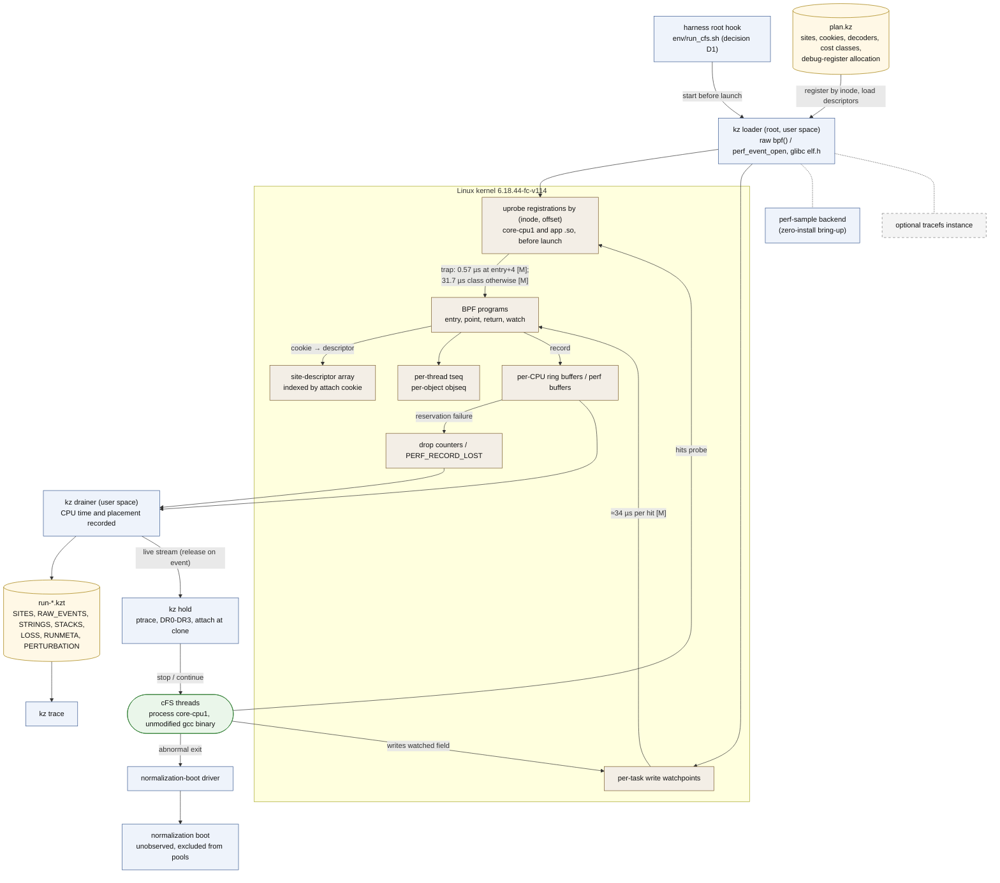

# 06 관측과 확인: 수정하지 않은 gcc 바이너리에서 기록하고, witness를 실제로 일으키는 법

이 문서는 Kairos가 실제 cFS 프로세스에서 사건을 기록하는 방법(관측, `kz observe`)과, 분석이 찾은 실행 예(witness)를 실제 바이너리에서 다시 일으키는 방법(확인, `kz hold`·`kz gate`)을 설명한다.
어떤 메커니즘을 왜 골랐는지, 무엇이 측정되었고 무엇이 아직 측정 전인지, 관측 자체가 결과를 흐리지 않게 하는 규칙이 무엇인지를 spec을 읽지 않은 연구자가 15–25분 안에 파악하는 것이 목적이다. spec에 없는 설계 요소·수치·인용은 더하지 않는다.

상태: 설계 문서 — 구현·측정 전. 규범 원문: [spec/SPEC_FINAL.md](spec/SPEC_FINAL.md)

## 목차

0. [읽기 전에](#0-읽기-전에): 표기, 이 문서의 자리, 필요한 용어
1. [한 장으로 보기: 관측 파이프라인 (그림 D7)](#1-한-장으로-보기-관측-파이프라인-그림-d7)
2. [메커니즘과 fidelity class](#2-메커니즘과-fidelity-class-spec-51) (spec §5.1)
3. [probe 배치와 반환값 capture](#3-probe-배치와-반환값-capture-spec-52-47) (spec §5.2, §4.7): 칸별 reach를 위한 prefix probe 포함
4. [eBPF data path](#4-ebpf-data-path-spec-53-54) (spec §5.3, §5.4)
5. [사건 기록과 trace container](#5-사건-기록과-trace-container-spec-55) (spec §5.5)
6. [손실 계산](#6-손실-계산-spec-56) (spec §5.6)
7. [GetAppID 없이 identity bootstrap](#7-getappid-없이-identity-bootstrap-spec-57) (spec §5.7)
8. [causal token과 timestamp](#8-causal-token과-timestamp-spec-58) (spec §5.8)
9. [관측과 제어의 안전 규칙](#9-관측과-제어의-안전-규칙-spec-59) (spec §5.9)
10. [비용 모형과 측정 의무](#10-비용-모형과-측정-의무-spec-510-86) (spec §5.10, §8.6)
11. [미시험 항목과 대안](#11-미시험-항목과-대안-spec-511-93) (spec §5.11, §9.3)
12. [확인 실행](#12-확인-실행-spec-413) (spec §4.13): `kz hold`(F0), `kz gate`(F1), normalization boot, perturbation 비율, progress witness와 wait-for 사실, 실제 실행이 끝나는 법과 σ_E 칸(spec §1.8, §4.12)
13. [CONDITIONS_POLICY와의 관계](#13-conditions_policy와의-관계)
14. [이 문서가 주장하지 않는 것](#14-이-문서가-주장하지-않는-것)
15. [관련 문서](#15-관련-문서)

---

## 0. 읽기 전에

### 0.1 표기

표기는 spec 머리말을 따른다(자세한 설명은 [01_overview.md §0](01_overview.md#0-읽는-법)).

| 표기 | 뜻 |
|---|---|
| [F] | 코드·기록·보고서 인용이 있는 사실 |
| [M] | 측정값. **이 문서의 [M]은 모두 spec이 인용한 기존 측정**이다: [R07 §4.7]의 probe 실험, [BM], [R2g], [R2c], 그리고 검토 X3가 이 머신에서 확인한 값([X3, here]). Kairos는 아직 아무것도 측정하지 않았다 |
| [I] | 추론 또는 설계상 추론. 실행하지 않았다 |
| [D] | 설계 결정. spec §11의 ADR이 기록한다 |
| [U] | 미확인 |

인용 형식은 01, 03과 같다. "(spec §5.3)"은 SPEC_FINAL.md의 절, "[R07 §4.7]"은 `background/`의 보고서, [BM]은 `env/BASELINE_MEASURE.md`, [R2g]·[R2c]는 `results/`의 R2 기록(gdb, 퇴역한 CORD recorder), [POL] Ln은 `CONDITIONS_POLICY.md`의 n번째 줄이다. PI 결정 D1, D3, P-TRACEFS 같은 이름은 [spec/PI_DECISIONS.md](spec/PI_DECISIONS.md)의 PI 결정이다. 코드 위치 `path:line`은 고정된 cFS tree(cFS `088b2fa8`) 기준이다.

**인용 형식과 이름이 겹치는 기호.** 인용 형식(설계안 [A]/[B]/[C], 심사 [J1]–[J3], 검토 [X1]–[X3], [X3, here], v0.1 등)은 [01_overview.md §0](01_overview.md#0-읽는-법)에 모아 두었다. 같은 기호가 여러 뜻으로 쓰이므로 이 문서는 앞에 종류를 붙인다: "PI 결정 D4"와 "그림 D4", "보장 G5"와 "gap G5", "단계 S0"와 "Init snapshot S0", HB stratum S/O와 cold/warm 층(stratum). 전체 목록은 [10_decisions_adr.md §0.2](10_decisions_adr.md#02-이름-충돌-주의)다.

### 0.2 이 문서의 자리

관측과 확인은 계층 L4(실제 바이너리 관측·제어)에 있다(spec §2.1). 데이터 흐름 12단계 중 단계 6(`kz observe`가 수정하지 않은 바이너리를 B 아래에서 실행하고 trace를 씀)과 단계 10(witness를 hold plan으로 바꾸어 `kz hold`나 `kz gate`로 실행)이다(spec §2.4).

원칙은 하나다. **관측이 먼저, 제어는 둘째다**(spec §2.1 원칙 4). 기본은 수정하지 않은 gcc 바이너리를 F0로 관측하는 것이고, 제어는 확인에만 쓰며, hold는 모두 기록한다.

관측이 무엇을 볼지는 관측기가 정하지 않는다. `kz-static plan`이 정적 분석 결과에서 probe plan(`plan.kz`)을 만든다(spec §4.7). plan은 두 부분이다.

- **필수 동기화 skeleton**: 모든 actor의 S·O 규칙 anchor(anchor는 규칙이 가리키는 소스 지점을 gcc 바이너리의 명령에 묶은 것이다. 대상은 OSAL task, mutex, semaphore, queue, timer, module 연산; ES lock wrapper, wait, `RunLoop`, `ExitApp`, app/task 생성; SB create, subscribe, route_lookup, put, receive; shutdown store). 이것을 다 남기는 것은 관련 없어 보이는 제3자 thread의 동기화를 관측에서 잘라 내는 slicing 오류를 피하기 위해서다(spec §4.7 항목 1; v0.1 §7.3).
- **후보 의무**: 아직 판정이 열린(open) instance가 요구하는 것. 각 conjunct의 LP 구간과 capture 지점, 계약 사용 지점의 결과값, Allowed(호출자 수준에서 받아들이는 not-ready 결과)를 정하는 guard 결과, API 경계가 없는 준비 field의 쓰기 감시, identity frame에 필요한 user stack, 예측 후보의 A-COMM 검사(예측 witness가 trace에 없는 공유 읽기에 기대지 않는지 보는 검사)가 지목한 writer(spec §4.7 항목 2).
- **칸별 reach를 위한 prefix probe**: 실행으로 (σ_U, M_impl) 밖의 칸에서 reach를 증명하려면, instance의 닫힌 cone에 있는 모든 actor의 prefix에서 OSAL 반환값과 시간 기반 전이를 본다(spec §4.7 항목 6; 이 문서 §3.7).

그래서 recorder는 "좁고, 모형이 이끈다"(spec §9.3). 관측 결과는 `kz trace`(identity 결합, HB, LP 구간, routing; spec §4.8)와 `kz conform`(O1/O2; spec §4.11)으로 가고, feedback loop가 새 key와 모형 빈틈을 plan에 되돌린다(spec §4.14). 확인 실행은 판정 기록의 `realized` 근거와 naturalness label을 만든다(spec §1.10). wait-for 사실이 있는 실현된 hang은 progress 결과의 근거가 된다(spec §4.12 item 9; 이 문서 §12.6–12.7).

### 0.3 필요한 용어

이 문서를 읽는 데 필요한 만큼만 적는다. 전체 용어집은 [10_decisions_adr.md §3](10_decisions_adr.md#3-용어집)이다(원문 spec §13).

| 용어 | 쉬운 설명 | spec |
|---|---|---|
| fidelity class F0–F3 | 실제로 실행한 바이너리와 실행 조건이 기준(gcc 13.3.0, 기록된 flag, README 방식 실행)에서 얼마나 멀어졌는지의 등급. F0은 바이너리와 실행 조건이 그대로이고 timing만 흔들린다 | §5.1; [R07 §7] |
| README 방식 실행 | README가 정한 방식으로 사용자 `ubuntu`(uid 1000)가 띄운 cFS 프로세스 `core-cpu1`. 관측기는 그 옆에서 root로 돈다 | §5.1; [R07 §4.7] |
| uprobe | 실행 파일을 고치지 않고, 사용자 프로그램의 특정 명령 주소에 kernel이 거는 probe. 그 명령에 도달하면 trap이 나고 kernel이 처리기를 실행한다 | §5.1 |
| perf PMU uprobe | Linux 성능 측정 interface(`perf_event_open`)를 통해 만드는 uprobe. tracefs(kernel tracing 파일 시스템)를 mount하지 않고도 쓸 수 있다 | §5.1; [R07 §4.7] |
| eBPF | kernel이 검증기(verifier)로 안전성을 확인한 뒤 kernel 안에서 실행하는 작은 프로그램. 여기서는 uprobe가 걸릴 때마다 인자와 순서 token을 기록한다 | §5.3 |
| attach cookie | probe를 BPF 프로그램에 연결할 때 그 연결에 달아 두는 값. 프로그램이 `bpf_get_attach_cookie`로 읽는다. Kairos는 site id를 cookie로 쓴다 | §5.3 |
| trap 비용 등급 | uprobe가 걸린 자리의 원래 명령을 kernel이 흉내 낼(에뮬레이션) 수 있으면 싸고, 그렇지 못하면 한 명령을 실제로 실행하는 single-step 경로(debug exception, #DB)를 거쳐 비싸다(원인 설명은 [R07]의 추론). 이 VM에서 0.57 µs 대 31.7 µs다 [M] | §5.1; [R07 §4.7] |
| debug register, HW watchpoint | x86 CPU의 debug register(DR0–DR3, thread마다 네 개)에 주소를 넣으면 그 주소에 쓰기나 실행이 일어날 때 예외가 난다. 쓰기 감시가 watchpoint, 실행 감시가 HW 실행 breakpoint다 | §4.7 항목 3, §5.1 |
| ptrace | 한 프로세스(여기서는 root의 holder)가 다른 프로세스의 thread를 멈추고 register를 읽고 쓰게 하는 Linux system call | §4.13 |
| `ld --wrap` | link할 때 `foo` 호출을 `__wrap_foo`로 돌리는 GNU ld 옵션. 바이너리를 다시 link해야 하므로 F1이다 | §5.1; [R07 §4.2] |
| `tseq`, `objseq` | `tseq`는 thread별 일련번호로, 같은 thread 안의 순서와 손실을 알려 준다. `objseq`는 object(예: mutex)별 일련번호로, 같은 object를 둘러싼 thread 사이의 순서를 알려 준다. 둘 다 kernel 쪽에서 매긴다 | §5.3 |
| happens-before (HB), vector clock | HB는 한 실행 안에서 동기화(lock, message, thread 생성 등)로 정해지는 "먼저 일어남"의 부분 순서다. vector clock은 thread마다 카운터 벡터를 들고 다니며 HB를 계산하는 자료 구조다(Lamport 1978; Fidge 1988; Mattern 1989 [V-abs]) | §1.9 |
| linearization point (LP), capture point | LP는 연산의 효과가 "이 명령에서 한순간에 일어났다"고 보는 지점이다. Kairos는 요구 조건의 conjunct(∧로 묶인 조건 하나)마다 LP를 둔다. capture point는 호출자가 넘길 값을 미리 읽어 둔 load 지점이고, 값 conjunct의 LP가 된다 | §1.4 |
| witness | 판정을 뒷받침하는 구체적인 유한 실행 하나. bad witness나 good witness이고, 그 발생의 ordinal(같은 actor가 같은 template과 key로 시작한 몇 번째 발생인지)을 함께 적는다. stall witness는 class가 아니라 progress 결과에 속한다 | §1.10 |
| 유한 실행, 실제 실행 | 판정은 유한 실행(prefix) 위에서 정의한다. 실제 실행은 gcc 바이너리의 유한한 LP 단위 사건 열이고, maximal일 필요가 없다. 모든 유한 실제 실행은 (σ_U, M_impl)의 유한 실행이다(prefix containment) | §1.8 |
| progress 결과, stall witness | 칸마다의 진행 결과다: `stall-witness`(stall 상태, 즉 dead actor가 사용 앞이나 사용 안이나 Allowed horizon에서 영원히 기다리는 상태에 이르는 유한 실행), `no-stall-within(b)`(`exh`만), `unknown(reason)`, 기본값 `unknown(not_checked)`. class와 따로 둔다 | §1.8, §1.10 |
| wait-for 사실 | 막힌 thread가 무엇을 기다리는지와 그것을 풀 수 있는 thread의 상태를 실행에서 읽은 사실(`/proc/<tid>/wchan`, futex tracepoint). 교착과 lock 누수의 oracle이고 timeout이 아니다 | §4.13 |
| pool key, cold/warm 층(stratum) | 여러 실행의 빈도를 합칠 때 같아야 하는 열쇠(B hash, plan hash, cold/warm 층). cold/warm 층(spec의 stratum)은 VM 재부팅 뒤 첫 실행(cold)과 나머지(warm)의 구분이다. HB edge의 stratum S/O/C_σ와 다른 뜻이다 | §1.7, §4.12 항목 4 |

---

## 1. 한 장으로 보기: 관측 파이프라인 (그림 D7)

그림 D7은 관측과 hold가 수정하지 않은 gcc 바이너리 주위에서 어떻게 맞물리는지 보인다(spec §12 D7). 그림의 비용 값 중 [M]은 spec이 인용한 기존 측정([R07 §4.7])이고, Kairos가 실행한 것은 없다. 점선 테두리는 선택 사항(tracefs; P-TRACEFS는 쓰지 말 것을 권고)이다. loader에서 perf-sample backend와 tracefs로 이어진 점선은 loader의 기본 경로 대신 쓸 수 있는 대안 backend를 뜻한다(spec §12 D7에서 "|"로 나열한 것).

**그림 D7. 관측 파이프라인** (렌더링: [diagrams/D7_observation_pipeline.svg](diagrams/D7_observation_pipeline.svg); spec §12 D7; §5.1–5.7, §4.13)



분석 워크플로우 안에서 관측이 놓이는 자리는 [03_workflow.md §5](03_workflow.md#5-관측-파이프라인-개요-그림-d7)에 있다. 이 문서는 그림의 각 노드를 아래 절에서 자세히 다룬다.

| 그림의 노드 | 하는 일 | 이 문서 |
|---|---|---|
| `plan.kz` | probe 지점(inode, offset, 명령 등급, decoder, cookie), watchpoint, gate, thread별 debug register 할당, 예상 비용 | §3 |
| harness root hook | cFS를 띄우기 **전에** root 쪽 loader를 시작한다. `env/run_cfs.sh`에 새 hook이 필요하다(PI 결정 D1) | §2.3, §13 |
| kz loader, perf-sample backend, 선택적 tracefs | probe 등록과 BPF 프로그램 적재. perf-sample은 설치 없는 bring-up 경로다 | §2, §4 |
| uprobe 등록 (inode, offset) | `core-cpu1`과 앱 `.so`를 실행 전에 파일 기준으로 등록한다 | §3.6 |
| task별 write watchpoint | API 경계가 없는 준비 field의 쓰기를 잡는다 | §3.5 |
| BPF 프로그램, site descriptor 배열, `tseq`/`objseq` | phase마다 generic 프로그램 하나, cookie로 descriptor를 찾고, 순서 token을 매긴다 | §4 |
| CPU별 buffer, drop counter | 기록과 손실 계산 | §4.5, §6 |
| drainer | 사용자 공간에서 buffer를 비우고 `run-*.kzt`를 쓴다. 자기 CPU 시간과 배치를 기록한다 | §5, §9 |
| `run-*.kzt` | trace container(SITES, RAW_EVENTS, STRINGS, STACKS, LOSS, RUNMETA, PERTURBATION) | §5 |
| `kz hold` | live stream을 보고 thread를 멈추고 푼다(ptrace, DR0–DR3, clone 시 attach) | §12 |
| normalization-boot driver | 비정상 종료 뒤 관측하지 않는 정리 boot를 하고, 그 boot를 pool에서 뺀다 | §12.9 |
| `kz trace` | 해독, 손실 검사, identity 결합, HB | §5.3, §6, §7, §8 |

그림에는 F1 `kz gate`가 없다. gate는 PI 결정 D3 뒤에만 쓰는 경로다(§12.5).

---

## 2. 메커니즘과 fidelity class (spec §5.1)

### 2.1 fidelity 등급

등급은 [R07 §7]의 정의를 그대로 쓴다(spec §5.1). 기준은 gcc 13.3.0, 기록된 flag, README 방식 실행이다.

| 등급 | 무엇이 바뀌나 | Kairos에서의 쓰임 |
|---|---|---|
| **F0** | 아무것도 바뀌지 않는다. 바이너리와 실행 조건이 그대로이고 timing만 흔들린다 | 본 관측과 기본 확인(`kz hold`) |
| **F1** | 같은 소스와 컴파일러. link 옵션이나 code generation 옵션이 바뀐다 | `kz gate`, PI 결정 D3 승인 뒤에만(deviation) |
| **F2** | 같은 컴파일러. 계측 지점의 소스를 고쳐 쓴다 | 계획 없음 |
| **F3** | 다른 컴파일러(clang)로 실행 바이너리를 만든다 | 하지 않음 |

### 2.2 메커니즘별 역할과 비용

비용은 따로 적지 않으면 [M]이다([R07 §4.7, §5.1]). "측정 전"은 S1 또는 S6에서 잰다.

| 메커니즘 | 등급 | 역할 | 단위 비용 | 비고 |
|---|---|---|---|---|
| perf-PMU uprobe + eBPF (root 쪽, 자체 raw loader, **attach cookie**) | F0 | **본 관측**: `core-cpu1`과 앱 `.so`의 API 경계·함수 경계 사건 | entry+4(에뮬레이션되는 `push %rbp`)에서 0.57 µs/hit [M]. `endbr64`, `mov %rsp,%rbp`(+5) 등 에뮬레이션되지 않는 명령에서 31.7 µs [M]. BPF 본체 비용은 **측정 전** | callee 쪽에 거는 probe이므로 `--wrap`이 놓치는 같은 TU(번역 단위) 안의 API 호출 88곳도 본다 |
| **perf-sample uprobe backend** (`PERF_SAMPLE_TID`, `PERF_SAMPLE_TIME`, `PERF_SAMPLE_CPU`, `PERF_SAMPLE_REGS_USER`; 손실은 `PERF_RECORD_LOST`) | F0 | **설치 없는 bring-up backend**. 열어 둔 fd 범위로만 존재하고 스스로 정리된다 | trap 경로는 같다. sample 비용은 측정 전 | tracefs 없이 동작하고, 파일이 매핑되기 전에 등록해도 동작함을 측정했다([R07] L340) |
| tracefs dynamic uprobe event | F0 | 선택 사항. 쓰면 spec §5.4의 규칙을 따른다(이 문서 §4.7) | trap 경로는 같다 | event 정의가 kernel 전역이고 private mount namespace보다 오래 남는다 [I] |
| HW write watchpoint (perf breakpoint PMU, task별) | F0 | API 경계가 없는 준비 field의 store | ≈34 µs/hit [M]. gate와 debug register 네 개를 나눠 쓴다(§3.5) | 부팅당 몇 번만 쓰이는 field에만 쓴다. 선언한 실험 밖에서는 쓰기 감시만 한다 |
| ptrace + debug register 실행 breakpoint | F0 | 확인 hold(`kz hold`) | #DB trap ≈34 µs [M]; gdb breakpoint ≈203 µs [M]; 전용 holder는 **측정 전** | Yama(ptrace 제한 모듈) 없음. root가 uid 1000 프로세스에 붙을 수 있다 |
| sched/syscall tracepoint | F0 | clone 교차 확인; RacePro식 기준선의 관측 모형(spec §8.3) | 측정 전 | 이 kernel에 있다 |
| `ld --wrap` gate | F1 + deviation | PCT와 여러 지점 스케줄, **PI 결정 D3 승인 시에만**; perturbation 실험군 W | handoff 1.1 µs(같은 CPU) / 10.5 µs(다른 CPU) [M] | 앱을 다시 link한다. 같은 TU 안의 호출을 놓친다 |
| 소스 probe | F2 | 계획 없음 | — | API 호출 지점의 12.4%가 macro 전개 안에 있다([R07 §4.6]) |
| Clang으로 빌드한 실행 | F3 | 하지 않음 | — | — |
| `LD_PRELOAD` / `LD_AUDIT` | — | **기각**: PIE 실행 파일 안에서 정의된 symbol을 가로챌 수 없고, `run_cfs.sh:154–158`이 거부한다 | — | [R07 §4.3] |
| gdb | F0 | **참고 관측만**(R2 기록. ASLR을 끈 채 실행했다, [R2g]) | OPERATIONAL까지 +0.6 ~ +1.1 s [M]([R2g §1]) | — |
| valgrind helgrind / DRD | F0 바이너리, thread 직렬화 | **표시된 외부 참고점**(spec §8.3). gdb처럼 `RUN_CFS_WRAP`로 실행한다 | 큰 감속. cFS에서는 측정하지 않았다([R07] L466) | memory 수준만 본다. valgrind는 thread를 직렬화하므로 그 스케줄은 README 방식의 스케줄이 아니다 |

### 2.3 왜 이렇게 골랐나

**F0이 가장 높은 충실도다.** perf-PMU uprobe, eBPF, watchpoint, ptrace는 바이너리, build, 환경, 실행 사용자를 바꾸지 않는다. 남는 교란은 trap에 의한 timing뿐이다. 이것이 이 머신에서 쓸 수 있는 가장 충실한 선택이다([R07 §4.7] 추론; spec §2.1 원칙 4, ADR-013).

**비용 절벽이 있다.** 이 KVM/Firecracker guest에서는 debug exception(#DB) 경로가 비싸고, int3와 명령 에뮬레이션은 싸다([R07 §4.7] 추론). 같은 함수 entry라도 어느 명령에 거느냐에 따라 0.57 µs와 31.7 µs로 갈린다 [M]. 그래서 probe 위치를 명령 단위로 고르고(§3), 모든 계획 지점의 명령 등급을 검사한다(§3.5).

**`--wrap`은 기본이 아니다.** API 호출 3,762곳 중 88곳(같은 TU 안의 호출)을 놓치고([R07 §4.2]), 앱을 다시 link해야 하는 F1이다. callee 쪽 uprobe는 그 88곳도 본다(spec §5.1).

**gdb는 기준 기록일 뿐이다.** R2의 per-use 기록은 gdb로 만들었다([R2g]). Kairos는 자기 recorder로 그 집합을 다시 관측해야 하고, 그것이 S1의 출구 조건이다(§11.2).

**관측기는 root다.** observer는 README 방식의 `ubuntu` 프로세스 옆에서 root로 돈다. uprobe PMU에는 `CAP_PERFMON`이나 `CAP_SYS_ADMIN`이 필요하다는 것이 [R07]의 추론이다(PI_DECISIONS D1, [R07] L355). 이를 위해 `env/run_cfs.sh`에 root 쪽 hook을 새로 두어야 하고, 이것이 PI 결정 D1이다(spec §5.1; [R07 §9 항목 1]). 자세한 것은 §13.

---

## 3. probe 배치와 반환값 capture (spec §5.2, §4.7)

### 3.1 함수 entry는 entry+4 [D]

gcc는 `-O0`에서 함수 시작에 `endbr64; push %rbp; mov %rsp,%rbp`를 낸다. 이것은 core 함수 아홉 개와 앱 entry 하나([B §A.2]), 그리고 `CFE_EVS_SendEventWithAppID`([X3, here])에서 확인했다(spec §5.2).

entry+4는 `push %rbp` 자리다. 이 명령은 에뮬레이션되어 0.57 µs 등급이고 [M], 그 시점에는 인자 register가 아직 인자를 담고 있다. 그래서 함수 entry probe는 모두 entry+4에 둔다.

### 3.2 lock과 queue는 반환 probe 없이

lock과 queue에는 반환 probe를 걸지 않는다([B §5.5]; [J3-M4]).

- **mutex 순서**는 `OS_MutSemGive` entry에서 매기는 `objseq`로 얻는다(§8).
- **queue edge**는 put entry와, edge나 계약이 필요로 하는 곳에서만 get 결과로 얻는다.

이렇게 하면 자주 지나는 지점에서 반환 probe를 피한다(ADR-014의 결과).

### 3.3 반환값은 필요한 곳에서만, 방식은 측정으로 정한다

반환값은 **계약 사용 지점**, **결과가 edge를 정하는 지점**, **칸별 reach를 위한 prefix 지점**(§3.7)에서만 잡는다. 잡는 방식은 지점마다 **S1의 측정으로 고른다**(spec §5.2; ADR-015). 후보는 다섯 가지다.

| 방식 | 내용 | 비용 등급 | 상태 |
|---|---|---|---|
| R-a | callee에 uretprobe(함수 반환 때 걸리는 uprobe) | 이 kernel에는 uretprobe syscall trampoline(`__x64_sys_uretprobe`, `arch_uretprobe_trampoline`)이 있으므로 #DB 등급보다 쌀 수 있다 | symbol 존재는 [X3, here]; 비용은 [I], S1에서 측정 |
| R-b | caller 쪽 `call` 다음 명령(보통 `mov %eax,-0x..(%rbp)`)에 uprobe | +5의 `mov`가 31.7 µs였으므로 같은 등급으로 추정 | [I]; S1 |
| R-c | callee epilogue의 `leave`에 uprobe | 모름 | 측정 전; S1 |
| R-d | **지연 읽기**: entry에서 out-pointer가 가리키는 주소를 잡아 두고, 같은 thread의 다음 probe hit에서 그 값을 읽는다 | — | 반환과 다음 probe 사이에 그 thread의 어떤 사건도 대상을 쓸 수 없다는 것을 정적 검사가 보일 때만 유효하다 |
| R-e | `call` 뒤, 값이 아직 frame slot에 있는 동안의 **첫 번째 에뮬레이션 가능한 명령** | 0.57 µs 등급으로 추정 | 명령 순서는 [M]([X3, here]); 비용은 [I]; S1 |

**R-d의 예.** `cfe_sb_task.c:138`의 `CFE_ES_GetAppID(&CFE_SB_Global.AppId)`는 반환 상태를 무시한다. 이 지점에서는 out-pointer 대상(`CFE_SB_Global.AppId`)을 SB thread의 다음 probe hit에서 읽으면 된다(spec §5.2; [X3-m3]). 이 값은 R2의 핵심인 SB identity cell이다(spec §1.3 `cell(loc)`).

**R-e의 예.** `CFE_EVS_TaskInit`에서 `call CFE_ES_GetAppID` 뒤에 gcc는 결과를 frame에 내려놓고 검사한다: `mov %eax,-0x124(%rbp)`, `cmpl $0x0,-0x124(%rbp)`, `je`(주소 `0x2aca1`–`0x2acae`, [M] [X3, here]). x86 uprobe는 분기를 에뮬레이션한다(`branch_emulate_op`가 있다). 그래서 `je`에 probe를 걸고 `rbp-0x124` slot을 읽으면 0.57 µs 등급일 것으로 본다 [I]. 이 반환값은 core task App-record 구간 확인의 oracle이기도 하다(spec App. A.2 step 5; §12.10).

**측정 전에는 overhead를 주장하지 않는다.** 계획된 probe는 모두 자기 비용 등급을 기록하고, S1 전에는 어떤 overhead 수치도 주장하지 않는다(spec §5.2).

### 3.4 내부 지점과 capture 지점

**내부 지점**은 API 경계에 있지 않은 발행 store다(예: App record를 최종 상태로 만드는 store). 순서대로 다음을 쓴다(spec §5.2).

1. `static inline` helper의 out-of-line local copy에 entry probe. 같은 이름의 copy가 여러 개 있으므로 DWARF(바이너리에 들어 있는 debug 정보)의 compile unit으로 구분한다. `-O0`에서는 copy가 실제로 있다: `core-cpu1`에 `CFE_ES_AppRecordSetUsed` local copy 두 개, `CFE_ES_AppRecordIsMatch` copy 네 개 [M] [X3, here]. 예를 들어 core app의 발행은 `cfe_es_start.c`의 compile unit에 있는 `CFE_ES_AppRecordSetUsed` copy에 묶는다(spec §3.17).
2. 그것이 없으면 write watchpoint.
3. 그것도 안 되면 가장 가까운 싼 등급의 명령.

**capture 지점**은 값 conjunct의 LP다(spec §1.4, §4.8 step 4). R2의 예를 들면, `CFE_EVS_SendEventWithAppID`의 값 conjunct `valid(arg.AppID)`는 SB 코드가 인자를 평가하면서 `CFE_SB_Global.AppId`를 load하는 지점(예: `cfe_sb_api.c:226–228`)에서 평가한다(spec §1.4 표; App. A.1 step 2). capture load와 call 사이에는 인자 평가뿐이므로, 소비하는 API의 call-entry probe가 대개 capture 지점을 충분히 가깝게 감싼다. 그 구간이 판정에 너무 넓을 때만 plan이 capture load 자체에 probe를 더한다.

### 3.5 site validator와 debug register 공동 할당

**site validator.** 계획된 모든 주소를 LLVM MC(LLVM의 기계어 해독 계층)로 disassemble하고 보정표(§10.5)에서 비용을 찾는다. 비싼 지점은 보고하고, 조용히 받아들이지 않는다(spec §5.2).

**debug register 공동 할당** [D](spec §4.7 항목 3; [X3-m1]). HW watchpoint와 ptrace gate는 thread마다 같은 debug register 네 개를 나눠 쓴다 [I: kernel의 hw_breakpoint 계층을 통해]. 그래서 `plan`과 `kz hold`는 할당기 하나를 함께 쓴다.

- watchpoint와 gate를 합쳐 thread당 4개 이하.
- **task별 event만** 쓴다. CPU별 breakpoint는 그 CPU의 모든 thread에서 slot을 하나씩 차지하기 때문이다.
- **쓰기 전용 watchpoint**만 쓴다. 읽기·쓰기 watchpoint는 읽을 때마다 ≈34 µs로 걸린다. 예를 들어 `AppTable`에 걸면 `GetAppID`마다 걸린다([R07] L339). 이것은 선언한 실험에서만 쓴다.

**지점 선택**은 의무를 지점으로 덮는 greedy weighted set cover(의무 전체를 비용이 적은 지점들로 덮도록 하나씩 고르는 근사 방법)다. 최적성은 주장하지 않는다. plan의 hash는 모든 trace에 들어간다(spec §4.7 항목 5).

### 3.6 앱 `.so`는 실행 전에 inode로 등록한다

앱은 `dlopen`으로 실행 중에 load된다. Kairos는 perf-PMU uprobe를 (파일 inode, offset)에 **모든 프로세스 대상으로, `core-cpu1`이 시작되기 전에** 등록한다(spec §5.2; [X3-M1], [X3-m4]). inode는 파일 시스템 안의 파일 식별자다.

- 등록 뒤에 매핑된 파일의 hit도 센다는 것은 **주 바이너리에서만** 확인했다([R07] L340). 앱 `.so`에서는 S1이 시험한다.
- v1의 대비책(각 `OS_ModuleLoad` 반환에서 startup thread를 붙잡아 두기)은 **기본 설계에서 뺐다**. 그것은 앱 load를 늦추는데, 앱 load 시간은 바로 init interleaving을 바꾸는 변수다. [BM]에서 load 구간이 2.2–3.3 ms 대신 849 ms였을 때(cold 실행, spec §1.7), 마지막 앱이 load되기 전에 10개 앱이 초기화를 마쳤다.
- 그래도 그 방식을 쓰게 되면, 그 trace는 σ_E pool에서 빼고 그렇다고 표시한다.

### 3.7 칸별 reach를 위한 prefix probe (spec §4.7 항목 6)

실행은 (σ_U, M_impl)의 유한 실행이다(§12.11). 그래서 실행에서 관측한 발생은 그 칸의 reach를 곧바로 `proved`로 만든다. 다른 칸에서 실행으로 reach를 증명하거나 실행을 witness로 쓰려면, 그 칸이 허락하지 않는 일이 prefix에서 일어나지 않았음을 보여야 한다 [D] (spec §1.10 reach; EXT-20261012 §4.2). 그래서 plan은 그런 instance마다 다음 지점을 더한다.

| 칸 | 더하는 지점 | 쓰는 곳 |
|---|---|---|
| (a) M_api (L-MLEVEL을 쓸 수 없을 때) | 발생까지의 prefix에서 instance의 **닫힌 cone에 있는 모든 actor**가 부른 OSAL 호출의 반환값, 그리고 돌아온 API가 type lock을 잡은 채 남겼는지 | M_api 적합성 검사: `OS_ERR_INCORRECT_OBJ_STATE`, 잃은 task, 누수된 type lock이 cone actor에 없어야 한다(L-MAPI-CONE). 사용 actor와 그 spawn 사슬만 보면 writer, giver, monitor 대상 actor의 누수된 lock이나 잃은 task를 놓친다. cone 밖 actor의 OSAL 호출은 상관없다 |
| (b) σ_U∞ | 같은 cone actor들의 prefix에서, 주기적이지 않은 모든 timed wait와 지연 간격 재시도의 결과, 모든 kill timer 만료. M_impl에서는 OSAL RESERVED 대기의 timed wait가 돌아온 원인(`OS_WaitForStateChange_Impl`, `os-impl-idmap.c:138–170`. 예: 그 `pthread_cond_timedwait`의 반환. OSAL 자신은 이 결과를 검사하지 않는다) | cone actor의 prefix에 시간 기반 전이가 없음(L-REACH-CONE). cone 밖 actor의 시간 기반 전이는 상관없다 |
| (c) hold·gate 실행 | (b)와 같은 probe를 hold 동안과 그 뒤 witness의 결정 사건까지 cone actor에 둔다 | naturalness `timeout-exercised` 판정(§12.4) |

- 이 지점은 "결과값은 계약 사용 지점에서만"(§3.3)을 넘어선다. 비용은 다른 지점처럼 등급으로 매긴다(§10). 개수를 고르지 않는다.
- 이 지점이 생기기 전에는 그 칸들에서 실행에 기댄 reach가 `assumed`다. 실행 witness를 위로 옮기는 규칙(전이 규칙 3)도 M_api에서는 L-MLEVEL이나 이 검사가 있어야 쓴다(spec §1.8).

---

## 4. eBPF data path (spec §5.3, §5.4)

### 4.1 site는 attach cookie로 식별한다 [D]

BPF 프로그램은 "지금 어느 probe가 걸렸는가"를 알아야 한다. 실행 주소(IP)로 찾는 방식은 이 환경에서 맞지 않는다(spec §5.3; [X3-M1]; ADR-036).

- ASLR(주소 공간 배치 무작위화)이 켜져 있다: `randomize_va_space` = 2 [M] [X3, here], `mmap_rnd_bits` 28([R07] L77).
- `core-cpu1`은 PIE(위치 독립 실행 파일)이고, 앱은 무작위 base 주소에 `dlopen`된다.
- 실행 주소로 key를 둔 map은 module이 매핑된 **뒤에** 채워야 하므로 첫 실행과 경쟁한다. 15개 앱이 모두 2.2–3.3 ms 안에 load된다([BM] L278).

그래서 각 site의 **attach cookie를 site id와 같게** 둔다. 방법은 둘이다.

| 방법 | 내용 |
|---|---|
| 1 | site마다 perf uprobe fd 하나를 열고, `BPF_LINK_CREATE`로 cookie를 실어 연결한다 |
| 2 | binary마다 `uprobe_multi` link 하나를 두고, offset마다 cookie를 준다 |

프로그램은 `bpf_get_attach_cookie`로 cookie를 읽는다. 두 방법에 필요한 kernel symbol(`bpf_perf_link_attach`, `bpf_get_attach_cookie_pe`, `bpf_get_attach_cookie_uprobe_multi`)이 **있다는 것만** 확인했다 [M] [X3, here]. 실제 동작은 S1에서 둘 다 시험한다.

### 4.2 phase마다 generic 프로그램 하나, site 정보는 data

BPF 프로그램은 phase(entry, point, return, watch)마다 **generic한 것 하나**뿐이다. cookie는 **site descriptor 배열 map**의 index다. descriptor는 그 site에서 무엇을 읽을지 적은 **data**다(spec §5.3; [C §5.3]).

- 복사할 register;
- 읽을 stack slot과 제한된 깊이의 포인터 역참조;
- 제한된 길이의 문자열을 읽을지(한도는 build된 `osconfig.h`의 `OS_MAX_API_NAME` 20, `OS_MAX_PATH_LEN` 64, [B §A.2]);
- `objseq`를 매길지;
- user stack을 잡을지.

site마다 코드를 생성하지 않는다. 이것은 "생성 코드 없음" 원칙의 한 예다(spec §9.2).

### 4.3 verifier 한계 안에서 [I]

eBPF verifier는 프로그램이 안전하다고 증명할 수 있는 형태만 받는다. 그래서(spec §5.3):

- `pt_regs`(trap 시점의 register 묶음)는 상수 offset으로만 읽는다. 고정된 register 묶음을 상수 offset으로 복사한 뒤, 제한된 코드로 필요한 것을 고른다.
- stack slot과 역참조는 `bpf_probe_read_user`로 읽는다.
- 문자열은 상수 최대 길이로 읽는다.

### 4.4 libbpf 없이

libbpf(BPF 사용자 공간 library)는 설치되어 있지 않다([R07 §2.3]). Kairos는 설치 없이 간다(spec §5.3; spec §2.1 원칙 7).

- helper 함수 prototype은 UAPI `linux/bpf.h`(있음, [J3 §2.4])를 보고 손으로 쓴다.
- BPF ELF 객체는 system clang-18 `-target bpf`로 만들고, glibc `<elf.h>`로 parse한다.

libbpf 설치는 PI 결정 P-LIBBPF이고, 권고는 "설치하지 않음; S1에서 attach cookie, ring buffer, task storage를 libbpf 없이 쓸 수 없다고 드러날 때만"이다.

### 4.5 순서 token, buffer, stack

| 요소 | 설계 | spec |
|---|---|---|
| `tseq` | thread별 일련번호. task-local storage(thread에 붙는 kernel 저장소)나 tid를 key로 한 map에 둔다 | §5.3 |
| `objseq` | object별 일련번호. object별 map entry에 atomic add로 매긴다. **critical section 안의 지점에서만** 매긴다 [I] | §5.3 |
| buffer | CPU별 ring buffer(kernel이 쓰고 사용자 공간의 drainer가 읽는 원형 buffer) 또는 perf event array. 추적 대상 프로그램과 사용자 공간에서 공유하는 것이 없다. 추적되는 thread는 system call을 더 하지 않고 사용자 공간 lock도 잡지 않는다([R06 F10]) | §5.3 |
| stack | identity frame이 필요한 지점에서만 `bpf_get_stack`(`BPF_F_USER_STACK`)으로 잡는다. gcc `-O0` 코드는 frame pointer를 쓰므로 그것을 따라 펼친다. 깊이는 정적 최대 호출 깊이에서 정하되 `perf_event_max_stack`으로 제한하고, 잘리면 flag를 단다 | §5.3 |

### 4.6 아직 시험하지 않은 것 [U]

raw `bpf()` load와 uprobe attach는 시험했다([R07 §4.7]). **ring buffer, task storage, `bpf_get_stack`, attach cookie, `uprobe_multi`는 시험하지 않았다.** S1이 하나씩 시험하고, 안 되면 perf-sample backend로 간다(spec §5.3, §5.11; 표는 §11.1).

### 4.7 tracefs를 쓴다면 (spec §5.4)

tracefs는 더 이상 bring-up 경로가 아니다([X3-m2]). PI 결정 P-TRACEFS의 권고도 "쓰지 않음"이다. 그래도 쓴다면 규칙이 있다.

- 전용 tracing instance를 쓴다.
- 그 instance에 CPU 사이에서 일관된 trace clock을 명시한다. 기본 "local" clock은 CPU마다 따로다 [I].
- 끝날 때 event 정의를 모두 지운다.
- 그 사용을 RUNMETA에 **host 상태 변경**으로 기록한다.

이 경우 thread 안의 순서는 timestamp에서 오고, 가정 **A-CLK-PO**(clocksource `tsc`, 네 vCPU 모두 `constant_tsc`와 `nonstop_tsc`, [B §A.2])가 필요하다. thread 사이의 순서는 여전히 맞춘 protocol key에서만 온다. timestamp로 추론한 lock 순서는 `clock-ordered` 근거이고, VC, VC_R, certificate, 예측 제약에서 모두 뺀다([J2-4]). eBPF와 perf-sample backend에서는 이 가정이 필요 없다(spec §6.1 A-CLK-PO).

---

## 5. 사건 기록과 trace container (spec §5.5)

### 5.1 raw record `kz_raw_ev` (64 byte)

record 형식은 `kz_schema.h`의 X-macro field 목록 하나에서 C struct, dump printer, offset 검사가 함께 나온다(spec §2.3). BPF 프로그램도 같은 header를 쓴다.

| field | 크기 | 뜻 |
|---|---|---|
| `t_ns` | 8 | `CLOCK_MONOTONIC` 시각. **근거와 탐색 heuristic으로만** 쓰고 HB에는 쓰지 않는다(§8) |
| `tid` | 4 | kernel thread id |
| `tseq` | 4 | kernel에서 매긴 thread별 일련번호. 프로그램 순서와 손실 탐지에 쓴다 |
| `site` | 4 | site id = uprobe의 attach cookie. 실행 주소가 아니다 |
| `phase` | 2 | `ENTRY` / `POINT` / `RET` / `WATCH` / `GATE` / `MARK` |
| `flags` | 2 | `STR_FOLLOWS`, `STACK_FOLLOWS`, `TRUNC`, `OBJSEQ_VALID` 등 |
| `objseq` | 8 | critical section 안에서 매긴 object별 token. 0이면 없음 |
| `a[4]` | 32 | site decoder가 정한 원시 값 네 개(register, stack slot, 역참조) |

문자열과 stack은 `(tid, tseq)`를 key로 한 별도 section에 들어간다.

### 5.2 trace container `.kzt`

| section | 내용 |
|---|---|
| `SITES` | plan에서 복사한 site 목록과 binary build-id, inode, offset |
| `RAW_EVENTS`, `STRINGS`, `STACKS` | 위의 raw record와 그 부속 |
| `LOSS` | 손실 표(§6) |
| `RUNMETA` | B hash, plan hash, Init snapshot S0의 hash, cold/warm 층(stratum), kernel version, backend, hold 목록, observer CPU 시간과 배치, harness version |
| `PERTURBATION` | 실행별 교란 기록(§12.8) |

RUNMETA의 B hash, plan hash, cold/warm 층이 **pool key**다. σ_E 빈도는 pool key가 같은 실행끼리만 합치고 `σ_E(plan P)`라고 표시한다(spec §4.12 항목 4, §8.7). 즉, 관측 계획이 다른 실행은 같은 표본으로 보지 않는다.

### 5.3 해독된 사건

`kz trace`가 `RAW_EVENTS`를 typed `EVENTS`로 해독한다. 사건마다 actor instance, 연산, 자원, 결과, identity 4-tuple, template 연결, conjunct별 LP 구간이 붙는다(spec §5.5, §4.8 steps 1–4). 이후의 HB 계산과 routing은 [03_workflow.md §1.3](03_workflow.md#13-단계-2-관측과-routing-spec-47-48-411)이 다룬다.

---

## 6. 손실 계산 (spec §5.6)

관측은 사건을 잃을 수 있다. Kairos의 규칙은 **손실을 사건이 없었던 것으로 읽지 않는다**는 것이다.

1. ring buffer 예약에 실패하면 CPU별·site별 counter가 오른다. perf backend에서는 `PERF_RECORD_LOST`가 같은 역할을 한다.
2. thread별 `tseq`의 빈 번호가 각 actor가 잃은 record를 가리킨다.
3. 손실이 있으면 그 actor의 해당 구간을 "불완전"으로 표시한다.
4. 그 구간에 근거가 기대는 판정은 모두 `unknown(loss)`가 된다(spec §4.8 step 1).
5. buffer 크기는 calibration 실행의 최고 수위(high-water mark)에서 정하고 기록한다([B §5.2]).

이것은 가정 **A6**(계획한 지점의 관측 완전성, 손실은 계산함)의 실행 방식이다(spec §6.1).

**왜 중요한가: SB 구독 전 송신의 예** [I, 규칙 적용]. SB는 route_lookup 시점에 route가 있는지만 본다. 구독이 늦으면 transmit은 성공 코드를 돌려주므로 송신자는 모르게 message가 사라진다. SB는 그것을 counter와 event로 기록한다(spec §3.9 "Subscribe-before-send"). 이런 계약을 판정하려면 subscribe와 route_lookup 사이의 사건이 필요하다. 그 구간에 손실이 있으면 "subscribe가 없었다"고 읽지 않고 `unknown(loss)`로 둔다. 손실을 부재로 읽으면 일어나지 않았을 수도 있는 순서를 근거로 판정하게 된다.

관측이 판정할 수 있을 때도 이 손실은 세 판단으로 따로 기록한다(spec §1.6 "Three judgements", §3.9). framework 수준에서 cSB4305.5는 무구독 결과를 정하고 그것을 오류로 보지 않으므로 `fw_doc` = {`documented-not-error`}다. 실행에서 그 문서대로 counter가 오르고 event가 나갔는지가 `fw_conf`다. 호출자 수준에서는 소비자나 임무의 reference(`appreq`, 또는 TO_LAB의 연기 같은 호출자 쪽 항목)가 말하지 않으면 Allowed가 `unspecified_by_reference`이고 결과 label은 LOSS-UNDER-ORDER다. 관측된 결과는 "message lost"와 counter 증가량이다. framework 수준 판단은 발생을 TOLERATED로 만들지 않고, 셋을 합치는 규칙은 없다(spec §4.12 item 6; [05_cfs_mapping.md §2.9](05_cfs_mapping.md#29-software-bus-spec-39)).

---

## 7. GetAppID 없이 identity bootstrap (spec §5.7)

### 7.1 왜 프로세스 안에서 조회하지 않나

계측은 프로세스 안에서 **어떤 조회도 하지 않는다**. 모든 결합은 offline에서 한다(spec §5.7).

- 계측이 OSAL 이름 조회를 부르면, 찾으려는 F1 lock 누수(RESERVED 상태의 이름 조회가 type lock을 쥔 채 돌아오는 경로)를 스스로 일으킬 수 있다([R01 §6.3]; spec §3.2).
- 계측이 일찍 `GetAppID`를 부르면, 그 호출 자체가 App-record 구간(task는 있으나 App record가 아직 최종이 아닌 구간)에 걸린다([v0.1] §8.4; spec §3.3).

### 7.2 사건마다 identity 필드 넷

identity는 네 필드로 나누고 합치지 않는다(spec §1.2).

| 필드 | 뜻 | 따로 두는 이유(cFS 사실) |
|---|---|---|
| `exec(e)` | `e`를 실행하는 actor instance | SB 코드는 호출한 task 안에서 돈다([R02 §2.4, §2.8]) |
| `owner(e)` | 그 시점에 `exec(e)`를 task 집합에 가진 ES app(generation 구분). raw thread는 `⊥` | 한 app에는 main task와 child task가 있다([R02 §1.12]) |
| `svc(e)` | 활성 frame의 stack: API frame(SB, EVS, TBL, …)과, 다른 actor를 대신해 도는 코드의 on-behalf frame | TIME synch callback은 등록한 app을 위해 TIME task에서 돈다([R02 §5.3]) |
| `stamp(e)` | 코드가 명시적으로 넘기거나 저장하는 identity 값 | `CFE_EVS_SendEventWithAppID`의 `AppID` 인자 |

R2에서는 ES task(`exec`)가 SB 코드(`svc`의 SB API frame)를 실행하면서 SB가 아직 발행하지 않은 AppId(`stamp`)를 찍는다([R2g §2]; spec §1.2 표). 넷을 합쳐 "thread = app"으로 보면 이 사실이 보이지 않는다.

### 7.3 여덟 단계 bootstrap

| 단계 | 근거 사건 | 묶는 것 |
|---|---|---|
| 1 | 모든 record | kernel tid |
| 2 | 생성자 쪽: `OS_TaskCreate` entry(이름, entry pointer, 우선순위)와 out-parameter | 새 task의 이름·entry ↔ OSAL id |
| 3 | 자식 쪽: `OS_TaskEntryPoint(osal_id)`(export됨, `osapi-task.c:124`). `.symtab` 대비책은 `OS_PthreadTaskEntry`(`os-impl-tasks.c:131`, [J3 §2.4]) | `OS_TaskPrepare` 전에 tid ↔ OSAL id |
| 4 | ES 쪽: `CFE_ES_StartAppTask` 인자(`ParentAppId`), task record 발행, App record 발행(AST로 묶은 지점, spec §3.17) | task ↔ app. 가정 A-OWNER, A-FRESH도 여기서 검사한다(O9) |
| 5 | timebase thread: `OS_TimeBase_CallbackThread(timebase_id)`(`osapi-timebase.c:365`) | timebase thread. callback은 `OS_TimerAdd` 기록으로 등록자에게 돌린다 |
| 6 | 생성 지점 | OSAL task record가 없는 raw thread. PSP가 붙인 kernel thread 이름(15자, `cfe_psp_start.c:197–201`)은 독립된 두 번째 확인이다 |
| 7 | OSAL과 cFE의 serial | generation. 실행 사이에서는 `(type, name, creator, creation ordinal)`로 대응시킨다 |
| 8 | gcc 바이너리 기준으로 symbol화한 user stack; Φ의 parameter 역할 | `svc` frame; 인자에서 `stamp` |

### 7.4 결합하면서 함께 검사하는 것

4단계의 결합은 certificate가 신뢰하는 두 가정을 실행에서 반박하려고 시도한다(spec §2.5 O9). 통과는 증명이 아니다. 두 가정은 신뢰 장부의 (iv)부에 "반박할 수 있지만 증명되지 않음"으로 남고, 상태는 `not run` 또는 `not refuted on the exercised paths of runs R`다(spec §4.5.1).

- **A-FRESH**: 서로 다른 예약 노드는 서로 다른 record를 할당한다. 관측된 `PendingAppId` 값과 slot이 달라야 한다.
- **A-OWNER**: `StartAppTask(…, ParentAppId)`로 만든 task의 App record는 `PendingAppId`가 `ParentAppId`로 흘러간 그 예약의 record다. 관측된 task → app 결합이 정적 OWNER-MAP과 같아야 한다.

어긋나면 그 항목을 쓰는 certificate가 모두 철회되고 `unknown(model_fault)`가 된다(spec §2.5 O9, O3).

---

## 8. causal token과 timestamp (spec §5.8)

### 8.1 thread 사이의 순서는 맞춘 동기화에서만 온다 [D]

thread 사이의 HB edge는 **양 끝을 맞춘(matched) 동기화**에서만 나온다(spec §5.8, §4.8 step 3; ADR-014).

| 동기화 | 맞추는 열쇠 |
|---|---|
| mutex | `objseq`(`OS_MutSemGive` entry에서 매긴 object별 token) |
| queue | descriptor + FIFO 순서 |
| SB | descriptor + pipe |
| registry(이름·ID 조회) | 결과가 함의하는 reads-from: 성공한 조회는 같은 generation의 발행을 읽었다 |
| poll | 기록된 탈출 상태(조건으로 빠져나왔는가, timeout인가). poll은 성공 반환일 때만 edge가 된다 |
| task 생성 | OSAL id |
| semaphore | 보수적 결합(conservative join) |

protocol key로 부족한 곳에서는 timestamp 창을 **맞춤의 근거**로 쓸 수 있다. 그때 그 edge는 모호(ambiguous)로 표시되고, 그 edge를 쓰는 판정의 근거가 약해진다.

### 8.2 시계 값은 HB edge가 되지 않는다

**`CLOCK_MONOTONIC` 값은 결코 HB edge가 되지 않는다**([R04 §2.1, §4 row 16]; v0.1 §9.3). 물리 시각은 인과 순서를 주지 않는다는 것이 Lamport(CACM 1978 [V-abs])의 요점이다. raw record의 `t_ns`는 근거와 탐색 순서 heuristic으로만 남는다(spec §1.5, §2.3).

### 8.3 cFS에서 이것이 뜻하는 것

- **C1(OSAL 이름 조회)**: CF의 `OS_CountSemGetIdByName` 성공은 provider의 발행을 읽었다는 결과-함의 reads-from으로 순서가 정해진다. 두 사건의 timestamp로 순서를 정하지 않는다(spec §3.2 "Outcome-implied reads-from"; [A §5.6]).
- **SB 구독 전 송신**: spec은 구독을 순서 edge가 아니라 **상태**로 본다. 규칙 R8은 "route_lookup 시점에 route가 있는가"만 판정하고, 송신은 목적지를 snapshot하며, 늦게 구독한 pipe에는 전달하지 않는다(spec §3.9, §3.16). 그래서 timestamp로 구독과 송신의 순서를 정하지 않는다. SCH_LAB의 깨우기 송신 대 늦은 구독자 같은 K-ROUTE 후보는 spec이 예측과 구독자 hold로 다룬다고 적는다(spec §7.3). 이 문서가 적용한 규칙 [I]: 구독(`CFE_SB_SubscribeFull`)과 route_lookup은 둘 다 SB lock 아래에서 일어나므로, 둘의 순서가 SB lock 같은 O-edge(관측한 실행에서만 성립하고 예측에서 뒤집을 수 있는 동기화 순서, spec §1.9)로만 정해지는 instance라면 trace는 그것을 "O-ordered"로 예측에 넘긴다(spec §4.8 step 5의 routing 규칙). 모든 K-ROUTE 사용이 그런 것은 아니다.
- **R2**: 24개 위반 사용은 모두 core 직렬화 때문에 발행보다 **HB상 앞서** 있다([R2g §2]; spec §1.11). 그 순서는 시각이 아니라 구조적(S) edge, 특히 framework 규칙 R19(core 직렬화 poll)에서 나온다(spec App. A.1).

---

## 9. 관측과 제어의 안전 규칙 (spec §5.9)

### 9.1 eBPF는 프로세스 안의 위험을 구조적으로 없앤다

eBPF는 kernel 문맥에서 돈다. OSAL API를 부르지 않고, 사용자 lock을 잡지 않고, 출력하지 않고, record 중간에 취소될 수 없다. 그래서 프로세스 안 계측이 가진 위험([R01 §6.3])이 구조적으로 사라진다(spec §5.9).

### 9.2 남는 것은 timing: OSAL RESERVED 구간

남는 위험은 timing이다. OSAL POSIX 구현에서 객체 생성은 다음과 같이 진행한다. 이것은 OSAL 내부 구현까지 모형화하는 수준 M_impl이 그리는 경로다(spec §3.2; [R01 §1.5–1.8]).

1. type lock 아래에서 slot을 할당한다(ALLOC).
2. token을 EXCLUSIVE로 바꾸면서 slot을 **RESERVED**로 표시하고 type lock을 **놓는다**.
3. `OS_OBJECT_INIT`이 이름을 보이게 한다.
4. 구현 호출(`pthread_create`, `mq_open` 등)을 한다.
5. `FinalizeNew`가 다시 lock을 잡고 발행한다.

2–5 사이가 **RESERVED 구간**이다. 이 구간의 record를 ID로 조회하는 thread는 제한된 횟수만큼 기다린다. 시도 k마다 type unlock의 broadcast나 시간 초과(`k² × 10 ms`)로 깨어나고, 5번째 시도는 `OS_ERR_OBJECT_IN_USE`로 실패한다(`osapi-idmap.c:475–480`; spec §3.2). 자기 record를 ID로 조회하는 handshake에서 이 시도가 다 소모되면 생기는 것이 F7이다: 자식 task의 `OS_TaskPrepare`가 실패해, 생성자는 `OS_SUCCESS`를 받았는데도 entry가 끝내 실행되지 않는다(spec §3.3 K-SPAWN.osal). 이름으로 조회하는 thread는 기다리지 않고 곧바로 `OS_ERR_INCORRECT_OBJ_STATE`로 실패하는데, 이때 unlock 처리 전에 돌아오는 경로가 F1 lock 누수다(`osapi-idmap.c:401–404`; 계약 K-LOCKBAL; spec §3.2).

probe trap이 OSAL table lock을 쥔 구간 안에서 나면 그 lock을 쥐는 시간이 길어지고, 이 제한된 RESERVED 대기 시도를 소모할 수 있다(spec §5.9). 관측기가 찾으려는 현상을 관측기가 일으키면 안 된다. 그래서 planner는

- OSAL 내부 lock **밖의** entry probe를 우선하고,
- idmap critical section, timebase callback, binsem 내부 구간 안의 probe를 **모두 표시한다**(spec §5.9).

### 9.3 observer 자신도 CPU를 쓴다

drainer는 startup burst 동안 네 vCPU를 두고 cFS thread와 경쟁한다. [BM §1.3]은 root 쪽 hook에서 이 효과를 분리하지 못했다. 그래서 **모든 실행**에서 observer의 CPU 시간과 배치를 기록한다(spec §5.9, §8.6 controls).

### 9.4 hold의 안전 규칙

hold는 §12(spec §4.13)의 규칙을 따른다: 빈 program lockset, timebase callback·binsem 내부 구간·signal handler 밖, RESERVED 구간 밖(선언한 실험 제외), debug register 여유.

---

## 10. 비용 모형과 측정 의무 (spec §5.10, §8.6)

### 10.1 비용 식

thread `i`의 추가 비용은 `ΔC_i = Σ_j n_ij · c_j`다(v0.1 §11.2). `n_ij`는 thread `i`가 지점 `j`를 지난 횟수, `c_j`는 그 지점의 명령 등급 단가다. 확인 실행에는 `Σ_holds (c_hold + hold 지속 시간)`을 더한다(spec §5.10). plan은 이 값을 thread별로 기록한다(spec §4.7 항목 4).

### 10.2 따로 보고하는 비용 여섯 가지

분석, 탐색, 기록, 제어, profile 작성(사람-시간), triage(평가자 시간)를 따로 보고한다(spec §5.10; [R06 R4]; [J1-15]; [X3-M7]).

### 10.3 단가 표

| 양 | 값 | 상태 |
|---|---|---|
| `c_trap`: entry+4(`push %rbp`) | 0.57 µs | [M] |
| `c_trap`: `endbr64`, `mov %rsp,%rbp`(+5), 기타 에뮬레이션되지 않는 명령 | 31.7 µs | [M] |
| R-b: call 뒤 `mov %eax,-0x..(%rbp)` | 31.7 µs 등급으로 추정 | [I]; S1 |
| R-e: 값을 내려놓은 뒤의 에뮬레이션되는 분기 | 0.57 µs 등급으로 추정 | [I]; S1 |
| R-a uretprobe(syscall trampoline 있음); R-c `leave` | — | 측정 전; S1 |
| `c_bpf`(프로그램 본체, cookie 조회, 문자열 읽기, stack 잡기) | — | 측정 전; S1 |
| `c_wp`(HW watchpoint hit) | ≈34 µs | [M] |
| `c_hold`(gdb breakpoint) | ≈203 µs | [M]; 전용 holder와 clone 시 자동 attach는 측정 전(S6) |
| ptrace × uprobe, ptrace × signal 상호작용 | — | 측정 전; S6 |
| gate handoff(F1) | 1.1 µs(같은 CPU) / 10.5 µs(다른 CPU) | [M] |
| 부팅당 `n_ij` | — | 전체 동기화 skeleton에 대해서는 측정 전. 규모 감각으로만: 퇴역한 CORD recorder가 부팅당 626–632개 사건을 기록했다([R2c §4.1]). `sb.appid` 사용은 부팅당 240–258개([R2c §7]) |
| 정적 API 호출 지점 | 3,762 | [M] 정적 개수([R07 §4.2]) |

### 10.4 규모 감각: 측정값의 산술일 뿐, 예측이 아니다 [I]

- 626 hit × 0.57 µs ≈ 부팅당 0.36 ms. 626 hit × 31.7 µs ≈ 20 ms.
- ES의 시스템 단계(phase) OPERATIONAL까지 약 1.6 s다([M] 1613–1636 ms, [R2g §1]). CORE_READY → OPERATIONAL은 cFE 시각으로 아홉 실행에서 103.2–104.6 ms다([R2c §4.4]).
- OPERATIONAL 직후 메시지가 몰리는 startup burst(`SBNSubPipe` overflow가 OPERATIONAL 뒤 약 47–49 ms, [BM §1.3]; spec App. A.5)에 probe 시간이 몰린다. witness별 perturbation 비율(§12.8)도 여기서 가장 클 것이다.

이 숫자는 "probe를 어디에 거느냐가 한 자릿수 이상 차이를 만든다"는 것을 보일 뿐이다. 626–632개는 Kairos가 아닌 퇴역 recorder의 관측이고, 그 인용 방식은 PI 결정 D12가 정한다(권고: 이전 관측으로만 인용하고 S1/S2에서 다시 관측).

### 10.5 보정표(calibration table) (S1)

S1은 이 VM에서 micro-benchmark로 명령 등급마다 비용을 잰다. 방법은 [R07 §4.7]의 방법이다(spec §5.10).

- 대상: `push`, `mov`, `leave`, 에뮬레이션되는 분기(R-e), uretprobe, 문자열·stack 포함 여부에 따른 BPF 본체, cookie 조회, perf-sample 경로, holder의 stop/resume.
- 표는 kernel version별로 관리한다.
- 비교 전에 **기준 실험군 A를 `-fc-v114`에서 다시 잰다**([R07 §1]; PI 결정 D11). 기존 기록은 `-fc-v80`에서 만들었고, kernel이 그 사이 바뀌었다.

site validator(§3.5)는 이 표로 지점의 비용을 찾는다.

### 10.6 perturbation 실험군 (spec §8.6)

관측이 실행을 얼마나 바꾸는지는 실험군을 나누어 잰다. 실험군 A(수정 없는 바이너리, observer 없음, `-fc-v114`에서 다시 측정), B(빈 BPF 프로그램을 단 uprobe), C′(최소 R2 plan), C(전체 plan), D(C + hold, hold plan별로 같은 plan hash의 C와 비교), W(F1 `--wrap` build, PI 결정 D3 승인 시에만)가 각각 기준, trap 비용, 좁은 plan의 비용, 기록 비용, 제어 효과, code layout 효과를 가른다. 측정량은 계측 없이도 보이는 것(A를 B, C′, C와 비교)과 recorder만 보는 것(C′, C, D 비교)으로 나누고, cold와 warm 층은 합치지 않는다. σ_E 빈도는 `σ_E(plan P)`로 표시한다.

실험군 표, 측정량의 목록, 통제(교차 실행, cold/warm 분리)는 평가 계획 쪽 [07_evaluation.md §7](07_evaluation.md#7-오버헤드와-perturbation-실험-spec-86)에 한 곳으로 모았다.

---

## 11. 미시험 항목과 대안 (spec §5.11, §9.3)

### 11.1 표

| 항목 | 상태 | 대안 |
|---|---|---|
| 앱 `.so`에 대한 inode 등록 uprobe(`dlopen` 전) | `.so`에서는 시험 전([R07 §9 항목 6]). 주 바이너리에서는 동작 | 설계상 대안이 필요 없다. startup thread hold는 쓰더라도 pool에서 뺀다 |
| attach cookie(`BPF_LINK_CREATE` / `uprobe_multi`) | kernel symbol만 있음. 기능 시험 전 | perf-sample backend(사건의 perf fd로 site를 안다) |
| ring buffer, task storage, `bpf_get_stack` | 시험 전 | register와 user stack을 담은 perf-sample record |
| 반환값 capture R-a…R-e | 측정 전 | calibration이 지점마다 정한다. 지연 읽기는 정적으로 유효한 곳에서만 |
| stack 포함 `c_bpf` | 측정 전 | frame이 필요한 지점에서만 stack을 잡는다 |
| 전용 ptrace holder 비용, clone 시 자동 attach, ptrace × uprobe | 측정 전 | 계획에만 gdb 수준 상한(정지당 ≈203 µs)을 쓴다 |
| libbpf 없는 BPF ELF loading | 설계 추론 | libbpf 설치(P-LIBBPF) |
| `-O0`에서 `static inline` helper의 out-of-line copy | **닫힘**: copy가 있다([X3, here]) | — |

### 11.2 S1과 S6의 출구 조건 중 관측·확인에 관한 것

**S1(F0 observer)** 의 핵심 출구 조건은 **R2를 Kairos 자신의 recorder로 수정하지 않은 바이너리에서 다시 관측하는 것**이다(spec §9.3 S1; [X3-m8]).

- per-use 집합(task, SB 함수, EID)이 [R2g §2]의 표와 일치하고, B에서 계산한 기대와도 일치해야 한다: ENV의 version 표가 있으면 24개(ES 20 + EVS 4), 없으면 11개.
- 어긋나면 조사하고 보고한다. **결과에 맞추어 조정하지 않는다.** 쓴 backend를 기록한다.
- 손실은 0이거나 계산되어 있어야 한다.
- R-a…R-e, BPF 본체, cookie, perf-sample 비용을 잰다. 앱 `.so`의 inode 등록을 시험한다.
- 실험군 A를 `-fc-v114`에서 cold/warm 층별로 다시 재고, A, B, C′을 계측 없이 보이는 측정량으로 비교한다. S1의 N은 S1에서 deviation으로 정한다(PI 결정 D14).
- **첫 목표 rung V1의 하위 관문 S1-R2** [D] (spec §9.3; ADR-044). S1 출구 조건에서 R2 사슬에 필요한 항목만 뗀 것이다: perf-sample backend; `CFE_EVS_SendEventWithAppID`의 entry와 return, `cfe_sb_task.c:138` store, `MainTaskSyncDelay` 탈출, core task spawn의 probe; identity 결합; 손실 0 또는 계산; backend 기록; per-use 집합이 [R2g §2]와 B에서 계산한 기대에 일치(기대는 측정된 뒤에 적었으므로 recorder 시험이다. 어긋나면 조사하고 보고하며 맞추지 않는다); 관측한 발생으로 M_impl reach `proved`. 필요한 결정은 D1, D17, D14(S1 몫)다.

**S6(F0 확인)** 의 출구 조건은 App-record 구간 probe를 사건 해제, reference watchdog, attach 전략, 기록된 perturbation 비율과 함께 실행하고, 결과를 realized, refuted, inconclusive 중 하나로 `derived` 표시와 함께 내는 것이다. holder 비용, clone 시 attach 비용, ptrace × uprobe 상호작용도 이때 잰다(spec §9.3 S6; PI 결정 D16).

---

## 12. 확인 실행 (spec §4.13)

확인은 분석이 내놓은 witness의 순서와 결과를 실제 gcc 바이너리에서 일으켜 보는 단계다. 기본은 F0 `kz hold`이고, F1 `kz gate`는 PI 결정 D3 뒤에만 쓴다.

### 12.1 어떤 판정을 확인하나

| 판정 | 조치 |
|---|---|
| fixed-order(certificate) | 수동 관측(도달과 결과)만 한다. 좋은 쪽 실행은 바뀐 basis B′(예: 다른 core 순서)에서만 있으므로, 그것은 구성 변경 실험으로 표시한다. R2에서는 그런 basis가 certificate를 철회하고 그 자리에 protected를 두지 않을 것으로 본다(spec App. A.1 step 15; [05_cfs_mapping.md §7.5](05_cfs_mapping.md#75-그-밖에-이-예가-보여-주는-것)) |
| protected | safety 진술에 대해서는 conformance 외에 없다 |
| progress stall witness(`model(b)`) | **확인할 수 있는**(confirmable) witness만 directed 확인한다: kind가 `deadlock-cycle`이나 `leaked-lock`이고, `idle`도 `terminal-pending`도 아니며, hold가 stall 상태까지의 prefix를 실현할 수 있는 것. oracle은 wait-for 사실(§12.6)이고 결코 timeout이 아니다. 실행은 harness kill과 normalization boot로 끝난다. 결과는 naturalness를 단 `realized`이고, 스케줄을 구성했으면 `derived`다. stall이 실현되지 않으면 witness는 "run R에서 실현 안 됨"을 단 `model(b)`로 남는다. 이것은 반박이 아니다. prefix가 실현된 뒤 witnessing actor가 진행하는 것이 관측될 때만 반박이다(O6, bound `contested`). kind `other`(semaphore, queue, message, predicate 대기) witness는 이 oracle로 확인할 수 없고 모형 후보로 남는다 |
| schedule-dependent / timeout-dependent | 나쁜 witness를 directed 확인한다. 자연 실행이 나쁜 순서만 보이면 좋은 witness도 확인한다 |
| ordinal-split | 해당 ordinal을 수동 관측한다. 어느 한 발생이 스케줄에 달려 있다고 주장하지 않으므로 directed 확인은 없다. 나중에 같은 ordinal 짝이 나오면 class가 schedule-dependent로 옮긴다 |
| no-final-status | class는 확인하지 않는다(도달한 발생 가운데 최종 상태가 있는 것이 없다는 class다). reach와 progress 결과를 함께 보고하고, 확인할 수 있는 stall witness는 progress 행처럼 확인한다 |
| `¬OK_i`를 보인 unknown(no_decision_route) | 그 칸에서 bad witness를 directed로 시도한다(not-ready 발생의 horizon을 REJECT까지 끝내는 실행이나 예측). bad witness를 그 칸에서 찾을 때만 class가 fixed-order가 된다 |
| unknown(model_gap, writer_incomplete, conformance) | 예측 witness를 근거 삼아 시도한다. 근거는 쌓이지만 class는 모형을 고칠 때까지 unknown이다 |
| unknown(budget) | PI 결정 D3가 승인되면 F1 PCT 실행, 아니면 unknown으로 남는다 |
| LOSS-UNDER-ORDER | SB counter와 put 결과로 관측한다 |

`LOSS-UNDER-ORDER`는 route·용량 계약에서 전달을 요구하는 호출자 수준 reference(소비자나 임무의 `appreq`)가 없을 때 손실에 붙이는 label이다. SB의 framework 수준 판단(cSB4305.3–.5의 `fw_doc`, 실행의 `fw_conf`)과 관측된 손실 count는 옆에 따로 적는다(§6). conformance는 관측한 trace가 모형과 맞는지 보는 검사(actor별 O1/O2, 전역 O8)다(spec §1.6, §1.10, §2.5).

**확인 대상의 경계.** certificate는 progress를 주장하지 않으므로, certified instance에서 막힌 thread가 보여도 O4(b)의 실패가 아니다. 그것은 progress 결과로 간다(spec §2.5 O4, §4.13). stall witness는 어떤 class에 대해서도 모순이 아니다(spec §4.12 item 5).

### 12.2 gate 위치 규칙

"thread A의 사건 a를 thread B의 사건 b 뒤에" 일으키려면, A를 그 쌍에서 자기 첫 사건 전의 한 지점에서 멈춘다. 그 지점은 네 조건을 모두 만족해야 한다(spec §4.13; [J2-10], [J3-M10]).

| # | 조건 | 이유([I])와 cFS 예 |
|---|---|---|
| 1 | A의 **program lock 집합이 비어 있다**. 관측된 lock 사건과 정적 lockset으로 확인한다(ES lock, SB lock, TBL lock, `CFE_ES_DeleteChildTask`의 lock과 delete 사이 구간 포함) | lock을 쥔 thread를 멈추면 그 lock을 기다리는 thread가 모두 멈춘다 |
| 2 | timebase callback(`handler_mutex`를 쥠), binsem 내부 구간(내부 2 s `timedlock`, [R01 §6.3]), signal handler 안이 **아니고**, `OS_TaskPrepare` 등록 **전도 아니다** | 1 Hz chain, binsem의 내부 시간 제한, signal 처리를 멈추면 다른 결과가 섞인다 |
| 3 | OSAL **RESERVED 구간 안이 아니다**. 선언한 실험만 예외다(spec App. A.4) | RESERVED 구간의 정지는 다른 thread의 제한된 대기 시도를 소모해 F7이나 lock 누수 경로를 열 수 있다(§9.2). 그 경로를 일부러 여는 실험은 선언하고 따로 표시한다 |
| 4 | 공동 debug register 할당기(§3.5)에 A의 빈 slot이 있다 | gate는 debug register 하나를 쓴다 |

맞는 지점이 없으면 규칙을 대칭으로 적용한다. B를 그 사건을 가능하게 하는 사건 전에 멈춘다.

### 12.3 attach 전략

plan 시점에 이미 있는 thread는 하나씩 `PTRACE_SEIZE`로 잡는다. 나중에 생기는 thread에 gate를 걸려면(예: App. A.4의 provider) 그 생성자에 clone 시 자동 attach(`PTRACE_O_TRACECLONE`)를 건다. 그러면 새 thread는 생성될 때 한 번 멈춘다. 이 정지는 앱 시작 구간 안에서 일어나는 **측정 전의 교란**이다. S6이 그 비용을 재고, 그것을 쓴 실행은 기록한다(spec §4.13; [X3-m1]).

### 12.4 해제와 watchdog

**해제는 사건 기반이다.** 기다리던 사건이 결과와 함께 `kz observe`의 live stream에 나타나거나, 상대가 막혔거나 끝났을 때 푼다([POL] L22). 고정 sleep을 쓰지 않는다(ADR-020).

**watchdog**은 hold가 만료시킬 수 있는 대기들의 reference timeout 중 **가장 작은 값**이다. 값은 Φ와 B에서 읽는다.

| 상황 | watchdog |
|---|---|
| startup thread를 멈췄고, 그 자식이 `GetTaskFunction`에서 poll한다 | `CFE_PLATFORM_ES_STARTUP_SCRIPT_TIMEOUT_MSEC` |
| core 직렬화 | `CFE_PLATFORM_CORE_MAX_STARTUP_MSEC` |
| 멈춘 스케줄이 restart 요청으로 이어질 수 있다 | **`CFE_PSP_RESTART_DELAY`**. 요청자는 그 뒤 abort한다(spec §3.5) |
| CF | 유효 retry 상한 × 유효 지연 |

watchdog이 터지면 결과는 `inconclusive(await-timeout)`이다. hold 동안, 또는 hold 뒤 witness의 결정 사건 전에, instance의 닫힌 cone에 있는 actor에서 **시간 기반 전이**가 일어나면 그 실행의 naturalness는 `timeout-exercised`다. 시간 기반 전이는 주기적이지 않은 timed wait의 timeout 결과, 재시도 소진 갈래, 강제 kill, OSAL 내부 timed wait가 돌아온 원인이다. 판정은 반환 상태만이 아니라 §3.7 (c)의 prefix probe로 한다. 예를 들어 hold가 provider를 붙잡아 소진된 재시도(C1)는 timeout 상태가 아니라 `NAME_NOT_FOUND`를 보고, OSAL 내부 timed wake는 결코 반환되지 않는다. 주기적 대기의 timeout은 세지 않는다(spec §1.8, §4.13).

### 12.5 두 메커니즘

**F0 `kz hold`**(기본; spec §4.13 Mechanisms; ADR-020).

- root가 `PTRACE_SEIZE`로 붙는다.
- gate 지점에 **debug register 실행 breakpoint**(DR0–DR3, `PTRACE_POKEUSER`로 설정)를 건다. 코드 text는 고치지 않는다([B §4.6]).
- 그 thread만 멈춘다. 풀 때 debug register를 지운다.
- 측정된 단가: #DB trap ≈34 µs, gdb breakpoint ≈203 µs [M]([R07 §4.7]).
- holder의 stop/resume 비용과, uprobe 및 signal(timebase의 real-time signal, `SIGUSR1`)과의 상호작용은 **측정 전**이고 S6의 출구 항목이다.

**F1 `kz gate`**(PI 결정 D3 뒤에만).

- 동기화 skeleton API에 대한 손으로 쓴 `__wrap_*` gate를 C99 파일 하나에 두고 cFS flag로 build한다.
- controller가 witness 스케줄이나 PCT를 강제한다. PCT(probabilistic concurrency testing)는 무작위 우선순위로 스케줄을 고르는 방법이다. 버그의 깊이 d는 그것을 드러내는 데 필요한 최소 순서 제약 수다([R05 §2.1]). PCT는 실행마다 깊이 d의 버그를 적어도 `1/(n·k^(d−1))`의 확률로 찾는다([V-abs; mechanism P]). [R05 §2.1]에 따르면 n은 thread 수, k는 step 수다. Kairos는 n과 k를 실행마다 재고, gate 지점에 상대적으로 말한다. d는 1부터 PI가 정한 실행 예산 안에서 늘린다(deviation).
- `--wrap`은 같은 TU 안의 호출 88곳을 놓친다([R07 §4.2]). 이것은 link 옵션 deviation이다.

### 12.6 oracle

`kz trace`가 확인 trace를 **같은 계약으로** 다시 평가한다(spec §4.13 Oracles). 대상 사용은 그 LP에서 not-ready 상태와 예측한 결과를 보여야 하고, harm은 Allowed를 따른다.

deadlock과 lock 누수(K-LOCKBAL)의 oracle은 **wait-for 사실**이다. timeout이 아니다. 막힌 thread의 상태를 `/proc/<tid>/wchan`(thread가 kernel 안에서 기다리는 지점)이나 futex(Linux의 lock 대기 기구) tracepoint로 보고, 그 lock을 마지막으로 잡은 thread가 이미 API에서 돌아왔음을 함께 본다([C §4.9]).

**wait-for 사실은 실현된 progress witness의 oracle이기도 하다** [D] (spec §1.10, §4.13; EXT-20261012 §4.1). 막힌 thread가 보인다는 것만으로는 영원히 막혔다는 뜻이 아니다. wait-for 사실이 **영속성**(permanence)을 세우는 경우는 둘뿐이다.

| kind | wait-for 사실이 보여야 하는 것 |
|---|---|
| `deadlock-cycle` | timeout 없이 잡는, holder가 풀어야 하는 객체(mutex, OSAL type lock) 위의 순환. 각 thread가 순환의 다음 thread가 쥔 객체를 기다린다 |
| `leaked-lock` | 재귀가 아닌 lock을 timeout 없이 잡으려는 대기. 그 holder는 lock을 잡은 API에서 이미 돌아왔고, **끝났거나 자신도 같은 lock을 잡으려다 막혀 있다**. spec §1.8의 holder 조건을 관측으로 본 형태다. holder가 돌아온 뒤 다른 곳에서 계속 돌면, 정적 조건(lock을 다시 잡지 않고 놓는 `Sk^cert` 경로가 없음)과 함께일 때만 `leaked-lock`이다 |

- 이 두 경우에만 σ_E 칸의 progress가 `stall-witness(realized)`가 된다. 그 밖에는 `unknown(not_checked)`이고, σ_E는 결코 `no-stall-within(b)`가 아니다(spec §1.10 σ_E 칸).
- 실현된 wait-for 사실은 σ_E의 progress를 주고, L-DEAD (c), (d)에 따라 M_impl의 stall 상태도 준다(spec §4.12 item 2). 그 밖의 경로(certificate, 예측, wait-for 사실 없는 관측, σ 사이 전이)는 progress 결과를 정하지 않는다(spec §4.12 item 9; 보장 G11).
- stall의 harm은 spec §1.8의 우선순위로 정한다(App. A.4의 `leaked-lock` 예는 `hang_or_deadlock`). 실현된 stall witness는 detection이나 Reported로 센다. 모형 witness는 확인할 수 있고 `choice-dependent`가 아닐 때만 센다. 센 witness는 wait-for root 집합마다 묶어 칸마다 한 번 세고, 그것이 막는 instance를 붙인다(spec §1.10 counting rule).

### 12.7 label

| label | 뜻 |
|---|---|
| `realized` + naturalness `held-F0` / `gated-F1` / `timeout-exercised` | 순서와 결과가 일어났다. 구성한 스케줄이면 flag `derived`(원 사례 결과와 따로 둔다, [R06 S10]; [LED] X5) |
| `refuted` | 순서는 일어났는데 결과가 좋았다. witness를 만든 모형이나 요약이 그 prefix에서 틀렸다. witness를 거두고 O6으로 보고하며, `exh` witness였으면 탐색한 bound가 `contested`가 된다(spec §4.12 item 5). rule은 정지하지 않는다. progress witness는 prefix가 실현된 뒤 witnessing actor가 진행할 때만 반박된다. prefix를 실현하지 못한 hold는 아무것도 반박하지 않는다 |
| `inconclusive` | 결정하지 못했다(예: watchdog) |

hold나 gate로 얻은 realized witness는 σ_E class를 만들지 않는다. 그런 칸은 `σ_E(held)`다. σ_E의 `schedule-dependent`는 **같은 발생 ordinal**에서 자연 bad witness와 자연 good witness가 서로 다른 두 실행에 있어야 한다. 다른 ordinal의 자연 witness는 `ordinal-split(σ_E)`를 줄 뿐이고, 한 실행에서도 나올 수 있다(spec §1.10, §4.12 항목 4). spec은 확인에 대해 이만큼을 보장한다(G6): `realized` 판정은 선언한 제어 아래 B의 gcc 바이너리에서 재현되었고, 계약 oracle을 확인 trace에서 평가했으며, naturalness label과 perturbation 비율을 단다. realized 보고는 recorder의 oracle에 상대적으로 false alarm을 포함하지 않는다(spec §6.3 보장 G6).

### 12.8 perturbation 기록과 비율

실행마다 다음을 PERTURBATION section에 기록한다(spec §4.13; [X3-M2]).

- hold(횟수, 지점, 지속 시간);
- 비용 등급별 probe hit 수;
- observer CPU 시간과 배치;
- 계측 없이 보이는 측정량([07 §7.3](07_evaluation.md#73-측정은-무엇이-볼-수-있느냐로-나눈다));
- witness마다 **perturbation 비율**.

perturbation 비율은 다음과 같다.

```
perturbation ratio =
    (두 결정 사건 사이에 관련 thread에 더해진 probe·hold 시간:
     그 실행의 hit 수 × S1의 등급별 단가 + hold 지속 시간)
  / (다른 순서를 막아 주는 코드상의 간격)
```

분모의 예:

- `CFE_ES_GetTaskFunction`의 50 ms poll 지연(`cfe_es_apps.c:559–596`);
- 약 100 ms의 core 직렬화 간격([R2g §2]);
- SCH_LAB의 첫 tick이 init 뒤 적어도 1 s.

비율은 **문턱값 없이** 보고한다(spec §4.13, §4.12 항목 8). "비율이 작으니 자연스럽다"는 판정을 도구가 내리지 않는다는 뜻이다.

### 12.9 normalization boot [D]

**문제.** 콘솔에 "Exiting cFE with POWERON Reset status"(`cfe_psp_support.c:64`) 줄을 남기고 끝나지 않은 실행, 즉 panic, PROCESSOR restart, 요청자 abort, deadlock을 harness가 강제 종료한 경우는 SysV 공유 메모리 segment와 boot record를 남긴다. 그러면 다음 boot는 PROCESSOR reset이 된다(`cfe_psp_start.c:411–434`; [X3-M3]). 확인 실행은 일부러 비정상 종료를 만들기도 하므로 이 오염이 계획적으로 생긴다(spec §10.2 risks).

**처리.** 그런 실행 뒤에는 매번(spec §4.13):

1. **관측하지 않는 normalization boot**를 한 번 한다. 이미 E11(a)로 쓰고 있는 CI의 POWERON restart(`.github/workflows/build-run-app-reusable.yml` L209–214; [BM] L29)로 끝내며, 이것이 segment를 지운다(`cfe_psp_support.c:62–69`). 손으로 지우지 않는다([R2g]의 "not cleaned (policy)" 관행 유지).
2. 그 뒤의 유지 상태 snapshot이 기준 Init snapshot S0와 같아야 한다. 비교는 내용 hash로 하고 mtime은 보지 않는다.
3. normalization boot는 어떤 pool에도 넣지 않는다.
4. cold 실행(VM 재부팅 뒤 첫 실행)은 따로 cold/warm 층(stratum)을 이루고, warm 실행과 합치지 않는다.

정지 방법과 normalization 방법은 PI 결정 D17이 정한다. 권고는 둘 다 CI ES POWERON restart 명령(from-reference 후보)이다. 이 정지도 teardown(shutdown 요청 뒤 객체를 지우는 단계)이므로, 결정 event가 그 요청 뒤에 오는 발생은 K-TEARDOWN(기본 범위의 여집합인 계약 family) instance로 따로 보고하고, 그 progress는 `unknown(teardown_scope)`다(spec §1.6, §3.5; [05_cfs_mapping.md](05_cfs_mapping.md)의 그림 D9).

### 12.10 cFS 예: core task App-record 구간 확인 [I]

spec App. A.2 step 5의 계획을 위 규칙에 대입한다. 실행한 적은 없다.

| 요소 | 값 | 규칙 |
|---|---|---|
| 확인 대상 | core task(예: EVS)가 `cfe_es_start.c:818`의 App record 발행 전에 `GetAppID`를 부르는 순서 | §12.1 schedule-dependent |
| 멈출 thread와 지점 | startup thread. `CFE_ES_StartAppTask`가 돌아온 뒤(`cfe_es_start.c:810–814`), `:816`의 `CFE_ES_LockSharedData` 전 | §12.2 조건 1: 그 지점의 lock 집합은 비어 있다 |
| 해제 | 자식의 `GetAppID`가 돌아오면 | §12.4 사건 기반 |
| watchdog | EVS 구간은 10000 ms: 이미 만든 core task들은 `CFE_PLATFORM_CORE_MAX_STARTUP_MSEC` = 30000 ms를 기다리지만, 예측한 continuation에 restart 요청이 있으면 `CFE_PSP_RESTART_DELAY` = 10000 ms가 더 작다 | §12.4 최소 reference timeout |
| oracle | `GetAppID` 결과. EVS의 이 지점은 §3.3의 R-e 예이고, SB의 지점(`cfe_sb_task.c:138`)은 R-d 예다. 실제 capture 방식은 S1의 측정이 정한다. SB라면 이후 모든 SB 사건의 `ILLEGAL_APP_ID`. EVS라면 abort, panic, EVS task 부재 중 어느 가지가 일어났는가 | §12.6 |
| 실행 뒤 | 비정상 종료할 수 있으므로 normalization boot | §12.9 |
| label | `realized`, `held-F0`, `derived`. 50 ms poll 간격에 대한 perturbation 비율 | §12.7, §12.8 |
| 필요한 PI 결정 | D16(파생 App-record probe), D1, D17 | §13 |

자연 실행에서는 나쁜 witness가 나오지 않을 것으로 본다. 그래도 기록은 "no σ_E bad witness in n of N runs (pool key); σ_E class unknown"이고, timing으로 보호된다고 쓰지 않는다(spec App. A.2 step 6).

**두 번째 예: C1과 OSAL RESERVED 구간(선언한 실험).** C1의 CF 조회는 기본 B에서 `inactive`다(`sem_name`이 비어 있음). 그래서 확인은 이름과 provider 앱을 넣은 파생 구성 B′(PI 결정 D22)에서만 한다(spec App. A.4 step 5). 기대하는 결과 구분 A1–A5는 [05_cfs_mapping.md §6.4](05_cfs_mapping.md#64-c1의-결과-spec-app-a4)에 있다.

- M_api 쪽: provider를 create 호출 전(lockset 비어 있음)에 멈추고 CF의 loop 탈출이 관측되면 푼다. provider는 관측 시작 뒤에 생기므로 startup thread에 clone 시 자동 attach를 걸고, 그 정지를 기록한다. watchdog은 유효 retry 상한 × 유효 지연이다. 이 hold가 provider를 붙잡아 재시도를 소진시키면 그것이 갈래 A3(늦은 provider와 최종 실패)다. 소진은 시간 기반 전이이므로 그 실행은 `held-F0`이면서 `timeout-exercised`이고, 칸은 `σ_E(held)`다(§12.4, §12.7).
- M_impl 쪽은 **선언한 실험**이다(갈래 A5): provider를 `OS_CountSemCreate_Impl` entry, 즉 RESERVED 구간 안(이름은 보임, type lock은 쥐지 않음)에서 CF의 조회가 돌아올 때까지 멈춘 뒤 푼다. oracle은 wait-for 사실이다(provider가 countsem table lock에서 futex/wchan으로 막혀 있고 CF는 이미 돌아옴).
  - 이 실험이 확인하는 것은 CF의 VIOLATING 발생과 누수된 lock(K-LOCKBAL)이다. 둘 다 safety 결과다.
  - 이것이 실현된 progress `stall-witness`가 되는 것은 영속성도 보일 때뿐이다. 즉 CF가 끝났거나, CF 자신이 같은 lock을 잡으려다 막혔을 때다(§12.6의 `leaked-lock` 조건; spec §1.10 σ_E 칸).
  - deadlock 실행은 harness가 끝내고 normalization boot가 따른다. 언제 끝낼지(이 선언 실험의 hang 한도)는 reference가 없어 `unspecified_by_reference`이고 값을 고르지 않는다(spec App. A.4 step 2). 결과는 `derived`로 표시한다.
- 단계로 보면 S6가 hold 아래의 A3와 선언 실험의 A5를 맡는다. 필요한 결정은 D22, P-C1HOLD, 그리고 실행에 D1, D17이다(spec §9.3, §10.1).

이것이 §12.2 조건 3의 "선언한 실험은 예외"가 쓰이는 모습이다.

### 12.11 실제 실행이 끝나는 법과 σ_E 칸 (spec §1.8, §4.12)

관측 실행과 확인 실행은 모두 실제 실행이다. 실제 실행이 어떻게 끝나고 그것으로 무엇을 말할 수 있는지를 여기 모은다 [D] (spec §1.8 "Real runs", 전이 규칙; EXT-20261012 §4.2).

**실제 실행은 유한 실행이다.**
- 실제 실행(σ_E)은 B 아래 gcc 바이너리의 유한한 LP 단위 사건 열이다.
- 끝나는 방법은 다섯이다: 정지 방법(PI 결정 D17; 권고는 CI의 ES POWERON 재시작 명령), `abort()`(`cfe_psp_support.c:107, :120`), teardown 뒤 `main`의 반환, harness kill, watchdog.
- 실제 실행은 maximal일 필요가 없다. 끝 상태가 아직 σ_U 전이를 허락할 수 있다. 어떤 주장도 실행이 maximal인지에 기대지 않는다. maximal 실행의 containment는 주장하지 않는다(spec §6.4 항목 27).

**끝나는 방법이 기록에 주는 것.**

| 끝 | 기록에 생기는 일 |
|---|---|
| 정지 방법(ES POWERON 재시작 명령) | teardown이다. 결정 event가 관측한 SHUTDOWN_REQ LP 뒤에 오는 발생은 K-TEARDOWN instance로 따로 센다(spec §4.8 step 11). segment를 지우므로 다음 실행의 B.Init이 깨끗하다 |
| `abort()`(panic, 재시작 요청자), harness kill(예: deadlock 실행), watchdog | 비정상 종료다. SysV segment와 boot record가 남으므로 normalization boot가 따른다(§12.9). watchdog이면 확인 결과는 `inconclusive(await-timeout)`다(§12.4) |
| process를 끝내는 terminal 단계(`abort`, `CFE_PSP_Panic`, `CFE_PSP_RESTART_DELAY` 뒤 요청자의 `abort()`, teardown 뒤 `main` 반환) | 실제 실행에는 그 뒤의 사건이 없다. 그 단계 뒤에 결정될 발생은 status가 없다. horizon monitor는 그 단계에서도 그 뒤에서도 ACCEPT나 REJECT를 하지 않으므로, 끝날 때 PENDING인 발생은 PENDING으로 남는다(spec §1.6) |
| horizon monitor가 OPEN인 채 trace가 끝남 | 그 발생은 PENDING이고 결과는 `unknown(horizon)`이다. PENDING은 결코 TOLERATED로 세지 않는다(spec §1.6, §4.8 step 6) |

**σ_E 칸으로 무엇이 오고 무엇이 오지 않나.**
- **prefix containment.** 모든 유한 실제 실행을 LP 단위 사건으로 투영하면 (σ_U, M_impl)의 유한 실행이다(L-CONT (c)). 그래서 M_impl의 b = ∞ safety 진술(`¬Bad_i`, `¬OK_i`, `¬NR_i`)은 전이 규칙 2로 σ_E 칸에 온다: 어떤 실제 실행에서도 범위 안 발생이 그 진술을 깨지 않는다. M_api 결과는 cone에 M_impl-relevant 연산이 없거나(L-MLEVEL) M_impl 결과가 일치할 때만 온다. 아니면 σ_E 칸은 `unknown(model_level)`이다. R2의 예는 [05_cfs_mapping.md §7.6](05_cfs_mapping.md#76-σ_e-칸-실제-실행은-유한-실행이다)에 있다.
- **σ_E로 오지 않는 것.** bounded(b ≠ ∞) 진술, 빈도, 존재 class, reach, progress 결과는 σ_E로 옮기지 않는다(전이 규칙 4; spec §6.4 항목 28). σ_U 예측이나 모형 witness에서 σ_E 빈도나 class를 끌어내지 않는다(항목 10).
- **실행에서 오는 것.** σ_E의 reach는 관측한 발생으로 `proved`다. `schedule-dependent(σ_E)`는 같은 ordinal의 자연 bad·good witness가 서로 다른 두 실행에 있어야 하고, 다른 ordinal이면 `ordinal-split(σ_E)`다. hold·gate·`timeout-exercised` 실행은 `σ_E(held)`만 준다. 빈도 `n of N`은 pool key가 같은 실행끼리만 합치고 `σ_E(plan P)`로 표시한다. bad witness가 없으면 "no σ_E bad witness in n of N runs (pool key); σ_E class unknown"으로만 쓴다(spec §1.10, §4.12 항목 4).
- **실행에서 위로 가는 것.** M_impl의 실행, 그리고 L-MLEVEL이나 §3.7의 M_api 적합성 검사를 통과한 M_api의 실행은, 최종 상태(`READY`, `TOLERATED`, `VIOLATING`, `NOT_READY_UNJUDGED`)를 가진 범위 안 발생을 담으면 같은 M의 σ_U에서 good이나 bad witness다(전이 규칙 3). `PENDING`과 `NOT_EVALUATED`는 witness가 아니다. 실행 witness와 모형 witness는 실행 identity를 정준 이름에 대응시키는 지도로만 같은 ordinal에 짝짓는다.
- **progress.** σ_E의 progress는 영속성을 보이는 wait-for 사실이 있을 때만 `stall-witness(realized)`이고(§12.6), 그 밖에는 `unknown(not_checked)`다. 결코 `no-stall-within(b)`가 아니다.
- **모순.** 같은 칸과 bound 안에서, certificate나 그 전이에서 온 진술에 맞서는 실현된 witness(`¬Bad_i`에 맞선 bad witness, `¬OK_i`에 맞선 good witness, `¬NR_i`에 맞선 결정된 not-ready 발생)는 모순이다. rule이 정지되고 영향받은 판정은 `unknown(model_fault)`가 되며 그 Φ version의 loop가 끝난다. M_api에서만 성립하는 certificate가 바이너리와 어긋나면 `portability-hazard-evidence`다(spec §4.12 item 5).

---

## 13. CONDITIONS_POLICY와의 관계

[CONDITIONS_POLICY.md](../CONDITIONS_POLICY.md)([POL])는 모든 조건이 reference에서 오거나, 다르면 deviation으로 기록되어야 한다고 정한다. 관측과 확인은 실행 조건에 직접 닿으므로 이 원칙과 가장 많이 부딪친다. 아래 표는 그 접점을 모은 것이다.

| [POL] 원칙 | 관측·확인에서의 적용 | 근거 |
|---|---|---|
| 조건은 reference에서 온다(L3, L15). 기준 실행은 gcc 13.3.0 바이너리, 기록된 flag, README 방식이다 | **기준 바이너리를 수정하지 않는다.** 본 관측과 기본 확인은 F0: 바이너리, build, 환경, 실행 사용자를 바꾸지 않고 timing만 흔든다. `LD_PRELOAD`는 쓰지 않는다(`run_cfs.sh:154–158`이 거부). 소스 probe(F2)와 다른 컴파일러(F3)는 쓰지 않는다 | spec §5.1, §2.6; [R07 §4.7, §7] |
| 조건마다 값·reference·상태를 기록한다(L14–17) | **root 쪽 관측·hold hook은 PI 결정 D1이다.** `env/run_cfs.sh`의 `RUN_CFS_WRAP`/`RUN_CFS_HOOK` 옆에 hook 하나가 필요하다. 권고는 승인(F0)이고, 결정하지 않으면 Kairos 관측 실행은 없다. 질문, 선택지, 막히는 것은 [10_decisions_adr.md §2.4](10_decisions_adr.md#24-1순위-s1을-열기-위해-지금-필요한-결정)에 있다 | spec §5.1; PI_DECISIONS D1; [R07 §9 항목 1] |
| reference와 다르면 deviation으로만(L16, L18–21) | F1 `--wrap` gate는 link 옵션을 바꾸므로 deviation이고 PI 결정 D3 승인 뒤에만 쓴다. 그 code layout 효과는 실험군 W가 잰다 | spec §5.1, §4.13, §8.6; PI 결정 D3 |
| 우회책을 조용히 쓰지 않는다(L18–21) | tracefs dynamic event는 host 상태를 바꾸므로 쓰면 RUNMETA에 기록한다. 권고는 쓰지 않는 것(P-TRACEFS). libbpf 설치는 기록된 package 결정이고 기본은 설치하지 않음(P-LIBBPF). startup thread hold 대비책은 쓰더라도 pool에서 뺀다 | spec §5.2, §5.4; P-TRACEFS, P-LIBBPF |
| 도구 매개변수는 사건 기반이거나 reference 상수(L22) | hold 해제는 사건 기반. watchdog은 platform 상수(`CFE_PSP_RESTART_DELAY` 등)를 Φ와 B에서 읽는다. 고정 sleep은 기각한다 | spec §4.13; ADR-020 |
| reference가 정하지 않은 값은 고르지 않는다(L17; spec 머리말) | C1의 파생 구성 B′에서 provider의 build·코드·우선순위·script 위치, channel 수, RT 강제·CPU 수·affinity, provider 지연, 선언 실험의 hang 한도는 `unspecified_by_reference`다. 값을 고르지 않고, provider 지연은 사건 기반 hold로만 만든다. PI 결정 D22는 아직 아무것도 고르지 않았고, reference가 없는 값은 기록된 deviation이거나 `unspecified_by_reference`로 남는다 | spec App. A.4 step 2; PI 결정 D22(spec §10.1) |
| 자원 때문에 고른 값은 deviation(L16; spec 머리말) | 실행 횟수 N(PI 결정 D14; S1의 N은 S1에서 결정), PCT 깊이 d를 늘리는 실행 예산 | spec §4.13, §8.7; PI 결정 D14 |
| 정지 방법도 reference에서 | CI ES POWERON restart 명령(from-reference 후보)으로 정지하고 normalization boot도 그것으로 한다(PI 결정 D17). 결정 전에는 실행을 하나씩 하고 Init snapshot S0를 기록하되 pool하지 않는다 | spec §3.5, §4.13; PI 결정 D17 |
| 기록된 조건과 현재 환경의 차이도 기록한다(L14) | kernel이 `-fc-v80`에서 `-fc-v114`로 바뀌었으므로 실험군 A를 다시 잰다(PI 결정 D11, 필수) | spec §5.10; PI 결정 D11 |
| 외부 참고 도구 | valgrind helgrind/DRD는 gdb처럼 `RUN_CFS_WRAP`로 실행하는 표시된 참고점이다. 감싼 실행 명령은 deviation이다(P-VALGRIND) | spec §5.1, §8.3; P-VALGRIND |
| 단위 시험의 값은 연구 조건이 아니다(L23) | Kairos 자신의 단위 시험 값은 연구 조건이 아니다 | spec 머리말 |

요컨대 관측은 기준 바이너리와 실행 조건을 바꾸지 않는 쪽(F0)을 기본으로 하고, 남는 차이(root hook, timing 교란, 정지 방법, kernel drift)는 PI 결정이나 측정 의무로 드러낸다. 교란을 0으로 만들 수는 없으므로 그 크기를 실행마다 기록하고(§12.8), σ_E 진술은 `σ_E(plan P)`로 한정한다(§10.6).

---

## 14. 이 문서가 주장하지 않는 것

- **구현과 측정.** Kairos는 아직 만들어지지도, 실행되지도 않았다. 이 문서의 [M] 값은 모두 spec이 인용한 기존 측정이다. **S1 전에는 overhead 수치를 주장하지 않는다**(spec §5.2). §10.4의 숫자는 산술이지 예측이 아니다.
- **"안전".** 경보 없음은 안전의 근거가 아니다(spec §6.4 항목 2). 관측에서 나쁜 실행이 없었다는 것은 "no σ_E bad witness in n of N runs (pool key); σ_E class unknown"으로만 쓰고 "timing-protected"라 하지 않는다(항목 3). 손실은 사건 없음이 아니다(§6).
- **확인 실행에서 σ_E class.** hold, gate, timeout-exercised 실행은 σ_E class를 만들지 않고 `σ_E(held)`만 만든다(항목 10). 파생 확인은 `derived`로 표시하고 원 사례 결과와 섞지 않는다. 다른 ordinal의 자연 witness로 `schedule-dependent(σ_E)`를 말하지 않는다. 그것은 `ordinal-split(σ_E)`다(항목 30).
- **progress.** 관측에서 "stall 없음", "deadlock 없음", "live"를 끌어내지 않는다. σ_E progress는 영속성을 보이는 wait-for 사실이 있을 때만 `stall-witness(realized)`이고, 그 밖에는 `unknown(not_checked)`다(항목 29). 막힌 thread가 보였다는 것만으로 hang이라 하지 않는다. kind `other`, `idle`, `terminal-pending`, `choice-dependent`인 모형 stall witness를 바이너리의 hang이라 하지 않는다(항목 33). progress 결과를 σ 사이에서 옮기지 않는다(deadlock 순환과 누수된 lock의 stall만 예외, 항목 28).
- **maximal 실행.** 실제 실행은 유한 실행이지 maximal 실행이 아니다. maximal 실행의 containment를 주장하지 않는다(항목 27). process를 끝내는 terminal 단계 뒤에 결정되는 발생에 대해서는 아무것도 말하지 않는다(항목 36).
- **확인 전의 버그 주장.** OSAL F1(lock 누수), F7(조용한 task 소실), timebase handshake 소실, 두 App-record 구간은 확인 실행 전에는 버그가 아니다(항목 23).
- **R2 수치.** Kairos 자신의 recorder가 per-use 집합을 재현하기 전에는 어떤 R2 수치도 Kairos의 결과가 아니다. "24"는 ENV의 version 표가 있는 basis에서만 맞다(항목 21).
- **비행 환경 대표성.** Linux `SCHED_OTHER`, permissive 모드에서 잰 timing과 overhead는 비행 환경을 대표하지 않는다(항목 17).
- **도구의 새로움.** PCT, delay injection 같은 기존 기법의 새로움을 주장하지 않는다(항목 18). 관측 수단인 uprobe, eBPF, ptrace도 기존 Linux 기능이다.

---

## 15. 관련 문서

이 폴더의 모든 문서는 아래 같은 문서 지도를 쓴다. 용어는 [10_decisions_adr.md §3 용어집](10_decisions_adr.md#3-용어집), 이름이 겹치는 기호는 [§0.2 이름 충돌 주의](10_decisions_adr.md#02-이름-충돌-주의), PI 결정 목록은 [§2](10_decisions_adr.md#2-pi가-내려야-할-결정)에 있다.

| 문서 | 내용 | spec |
|---|---|---|
| [README.md](README.md) | 폴더 입구: 읽는 순서, 문서별 한 줄 요약 | — |
| [01_overview.md](01_overview.md) | 문제, 네 가지 예(R2, C1, SB 구독 전 송신, OSAL RESERVED 구간), 기존 기법의 한계, 판정 체계, 기여 가설과 하지 않는 주장(그림 D0) | §0, §1, §6.4 |
| [02_architecture.md](02_architecture.md) | 계층 L0–L5, 구성요소, 두 실행 파일, typed 산출물, 데이터 흐름, obligation O1–O10(그림 D1, D2) | §2 |
| [03_workflow.md](03_workflow.md) | instance 하나의 분석 순서, feedback loop, 판정 상태 기계, 연구 단계 개요(그림 D3, D4 개요, D6, D7) | §4, §9.3 |
| [04_formal_model.md](04_formal_model.md) | 형식 모형: actor·자원·계약, 의미론 σ와 모형 수준 M, MustBefore·PWB·certificate의 형식 유도, 보장(그림 D10) | §1, §4.2–4.5, §6 |
| [05_cfs_mapping.md](05_cfs_mapping.md) | cFS 계층과 Φ_cFS의 대응, 계약 template K-*와 RC1–RC15, R2 certificate, 종료 범위(그림 D5, D8, D9) | §3, §7.3, App. A |
| **06_observation_confirmation.md (이 문서)** | 수정하지 않은 바이너리의 관측(`kz observe`)과 확인 실행(`kz hold`, `kz gate`), 비용 모형(그림 D7) | §4.13, §5 |
| [07_evaluation.md](07_evaluation.md) | 평가 계획: 연구 질문, 기준선, ablation, recall protocol, triage, perturbation 실험군, 통계(그림 D4 상세) | §7.2, §7.5, §8 |
| [08_roadmap.md](08_roadmap.md) | 구현 단계 S0–S10, 출구 조건, 공수 추정, 범위를 줄이는 순서, 위험(그림 D4 개요) | §9, §10.2 |
| [09_prior_work.md](09_prior_work.md) | 선행 연구와의 관계, 빌려 온 것과 새로움, [R04 §5]의 gap G1–G8(그림 D0) | §1.11, §0.3, §0.5, App. B |
| [10_decisions_adr.md](10_decisions_adr.md) | ADR 44개, PI 결정 목록(§2), 이름 충돌 주의(§0.2), 한국어 용어집(§3) | §10, §11, §13 |
| [diagrams/README.md](diagrams/README.md) | 그림 D0–D10 목록, 범례, 다시 렌더링하는 법 | §12 |
| [spec/SPEC_FINAL.md](spec/SPEC_FINAL.md) | 규범 원문(영문). 검토 쟁점 처리는 [spec/ISSUE_RESOLUTION.md](spec/ISSUE_RESOLUTION.md), PI 결정 원문은 [spec/PI_DECISIONS.md](spec/PI_DECISIONS.md) | — |
| [background/README.md](background/README.md) | 배경 보고서 [R01]–[R07]의 목록 | — |
| [history/](history/) | 설계 이력: 설계안 [A]/[B]/[C], 심사 [J1]–[J3], 검토 [X1]–[X3], SPEC v1 | — |

**이 문서와 특히 관련된 곳.**

- spec: 주로 §5, §4.13, §4.7(항목 6의 prefix probe 포함), §8.6을 풀어 쓴 것이다. 실제 실행과 σ_E 칸은 §1.8, §1.10, §4.12, C1 확인은 App. A.4를 따른다. perturbation 실험군의 평가 쪽 쓰임은 [07_evaluation.md §7](07_evaluation.md#7-오버헤드와-perturbation-실험-spec-86)에 있다.
- PI 결정: D1, D3, D11, D14, D16, D17, P-LIBBPF, P-TRACEFS, P-VALGRIND([spec/PI_DECISIONS.md](spec/PI_DECISIONS.md)). EXT-20261012로 새로 요청한 D22, P-C1HOLD는 spec §10.1에 있다.
- 검토 쟁점: X3-M1(cookie, inode 등록), X3-M2(perturbation 비율), X3-M3(normalization boot), X3-m1(debug register 할당), X3-m2(perf-sample backend), X3-m3(R-e, 지연 읽기), X3-m4(hold 대비책 제거), X3-m8(S1 출구 조건)([spec/ISSUE_RESOLUTION.md](spec/ISSUE_RESOLUTION.md)).
- 배경: [background/07_env_feasibility.md](background/07_env_feasibility.md)([R07] §4.7, §7). 이 문서의 측정값 대부분의 출처다.
