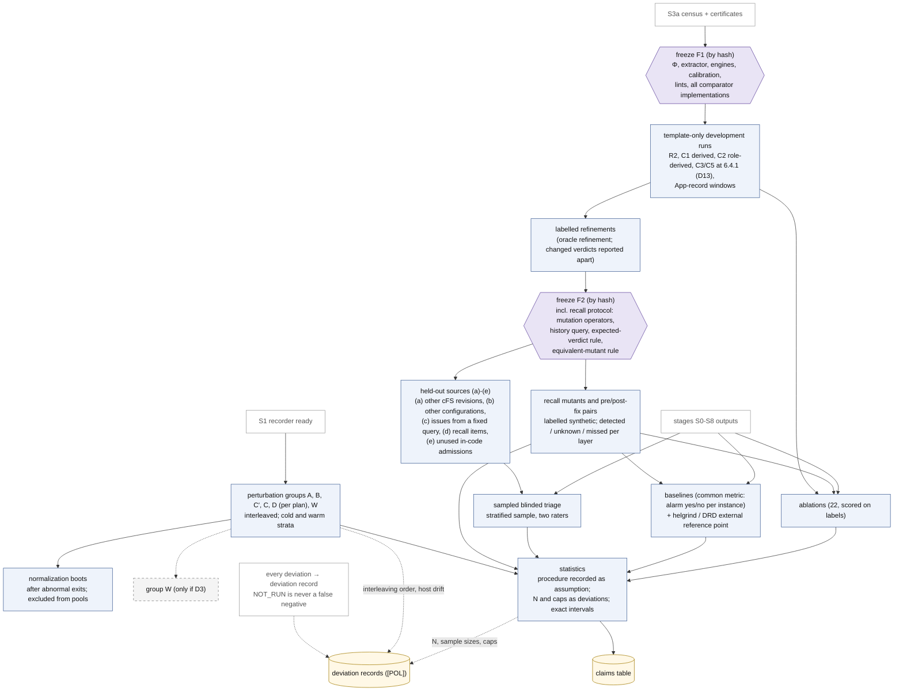

# 07 평가 계획: 무엇을 묻고, 무엇과 비교하며, 놓친 것을 어떻게 재는가

이 문서는 Kairos 설계의 평가 계획(spec §8)을 spec을 읽지 않은 연구자가 15–25분 안에 파악하도록 정리한다. 연구 질문, 평가 대상, 기준선과 비교 방법, ablation, 지표(특히 Kairos가 놓친 것을 재는 recall protocol), 오버헤드·perturbation 실험, 통계·재현성, 타당성 위협을 차례로 다룬다.
평가 조건 가운데 사람이 고르는 값(실행 횟수 N, 탐색 cap, 표본 크기)을 CONDITIONS_POLICY에 따라 어떻게 기록하는지도 함께 적는다. spec에 없는 설계 요소·수치·인용은 더하지 않는다.

상태: 설계 문서 — 구현·측정 전. 규범 원문: [spec/SPEC_FINAL.md](spec/SPEC_FINAL.md)

## 목차

0. [읽기 전에](#0-읽기-전에): 표기, 이 문서의 자리, 평가의 세 원칙, 필요한 용어
1. [한 장으로 보기: 평가 경로 (그림 D4 상세)](#1-한-장으로-보기-평가-경로-그림-d4-상세)
2. [연구 질문](#2-연구-질문-spec-81) (spec §8.1)
3. [평가 대상](#3-평가-대상-spec-82-75) (spec §8.2, §7.5): 개발 집합, census, recall, held-out
4. [기준선과 비교 방법](#4-기준선과-비교-방법-spec-83) (spec §8.3)
5. [Ablation](#5-ablation-spec-84) (spec §8.4)
6. [지표](#6-지표-spec-85) (spec §8.5): recall protocol, soundness failure, triage
7. [오버헤드와 perturbation 실험](#7-오버헤드와-perturbation-실험-spec-86) (spec §8.6)
8. [통계와 재현성](#8-통계와-재현성-spec-87) (spec §8.7)
9. [N, cap, 표본 크기를 기록하는 법](#9-n-cap-표본-크기를-기록하는-법-conditions_policy) (CONDITIONS_POLICY)
10. [타당성 위협](#10-타당성-위협-spec-88) (spec §8.8)
11. [평가를 여는 단계와 PI 결정](#11-평가를-여는-단계와-pi-결정-spec-93-101) (spec §9.3, §10.1)
12. [이 문서가 주장하지 않는 것](#12-이-문서가-주장하지-않는-것)
13. [관련 문서](#13-관련-문서)

---

## 0. 읽기 전에

### 0.1 표기

표기는 spec 머리말을 따른다(자세한 설명은 [01_overview.md §0](01_overview.md#0-읽는-법)).

| 표기 | 뜻 |
|---|---|
| [F] | 코드·기록·보고서 인용이 있는 사실 |
| [M] | 측정값. **이 문서의 [M]은 모두 spec이 인용한 기존 측정**이다: [BM] (`env/BASELINE_MEASURE.md`), [R2g]·[R2c] (R2의 gdb 기록과 퇴역한 CORD recorder 기록), [R07] (환경 타당성 보고서), 검토 X3가 이 머신에서 확인한 값([X3, here]). Kairos는 아직 아무것도 측정하지 않았다 |
| [I] | 추론 또는 설계상 추론. 실행하지 않았다 |
| [D] | 설계 결정. spec §11의 ADR이 기록한다 |
| [U] | 미확인 |

문헌의 상태 표시는 spec과 [R04]·[R05]가 확인한 그대로 옮긴다. V-abs는 서지와 초록 수준의 주장을 확인한 것, V-me는 해당 보고서 작성자가 검색으로 서지·초록 수준을 확인한 것, P는 일부만 확인한 것이다([R04 §0.2]; [R05 §0.2]; V-me는 [R06 §9]).

인용 형식은 01, 03, 06과 같다. "(spec §8.5)"는 SPEC_FINAL.md의 절, "[R05 §6.3]"은 `background/`의 보고서, [LED]는 `cases/ledger.md`, [POL] Ln은 [CONDITIONS_POLICY.md](../CONDITIONS_POLICY.md)의 n번째 줄이다. PI 결정 D8, D14, P-TRIAGE 같은 이름은 [spec/PI_DECISIONS.md](spec/PI_DECISIONS.md)의 PI 결정이다. X3-C1, X3-M6 같은 이름은 검토 쟁점이고 처리 내용은 [spec/ISSUE_RESOLUTION.md](spec/ISSUE_RESOLUTION.md)에 있다. [A]·[B]는 `history/`의 설계 제안, [J1]–[J3]은 심사, [X1]–[X3]은 적대적 검토다. 실험군 이름 A, B와 혼동하지 않도록, 제안은 언제나 대괄호로 쓴다.

**인용 형식과 이름이 겹치는 기호.** 인용 형식(설계안 [A]/[B]/[C], 심사 [J1]–[J3], 검토 [X1]–[X3], [X3, here], v0.1 등)은 [01_overview.md §0](01_overview.md#0-읽는-법)에 모아 두었다. 같은 기호가 여러 뜻으로 쓰이므로 이 문서는 앞에 종류를 붙인다: "PI 결정 D4"와 "그림 D4", "보장 G5"와 "gap G5", "단계 S0"와 "Init snapshot S0", HB stratum S/O와 cold/warm 층(stratum). 전체 목록은 [10_decisions_adr.md §0.2](10_decisions_adr.md#02-이름-충돌-주의)다.

### 0.2 이 문서의 자리

평가는 연구 단계 S9에서 한다(spec §9.3). S9는 freeze F1, freeze F2, 그리고 §8 전체(recall protocol, 기준선, triage)를 실행하는 단계다. [03_workflow.md §4](03_workflow.md#4-연구-워크플로우-그림-d4)가 이 경로를 짧게 요약했고, 이 문서는 같은 내용을 spec §8을 따라 넓히면서 이유와 cFS 예를 붙인다. 평가의 어떤 부분도 아직 실행되지 않았다.

### 0.3 평가의 세 원칙

spec은 평가 전체에 걸쳐 세 원칙을 둔다. 셋 다 설계 결정 [D]이다.

1. **평가는 놓친 것을 잰다**(spec §0.2 항목 8). 개발 사례에서 찾은 것만으로는 무엇을 놓치는지 알 수 없다([X3-C1]). 그래서 과거 수정 이력에서 만든 program mutant와 수정 전후 쌍으로 Kairos가 무엇을 찾고, 무엇을 `unknown`으로 남기고, 무엇을 놓치는지 층별로 잰다(§6.1). certificate가 틀린 경우는 soundness failure로 따로 센다(§6.2).
2. **동결 순서가 평가의 순서를 정한다**(spec §7.2). F1(첫 평가 실행 전) → 사례 전용 항목 없는 template-only 실행 → 표시된 refinement → F2(held-out을 열기 전)의 순서를 지킨다. 결과를 본 뒤 도구나 규칙을 고치지 못하게 하는 장치다.
3. **사람이 고른 값은 deviation, 통계 절차는 가정이다**(spec 머리말, §8.7). 실행 횟수 N, 탐색 cap, 표본 크기는 reference가 정하지 않으므로 이유·영향·필요성과 함께 deviation으로 기록한다. 방법론 문헌은 [POL]이 인정하는 reference 종류가 아니므로, 통계 절차는 가정(assumption)으로 미리 기록한다(§9).

그리고 판정 체계 전체의 원칙이 평가에도 그대로 적용된다. **경보 없음은 안전이 아니다**(spec §0.1, §6.4 항목 2). 비교 도구가 조용한 것, `NOT_RUN`인 것, Kairos가 `unknown`을 낸 것은 모두 "문제가 없다"는 뜻이 아니다.

### 0.4 필요한 용어

이 문서를 읽는 데 필요한 만큼만 적는다. 전체 용어집은 [10_decisions_adr.md §3](10_decisions_adr.md#3-용어집)이다(원문 spec §13).

| 용어 | 쉬운 설명 | spec |
|---|---|---|
| 계약 instance | 프레임워크 자원을 쓰는 사용 지점 하나와, 그때 그 자원이 있어야 할 lifecycle 상태의 쌍. Kairos는 instance마다 판정 기록을 만든다. 예: R2에서 ES가 SB API를 부를 때 SB의 AppId가 발행되어 있어야 한다 | §0.1, §1.6 |
| (σ, M) 칸, class | 판정은 스케줄 의미론 σ(σ_U 시간 무시, σ_U∞ timeout 없음, σ_R1 한 CPU 고정 우선순위, σ_E 실제 환경)와 OSAL 모형 수준 M(M_api API 계약 수준, M_impl POSIX 구현 수준)의 조합마다 따로 낸다. class는 `inactive`, `protected`, `fixed-order`, `schedule-dependent`, `unknown(reason)` 중 하나다. "safe"는 없다 | §0.1, §1.8, §1.10 |
| happens-before (HB), vector clock | HB는 한 실행 안에서 동기화(lock, message, thread 생성 등)로 정해지는 "먼저 일어남"의 부분 순서다. vector clock은 thread마다 카운터 벡터를 들고 다니며 HB를 계산하는 자료 구조다 | §1.9, §1.11 |
| 예측 분석, lock 뒤집기 | 예측 분석(predictive analysis)은 관측한 trace 하나에서, 동기화 제약을 지키면서 사건 순서를 바꾼 다른 실행이 가능한지 추론하는 기법이다. lock 뒤집기는 같은 lock을 잡는 두 구간의 순서를 바꾼 실행을 예측하는 것이다 | §4.9, §1.11 |
| typestate | 자원마다 상태 automaton을 두고, 연산이 허용된 상태에서만 일어나는지 검사하는 방식이다 | §1.11 |
| linearization point (LP) | 연산의 효과가 "이 명령에서 한순간에 일어났다"고 보는 지점이다. Kairos는 요구 조건의 conjunct(∧로 묶인 조건 하나)마다 LP를 둔다. capture point는 호출자가 넘길 값을 미리 읽어 둔 load 지점이다 | §1.4 |
| certificate, `kz proofcheck` | certificate는 `fixed-order`나 `protected` 판정이 맞다는 증명 기록이다. `kz proofcheck`는 분석기와 코드를 공유하지 않는 독립 검사기로, certificate를 단계마다 다시 확인한다 | §4.5 |
| uprobe, eBPF | uprobe는 실행 파일을 고치지 않고 사용자 프로그램의 명령 주소에 kernel이 거는 probe다. eBPF는 그 probe가 걸릴 때 kernel 안에서 실행되는, 검증을 거친 작은 프로그램이다 | §5.1, §5.3 |
| DPOR | dynamic partial-order reduction. 의존하는(dependent) transition이 뒤바뀔 수 있는 곳에만 backtracking 지점(다른 순서를 시도하려고 되돌아갈 지점)을 두어, 독립 연산의 순서만 다른 interleaving의 탐색을 줄이는 체계적 탐색 기법이다([R05 §2.2]; DPOR POPL 2005 [V-abs; 보장 문구 UNVERIFIED]). Kairos explorer의 `dpor` engine이 쓴다. Kairos의 source-DPOR은 class(독립 연산의 순서만 다른 실행들의 동치류)당 실행 하나를 주장하지 않는다(spec §6.4 항목 9). | §4.10, §6.4 항목 9 |
| program mutant | 원래 프로그램의 코드를 일부러 조금 바꾼 변형이다. 여기서는 정해진 연산자나 과거 수정의 역(되돌리기)으로 만든다 | §8.5 |
| recall | 실제로 있는 문제 가운데 도구가 찾은 비율이다. Kairos는 이것을 mutant와 수정 전후 쌍에서만 잰다 | §8.5 |
| held-out | 설계하는 동안 열어 보지 않고 평가용으로 남겨 둔 대상이다 | §7.5 |
| freeze F1, F2 | 그 시점의 Φ(cFS 지식을 담은 profile), 도구, 비교 도구, 규칙을 hash로 고정해 이후 바꾸지 못하게 하는 것이다 | §7.2 |
| template-only 실행 | 사례 전용 항목 없이 동결한 generic profile만으로 돌린 평가 실행이다 | §7.2, §13 |
| 표시된 instance | 정답 label이 있는 instance. 개발 사례, recall mutant와 쌍, triage 표본이 여기에 든다 | §8.3 |
| `NOT_RUN` | 실행하지 않은 비교 도구나 항목의 상태. false negative(놓침)로 세지 않는다 | §8.3, §8.5 |
| perturbation(교란) | 관측이나 제어가 실행 timing을 바꾸는 것 | §8.6, §4.13 |
| pool key, cold/warm 층(stratum) | 여러 실행의 빈도를 합칠 때 같아야 하는 열쇠(B hash, plan hash, cold/warm 층). cold/warm 층(spec의 stratum)은 VM 재부팅 뒤 첫 실행(cold)과 나머지(warm)의 구분이다. HB edge의 stratum S/O/C_σ와 다른 뜻이다 | §4.12, §8.6 |
| work unit | 탐색 상태 수, transition 수 같은 결정적 횟수. 모든 분석 예산을 이것으로 잰다. 벽시계 시간은 비용으로만 보고한다 | §4.14, §13 |

---

## 1. 한 장으로 보기: 평가 경로 (그림 D4 상세)

아래 그림은 평가가 어떤 순서로 진행되고, 각 결과가 어디로 모이는지 보인다. 점선 테두리는 PI 결정이 있어야 쓰는 것(실험군 W는 PI 결정 D3 승인 시만)이고, 점선 화살표는 deviation 기록으로 가는 경로이거나 PI 결정이 여는 경로다.

**그림 D4 상세. 평가 경로** (렌더링: [diagrams/D4_research_evaluation.svg](diagrams/D4_research_evaluation.svg); spec §12 D4; §7.2, §7.5, §8.3–8.7)

그림은 세 줄기로 읽는다.

- **첫째, 동결 사슬**(S3a → F1 → template-only → refinement → F2)은 개발 사례를 다루는 순서다. F1에서 도구와 비교 도구를 모두 동결하고, 첫 실행은 사례 전용 항목 없이 한다(§3.5). 그 뒤 보강은 따로 표시한다.
- **둘째, F2에서 갈라지는 두 줄기**(held-out (a)–(e), recall)는 설계자가 미리 보지 못한 대상이다. F2 전에는 열지 않는다(§3.4, §6.1).
- **셋째, S1에서 시작하는 줄기**(perturbation 실험군, normalization boot)는 관측 자체의 비용과 교란을 잰다(§7).

모든 줄기는 통계(§8)를 거쳐 claims table에 모인다. 그 과정에서 사람이 고른 값(N, 표본 크기, cap)과 실험군 교차 순서는 deviation 기록이나 가정으로 남는다(§9).

---

## 2. 연구 질문 (spec §8.1)

spec은 아홉 개의 연구 질문(RQ)을 둔다. 크게 세 묶음이다. Kairos가 무엇을 찾는가(RQ1, RQ2, RQ3, RQ5), 그 답을 믿을 수 있는가(RQ4, RQ9), 각 부분이 무엇을 더하고 얼마나 드는가(RQ6, RQ7, RQ8).

| RQ | 묻는 것 | 답의 형태 | 이 문서 |
|---|---|---|---|
| RQ1 개방성 | cFE core와 15개 앱에 기본 B와 변형 B′ 아래 계약 instance가 몇 개 있는가(kind별, RC별). certificate, 관측, 예측, 탐색, 확인이 각각 얼마를 결정하는가((σ, M)별). 얼마가 왜 `unknown`으로 남는가. key가 concrete/symbolic/⊤로 풀린 비율(특히 송신 위치)은 얼마인가 | 분모가 있는 비율과 이유별 unknown | §6.4, §6.5 |
| RQ2 개발 사례 | template-only profile로 어떤 판정 기록이 나오고, refinement로 무엇이 바뀌는가 | 사례별 판정 기록, refinement가 바꾼 판정은 따로 | §3.1 |
| RQ3 held-out 일반화 | 동결한 도구(F2)가 출처 (a)–(e)에서 무엇을 찾는가. 표본 triage 정밀도, 실현 비율, unknown 비율은 얼마인가 | 출처별로 따로 센 결과와 exact 신뢰구간 | §3.4, §6.3 |
| RQ4 모형 충실도 | 모든 trace의 O2 conformance와 표본의 O8, 반복별 obligation 실패, checker 통과율과 certificate-mutation kill rate, T-OBS 비활성화·A-TYPE 목록·`DECLARED_TRUSTED` 수, O9 반박, anchor audit 범위, 규칙별 closure 해석, havoc·local-choice 수, summary fallback 수 | 수와 비율 | §6.2, §6.4 |
| RQ5 측정된 현상 | 기본 bundle에서 측정된 순서 의존 손실을 두 용량 수준(queue 깊이와 MsgLim)에서 분류하는가. 어떤 pipe가 넘칠 수 있는지 예측하는가 | LOSS-UNDER-ORDER label, oracle 일치 | 아래 |
| RQ6 층과 반복의 가치 | 각 층과 feedback loop가 표시된 instance에서 무엇을 더하는가 | ablation별 instance 단위 차이 | §5 |
| RQ7 비용과 교란 | 여섯 비용, 계측 없이 보이는 지표의 변화, witness별 perturbation 비율 | 분포 | §7 |
| RQ8 비교 | 기존 순서·예측·관측 모형과 같은 instance에서, 공통 지표로 비교하면 어떤가 | instance별 경보 yes/no의 짝지은 비교 | §4 |
| RQ9 recall | 사전 등록한 program mutant와 수정 전후 쌍에서 각 층이 무엇을 검출하고, 무엇을 `unknown`(이유별)으로 남기고, 무엇을 놓치는가. certificate가 몇 개 반박되는가 | 층별 detected / unknown / missed, soundness failure 수 | §6.1, §6.2 |

**RQ5의 구체 내용.** 측정된 현상은 다음과 같다 [M] ([BM §0, §3.3]; spec §8.1).

- queue-full drop: 부팅마다 4–49건.
- `NoSubscribersCounter`: 15–26. 구독자가 생기기 전에 보낸 메시지가 성공을 반환하며 사라지는 경로다(01의 "SB 구독 전 송신" 예).
- 넘친 pipe: `SBNSubPipe`, `TO_LAB_TLM_PIPE`, `DS_CMD_PIPE`.

oracle은 put 결과와 SB counter 넷이다. `PeakQueueDepth`는 SB가 센 깊이로만 쓴다. 판정 label은 LOSS-UNDER-ORDER이고 harm은 정하지 않는다(unspecified). 대부분의 문서가 전달을 요구하지 않으므로, 이 손실을 "버그"로 부르지 않는다(spec §1.6, §10.2 "Route/capacity verdicts read as bugs"). `msg_max`를 바꾼 변형은 RQ5의 민감도 분석에만 쓴다(PI 결정 D19). 퇴역한 recorder의 기록은 이전 관측으로만 인용한다(PI 결정 D12).

**RQ9가 필요한 이유.** 개발 사례 중 대상 revision(v7.0.1)에서 자연스럽게 재현된 것은 R2 하나이고, R2는 fixed-order다. schedule-dependent class에는 대상 바이너리 위의 자연 정답이 없다(spec §8.2; [X3-C1]). 그래서 RQ1–RQ3만으로는 Kairos가 무엇을 놓치는지 알 수 없고, RQ9의 recall protocol이 그 빈자리를 채운다.

---

## 3. 평가 대상 (spec §8.2, §7.5)

평가 대상은 네 종류다. 서로 섞지 않고 따로 보고한다.

| 대상 | 무엇 | 역할 |
|---|---|---|
| 개발 집합 | 다섯 설계 사례와 두 App-record 구간 | RQ2. 설계에 썼으므로 맹검이 아니다 |
| census 대상 | 기본 B 아래 v7.0.1 bundle, 그리고 §7.4의 변형 B′ | RQ1. 변형마다 따로 보고 |
| recall 대상 | v7.0.1의 program mutant와 수정 전후 쌍 | RQ9. synthetic으로 표시 |
| held-out | §7.5 출처 (a)–(e) | RQ3. 출처마다 따로 셈 |

### 3.1 개발 집합

다섯 사례는 개발용이다. label은 [R06 S10]의 구분(original, public-code-derived, role-derived, synthetic control)을 따른다([LED]; spec §8.2).

| 사례 | 무엇 | 대상 revision | label과 상태 |
|---|---|---|---|
| R2 (cFE #2663) | SB의 AppId가 발행되기 전에 ES·EVS init의 SB 코드가 그것을 쓴다 | v7.0.1 현재 코드 | 자연 사례. gdb와 퇴역한 recorder로 관측했다. 부팅마다 24건(ES 20, EVS 4), ENV의 version table이 있는 basis에서 [M] ([R2g §2]) |
| C1 (CF #184) | CF가 다른 앱이 만들 OSAL semaphore를 이름으로 찾는다 | v7.0.1, 파생 구성 | public-code-derived. 기본 table에서는 실행되지 않는다(latent) |
| C2 (cFE #198) | RUNNING을 알린 앱의 late init이 끝나기 전에 다른 앱이 진행한다 | 구성한 앱 쌍 | role-derived, synthetic control |
| C3 (cFE #73) | 6.4.1에서 TIME이 먼저 실행되어 core 시작 중 crash | 6.4.1 tarball, 공유 파생 6.4.x platform | PI 결정 D13 승인 시에만([LED] X3) |
| C5 (cFE #72) | 6.4.x의 AppCreate가 lock을 푼 채 task를 만들고 나중에 등록한다 | 6.4.1 tarball | PI 결정 D13 승인 시에만 |
| 두 App-record 구간 | core task와 startup script 앱이, 자기 App record가 발행되기 전에 자기 문맥을 조회할 수 있는 구간(계약 K-SELF.es). C5 모양의 잔여 후보 | v7.0.1 | 확인은 파생(derived). 코드 읽기에서 나온 후보 [I] (spec App. A.2, A.3) |

이 집합에는 한계가 셋 있다.

- **R2만 자연 사례이고, fixed-order다.** schedule-dependent class의 자연 정답은 대상 바이너리에 없다. 이것이 RQ9를 둔 이유다(§2).
- **C3와 R2는 독립이 아니다.** 같은 자원 family(SB AppId를 발행 전에 읽는 경로)를 공유하므로 독립 사례 둘로 세지 않는다([LED §3.1]).
- **R2의 "24"는 아직 Kairos의 결과가 아니다.** Kairos 자신의 recorder가 사용 집합(task, SB 함수, EID)을 재관측하기 전에는 어떤 R2 수도 Kairos 결과로 쓰지 않는다. version table이 없는 basis에서는 11건이다(spec §6.4 항목 21; §9.3 S1 출구 조건).

### 3.2 census 대상과 변형

census 대상은 기본 B 아래의 v7.0.1 bundle이고, §7.4의 변형을 더한다. 변형 B′의 예는 잠재 경로를 켜는 table(CF `sem_name`에 제공자를 둔 구성, LC, MD, HS, CS), 다른 schedule table, startup script 순서, cpu2 target, `msg_max`와 euid, reset 종류, restart·reload·delete 입력이다(spec §7.4).

변형마다 별도의 basis이고 별도의 manifest를 가지며, 기본 B와 합치지 않는다. **변형에서만 나온 것은 기본 구성의 "새 버그"가 아니다**(PI 결정 D18). 어떤 변형을 먼저 돌릴지는 PI 결정 D18이 정한다(권고: 잠재 경로 table과 `B_restart` 먼저).

### 3.3 recall 대상

recall 대상은 v7.0.1의 program mutant와 수정 전후 쌍이다. 모두 synthetic으로 표시하고 "새 버그"라 부르지 않는다(spec §8.2, §8.5 항목 9). 만드는 법과 채점은 §6.1에 있다.

### 3.4 held-out 출처

held-out은 F2를 동결한 뒤에만 연다(spec §7.5).

| | 출처 | 비고 |
|---|---|---|
| (a) | 다른 cFS revision | version 이전. profile을 AST pattern으로 다시 묶는다 |
| (b) | 다른 구성 | cpu2, table 변형 |
| (c) | F2 전에 고정한 query(keyword와 날짜 cut)로 찾은 issue | C1, C2, C3, C5, R2는 뺀다 |
| (d) | recall protocol의 program mutant와 수정 전후 쌍 | synthetic 표시 |
| (e) | 설계에 쓰지 않은 코드 안의 시인(admission) 주석 | 예: 순서 가정이나 알려진 race를 적은 주석(spec §7.1 source 8) |

출처마다 따로 세고, 어느 것도 "새 실제 버그"에 더하지 않는다. 개발 사례에서는 template-only 결과와 refined 결과를 나란히 보고한다(spec §7.5 항목 3). 누가 query를 언제 돌리는지는 PI 결정 D8/P-RECALL이다. 권고는 다섯 출처를 모두 쓰고, Φ를 쓰지 않는 사람이 F2 전에 query를 고정하는 것이다.

### 3.5 맹검에 대한 정직

계약은 사람이 쓰므로 "답을 알고 규칙을 맞춘 것 아닌가"라는 순환 문제가 따른다. spec은 평가 쪽에서 다음과 같이 대응한다(spec §7.2).

- **template-only 먼저.** 첫 평가 실행은 사례 전용 항목 없이 한다. 이후 보강은 `oracle refinement`로 표시하고, 그것이 바꾼 판정은 따로 보고한다.
- **refinement accounting.** 판정마다 증명에 쓴 Φ 항목을 generic 계약, generic 장치, **사례를 알고 쓴 framework 규칙**으로 나눈다. R2의 certificate는 "generic 계약 K-ID + framework 규칙 R19(CORE-SERIAL, core 시작 직렬화)"로 보고한다.
- **맹검은 어디까지인가.** 저자들은 R2와 App-record 구간을 이미 안다. 그래서 개발 집합의 template-only 실행은 맹검이 아니고, 거기서는 header provenance와 코드에서 추출한 predicate가 순환을 막는 근거다. 맹검은 held-out 출처와 recall mutant(기대 판정이 수정 문서에서 온다)에 대해서만 주장한다.
- **작성 노력 보고.** person-hour, 항목 수, Φ 줄 수를 층별로 재서 보고한다.

---

## 4. 기준선과 비교 방법 (spec §8.3)

### 4.1 비교 규칙

spec은 비교에 네 가지 규칙을 둔다(spec §8.3).

1. **원 도구, 확장, 재구현을 항상 구분한다.** 재구현 결과를 원 도구의 결과처럼 쓰지 않는다([R06 S5]).
2. **`NOT_RUN`은 결코 false negative가 아니다**([R06 S5]). 돌리지 않은 도구는 아무것도 놓치지 않았고, 아무것도 찾지 않았다(§4.6).
3. **thread data-race 도구는 기준선이 아니다.** 사용자의 결정이다([R06 S13]). 이런 도구는 표시된 참조점(reference point)으로만 나온다([J3-M12]).
4. **같은 계열에서 실행 가능한 가장 강한 도구와, 같은 대상에서 비교한다**([R05 §6.3] L446).

### 4.2 공통 지표 [D]

모든 비교는 같은 단위로 한다(spec §8.3; [X3-M6]).

- **단위는 표시된 instance 하나**다. 개발 사례, recall mutant와 쌍, triage 표본(§6.3)이 여기에 든다.
- **각 비교 도구는 instance마다 경보 yes/no 하나를 낸다.**
- Kairos와 비교 도구를 **instance별로 짝지어** 이항 결과용 짝지은 검정(paired test)으로 비교한다. 같은 instance에서 나온 두 결과를 한 쌍으로 다룬다는 뜻이다.
- 어떤 검정을 쓸지는 F1 전에 **가정으로 기록한다**([POL] L17; P-STATS).
- **비교 도구의 결과를 미리 예측해 적지 않는다.**

### 4.3 구현 규율

- **동결.** 재구현한 비교 도구는 모두 F1에서 Kairos와 함께 동결한다(spec §7.2).
- **golden test.** 원 논문의 worked example에서 golden test(정답이 정해진 회귀 시험)를 만든다. 논문 원문에 접근할 수 있을 때만 가능하므로 P-PAPERS에 달려 있다.
- **구현자 기록.** 누가 구현했는지 기록한다.
- **probe plan 의존성.** Kairos의 trace 위에서 도는 비교 도구는 Kairos의 probe plan이 무엇을 기록했는지에 의존한다. 모든 비교에 이 의존성을 적는다. 아래 외부 참조점(helgrind, DRD)은 이 의존성이 없다.

### 4.4 비교 대상

spec §8.3의 표를 무엇을 대비하는지에 따라 다섯 묶음으로 나누었다. "같은 trace"는 Kairos의 `run-*.kzt` trace를 입력으로 쓴다는 뜻이다.

**(가) 같은 trace 위의 HB·예측 탐지기 재구현**

| 비교 대상 | 종류 | 보여 주는 것 |
|---|---|---|
| FastTrack 방식 HB(PLDI 2009 [V-abs]). lifecycle LP를 쓰기로, 사용을 읽기로, lock을 edge로 본다 | 재구현, 참조점 | 같은 근거 위에서 순서 없는 쌍만 찾는 검출기 |
| WCP·SHB 방식 관계(PLDI 2017, OOPSLA 2018 [V-abs]) | 재구현, 참조점 | lock 순서를 보존하는 예측 |
| **MCM/GPredict 방식 lock 뒤집기 예측기**(RV 2012, ICSE 2015 [V-abs]). key를 충돌 객체로, lock을 원자성으로, 일반 성질을 Req(사용 시점의 요구 조건)로 둔다. **Φ의 결과 의미, Allowed, capture point, certificate는 없다** | 재구현, **같은 계열 기준선**([X1-M12]) | 같은 cone에서 명시적 탐색으로 돌린다. P-Z3 승인 뒤에는 SMT-LIB 변형도 가능하다 |
| DCatch 방식 framework HB(ASPLOS 2017 [P]). 계약, 결과 의미, 조건부 edge가 없다 | 재구현 | 계약과 결과 의미의 가치 |

MCM/GPredict 방식이 "같은 계열 기준선"인 이유는 spec §1.11에 있다. RVPredict와 GPredict 방식의 제약 인코딩은 이미 key를 충돌 객체로, lock을 원자성으로 다룬다([R04 L259, L492]). 이 기준선은 같은 cone 위에서 명시적 탐색으로 돌되 Φ의 결과 의미, Allowed, capture point, certificate를 뺀 것이므로, 그 요소들이 더하는 것을 가른다 [I]. spec은 Kairos의 예측 soundness가 희소한 API 수준 trace 위에서 RVPredict보다 **약하다**고 적는다(spec §1.11).

**(나) 계약 검사 계열**

| 비교 대상 | 종류 | 보여 주는 것 |
|---|---|---|
| **단순 typestate runtime monitor**. Φ의 automaton을 관측 trace에서 검사한다. certificate, 예측, σ가 없다 | 재구현 | certificate와 예측이 더하는 것(예: R2) |
| **DefUse 방식 학습 불변식**(OOPSLA 2010 [V-abs]). N번의 자연 실행에서 def-use 불변식(어느 쓰기가 어느 읽기에 값을 주는지)을 배우고, 어긋나면 표시한다 | 재구현 | reference에서 온 계약과의 대비. spec은 이 행에 "R2의 잘못된 정의(EarlyInit 값)를 정상으로 배울 것으로 본다. 모든 실행이 그 값을 읽기 때문이다"라는 설계 추론 [I]을 적는다(spec §1.11) |

**(다) 관측 모형과 참조 관측**

| 비교 대상 | 종류 | 보여 주는 것 |
|---|---|---|
| RacePro 방식 syscall 모형(SOSP 2011 [V-abs]). 같은 실행의 syscall tracepoint 위에서 돈다 | 관측 모형의 재구현 | 기존 기록은 OSAL 이름 생성과 조회에서 syscall 0개를 보였다([R06 §6.2 C5]) |
| 통제하지 않은 반복 boot + SB/EVS counter | 참조 관측 | 순서 정보 없이 counter만으로 드러나는 것 |
| gdb 기록([R2g]) | 참조 관측 | 보고자의 방법과 그 교란(ASLR, 즉 주소 무작위화를 끈 상태) |

**(라) 외부 참조점: 실제로 돌리는 도구**

| 비교 대상 | 종류 | 보여 주는 것 |
|---|---|---|
| **valgrind helgrind와 DRD**. 수정하지 않은 바이너리에 `RUN_CFS_WRAP`로 실행한다 | **외부 참조점, 실제 실행**([X3-M6]). gdb처럼 감싼 실행 명령을 쓰므로 deviation이다([R2g] L11). P-VALGRIND | 메모리 수준만 본다. valgrind는 thread를 직렬화하므로 schedule이 README 방식과 다르다. 다른 질문에 답할 것으로 본다([R05 §6.3 (c)]) |
| ThreadSanitizer(gcc 변형) | 참조점. P-TSAN이 재빌드 deviation을 승인할 때만 | 메모리 수준 race |

helgrind·DRD는 이 환경에서 설치 없이 도는 유일한 외부 도구이고, Kairos의 probe plan에 의존하지 않는 비교를 하나 준다(PI_DECISIONS P-VALGRIND). TSan은 P-VALGRIND가 메모리 수준 참조점을 이미 맡으므로, 검토자가 요청하지 않으면 빼는 것이 권고다(P-TSAN).

**(마) `NOT_RUN`: 차단 사유를 기록한 도구**

| 도구 | 상태와 차단 사유 |
|---|---|
| 원 process-level 도구(RacePro, SimRacer, …) | `NOT_RUN`, 차단 사유 기록([R06 K6]) |
| Nidhugg | `NOT_RUN`. 차단 사유는 설치 결정이다: Nidhugg README는 LLVM 8–19를 지원하는데 LLVM 18은 runtime만 설치되어 있다(`llvm-18-dev` 필요; [R05 F11]; [R07] L126–127). P-NIDHUGG 승인 뒤에는 pthread create, join, mutex만 쓰는 litmus 프로그램에서 explorer를 교차 확인하는 선택 항목이 된다([R05 §6.3] L452) |
| GenMC, CBMC | `NOT_RUN`. GenMC README는 LLVM 19–22를 요구하는데 없다. CBMC는 설치되어 있지 않다 |

### 4.5 이 비교로 무엇을 가르는가

비교 결과는 미리 적지 않는다(§4.2). spec 표 안의 [I] 문장(DefUse 행)은 그 비교 대상을 둔 설계상 이유다. 각 비교가 어떤 질문을 가르는지는 spec §1.11이 설명한다. R2와 lock 아래의 구간으로 보면 다음과 같다.

- R2의 위반 사용 24건은 모두 core 직렬화 때문에 SB의 발행보다 HB상 **앞선다**([R2g §2]; [R2c §7]; spec §1.11). FastTrack, TSan, Djit+는 순서 없는 충돌 접근을 보고하고, CP, WCP, SHB, M2, SyncP는 순서를 바꿀 수 있는 쌍만 보고한다([R04 §3 L4]). 그래서 (가) 묶음과의 비교는 "순서가 잘못된 방향으로 정해진 사용"을 다루는지를 가른다 [I].
- Kairos는 reference에서 온 계약과 문서화된 Allowed 결과를 **순서가 정해진 쌍**에서 검사하고, σ와 M을 밝힌 PWB certificate로 "잘못된 방향으로 정해짐"을 보편 class `fixed-order`로 끌어올린다(spec §1.11). typestate monitor와의 비교는 이 certificate와 예측이 더하는 것을 가른다.
- C1, C5, 두 App-record 구간처럼 같은 lock 아래의 생성·조회나 발행·`GetAppID`는 HB가 lock으로 순서를 정하고, lockset은 일관된 보호를 본다([R04 §2.3, §3 L5]). 여기서 Kairos가 쓰는 lock 뒤집기 예측 자체는 RVPredict·GPredict 방식에 이미 있으므로(spec §1.11), 같은 계열 기준선과의 비교가 Kairos의 나머지 요소가 더하는 것을 가른다 [I].

어느 경우든 비교 도구가 조용한 것은 "문제가 없다"는 증거가 아니다. 그것이 어떤 질문에 답하는 도구인지를 보여 줄 뿐이다.

### 4.6 `NOT_RUN`은 false negative가 아니다

돌리지 않은 도구에 대해 "이 도구는 C1–R2를 놓친다"고 쓰지 않는다(spec §6.4 항목 14). 외부 process-level 도구는 모두 `NOT_RUN`이다. 마찬가지로 `NOT_RUN`, `NOT_MEASURED`, `NOT_FROZEN`은 어떤 표에서도 0이나 "통과"로 세지 않는다([R06 R2]; spec §8.5).

---

## 5. Ablation (spec §8.4)

### 5.1 원칙과 채점

ablation은 한 번에 한 요소만 빼고, 같은 engine과 같은 trace로 다시 돌리는 실험이다([R06 S11]; [J1-14]; [J3-M8]). 목적은 RQ6, 곧 각 층과 장치가 무엇을 더하는지다.

**모든 ablation은 표시된 집합에서 채점한다**([X3-M8]). 표시된 집합은 개발 사례, recall mutant와 쌍, triage 표본이다. 보고하는 것은 다음과 같다.

- 전체 시스템 대비 **instance별 정답 변화**. 짝지은 검정과 효과 크기를 붙이고, 둘 다 가정으로 기록한다.
- 결정 비율과, 이유별 unknown 비율.
- O1–O9가 걸러 낸 거짓 후보 수.
- 비용 변화.

feedback loop ablation(3번)은 여기에 더해, 반복마다 해석한 key와 간접 호출 대상, 줄어든 unknown, 찾아낸 모형 빈틈도 보고한다.

### 5.2 22개 ablation

"S7 조건부"는 explorer(S7)가 kill criterion을 통과해야 의미가 있는 항목이다.

| # | 빼거나 바꾸는 것 | 비고 |
|---|---|---|
| 1 | **정적만**(예전 이름 "≈ A"): census와 certificate(S7을 통과했으면 explorer 포함), trace 없음 | explorer 부분은 S7 조건부 |
| 2 | **동적만**(예전 이름 "≈ B"): trace HB, 예측, 확인. census와 certificate 없음 | |
| 3 | feedback loop 없음: 한 번의 순방향 처리 | 반복별 지표 추가 보고 |
| 4 | obligation 없음(O1–O9 끔) | |
| 5 | σ_U∞ 끔: refinement 없음 | |
| 6 | robustness tag 끔: `VC_R` 사전 필터 없음 | |
| 7 | M_api만 대 M_impl | |
| 8 | identity 합침: 사건마다 identity 하나 | |
| 9 | 원자적 API(LP 없이 API 전체를 entry에서), capture point 없음(값 conjunct를 API의 검사 지점에서) | |
| 10 | 조건부 edge를 무조건으로: soft barrier를 must-edge로 | |
| 11 | OSAL 구현 수준 lock을 동기화로 본다 | |
| 12 | certificate를 먼저 하지 않음: 전부 탐색 | S7 조건부 |
| 13 | 예측 없음 | |
| 14 | 구성 closure 끔(pointer 분석만), message provenance 끔 | |
| 15 | looper 제한 끔: handler 사이에 thread program order를 둔다 | |
| 16 | 계약 끔: 순수 HB race 보고 | |
| 17 | writer 집합을 Φ만 / S3a만 / S3a + S3b로 | 두 oracle과 points-to의 가치. S3b를 만들었다면 그 이득도 이것으로 잰다(spec §9.3) |
| 18 | L1, L2, L3 끔 | L2, L3는 S7 조건부 |
| 19 | `dpor` 대 `exh`(작은 cone에서) | S7 조건부 |
| 20 | syscall만 관측; 메모리 수준 HB만 | |
| 21 | once와 KEY-SEP 끔: frontier를 spawn이 하나뿐인 actor에만 쓰고 key 분리 없음 | X1-M2/M3 장치가 얻는 것 |
| 22 | A-COMM 검사 끔: 모든 예측을 `predicted`로 label | label이 바뀌는 witness 수, 그중 바이너리에서 반박되는 수 |

### 5.3 빼는 요소가 cFS에서 맡는 역할

ablation의 결과는 예측하지 않는다. 다만 몇몇 요소가 cFS의 어디에 필요한지는 설계에 이미 적혀 있다. 아래는 그 사실만 모은 것이다.

| # | 빼는 요소 | cFS에서 맡는 역할(설계상 사실) |
|---|---|---|
| 7 | M_impl | OSAL RESERVED 구간(이름은 보이지만 object가 아직 LIVE가 아닌 구간)은 POSIX 구현 수준 모형 M_impl에서만 보인다. M_api에서는 생성이 원자적이다(spec §1.4, §3.2) |
| 8 | identity 넷 | R2에서 SB 코드는 ES나 EVS의 task 안에서 실행되면서 SB의 AppId를 찍는다. 실행 task, 소유자, 서비스, 찍힌 AppId가 서로 다를 수 있다(spec §1.2, §1.11의 gap G6 행) |
| 9 | capture point | R2 certificate는 찍힌 AppId 값에 capture point를 쓴다(spec §0.6 항목 3; App. A.1) |
| 10 | 조건부 edge | startup barrier `WaitForStartupSync`는 opt-in이고 timeout이 있으며 void를 반환하는 soft barrier다(`cfe_es_api.c:616–619`; spec §1.11). 그래서 spec은 이것을 조건부 edge로 모형화한다 |
| 15 | looper 제한 | message loop에서 handler 사이의 program order는 HB edge가 아니다. 예측에서만 FIFO 제약으로 남는다(spec §0.2 항목 6) |
| 21 | once | R2 certificate의 EVS 쪽 절반은 ES main의 raise(`cfe_es_task.c:134`)가 한 번만 일어난다는 once 사실로 ONCE-PWB를 얻어, EVS 쪽 관측의 writer 집합에서 그 raise를 뺀다(spec §4.5; App. A.1) |

---

## 6. 지표 (spec §8.5)

### 6.1 recall protocol [D]

recall protocol은 Kairos가 무엇을 놓치는지 재는 장치다([X3-C1]; ADR-035). 아래 항목 1, 2, 3, 6(연산자, history query, 기대 판정 규칙, 동치 mutant 제외 규칙)은 **F2 전에 동결한다**(spec §7.2).

**1. 연산자.** 순서 버그를 만드는 mutation 연산자는 다섯이다([R06 §5.6]; [R05 §6.2]).

| 연산자 | 뜻 |
|---|---|
| 대기 제거(remove a wait) | 준비를 기다리는 wait를 없앤다 |
| 발행을 spawn 뒤로 이동 | 자원의 발행(publication)을 task 생성(spawn) 뒤로 옮긴다 |
| object table 항목 교환 | object table의 항목을 서로 바꾼다 |
| retry 경계 비우기 | 시도를 한 번만 하게 한다. C1의 버그 revision이 이 모양이었다(수정 전에는 한 번만 시도했다) |
| 상태 검사 제거 | 반환 상태 검사를 없앤다 |

**2. history query.** 오프라인으로 받아 둔 cFE 이력(전체 2047 commit [M] [X3, here]), OSAL 이력, 앱 이력에서 keyword와 날짜 cut으로 수정 commit을 찾는다. keyword와 날짜 cut은 F2 전에 고정한다. 예를 들어 `race|startup sync|order`에 맞는 cFE commit 제목은 23개이고, 이것은 관련성을 아직 분류하지 않은 출발 집합이다([X3 §1]). 예: `6932f1fe` "Fix #950, race condition in control request", `58abd38d` "Fix #978, store task parameters in task record". 관련 있는 수정 가운데 그 코드가 고정 commit에 있는 것마다, 수정의 **역**을 v7.0.1에 mutant로 다시 만든다.

**3. 기대 판정.** mutant마다 기대 판정을 수정의 issue 본문과 commit에서 가져온다. 이것은 [POL]이 인정하는 reference 종류 1–2(L7–8)다. 기대 판정은 어긴 계약, instance, 방향(예: "사용이 발행보다 앞설 수 있다")으로 적는다. 기대 판정이 수정 문서에서 오므로, recall mutant에 대해서는 맹검을 주장할 수 있다(§3.5).

**4. 채점.** mutant마다, 층마다 셋 중 하나로 채점한다.

| 결과 | 조건 |
|---|---|
| `detected` | 기대 instance에서 `fixed-order`나 `schedule-dependent` class가 나오고 shape(WRONG-WAY, UNORDERED, ABSENT, STALE)가 맞는다 |
| `unknown(reason)` | class가 정해지지 않았다. 이유를 함께 센다 |
| `missed` | `protected`, `inactive`, 또는 instance 자체가 없다 |

층은 static, trace, prediction, exploration, confirmation 다섯이고, 층별 결과와 전체 결과를 모두 **exact binomial 신뢰구간**과 함께 보고한다. exact binomial 신뢰구간은 비율의 신뢰구간을 정규 근사 없이 이항분포에서 직접 계산한 것이다.

`unknown`과 `missed`를 나누는 것이 중요하다. `unknown`은 Kairos가 class를 내지 않고 이유와 함께 "모른다"고 답한 경우이고, `missed`는 Kairos가 기대와 반대 방향의 class를 냈거나 instance를 만들지 못한 경우다.

**5. soundness failure.** 수정 문서가 반대 동작을 적은 mutant에서 `protected`나 `fixed-order` certificate가 나오면 soundness failure로 보고한다. 가능하면 mutant 바이너리에서 확인도 한다. 이것이 certificate의 프로그램 수준 시험이다(§6.2).

**6. 동치 mutant.** 코드를 바꿨지만 판정할 차이가 없는 mutant는 F2 전에 등록한 규칙으로만 뺀다. 규칙은 둘이다. 바뀐 위치가 증명과 함께 `inactive(B)`이거나, mutant의 object 파일이 원래와 byte 단위로 같은 경우다.

**7. 수정 전후 쌍.** 수정이 있는 경우 수정 전과 후를 짝으로 돌린다([R05 §6.1 (iii)] L431). 판정은 수정이 뜻하는 방향으로 움직여야 한다.

**8. 첫 검출까지의 시간.** σ_E 관측에서는 mutant마다 첫 나쁜 witness가 나올 때까지의 자연 실행 수를, 확인에서는 hold 시도 횟수를 센다. 평균이 아니라 분포로 보고한다([R05 §6.5]).

**9. 빌드 예산.** mutant는 **한 variant tree**에서 증분 빌드한다. 근거가 된 값은 다음과 같다 [M]: 전체 직렬 빌드 한 번에 약 15분([R07] L423), variant tree 하나에 약 0.8 GB([R07] L420), 여유 공간 18 GB([R07 §1], 그리고 spec 작성 때 측정). mutant마다 바이너리, compile DB, hash만 보관한다.

recall 수치는 history에서 만든 mutant와 수정 쌍의 검출률이다. **실제 순서 버그 일반의 recall이 아니다**(spec §6.4 항목 25). mutant는 수정의 역이므로 아직 고쳐지지 않은 버그를 대표하지 않을 수 있다. 이것은 구성 타당성 위협으로 남는다(§10).

### 6.2 두 가지 "mutation" 시험의 차이

spec에는 mutation이 두 곳에 나온다. 서로 다른 것을 시험한다.

| | certificate-mutation 시험(spec §4.5) | program mutant의 soundness failure(spec §8.5 항목 5) |
|---|---|---|
| 무엇을 바꾸나 | 이미 맞는 certificate. 예: spawn site 하나를 빼거나, `cfe_es_start.c:823`을 OWN-NOPATH 증명 없이 writer 집합에 다시 넣거나, once 사실을 빼거나, 단계를 truncation 영역으로 옮긴다 | cFS 프로그램 자체(§6.1의 연산자와 수정의 역) |
| 기대 | 모든 변형이 `kz proofcheck`에서 거부되어야 한다 | 수정 문서와 반대인 certificate가 나오지 않아야 한다 |
| 지표 | kill rate(거부한 비율). RQ4 | soundness failure 수. RQ9 |
| 시험 대상 | **checker** | **분석 자체** |

kill rate가 높아도 분석이 맞다는 뜻은 아니다. 그것은 checker가 잘못된 증명을 거부한다는 뜻일 뿐이다. 분석의 soundness는 program mutant로만 시험한다(spec §4.5 끝).

### 6.3 triage [D]

census는 instance를 아주 많이 만들 수 있다. 사람이 판정이 맞는지 보는 일(triage)을 어떻게 할지가 문제다([X3-M7]; ADR-038).

- **보고 대상의 정의.** "보고"는 class가 `fixed-order`나 `schedule-dependent`이고 outcome label이 `violation`이나 `liveness`인 판정이다.
- **규모** [M] [X3, here]. `cfe/modules`와 `apps`에 `CFE_EVS_SendEvent` 호출 위치 1,208개, `CFE_SB_TransmitMsg`/`Subscribe*` 133개가 있다. 시험과 stub은 뺐고, link 포함 여부는 거르지 않았고, 문맥 구분 전의 수다. instance는 수천 개일 가능성이 크다 [I].
- **층화 무작위 표본.** 그래서 전수 triage 대신 (class, RC 종류, 결정한 층)별로 층화 무작위 표본을 뽑는다. RC 종류는 [R03 §4]의 readiness-contract 종류 15개다(spec §3.15). **표본 크기는 deviation**이고(유한한 평가자 시간), exact 신뢰구간을 보고한다.
- **평가자.** 둘이다. 산출한 층, ablation, 그리고 서로에 대해 맹검이다. 누가 평가하는지와 Φ 작성자와의 독립성은 P-TRIAGE다(권고: 적어도 한 명은 Φ 작성자가 아님). 일치 통계량은 triage 전에 가정으로 기록한다.
- **LOSS-UNDER-ORDER는 평가하지 않는다.** 대신 SB counter와 put 결과 oracle과의 일치를 보고한다. `not-ready-unjudged` 판정은 세기만 한다. Allowed가 정해지지 않았으므로 옳고 그름이 정의되지 않기 때문이다.
- **평가자 노력**은 여섯 비용 가운데 하나로 보고한다(§7.6).

### 6.4 그 밖의 지표

- **분모가 있는 instance 수.** class, refinement, σ, M, provider, reach, 근거(두 축), RC 종류, 발견 출처(spec §7.1)별로 센다. 언제나 분모와 함께 보고한다([R06 R3]).
- **결정 비율.** 층별, (σ, M)별 결정 비율과 이유별 unknown 비율. 예측, 탐색, O8에는 **anytime curve**(투입한 work unit에 따른 결정 비율 곡선)를 그린다. cap(deviation)에 걸린 결과는 `unknown(budget)`과 이 곡선으로 함께 보고한다(PI 결정 D15).
- **확인.** 실현·반박·결론 없음의 비율(naturalness별), gate에 이르지 못한 비율, 확인당 hold 수, perturbation 비율.
- **정적 범위**([R06 T3]). 해석한 entry 함수, 규칙별로 해석한 간접 호출 위치, key 비율, message provenance로 접힌 수.
- **충실도.** RQ4와 같다.
- **비용.** 단계별 work unit, 벽시계 시간, 최대 메모리. 여섯 비용을 따로(§7.6). profile 크기와 작성 시간.

### 6.5 개방성 지표 (spec §7.7)

RQ1과 RQ3를 위해 개방성을 따로 보고한다([R06 §5.7]).

- 다룬 계약 종류 대 census에서 발견한 종류.
- 자동으로 발견한 instance(spec §7.1의 출처 1–6, 10–12)와 사람이 쓴 instance의 비율.
- 사례 전용 refinement나 사례를 알고 쓴 framework 규칙이 필요했던 판정의 비율.
- held-out과 mutant 결과는 설계 사례 결과와 떼어 보고하고, 변형 B′별 instance는 기본 B와 떼어 보고한다.
- 층별 recall(§6.1).

---

## 7. 오버헤드와 perturbation 실험 (spec §8.6)

### 7.1 왜 따로 재는가

관측은 실행을 흔든다. 예를 들어 R2의 gdb 기록은 breakpoint가 걸릴 때마다 모든 thread를 잠시 멈췄으므로, 교란 없는 스케줄의 증거가 아니다([R2g] 머리말). Kairos는 수정하지 않은 바이너리에 uprobe와 eBPF를 붙여 관측하고, 확인 실행에서는 ptrace로 thread를 붙잡는다(hold). 이 비용과 교란이 판정을 흐리지 않았는지 보이려면, 관측기의 각 부분이 무엇을 더하는지 실험군으로 나누어 재야 한다([J3-M6]; [A §5.8]; [B §5.6]).

### 7.2 실험군

| 실험군 | 구성 | 가르는 것 |
|---|---|---|
| A | 수정하지 않은 바이너리, 관측기 없음. **kernel `-fc-v114`에서 다시 잰다** | 기준 |
| B | 빈 BPF 프로그램을 단 uprobe | trap 비용 |
| C′ | 최소 R2 plan(R2 위치와 identity bootstrap만) | 좁은 plan의 비용 |
| C | 전체 plan | 기록 비용 |
| D | C + hold. **hold plan별로**, 같은 plan hash의 C 실행과 비교한다([X3-M2]) | 제어 효과 |
| W | F1 `--wrap` 빌드에서 gate를 끈 것. PI 결정 D3 승인 시만 | 변형 빌드의 code layout 효과 |

실험군 A를 다시 재는 이유는 기존 기록이 `-fc-v80` kernel에서 만들어졌기 때문이다. 다시 재는 것은 필수다(PI 결정 D11; spec §5.10).

### 7.3 측정은 무엇이 볼 수 있느냐로 나눈다

측정은 두 종류로 나눈다([X3-M2]).

**계측 없이도 보이는 것**은 A와 B, C′, C를 비교한다. 관측기가 없는 실행(A)에서도 같은 값을 읽을 수 있어야 비교가 성립하기 때문이다.

| 측정 | 기존 기록의 값 [M] |
|---|---|
| console에 찍힌 cFE 시간 기준 **CORE_READY → OPERATIONAL** | 아홉 번 실행에서 103.2–104.6 ms, 폭이 좁은 지표([R2c §4.4]) |
| 15개 "Loading file … APP:" 줄의 **간격** | warm에서 2.2–3.3 ms([BM] L278) |
| 앱별 init offset, OPERATIONAL 줄의 벽시계 시간 | — |
| 종료 시 읽는 SB counter: `PipeOverflowErrorCounter` | 같은 조건 여섯 번에서 4–49, 검정력이 낮다([BM §2.3]) |
| `NoSubscribersCounter` | 15–26 |
| `MsgLimitErrorCounter`, `InternalErrorCounter`, 넘친 pipe 목록 | — |

**recorder만 보는 것**은 C′, C, D를 비교한다. R2 사용 집합(task, SB 함수, EID), 위치별 probe hit, drop, 관측기 CPU 시간과 배치가 여기에 든다.

어느 쪽이든 **평균이 아니라 분포를 비교한다.**

### 7.4 witness별 perturbation 비율

실현된 witness(실제 바이너리에서 일어난 판정 근거 실행)마다 perturbation 비율을 계산해 함께 보고한다(spec §4.13).

- **분자**: 판정을 가르는 두 사건 사이에, 관련 thread에 더해진 probe 시간과 hold 시간. 그 실행 자신의 hit 수에 S1의 비용 등급을 곱하고, hold 시간을 더한다.
- **분모**: 다른 순서를 막고 있는, 코드에서 나온 간격. 예: `CFE_ES_GetTaskFunction`의 50 ms poll 지연(`cfe_es_apps.c:559–596`), core 직렬화의 약 100 ms 간격([R2g §2]), SCH_LAB의 첫 tick이 init 뒤 적어도 1 s.

비율에는 **문턱값을 두지 않는다.** 독자가 판단할 수 있도록 값만 붙인다. σ_E 빈도는 모두 `σ_E(plan P)`로 표시한다. 관측하지 않은 실행과 같다는 주장은, 실제로 잰 계측 없이 보이는 지표에서만 한다(spec §4.12 항목 4, §8.6).

### 7.5 통제

- **cold/warm 층(stratum).** cold(VM 재부팅 뒤 첫 실행)와 warm은 따로 두고 합치지 않는다. 기존 기록에서 둘은 크게 달랐다 [M] ([BM]): OPERATIONAL 줄 2570 ms 대 1613–1633 ms, 15개 앱 load 줄의 간격 849 ms 대 2.2–3.3 ms. cold 실행에서는 앱이 load되는 동안 이미 init이 겹쳐 시작 순서가 달랐다([BM]).
- **교차 실행.** 실험군은 블록이 아니라 교차로 돌린다. host를 공유하고 상태가 표류하기 때문이다([R07 §1]). 교차 순서는 그 이유와 함께 **가정**으로 기록하고, 어떤 순서도 reference에서 온 것처럼 쓰지 않는다.
- **normalization boot.** 비정상 종료(panic, PROCESSOR restart, 요청자 abort, deadlock을 harness가 끊은 것) 뒤에는 관측하지 않는 normalization boot를 한 번 하고, 그 boot는 pool에서 뺀다. 그 뒤 유지 상태가 정규 S0와 content hash로 같은지 확인한다(spec §4.13).
- **관측기 기록.** 관측기 CPU 시간과 배치를 모든 실행에서 기록한다.

### 7.6 여섯 비용과 단위 비용

비용은 여섯 가지를 따로 보고한다: 분석, 탐색, 기록, 제어, profile 작성(person-hour), triage(평가자 시간)(spec §5.10; [R06 R4]).

단위 비용 가운데 일부는 이미 측정되었다 [M] ([R07 §4.7]). uprobe trap은 entry+4 위치에서 0.57 µs, 에뮬레이션이 안 되는 명령 위치에서 31.7 µs다. HW watchpoint hit는 약 34 µs, gdb breakpoint는 약 203 µs다. BPF 프로그램 본체, 반환값 capture 방식, 전용 holder의 비용은 아직 재지 않았고, S1과 S6에서 잰다.

spec은 다음 계산을 "측정값의 산술일 뿐 예측이 아니다"로 표시한다 [I]. 퇴역한 recorder가 부팅마다 기록한 626 hit에 0.57 µs를 곱하면 부팅당 약 0.36 ms이고, 31.7 µs를 곱하면 약 20 ms다. OPERATIONAL은 약 1.6 s이다 [M] ([R2g §1]). 시작 직후의 burst(`SBNSubPipe` overflow가 OPERATIONAL 뒤 약 47–49 ms에 생김, [BM §1.3])에 probe 시간이 몰리고, perturbation 비율도 거기서 가장 클 것이다(spec §5.10). S1 전에는 overhead 수치를 주장하지 않는다(spec §5.2).

---

## 8. 통계와 재현성 (spec §8.7)

### 8.1 실행 횟수 N

실험군별, 반복별, σ_E 빈도별 실행 수 N은 **deviation**이다([X3-M9]). 기록 내용은 이렇다.

- 이유: 자원이 유한하다.
- 영향: 결과에 경계가 생기고, exact 구간이나 `unknown(budget)`으로 보고된다.
- 필요성: 어떤 reference도 N을 정하지 않는다.

S1의 특성 측정에 쓸 N은 S1에서 정한다(PI 결정 D14를 S1로 옮겼다). 이후의 N은 S9 전에 정한다. **사건 기반 정지가 있으면 그것을 우선한다.** 소진, 고정점, loop 종료가 그 예다. N이 정해지지 않으면 실험군 비교를 보고하지 않는다(PI_DECISIONS D14 "Default if undecided").

### 8.2 통계 절차

통계 절차는 **가정**으로 기록한다. 방법론 문헌은 [POL]이 인정하는 reference 종류(L5–10)가 아니기 때문이다. 이 절차를 F1 전에 승인할지는 P-STATS다.

| 대상 | 절차 | 쉬운 설명 |
|---|---|---|
| 모든 측정 | 전체 분포를 보고한다 | 평균 하나로 줄이지 않는다 |
| 시간과 횟수 | Mann–Whitney U | 두 집단의 값을 순위로 바꾸어 분포가 다른지 보는 비모수 검정 |
| 발생 여부 | Fisher's exact test | "일어났다/안 일어났다"의 2×2 표에서 차이를 정확 확률로 검정 |
| instance별 이항 비교(§4.2, §5.1) | 짝지은 검정 | 같은 instance에서 두 도구나 두 구성을 짝지어 비교. 어떤 검정인지는 F1 전에 가정으로 기록 |
| 차이의 크기 | 표준화 효과 크기 | 단위에 기대지 않는 차이의 크기 |
| 비율 | exact binomial 신뢰구간 | §6.1 참조 |

Arcuri와 Briand(ICSE 2011 [V-abs])는 지침으로 인용한다. Klees et al.의 "약 30회 시행"은 2차 요약으로만 알려져 있으므로([R05 §6.5], P) 값으로 쓰지 않는다.

### 8.3 합치는 규칙과 재현성

- **pool.** σ_E 빈도는 pool key(B hash, plan hash, cold/warm 층)가 똑같은 실행끼리만 합친다.
- **재현성.** 보고하는 모든 수는 저장된 산출물에서 다시 만들 수 있어야 한다. 모든 분석은 저장된 산출물의 순수 함수다. 반복 순서는 정렬되어 있고, 탐색 순서는 결정적이며, 예산은 work unit이고, 벽시계 시간에 기대지 않는다. 그래서 저장된 trace에서 다시 돌리면 판정 저장소가 byte 단위로 같아야 하고, 이것 자체가 시험이다(spec §4.14; 보장 G8). 벽시계 cap으로 얻은 결과는 PI 결정 D15가 허용할 때만 있을 수 있고, 표시해서 replay 시험에서 뺀다.
- **고정점은 run 집합과 함께.** feedback loop의 고정점은 그것을 만든 실행 집합과 함께 보고한다(spec §4.14).

---

## 9. N, cap, 표본 크기를 기록하는 법 (CONDITIONS_POLICY)

[CONDITIONS_POLICY.md](../CONDITIONS_POLICY.md)([POL])는 연구 조건을 임의로 정하지 말고 reference에 근거해 정하라고 요구한다. 조건마다 값, reference, 상태를 적고, 상태는 셋 중 하나다(L14–17).

| 상태 | 뜻 | 평가에서의 쓰임 |
|---|---|---|
| `from-reference` (L15) | reference에서 그대로 가져온 값 | 예: hold watchdog의 platform 상수 |
| `deviation` (L16, L18–21) | reference와 다르거나 reference에 없는 값. 이유, 영향, 필요성을 적는다 | **자원이 유한해서 사람이 고르는 값은 모두 여기다**: N, work-unit cap, 표본 크기 |
| `unspecified_by_reference` (L17) | reference가 정하지 않고, **값을 고르지 않는다**. 분석에 전제가 필요하면 가정으로 기록한다 | 예: 통계 절차, 교차 순서, 일치 통계량 |

spec은 이 구분을 분명히 한다. 사람이 자원 때문에 고른 값은 **결코 `unspecified_by_reference`가 아니다**(spec 머리말). `unspecified_by_reference`는 값을 고르지 않았다는 뜻이기 때문이다.

평가에 나오는 조건을 이 기준으로 정리하면 다음과 같다.

| 조건 | 기록 | 누가, 언제 정하나 | 근거 |
|---|---|---|---|
| 실행 횟수 N(실험군별, 반복별, σ_E 빈도별) | deviation | S1의 N은 S1에서, 나머지는 S9 전(PI 결정 D14) | spec §8.7 |
| work-unit cap(예측, 탐색, O8, skeleton 구성) | deviation | S5 전과 S7 검토 전(PI 결정 D15). work unit만 쓴다 | spec §4.15; PI 결정 D15 |
| triage 표본 크기(층별) | deviation | P-TRIAGE | spec §8.5 |
| PCT 깊이 d를 늘리는 실행 예산 | deviation | PI 결정 D3 승인 시만 | spec §4.13, §4.15 |
| helgrind·DRD의 감싼 실행 명령 | deviation | P-VALGRIND | spec §8.3 |
| TSan 재빌드 | deviation | P-TSAN 승인 시만 | spec §8.3 |
| 통계 절차, 짝지은 검정, 효과 크기 | 가정 | F1 전(P-STATS) | spec §8.3, §8.7 |
| triage 일치 통계량 | 가정 | triage 전(P-TRIAGE) | spec §8.5 |
| 실험군 교차 순서 | 가정(이유와 함께) | 실험 전 | spec §8.6 |
| exploration horizon h | 고르지 않는다. 완료한 h마다 결과를 보고한다 | — | spec §4.15, §13 |
| hold watchdog | from-reference. Φ와 B에서 platform 상수를 읽는다(예: `CFE_PLATFORM_ES_STARTUP_SCRIPT_TIMEOUT_MSEC`, `CFE_PSP_RESTART_DELAY`) | — | spec §4.13 |
| hold 해제 | 사건 기반(L22). 기다리는 사건이 결과와 함께 live stream에 나타나거나, 상대가 막히거나 끝났을 때 푼다 | — | spec §4.13 |

몇 가지를 덧붙인다.

- **deviation은 숨기지 않는다.** 모든 deviation은 deviation 기록으로 남고(그림 D4의 점선), 타당성 위협에서도 다시 밝힌다(§10 결론 타당성).
- **방법론 문헌은 reference가 아니다.** Arcuri와 Briand의 지침이나 "약 30회"라는 관행은 N을 고르는 동기는 될 수 있어도 `from-reference`가 될 수는 없다(PI_DECISIONS D14).
- **단위 시험의 값은 연구 조건이 아니다**(L23). Kairos 자신의 단위 시험에 쓴 값을 평가 결과로 쓰지 않는다.
- **도구 상수는 코드에서 `KZ_REF(value, "path:line")`로만 쓴다**(spec 머리말, §9.2). 출처 없는 상수가 도구에 섞이지 않게 하는 lint다.

---

## 10. 타당성 위협 (spec §8.8)

spec이 적은 위협과, 그 위협에 대해 설계가 두는 장치를 함께 정리했다. 장치는 위협을 없애지 않고 드러낼 뿐이다.

### 10.1 내적 타당성: 결과가 측정한 그대로인가

| 위협 | 설계가 두는 장치 |
|---|---|
| profile 오류 | certificate, 독립 checker, obligation O3/O4/O7/O9 |
| Clang과 gcc의 차이(정적 분석은 Clang AST, 관측은 gcc 바이너리) | anchor audit(소스 위치를 gcc 명령에 하나로 묶지 못한 곳을 나열) |
| 모형 충실도 | O1, O2, O6, O8 |
| probe 교란 | §7의 실험군, witness별 perturbation 비율 |
| kernel 표류와 공유 host | 실험군 A 재측정, 교차 실행, cold/warm 층 분리, 분석은 work unit 예산(spec §10.2) |
| 실행 사이에 남는 유지 상태 | normalization boot |
| `DECLARED_TRUSTED` 항목(검증하지 못하고 신뢰한 항목) | certificate마다 나열, O9 |
| 비교 도구의 품질이 Kairos 자신의 probe plan에 기댐 | 의존성을 모든 비교에 명시, helgrind·DRD를 독립 참조점으로 |

### 10.2 외적 타당성: 다른 곳에도 통하는가

다음은 이번 평가의 범위 한계다. 장치로 덜어지지 않으므로 결과마다 범위로 밝힌다.

- **한 platform.** Linux `SCHED_OTHER`, 4 vCPU, permissive mode, `msg_max` 10, euid ≠ 0. 여기서 잰 timing과 overhead는 비행 환경을 대표하지 않는다(spec §6.4 항목 17).
- **한 OSAL backend**(POSIX), **한 bundle version**.
- **RT 동작은 모형에서만** 다룬다(σ_R1[P_sched]). RTEMS나 VxWorks의 RT 판정은 그 profile이 생기기 전에는 하지 않는다.
- **C1, C2, C3, C5는 파생 사례**다.
- **recall은 synthetic mutant에서 잰다.**

### 10.3 구성 타당성: 재는 것이 재려던 것인가

- **계약은 사람이 쓴다.** 그래서 oracle은 그 provenance만큼만 좋다. provenance는 판정마다 보인다.
- **harm은 문서화된 Allowed 결과로만 판단한다.**
- **route와 capacity 손실은 위반이 아니다.** 반드시 전달하라는 reference가 없으면 LOSS-UNDER-ORDER로만 표시한다.
- **mutant는 수정의 역이다.** 아직 고쳐지지 않은 버그를 대표하지 않을 수 있다.

### 10.4 결론 타당성: 결론이 통계적으로 받쳐지는가

- 개발 사례가 적고, 일부는 서로 독립이 아니다(C3와 R2).
- held-out이 부족할 수 있다.
- N, 표본 크기, cap은 deviation이고, 그렇게 보고한다(§9).

---

## 11. 평가를 여는 단계와 PI 결정 (spec §9.3, §10.1)

### 11.1 단계

평가 전체는 S9에서 한다. S9의 출구 조건은 세 가지다. template-only 실행을 refinement 전에 기록한다. §8을 실행한다. held-out과 recall 항목은 F2 뒤에만 연다(spec §9.3). 각 단계는 따로 발표할 수 있게 되어 있고, S3a 이후에는 그때까지 만든 층에 대한 recall을 보고할 수 있다.

| 끊는 지점 | 평가 쪽에서 주장할 수 있는 것 [I] (spec §9.3 표) |
|---|---|
| S0 + S1 | R2 사용 집합을 Kairos recorder로 재관측, 측정된 비용과 교란 |
| + S2 | 동적 계약 검사로 R2를 사용별로 분류, SB oracle과 함께 LOSS-UNDER-ORDER 수 |
| + S3a(thin MVC) | census, R2 fixed-order certificate, **정적 층과 trace 층의 recall** |
| + S4 | 재현 가능한 고정점, 모형 충실도(O1–O7, O9) |
| + S5 | schedule-dependent witness, **예측 층의 recall** |
| + S6 | 실현된(hold) witness와 perturbation 비율 |
| + S7 | b 안의 bounded class |

범위를 줄여야 할 때 버리는 순서도 정해져 있다(spec §9.3 cut list). **thin MVC(S0 + S1 + S2 + S3a)와 그 층들에 대한 recall protocol은 끊지 않는다.**

### 11.2 평가에 걸린 PI 결정

평가에 걸린 PI 결정은 다음 열다섯이다: D8/P-RECALL(held-out과 recall protocol, F2 전), P-TRIAGE, P-STATS(F1 전), D14(N), D15(work-unit cap), D11(실험군 A 재측정), P-VALGRIND, P-TSAN, P-PAPERS, P-NIDHUGG, P-Z3, D13(6.4.x platform), D18(변형 B′), D19(`msg_max` 변형), D3(F1 `--wrap` gate, PCT, 실험군 W). 질문, 선택지, 권고, 막는 것, 결정하지 않았을 때의 기본값은 [10_decisions_adr.md §2](10_decisions_adr.md#2-pi가-내려야-할-결정)에 한 곳으로 모았다(원문 [spec/PI_DECISIONS.md](spec/PI_DECISIONS.md)).

---

## 12. 이 문서가 주장하지 않는 것

- **구현과 측정.** 평가는 아무것도 실행되지 않았다. 이 문서의 [M] 값은 모두 spec이 인용한 기존 측정이다. 비교 도구와 ablation의 결과는 예측해 적지 않았다. spec 표의 DefUse 행 [I]은 그 비교를 둔 이유로만 옮겼다.
- **"안전".** 경보 없음, 비교 도구의 침묵, `unknown`, `NOT_RUN`은 안전의 근거가 아니다(spec §6.4 항목 2). 관측에서 나쁜 실행이 없었다는 것은 "no σ_E bad witness in n of N runs (pool key); σ_E class unknown"으로만 쓴다(항목 3).
- **기존 도구의 실패.** "기존 도구가 C1–R2를 놓친다"고 쓰지 않는다. 외부 process-level 도구는 모두 `NOT_RUN`이고, `NOT_RUN`은 false negative가 아니다(항목 14).
- **일반성과 새 버그.** 다섯 설계 사례로 일반성을 주장하지 않는다. 파생, 역할 파생, seeded, mutant, 구성 변경 시험에서 나온 것을 "새 버그"라 부르지 않는다(항목 16).
- **recall의 범위.** recall 수치는 history에서 만든 program mutant와 수정 전후 쌍의 검출률이다. 실제 순서 버그 일반의 recall이 아니다(항목 25).
- **R2 수치.** Kairos recorder가 사용 집합을 재관측하기 전에는 어떤 R2 수도 Kairos 결과가 아니다(항목 21). R2는 race가 아니라 순서가 고정된 의존 오류다(항목 12).
- **C3·C5의 v7.0.1 재현.** 그 버그 코드는 v7.0.1에 없다(항목 13).
- **비행 환경 대표성.** Linux `SCHED_OTHER`, permissive mode의 timing과 overhead는 비행 환경을 대표하지 않는다(항목 17).

---

## 13. 관련 문서

이 폴더의 모든 문서는 아래 같은 문서 지도를 쓴다. 용어는 [10_decisions_adr.md §3 용어집](10_decisions_adr.md#3-용어집), 이름이 겹치는 기호는 [§0.2 이름 충돌 주의](10_decisions_adr.md#02-이름-충돌-주의), PI 결정 목록은 [§2](10_decisions_adr.md#2-pi가-내려야-할-결정)에 있다.

| 문서 | 내용 | spec |
|---|---|---|
| [README.md](README.md) | 폴더 입구: 읽는 순서, 문서별 한 줄 요약 | — |
| [01_overview.md](01_overview.md) | 문제, 네 가지 예(R2, C1, SB 구독 전 송신, OSAL RESERVED 구간), 기존 기법의 한계, 판정 체계, 기여 가설과 하지 않는 주장(그림 D0) | §0, §1, §6.4 |
| [02_architecture.md](02_architecture.md) | 계층 L0–L5, 구성요소, 두 실행 파일, typed 산출물, 데이터 흐름, obligation O1–O9(그림 D1, D2) | §2 |
| [03_workflow.md](03_workflow.md) | instance 하나의 분석 순서, feedback loop, 판정 상태 기계, 연구 단계 개요(그림 D3, D4 개요, D6, D7) | §4, §9.3 |
| [04_formal_model.md](04_formal_model.md) | 형식 모형: actor·자원·계약, 의미론 σ와 모형 수준 M, MustBefore·PWB·certificate의 형식 유도, 보장(그림 D10) | §1, §4.2–4.5, §6 |
| [05_cfs_mapping.md](05_cfs_mapping.md) | cFS 계층과 Φ_cFS의 대응, 계약 template K-*와 RC1–RC15, R2 certificate, 종료 범위(그림 D5, D8, D9) | §3, §7.3, App. A |
| [06_observation_confirmation.md](06_observation_confirmation.md) | 수정하지 않은 바이너리의 관측(`kz observe`)과 확인 실행(`kz hold`, `kz gate`), 비용 모형(그림 D7) | §4.13, §5 |
| **07_evaluation.md (이 문서)** | 평가 계획: 연구 질문, 기준선, ablation, recall protocol, triage, perturbation 실험군, 통계(그림 D4 상세) | §7.2, §7.5, §8 |
| [08_roadmap.md](08_roadmap.md) | 구현 단계 S0–S10, 출구 조건, 공수 추정, 범위를 줄이는 순서, 위험(그림 D4 개요) | §9, §10.2 |
| [09_prior_work.md](09_prior_work.md) | 선행 연구와의 관계, 빌려 온 것과 새로움, [R04 §5]의 gap G1–G8(그림 D0) | §1.11, §0.3, §0.5, App. B |
| [10_decisions_adr.md](10_decisions_adr.md) | ADR 38개, PI 결정 목록(§2), 이름 충돌 주의(§0.2), 한국어 용어집(§3) | §10, §11, §13 |
| [diagrams/README.md](diagrams/README.md) | 그림 D0–D10 목록, 범례, 다시 렌더링하는 법 | §12 |
| [spec/SPEC_FINAL.md](spec/SPEC_FINAL.md) | 규범 원문(영문). 검토 쟁점 처리는 [spec/ISSUE_RESOLUTION.md](spec/ISSUE_RESOLUTION.md), PI 결정 원문은 [spec/PI_DECISIONS.md](spec/PI_DECISIONS.md) | — |
| [background/README.md](background/README.md) | 배경 보고서 [R01]–[R07]의 목록 | — |
| [history/](history/) | 설계 이력: 설계안 [A]/[B]/[C], 심사 [J1]–[J3], 검토 [X1]–[X3], SPEC v1 | — |

**이 문서와 특히 관련된 곳.**

- spec: 주로 §8과 §7.2, §7.5, §7.7, §4.13, §5.10을 풀어 쓴 것이다. 연구 단계 전체에서 평가가 놓이는 자리는 [03_workflow.md §4](03_workflow.md#4-연구-워크플로우-그림-d4)에 있다.
- PI 결정: D3, D8/P-RECALL, D11, D13, D14, D15, D18, D19, P-TRIAGE, P-STATS, P-VALGRIND, P-TSAN, P-PAPERS, P-NIDHUGG, P-Z3(목록과 권고는 [10_decisions_adr.md §2](10_decisions_adr.md#2-pi가-내려야-할-결정)).
- 검토 쟁점: X3-C1(recall protocol), X3-M2(측정 분리, perturbation 비율), X3-M3(normalization boot), X3-M6(공통 지표, 외부 참조점), X3-M7(triage), X3-M8(ablation 채점), X3-M9(N과 cap은 deviation), X3-M10(work unit), X1-M12(같은 계열 기준선)([spec/ISSUE_RESOLUTION.md](spec/ISSUE_RESOLUTION.md)).
- 조건 설정 원칙: [CONDITIONS_POLICY.md](../CONDITIONS_POLICY.md)(from-reference, deviation, unspecified_by_reference).
