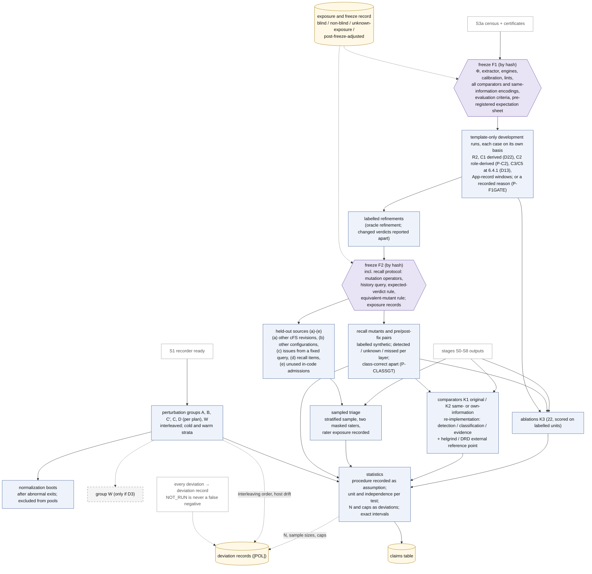

# 07 평가 계획: 무엇을 묻고, 무엇과 비교하며, 놓친 것을 어떻게 재는가

이 문서는 Kairos 설계의 평가 계획(spec §8)을 spec을 읽지 않은 연구자가 15–25분 안에 파악하도록 정리한다. 연구 질문, 평가 대상(사례별 대상과 대조, 관측 단위 U1–U6 포함), 비교의 세 종류와 세 결과(탐지·분류·근거), ablation, 지표(특히 Kairos가 놓친 것을 재는 recall protocol), 오버헤드·perturbation 실험, 통계·재현성, 타당성 위협을 차례로 다룬다.
평가 조건 가운데 사람이 고르는 값(실행 횟수 N, 탐색 cap, 표본 크기)과 reference가 정하지 않은 조건을 CONDITIONS_POLICY에 따라 어떻게 기록하는지도 함께 적는다. spec에 없는 설계 요소·수치·인용은 더하지 않는다.

상태: 설계 문서 — 구현·측정 전. 규범 원문: [spec/SPEC_FINAL.md](spec/SPEC_FINAL.md)(revision 1.1: 외부 검토 EXT-20261012 반영, spec §0.7)

## 목차

0. [읽기 전에](#0-읽기-전에): 표기, 이 문서의 자리, 평가의 세 원칙, 필요한 용어
1. [한 장으로 보기: 평가 경로 (그림 D4 상세)](#1-한-장으로-보기-평가-경로-그림-d4-상세)
2. [연구 질문](#2-연구-질문-spec-81) (spec §8.1)
3. [평가 대상](#3-평가-대상-spec-82-75) (spec §8.2, §7.5, §7.3): 개발 집합, census, recall, held-out, 맹검과 노출·동결 기록, 사례별 대상과 대조, ENV 후보와 다섯 사례, 관측 단위 U1–U6
4. [기준선과 비교 방법](#4-기준선과-비교-방법-spec-83) (spec §8.3): 비교의 세 종류, 세 결과(탐지·분류·근거), GPredict 서술과 표현 가능성
5. [Ablation](#5-ablation-spec-84) (spec §8.4)
6. [지표](#6-지표-spec-85) (spec §8.5): recall protocol, soundness failure, triage, 비교 기록
7. [오버헤드와 perturbation 실험](#7-오버헤드와-perturbation-실험-spec-86) (spec §8.6)
8. [통계와 재현성](#8-통계와-재현성-spec-87) (spec §8.7): 분석 단위와 의존
9. [N, cap, 표본 크기를 기록하는 법](#9-n-cap-표본-크기를-기록하는-법-conditions_policy) (CONDITIONS_POLICY): reference가 정하지 않은 조건 포함
10. [타당성 위협](#10-타당성-위협-spec-88) (spec §8.8)
11. [평가를 여는 단계와 PI 결정](#11-평가를-여는-단계와-pi-결정-spec-93-101) (spec §9.3, §10.1): 검증 사다리의 V4a, V4b
12. [이 문서가 주장하지 않는 것](#12-이-문서가-주장하지-않는-것)
13. [관련 문서](#13-관련-문서)

---

## 0. 읽기 전에

### 0.1 표기

표기는 spec 머리말을 따른다(자세한 설명은 [01_overview.md §0](01_overview.md#0-읽는-법)).

| 표기 | 뜻 |
|---|---|
| [F] | 코드·기록·보고서 인용이 있는 사실 |
| [M] | 측정값. **이 문서의 [M]은 모두 spec이 인용한 기존 측정**이다: [BM] (`env/BASELINE_MEASURE.md`), [R2g]·[R2c] (R2의 gdb 기록과 퇴역한 CORD recorder 기록), [R07] (환경 타당성 보고서), 검토 X3가 이 머신에서 확인한 값([X3, here]), spec이 읽기 전용 `git log`로 확인한 값. Kairos는 아직 아무것도 측정하지 않았다 |
| [I] | 추론 또는 설계상 추론. 실행하지 않았다 |
| [D] | 설계 결정. spec §11의 ADR이 기록한다 |
| [U] | 미확인 |

문헌의 상태 표시는 spec과 [R04]·[R05]가 확인한 그대로 옮긴다. V-abs는 서지와 초록 수준의 주장을 확인한 것, V-me는 해당 보고서 작성자가 검색으로 서지·초록 수준을 확인한 것, P는 일부만 확인한 것이다([R04 §0.2]; [R05 §0.2]; V-me는 [R06 §9]).

인용 형식은 01, 03, 06과 같다. "(spec §8.5)"는 SPEC_FINAL.md의 절, "[R05 §6.3]"은 `background/`의 보고서, [LED]는 `cases/ledger.md`, [POL] Ln은 [CONDITIONS_POLICY.md](../CONDITIONS_POLICY.md)의 n번째 줄이다. PI 결정 D8, D14, P-TRIAGE 같은 이름은 [spec/PI_DECISIONS.md](spec/PI_DECISIONS.md)의 PI 결정이고, revision 1.1에서 새로 생긴 항목(P-CLASSGT, P-F1GATE 등)은 spec §10.1에 있다. X3-C1, X3-M6 같은 이름은 검토 쟁점이고 처리 내용은 [spec/ISSUE_RESOLUTION.md](spec/ISSUE_RESOLUTION.md)에 있다. EXT-20261012 §5.1 같은 이름은 외부 검토(`history/review_EXT_20261012.md`)의 절이고, 그 처리는 spec §0.7과 ADR-039–ADR-044에 있다. [A]·[B]는 `history/`의 설계 제안, [J1]–[J3]은 심사, [X1]–[X3]은 적대적 검토다. 실험군 이름 A, B와 혼동하지 않도록, 제안은 언제나 대괄호로 쓴다.

**인용 형식과 이름이 겹치는 기호.** 인용 형식(설계안 [A]/[B]/[C], 심사 [J1]–[J3], 검토 [X1]–[X3], [X3, here], v0.1 등)은 [01_overview.md §0](01_overview.md#0-읽는-법)에 모아 두었다. 같은 기호가 여러 뜻으로 쓰이므로 이 문서는 앞에 종류를 붙인다: "PI 결정 D4"와 "그림 D4", "보장 G5"와 "gap G5", "단계 S0"와 "Init snapshot S0", HB stratum S/O와 cold/warm 층(stratum). 관측 단위 U1–U6와 분석 예산의 work unit도 다른 것이다. 전체 목록은 [10_decisions_adr.md §0.2](10_decisions_adr.md#02-이름-충돌-주의)다.

### 0.2 이 문서의 자리

평가는 연구 단계 S9에서 한다(spec §9.3). S9는 freeze F1, freeze F2, 그리고 §8 전체(recall protocol, 비교, triage)를 실행하는 단계다. 검증 사다리(validation ladder; spec §9.3, ADR-044)로 보면 평가는 V4a(F1 뒤의 비교)와 V4b(F2 뒤의 held-out과 수정 전후 쌍)다(§11.1). 다만 다섯 사례의 paper track(고정한 revision을 읽고 기대표를 동결하는 일)은 단계와 결정 없이 지금 할 수 있다(spec §9.3). [03_workflow.md §4](03_workflow.md#4-연구-워크플로우-그림-d4)가 이 경로를 짧게 요약했고, 이 문서는 같은 내용을 spec §8을 따라 넓히면서 이유와 cFS 예를 붙인다. 평가의 어떤 부분도 아직 실행되지 않았다.

### 0.3 평가의 세 원칙

spec은 평가 전체에 걸쳐 세 원칙을 둔다. 셋 다 설계 결정 [D]이다.

1. **평가는 놓친 것을 잰다**(spec §0.2 항목 8). 개발 사례에서 찾은 것만으로는 무엇을 놓치는지 알 수 없다([X3-C1]). 그래서 과거 수정 이력에서 만든 program mutant와 수정 전후 쌍으로 Kairos가 무엇을 찾고, 무엇을 `unknown`으로 남기고, 무엇을 놓치는지 층별로 잰다(§6.1). class label이 있는 곳에서는 class가 맞았는지(class-correct)를 따로 센다. certificate가 틀린 경우는 soundness failure로 따로 센다(§6.2).
2. **동결 순서가 평가의 순서를 정한다**(spec §7.2). F1(첫 평가 실행 전. 도구와 비교 도구에 더해 평가 기준과 미리 등록한 기대표도 hash로 동결한다) → 사례 전용 항목 없는 template-only 실행 → 표시된 refinement → F2(held-out을 열기 전. 노출·동결 기록도 이때 동결한다)의 순서를 지킨다. 결과를 본 뒤 도구나 규칙을 고치지 못하게 하는 장치다. F1 뒤에 바꾼 것은 모두 시각, 이유, 계기가 된 항목, 바뀐 판정과 함께 기록한다. 항목마다 지배 동결(개발 항목은 F1, held-out과 recall 항목은 F2)이 있고, 그 뒤의 변경이 건드린 항목은 `post-freeze-adjusted`로 따로 보고한다. 예외는 F1과 F2 사이에 개발 항목을 건드린 Φ·규칙·예외 보강 하나다. 이것은 계획된 `oracle refinement`다(§3.5). 평가 기준, 인코딩, 기대표를 F1 뒤에 바꾼 것은 결코 `oracle refinement`가 아니다.
3. **사람이 고른 값은 deviation, 통계 절차는 가정이다**(spec 머리말, §8.7). 실행 횟수 N, 탐색 cap, 표본 크기는 reference가 정하지 않으므로 이유·영향·필요성과 함께 deviation으로 기록한다. 방법론 문헌은 [POL]이 인정하는 reference 종류가 아니므로, 통계 절차는 가정(assumption)으로 미리 기록한다(§9). 모든 검정과 구간은 그 단위와 독립 가정을 밝힌다(§8.4).

그리고 판정 체계 전체의 원칙이 평가에도 그대로 적용된다. **경보 없음은 안전이 아니다**(spec §0.1, §6.4 항목 2). 비교 도구가 조용한 것, `NOT_RUN`인 것, Kairos가 `unknown`을 낸 것은 모두 "문제가 없다"는 뜻이 아니다. 또 **한 사례의 결과로 다른 사례를 대신하지 않는다**(spec §8.2, §6.4 항목 43). 설계 사례는 저마다 자기 현상, 자기 basis, 자기 대조로 평가한다(§3.6).

### 0.4 필요한 용어

이 문서를 읽는 데 필요한 만큼만 적는다. 전체 용어집은 [10_decisions_adr.md §3](10_decisions_adr.md#3-용어집)이다(원문 spec §13).

| 용어 | 쉬운 설명 | spec |
|---|---|---|
| 계약 instance | 프레임워크 자원을 쓰는 사용 지점 하나와, 그때 그 자원이 있어야 할 lifecycle 상태의 쌍. Kairos는 instance마다 판정 기록을 만든다. 예: R2에서 ES가 SB API를 부를 때 SB의 AppId가 발행되어 있어야 한다 | §0.1, §1.6 |
| (σ, M) 칸, class | 판정은 스케줄 의미론 σ(σ_U 시간 무시, σ_U∞ σ_U에서 시간 기반 전이를 뺀 것, σ_R1 한 CPU 고정 우선순위, σ_E 실제 환경)와 OSAL 모형 수준 M(M_api API 계약 수준, M_impl POSIX 구현 수준)의 조합마다, 경계 b마다 따로 낸다. class는 안전성 기록에서 나오며 `inactive`, `protected`(↳`tolerated`), `fixed-order`, `no-final-status`, `schedule-dependent`(↳`timeout-dependent`), `ordinal-split`, `unknown(reason)` 중 하나다. "safe"는 없다 | §0.1, §1.8, §1.10 |
| 진행(progress) 결과, stall witness | 영구 대기와 deadlock은 class가 아니라 칸마다 따로 적는 진행 결과다: `stall-witness`, `no-stall-within(b)`(`exh`만), `unknown(reason)`(기본 `not_checked`). "live"를 뜻하는 값은 없다. 평가에서 stall witness는 `realized`이거나, 확인할 수 있는 종류(`deadlock-cycle`, `leaked-lock`)이면서 `idle`·`terminal-pending`이 아니고 `choice-dependent`도 아닌 모형 witness일 때만 센다. 센 것은 wait-for root 집합마다 한 번 센다 | §1.8, §1.10, §8.5 |
| happens-before (HB), vector clock | HB는 한 실행 안에서 동기화(lock, message, thread 생성 등)로 정해지는 "먼저 일어남"의 부분 순서다. vector clock은 thread마다 카운터 벡터를 들고 다니며 HB를 계산하는 자료 구조다 | §1.9, §1.11 |
| 예측 분석, lock 뒤집기 | 예측 분석(predictive analysis)은 관측한 trace 하나에서, 동기화 제약을 지키면서 사건 순서를 바꾼 다른 실행이 가능한지 추론하는 기법이다. lock 뒤집기는 같은 lock을 잡는 두 구간의 순서를 바꾼 실행을 예측하는 것이다 | §4.9, §1.11 |
| typestate | 자원마다 상태 automaton을 두고, 연산이 허용된 상태에서만 일어나는지 검사하는 방식이다 | §1.11 |
| linearization point (LP) | 연산의 효과가 "이 명령에서 한순간에 일어났다"고 보는 지점이다. Kairos는 요구 조건의 conjunct(∧로 묶인 조건 하나)마다 LP를 둔다. capture point는 호출자가 넘길 값을 미리 읽어 둔 load 지점이다 | §1.4 |
| certificate, `kz proofcheck` | certificate는 안전성 진술 하나(`fixed-order`의 `¬OK_i`, `protected`의 `¬NR_i`)의 증명 기록이다. `kz proofcheck`는 분석기와 코드를 공유하지 않는 검사기로(공유 `libkz-core`는 예외), 명시한 trusted base에 상대적으로 certificate의 추론 단계를 다시 검증하고 trust ledger에 남긴다. certificate는 진행에 대해서는 아무것도 주장하지 않는다 | §4.5, §4.5.1, §6.4 항목 26 |
| uprobe, eBPF | uprobe는 실행 파일을 고치지 않고 사용자 프로그램의 명령 주소에 kernel이 거는 probe다. eBPF는 그 probe가 걸릴 때 kernel 안에서 실행되는, 검증을 거친 작은 프로그램이다 | §5.1, §5.3 |
| DPOR | dynamic partial-order reduction. 의존하는(dependent) transition이 뒤바뀔 수 있는 곳에만 backtracking 지점(다른 순서를 시도하려고 되돌아갈 지점)을 두어, 독립 연산의 순서만 다른 interleaving의 탐색을 줄이는 체계적 탐색 기법이다([R05 §2.2]; DPOR POPL 2005 [V-abs; 보장 문구 UNVERIFIED]). Kairos explorer의 `dpor` engine이 쓴다. Kairos의 source-DPOR은 class(독립 연산의 순서만 다른 실행들의 동치류)당 실행 하나를 주장하지 않는다(spec §6.4 항목 9). | §4.10, §6.4 항목 9 |
| program mutant | 원래 프로그램의 코드를 일부러 조금 바꾼 변형이다. 여기서는 정해진 연산자나 과거 수정의 역(되돌리기)으로 만든다 | §8.5 |
| recall | 실제로 있는 문제 가운데 도구가 찾은 비율이다. Kairos는 이것을 mutant와 수정 전후 쌍에서만 잰다 | §8.5 |
| held-out | 설계하는 동안 열어 보지 않고 평가용으로 남겨 둔 대상이다. 맹검인지는 노출·동결 기록으로만 정한다 | §7.5 |
| freeze F1, F2 | 그 시점의 Φ(cFS 지식을 담은 profile), 도구, 비교 도구, 규칙을 hash로 고정해 이후 바꾸지 못하게 하는 것이다. F1은 평가 기준(채점 규칙과 비교 기록의 칸, class label 규칙, 단위 규칙, 통계 가정)과 미리 등록한 기대표도 고정한다. F1 뒤의 변경은 모두 기록한다 | §7.2 |
| template-only 실행 | 사례 전용 항목 없이 동결한 generic profile만으로 돌린 평가 실행이다 | §7.2, §13 |
| 표시된 단위(labelled unit) | 정답 label이 있는 평가 단위. 개발 사례, recall mutant와 쌍, triage 표본이 여기에 든다. label은 기대 instance, 방향, 그리고 준비성과 진행성 중 무엇에 관한 기대인지를 담는다 | §8.2, §8.3, §8.5 |
| 비교의 세 종류 K1–K3 | K1 공개된 그대로 돌린 원 도구, K2 같은 정보나 자기 정보로 재구현한 선행 기법, K3 Kairos의 한 요소를 뺀 ablation. 이름, 표, 결론에서 섞지 않는다 | §8.3, §8.4 |
| 탐지·분류·근거 | 표시된 단위마다 도구별로 따로 적는 세 결과. 탐지는 기대 instance의 미준비 발생을 보고했는가(경보와 `not-ready-unjudged` 보고를 똑같이 센다), 분류는 class·refinement·outcome label·진행 결과, 근거는 경로·실현·경계·범위·reach·trust ledger다 | §8.3, §8.5 |
| 미리 등록한 기대표 | 개발 사례·basis·(σ, M, b) 칸·instance마다 기대 class, refinement, 진행 값, outcome label, 그리고 reference가 class를 말한 경우 그 진술과 출처를 적은 표(pre-registered expectation sheet). F1에서 hash로 동결한다 | §7.2 |
| reference의 class 진술, P-CLASSGT | issue나 수정 문서가 사례를 "race (condition)"라고 부르는 것. 이것을 σ·M별 class로 옮기는 대응은 어느 reference에도 없어 PI 결정 P-CLASSGT로 남는다. 그때까지 class label은 없다 | §8.2, §8.5, §10.1 |
| 노출·동결 기록, 맹검 | 누가 언제 어느 사례·수정·기대 판정을 보았는지를, 동결과 동결 뒤 변경과 함께 적는 덧붙이기만 하는(append-only) 기록 / 그 기록이 항목의 지배 동결 전에 노출이 없었음을 보일 때만 붙이는 label `blind` | §7.2, §7.5 항목 5 |
| 단위 U1–U6 | 결함 원인, 수정 이력, 프로그램 변형, 정적 instance, 동적 발생, 실행. 모든 수는 이 가운데 하나를 밝힌다(§3.8) | §8.2 |
| `NOT_RUN` | 실행하지 않은 비교 도구나 항목의 상태. false negative(놓침)로 세지 않는다 | §8.3, §8.5 |
| perturbation(교란) | 관측이나 제어가 실행 timing을 바꾸는 것 | §8.6, §4.13 |
| pool key, cold/warm 층(stratum) | 여러 실행의 빈도를 합칠 때 같아야 하는 열쇠(B hash, plan hash, cold/warm 층). cold/warm 층(spec의 stratum)은 VM 재부팅 뒤 첫 실행(cold)과 나머지(warm)의 구분이다. HB edge의 stratum S/O/C_σ와 다른 뜻이다 | §4.12, §8.6 |
| work unit | 탐색 상태 수, transition 수 같은 결정적 횟수. 모든 분석 예산을 이것으로 잰다. 벽시계 시간은 비용으로만 보고한다. 관측 단위 U1–U6와 다르다 | §4.14, §13 |
| 검증 사다리 V0–V4 | 끝에서 끝까지 확인하는 일의 순서. 첫 목표는 R2의 K-ID 사슬(V1)이다. 평가는 V4a(F1 뒤 비교)와 V4b(F2 뒤 held-out과 수정 전후 쌍)다 | §9.3, §13 |

---

## 1. 한 장으로 보기: 평가 경로 (그림 D4 상세)

아래 그림은 평가가 어떤 순서로 진행되고, 각 결과가 어디로 모이는지 보인다. 점선 테두리는 PI 결정이 있어야 쓰는 것(실험군 W는 PI 결정 D3 승인 시만)이고, 점선 화살표는 기록(deviation 기록, 노출·동결 기록)으로 가는 경로이거나 PI 결정이 여는 경로다.

**그림 D4 상세. 평가 경로** (렌더링: [diagrams/D4_research_evaluation.svg](diagrams/D4_research_evaluation.svg); spec §12 D4; §7.2, §7.5, §8.2–8.7)

그림은 세 줄기로 읽는다.

- **첫째, 동결 사슬**(S3a → F1 → template-only → refinement → F2)은 개발 사례를 다루는 순서다. F1에서 도구, 비교 도구와 그 같은 정보 인코딩, 평가 기준, 미리 등록한 기대표를 동결하고, 첫 실행은 사례 전용 항목 없이 사례마다 자기 basis에서 한다. basis가 없는 사례는 그 이유를 기록한다(§3.5, §3.6). 그 뒤 보강은 `oracle refinement`로 따로 표시한다.
- **둘째, F2에서 갈라지는 두 줄기**(held-out (a)–(e), recall)는 F2 뒤에만 연다(§3.4, §6.1). 맹검인지는 항목마다 노출·동결 기록으로 정한다(§3.5). 설계 중에 이름이 나온 수정과, C1을 본뜬 연산자의 C1 위치 mutant는 맹검이 아니다.
- **셋째, S1에서 시작하는 줄기**(perturbation 실험군, normalization boot)는 관측 자체의 비용과 교란을 잰다(§7).

모든 줄기는 통계(§8)를 거쳐 claims table에 모인다. 그 과정에서 사람이 고른 값(N, 표본 크기, cap)과 실험군 교차 순서는 deviation 기록이나 가정으로 남고, 검정마다 단위와 독립 가정이 붙는다(§8.4, §9).

---

## 2. 연구 질문 (spec §8.1)

spec은 아홉 개의 연구 질문(RQ)을 둔다. 크게 세 묶음이다. Kairos가 무엇을 찾는가(RQ1, RQ2, RQ3, RQ5), 그 답을 믿을 수 있는가(RQ4, RQ9), 각 부분이 무엇을 더하고 얼마나 드는가(RQ6, RQ7, RQ8).

| RQ | 묻는 것 | 답의 형태 | 이 문서 |
|---|---|---|---|
| RQ1 개방성 | cFE core와 15개 앱에 기본 B와 변형 B′ 아래 계약 instance가 몇 개 있는가(kind별, RC별). certificate, 관측, 예측, 탐색, 확인이 각각 얼마를 결정하는가((σ, M)별). 얼마가 왜 `unknown`으로 남는가. key가 concrete/symbolic/⊤로 풀린 비율(특히 송신 위치)은 얼마인가 | 분모가 있는 비율과 이유별 unknown | §6.4, §6.5 |
| RQ2 개발 사례 | template-only profile로 어떤 판정 기록이 나오고, refinement로 무엇이 바뀌는가. 사례마다 그 사례의 현상으로, 탐지·분류(σ, M, b별 class와 refinement, 진행 결과)·근거를 나누어 보고한다. 한 사례의 결과로 다른 사례를 대신하지 않는다 | 사례별 판정 기록과 그 대조(§3.6). refinement가 바꾼 판정은 따로. F1 때 basis가 정해지지 않은 사례는 "도구 수준에서 평가하지 않음"과 기록한 이유(P-F1GATE). v7.0.1 대응물로 대신하지 않는다 | §3.1, §3.6 |
| RQ3 held-out 일반화 | 동결한 도구(F2)가 출처 (a)–(e)에서 무엇을 찾는가. 표본 triage 정밀도(instance 단위, 그리고 보고 instance 사이의 서로 다른 원인 수), 실현 비율, unknown 비율은 얼마인가 | 출처별, 맹검 label별로 따로 센 결과와 exact 신뢰구간 | §3.4, §3.5, §6.3 |
| RQ4 모형 충실도 | 모든 trace의 O2 conformance와 표본의 O8, 반복별 obligation 실패, checker 통과율과 certificate-mutation kill rate, T-OBS 비활성화·A-TYPE 목록·`DECLARED_TRUSTED` 수, O9 반박, anchor audit 범위, 규칙별 closure 해석, havoc·local-choice 수, summary fallback 수 | 수와 비율 | §6.2, §6.4 |
| RQ5 측정된 현상 | 기본 bundle에서 측정된 순서 의존 손실을 두 용량 수준(queue 깊이와 MsgLim)에서 분류하는가. 어떤 pipe가 넘칠 수 있는지 예측하는가 | 호출자 수준 LOSS-UNDER-ORDER label(프레임워크 수준 판단과 관측 손실 수는 옆에), oracle 일치 | 아래 |
| RQ6 층과 반복의 가치 | 각 층과 feedback loop가 표시된 단위에서 무엇을 더하는가 | ablation별 단위 탐지 차이와, 분류·근거 변화의 서술 | §5 |
| RQ7 비용과 교란 | 여섯 비용, 계측 없이 보이는 지표의 변화, witness별 perturbation 비율 | 분포 | §7 |
| RQ8 비교 | 같은 표시된 단위에서 원 도구(돌릴 수 있을 때), 같은 정보나 자기 정보로 재구현한 선행 기법, 참조점이 무엇을 보고하는가. 탐지·분류·근거로 나누어 따로 비교한다. ablation은 RQ6에 답하고 RQ8에는 답하지 않는다 | 탐지는 짝지은 비교, 분류는 기대표와의 일치, 근거는 서술 | §4 |
| RQ9 recall | 사전 등록한 program mutant와 수정 전후 쌍에서 각 층이 무엇을 검출하고, 무엇을 `unknown`(이유별)으로 남기고, 무엇을 놓치는가. 검출한 것 가운데 class label이 있는 곳(P-CLASSGT)에서 class가 맞는 비율은 얼마인가. certificate가 몇 개 반박되는가 | 층별 detected / unknown / missed와 따로 센 class-correct, soundness failure 수. mutant별, 원래 수정·원인별, 맹검 label별 | §6.1, §6.2 |

**RQ5의 구체 내용.** 측정된 현상은 다음과 같다 [M] ([BM §0, §3.3]; spec §8.1).

- queue-full drop: 부팅마다 4–49건.
- `NoSubscribersCounter`: 15–26. 구독자가 생기기 전에 보낸 메시지가 성공을 반환하며 사라지는 경로다(01의 "SB 구독 전 송신" 예).
- 넘친 pipe: `SBNSubPipe`, `TO_LAB_TLM_PIPE`, `DS_CMD_PIPE`.

oracle은 put 결과와 SB counter 넷이다. `PeakQueueDepth`는 SB가 센 깊이로만 쓴다. 판정 label은 호출자 수준의 LOSS-UNDER-ORDER이고 harm은 정하지 않는다(unspecified). 프레임워크 수준 판단(`fw_doc`, `fw_conf`)과 관측 손실 수는 옆에 따로 보고한다(spec §1.6 "Three judgements"). 전달을 요구하는 소비자·임무 근거(`appreq`)가 없으므로, 이 손실을 "버그"로 부르지 않는다(spec §1.6, §10.2 "Route/capacity verdicts read as bugs"). `msg_max`를 바꾼 변형은 RQ5의 민감도 분석에만 쓴다(PI 결정 D19). 퇴역한 recorder의 기록은 이전 관측으로만 인용한다(PI 결정 D12).

**RQ9가 필요한 이유.** 개발 사례 중 대상 revision(v7.0.1)에서 자연스럽게 재현된 것은 R2 하나다. R2에는 class를 밝힌 reference가 없고, 그 fixed-order 읽기는 코드 읽기와 실험군마다 셋 중 셋인 관측에 기댄다. 반복 관측은 그것을 증명하지 않는다(spec §8.2, §6.4 항목 4). schedule-dependent class에는 대상 바이너리 위의 자연 정답이 없다(spec §8.2; [X3-C1]). 그래서 RQ1–RQ3만으로는 Kairos가 무엇을 놓치는지 알 수 없고, RQ9의 recall protocol이 그 빈자리를 채운다.

---

## 3. 평가 대상 (spec §8.2, §7.5)

평가 대상은 네 종류다. 서로 섞지 않고 따로 보고한다. 모든 수는 관측 단위 하나를 밝힌다(§3.8).

| 대상 | 무엇 | 역할 |
|---|---|---|
| 개발 집합 | 다섯 설계 사례와 두 App-record 구간, 그리고 사례마다의 대조(§3.6) | RQ2. 저자들이 이미 알고 있으므로 맹검이 아니다 |
| census 대상 | 기본 B 아래 v7.0.1 bundle, 그리고 §7.4의 변형 B′ | RQ1. 변형마다 따로 보고 |
| recall 대상 | v7.0.1의 program mutant와 수정 전후 쌍 | RQ9. synthetic으로 표시 |
| held-out | §7.5 출처 (a)–(e) | RQ3. 출처마다 따로 셈 |

### 3.1 개발 집합

다섯 사례는 개발용이다. label은 [R06 S10]의 구분(original, public-code-derived, role-derived, synthetic control)을 따른다([LED]; spec §8.2).

| 사례 | 무엇 | 대상 revision | label과 상태 |
|---|---|---|---|
| R2 (cFE #2663) | SB의 AppId가 발행되기 전에 ES·EVS init의 SB 코드가 그것을 쓴다 | v7.0.1 현재 코드 | 자연 사례. gdb와 퇴역한 recorder로 세 실험군에서 관측했고, 실험군은 합치지 않는다([R2c §8]). 원인 하나, SB의 AppId를 넘기는 SB 위치 39곳 가운데 위반 정적 위치 3곳, task × 함수 문맥 6개, call string 12개, 부팅마다 발생 24건(ES 20, EVS 4; ENV의 version table이 있는 basis; `NULL` table이면 11) [M] ([R2g §6]) |
| C1 (CF #184) | CF가 다른 앱이 만들 OSAL semaphore를 이름으로 찾는다 | v7.0.1, 파생 구성 | public-code-derived. 기본 B에서는 실행되지 않는다(latent). 파생 basis는 PI 결정 D22 |
| C2 (cFE #198) | RUNNING을 알린 앱의 late init이 끝나기 전에 다른 앱이 진행한다 | 구성한 앱 쌍 | role-derived, synthetic control. PI 결정 P-C2 |
| C3 (cFE #73) | 6.4.1에서 TIME이 먼저 실행되어 core 시작 중 crash. 연결된 instance 둘이고, 잘못된 귀속은 K-ID의 적합성 빈틈으로 기록한다 | 6.4.1 tarball, 공유 파생 6.4.x platform | PI 결정 D13 승인 시에만([LED] X3). 그 basis를 F1 전에 둘지, C3와 C5를 설계상 동결 뒤 항목으로 기록할지는 D13 (c) |
| C5 (cFE #72) | 6.4.x의 AppCreate가 lock을 푼 채 task를 만들고 나중에 등록한다. instance 셋 | 6.4.1 tarball | PI 결정 D13 승인 시에만 |
| 두 App-record 구간 | core task와 startup script 앱이, 자기 App record가 발행되기 전에 자기 문맥을 조회할 수 있는 구간(계약 K-SELF.es). C5 모양의 잔여 후보 | v7.0.1 | 확인은 파생(derived). 코드 읽기에서 나온 후보 [I] (spec App. A.2, A.3) |

**reference의 class 진술** (spec §8.2). R2에는 class를 밝힌 reference가 없다. 그 fixed-order 읽기는 코드 읽기(`cases/R2.md` L45)와 실험군마다 셋 중 셋인 관측에 기대고, 관측은 그것을 증명하지 않는다(spec §6.4 항목 4). C1, C2, C3, C5에는 race라고 말하는 reference가 있다. CF #184의 제목과 본문, CF의 v7.0.1 주석 `cf_cfdp.c:1273`, 수정 commit `833fdbb`(C1); cFE #198의 본문(C2); cFE #73과 #72의 제목, 그리고 6.4.2 VDD의 "startup race conditions … in cFE build 6.4.1"(C3, C5)이다([LED]; 사례 기록). 이 진술을 σ·M별 class로 옮기는 규칙은 어느 reference에도 없다. 그것은 PI 결정 P-CLASSGT다. 그때까지 개발 집합의 분류는 F1에 동결한 미리 등록한 기대표와 비교한다. 사례마다 reference 진술과의 일치·불일치는 결과로 보고하고, 정확도로 채점하지 않는다(§4.2). C3는 둘이 어긋날 수 있는 사례다. reference는 race라고 하지만, 가설 H-V는 σ_R1에서 `fixed-order`를 기대한다(spec §7.6).

이 집합에는 한계가 셋 있다.

- **R2만 대상 revision에서 자연스럽게 재현된 사례다.** schedule-dependent class의 자연 정답은 대상 바이너리에 없다. 이것이 RQ9를 둔 이유다(§2).
- **사례는 서로 독립이 아니다.** C3와 R2는 자원 family(SB AppId를 발행 전에 읽는 경로)를 공유한다([LED §3.1]). C3와 C5의 수정은 같은 6.4.1 → 6.4.2 release diff(Trac #40–#42)에 있어, 두 사례의 수정 전후 쌍은 수정 이력 하나를 공유한다([LED §3.3]). C5와 두 App-record 구간은 K-SELF.es 모양을 공유한다. C1, C5, R2는 reserve-then-finalize 모양을 공유하지만 층이 다르다(C1은 OSAL object table, M_impl; C5와 R2는 ES app record; [LED §3.6], 모두 가설). "retry 경계 비우기" 연산자는 C1을 본떴다(§6.1). 어느 것도 독립으로 세지 않는다.
- **R2의 "24"는 아직 Kairos의 결과가 아니다.** Kairos 자신의 recorder가 사용 집합(task, SB 함수, EID)을 재관측하기 전에는 어떤 R2 수도 Kairos 결과로 쓰지 않는다. version table이 없는 basis에서는 11건이다(spec §6.4 항목 21; §9.3 S1 출구 조건).

### 3.2 census 대상과 변형

census 대상은 기본 B 아래의 v7.0.1 bundle이고, §7.4의 변형을 더한다. 변형 B′의 예는 잠재 경로를 켜는 table(CF `sem_name`에 제공자를 둔 구성, LC, MD, HS, CS), 다른 schedule table, startup script 순서, `MISSION_CORE_MODULES` 순서, cpu2 target, `msg_max`와 euid, reset 종류, restart·reload·delete 입력이다(spec §7.4). C1의 B′은 PI 결정 D22로 정한다.

변형마다 별도의 basis이고 별도의 manifest를 가지며, 기본 B와 합치지 않는다. **변형에서만 나온 것은 기본 구성의 "새 버그"가 아니다**(PI 결정 D18). 어떤 변형을 먼저 돌릴지는 PI 결정 D18이 정한다(권고: 잠재 경로 table과 `B_restart` 먼저). C1의 부분은 D22로 옮겼다.

`MISSION_CORE_MODULES` 순서를 바꾸는 것은 구성 변경 실험이지 schedule 증거가 아니다. `sb`를 `es`와 `evs` 앞에 둔 순서를 주는 reference는 없다. 공개된 선례는 `b9bec567` 전의 **task** 순서(EVS, SB, ES, TIME, TBL)뿐이고, 이것은 R2의 ES 절반만 바로잡는다. v7.0.1에서는 목록 하나가 EarlyInit 단계와 TaskMain 단계를 함께 정하므로, 옮겨 심으면 EarlyInit 순서도 정해진다. `config`, `fs`, `osal`, `psp`, `msg`, `sbr`, `resourceid`의 위치는 `unspecified_by_reference`이고, D18 아래 PI가 기록한 deviation으로 정한다(spec §7.4; P-R2CTRL).

### 3.3 recall 대상

recall 대상은 v7.0.1의 program mutant와 수정 전후 쌍이다. 모두 synthetic으로 표시하고 "새 버그"라 부르지 않는다(spec §8.2, §8.5 항목 9). 만드는 법과 채점은 §6.1에 있다. 설계 사례 자신의 수정 전후 쌍은 recall 대상이 아니라 개발 집합의 대조다(§3.6).

### 3.4 held-out 출처

held-out은 F2를 동결한 뒤에만 연다(spec §7.5).

| | 출처 | 비고 |
|---|---|---|
| (a) | 다른 cFS revision | version 이전. profile을 AST pattern으로 다시 묶는다. C3와 C5를 분석하는 6.4.x revision은 개발 basis이지 held-out이 아니다 |
| (b) | 다른 구성 | cpu2, 설계 사례에서 나오지 않은 table 변형. §3.2의 C1 파생 `sem_name` 변형은 개발 basis이지 held-out이 아니다 |
| (c) | F2 전에 고정한 query(keyword와 날짜 cut)로 찾은 issue | C1, C2, C3, C5, R2는 뺀다. spec이나 사례 기록에 이미 이름이 나온 issue·수정은 맹검이 아님으로 표시하고, 그것까지 뺄지는 D8이다 |
| (d) | recall protocol의 program mutant와 수정 전후 쌍 | synthetic 표시. 설계 사례를 본뜬 연산자의 그 사례 위치 mutant와, 설계 중에 이름이 나온 수정에서 나온 항목은 맹검이 아니다 |
| (e) | 설계에 쓰지 않은 코드 안의 시인(admission) 주석 | 예: 순서 가정이나 알려진 race를 적은 주석(spec §7.1 source 8). Φ provenance 기록이 인용한 시인은 설계에 쓴 것이다 |

출처마다 따로 세고, 어느 것도 "새 실제 버그"에 더하지 않는다. 항목마다 §3.5의 label이 붙는다. 개발 사례에서는 template-only 결과와 refined 결과를 나란히 보고한다(spec §7.5 항목 3).

누가 issue query와 history query를 언제(F2에 대해) 돌리는지는 PI 결정 D8/P-RECALL이다. 두 query가 무엇을 뺄지도 D8이다. 대상은 조회하는 이력 안에 있는 설계 사례의 수정(CF #184의 `833fdbb`는 CF 이력 위의 keyword query가 고른다. cFE #198의 barrier commit. #72와 #73의 6.4.2 수정은 git import보다 앞선다, [LED] C5 행)과, spec이나 사례 기록에 이미 이름이 나온 항목이다. 정하기 전까지 그런 항목은 남기고 맹검이 아님으로 표시한다(spec §7.5 항목 4). 권고는 다섯 출처를 모두 쓰고, Φ를 쓰지 않는 사람이 F2 전에 query를 고정하며, 노출 기록이 생기기 전에는 맹검을 주장하지 않는 것이다. 무엇을 뺄지는 PI가 고른다(spec §10.1).

### 3.5 맹검에 대한 정직

계약은 사람이 쓰므로 "답을 알고 규칙을 맞춘 것 아닌가"라는 순환 문제가 따른다. spec은 평가 쪽에서 다음과 같이 대응한다(spec §7.2, §7.5 항목 5; ADR-042).

- **template-only 먼저.** 첫 평가 실행은 사례 전용 항목 없이 한다. 이후 보강은 `oracle refinement`로 표시하고, 그것이 바꾼 판정은 따로 보고한다. F1과 F2 사이에 개발 항목을 건드린 Φ·규칙·예외 보강이 이것이다. 이 보강은 held-out과 recall 항목에 표시를 남기지 않는다. F2가 그 변경과 함께 그 항목들을 동결하기 때문이다. 평가 기준, 비교 인코딩, 기대표를 F1 뒤에 바꾼 것은 refinement가 아니라 동결 뒤 변경이다(§0.3).
- **refinement accounting.** 판정마다 증명에 쓴 Φ 항목을 generic 계약, generic 장치, **사례를 알고 쓴 framework 규칙**으로 나눈다. R2의 certificate는 "generic 계약 K-ID + framework 규칙 R19(CORE-SERIAL, core 시작 직렬화)"로 보고한다. R19의 predicate는 코드에서 추출하고, 검사기는 추출기가 직렬화한 exit tree(추출 사실, trust ledger 부분 (ii))에서 그것을 다시 유도한다.
- **정답의 출처와 맹검은 다르다.** 수정 문서와 issue 문서는 정답(ground truth)의 외부 출처다. 항목의 instance, 기대 방향, 그 기대가 준비성과 진행성 중 무엇에 관한 것인지를 준다(§6.1 항목 3). 그러나 그것으로 항목이 맹검이 되지는 않는다. 맹검은 Φ, engine, 비교 인코딩, 채점 규칙을 쓰는 사람과 평가자를 기준으로 한 항목의 성질이다. 노출·동결 기록이, 그 항목을 지배하는 동결 전에 그들 가운데 누구도 사례, 수정, 기대 판정을 보지 않았음을 보일 때만 주장한다.
- **개발 집합은 맹검이 아니다.** 저자들은 R2, C1, C2, C3, C5와 두 App-record 구간을 안다. 그래서 개발 집합의 실행은 모두 맹검이 아니다. 거기서는 header provenance, 코드에서 추출한 predicate, template-only 우선 규칙이 순환을 막는 근거다. spec이나 사례 기록에 이미 이름이 나온 항목도 맹검이 아니다. §6.1 항목 2의 commit(`58abd38d`는 C5 사례 기록에도 있다), C1의 버그 revision을 본뜬 연산자의 C1 위치 mutant, §3.2의 C1 파생 table 변형, 대조로 이름이 나온 R2 이력 항목(`b9bec567^`/`b9bec567`, `v7.0.0`, PR #2820; §3.6)이 그렇다.
- **평가자 masking은 데이터 맹검이 아니다.** triage 평가자를 산출 층, ablation, 서로에 대해 가리는 것(§6.3)은 평가자(assessor) masking이다.
- **작성 노력 보고.** person-hour, 항목 수, Φ 줄 수를 층별로 재서 보고한다.

**노출·동결 기록** [D] (spec §7.5 항목 5; EXT-20261012 §5.3). 개발, held-out, recall 항목마다 덧붙이기만 하는 기록을 두고 F2와 함께 동결한다. 기록하는 것은 다음과 같다.

- 항목, 그 종류와 출처.
- Φ, engine, 비교 인코딩, 채점 규칙을 쓰는 사람과 평가자 각각에 대해: 사례, 그 수정, 기대 판정을 보았는지, 언제, 어떻게(사례 기록, 설계 문서, 검색, 검토) 보았는지.
- 항목을 평가 집합에 넣은 시각과 사람.
- F1과 F2의 hash와 시각, 미리 등록한 기대표의 hash.
- 항목의 지배 동결(개발 항목은 F1, held-out과 recall 항목은 F2)과, 그 뒤에 항목을 건드린 변경.

| label | 조건 |
|---|---|
| `blind` | 기록이 지배 동결 전에 이 사람들 누구의 노출도 보이지 않는다 |
| `non-blind(case \| fix \| expected)` | 그 밖의 경우. 무엇에 노출되었는지 적는다 |
| `unknown-exposure` | 노출을 알 수 없다. 맹검이 아닌 것으로 다룬다 |
| `post-freeze-adjusted` | 지배 동결 뒤의 변경이 항목을 건드렸다. F1과 F2 사이에 개발 항목에 한 표시된 `oracle refinement`는 예외다. 따로 보고한다 |

결과는 label별로 보고한다. 기록이 생기기 전에는 맹검을 주장하지 않는다.

### 3.6 사례별 대상과 대조

각 설계 사례는 자기 현상, 자기 basis, 자기 대조로 평가한다 [D] (spec §8.2; EXT-20261012 §7; ADR-044). 경로, 단계, 결정은 spec §9.3의 "per-case paths and controls"에 있다.

- C1, C2, C3, C5의 v7.0.1 대응물은 generic 층만 시험한다. 그 사례의 평가 대상이 결코 아니다.
- 설계 사례의 수정 전후 쌍은 개발 집합의 대조다. 맹검이 아니고(§3.5), §6.1 항목 7의 이동 규칙으로 채점하며, RQ2 아래 사례별로 보고한다. held-out 쌍으로 세지 않는다. EXT-20261012 §7 step 5가 설계에 쓰지 않은 쌍을 요구하기 때문이다.
- F1 때 basis가 정해지지 않은 사례는 "도구 수준에서 평가하지 않음"과 기록한 이유로 보고한다(P-F1GATE).

| 사례 | 결함이 있는 대상(U3) | 대조(U2)와 기대 이동 [I] | basis 결정 | v7.0.1 대응물(그 사례의 대상이 아님) |
|---|---|---|---|---|
| R2 | ENV basis(v7.0.1) | 병합된 수정이 없어 수정 전후 쌍이 없다. P-R2CTRL 아래의 대체 대조: `b9bec567^`/`b9bec567`, bundle tag `v7.0.0` → v7.0.1, PR #2820 head(이동이 없어야 한다), 구성한 core 순서(§3.2). 순서를 바로잡은 절반에서는 fixed-order가 철회되고, protected 판정이 그 자리를 대신하지 않는다(spec App. A.1 step 15). 이것은 구성·revision 민감도이고 결코 schedule 증거가 아니다 | 자기 instance에는 없다(실행에는 D1). 대조는 P-R2CTRL | 없다. R2는 대상 revision에 있다. basis 안의 음성 대조 E-post/E-TBL(spec §9.3)은 R2 근거의 일부다 |
| C1 | 파생 B′ 위의 CF `2a024d8`(보고된 revision)이나 `281a941`(수정의 base). v7.0.1 B′ 위의 CF `15a871e`([LED §1b]) | CF `833fdbb`. `281a941`과 최소 쌍을 이룬다. 이동은 (σ_U∞, M_api) 칸(refinement 없음 → `timeout-dependent`, `exh`만)과 마지막 실패의 naturalness에서만 있다(§6.1 항목 7) | D22(D18의 C1 부분 포함). C1 D2–D4(`cases/C1.md`) | 두 조회가 모두 `inactive(B)`인 기본 B(`cf_def_config.c:60, 78`) |
| C2 | 단일 OPERATIONAL counter barrier(6.4.2 tarball이나 v6.5.0a)나 옛 제공자를 쓴 역할 파생 제공자·소비자 쌍([LED §1b]) | 2 × 2: two-phase barrier(v6.6.0a)와 새 제공자. 어느 대비를 셀지, 버그 설계와 고친 설계를 구별할 수 있는지(Q22)는 P-C2 | P-C2. 6.4.2 행은 D13 | v7.0.1 barrier의 writer 집합과 bundle의 K-PHASE census |
| C3 | 6.4.1 tarball | 6.4.2 tarball. 그 diff에 Trac #40, #41, #42가 함께 있어 C5와 수정 이력을 공유한다([LED §3.3]). schedule-dependent → b 안의 protected. `exh`로만 보인다 | D13 (a)–(c), Q16 | TIME과 TBL TaskInit의 SB 도장 사건. E-post 안에 있고 R2와 함께 센다 |
| C5 | 6.4.1 tarball(6.4.0의 `cfe_es_apps.c`는 같다, [LED §1b]) | 6.4.2 tarball(Trac #41, lock 범위 확장. C3의 수정과 같은 diff). `exh`로만 움직이고, S7이 없으면 protected가 아니라 `unknown`으로 간다. `58abd38d^`/`58abd38d`는 #72가 아니라 A.3 선 위에 있다(P-RGIT) | D13, Q16 | App. A.3. #72와 떼어 둔 잔여 후보 |

사례마다 지금 할 수 있는 일과 도구 단계는 다음과 같다(spec §9.3). 셋째 열(결정 없이 가능한 첫 도구 단계)의 결과는 R2를 빼면 그 사례의 근거가 아니다.

| 사례 | 지금, 결정 없이 | 결정 없이 가능한 첫 도구 단계 | 그 사례 자신의 현상에 대한 첫 도구 단계 |
|---|---|---|---|
| R2 | ENV 저장소 이력에서 만든 대조 표, template별·칸별로 나눈 E-post/E-TBL 목록, 동결한 기대표 | V1: (σ_U, M_api)와 (σ_U, M_impl)에서 ES와 EVS 절반의 FIXED_ORDER, E-post·E-TBL에는 없음. **이것은 R2 근거다** | 같은 V1(S1 부분에는 D1). 대조는 V2(P-R2CTRL) |
| C1 | 기본 B의 정적 표(init과 re-bind 조회, take 위치, key, 생성한 header로 상수 평가한 경계 25와 지연 100, 접힌 `inactive(B)` 증명) | V1b: 두 CF 조회의 `inactive(B)`. 구성 closure를 시험한다. C1 근거가 아니다 | V3(D22, P-C1HOLD) |
| C2 | 6.5.0a, 6.6.0a, v7.0.1의 barrier 다시 읽기, "C2를 알고 찾음"으로 표시한 K-PHASE 코드 읽기 census | V1b: phase-2 conjunct의 writer 집합, generic K-PHASE census. C2 근거가 아니다 | VP-D4(P-C2) |
| C3 | C5와 함께 쓰는 종이 위의 Φ_6.4.x 표, compile DB 입력 표(D13 (b)) | V1: TIME과 TBL의 SB 도장 문맥(보류). E-post 안에 있고 R2와 함께 센다. 독립 C3 근거가 아니다 | VP-D3(D13 (a)–(c), Q16) |
| C5 | 6.4.2와 OSAL 4.1.1 읽기, C5의 Allowed 항목을 두 값으로 둔 instance 표 | V1b: App. A.3 census(certificate 보류). C5 근거가 아니다 | VP-D3(#72), VP-D5(P-RGIT; A.3 선, 따로 보고) |

D13, D22, P-C2가 없으면 사례 자신의 현상에 대한 도구 수준 근거는 R2에만 있다. 이것은 숨기지 않고 보고한다(P-F1GATE). 어느 칸도 "safe"로 읽지 않는다(spec §9.3).

### 3.7 ENV 후보와 다섯 사례

spec §7.3의 후보는 census가 generic template으로 찾은 것이고, loop가 증거를 낼 때까지 후보로 남는다. 어느 후보도 설계 사례가 아니고, 후보에 대한 결과는 사례에 대한 근거가 아니다. 다만 ENV basis의 몇몇 후보는, 사례 basis가 생기기 전에, 사례가 자기 basis에서 필요로 할 메커니즘을 먼저 시험한다 [I] (spec §7.3; ADR-044). 사례 자신의 시험은 §3.6의 경로에 남는다.

| 메커니즘 | 그것이 자기 basis에서 필요한 사례 | 먼저 시험하는 ENV 후보(사례 근거가 아님) |
|---|---|---|
| A-COMM label이 붙은 lock 뒤집기 예측, 같은 서수 쌍에서 나온 schedule 의존, hold 확인(S5, S6) | C1(D22), C3와 C5(D13) | 두 App-record 구간(App. A.2, A.3): 기본 boot에서 예측, D16 아래 hold |
| explorer의 유계 class, `unreached(b)`, kill criterion(S7) | C1, C2, C3, C5 | App-record 구간과 `SBNSubPipe`(spec §4.10 항목 9. C1 파생 cone 둘은 D22가 필요) |
| M_api/M_impl 불일치, K-LOCKBAL, `leaked-lock` stall witness | M_impl의 C1 | OSAL lock 누수 행(F1) |
| PROTECTED certificate | 다섯 사례의 issue instance에는 없다. 조건부로 C3의 6.4.1 census에서 EVS 자기 identity 문맥(D13), A.3 선의 `58abd38d^`(P-RGIT) | App. A.7의 timebase 조회, RC10과 RC11(spec §3.15) |
| 증명이 붙은 `inactive(B)` | 기본 B의 C1(C1이 잠재 상태인 동안의 구성 closure) | `K-ATOM.tbl-load`, 기본 table의 HS 행 |
| `none`이 아닌 Allowed | C1(`retry_until_ready`). Φ_6.4.x가 전파 항목을 쓰면 C5 (a)(Q16) | TO_LAB의 `defer_by_design`(App. A.1 step 13), EVS 자기 ID guard(`documented_drop`, spec §3.15 RC6) |
| barrier 의미, K-PHASE, app-profile 층 | C2(P-C2) | spec §3.6의 tree 안 K-PHASE 이탈(SBN, CS). C2를 알고 찾은 개발 집합 항목이므로 census가 다시 찾아야 한다 |
| 한 서수에 두 결과가 모두 있을 수 있는 자연 실행 | 다섯 사례 중 없다 | `SBNSubPipe`(App. A.5) |

어느 ENV 후보도 시험하지 않는 메커니즘은 사례 basis에서만 시험한다. 그때까지는 App. A.8의 litmus 프로그램만 있고, 그것은 정의에 대한 근거이지 사례에 대한 근거가 아니다. 그런 메커니즘은 다음과 같다: HB 순서가 없는 쌍의 단순 재배열과 외삽(C2, C1), 긍정적 구별자로서의 σ_U∞(`timeout-dependent`: C1, 그리고 제공자의 late init이 실패할 수 없을 때만 C2, Q22), 인용한 `P_sched`로 정하는 σ_R1(6.4.1의 C3), key마다 서수가 붙은 symbolic key(C1), 병합된 수정의 전후 쌍(C1, C3, C5와 C2의 2 × 2), version 이전(H-V, spec §7.6: C3, C5), 잘못된 identity의 적합성 빈틈(C3, C5). 어느 설계 사례도 후보도 다루지 않는 종류는 census와 held-out 출처로 들어오고, 개방성 지표(§6.5)에 보고한다.

### 3.8 관측 단위 U1–U6

모든 수는 단위 하나를 밝힌다 [D] (spec §8.2; EXT-20261012 §5.4). 한 단위의 수를 다른 단위의 표본 크기로 쓰지 않는다. 단위를 넘어 수를 더하지 않는다. 프로그램 변형, 관측 방법, pool key가 다른 실행을 합치지 않는다.

| 단위 | 정의 |
|---|---|
| U1 결함 원인 | 결함 하나. issue나 수정 문서가 말한 대로, 후보는 코드 읽기 설명대로 정한다 |
| U2 수정 이력 | 수정 commit 하나나 release diff 하나, 그리고 그것이 인용하는 issue 문서 |
| U3 프로그램 변형 | 분석한 산출물 하나. source revision이나 mutant 하나를 바이너리 하나로 빌드해 basis B나 B′ 하나 아래 둔 것 |
| U4 정적 instance | instance `(κ, t, key, scope)`. t는 문맥까지 구분한 template이다(spec §1.6) |
| U5 동적 발생 | 한 실행 안에서 instance의 발생 하나와 그 서수 |
| U6 실행 | U3 하나를 pool key 하나와 관측 방법 하나로 boot한 한 번 |

R2의 예 [M]: U1 = 1. U2는 없다(PR 하나가 병합되지 않고 닫혔다, `cases/R2.md` L49–52). 그래서 R2에는 수정 전후 쌍이 없다. U3 = ENV 바이너리와 CORD 복사본 둘. U4 = 위반 정적 위치 3곳의 instance(task × 함수 문맥 6개, call string 12개를 거쳐 도달한다, [R2g §6]). U5 = 부팅마다 24(`NULL` version table이면 11). U6 = 실험군마다 3, 합치지 않는다([R2c §8]). 다른 개발 사례에는 아직 U5와 U6가 없다. U2–U4는 사례마다 기록하고, C3와 C5는 U2 하나를 공유한다.

---

## 4. 기준선과 비교 방법 (spec §8.3)

### 4.1 비교 규칙

spec은 비교를 세 종류로 나누고, 이름·표·결론에서 섞지 않는다 [D] (spec §8.3; EXT-20261012 §5.1; ADR-042).

| 종류 | 무엇 | 읽는 법 |
|---|---|---|
| K1 원 도구 | 공개된 그대로 돌린 도구 | 그 도구가 이 대상에서 보고한 것. `NOT_RUN`은 결코 false negative가 아니다([R06 S5]; §4.6) |
| K2 선행 기법의 재구현 | 같은 대상에서 돌리고, 쓴 정보를 밝힌다. **같은 정보**: instance의 Req, oracle 결과 code, 호출자 수준 Allowed 항목(spec §1.6)과 B에서 얻은 경계와 이어짐 사건을, 그 기법의 형식이 허락하는 만큼 인코딩한다. **자기 정보**: 그 기법 자신의 HB 규칙이나 학습한 불변식 | 만든 그대로의 재구현의 결과다. 원 도구의 결과가 아니다 |
| K3 Kairos ablation | Kairos의 요소 하나를 뺀다(§5) | 그 요소가 Kairos에 더하는 것. **선행 기법이 어떤 성질을 표현하지 못한다는 증거가 결코 아니다** |

규칙은 다음과 같다.

1. **선행 기법이 무엇을 표현할 수 있는지는 1차 문헌 없이 말하지 않는다**(P-PAPERS). 재구현의 침묵도 원 도구가 무엇을 보고할지의 증거가 아니다(spec §0.7 항목 6).
2. **참조점과 참조 관측은 그렇게 표시한다.** thread data-race 도구는 기준선이 아니다. 사용자의 결정이다([R06 S13]). 이런 도구는 표시된 참조점(reference point)으로만 나온다([J3-M12]).
3. **같은 계열에서 실행 가능한 가장 강한 도구와, 같은 대상에서 비교한다**([R05 §6.3] L446). K2에서 이것은 그 계열의 문서화된 형식이 허락하는 가장 강한 인코딩이다. 요소를 뺀 변형이 아니다.

### 4.2 세 결과: 탐지·분류·근거 [D]

spec은 지표 하나 대신 세 결과를 둔다([X3-M6]; EXT-20261012 §5.2). 표시된 단위(§3.8, §8.4)마다 Kairos와 각 비교 도구는 따로 된 기록 셋을 낸다(비교 기록, §6.6).

| 결과 | 무엇을 적나 | 어떻게 비교하나 |
|---|---|---|
| 탐지 | 기대 instance의 미준비 발생을 보고했는가. outcome label은 가리지 않는다. Kairos는 VIOLATING이나 NOT_READY_UNJUDGED 발생, 비교 도구는 경보나 `not-ready-unjudged` 보고이고, 모든 도구에 같은 규칙이다. hang을 문서화한 항목에서는 센 stall witness다. 결과는 detected, missed, false alarm이다. false alarm은 label이 나쁜 발생을 기대하지 않는 단위(예: 쌍의 수정 후 쪽)에서 나온 그런 보고다 | 짝지은 검정. 비교 도구와 ablation 모두 같다. 단위는 §8.4에서 정한 분석 단위다 |
| 분류 | (σ, M, b)별 class와 refinement, outcome label, 진행 결과. class 출력이 없는 도구는 "class 출력 없음" | F1에 동결한 미리 등록한 기대표와의 일치로 보고한다. reference가 class를 말한 경우(§3.1)에는, P-CLASSGT가 채택한 대응 아래에서만 정확도로 채점한다. 그 전에는 이름 붙은 대응 선택지마다 일치·불일치로 보고한다 |
| 근거 | 경로, 실현과 naturalness, 경계, σ·M 범위, reach, trust ledger, 검사 가능성 | 서술로 보고한다. yes/no로 접지 않는다 |

- 검정, 단위, 그 단위의 독립 가정은 F1 전에 **가정으로 기록한다**([POL] L17; P-STATS).
- **비교 도구의 결과를 미리 예측해 적지 않는다.**
- 어떤 지표가 무엇을 가를 수 있는지에 대한 설계 근거 문장 [I]은 둘 수 있다. 표시하고, 채점하지 않는다. 예: 아래의 단순 상태 monitor는 실현된 R2 발생마다 경보를 낼 것으로 본다. 그래서 탐지로는 R2의 certificate가 무엇을 더하는지 보일 수 없다(spec §8.3).

### 4.3 구현 규율

- **동결.** 재구현한 비교 도구와 그 같은 정보 인코딩은 작성 기록과 함께 모두 F1에서 Kairos와 함께 동결한다(spec §7.2).
- **golden test.** 원 논문의 worked example에서 golden test(정답이 정해진 회귀 시험)를 만든다. 논문 원문에 접근할 수 있을 때만 가능하므로 P-PAPERS에 달려 있다.
- **구현자 기록.** 누가 구현했는지 기록한다. 같은 정보 인코딩은 누가 썼는지, 그때 어느 설계 사례를 보았는지도 기록한다(Φ와 같다, spec §7.2). 그 인코딩이 원 기법의 형식에 충실한지는 논문을 읽기 전까지 [U]다(P-PAPERS).
- **probe plan 의존성.** Kairos의 trace 위에서 도는 비교 도구는 Kairos의 probe plan이 무엇을 기록했는지에 의존한다. 모든 비교에 이 의존성을 적는다. 아래 외부 참조점(helgrind, DRD)은 이 의존성이 없다.

### 4.4 비교 대상

spec §8.3의 표를 무엇을 대비하는지에 따라 다섯 묶음으로 나누었다. "같은 trace"는 Kairos의 `run-*.kzt` trace를 입력으로 쓴다는 뜻이다. 종류 열의 K1–K3는 §4.1의 구분이다.

**(가) 같은 trace 위의 HB·예측 탐지기 재구현**

| 비교 대상 | 종류 | 보여 주는 것 |
|---|---|---|
| FastTrack 방식 HB(PLDI 2009 [V-abs]). lifecycle LP를 쓰기로, 사용을 읽기로, lock을 edge로 본다 | 재구현(K2), 참조점 | 같은 근거 위에서 순서 없는 쌍만 찾는 검출기 |
| WCP·SHB 방식 관계(PLDI 2017, OOPSLA 2018 [V-abs]) | 재구현(K2), 참조점 | lock 순서를 보존하는 예측 |
| **GPredict 방식 예측기, 같은 정보**(MCM RV 2012, GPredict ICSE 2015 [V-abs]). key를 충돌 객체로, lock을 원자성으로 둔다. instance마다 성질은 Req와 호출자 수준 Allowed 항목(B에서 얻은 경계와 이어짐 사건 포함)이다. key, 포착한 값, 반환 code를 담은 사건 위의 매개변수 정규 성질로, 형식이 허락하는 만큼 인코딩한다(아래 표) | 같은 정보 재구현(K2), 같은 계열 비교 대상([X1-M12]; EXT-20261012 §5.1) | 같은 trace와 cone에서 명시적 탐색으로 돈다. P-Z3 승인 뒤에는 SMT-LIB 변형도 가능하다. GPredict 형식에 충실한지는 [U]이고, P-PAPERS 전에는 golden test가 없다. 구조상 certificate, σ 분리, M 수준, 진행 축, 세 번째 horizon 판정이 없다 |
| DCatch 방식 framework HB(ASPLOS 2017 [P]). 그 기법 자신의 정보인 framework HB 규칙만 쓴다. 계약, 결과, 조건부 edge가 없다 | 자기 정보 재구현(K2) | 같은 근거에서 framework HB 검출기가 보고하는 것. 계약의 가치는 이 행이 아니라 ablation 16(§5)이 잰다 |

Φ의 결과 의미, Allowed, capture point, certificate를 뺀 예전 MCM/GPredict 변형은 기준선이 아니다. 그것을 표시한 묶음(bundle) ablation으로 남길지는 PI 결정 P-ABL-ALLOWED다. 같은 결정이 한 요소 ablation 후보 "Allowed 끔"과 "결과 의미 끔"을 더할지도 정한다. 정하기 전에는 어느 것도 §5의 목록에 없다(spec §8.3, §10.1).

**GPredict를 어떻게 적는가.** [R04]가 기록한 만큼만 적는다(spec §1.11; ADR-037, ADR-042).

- GPredict(ICSE 2015 [V-abs])는 인과 모형 아래에서, 사용자가 쓴 일반 성질의 위반을 예측한다([R04] L249–251).
- RVPredict(PLDI 2014)와 GPredict 방식의 제약 인코딩은 이미 key를 충돌 객체로, lock을 원자성으로 다룬다([R04 L259, L492]).
- [R04 L553]의 "합법적 오류 결과라는 개념이 없다"는 [R04 §5]의 초록 수준 추론이다. [R04]는 GPredict에 문서화된 미준비 결과의 어휘가 내장되어 있다고 기록하지 않는다(초록 수준, [I]).
- 도구와 그 성질 형식(MOP에서 가져옴, P)은 확인하지 못했다(P-PAPERS) [U]. 그래서 이 문서는 GPredict 방식 기법이 무엇을 표현하지 못한다고 말하지 않는다(spec §6.4 항목 37).
- spec은 유한 horizon Allowed 항목을 GPredict 방식 성질로 인코딩할 수 있다고 추론한다 [I](아래 표). 그래서 이것을 표현력의 차이로 주장하지 않는다.
- spec은 Kairos의 예측 soundness가 희소한 API 수준 trace 위에서 RVPredict보다 **약하다**고 적는다(A-COMM; spec §1.11).

**계약을 GPredict 방식 성질로 쓸 수 있는가** (설계 근거 [I]. MOP에서 가져온 GPredict 형식에 각 기능이 있는지는 P-PAPERS 전까지 [U]). 사건은 key, 포착한 값, 반환 code를 담는다. 경계와 이어짐 node는 Kairos의 것이다(spec §1.6, §8.3).

| 계약 요소 | 유한 trace 위의 매개변수 정규 성질로 [I] | 비교 대상에 필요한 것 |
|---|---|---|
| oracle code가 붙은 Req, `Allowed = none` | 된다 | 사용의 반환 code. 값 conjunct에는 capture point의 값 |
| `documented_drop(src)` | drop이 사건이면 된다. 조용한 drop은 code를 돌려주지 않는다 | drop 분기의 probe |
| `returned_and_tested(codes)` | actor와 key마다 된다 | 정상 이어짐 node, REJECT 사건, 문서화된 전파 |
| `retry_until_ready(codes, bound)` | 경계가 상수면 된다 | B에서 계산한 경계 |
| `fallback(op′)`, `defer_by_design(src)`, `exit(code, src)` | 된다 | 다음 사건, 미룸 지점 사건, 종료 사건 |
| `unspecified_by_reference` | 성질이 아니라 label 규칙이다. 맞으면 outcome label `not-ready-unjudged`로 보고하고, 탐지에서는 경보처럼 센다(§6.6) | — |
| scope | 된다(prefix 조건) | SHUTDOWN_REQ LP 사건 |
| 열린 horizon 안에서 끝나는 trace | 안 된다. 두 값 매칭은 `unknown(horizon)`이나 PENDING을 주지 못한다 | 세 번째 판정 |
| 진행과 stall, `Pref(B,σ,M)` 위의 certificate, σ 분리와 refinement, M 수준, 같은 서수 짝, provenance | 안 된다. 성질 언어의 기능이 아니라 분석이나 기록의 기능이다 | — |

그래서 유한 horizon Allowed 항목에서 Kairos와 이 비교 대상이 다르면, 그 차이는 성질 언어가 아니라 분석 탓으로 본다. 이것이 문제 되는 개발 사례는 C1(`retry_until_ready`, 그리고 버그 revision의 `returned_and_tested`. 이 항목이 탐지와 class를 정한다)과 C5 (a)(Φ_6.4.x가 문서화된 전파 항목을 쓴다면. outcome label만 정한다)다. R2의 Allowed는 `none`이다(spec §8.3).

**(나) 계약 검사 계열**

| 비교 대상 | 종류 | 보여 주는 것 |
|---|---|---|
| **단순 상태 monitor, 같은 정보**. Req, oracle code, Kairos의 horizon을 붙인 호출자 수준 Allowed 항목을 관측 trace에서 검사한다. 예측, 탐색, certificate, σ 분리가 없다 | 같은 정보 재구현(K2, runtime verification 계열) | 설계 근거 [I]: K-ID의 Req를 받으면 Kairos의 trace 층처럼 실현된 R2 발생마다 경보를 낸다. 다른 사례에서도 실현된 발생에서는 비길 것으로 본다. 그래서 certificate와 예측의 가치는 분류와 근거로만 재고, 탐지로는 결코 재지 않는다(§6.6) |
| **DefUse 방식 학습 불변식**(OOPSLA 2010 [V-abs]). N번의 자연 실행에서 def-use 불변식(어느 쓰기가 어느 읽기에 값을 주는지)을 배우고, 어긋나면 표시한다 | 재구현(K2) | reference에서 온 계약과의 대비. spec은 이 행에 "R2의 잘못된 정의(EarlyInit 값)를 정상으로 배울 것으로 본다. 모든 실행이 그 값을 읽기 때문이다"라는 설계 추론 [I]을 적는다(spec §1.11) |

**(다) 관측 모형과 참조 관측**

| 비교 대상 | 종류 | 보여 주는 것 |
|---|---|---|
| RacePro 방식 syscall 모형(SOSP 2011 [V-abs]). 같은 실행의 syscall tracepoint 위에서 돈다 | 관측 모형의 재구현 | 기존 기록은 OSAL 이름 생성과 조회에서 syscall 0개를 보였다([R06 §6.2 C5]) |
| 통제하지 않은 반복 boot + SB/EVS counter | 참조 관측 | 순서 정보 없이 counter만으로 드러나는 것. 이것은 사례가 아니라 conjunct에 따라 다르다. v7.0.1에서 EVS의 미등록 분기는 `UnregisteredAppCounter`를 올리지만(`cfe_evs_utils.c:161`), R2가 타는 `ILLEGAL_APP_ID` 분기는 어떤 counter도 올리지 않는다(`cfe_evs.c:185–188`). 그래서 이 행은 R2의 거부를 보지 못하고, 상태 monitor도 아니다 |
| gdb 기록([R2g]) | 참조 관측 | 보고자의 방법과 그 교란(ASLR, 즉 주소 무작위화를 끈 상태) |

**(라) 외부 참조점: 실제로 돌리는 도구**

| 비교 대상 | 종류 | 보여 주는 것 |
|---|---|---|
| **valgrind helgrind와 DRD**. 수정하지 않은 바이너리에 `RUN_CFS_WRAP`로 실행한다 | **외부 참조점, 실제 실행**([X3-M6]). gdb처럼 감싼 실행 명령을 쓰므로 deviation이다([R2g] L11). P-VALGRIND | 메모리 수준만 본다. valgrind는 thread를 직렬화하므로 schedule이 README 방식과 다르다. 다른 질문에 답할 것으로 본다([R05 §6.3 (c)]) |
| ThreadSanitizer(gcc 변형) | 참조점. P-TSAN이 재빌드 deviation을 승인할 때만 | 메모리 수준 race |

helgrind·DRD는 이 환경에서 설치 없이 도는 유일한 외부 도구이고, Kairos의 probe plan에 의존하지 않는 비교를 하나 준다(PI_DECISIONS P-VALGRIND). TSan은 P-VALGRIND가 메모리 수준 참조점을 이미 맡으므로, 검토자가 요청하지 않으면 빼는 것이 권고다(P-TSAN).

**(마) `NOT_RUN`: 차단 사유를 기록한 원 도구(K1)**

| 도구 | 상태와 차단 사유 |
|---|---|
| 원 process-level 도구(RacePro, SimRacer, …) | `NOT_RUN`, 차단 사유 기록([R06 K6]) |
| Nidhugg | `NOT_RUN`. 차단 사유는 설치 결정이다: Nidhugg README는 LLVM 8–19를 지원하는데 LLVM 18은 runtime만 설치되어 있다(`llvm-18-dev` 필요; [R05 F11]; [R07] L126–127). P-NIDHUGG 승인 뒤에는 pthread create, join, mutex만 쓰는 litmus 프로그램에서 explorer를 교차 확인하는 선택 항목이 된다([R05 §6.3] L452) |
| GenMC, CBMC | `NOT_RUN`. GenMC README는 LLVM 19–22를 요구하는데 없다. CBMC는 설치되어 있지 않다 |

### 4.5 이 비교로 무엇을 가르는가

비교 결과는 미리 적지 않는다(§4.2). 아래는 spec이 적은 설계 근거 [I]이고, 채점하지 않는다.

- **탐지에서는 비길 것으로 본다.** 같은 정보를 받은 상태 monitor는 실현된 발생에서 Kairos의 trace 층과 같이 경보를 낼 것으로 본다(spec §8.3). 그래서 Kairos가 더하는 것이 있다면 분류와 근거에서 보여야 한다. 탐지만으로 certificate와 예측이 더하는 것을 말하지 않는다(spec §6.4 항목 38).
- **R2.** R2의 위반 발생 24건(부팅마다. 원인 하나, 정적 위치 3곳)은 모두 core 직렬화 때문에 SB의 발행보다 HB상 **앞선다**([R2g §2]; [R2c §7]; spec §1.11). FastTrack, TSan, Djit+는 순서 없는 충돌 접근을 보고하고, CP, WCP, SHB, M2, SyncP는 순서를 바꿀 수 있는 쌍만 보고한다([R04 §3 L4]). Kairos는 reference에서 온 계약과 호출자 수준 Allowed를 **순서가 정해진 쌍**에서 검사하고, σ와 M을 밝힌 PWB certificate로 "잘못된 방향으로 정해짐"을 보편 class `fixed-order`로 끌어올린다(spec §1.11). 이 차이는 근거(경로가 certificate인지)에서 보인다.
- **C1, C5, 두 App-record 구간.** 같은 lock 아래의 생성·조회나 발행·`GetAppID`는 HB가 lock으로 순서를 정하고, lockset은 일관된 보호를 본다([R04 §2.3, §3 L5]). lock 뒤집기 예측 자체는 RVPredict·GPredict 방식에 이미 있다(spec §1.11). 여기서 Kairos를 구별할 수 있는 것은 σ별 class와 같은 서수 짝, refinement, 진행 결과다. C1–C5에서 이런 분류 구별자는 대부분 explorer(S7)와 사례 basis(D22, P-C2, D13)가 있어야 나온다(spec §8.8). certificate는 S-edge가 쌍의 순서를 정하는 곳에서만 나오고, C1의 B′에서 앱이 제공자인 경우에도 C5의 lock 범위 수정에도 나오지 않을 것으로 본다 [I] (spec §1.11).

어느 경우든 비교 도구가 조용한 것은 "문제가 없다"는 증거가 아니다. 그것이 어떤 질문에 답하는 도구인지를 보여 줄 뿐이다.

### 4.6 `NOT_RUN`은 false negative가 아니다

돌리지 않은 도구에 대해 "이 도구는 C1–R2를 놓친다"고 쓰지 않는다(spec §6.4 항목 14). 외부 process-level 도구는 모두 `NOT_RUN`이다. 재구현(K2)의 결과나 침묵으로 원 도구가 무엇을 보고할지 말하지도 않는다(spec §0.7 항목 6). 마찬가지로 `NOT_RUN`, `NOT_MEASURED`, `NOT_FROZEN`은 어떤 표에서도 0이나 "통과"로 세지 않는다([R06 R2]; spec §8.5).

---

## 5. Ablation (spec §8.4)

### 5.1 원칙과 채점

ablation(K3)은 한 번에 한 요소만 빼고, 같은 engine과 같은 trace로 다시 돌리는 실험이다([R06 S11]; [J1-14]; [J3-M8]). 목적은 RQ6, 곧 각 층과 장치가 Kairos에 무엇을 더하는지다. **ablation은 선행 기법이 무엇을 표현할 수 있는지에 대해서는 아무것도 말하지 않는다**(spec §8.3, §8.4; EXT-20261012 §5.1). RQ8에도 답하지 않는다.

**모든 ablation은 표시된 집합에서 채점한다**([X3-M8]). 표시된 집합은 개발 사례, recall mutant와 쌍, triage 표본이다. 보고하는 것은 다음과 같다.

- 전체 시스템 대비 **단위별 탐지 변화**. §8.4의 분석 단위에서 짝지은 검정과 효과 크기를 붙인다. 검정, 효과 크기, 단위, 독립 가정은 모두 가정으로 기록한다.
- 단위별 class, outcome label, 근거의 변화. 서술로 보고하고, class 정답은 class label이 있는 곳에서만 센다(P-CLASSGT).
- 결정 비율과, 이유별 unknown 비율.
- O1–O10이 걸러 낸 거짓 후보 수.
- 비용 변화.

feedback loop ablation(3번)은 여기에 더해, 반복마다 해석한 key와 간접 호출 대상, 줄어든 unknown, 찾아낸 모형 빈틈도 보고한다.

### 5.2 22개 ablation

"S7 조건부"는 explorer(S7)가 kill criterion을 통과해야 의미가 있는 항목이다.

| # | 빼거나 바꾸는 것 | 비고 |
|---|---|---|
| 1 | **정적만**(예전 이름 "≈ A"): census와 certificate(S7을 통과했으면 explorer 포함), trace 없음 | explorer 부분은 S7 조건부 |
| 2 | **동적만**(예전 이름 "≈ B"): trace HB, 예측, 확인. census와 certificate 없음 | |
| 3 | feedback loop 없음: 한 번의 순방향 처리 | 반복별 지표 추가 보고 |
| 4 | obligation 없음(O1–O10 끔) | |
| 5 | σ_U∞ 끔: refinement 없음 | |
| 6 | robustness tag 끔: `VC_R` 사전 필터 없음 | |
| 7 | M_api만 대 M_impl | |
| 8 | identity 합침: 사건마다 identity 하나 | |
| 9 | 원자적 API(LP 없이 API 전체를 entry에서), capture point 없음(값 conjunct를 API의 검사 지점에서) | |
| 10 | 조건부 edge를 무조건으로: soft barrier를 must-edge로 | |
| 11 | OSAL 구현 수준 lock을 동기화로 본다 | |
| 12 | certificate를 먼저 하지 않음: 전부 탐색 | S7 조건부 |
| 13 | 예측 없음 | |
| 14 | 구성 closure 끔(pointer 분석만), message provenance 끔 | |
| 15 | looper 제한 끔: handler 사이에 thread program order를 둔다 | |
| 16 | 계약 끔: 순수 HB race 보고 | 계약의 가치는 이것이 잰다(§4.4 DCatch 행) |
| 17 | writer 집합을 Φ만 / S3a만 / S3a + S3b로 | 두 oracle과 points-to의 가치. S3b를 만들었다면 그 이득도 이것으로 잰다(spec §9.3) |
| 18 | L1, L2, L3 끔 | L2, L3는 S7 조건부 |
| 19 | `dpor` 대 `exh`(작은 cone에서) | S7 조건부 |
| 20 | syscall만 관측; 메모리 수준 HB만 | |
| 21 | once와 KEY-SEP 끔: frontier를 spawn이 하나뿐인 actor에만 쓰고 key 분리 없음 | X1-M2/M3 장치가 얻는 것 |
| 22 | A-COMM 검사 끔: 모든 예측을 `predicted`로 label | label이 바뀌는 witness 수, 그중 바이너리에서 반박되는 수 |

"Allowed 끔"과 "결과 의미 끔"은 후보일 뿐이다. P-ABL-ALLOWED가 정하기 전에는 이 목록에 없고, 그때까지 Allowed 한 요소만 빼는 ablation은 없다(spec §8.3, §10.1).

### 5.3 빼는 요소가 cFS에서 맡는 역할

ablation의 결과는 예측하지 않는다. 다만 몇몇 요소가 cFS의 어디에 필요한지는 설계에 이미 적혀 있다. 아래는 그 사실만 모은 것이다.

| # | 빼는 요소 | cFS에서 맡는 역할(설계상 사실) |
|---|---|---|
| 7 | M_impl | OSAL RESERVED 구간(이름은 보이지만 object가 아직 LIVE가 아닌 구간)은 POSIX 구현 수준 모형 M_impl에서만 보인다. M_api에서는 생성이 원자적이다(spec §1.4, §3.2) |
| 8 | identity 넷 | R2에서 SB 코드는 ES나 EVS의 task 안에서 실행되면서 SB의 AppId를 찍는다. 실행 task, 소유자, 서비스, 찍힌 AppId가 서로 다를 수 있다(spec §1.2, §1.11의 gap G6 행) |
| 9 | capture point | R2 certificate는 찍힌 AppId 값에 capture point를 쓴다(spec §0.6 항목 3; App. A.1) |
| 10 | 조건부 edge | startup barrier `WaitForStartupSync`는 opt-in이고 timeout이 있으며 void를 반환하는 soft barrier다(`cfe_es_api.c:616–619`; spec §1.11). 그래서 spec은 이것을 조건부 edge로 모형화한다 |
| 15 | looper 제한 | message loop에서 handler 사이의 program order는 HB edge가 아니다. 예측에서만 FIFO 제약으로 남는다(spec §0.2 항목 6) |
| 21 | once | R2 certificate의 EVS 쪽 절반은 ES main의 raise(`cfe_es_task.c:134`)가 한 번만 일어난다는 once 사실로 ONCE-PWB를 얻어, EVS 쪽 관측의 writer 집합에서 그 raise를 뺀다(spec §4.5; App. A.1) |

---

## 6. 지표 (spec §8.5)

### 6.1 recall protocol [D]

recall protocol은 Kairos가 무엇을 놓치는지 재는 장치다([X3-C1]; ADR-035). 아래 항목 1, 2, 3, 6(연산자, history query, 기대 판정 규칙, 동치 mutant 제외 규칙)은 **F2 전에 동결한다**(spec §7.2). recall 항목마다의 노출·동결 기록도 F2와 함께 동결한다(§3.5).

**1. 연산자.** 순서 버그를 만드는 mutation 연산자는 다섯이다([R06 §5.6]; [R05 §6.2]). 연산자마다 본뜬 설계 사례가 있다 [I] (spec §8.5 항목 1).

| 연산자 | 뜻 | 본뜬 모양 |
|---|---|---|
| 대기 제거(remove a wait) | 준비를 기다리는 wait를 없앤다 | C3(6.4.2 순서 보장의 역, Trac #40, [LED §1b, §3.3]). v7.0.1에서는 App. A.3(trampoline의 task-record poll) |
| 발행을 spawn 뒤로 이동 | 자원의 발행(publication)을 task 생성(spawn) 뒤로 옮긴다 | C5와 App. A.3 |
| object table 항목 교환 | object table의 항목을 서로 바꾼다 | R2(`b9bec567` 이후 ES와 EVS가 SB보다 앞선다, [LED §1b]) |
| retry 경계 비우기 | 시도를 한 번만 하게 한다. C1의 버그 revision이 이 모양이었다(수정 전에는 한 번만 시도했다) | C1(수정의 역). C1을 알고 만든 연산자로 기록하고, C1 자신의 위치에 만든 mutant는 맹검이 아니다(§3.5) |
| 상태 검사 제거 | 반환 상태 검사를 없앤다 | R2 사슬의 무시된 상태(`cfe_sb_task.c:138`)와 C5의 `CFE_SB_CreatePipe` 사용 |

그래서 recall은 연산자마다 그 모양을 밝혀 보고하고, 설계 중에 읽지 않은 history 수정의 역과 떼어 보고한다. 순서 버그 일반의 recall로는 결코 보고하지 않는다(spec §6.4 항목 25).

**2. history query.** 오프라인으로 받아 둔 cFE 이력(전체 2047 commit [M] [X3, here]), OSAL 이력, 앱 이력에서 keyword와 날짜 cut으로 수정 commit을 찾는다. keyword와 날짜 cut, 그리고 맞추는 field와 대소문자 구분은 F2 전에 query와 함께 고정한다([X3 §1]). 예를 들어 고정 commit에서 전체 메시지가 `race|startup sync|order`에 대소문자 무시로 맞는 cFE commit은 23개이고, 이것은 관련성을 아직 분류하지 않은 출발 집합이다. 제목만 맞추면 대소문자 구분으로 8개, 무시로 11개다. CF 이력에서는 같은 keyword가 C1 자신의 수정 `833fdbb`를 고른다([M], 읽기 전용 `git log`, EXT-20261012 §5.3). 예: `6932f1fe` "Fix #950, race condition in control request", `58abd38d` "Fix #978, store task parameters in task record". 둘 다 설계 중에 이름이 나왔고([X3] L59), `58abd38d`는 C5 사례 기록에도 있으므로, 여기서 나온 항목은 맹검이 아니다(§3.5). 관련 있는 수정 가운데 그 코드가 고정 commit에 있는 것마다, 수정의 **역**을 v7.0.1에 mutant로 다시 만든다. query가 조회 이력 안의 설계 사례 수정을 뺄지는 D8이다(§3.4). 수정 문서가 class를 말하면(예: `6932f1fe`와 `58abd38d`의 "race condition") 기대 판정과 함께 기록한다(항목 3).

**3. 기대 판정.** mutant마다 기대 판정을 수정의 issue 본문과 commit에서 가져온다. 이것은 [POL]이 인정하는 reference 종류 1–2(L7–8)다. 기대 판정은 어긴 계약, instance, 방향(예: "사용이 발행보다 앞설 수 있다"), 그리고 기대가 준비성과 진행성(문서화된 hang) 중 무엇에 관한 것인지로 적는다. 이 마지막 칸도 F2 전의 기대 판정 규칙이 mutant마다 수정 문서에서 가져온다. 수정 문서가 class를 자기 말로 밝히면(예: `6932f1fe` "race condition in control request", `58abd38d` "Fixes a race condition …") 그 진술을 출처와 함께 적는다. 수정 문서는 이 칸들의 정답 출처이지, 맹검의 근거가 아니다(§3.5). 기록한 class 진술은 PI 결정 P-CLASSGT가 채택한 대응 아래에서만 class label(σ별 fixed-order나 schedule-dependent)이 된다. 그 전에는, 그리고 진술이 없는 수정 문서에서는 class label이 `unspecified_by_reference`다. 여기서 class 규칙이나 대응을 만들지 않는다.

**4. 채점.** mutant마다, 층마다 다음으로 채점한다(진행 counting rule 포함, EXT-20261012 §4.1).

| 결과 | 조건 |
|---|---|
| `detected` | 기대 instance에서 `fixed-order`나 `schedule-dependent` class(수정 문서가 서수에 따른 결함을 문서화했으면 `ordinal-split`도)가 나오고 shape가 맞는다. hang을 문서화한 mutant에서는, 기대 instance의 진행 축이나 그 진행 사슬의 root에 **센** stall witness가 있다(§0.4의 세는 법). `fixed-order`는 `¬OK_i`가 결정적(deciding)이어서만 세므로, 결정 경로 없는 `¬OK_i`(`unknown(no_decision_route)`)는 결코 `detected`가 아니다 |
| `class-correct` | `detected`의 하위 수로 따로 보고한다. σ별 class가 mutant의 class label과 같다. P-CLASSGT의 대응 아래 label이 있는 mutant에서만 센다(항목 3). 나머지 mutant와, P-CLASSGT가 정해지기 전의 모든 mutant에서는 `not-scored`이고, 맞음이나 틀림으로 세지 않는다 |
| `unknown(reason)` | class가 정해지지 않았다. 이유를 함께 센다. hang을 문서화한 mutant의 진행 `unknown(not_checked)`와 세지 않은 모형 stall witness도 여기에 들고, qualifier별로 수를 보고한다 |
| `missed` | hang을 문서화한 mutant에서는 `no-stall-within(b)`와 함께 protected. 나머지에서는 `protected`, `inactive`, 또는 instance 자체가 없다 |

층은 static, trace, prediction, exploration, confirmation 다섯이다. 층별 결과와 전체 결과를 **mutant별, 원래 수정(U2)별, 원인(U1)별, 그리고 맹검 label별로** 보고한다. mutant 위의 exact binomial 신뢰구간은 그 단위와 독립 가정과 함께만 낸다(§8.4). exact binomial 신뢰구간은 비율의 신뢰구간을 정규 근사 없이 이항분포에서 직접 계산한 것이다. 한 수정에서 나온 mutant, 또는 한 계약의 여러 위치에 쓴 한 연산자의 mutant는 독립이 아니다. 그래서 mutant 위의 구간은 수정이나 원인에 대한 진술이 아니다. 모형 stall witness 가운데 `idle`, `terminal-pending`, `choice-dependent`인 것의 비율은 모형 정밀도 지표로 보고한다. S7 전까지는 알 수 없다 [U].

`unknown`과 `missed`를 나누는 것이 중요하다. `unknown`은 Kairos가 class를 내지 않고 이유와 함께 "모른다"고 답한 경우이고, `missed`는 Kairos가 기대와 반대 방향의 판정(protected, inactive, 문서화된 hang에서 `no-stall-within(b)`)을 냈거나 instance를 만들지 못한 경우다.

**5. soundness failure.** 다음은 soundness failure로 보고하고, 가능하면 mutant 바이너리에서 확인도 한다.

- 수정 문서가 반대의 **준비성** 동작을 적은 mutant에서 나온 `protected`나 `fixed-order` certificate. 이것이 certificate의 프로그램 수준 시험이다(§6.2).
- 수정 문서가 hang을 적은 mutant에서, 모형의 b 안에서 나온 `no-stall-within(b)`. 이것은 진행 모형의 실패로 보고한다.

수정 문서가 hang만 적은 mutant에서 나온 certificate는 soundness failure가 **아니다**. certificate는 진행에 대해 아무것도 주장하지 않기 때문이다(spec §6.4 항목 26).

**6. 동치 mutant.** 코드를 바꿨지만 판정할 차이가 없는 mutant는 F2 전에 등록한 규칙으로만 뺀다. 규칙은 둘이다. 바뀐 위치가 증명과 함께 `inactive(B)`이거나, mutant의 object 파일이 원래와 byte 단위로 같은 경우다.

**7. 수정 전후 쌍.** 수정이 있는 경우 수정 전과 후를 짝으로 돌린다([R05 §6.1 (iii)] L431). 판정은 수정이 뜻하는 방향으로, 수정이 다루는 축에서 움직여야 한다.

- 준비성 수정: 안전성 class.
- hang 수정: 진행 결과. 수정 전 쪽에 센 stall witness가 있고, 같은 b 안에서 수정 후 쪽에는 없어야 한다.
- 순서 논리 위반을 timing 여유로 바꾸는 수정: refinement. C1이 그렇다. 수정 전에는 σ_U∞에서 schedule-dependent, 수정 후에는 timeout-dependent이고, `exh`로만 보인다. 이 방향은 `returned_and_tested`의 정상 이어짐을 어느 쪽으로 읽어도 성립한다(spec §1.6).

설계 사례 자신의 쌍(C1, C3, C5와 C2의 2 × 2)은 개발 집합의 대조로, 같은 이동 규칙으로 채점하되 RQ2 아래 사례별로 보고한다(§3.6).

**8. 첫 검출까지의 시간.** σ_E 관측에서는 mutant마다 한 pool key 안에서 첫 나쁜 witness가 나올 때까지의 자연 실행(U6) 수를, 확인에서는 hold 시도 횟수를 센다. 평균이 아니라 분포로 보고한다([R05 §6.5]). 한 pool key 안의 실행은 같은 host와 유지 상태를 쓰므로 어떤 모집단의 독립 표본이 아니다(§8.4). 그래서 이 분포는 서술용이고, 한 수정에서 나온 mutant는 함께 보고한다.

**9. 빌드 예산.** mutant는 **한 variant tree**에서 증분 빌드한다. 근거가 된 값은 다음과 같다 [M]: 전체 직렬 빌드 한 번에 약 15분([R07] L423), variant tree 하나에 약 0.8 GB([R07] L420), 여유 공간 18 GB([R07 §1], 그리고 spec 작성 때 측정). mutant마다 바이너리, compile DB, hash만 보관한다.

recall 수치는 history에서 만든 mutant와 수정 쌍의 검출률이다. **실제 순서 버그 일반의 recall이 아니다**(spec §6.4 항목 25). mutant는 수정의 역이므로 아직 고쳐지지 않은 버그를 대표하지 않을 수 있다. 이것은 구성 타당성 위협으로 남는다(§10).

### 6.2 두 가지 "mutation" 시험의 차이

spec에는 mutation이 두 곳에 나온다. 서로 다른 것을 시험한다.

| | certificate-mutation 시험(spec §4.5) | program mutant의 soundness failure(spec §8.5 항목 5) |
|---|---|---|
| 무엇을 바꾸나 | 이미 맞는 certificate. 예: spawn site 하나를 빼거나, `cfe_es_start.c:823`을 OWN-NOPATH 증명 없이 writer 집합에 다시 넣거나, once 사실을 빼거나, 단계를 truncation 영역으로 옮긴다 | cFS 프로그램 자체(§6.1의 연산자와 수정의 역) |
| 기대 | 모든 변형이 `kz proofcheck`에서 거부되어야 한다 | 수정 문서가 적은 준비성 동작과 반대인 certificate가 나오지 않아야 하고, 문서화된 hang에서 `no-stall-within(b)`가 나오지 않아야 한다 |
| 지표 | kill rate(거부한 비율). RQ4 | soundness failure 수. RQ9 |
| 시험 대상 | **checker** | **분석 자체** |

kill rate가 높아도 분석이 맞다는 뜻은 아니다. 그것은 checker가 잘못된 증명을 거부한다는 뜻일 뿐이다. 분석의 soundness는 program mutant로만 시험한다(spec §4.5 끝).

### 6.3 triage [D]

census는 instance를 아주 많이 만들 수 있다. 사람이 판정이 맞는지 보는 일(triage)을 어떻게 할지가 문제다([X3-M7]; ADR-038).

- **보고 대상의 정의.** "보고"는 둘 중 하나다. outcome label이 `violation`이고 class가 `fixed-order`(`¬OK_i`가 결정적인 것), `schedule-dependent`, `ordinal-split` 중 하나인 판정. 또는 센 진행 `stall-witness`(label `liveness`. §6.1 항목 4처럼 wait-for root 집합마다 한 번 센다)이고, 진행 사슬이 있으면 그 root에서 보고한다. 세지 않은 모형 stall witness는 진행 후보로 따로 나열하고, 보고로 triage하지 않는다.
- **규모** [M] [X3, here]. `cfe/modules`와 `apps`에 `CFE_EVS_SendEvent` 호출 위치 1,208개, `CFE_SB_TransmitMsg`/`Subscribe*` 133개가 있다. 시험과 stub은 뺐고, link 포함 여부는 거르지 않았고, 문맥 구분 전의 수다. instance는 수천 개일 가능성이 크다 [I].
- **층화 무작위 표본.** 그래서 전수 triage 대신 (class, RC 종류, 결정한 층)별로 층화 무작위 표본을 뽑는다. RC 종류는 [R03 §4]의 readiness-contract 종류 15개다(spec §3.15). **표본 크기는 deviation**이다(유한한 평가자 시간). exact 신뢰구간은 각 층의 표본 instance 모집단에 대한 설계 기반 추정이고, 원인이 몇 개인지는 말하지 않는다. 그래서 표본의 보고 instance에 든 서로 다른 원인(U1)의 수를 함께 보고한다.
- **평가자.** 둘이다. 산출한 층, ablation, 그리고 서로를 모르게 한다. 이것은 평가자 masking이지 데이터 맹검이 아니다(§3.5). 평가자마다 설계 사례, 그 수정, Φ를 미리 보았는지 노출 기록에 적는다. 누가 평가하는지와 Φ 작성자와의 독립성은 P-TRIAGE다(권고: 적어도 한 명은 Φ 작성자가 아님. 평가자마다 노출을 기록). 일치 통계량은 triage 전에 가정으로 기록한다.
- **LOSS-UNDER-ORDER는 평가하지 않는다.** 대신 SB counter와 put 결과 oracle과의 일치를 보고한다. `not-ready-unjudged` 판정은 세기만 한다. Allowed가 정해지지 않았으므로 옳고 그름이 정의되지 않기 때문이다.
- **평가자 노력**은 여섯 비용 가운데 하나로 보고한다(§7.6).

### 6.4 그 밖의 지표

- **분모가 있는 instance 수.** class, refinement, σ, M, provider, reach, 진행 값(stall 조항, 종류, qualifier, 센 것과 세지 않은 것의 구분을 포함하고 wait-for root마다 센다), 근거(두 축), RC 종류, 발견 출처(spec §7.1)별로 센다. 언제나 분모와 함께 보고한다([R06 R3]).
- **결정 비율.** 층별, (σ, M)별 결정 비율과 이유별 unknown 비율. 예측, 탐색, O8에는 **anytime curve**(투입한 work unit에 따른 결정 비율 곡선)를 그린다. cap(deviation)에 걸린 결과는 `unknown(budget)`과 이 곡선으로 함께 보고한다(PI 결정 D15).
- **비교 기록.** 도구와 표시된 단위마다 탐지·분류·근거·모델링 비용(§6.6).
- **확인.** 실현·반박·결론 없음의 비율(naturalness별), gate에 이르지 못한 비율, 확인당 hold 수, perturbation 비율.
- **정적 범위**([R06 T3]). 해석한 entry 함수, 규칙별로 해석한 간접 호출 위치, key 비율, message provenance로 접힌 수.
- **충실도.** RQ4와 같다.
- **비용.** 단계별 work unit, 벽시계 시간, 최대 메모리. 여섯 비용을 따로(§7.6). profile 크기와 작성 시간.

### 6.5 개방성 지표 (spec §7.7)

RQ1과 RQ3를 위해 개방성을 따로 보고한다([R06 §5.7]).

- 다룬 계약 종류 대 census에서 발견한 종류. 작성한 template이 없는 종류는 빼지 않고 "작성하지 않음"으로 보고한다(spec §9.3 expansion rule).
- 자동으로 발견한 instance(spec §7.1의 출처 1–6, 10–12)와 사람이 쓴 instance의 비율.
- 사례 전용 refinement나 사례를 알고 쓴 framework 규칙이 필요했던 판정의 비율.
- held-out과 mutant 결과는 설계 사례 결과와 떼어 보고한다. v7.0.1 대응물의 결과는 그것이 닮은 사례의 결과와 떼어 보고한다(§3.6). 변형 B′별 instance는 기본 B와 떼어 보고한다.
- 층별 recall(§6.1). held-out과 recall 결과는 맹검 label별로 보고한다(§3.5).

### 6.6 비교 기록 [D]

비교 기록(comparison record)은 (도구, 표시된 단위)마다 하나씩 만든다(spec §8.5; EXT-20261012 §5.2). 칸 이름은 S9를 위한 제안이다.

| 칸 | 내용 |
|---|---|
| 탐지 | {기대 instance에 경보나 `not-ready-unjudged` 보고, 다른 곳에만 보고, 보고 없음, `NOT_RUN`, 적용할 수 없음(도구에 입력이 없음)}. 단위의 label에 대어 detected, missed, false alarm으로 채점한다. Kairos(VIOLATING이나 NOT_READY_UNJUDGED 발생)와 모든 비교 도구에 같은 규칙이다. false alarm은 label이 나쁜 발생을 기대하지 않는 단위에서 나온 그런 보고다 |
| 분류 | 그 도구 자신의 σ·M·b별 class 출력, 보고의 outcome label(`violation`, `not-ready-unjudged`, …), 진행 결과, 또는 "class 출력 없음". Kairos는 미리 등록한 기대표와의 일치, 그리고 P-CLASSGT의 이름 붙은 선택지마다 reference의 class 진술과의 일치도 적는다 |
| 근거 | 경로(certificate, b 안의 `exh`, label이 붙은 예측, 실현된 자연 실행이나 hold 실행), 실현과 naturalness, 경계 b, σ·M 범위, reach, trust ledger 부분별 크기와 T5를 거쳐 다시 검증한 단계, `DECLARED_TRUSTED` 항목, 반박될 수 있는 항목과 그 obligation 상태, `kz proofcheck`가 certificate를 받아들였는지 |
| 모델링 비용 | Kairos의 Φ와 같은 정보 인코딩마다: 밝힌 작성 범위, 작성 시간, 항목이나 규칙 수, 동결 뒤에 고친 것(spec §7.2; EXT-20261012 §5.1) |

칸이 없는 도구는 그 칸을 0이 아니라 "없음"으로 보고한다.

---

## 7. 오버헤드와 perturbation 실험 (spec §8.6)

### 7.1 왜 따로 재는가

관측은 실행을 흔든다. 예를 들어 R2의 gdb 기록은 breakpoint가 걸릴 때마다 모든 thread를 잠시 멈췄으므로, 교란 없는 스케줄의 증거가 아니다([R2g] 머리말). Kairos는 수정하지 않은 바이너리에 uprobe와 eBPF를 붙여 관측하고, 확인 실행에서는 ptrace로 thread를 붙잡는다(hold). 이 비용과 교란이 판정을 흐리지 않았는지 보이려면, 관측기의 각 부분이 무엇을 더하는지 실험군으로 나누어 재야 한다([J3-M6]; [A §5.8]; [B §5.6]).

### 7.2 실험군

| 실험군 | 구성 | 가르는 것 |
|---|---|---|
| A | 수정하지 않은 바이너리, 관측기 없음. **kernel `-fc-v114`에서 다시 잰다** | 기준 |
| B | 빈 BPF 프로그램을 단 uprobe | trap 비용 |
| C′ | 최소 R2 plan(R2 위치와 identity bootstrap만) | 좁은 plan의 비용 |
| C | 전체 plan | 기록 비용 |
| D | C + hold. **hold plan별로**, 같은 plan hash의 C 실행과 비교한다([X3-M2]) | 제어 효과 |
| W | F1 `--wrap` 빌드에서 gate를 끈 것. PI 결정 D3 승인 시만 | 변형 빌드의 code layout 효과 |

실험군 A를 다시 재는 이유는 기존 기록이 `-fc-v80` kernel에서 만들어졌기 때문이다. 다시 재는 것은 필수다(PI 결정 D11; spec §5.10).

### 7.3 측정은 무엇이 볼 수 있느냐로 나눈다

측정은 두 종류로 나눈다([X3-M2]).

**계측 없이도 보이는 것**은 A와 B, C′, C를 비교한다. 관측기가 없는 실행(A)에서도 같은 값을 읽을 수 있어야 비교가 성립하기 때문이다.

| 측정 | 기존 기록의 값 [M] |
|---|---|
| console에 찍힌 cFE 시간 기준 **CORE_READY → OPERATIONAL** | 아홉 번 실행에서 103.2–104.6 ms, 폭이 좁은 지표([R2c §4.4]) |
| 15개 "Loading file … APP:" 줄의 **간격** | warm에서 2.2–3.3 ms([BM] L278) |
| 앱별 init offset, OPERATIONAL 줄의 벽시계 시간 | — |
| 종료 시 읽는 SB counter: `PipeOverflowErrorCounter` | 같은 조건 여섯 번에서 4–49, 검정력이 낮다([BM §2.3]) |
| `NoSubscribersCounter` | 15–26 |
| `MsgLimitErrorCounter`, `InternalErrorCounter`, 넘친 pipe 목록 | — |

**recorder만 보는 것**은 C′, C, D를 비교한다. R2 사용 집합(task, SB 함수, EID), 위치별 probe hit, drop, 관측기 CPU 시간과 배치가 여기에 든다.

어느 쪽이든 **평균이 아니라 분포를 비교한다.** 단위는 한 실험군·층·pool key 안의 실행(U6)이다. 교차해서 돌린 실험군 안에서 실행을 서로 바꿔도 되는 것(exchangeable)으로 보는 것은, §8.4에 기록한 가정 아래에서만이다.

### 7.4 witness별 perturbation 비율

실현된 witness(실제 바이너리에서 일어난 판정 근거 실행)마다 perturbation 비율을 계산해 함께 보고한다(spec §4.13).

- **분자**: 판정을 가르는 두 사건 사이에, 관련 thread에 더해진 probe 시간과 hold 시간. 그 실행 자신의 hit 수에 S1의 비용 등급을 곱하고, hold 시간을 더한다.
- **분모**: 다른 순서를 막고 있는, 코드에서 나온 간격. 예: `CFE_ES_GetTaskFunction`의 50 ms poll 지연(`cfe_es_apps.c:559–596`), core 직렬화의 약 100 ms 간격([R2g §2]), SCH_LAB의 첫 tick이 init 뒤 적어도 1 s.

비율에는 **문턱값을 두지 않는다.** 독자가 판단할 수 있도록 값만 붙인다. σ_E 빈도는 모두 `σ_E(plan P)`로 표시한다. 관측하지 않은 실행과 같다는 주장은, 실제로 잰 계측 없이 보이는 지표에서만 한다(spec §4.12 항목 4, §8.6).

### 7.5 통제

- **cold/warm 층(stratum).** cold(VM 재부팅 뒤 첫 실행)와 warm은 따로 두고 합치지 않는다. 기존 기록에서 둘은 크게 달랐다 [M] ([BM]): OPERATIONAL 줄 2570 ms 대 1613–1633 ms, 15개 앱 load 줄의 간격 849 ms 대 2.2–3.3 ms. cold 실행에서는 앱이 load되는 동안 이미 init이 겹쳐 시작 순서가 달랐다([BM]).
- **교차 실행.** 실험군은 블록이 아니라 교차로 돌린다. host를 공유하고 상태가 표류하기 때문이다([R07 §1]). 교차 순서는 그 이유와 함께 **가정**으로 기록하고, 어떤 순서도 reference에서 온 것처럼 쓰지 않는다.
- **normalization boot.** 비정상 종료(panic, PROCESSOR restart, 요청자 abort, deadlock을 harness가 끊은 것) 뒤에는 관측하지 않는 normalization boot를 한 번 하고, 그 boot는 pool에서 뺀다. 그 뒤 유지 상태가 정규 S0와 content hash로 같은지 확인한다(spec §4.13).
- **관측기 기록.** 관측기 CPU 시간과 배치를 모든 실행에서 기록한다.

### 7.6 여섯 비용과 단위 비용

비용은 여섯 가지를 따로 보고한다: 분석, 탐색, 기록, 제어, profile 작성(person-hour), triage(평가자 시간)(spec §5.10; [R06 R4]).

단위 비용 가운데 일부는 이미 측정되었다 [M] ([R07 §4.7]). uprobe trap은 entry+4 위치에서 0.57 µs, 에뮬레이션이 안 되는 명령 위치에서 31.7 µs다. HW watchpoint hit는 약 34 µs, gdb breakpoint는 약 203 µs다. BPF 프로그램 본체, 반환값 capture 방식, 전용 holder의 비용은 아직 재지 않았고, S1과 S6에서 잰다.

spec은 다음 계산을 "측정값의 산술일 뿐 예측이 아니다"로 표시한다 [I]. 퇴역한 recorder가 부팅마다 기록한 626 hit에 0.57 µs를 곱하면 부팅당 약 0.36 ms이고, 31.7 µs를 곱하면 약 20 ms다. OPERATIONAL은 약 1.6 s이다 [M] ([R2g §1]). 시작 직후의 burst(`SBNSubPipe` overflow가 OPERATIONAL 뒤 약 47–49 ms에 생김, [BM §1.3])에 probe 시간이 몰리고, perturbation 비율도 거기서 가장 클 것이다(spec §5.10). S1 전에는 overhead 수치를 주장하지 않는다(spec §5.2).

---

## 8. 통계와 재현성 (spec §8.7)

### 8.1 실행 횟수 N

실험군별, 반복별, σ_E 빈도별 실행 수 N은 **deviation**이다([X3-M9]). 기록 내용은 이렇다.

- 이유: 자원이 유한하다.
- 영향: 결과에 경계가 생기고, exact 구간이나 `unknown(budget)`으로 보고된다.
- 필요성: 어떤 reference도 N을 정하지 않는다.

S1의 특성 측정에 쓸 N은 S1에서 정한다(PI 결정 D14를 S1로 옮겼다. V1의 `n of N` label도 여기에 든다). 이후의 N은 S9 전에 정한다. **사건 기반 정지가 있으면 그것을 우선한다.** 소진, 고정점, loop 종료가 그 예다. N이 정해지지 않으면 실험군 비교를 보고하지 않는다(PI_DECISIONS D14 "Default if undecided").

### 8.2 통계 절차

통계 절차는 **가정**으로 기록한다. 방법론 문헌은 [POL]이 인정하는 reference 종류(L5–10)가 아니기 때문이다. 이 절차를 F1 전에 승인할지는 P-STATS다.

| 대상 | 절차 | 쉬운 설명 |
|---|---|---|
| 모든 측정 | 전체 분포를 보고한다 | 평균 하나로 줄이지 않는다 |
| 실행에 걸친 시간과 횟수 | Mann–Whitney U | 두 집단의 값을 순위로 바꾸어 분포가 다른지 보는 비모수 검정 |
| 실행에 걸친 발생 여부 | Fisher's exact test | "일어났다/안 일어났다"의 2×2 표에서 차이를 정확 확률로 검정 |
| 단위별 탐지 비교(§4.2, §5.1) | 짝지은 검정 | 같은 단위에서 두 도구나 두 구성을 짝지어 비교. 어떤 검정인지는 F1 전에 가정으로 기록 |
| 차이의 크기 | 표준화 효과 크기 | 단위에 기대지 않는 차이의 크기 |
| 비율 | exact binomial 신뢰구간 | §6.1 참조 |

**모든 검정과 구간은 단위(§3.8)와 독립 가정을 밝힌다**(EXT-20261012 §5.4). Arcuri와 Briand(ICSE 2011 [V-abs])는 지침으로 인용한다. Klees et al.의 "약 30회 시행"은 2차 요약으로만 알려져 있으므로([R05 §6.5], P) 값으로 쓰지 않는다.

### 8.3 합치는 규칙과 재현성

- **pool.** σ_E 빈도는 pool key(B hash, plan hash, cold/warm 층)가 똑같은 실행끼리만 합친다. 바이너리나 관측 방법이 다르면 합치지 않는다(예: R2의 gdb, C-init, C-restored 실험군, [R2c §8]).
- **재현성.** 보고하는 모든 수는 저장된 산출물에서 다시 만들 수 있어야 한다. 모든 분석은 저장된 산출물의 순수 함수다. 반복 순서는 정렬되어 있고, 탐색 순서는 결정적이며, 예산은 work unit이고, 벽시계 시간에 기대지 않는다. 그래서 저장된 trace에서 다시 돌리면 판정 저장소가 byte 단위로 같아야 하고, 이것 자체가 시험이다(spec §4.14; 보장 G8). 벽시계 cap으로 얻은 결과는 PI 결정 D15가 허용할 때만 있을 수 있고, 표시해서 replay 시험에서 뺀다.
- **고정점은 run 집합과 함께.** feedback loop의 고정점은 그것을 만든 실행 집합과 함께 보고한다(spec §4.14).

### 8.4 분석 단위와 의존

의존을 어떻게 다룰지는 P-STATS 아래의 가정이다 [D] (spec §8.7). 여기서는 N, cluster 크기, 문턱값을 고르지 않는다.

| 통계 | 단위 | 기록할 독립 가정 | 알려진 의존 [I] | 선택지(P-STATS; 고르지 않음) |
|---|---|---|---|---|
| 짝지은 탐지 비교(§4.2)와 ablation 차이(§5.1) | 한 평가 집합(개발, recall, triage 표본, held-out 출처 각각)의 표시된 단위. 집합을 넘어 합치지 않는다 | 도구가 주어지면 단위들의 결과는 독립이다 | 한 계약의 instance는 certificate 하나를 공유한다(R2의 certificate는 모든 R2 instance를 덮는다). 한 원인의 instance와 발생. 한 수정의 mutant, 한 계약의 여러 위치에 쓴 한 연산자의 mutant | 검정 전에 U1/U2 cluster로 묶는다 / 단위별로 보고하고 cluster 수준 요약을 붙인다 / 서술만 한다 |
| recall의 exact binomial 구간(§6.1 항목 4) | mutant(U3) | mutant는 독립 Bernoulli 시행이다 | 한 수정의 역들, 여러 위치에 쓴 한 연산자, 설계 사례에서 나온 mutant | mutant별과 U2/U1별로 보고한다. 구간은 동결한 mutant 모집단에 대해서만 읽는다 |
| triage 정밀도(§6.3) | 층 안의 표본 instance(U4) | 층화 무작위 표본 설계 | 많은 보고 instance가 원인 하나를 공유할 수 있다 | instance 모집단에 대한 설계 기반 추정. 서로 다른 원인 수를 옆에 보고한다. PI가 채택하지 않으면 원인에 대한 구간은 없다 |
| Fisher's exact test, Mann–Whitney U(§7) | 실험군·층·pool key 안의 실행(U6) | 교차한 실험군 안에서 실행은 서로 바꿀 수 있다 | 공유하고 표류하는 host, 유지 상태, 실험군마다 바이너리 하나 | 기록한 가정 아래에서만 검정한다. 아니면 "n of N (pool key)"로 쓴다 |
| 첫 검출까지의 시간(§6.1 항목 8) | 한 pool key 안의 mutant별 실행 | 위와 같다 | 위와 같고, mutant가 수정별로 묶인다 | 서술용 분포 |

U5 발생의 수는 결코 표본 크기가 아니다. R2의 부팅당 발생 24건은 정적 위치 3곳에 있는 원인 하나다(spec §8.2).

---

## 9. N, cap, 표본 크기를 기록하는 법 (CONDITIONS_POLICY)

[CONDITIONS_POLICY.md](../CONDITIONS_POLICY.md)([POL])는 연구 조건을 임의로 정하지 말고 reference에 근거해 정하라고 요구한다. 조건마다 값, reference, 상태를 적고, 상태는 셋 중 하나다(L14–17).

| 상태 | 뜻 | 평가에서의 쓰임 |
|---|---|---|
| `from-reference` (L15) | reference에서 그대로 가져온 값 | 예: hold watchdog의 platform 상수 |
| `deviation` (L16, L18–21) | reference와 다르거나 reference에 없는 값. 이유, 영향, 필요성을 적는다 | **자원이 유한해서 사람이 고르는 값은 모두 여기다**: N, work-unit cap, 표본 크기 |
| `unspecified_by_reference` (L17) | reference가 정하지 않고, **값을 고르지 않는다**. 분석에 전제가 필요하면 가정으로 기록한다 | 예: 통계 절차, 교차 순서, 일치 통계량, class label 대응 |

spec은 이 구분을 분명히 한다. 사람이 자원 때문에 고른 값은 **결코 `unspecified_by_reference`가 아니다**(spec 머리말). `unspecified_by_reference`는 값을 고르지 않았다는 뜻이기 때문이다.

평가에 나오는 조건을 이 기준으로 정리하면 다음과 같다.

| 조건 | 기록 | 누가, 언제 정하나 | 근거 |
|---|---|---|---|
| 실행 횟수 N(실험군별, 반복별, σ_E 빈도별) | deviation | S1의 N은 S1에서, 나머지는 S9 전(PI 결정 D14) | spec §8.7 |
| work-unit cap(예측, 탐색, O8, skeleton 구성) | deviation | S5 전과 S7 검토 전(PI 결정 D15). work unit만 쓴다 | spec §4.15; PI 결정 D15 |
| triage 표본 크기(층별) | deviation | P-TRIAGE | spec §8.5 |
| PCT 깊이 d를 늘리는 실행 예산 | deviation | PI 결정 D3 승인 시만 | spec §4.13, §4.15 |
| helgrind·DRD의 감싼 실행 명령 | deviation | P-VALGRIND | spec §8.3 |
| TSan 재빌드 | deviation | P-TSAN 승인 시만 | spec §8.3 |
| 통계 절차, 짝지은 검정, 효과 크기, 검정마다의 단위와 독립 가정 | 가정 | F1 전(P-STATS) | spec §8.3, §8.7 |
| 의존 처리(U1/U2 cluster로 묶을지 등) | 가정. 선택지만 있고 고르지 않았다 | F1 전(P-STATS) | spec §8.7 |
| triage 일치 통계량 | 가정 | triage 전(P-TRIAGE) | spec §8.5 |
| 실험군 교차 순서 | 가정(이유와 함께) | 실험 전 | spec §8.6 |
| reference의 class 진술("race")을 σ·M별 class로 옮기는 대응 | `unspecified_by_reference`. 값을 고르지 않는다. 그때까지 분류는 미리 등록한 기대표와 비교한다 | P-CLASSGT | spec §8.2, §8.5 항목 3, §10.1 |
| C1의 파생 basis B′(제공자, 이름, 시작 순서, 우선순위) | `unspecified_by_reference`. PI가 정하면 기록한 deviation이다 | D22(S9가 아니라 V3 전에 필요) | spec §10.1 |
| R2 대조용 core module 순서에서 `config`, `fs`, `osal`, `psp`, `msg`, `sbr`, `resourceid`의 위치 | `unspecified_by_reference`. PI가 D18 아래 기록한 deviation으로 정한다 | D18, P-R2CTRL | spec §7.4 |
| A.3 선의 `58abd38d^`/`58abd38d` basis 조건 | `unspecified_by_reference` | P-RGIT | spec §10.1 |
| C5의 대조에서 Trac #41만 떼어 낸 6.4.2 diff 부분집합 | deviation(구성한 부분집합) | 그렇게 떼어 낼 때만 | spec §9.3; [LED §3.3] |
| exploration horizon h | 고르지 않는다. 완료한 h마다 결과를 보고한다 | — | spec §4.15, §13 |
| hold watchdog | from-reference. Φ와 B에서 platform 상수를 읽는다(예: `CFE_PLATFORM_ES_STARTUP_SCRIPT_TIMEOUT_MSEC`, `CFE_PSP_RESTART_DELAY`) | — | spec §4.13 |
| hold 해제 | 사건 기반(L22). 기다리는 사건이 결과와 함께 live stream에 나타나거나, 상대가 막히거나 끝났을 때 푼다 | — | spec §4.13 |

몇 가지를 덧붙인다.

- **deviation은 숨기지 않는다.** 모든 deviation은 deviation 기록으로 남고(그림 D4의 점선), 타당성 위협에서도 다시 밝힌다(§10 결론 타당성).
- **방법론 문헌은 reference가 아니다.** Arcuri와 Briand의 지침이나 "약 30회"라는 관행은 N을 고르는 동기는 될 수 있어도 `from-reference`가 될 수는 없다(PI_DECISIONS D14).
- **class 대응을 만들지 않는다.** "race"를 σ·M별 class로 옮기는 규칙은 어느 reference에도 없으므로, 이 문서와 spec은 그 대응을 고르지 않는다. P-CLASSGT는 선택지를 나열할 뿐 어느 것도 권고하지 않는다(spec §10.1).
- **단위 시험의 값은 연구 조건이 아니다**(L23). Kairos 자신의 단위 시험에 쓴 값을 평가 결과로 쓰지 않는다.
- **도구 상수는 코드에서 `KZ_REF(value, "path:line")`로만 쓴다**(spec 머리말, §9.2). 출처 없는 상수가 도구에 섞이지 않게 하는 lint다.

---

## 10. 타당성 위협 (spec §8.8)

spec이 적은 위협과, 그 위협에 대해 설계가 두는 장치를 함께 정리했다. 장치는 위협을 없애지 않고 드러낼 뿐이다.

### 10.1 내적 타당성: 결과가 측정한 그대로인가

| 위협 | 설계가 두는 장치 |
|---|---|
| profile 오류 | certificate, 독립 checker, obligation O3/O4/O7/O9 |
| Clang과 gcc의 차이(정적 분석은 Clang AST, 관측은 gcc 바이너리) | anchor audit(소스 위치를 gcc 명령에 하나로 묶지 못한 곳을 나열) |
| 모형 충실도 | O1, O2, O6, O8 |
| probe 교란 | §7의 실험군, witness별 perturbation 비율 |
| kernel 표류와 공유 host | 실험군 A 재측정, 교차 실행, cold/warm 층 분리, 분석은 work unit 예산(spec §10.2) |
| 실행 사이에 남는 유지 상태 | normalization boot |
| `DECLARED_TRUSTED` 항목(검증하지 못하고 신뢰한 항목) | certificate마다 나열, O9 |
| 비교 도구의 품질이 Kairos 자신의 probe plan에 기댐 | 의존성을 모든 비교에 명시, helgrind·DRD를 독립 참조점으로 |
| 같은 정보 인코딩도 Kairos의 정적 사실(경계, 이어짐 node)에 기대고, 사례를 아는 저자가 쓴다 | 작성 기록(누가 썼고, 어느 설계 사례를 보았는가; §4.3) |

### 10.2 외적 타당성: 다른 곳에도 통하는가

다음은 이번 평가의 범위 한계다. 장치로 덜어지지 않으므로 결과마다 범위로 밝힌다.

- **한 platform.** Linux `SCHED_OTHER`, 4 vCPU, permissive mode, `msg_max` 10, euid ≠ 0. 여기서 잰 timing과 overhead는 비행 환경을 대표하지 않는다(spec §6.4 항목 17).
- **한 OSAL backend**(POSIX), **한 bundle version**.
- **RT 동작은 모형에서만** 다룬다(σ_R1[P_sched]). RTEMS나 VxWorks의 RT 판정은 그 profile이 생기기 전에는 하지 않는다.
- **C1, C2, C3, C5는 파생 사례**다.
- **recall은 synthetic mutant에서 잰다.**

### 10.3 구성 타당성: 재는 것이 재려던 것인가

- **계약은 사람이 쓴다.** 그래서 oracle은 그 provenance만큼만 좋다. provenance는 판정마다 보인다.
- **harm은 호출자 쪽 근거로만 판단한다.** 공급자가 문서화한 결과는 결과를 허용으로 만들지 않는다(spec §1.6).
- **route와 capacity 손실은 위반이 아니다.** 전달을 요구하는 `appreq`가 없으면 LOSS-UNDER-ORDER로만 표시한다. 관측 손실 수는 그와 상관없이 보고한다.
- **mutant는 수정의 역이다.** 아직 고쳐지지 않은 버그를 대표하지 않을 수 있다.
- **ablation은 Kairos의 요소를 잰다.** 선행 기법이 표현할 수 있는 것을 재지 않는다. 재구현은 만든 그대로의 자신을 잰다.
- **탐지만으로는 certificate가 더하는 것을 보일 수 없다.** 같은 정보를 받은 monitor가 실현된 발생에서 비길 것이기 때문이다 [I].
- **"race"에는 class label이 없다.** reference는 C1, C2, C3, C5를 race라 부르고, R2에는 class 진술이 없다. "race"를 σ·M별 class로 옮기는 reference가 없으므로 P-CLASSGT 전까지 class label은 없다. reference 진술과 Kairos의 기대는 어긋날 수 있고(σ_R1의 C3), 그것은 결과로 보고한다.

### 10.4 결론 타당성: 결론이 통계적으로 받쳐지는가

- **설계 사례는 원인이 하나씩인 다섯이고, 연결이 밝혀져 있다.** C3–R2는 자원 family, C3–C5는 수정 release 하나, C5와 App-record 구간은 모양 하나, C1·C5·R2는 층이 다른 reserve-then-finalize 모양을 공유한다([LED §3.6]). 독립 표본 다섯이 아니다.
- **실행이 있는 사례는 R2뿐이다.** C1–C5의 분류 구별자는 대부분 explorer(S7)와 사례 basis(D22, P-C2, D13)가 있어야 나온다. thin MVC는 C1, C2, C3, C5에 대해 v7.0.1 대응물의 generic 층 결과(C1의 `inactive(B)` 증명, K-PHASE census, C3의 TIME/TBL 문맥에 쓴 R2 template, App-record 구간 A.3)만 낸다. 이것은 그 사례들의 근거가 아니다(§3.6). 그래서 R2에 한정된 결과는 한 사례의 결과로 보고한다.
- **recall mutant와 쌍은 원래 수정과 원인으로 묶인다.** triage 구간은 instance에 대한 것이지 원인에 대한 것이 아니다.
- **맹검이 아닌 항목은 따로 보고한다.**
- **held-out이 부족할 수 있다.**
- **N, 표본 크기, cap, 의존 처리는 deviation이나 기록한 가정이고, 그렇게 보고한다**(§8.4, §9).

---

## 11. 평가를 여는 단계와 PI 결정 (spec §9.3, §10.1)

### 11.1 단계

평가 전체는 S9에서 한다. S9의 출구 조건은 넷이다. template-only 실행을 refinement 전에 기록한다. §8을 실행한다. 설계 사례마다 그 사례의 현상으로 보고하거나, 도구 수준 결과가 없는 이유를 기록한다(P-F1GATE). held-out과 recall 항목은 F2 뒤에만 연다(spec §9.3). S9에 걸린 결정은 D8, D14, P-RECALL, P-TRIAGE, P-STATS, P-CLASSGT, P-F1GATE다.

검증 사다리(spec §9.3; ADR-044)로 보면 평가는 다음 두 rung이다.

| rung | 무엇을 확인하나 | 출구 조건 | 주장할 수 있는 것 | 필요한 결정 |
|---|---|---|---|---|
| V4a 비교 | 도구와 표시된 단위마다 세 결과(§4.2) | S9, F1 뒤. §8의 비교 protocol | 분류와 근거에서의 추가 가치뿐 | P-STATS, P-CLASSGT, P-PAPERS(golden test), P-VALGRIND, P-F1GATE |
| V4b held-out과 수정 전후 쌍 | §7.5의 출처 (a)–(e), recall(§8.5) | S9, F2 뒤. S9 출구 조건. F2 뒤에 더한 규칙은 `oracle refinement`로 보고하고, 수작업 비용과 층별 `unknown` 이유를 함께 낸다 | §7.5, §8.5가 정한 것 | D8/P-RECALL, P-TRIAGE, P-STATS, D14, P-CLASSGT |

F2 뒤의 변경이 건드린 held-out·recall 항목은 `post-freeze-adjusted`로 따로 보고한다(spec §7.2; §3.5).

각 단계에는 자기 출구 조건과 자기 주장이 있다. 어느 절단이 발표할 만한지는 끝낸 단계가 아니라 구별력과 평가에 달려 있다(spec §9.3; EXT-20261012 §9). S3a 이후에는 그때까지 만든 층에 대한 recall을 보고할 수 있다.

| 끊는 지점 | 평가 쪽에서 주장할 수 있는 것 [I] (spec §9.3 표) |
|---|---|
| S0 + S1 | R2 사용 집합을 Kairos recorder로 재관측, 측정된 비용과 교란 |
| + S2 | 동적 계약 검사로 R2를 사용별로 분류, SB oracle과 함께 LOSS-UNDER-ORDER 수 |
| + S3a(thin MVC) | census. 안전성 진술로서의 R2 fixed-order certificate((σ_U, M_api)와 (σ_U, M_impl); 명시한 trusted base에 상대적으로 추론 단계를 다시 검증; trust ledger). 구성 closure와 message provenance에서 나온 inactive와 provider 판정. **정적 층과 trace 층의 recall** |
| + S4 | 재현 가능한 고정점, 모형 충실도(O1–O7, O9) |
| + S5 | App-record 구간의 schedule-dependent witness(predicted / predicted-modelled). C1 파생 instance에서는 M_impl의 `predicted` 나쁜 witness와 관측한 좋은 실행이 함께 있으면 schedule-dependent이고, M_api에서는 예측한 미준비 근거뿐이다(retry summary가 O2를 통과한 곳에서는 `predicted-extrapolated` witness). **예측 층의 recall** |
| + S6 | 실현된(hold) witness와 perturbation 비율 |
| + S7 | b 안의 유계 안전성 기록과 class(`no-final-status`, `ordinal-split` 포함), σ_U∞ refinement(S7 없이는 없다), 모형 진행 결과 |

범위를 줄여야 할 때 버리는 순서도 정해져 있다(spec §9.3 cut list). **thin MVC(S0 + S1 + S2 + S3a)와 그 층들에 대한 recall protocol은 끊지 않는다.** 검증 사다리의 V1과 다섯 사례의 paper track도 끊지 않는다. 끊을 때는 그것이 지우는 사례 근거를 함께 보고한다.

- S10을 끊으면 C3·C5의 도구 수준 근거와 C2의 6.4.2 행이 사라진다. D13 (c)가 6.4.x basis를 F1 전에 두었다면 예외다.
- S7을 끊으면 C1의 refinement와 진행 행, C2의 refinement, C3·C5의 수정 쪽이 답할 수 없게 된다.
- S5나 S6을 끊으면 C1의 예측 갈래와 hold 갈래가 사라진다.
- R2 하나에만 도구 수준 근거를 남기는 절단은 한 사례의 결과로 보고한다(ADR-042).

### 11.2 평가에 걸린 PI 결정

평가에 걸린 PI 결정은 다음 스물둘이다.

- held-out과 recall: D8/P-RECALL(held-out 출처, history query의 keyword·맞추는 field와 대소문자·날짜 cut, 연산자, 기대 판정 규칙과 제외 규칙, 설계 사례의 수정과 이미 이름이 나온 항목을 뺄지, 노출·동결 기록, 누가 돌리나. F2 전).
- 채점과 통계: P-TRIAGE(평가자, masking, 표본 크기, 평가자 노출), P-STATS(F1 전. 검정마다 단위와 독립 가정, 원인·수정으로 묶이는 의존의 처리), P-CLASSGT(reference의 "race" 진술을 σ·M별 class로 옮기는 대응), D14(N), D15(work-unit cap).
- 동결과 사례 basis: P-F1GATE(F1이 D13, D22, P-C2가 정해지거나 결과를 기록하고 거절될 때까지 기다리는가), D13(6.4.x platform, Q16 포함), D22(C1의 B′. 후보), P-C2(C2의 역할 파생 쌍과 2 × 2, Q22), P-R2CTRL(R2의 대조 basis), P-RGIT(A.3 선의 `58abd38d`), D18(변형 B′), D19(`msg_max` 변형).
- 비교와 ablation: P-ABL-ALLOWED("Allowed 끔"·"결과 의미 끔" ablation과 예전 GPredict 방식 변형 묶음), P-VALGRIND, P-TSAN, P-PAPERS(golden test, GPredict 성질 형식 포함), P-NIDHUGG, P-Z3.
- 관측: D11(실험군 A 재측정), D3(F1 `--wrap` gate, PCT, 실험군 W).

질문, 선택지, 권고, 막는 것, 결정하지 않았을 때의 기본값은 [10_decisions_adr.md §2](10_decisions_adr.md#2-pi가-내려야-할-결정)에 한 곳으로 모았다(원문 [spec/PI_DECISIONS.md](spec/PI_DECISIONS.md)). revision 1.1의 새 항목(P-CLASSGT, P-F1GATE, P-ABL-ALLOWED, P-R2CTRL, P-C2, P-RGIT)과 후보 D22는 spec §10.1에 있다. spec §10.1은 PI_DECISIONS.md에 같은 ID로 더할 때까지 그 표가 이 항목들의 유일한 기록이라고 적는다.

---

## 12. 이 문서가 주장하지 않는 것

- **구현과 측정.** 평가는 아무것도 실행되지 않았다. 이 문서의 [M] 값은 모두 spec이 인용한 기존 측정이다. 비교 도구와 ablation의 결과는 예측해 적지 않았다. spec 표의 [I] 문장(DefUse 행, 단순 상태 monitor 행, 표현 가능성 표)은 그 비교를 둔 설계 근거로만 옮겼고, 채점하지 않는다.
- **"안전".** 경보 없음, 비교 도구의 침묵, `unknown`, `NOT_RUN`은 안전의 근거가 아니다(spec §6.4 항목 2). 관측에서 나쁜 실행이 없었다는 것은 "no σ_E bad witness in n of N runs (pool key); σ_E class unknown"으로만 쓴다(항목 3).
- **기존 도구의 실패.** "기존 도구가 C1–R2를 놓친다"고 쓰지 않는다. 외부 process-level 도구는 모두 `NOT_RUN`이고, `NOT_RUN`은 false negative가 아니다(항목 14).
- **선행 기법의 표현력.** 명세 기반 기법이나 GPredict 방식 기법이 Allowed, 유한 retry, 유한 horizon을 표현하지 못한다고 하지 않는다. 같은 정보 재구현의 결과는 만든 그대로의 재구현의 결과이고, ablation은 선행 기법이 무엇을 표현할 수 있는지 말하지 않는다(항목 37).
- **탐지만으로 본 가치.** 경보 yes/no만으로 certificate나 예측이 무엇을 더하는지 말하지 않는다(항목 38).
- **맹검.** 노출·동결 기록 없이, 기대 판정이 수정 문서에서 온다는 이유로, 또는 평가자 masking만으로 맹검을 말하지 않는다(항목 39).
- **구간과 단위.** 발생, instance, mutant, 실행 위의 구간을 독립 결함이나 원인에 대한 진술로 읽지 않는다. 동적 발생의 수를 표본 크기로 쓰지 않는다. 바이너리, 관측 방법, pool key를 넘어 합친 수를 쓰지 않는다(항목 40).
- **class label 없는 정확도.** P-CLASSGT 전에는 class label이 없으므로 class 정확도를 말하지 않는다. 기대표와의 일치, 이름 붙은 대응 선택지 아래 reference 진술과의 일치·불일치는 그대로 보고한다(항목 41).
- **일반성과 새 버그.** 다섯 설계 사례로 일반성을 주장하지 않는다. 파생, 역할 파생, seeded, mutant, 구성 변경 시험에서 나온 것을 "새 버그"라 부르지 않는다(항목 16).
- **사례 사이의 대체.** 한 설계 사례의 결과를 다른 사례의 근거로 쓰지 않고, 다섯 사례를 독립 표본 다섯으로 세지 않는다. v7.0.1 대응물의 결과(TIME/TBL 문맥에 쓴 R2 template, App-record 구간 A.3, 기본 B에서 C1의 `inactive(B)` 증명, bundle의 K-PHASE census)는 C3, C5, C1, C2의 결과가 아니다(항목 43).
- **recall의 범위.** recall 수치는 history에서 만든 program mutant와 수정 전후 쌍의 검출률이다. 실제 순서 버그 일반의 recall이 아니다(항목 25).
- **R2 수치.** Kairos recorder가 사용 집합을 재관측하기 전에는 어떤 R2 수도 Kairos 결과가 아니다(항목 21). R2는 race가 아니라 순서가 고정된 의존 오류다(항목 12).
- **C3·C5의 v7.0.1 재현.** 그 버그 코드는 v7.0.1에 없다(항목 13). C1, C2, C3, C5를 v7.0.1 기본 구성에서 "재현했다"고도 하지 않는다. C1의 조회는 잠재 상태이고(`cf_def_config.c:60, 78`), C2의 앱은 비공개라 역할 파생 쌍을 쓴다(항목 42).
- **비행 환경 대표성.** Linux `SCHED_OTHER`, permissive mode의 timing과 overhead는 비행 환경을 대표하지 않는다(항목 17).

---

## 13. 관련 문서

이 폴더의 모든 문서는 아래 같은 문서 지도를 쓴다. 용어는 [10_decisions_adr.md §3 용어집](10_decisions_adr.md#3-용어집), 이름이 겹치는 기호는 [§0.2 이름 충돌 주의](10_decisions_adr.md#02-이름-충돌-주의), PI 결정 목록은 [§2](10_decisions_adr.md#2-pi가-내려야-할-결정)에 있다.

| 문서 | 내용 | spec |
|---|---|---|
| [README.md](README.md) | 폴더 입구: 읽는 순서, 문서별 한 줄 요약 | — |
| [01_overview.md](01_overview.md) | 문제, 네 가지 예(R2, C1, SB 구독 전 송신, OSAL RESERVED 구간), 기존 기법의 한계, 판정 체계, 기여 가설과 하지 않는 주장(그림 D0) | §0, §1, §6.4 |
| [02_architecture.md](02_architecture.md) | 계층 L0–L5, 구성요소, 두 실행 파일, typed 산출물, 데이터 흐름, obligation O1–O10(그림 D1, D2) | §2 |
| [03_workflow.md](03_workflow.md) | instance 하나의 분석 순서, feedback loop, 판정 상태 기계, 연구 단계 개요(그림 D3, D4 개요, D6, D7) | §4, §9.3 |
| [04_formal_model.md](04_formal_model.md) | 형식 모형: actor·자원·계약, 의미론 σ와 모형 수준 M, MustBefore·PWB·certificate의 형식 유도, 보장(그림 D10) | §1, §4.2–4.5, §6 |
| [05_cfs_mapping.md](05_cfs_mapping.md) | cFS 계층과 Φ_cFS의 대응, 계약 template K-*와 RC1–RC15, R2 certificate, 종료 범위(그림 D5, D8, D9) | §3, §7.3, App. A |
| [06_observation_confirmation.md](06_observation_confirmation.md) | 수정하지 않은 바이너리의 관측(`kz observe`)과 확인 실행(`kz hold`, `kz gate`), 비용 모형(그림 D7) | §4.13, §5 |
| **07_evaluation.md (이 문서)** | 평가 계획: 연구 질문, 기준선, ablation, recall protocol, triage, perturbation 실험군, 통계(그림 D4 상세) | §7.2, §7.5, §8 |
| [08_roadmap.md](08_roadmap.md) | 구현 단계 S0–S10, 출구 조건, 공수 추정, 범위를 줄이는 순서, 위험(그림 D4 개요) | §9, §10.2 |
| [09_prior_work.md](09_prior_work.md) | 선행 연구와의 관계, 빌려 온 것과 새로움, [R04 §5]의 gap G1–G8(그림 D0) | §1.11, §0.3, §0.5, App. B |
| [10_decisions_adr.md](10_decisions_adr.md) | ADR 44개, PI 결정 목록(§2), 이름 충돌 주의(§0.2), 한국어 용어집(§3) | §10, §11, §13 |
| [diagrams/README.md](diagrams/README.md) | 그림 D0–D10 목록, 범례, 다시 렌더링하는 법 | §12 |
| [spec/SPEC_FINAL.md](spec/SPEC_FINAL.md) | 규범 원문(영문). 검토 쟁점 처리는 [spec/ISSUE_RESOLUTION.md](spec/ISSUE_RESOLUTION.md), PI 결정 원문은 [spec/PI_DECISIONS.md](spec/PI_DECISIONS.md) | — |
| [background/README.md](background/README.md) | 배경 보고서 [R01]–[R07]의 목록 | — |
| [history/](history/) | 설계 이력: 설계안 [A]/[B]/[C], 심사 [J1]–[J3], 검토 [X1]–[X3], SPEC v1 | — |

**이 문서와 특히 관련된 곳.**

- spec: 주로 §8과 §7.2, §7.3, §7.5, §7.7, §4.13, §5.10, 그리고 §9.3의 검증 사다리와 사례별 경로·대조를 풀어 쓴 것이다. 연구 단계 전체에서 평가가 놓이는 자리는 [03_workflow.md §4](03_workflow.md#4-연구-워크플로우-그림-d4)에 있다.
- PI 결정: D3, D8/P-RECALL, D11, D13, D14, D15, D18, D19, D22(후보), P-TRIAGE, P-STATS, P-CLASSGT, P-F1GATE, P-ABL-ALLOWED, P-R2CTRL, P-C2, P-RGIT, P-VALGRIND, P-TSAN, P-PAPERS, P-NIDHUGG, P-Z3(목록과 권고는 [10_decisions_adr.md §2](10_decisions_adr.md#2-pi가-내려야-할-결정), 새 항목은 spec §10.1).
- 검토 쟁점: X3-C1(recall protocol), X3-M2(측정 분리, perturbation 비율), X3-M3(normalization boot), X3-M6(세 결과, 외부 참조점), X3-M7(triage), X3-M8(ablation 채점), X3-M9(N과 cap은 deviation), X3-M10(work unit), X1-M12(같은 계열 비교 대상)([spec/ISSUE_RESOLUTION.md](spec/ISSUE_RESOLUTION.md)). 외부 검토 EXT-20261012 §5.1–§5.4(비교의 세 종류, 세 결과, 노출·동결 기록, 단위)와 §7(사례별 경로와 대조)의 처리는 spec §0.7 항목 6, 7과 ADR-042, ADR-044에 있다.
- 조건 설정 원칙: [CONDITIONS_POLICY.md](../CONDITIONS_POLICY.md)(from-reference, deviation, unspecified_by_reference).
