# 08 구현 로드맵: Kairos를 어떤 순서로 만들고, 단계마다 무엇을 주장할 수 있는가

이 문서는 Kairos 설계의 구현 계획(spec §9)과 위험(spec §10.2)을, spec을 읽지 않은 연구자가 15–25분 안에 파악하도록 정리한다. 계획된 디렉터리 구조, 코드를 정돈된 상태로 유지하는 규율, 단계 S0–S10의 출구 조건·필요한 결정·추정 공수, 첫 목표인 검증 사다리 V0–V4(revision 1.3의 V1′ 포함)와 다섯 사례의 경로·대조, 단계마다 주장할 수 있는 것, 범위를 줄일 때 버리는 순서, 최소 핵심(thin MVC), 먼저 만드는 것을 다룬다.
spec에 없는 설계 요소·수치·인용은 더하지 않는다. 세부는 spec의 해당 절로 넘긴다.

상태: 설계 문서 — 구현·측정 전. 규범 원문: [spec/SPEC_FINAL.md](spec/SPEC_FINAL.md) rev 1.3(2026-10-22 PI 결정 D1–D5 반영, spec §0.12). rev 1.2는 2026-10-15 PI 결정, 용어 결정 T1, CORD 인용 정리를 반영했고(spec §0.10, §0.11), rev 1.1은 외부 검토 EXT-20261012([history/review_EXT_20261012.md](history/review_EXT_20261012.md))에 답한 판이다. 이 문서와 관련된 결정은 ADR-044(검증 사다리; spec §0.7 항목 7), ADR-050(사례 basis와 대조), ADR-051(통계·도구·MLIR 제외), ADR-057(사다리 재정의와 C1 우선)이다.

**rev 1.2·1.3 반영.** 이 문서가 풀어 쓰는 spec §9(그리고 §10.2 위험)에서 두 개정이 바꾼 것을 옮겼다. 모두 결정 [D]이거나 설계 요구이고, 실행 결과가 아니다. 이 개정들에서도 아무것도 빌드·설치·실행하지 않았다.

- rev 1.2(2026-10-15 결정, 결정문 [spec/PI_DECISIONS_RESOLVED_20261015.md](spec/PI_DECISIONS_RESOLVED_20261015.md); spec §0.10, §0.11, ADR-046–ADR-052):
  - P-LADDER 승인: 사다리 V0–V4와 사례 경로를 첫 목표로 채택했다. R2 경로를 먼저 끝까지 만들고, 다른 사례의 기준 소스와 구성은 나란히 준비한다. thin MVC 전체는 더 이상 첫 완료 조건이 아니다(§1, §4.14, §8, §9).
  - MLIR 단계 S8과 G-MLIR gate 삭제(D6). 번호는 다시 쓰지 않는다(§2, §3.3, §4.1, §4.11, §7).
  - 단계별 결정의 값: D1·D11(관측 영향 점검, 실험군 A 재측정을 관측 영향 비교 전에, kernel은 실행마다 기록), D14(S1에서 목적별 N), D15·D21, D16, D17, P-D18GATES, P-LIBBPF, P-C1HOLD, P-R2CTRL, D22(공개 BP basis), D13(F1 전), P-C2·Q22, P-RGIT, P-F1GATE, D3·D4(후순위·모형 먼저)(§4, §5).
  - S9는 다섯 사례의 평가, 기존 Process-Level Race 연구와의 비교(V4a), 확장 평가(V4b)로 바뀌었다. recall protocol은 확장 평가에 속해 cut list의 "자르지 않음"에서 빠졌다(§4.12, §6, §7).
  - 용어 T1("준비 상태 명세")과 CORD 인용 정리(D12; spec §0.11 항목 1의 규칙으로 [R2c] 인용과 그에 기댄 문장을 지웠다)(§0.1, §4.3, §4.4).
- rev 1.3(2026-10-22 결정 D1–D5, 결정문 [spec/PI_DECISIONS_RESOLVED_20261022.md](spec/PI_DECISIONS_RESOLVED_20261022.md); 변경표 [../plan/REV13_CHANGE_TABLE.md](../plan/REV13_CHANGE_TABLE.md) C-42–C-45; spec §0.12):
  - 사다리 재정의: 첫 rung은 R2 기반 검증 V1′(certificate 출구 항목은 선택), C1의 V3는 V1′와 나란히. [P0.2]의 단계 A–F와 rung의 대응. 단계 B의 사례별 완료 조건(closure 범위, 10-22 결정 D5)(§1, §4.14, §9).
  - 시험 T-01–T-22. 그중 T-05, T-17–T-20은 단계 B의 완료 조건(C-45, §3.5).
  - S2가 S3a 뒤를 기다리지 않는다는 의존 정리와 C1 track의 app-unit probe 필수(C-43, §4.1, §4.14). 만드는 순서는 R2의 필수 경로(V1′)와 C1의 basis·closure·관측 계획을 나란히(§9.1).
  - 위험 표의 새 행 다섯과 고친 행(§10).

## 목차

0. [읽기 전에](#0-읽기-전에): 표기, 이 문서의 자리, 필요한 용어, obligation O1–O10, "F1"의 네 가지 뜻
1. [한 장으로 보기](#1-한-장으로-보기): 로드맵 요약과 그림 D4
2. [디렉터리 구조](#2-디렉터리-구조) (spec §9.1, 아직 만들지 않음)
3. [엔지니어링 규율](#3-엔지니어링-규율) (spec §9.2): interface 먼저, 생성 코드 없음, 사례 전용 코드 금지, 여섯 층의 시험과 rev 1.3의 시험 T-01–T-22, 결정적 출력
4. [단계와 출구 조건](#4-단계와-출구-조건) (spec §9.3): 요약 표, 단계별 상세(S8은 rev 1.2에서 삭제), 첫 목표인 검증 사다리 V0–V4와 rev 1.3의 V1′·단계 A–F(§4.14), V1의 하위 관문과 R2의 음성 대조(§4.15), 다섯 사례의 경로와 대조(§4.16), V2와 V3에서 기대하는 기록(§4.17)
5. [단계별 PI 결정](#5-단계별-pi-결정) (spec §10.1, PI_DECISIONS): 단계와 rung마다 필요한 결정과 2026-10-15·2026-10-22의 결정 값
6. [단계별로 주장할 수 있는 것](#6-단계별로-주장할-수-있는-것) (spec §9.3 claims, §6.4)
7. [범위를 줄이는 순서](#7-범위를-줄이는-순서) (spec §9.3 cut list): 자르면 사라지는 사례 근거
8. [thin MVC](#8-thin-mvc): S0 + S1 + S2 + S3a. P-LADDER 승인 뒤로는 claims 표와 cut list의 이름이고, 첫 완료 조건이 아니다
9. [먼저 만드는 것](#9-먼저-만드는-것) (spec §9.4): 검증 사다리의 순서(rev 1.3: V1′와 V3를 나란히)와 단계의 순서
10. [위험](#10-위험) (spec §10.2): 27개 위험(rev 1.1의 사례 근거 위험 넷, rev 1.2·1.3에서 더한 다섯 포함)
11. [이 문서가 주장하지 않는 것](#11-이-문서가-주장하지-않는-것)
12. [관련 문서](#12-관련-문서)

---

## 0. 읽기 전에

### 0.1 표기

표기는 spec 머리말을 따른다(자세한 설명은 [01_overview.md §0](01_overview.md#0-읽는-법)).

| 표기 | 뜻 |
|---|---|
| [F] | 코드·기록·보고서 인용이 있는 사실 |
| [M] | 측정값. **이 문서의 [M]은 모두 spec이 인용한 기존 측정**이다([R07], [BM], [R2g], 검토 X3가 이 머신에서 확인한 값). 퇴역한 recorder(CORD)의 결과는 근거로 쓰지 않는다(PI 결정 D12; spec §0.11 항목 1). Kairos는 아직 아무것도 측정하지 않았다 |
| [I] | 추론 또는 설계상 추론. 실행하지 않았다 |
| [D] | 설계 결정. spec §11의 ADR이 기록한다 |
| [U] | 미확인 |

**이 문서의 숫자 대부분은 [I]다.** spec §9.3의 공수 추정, "단계별로 주장할 수 있는 것" 표, cut list, 사례마다 기대하는 움직임, §10.2의 가능성·영향 평가는 spec에서 모두 [I]로 표시되어 있다. 이 문서가 spec의 표를 다시 늘어놓거나 spec의 두 곳을 이어 읽은 곳에는 "이 문서의 대응 [I]"이라고 따로 적는다.

**인용 형식.** "(spec §9.3)"은 SPEC_FINAL.md의 절이다. "[R07 §2.1]"은 `background/`의 보고서, [R2g]는 `results/`의 R2 gdb 기록, [BM]은 `env/BASELINE_MEASURE.md`, [LED]는 `cases/ledger.md`, [POL]은 [CONDITIONS_POLICY.md](../CONDITIONS_POLICY.md)다. PI 결정 D1, D14, P-RECALL, P-LADDER 같은 이름은 [spec/PI_DECISIONS.md](spec/PI_DECISIONS.md)의 PI 결정이다. 2026-10-15에 내린 값은 결정문 [spec/PI_DECISIONS_RESOLVED_20261015.md](spec/PI_DECISIONS_RESOLVED_20261015.md)와 spec §0.10, §10.1에 있다. 2026-10-22의 결정 D1–D5([spec/PI_DECISIONS_RESOLVED_20261022.md](spec/PI_DECISIONS_RESOLVED_20261022.md), spec §0.12)는 2026-10-15 목록의 D1, D3, D4, D5와 이름이 같지만 다른 결정이므로, 이 문서는 "10-22 결정 D3"처럼 날짜를 붙여 쓴다. X3-M5 같은 이름은 검토 쟁점이고 처리 내용은 [spec/ISSUE_RESOLUTION.md](spec/ISSUE_RESOLUTION.md)에 있다. "EXT-20261012 §7"은 외부 검토 문서 [history/review_EXT_20261012.md](history/review_EXT_20261012.md)의 절이다.

**인용 형식과 이름이 겹치는 기호.** 인용 형식(설계안 [A]/[B]/[C], 심사 [J1]–[J3], 검토 [X1]–[X3], [X3, here], v0.1 등)은 [01_overview.md §0](01_overview.md#0-읽는-법)에 모아 두었다. 같은 기호가 여러 뜻으로 쓰이므로 이 문서는 앞에 종류를 붙인다: "PI 결정 D4"와 "그림 D4"와 사례 track "VP-D4", "보장 G5"와 "gap G5", "단계 S0"와 "Init snapshot S0"와 "하위 관문 S1-R2", "rung V1"과 문헌 상태 [V-abs], HB stratum S/O와 cold/warm 층(stratum). 전체 목록은 [10_decisions_adr.md §0.2](10_decisions_adr.md#02-이름-충돌-주의)다.

### 0.2 이 문서의 자리

연구 워크플로우의 흐름은 [03_workflow.md §4](03_workflow.md#4-연구-워크플로우-그림-d4)가 짧게 요약했고, 평가 단계 S9의 내용은 [07_evaluation.md](07_evaluation.md)가 자세히 다룬다. 이 문서는 **엔지니어링 계획** 쪽을 맡는다. 코드를 어디에 두는지, 어떤 규칙으로 쓰는지, 무엇을 먼저 만들고 각 단계가 끝났다는 것을 무엇으로 판정하는지, 시간이 모자랄 때 무엇을 버리는지, 무엇이 계획을 무너뜨릴 수 있는지다.

이 문서가 설명하는 것은 하나도 아직 존재하지 않는다. 디렉터리도, 코드도, 시험도 없다(spec §9.1 제목; spec 머리말).

### 0.3 필요한 용어

전체 용어집은 [10_decisions_adr.md §3](10_decisions_adr.md#3-용어집)이다(원문 spec §13). 여기에는 이 문서를 읽는 데 필요한 만큼만 적는다. 다른 문서의 용어 설명과 같은 뜻으로 쓴다.

| 용어 | 쉬운 설명 | spec |
|---|---|---|
| 단계(stage), 출구 조건(exit gate) | 도구를 나누어 만드는 단위와, 그 단계가 끝났다고 말하려면 **모두** 채워야 하는 조건 목록이다 | §9.3 |
| thin MVC | thin minimum viable core. 범위를 줄여도 단계 계획이 자르지 않는 단계 묶음 S0 + S1 + S2 + S3a다. 그 출구 조건 전체가 rung V1b다. P-LADDER가 2026-10-15에 승인된 뒤로 thin MVC는 claims 표와 cut list의 이름이고, 첫 완료 조건이 아니다. 첫 목표는 thin MVC 전체가 아니라 rung V1(revision 1.3에서는 V1′)이다. 어느 cut이든 출판할 수 있는지는 끝낸 단계가 아니라 차별성과 평가에 달려 있고(EXT-20261012 §9), 사례 자체의 도구 수준 근거가 R2뿐이면 thin MVC는 단일 사례 결과다 | §9.3, §9.4; ADR-026, ADR-044 |
| person-week(pw), kLOC | 공수 추정의 단위다. pw는 한 사람이 한 주 일하는 양, kLOC는 코드 천 줄이다. 둘 다 [I]다 | §9.3 |
| basis B | 스케줄을 뺀, 실행을 정하는 모든 것(빌드 tree, 구성, 환경, 초기 상태, 입력)이다. B′는 구성이나 입력을 바꾼 새 basis다 | §1.7 |
| Φ (profile Φ_cFS) | cFS의 자원 종류, 연산의 효과, 순서 규칙, 준비 상태 명세를 적은 선언적 파일이다. engine 코드가 아니라 데이터다 | §0.2, §2.1 |
| fidelity class F0 / F1 | 관측·제어 방식이 실행을 얼마나 바꾸는지의 등급이다. F0는 바이너리와 실행 조건을 바꾸지 않고 timing만 교란한다. F1은 같은 소스와 compiler에서 link나 code-generation 옵션을 바꾼다 | §5.1 |
| uprobe, eBPF | uprobe는 실행 파일을 고치지 않고 사용자 프로그램의 명령 주소에 kernel이 거는 probe다. eBPF는 그 probe가 걸릴 때 kernel 안에서 실행되는, 검증을 거친 작은 프로그램이다 | §5.1, §5.3 |
| happens-before(HB), vector clock | HB는 한 실행 안에서 동기화(lock, message, thread 생성 등)로 정해지는 "먼저 일어남"의 부분 순서다. vector clock은 thread마다 카운터 벡터를 들고 다니며 HB를 계산하는 자료 구조다(Fidge 1988; Mattern 1989 [V-abs]) | §1.9 |
| linearization point(LP), capture point | LP는 연산의 효과가 "이 명령에서 한순간에 일어났다"고 보는 지점이다. Kairos는 요구 조건의 conjunct(∧로 묶인 조건 하나)마다 LP를 둔다. capture point는 호출자가 넘길 값을 미리 읽어 둔 load 지점이다 | §1.4 |
| census | 모든 준비 상태 명세 template을 맞는 모든 문맥 위치에 instance로 만들고, 각 instance에 class나 `unknown(reason)`을 주는 정적 작업이다 | §4.6, §7.1 |
| MustBefore(MB), PWB | MB는 "n이 일어나는 모든 실행에서 a가 n보다 먼저 일어난다"는 정적 관계다. PWB(precedes-whenever-both-occur)는 "둘 다 일어나는 실행에서는 늘 a가 먼저"라는 관계다. certificate는 이 둘로 만든다 | §1.9, §4.4, §4.5 |
| certificate, `kz proofcheck` | certificate는 safety 진술 하나(`fixed-order`나 `protected`의 근거)를 증명하는 기록이다. progress는 주장하지 않는다. `kz proofcheck`는 분석기와 분석 코드를 공유하지 않는 검사기로, 밝힌 신뢰 기반(추출 사실, skeleton, closure 목록, Φ, 공유 `libkz-core`)에 상대적으로 certificate의 추론 단계를 다시 확인한다. revision 1.3부터 MustBefore, certificate, `kz proofcheck`, explorer, progress 결과는 보편 순서 주장이나 progress 결과가 필요할 때 쓰는 선택 경로다(ADR-053) | §4.5; ADR-039, ADR-041, ADR-053 |
| trust ledger | certificate와 판정 칸마다 붙는 네 부분 기록이다. 다시 확인한 단계, 읽은 추출 사실, 믿은 항목, 반박할 수 있지만 증명하지 않은 항목을 적는다 | §4.5.1; ADR-041 |
| safety 진술, progress 결과 | class는 유한 실행 위의 safety 진술에서만 나온다. 영원한 대기와 deadlock은 칸마다 따로 두는 progress 결과이고, 기본값은 `unknown(not_checked)`다. progress 결과를 정하는 것은 explorer의 `exh`뿐이다(wait-for 사실과 함께 실현한 σ_E stall witness는 예외) | §1.8, §1.10; ADR-039 |
| σ, M | σ는 스케줄 의미론이다(σ_U 시간 무시, σ_U∞ 시간 기반 전이 없음, σ_R1 한 CPU 고정 우선순위, σ_E 실제 환경). M은 OSAL 모형 수준이다(M_api API 계약 수준, M_impl POSIX 구현 수준). 판정은 (σ, M) 칸마다 따로 낸다 | §0.1, §1.8 |
| `Sk^cert`, `Sk^h` | 같은 actor의 두 skeleton view다. `Sk^cert`는 loop를 star-closure(몇 번이든 돌고 나갈 수 있다)로 닫아 보편 판정에 쓰고, `Sk^h`는 loop를 h번까지만 펼쳐 탐색에만 쓴다 | §4.3, ADR-027 |
| deviation | reference가 정하지 않아 사람이 자원 한계 때문에 고른 값이다(실행 횟수 N, 탐색 cap, 표본 크기). 이유·영향·필요성과 함께 기록한다 | 머리말; [POL] L16, L18–21 |
| work unit | 탐색 상태 수, transition 수 같은 결정적 횟수다. 모든 분석 예산을 이것으로 잰다. 벽시계 시간과 메모리는 비용으로만 보고한다 | §2.1 원칙 8, ADR-034 |
| freeze F1, F2 | 그 시점의 Φ, 도구, 규칙을 hash로 고정해 이후 바꾸지 못하게 하는 것이다. F1은 본 평가 전에 평가 engine과 규칙, process-level 기법의 재구현(있다면), 평가 기준, 사례별 기대표의 hash를 고정한다. 기대표 자체는 사례마다 첫 도구 출력 전에 동결한다. F2는 held-out을 열기 전이고, recall protocol과 노출 기록도 고정한다 | §7.2 |
| 검증 사다리, rung | 첫 목표이자 끝에서 끝까지 확인하는 일의 순서다. rung은 V0(형식 수정), V1(R2의 사슬), V1b(thin MVC 출구 조건의 나머지), V2(R2의 대조), V3(C1), V4a(기존 Process-Level Race 연구와의 비교), V4b(held-out, 확장 평가)다. revision 1.3에서 V1′(R2 기반 검증)이 V1 대신 첫 rung이다. 단계는 무엇을 만드는지, rung은 무엇을 끝에서 끝까지 확인하는지를 말한다 | §9.3; ADR-044, ADR-057 |
| 단계 A–F | [P0.2]의 연구 단계: A 자산과 준비 상태 명세의 대응, B 실제 기록 판정, C 유계 예측, D 통제된 확인, E 동결 뒤 독립 평가, F 논문의 주장. rung과의 대응은 §4.14다. 단계 S0–S10과 다른 것이다 | §9.3 |
| 확장 평가 | held-out, recall, triage를 다섯 사례의 검증과 따로 그 뒤에 하는 절차다(D8/P-RECALL, D9). 결과는 빠진 사례를 대신하지 않는다 | §8.1 |
| 하위 관문 | rung V1이 단계 출구 조건에서 R2 사슬에 필요한 항목만 떼어 쓰는 관문이다: S0-R2, S3a-R2, S1-R2, S2-R2 | §9.3 |
| 사례 track, paper track | 사례 track은 사례마다 basis 결정이 내려지면 시작하는 경로다(VP-D3, VP-D4, VP-D5). paper track은 그 첫 단계로, 고정한 revision을 읽고 첫 도구 출력 전에 hash로 기대표를 동결한다. 단계도 결정도 필요 없다 | §9.3 |
| v7.0.1 대응물 | 설계 사례가 v7.0.1에서 잠복하거나 없거나 옛 판에만 있을 때, 그 사례와 모양을 나누는 v7.0.1의 site나 구간이다. 일반 층만 시험하고, 그 사례의 근거로 보고하지 않는다 | §9.3, §13 |
| LOSS-UNDER-ORDER | 순서 때문에 메시지가 사라지는 route·capacity 준비 상태 명세에서, 전달을 요구하는 reference가 없을 때(Allowed가 `unspecified_by_reference`) 붙이는 결과 label이다. 위반(`violation`)과 구분한다 | §1.6, §1.10 |
| derived | 원래 사례가 아니라 구성 변경이나 hold로 만든 실험의 결과라는 표시다. 원래 사례의 결과와 섞지 않는다 | §4.13 |

### 0.4 obligation O1–O9

출구 조건이 자주 가리키는 것이 obligation이다. Kairos의 계층들이 서로를 검사하는 일관성 의무이고, 실패하면 조용히 넘어가지 않고 `unknown(reason)`이나 model-fault 기록을 남긴다(spec §2.5, ADR-021). 의무는 O1–O10 열 개와 certificate 검사 CC다. O10은 외부 검토 EXT-20261012가 더했다. 절의 제목(O1–O9)은 다른 문서와 맞추려고 그대로 두었다. 이 문서에서 알아 둘 것은 언제 켜지는가뿐이다. O1–O5, O9는 모든 trace에서, O6은 예측 witness와 explorer witness가 둘 다 있을 때와 `exh` 결과를 경계 안의 실현된 근거와 대볼 때(O6 (b)), O7은 모형을 만들 때마다, O8(전역 conformance)은 S5부터 사전 등록한 표본에서, O10(모형–certificate 일치)은 certificate가 있는 instance나 옮긴 진술이 있는 칸에서 `exh`가 돌 때마다, CC(certificate 검사)는 census마다 한다. 각 obligation이 무엇을 확인하고 실패하면 무엇을 하는지는 [02_architecture.md §9](02_architecture.md#9-계층-간-일관성-의무-o1-o9와-cc)의 표 하나에 모았다.

### 0.5 "F1"의 네 가지 뜻

spec은 같은 이름 "F1"을 네 가지 다른 것에 쓴다. 이 문서에서는 항상 앞에 종류를 붙인다.

| 이 문서의 표기 | 뜻 | spec |
|---|---|---|
| **freeze F1** | 본 평가 전에 평가 engine과 규칙(Φ, 추출기, engine, 보정표, lint), process-level 기법의 재구현(있다면), 평가 기준, 사례별 기대표의 hash를 고정하는 것 | §7.2 |
| **fidelity class F1** | link나 code-generation 옵션을 바꾼 실행. `ld --wrap` gate(`kz gate`, `gate/kz_wrap.c`)가 여기에 속한다 | §5.1 |
| **feedback F1** | feedback loop의 경로 F1–F4 중 하나. O5가 closure의 빈틈을 찾으면 관측에서 배운 key·대상·실제로 열린 startup script를 정적 closure로 돌려보낸다 | §2.4, §2.5, §4.14 |
| **OSAL F1** | OSAL 코드 읽기에서 나온 후보 하나: by-name 조회가 RESERVED 구간에서 lock을 풀지 않고 돌아오는 경로(K-LOCKBAL) | §3.2, App. A.4 |

---

## 1. 한 장으로 보기

출처: spec §9.3, §9.4, ADR-026, ADR-044, ADR-057.

로드맵을 여섯 문장으로 줄이면 다음과 같다.

1. Kairos는 단계 S0–S10(S8은 revision 1.2에서 삭제)과 조건부 단계 S3b로 만든다. 단계마다 자기 출구 조건과 자기 주장이 있다. 잘린 지점의 결과를 출판할 수 있는지는 끝낸 단계 수가 아니라 차별성과 평가에 달려 있다(spec §9.3; EXT-20261012 §9).
2. 단계마다 출구 조건이 있고, 그 항목을 **모두** 채워야 단계가 끝난다. 여러 단계의 출구 조건이 cFS의 구체 사례로 적혀 있다. 예를 들어 S1은 R2를 Kairos 자신의 recorder로 다시 관측해야 끝나고, S3a는 R2의 FIXED_ORDER certificate가 검사기를 통과해야 끝난다.
3. 최소 핵심 **thin MVC는 S0 + S1 + S2 + S3a**다([X3-M5] 반영). P-LADDER가 2026-10-15에 승인된 뒤로 이것은 claims 표와 cut list의 이름이고, 첫 완료 조건이 아니다. 검증 사다리의 V1과 다섯 사례의 paper track, 그리고 사례의 도구 단계가 필요로 하는 S0–S3a 부분은 범위를 줄여도 버리지 않는다. recall protocol은 확장 평가에 속하고 다섯 사례 검증과 따로 일정을 잡는다(D8/P-RECALL).
4. recorder(관측기)는 좁게 유지하고, 무엇을 기록할지는 모형이 정한다(spec §9.3; v0.1 §15; [J3-M5]; [J1-11]; [J2-15]). probe 계획은 필수 동기화 skeleton과 열린 후보의 obligation을 고른다(spec §2.4 step 5).
5. 공수 추정은 **설계자의 계획용 추정 [I]**이다. 연구 조건이 아니고, 측정한 값이 아니며, 어떤 도구도 쓰지 않는다. PI가 범위를 자를 수 있게 하려고 둔 것이다(spec §9.3). 검증 사다리의 어느 rung에도 추정은 없다.
6. **첫 목표는 thin MVC 전체가 아니라 검증 사다리다**(spec §9.3, ADR-044; PI 결정 P-LADDER, 2026-10-15 승인: R2의 처리 경로를 먼저 끝까지 만들고, 다른 사례의 기준 소스와 구성은 나란히 준비한다). revision 1.2까지의 첫 rung V1은 ENV basis에서 R2의 K-ID 사슬을 끝까지 잇고, 단계 출구 조건 가운데 R2 사슬에 필요한 항목만 떼어 낸 하위 관문 S0-R2, S3a-R2, S1-R2, S2-R2를 쓴다. 단계 출구 조건 전체는 rung V1b로 남는다. **revision 1.3에서는 R2의 기반 검증 V1′이 첫 rung이고(certificate 출구 항목은 선택), C1의 V3가 그와 나란히 간다**(ADR-057; §4.14). 다섯 사례는 모두 지금 paper track으로 들어온다. C1(D22, 결정), C2(P-C2), C3·C5(D13)의 basis가 만들어져 도구 출력이 나오기 전까지는 사례 자체의 현상에 대한 도구 수준 근거가 R2에만 있고, 이것은 숨기지 않고 보고한다.

아래 그림 D4(개요)는 검증 사다리(V0–V4b), 사례 track, 단계와 thin MVC, 조건부 단계, freeze F1·F2, 그리고 rung·track·단계를 여는 PI 결정을 한 장에 보인다(spec §12 D4). rung마다의 출구 조건은 §4.14의 표가, rung마다 필요한 결정은 §5가 자세히 보인다.

**그림 D4 개요. 검증 사다리, 사례 track, 연구 단계, 동결, PI 결정** (렌더링: [diagrams/D4_research_overview.svg](diagrams/D4_research_overview.svg); spec §12 D4 (rev 1.2); §9.3, §9.4, §10.1; ADR-044)

렌더링 파일(`diagrams/D4_research_overview.mmd`·`.svg`)은 아직 rev 1.1 판이다(S8, 결정 전의 PI 결정 상자). 아래 블록은 [03_workflow.md §4](03_workflow.md#4-연구-워크플로우-그림-d4)와 같은 rev 1.2 판이고, spec §12 D4(rev 1.2)를 따른다. revision 1.3의 V1′는 그림에 없다(아래 "revision 1.3에서 읽는 법").

```mermaid
flowchart TD
    %% D4 overview - research workflow: validation ladder (first target: rung V1), case tracks, stages, freezes, PI decisions.
    %% Source: spec §12 D4 (rev 1.2); §9.3, §9.4, §10.1; ADR-044. Detail: D4_research_evaluation.mmd (evaluation path).
    %% Dashed border = conditional, later or not yet built (its basis or arm exists only after the work its decision names). Dashed edge = a decision gating a rung, track or stage (most are decided on 2026-10-15; the values are in spec §10.1), or a conditional path.
    %% No edge between V2 and V3: the order of EXT-20261012 §7 (step 3, then step 4) is a reporting order. No effort estimate exists for any rung.

    PHI["Φ authoring<br/>provenance, authoring records,<br/>refinement accounting"]

    subgraph LAD["validation ladder (ADR-044, approved as P-LADDER): the first target is rung V1, not the whole thin MVC"]
        V0["V0 formal fixes<br/>definitions of ADR-039 to ADR-043;<br/>litmus LP-DL, LP-TW"]
        V0P["V0-P lemma obligations written<br/>before any certificate or transfer wording"]
        V1["V1 R2's K-ID chain end to end, ENV basis<br/>sub-gates S0-R2, S3a-R2, S1-R2, S2-R2"]
        V1B["V1b the rest of the thin MVC gates<br/>(results on counterparts are not case evidence)"]
        V2["V2 R2's control basis B′"]
        V3["V3 C1 on its B′ (public BP basis, D22)"]
        V4A["V4a comparison with existing<br/>process-level race work<br/>(in S9, after F1)"]
        V4B["V4b held-out and pre/post-fix pairs<br/>(extended evaluation, in S9, after F2)"]
    end

    subgraph TRK["case tracks (beside the ladder)"]
        PAP["paper track, all five cases<br/>reading at pinned revisions;<br/>expectation sheets frozen before tool output"]
        VPD3["VP-D3 C3 and C5<br/>on the 6.4.x pair"]
        VPD4["VP-D4 C2 role-derived"]
        VPD5["VP-D5 the A.3 line"]
    end

    subgraph MVC["thin MVC = S0 + S1 + S2 + S3a (never cut; its full gates are rung V1b)"]
        S0["S0 formats + formal core<br/>kz_schema.h, Φ grammar + semantics,<br/>one evaluator, golden harness"]
        S1["S1 F0 observer<br/>gate: R2 per-use set re-observed<br/>by Kairos's own recorder"]
        S2["S2 trace HB + dynamic readiness checking<br/>gate: every R2 use classified"]
        S3A["S3a static closure, writers, two views,<br/>census, certificates, kz proofcheck<br/>gate: R2 FIXED_ORDER accepted, with trust<br/>ledger and progress unknown(not_checked)"]
    end

    subgraph LATER["later stages"]
        S3B["S3b points-to (conditional:<br/>only if O7 shows blocking DISABLED)"]
        S4["S4 feedback loop, O1-O7 + O9,<br/>byte-exact replay"]
        S5["S5 prediction + O8"]
        S6["S6 F0 confirmation (kz hold)"]
        S7["S7 explorer: exh then dpor<br/>kill criterion"]
        S10["S10 arms: --wrap gates + PCT (D3, later),<br/>native σ_R1 (D4, model first),<br/>6.4.x basis (before F1, D13)"]
    end

    subgraph EVL["S9 freezes and evaluation (D4 evaluation detail)"]
        EXR[("exposure and freeze record")]
        F1{{"freeze F1 (by hash)<br/>evaluation engine and rules, any re-implementation<br/>of a process-level technique, evaluation criteria,<br/>expectation-sheet hashes (each sheet frozen<br/>before its case's first output)"}}
        TO["template-only development runs"]
        REF["labelled refinements"]
        F2{{"freeze F2 (by hash)<br/>incl. recall protocol, exposure record"}}
        HO["held-out sources (a)-(e);<br/>recall mutants, pre/post-fix pairs<br/>(extended evaluation)"]
        EVA["comparison among existing process-level race work,<br/>ablations (24, descriptive), sampled triage (extended);<br/>perturbation groups, normalization boots"]
        STAT["descriptive statistics (P-STATS)<br/>(N per purpose frozen; caps as deviations)"]
    end

    CLAIMS[("claims table")]
    DEV[("deviation records<br/>(every deviation)")]

    PHI --> S0
    S0 --> S1 --> S2 --> S3A --> S4 --> S5 --> S6 --> S7
    S3A -.-> S3B
    S1 -->|"perturbation groups"| EVA
    S7 -->|"stage outputs"| EVA
    S3A --> F1 --> TO --> REF --> F2 --> HO
    EXR --> F1
    EXR --> F2
    HO --> EVA --> STAT --> CLAIMS
    STAT -->|"N and caps"| DEV

    V0 --> V1
    V0P -->|"V1's certificate wording"| V1
    MVC -->|"sub-gates"| V1
    MVC -->|"full gates"| V1B
    V1 --> V2
    V1 --> V3
    V1B -->|"the App. A.2 instance"| V2
    V1B -->|"app-unit closure, app .so probes"| V3
    S5 -->|"classes"| V3
    S6 -->|"holds"| V3
    S7 -->|"classes"| V3
    F1 --> V4A --> F2
    F2 --> V4B

    PAP -->|"sheets frozen before tool output"| V1
    PAP --> VPD3
    PAP --> VPD4
    PAP --> VPD5
    VPD3 -->|"template-only on own basis,<br/>or a recorded reason"| F1
    VPD4 --> F1
    VPD5 --> F1
    VPD3 -.->|"in S10, placed before F1<br/>(D13 (c))"| S10

    DLAD["P-LADDER<br/>(ladder approved)"]
    D20["D20 = A (decided)<br/>(certificates prove safety statements only)"]
    D1["D1 root-side hook,<br/>D17 stop method"]
    D14["D14 N per purpose<br/>(deviation, frozen)"]
    DR2["P-R2CTRL<br/>(c2) first, (c1), (b) optional"]
    DC1["D22 public BP basis,<br/>P-C1HOLD C1 holds"]
    D13["D13 6.4.x platform<br/>(with Q16)"]
    DC2["P-C2 role-derived pair"]
    DRG["P-RGIT A.3 pair"]
    D15["P-D18GATES,<br/>D15 work-unit caps"]
    D16["D16 App-record probes"]
    DF1["P-F1GATE"]
    DS9["P-RECALL, P-TRIAGE,<br/>P-STATS, P-CLASSGT"]
    D34["D3 --wrap and PCT (later),<br/>D4 native σ_R1 (model first)"]

    DLAD -.-> V1
    D20 -.-> V0
    D1 -.-> S1
    D14 -.-> S1
    D14 -.-> EVL
    DR2 -.-> V2
    DC1 -.-> V3
    D13 -.-> VPD3
    DC2 -.-> VPD4
    DRG -.-> VPD5
    D15 -.-> S5
    D15 -.-> S7
    D16 -.-> S6
    DF1 -.-> F1
    DS9 -.-> EVL
    D34 -.-> S10

    classDef comp fill:#eef3fb,stroke:#3b5b92,color:#111
    classDef gated fill:#f4f4f4,stroke:#777,stroke-dasharray:5 5,color:#111
    classDef dec fill:#fffbe6,stroke:#a07a00,color:#111
    classDef art fill:#fff8e6,stroke:#a07a00,color:#111
    classDef frz fill:#e9e4f5,stroke:#5b3f99,color:#111
    class PHI,S0,S1,S2,S3A,S4,S5,S6,S7,V0,V0P,V1,V1B,V4A,V4B,PAP,TO,REF,HO,EVA,STAT comp
    class S3B,S10,V2,V3,VPD3,VPD4,VPD5 gated
    class DLAD,D20,D1,D14,DR2,DC1,D13,DC2,DRG,D15,D16,DF1,DS9,D34 dec
    class CLAIMS,DEV,EXR art
    class F1,F2 frz
```


평가 경로(freeze F1 → template-only 실행 → freeze F2 → held-out·recall)의 상세 그림은 [diagrams/D4_research_evaluation.svg](diagrams/D4_research_evaluation.svg)이고, [07_evaluation.md §1](07_evaluation.md#1-한-장으로-보기-평가-경로-그림-d4-상세)이 설명한다.

**그림 읽는 법.**

- 파란 상자는 Φ 작성, 단계, rung(V0, V0-P, V1, V1b, V4a, V4b), paper track, 평가 경로의 상자다. 점선 테두리 상자는 조건부이거나, 나중에 하거나, 아직 만들지 않은 것이다: S3b(조건부), S10(arm), 그리고 basis나 arm이 그 결정이 이름 댄 일 뒤에만 생기는 rung과 track(V2, V3, VP-D3, VP-D4, VP-D5). 노란 상자는 PI 결정이고, 대부분 2026-10-15에 결정되었다(값은 spec §10.1). 보라 육각형은 freeze F1과 F2, 원통은 기록(claims table, deviation 기록, 노출·동결 기록)이다. 점선 화살표는 결정이 rung·track·단계를 여는 관계(노란 상자에서 나가는 것)이거나 조건부 경로(S3a → S3b, VP-D3 → S10)다([diagrams/README.md](diagrams/README.md) 범례).
- **사다리.** V0 → V1이고, V0-P는 V1의 certificate 문구로 이어진다. thin MVC 상자에서 V1로 가는 화살표("sub-gates")는 하위 관문 S0-R2, S3a-R2, S1-R2, S2-R2이고, V1b로 가는 화살표("full gates")는 단계 출구 조건 전체다(§4.14, §4.15). V2는 V1과, V1b의 App. A.2 instance를 받는다. V3는 V1과, V1b의 app-unit closure와 app `.so` probe 등록, S5·S7의 class, S6의 hold를 받는다. **V2와 V3 사이에는 edge가 없다.** EXT-20261012 §7의 순서(순서 3 다음 순서 4)는 보고 순서이고 의존이 아니다. V4a는 freeze F1과 F2 사이에, V4b는 F2 뒤에 있다. 그림의 어느 rung에도 공수 추정은 없다(§4.1의 주의).
- **사례 track.** paper track은 다섯 사례 모두에 대해 지금 하는 일이고, 도구 출력 전에 동결한 기대표를 V1과 각 사례 track에 넘긴다. VP-D3, VP-D4, VP-D5는 각자의 PI 결정(D13, P-C2, P-RGIT)으로 열리고, 자기 basis 위의 template-only 실행이나 기록된 이유를 freeze F1에 가져온다. VP-D3은 S10 안에 있고, D13 (c)(2026-10-15 결정)에 따라 F1 앞에 둔다(§4.16).
- 그림은 S4 → S5 → S6 → S7을 한 줄로 그렸다. 이것은 만드는 순서다. **실제 선행 조건은 §4.1 표의 "필요" 열**이다. 예를 들어 S7은 S3a만 필요로 하고 S6을 기다리지 않는다(spec §9.3) [이 문서의 대응 I]. 끝에서 끝까지 확인하는 순서는 검증 사다리가 정한다(§4.14).
- S3a에서 freeze F1로 가는 화살표가 평가 경로의 시작이다. freeze F1은 본 평가 전에 일어나고, P-F1GATE(2026-10-15 승인)에 따라 D13, D22, P-C2의 선택과 필요한 세부가 기록되고 다섯 사례마다 자기 기준 구성, 기대표, 필요한 구현 기능, 검증 단계가 있거나 하지 못한 사례의 이유와 연구 범위의 한계가 기록될 때까지 기다린다(spec §7.2).

**revision 1.3에서 읽는 법** [D] (ADR-057; spec §9.3 "Ladder of revision 1.3"). 그림의 V1 자리에는 V1′(R2 기반 검증: 관측, task→앱 매핑을 포함한 정규화, 관측 기반 판정, 신뢰 장부)가 온다. V1의 certificate 출구 항목은 R2의 보편 순서 주장을 할 때만 쓰는 선택 항목이다. V3는 V1′ 뒤가 아니라 V1′와 나란히 간다. C1의 basis, 앱 closure, 관측 계획은 단계 B와 함께 시작한다. spec §12 D4는 revision 1.3에서 바뀌지 않았다(변경표 C-48은 D2와 D3만 고친다).

---

## 2. 디렉터리 구조

출처: spec §9.1. spec의 절 제목 그대로, 이 구조는 **나중에 만들 계획이고 지금은 아무것도 만들지 않았다**.

```
kairos/
  CMakeLists.txt                     # find_package(LLVM, Clang) from the pinned LLVM 23 build 1053047a; no MLIR (D6)
  include/kz/schema/kz_schema.h      # X-macro field lists: the only record-layout definition (C, _Static_assert)
  include/kz/core/*.hpp              # KEM types, Φ core expression AST, abstract-domain interface, component interfaces
  profiles/cfs-v7.0.1/*.kzp          # Φ: kinds, ops, effects+per-conjunct LPs, bindings, rules, readiness specifications, constants
  profiles/apps/<app>/*.kzp          # optional app-profile layer (provenance, separate authoring cost)
  profiles/freeze/                   # F1/F2 freeze manifests (hashes): any re-implementation of a process-level technique, evaluation criteria, per-case expectation sheets, recall protocol, exposure record
  lib/core/      container I/O, Φ parser, one evaluator (3 domains), rule engine, typestate, vector clocks, verdicts
  lib/llvm/      basis, extract (AST facts, derives, S3a writers, loop-exit trees), link (IR call graph, DWARF, MC,
                 anchor audit, app-unit probe), skel (two views, provenance, once, predicate extraction), modref (S3b)
  lib/static/    MustBefore (per M), PWB/once, certificates, census, plan (joint debug-register allocator)
  lib/proofcheck/ checker with independent inference (no analysis code shared with lib/static; links lib/core, the trusted T5; no LLVM) + certificate-mutation engine
  lib/trace/     decode, identity, HB (VC, VC_R, looper rule), per-conjunct LP intervals, routing, chains, mining
  lib/conform/   per-actor acceptance (O1/O2); global conformance O8 (on lib/predict's engine, from S5)
  lib/predict/   cone, A-COMM check, explicit search, prefilters, extrapolation, SMT-LIB2 emitter (optional)
  lib/explore/   model builder, exh and dpor engines, σ variants (σ_U, σ_U∞, σ_R1[P_sched]), monitor, BPOR, L3 checks
  lib/confirm/   hold plans, ptrace + debug-register holder, attach-at-clone, wait-for oracle, F1 controller, PCT,
                 normalization-boot driver, perturbation ratio
  lib/baselines/ re-implementations of process-level techniques, if any are made (kept apart from original-tool results; frozen at F1; golden tests from the papers' examples)
  probe/bpf/     kz_probe.bpf.c (one generic program per phase; cookie-indexed descriptors; clang-18 -target bpf)
  probe/loader/  raw bpf()/perf_event_open loader (hand-written helper prototypes, <elf.h>), drainer;
                 perf-sample backend; optional tracefs backend
  gate/          kz_wrap.c (C99, cFS flags; F1 only, after D3)
  tools/kz/        core-only CLI: trace|conform|predict|explore|proofcheck|observe|hold|gate|loop|report|dump
  tools/kz-static/ LLVM CLI: basis|extract|link|modref|skel|static|plan
  tests/unit  tests/golden (canonical dumps)  tests/litmus (gcc-built C99 programs on the real OSAL, expected
              classes per σ and M; incl. App. A.8)  tests/mutation (certificates)  tests/property (evaluator
              agreement, HB, containment, loop monotonicity, dpor vs exh)  tests/recall (mutant manifests)
              tests/cfs (integration)
  docs/          formal model, Φ reference (grammar + semantics), provenance rules, ADRs (§11), diagrams (§12)
```

(위 블록은 spec §9.1(rev 1.3)을 그대로 옮겼다. 주석은 spec 원문의 영어다.)

### 2.1 무엇이 어디에 있나

"관련 단계" 열은 spec §9.3의 단계별 산출물 목록을 이 디렉터리에 대응시킨 것이다 [이 문서의 대응 I].

| 경로 | 담는 것 | 왜 이렇게 두나 | 관련 단계 |
|---|---|---|---|
| `CMakeLists.txt` | 고정된 LLVM 23 build(`1053047a`)에서 LLVM·Clang을 찾는다. MLIR은 쓰지 않는다(D6, revision 1.2) | 도구 사슬을 하나로 고정한다(spec §2.6, ADR-001; ADR-018은 대체됨) | S0 |
| `include/kz/schema/kz_schema.h` | 모든 record layout의 **유일한** 정의. X-macro field 목록과 `_Static_assert` | BPF 프로그램, gcc로 빌드하는 gate 객체, C++ 도구가 같은 layout을 공유해야 한다(spec §2.3, ADR-004) | S0 |
| `include/kz/core/*.hpp` | KEM 타입(하나의 typed 사건 모형), Φ core expression AST, abstract-domain interface, 구성요소 interface | interface를 구현보다 먼저 검토한다(spec §9.2) | S0 |
| `profiles/cfs-v7.0.1/*.kzp` | Φ_cFS: 자원 종류, 연산, effect와 conjunct별 LP, binding, 순서 규칙, 준비 상태 명세, 상수 | framework 지식은 코드가 아니라 provenance가 붙은 데이터다(spec §2.1 원칙 2) | S0(K-ID, K-SELF, K-SPAWN, K-REG 골격), 이후 계속 |
| `profiles/apps/<app>/*.kzp` | 선택적 app-profile 계층 | 앱 고유 protocol(예: FM의 parent–child queue)은 engine에 넣지 않고, 넣더라도 작성 비용을 따로 잰다(spec §7.2) | 필요할 때만 |
| `profiles/freeze/` | freeze F1/F2 manifest(hash). process-level 기법의 재구현(있다면), 평가 기준, 사례별 기대표, recall protocol, 노출 기록 포함 | 동결을 hash로 검증한다(spec §7.2) | S9 |
| `lib/core/` | `libkz-core`: container I/O, Φ parser, 평가기 하나(세 domain), 규칙 engine, typestate, vector clock, 판정 | 하나의 formal core를 모든 구성요소가 쓴다. LLVM에 의존하지 않는다(spec §2.1 원칙 1) | S0 |
| `lib/llvm/` | `basis`, `extract`(AST 사실, `derives`, S3a writer, loop 탈출 식), `link`(IR call graph, DWARF, MC, anchor audit, app-unit probe), `skel`(두 view, provenance, once, predicate 추출), `modref`(S3b) | Clang/LLVM은 분석에만 쓴다. 실행되는 것은 gcc 바이너리다(spec §2.6, ADR-023) | S3a(`modref`는 S3b) |
| `lib/static/` | M별 MustBefore, PWB/once, certificate, census, `plan`(debug register 공동 할당기) | | S3a |
| `lib/proofcheck/` | 추론을 독립적으로 다시 확인하는 검사기와 certificate-mutation engine | **`lib/static`과 분석 코드를 공유하지 않고 LLVM도 쓰지 않는다.** 신뢰 기반 T5인 `lib/core`는 link한다(spec §2.1 원칙 3, §4.5; ADR-041) | S3a |
| `lib/trace/` | decode, identity, HB(VC, VC_R, looper 규칙), conjunct별 LP 구간, routing, 사슬(chain), outcome mining | | S1(decode, identity join), S2 |
| `lib/conform/` | actor별 수용 검사(O1/O2), 전역 conformance O8(S5부터, `lib/predict`의 engine 위에서) | O8은 S5 예측 engine 위의 trace 제약 탐색으로 푼다. gated explorer를 쓰지 않는다(spec §4.11) | S3a(O1/O2), S5(O8) |
| `lib/predict/` | cone, A-COMM 검사, 명시적 탐색, prefilter, extrapolation, SMT-LIB2 출력기(선택) | solver 없이 동작한다(spec §2.2) | S5 |
| `lib/explore/` | 모형 builder, `exh`·`dpor` engine, σ 변형, monitor, BPOR, L3 검사 | explorer는 모형을 해석(interpret)한다. 모형마다 코드를 생성하지 않는다(spec §9.2) | S7 |
| `lib/confirm/` | hold plan, ptrace + debug-register holder, clone 시 attach, wait-for oracle, fidelity class F1 controller, PCT, normalization-boot driver, perturbation 비율 | | S1(normalization-boot driver), S6, S10(F1 controller, PCT) |
| `lib/baselines/` | process-level 기법의 재구현. 만들 때만 있다(원 도구를 돌릴 수 없을 때만). 원 도구의 결과와 떼어 두고, freeze F1에서 동결하며, 원 논문 예제로 golden test를 만든다 | spec §8.3; ADR-046, ADR-047 | S9 |
| `probe/bpf/` | `kz_probe.bpf.c`: phase마다 generic 프로그램 하나, attach cookie로 site descriptor 조회, 시스템 clang-18 `-target bpf` | site마다 코드를 생성하지 않는다(spec §5.3) | S1 |
| `probe/loader/` | raw `bpf()`/`perf_event_open` loader(helper prototype을 손으로 적고 glibc `<elf.h>`로 ELF를 읽는다), drainer, perf-sample backend, 선택적 tracefs backend | 설치 없이 동작한다(spec §2.1 원칙 7) | S1 |
| `gate/` | `kz_wrap.c`(C99, cFS 빌드 flag). fidelity class F1 전용, PI 결정 D3 승인 뒤에만 | spec §4.13, §5.1 | S10 |
| `tools/kz/` | core만 link하는 CLI: `trace`, `conform`, `predict`, `explore`, `proofcheck`, `observe`, `hold`, `gate`, `loop`, `report`, `dump` | 두 실행 파일(spec §2.2) | 단계마다 하위 명령이 늘어난다 |
| `tools/kz-static/` | LLVM을 link하는 CLI: `basis`, `extract`, `link`, `modref`, `skel`, `static`, `plan` | | S3a |
| `tests/` | `unit`, `golden`, `litmus`, `mutation`, `property`, `recall`, `cfs`(통합) | §3.5의 여섯 층과 통합 시험 | S0부터 |
| `docs/` | 형식 모형, Φ reference(문법 + 의미), provenance 규칙, ADR(spec §11), 그림(spec §12) | | S0부터 |

### 2.2 구조가 지키는 세 경계

디렉터리 구조는 설계 원칙 세 가지를 물리적 경계로 만든다 [이 문서의 대응 I].

1. **지식과 engine의 경계: `profiles/` 대 `lib/`.** cFS에 관한 지식(예: R2에서 쓰는 framework 규칙 R19 CORE-SERIAL, 준비 상태 명세 K-ID)은 `profiles/`의 Φ 파일에만 있다. engine 코드에 사례 식별자가 들어가면 lint가 막는다(§3.4; spec §7.2).
2. **만드는 쪽과 검사하는 쪽의 경계: `lib/static/` 대 `lib/proofcheck/`.** certificate를 만드는 분석과 그것을 다시 확인하는 검사기가 분석 코드를 공유하지 않는다. 다만 검사기는 밝힌 신뢰 기반 위에서 일한다: 추출 사실(`facts.kz`), skeleton(`skel.kz`, `anchors.kz`), closure의 spawn site 목록, Φ, 공유 `libkz-core`(T5), reach 단계가 이름 대는 실행 산출물이다. 공유 evaluator를 부른 단계는 "via T5"로 표시하고, 모든 것을 certificate의 trust ledger에 적는다. 그래서 "독립 검증"은 이 신뢰 기반에 상대적인 말이다(spec §4.5, §4.5.1, §6.4 항목 31; ADR-041).
3. **LLVM이 있는 쪽과 없는 쪽의 경계: `tools/kz-static/` 대 `tools/kz/`.** `kz-static`은 `libkz-llvm`을 link하고([M] 정적 LibTooling link 하나가 56.7 MB, [R07 §2.2]), `kz`는 `libkz-core`만 link한다. 그래서 `kz proofcheck`는 Clang을 link하지 않는다(spec §2.2, [X3-m7] 반영).

---

## 3. 엔지니어링 규율

출처: spec §9.2. spec의 이 절 제목은 "how messy code is avoided"다. 규칙 여덟 가지를 한 표로 먼저 보이고, 아래에서 하나씩 설명한다.

| 규칙 | 막으려는 것 [이 문서의 요약, I] | spec |
|---|---|---|
| interface 먼저 | 구현이 형식과 의미를 제각각 정하는 것 | §9.2, §9.4 |
| 구성요소마다 library 하나 + 얇은 CLI | 구성요소끼리 숨은 통로로 소통하는 것 | §9.2, §2.2 |
| 생성 코드 없음 | 검토할 수 없는 코드와 별도 code generator 유지 비용 | §9.2; [R06 K8] |
| 사례 전용 코드·맨 상수 금지 | engine이 다섯 사례에 맞춰지는 것, 근거 없는 상수 | §9.2, §7.2 |
| 여섯 층의 시험 | 분석, 검사기, 모형이 각각 틀려도 모르는 것 | §9.2 |
| LLVM 관례 | LLVM과 link하는 코드의 불일치 | §9.2; [R07 §2.1] |
| 모든 산출물에 provenance | 결과가 어디서 왔는지 모르는 것 | §9.2, §2.3 |
| 결정적 출력 | 다시 돌렸을 때 결과가 바뀌는 것 | §9.2, §4.14 |

### 3.1 interface 먼저

`kz_schema.h`, Φ 문법**과 그 의미**(core expression, binding, pattern), 판정 기록, 구성요소 interface를 구현보다 먼저 검토한다. 이 검토가 S0의 일이다(spec §9.2).

이유는 Kairos의 세 해석기(정적 abstract, trace 위 concrete, explorer의 operational)가 같은 Φ predicate를 같은 뜻으로 읽어야 하기 때문이다. 그래서 평가기는 하나이고, 그 하나가 세 abstract domain을 가진다(spec §0.2 항목 2, ADR-002, ADR-003; [X3-M11] 반영).

### 3.2 구성요소마다 library 하나와 얇은 CLI

구성요소마다 library 하나를 두고, CLI 하위 명령은 그 library를 부르는 얇은 껍데기다. **구성요소끼리는 KZ container로만 소통한다.** 실행 파일은 둘이다(spec §9.2, §2.2).

KZ container는 모든 산출물이 쓰는 typed binary 형식이다. header에 B hash, Φ hash, tool hash, 그리고 이 산출물을 만든 **부모 산출물의 hash**를 담는다(Merkle 방식). section마다 schema version이 따로 있다(spec §2.3; [X3-m6] 반영). 그래서 어떤 판정이든 그것을 만든 입력 사슬을 hash로 거슬러 올라갈 수 있다 [I].

### 3.3 생성 코드 없음

Kairos는 생성 코드를 쓰지 않는다([R06 K8]; spec §9.2). 구체적으로 다음 다섯 가지다.

- **schema compiler 대신 X-macro.** X-macro는 field 목록을 macro 하나로 적어 두고, 그 macro를 여러 번 다르게 펼쳐 같은 목록에서 여러 코드를 얻는 C 전처리기 기법이다. Kairos에서는 목록 하나가 C struct, canonical dump printer, 모든 offset에 대한 `_Static_assert`, "`sizeof`가 field 크기의 합과 같다"는 assert로 펼쳐진다. 그래서 record에 숨은 padding이 생기지 않는다(spec §2.3, ADR-004).
- **TableGen/ODS 없음.** TableGen과 ODS는 LLVM·MLIR이 선언적 정의에서 C++ 코드를 생성하는 도구다. MLIR은 로드맵에서 제외했으므로(D6, revision 1.2) 쓰지 않는다. G-MLIR gate를 두었던 ADR-018은 대체되었다.
- **generic data-driven BPF 프로그램.** phase(entry, point, return, watch)마다 BPF 프로그램 하나가 있고, attach cookie(probe site마다 kernel이 BPF 프로그램에 넘겨 주는 식별 값)로 site descriptor 배열을 찾아 읽는다. descriptor는 데이터다(spec §5.3).
- **손으로 쓴 gate wrapper.** fidelity class F1 gate(`gate/kz_wrap.c`)는 C99로 직접 쓴다.
- **explorer는 모형을 해석한다.** 후보마다 모형 코드를 생성하지 않는다.

배경에는 사용자가 Python/JSON 시제품(CORD)을 버린 결정이 있다([R06 K7]). 모든 구성요소는 C/C++이고, JSON은 CMake의 입력 `compile_commands.json`에만 나온다(ADR-001; spec §2.6).

### 3.4 사례 전용 코드와 맨 상수 금지

두 lint가 이것을 강제한다(spec §7.2, §9.2).

- **상수는 근거와 함께.** 도구 코드의 상수는 `KZ_REF(value, "path:line")` 형태로만 쓴다. 값이 어느 코드 위치나 고정 문서에서 왔는지가 코드에 남는다(spec 머리말; [POL] L22).
- **사례 식별자 금지.** `CFE_SB_Global`, `sem_name`, `C1` 같은 사례 식별자나 사례 전용 symbol은 `profiles/`와 `tests/` 밖의 engine 코드에 쓸 수 없다.

이것은 연구의 개방성 요구와 직접 연결된다. engine은 framework에 중립이어야 하고, cFS 지식은 provenance가 붙은 Φ 항목으로만 들어간다(spec §2.1 원칙 2). 예를 들어 R2의 certificate에는 SB 전용 준비 상태 명세가 없다. generic 준비 상태 명세 K-ID와 framework 규칙 R19가 Φ에서 온다. 판정 기록은 증명에 쓴 Φ 항목을 generic 준비 상태 명세, generic 장치, 사례를 알고 쓴 framework 규칙으로 나눠 적고, R2는 "generic 준비 상태 명세 K-ID + framework 규칙 R19"로 보고한다(spec App. A.1 steps 1, 10; §7.2 refinement accounting).

### 3.5 여섯 층의 시험

spec §9.2는 시험을 여섯 층으로 둔다. `tests/cfs`의 통합 시험은 §9.1 디렉터리에 따로 있다.

| 층 | 무엇을 검사하나 | 예 | 디렉터리 |
|---|---|---|---|
| unit | 함수·자료 구조 단위의 동작 | — | `tests/unit` |
| golden | 출력이 저장된 정답 파일(canonical dump, 한 줄에 record 하나인 정규 text)과 같은지. **모든 Φ 규칙에 golden test가 하나씩 있다** | S0 출구 조건: 합성 trace 위 규칙 catalogue의 golden test | `tests/golden` |
| litmus | 한 가지 패턴만 떼어 낸 작은 C99 프로그램을 gcc로 빌드해 **실제 OSAL 위에서** 돌리고, σ와 M마다 기대 class와 비교한다 | App. A.8의 L-OWN: 실패 분기가 `abort()`로 끝나는 writer가 있는 관측. certificate는 OWN-NOPATH로 통과해야 하고, 실패 분기가 다시 합류하는 변형에서는 certificate를 잃어야 한다. R2의 `cfe_es_start.c:823`(뒤에 panic만 따르는 실패 경로의 writer)을 떼어 낸 모양이다(X2-01) [I] | `tests/litmus` |
| property | 무작위 입력에서 늘 성립해야 하는 성질 | 세 domain 사이 평가기 일치, HB 추이성, 작은 무작위 모형에서 prefix 포함(L-CONT (a), (b)). LP-TW는 maximal 포함이 깨진다는 음성 시험이다. loop 단조성, `dpor` 대 `exh` | `tests/property` |
| certificate mutation | 올바른 certificate를 일부러 망가뜨리고 검사기가 모두 거부하는지. kill rate를 지표로 보고한다 | spawn site 빼기, writer 지우기, `:823`을 OWN-NOPATH 증명 없이 writer 집합에 다시 넣기, once 사실 빼기, 단계를 `TRUNC` 영역으로 옮기기, `derives` 빼기(spec §4.5) | `tests/mutation` |
| recall | 과거 수정 이력에서 만든 program mutant(코드를 일부러 바꾼 변형)를 분석이 찾는지 | 수정의 역(되돌리기)을 v7.0.1에 다시 만든 mutant(spec §8.5) | `tests/recall` |

**두 mutation 시험은 서로 다른 것을 검사한다.** certificate mutation은 **검사기**를 시험하고, program mutant는 **분석**을 시험한다(spec §2.1 원칙 3, §4.5). 검사기가 망가진 certificate를 모두 거부해도 분석이 놓친 writer는 드러나지 않는다. 그래서 둘 다 있다.

recall 층(program mutant)의 결과는 revision 1.2부터 확장 평가에 속한다(D8/P-RECALL).

**revision 1.3에서 더한 시험** [D] ([P0.2] §15.1; 변경표 C-45; spec §9.2). 아래 시험은 unit, golden, litmus 층에 들어간다. **T-05, T-17, T-18, T-19, T-20은 trace 판정(단계 B)의 완료 조건**이다(§4.14).

| 시험 | 구성 | 기대 |
|---|---|---|
| T-01 | 한 자원 종류의 instance 둘 | 한 객체의 사건은 다른 객체의 순서 근거가 결코 아니다(EV-01, EV-02) |
| T-02 | 수명을 넘어 다시 쓰인 이름이나 ID | 상태나 등록이 새 객체로 넘어가지 않는다(IN-04, EV-02) |
| T-03 | 만들어지는 task의 귀속 | 독립된 생성 근거가 없으면 미확정이다(EV-03) |
| T-04 | 함수 진입과 상태 변화 사이의 사건 | 효과 지점 없이는 순서를 주장하지 않는다(EV-04) |
| T-05 | 빠진 등록 사건이나 생성 사건 | 결코 미등록이나 미생성으로 읽지 않는다(IN-03, OB-01) |
| T-06 | 올바른 설명과 위반 설명이 둘 다 있는 기록 | `INCONCLUSIVE`. timestamp로 결코 정하지 않는다 |
| T-07 | lock 하나 아래의 연산 둘 | 필요한 방향이 강제되지 않으면 올바른 순서를 주장하지 않는다 |
| T-08 | 순서가 강제된 실행 | 강제된 제약을 깨는 예측 후보는 뺀다 |
| T-09 | 순서를 바꾼 조회가 반환과 분기를 바꾸는 경우 | 기록된 이어짐을 조건 없이 다시 쓰지 않는다(spec §4.9) |
| T-10 | round나 init 단계가 다른 barrier | 다른 round나 late init 완료를 barrier edge에 합치지 않는다 |
| T-11 | 정당한 조회 실패와 재시도 대 불법 호출 | 요구로 가른다. harm이 없다고 위반이 지워지지 않는다 |
| T-12 | 모순되거나 손상된 입력, solver 한계 | 입력 오류나 보류. 결코 위반 없음이 아니다 |
| T-13 | 작은 유한 모형의 가능한 순서 | 독립 전수 평가(`exh`)가 예측 engine과 일치한다. SMT가 있으면 그 인코딩도 |
| T-14 | 앱 label만 바꾼 대조 | 조건이 귀속을 무시하는 곳에서는 판정이 바뀌지 않고, 관계 분류만 바뀐다 |
| T-15 | 다섯 사례의 올바른 대조와 기록 | 사례마다 판정, 미지원, 보류, 재구성을 떼어 둔다. 돌리지 않은 사례를 결코 통과로 보이지 않는다 |
| T-16 | 통제된 확인 중의 새 timeout | 후보와 떼어 둔다(CF-01–CF-04) |
| T-17 | probe가 붙지 못했거나 사건을 잃은 계획된 writer | 기록된 쓰기에서 상태를 고정하지 않는다(OB-04) |
| T-18 | ID, 별칭, 수명을 잘못 고정한 넓힌 상태 | 근거 없는 확정 판정이 없거나 `not supported`(OB-05) |
| T-19 | 여섯 status, `OPEN`, 해당 없음, 관측 불확실성 | 요약이 원래 뜻과 세 판단을 지킨다. 조기 반환은 결코 준비 완료가 아니다. `PENDING`/`OPEN`은 `INCONCLUSIVE(horizon-open)`을 준다 |
| T-20 | 작은 모형 하나의 완전한 기록과 부분 기록 | 어떤 확정 판정도 양립하는 구체 실행 집합과 모순되지 않는다. 추상화 때문의 보류는 따로 센다(L-OBS) |
| T-21 | σ_U, σ_U∞, 지원하는 우선순위 모형 | 의미론을 떼어 두고 실제 실행 결과와 섞지 않는다 |
| T-22 | 같은 사례의 다른 버전이나 조건 basis | 버전 밖의 규칙과 caller 기록을 물려받지 않는다 |

### 3.6 LLVM 관례

LLVM과 link하는 코드는 LLVM 관례를 따른다. 예외 처리를 쓰지 않는다(`LLVM_ENABLE_EH=OFF`, [R07 §2.1]; spec §9.2).

### 3.7 모든 산출물에 provenance

모든 산출물은 B, Φ, tool, 부모 산출물의 hash와, LLVM `1053047a`, gcc 13.3.0, kernel, 관측 backend, fidelity class를 기록한다(spec §9.2). S1의 출구 조건 "backend recorded"도 같은 취지로 읽힌다 [I]. 여러 실행의 빈도는 pool key(B hash, plan hash, stratum)가 같을 때만 합친다(spec §8.7).

### 3.8 결정적 출력

출력은 정렬하고 hash하며, 분석 예산은 work unit으로 센다. 그래서 golden test와 replay가 안정적이다(spec §9.2). 저장된 trace에서 다시 돌리면 판정 저장소가 byte 단위로 같아야 하고, 이것 자체가 시험이다(spec §4.14). 벽시계 cap으로 낸 결과는 PI 결정 D15가 허용할 때만 있을 수 있고, label을 붙여 replay 시험에서 뺀다(spec §4.14; PI_DECISIONS D15).

---

## 4. 단계와 출구 조건

출처: spec §9.3, ADR-026.

### 4.1 요약 표

**공수 추정에 관한 주의.** 아래 "추정" 열은 spec §9.3이 **[I]로 표시한 설계자의 계획용 추정**이다. 연구 조건이 아니고, 측정한 값이 아니며, 어떤 도구도 쓰지 않는다. PI가 범위를 자를 수 있게 하려고 둔 것이다. 이 문서는 추정을 더하거나 합산하지 않는다. 외부 검토(EXT-20261012 §7)가 S0–S3a의 추정을 더한 19–28 person-week는 [I] 입력의 산술로는 맞다. 그러나 기간이 아니라 공수이고(S2와 S3a는 겹칠 수 있다, spec §9.4), thin MVC만 덮으며, 계획 값으로 쓰지 않는다. 검증 사다리의 V1이나 다른 rung에 대한 추정은 없다. 그것은 `unspecified_by_reference`이고 PI 결정 P-LADDER (b)다(spec §9.3).

**첫 목표는 이 표의 단계 전체가 아니다.** 첫 목표는 검증 사다리의 rung V1이고, V1은 S0, S3a, S1, S2의 출구 조건에서 R2 사슬에 필요한 항목만 떼어 쓴다. 단계 출구 조건 전체는 rung V1b다. V1b는 V1을 끝내는 조건이 아니고, V2나 V3가 이름 댄 항목을 가져가기 전에 전부 필요하지도 않다(§4.14, §4.15).

> **revision 1.3**(ADR-057): 첫 rung은 R2의 기반 검증 V1′이고, V3(C1)가 그와 나란히 간다. 아래 표나 이 절의 문단과 다르면 §4.14의 "revision 1.3의 사다리"가 앞선다. 사례의 조건이 덮이는 곳에서는 S2가 S3a의 전체 추출을 기다리지 않고, C1, C2, C5의 track에서는 S3a의 app-unit link probe가 필수다(10-22 결정 D5; 변경표 C-43).

| 단계 | 만드는 것 (요약) | 필요 | 추정 [I] |
|---|---|---|---|
| **S0** | 형식과 formal core: `kz_schema.h`, KZ container, Φ 문법 + 의미, 평가기 하나(세 domain), 판정 기록, certificate 형식, lint, golden harness, Φ_cFS 골격 | — | 3–4 pw; 6–9 kLOC |
| **S1** | F0 관측기: perf-sample backend → raw `bpf()` loader, identity join, 보정표, normalization-boot driver | PI 결정 D1, D17(pool 실행과 normalization boot), D14(S1 몫), D11(관측 영향 비교 전의 실험군 A 재측정과 모든 perturbation 비교); P-LIBBPF는 필요한 기능이 기존 환경에 없다고 확인될 때만(모두 2026-10-15 결정) | 5–7 pw; 6–9 kLOC (C + C++) |
| **S2** | trace HB와 동적 준비 상태 검사 | S1 | 3–5 pw; 5–7 kLOC |
| **S3a** | 정적 closure, S3a writer 추출, 두 view, census와 instance마다의 닫힌 cone, certificate와 trust ledger, `kz proofcheck` | S0; reach와 O1/O2에는 S1 | 8–12 pw; 12–18 kLOC (그중 `kz proofcheck` 3–5) |
| **S3b** (조건부) | IR 위 Andersen 방식 points-to | S3a | 4–8 pw |
| **S4** | feedback loop(O1–O7, O9)와 재현성. 예측·hold 없음 | S1–S3a | 2–3 pw; 2–3 kLOC |
| **S5** | trace 예측과 같은 engine 위의 O8 | S2(A-COMM에는 S3a도); PI 결정 D15; C1 항목에는 C1의 basis(D22 결정, 만들 일), 또는 P-D18GATES (a)(2026-10-15 결정: 작은 C1 예제는 개발 시험으로 허용하고 실제 C1 검증을 대신하지 않는다) | 5–7 pw; 6–9 kLOC |
| **S6** | F0 확인(`kz hold`) | S5; PI 결정 D16(2026-10-15 승인) | 3–5 pw; 3–5 kLOC |
| **S7** (gated) | explorer: `exh` 다음 `dpor` | S3a; PI 결정 D15, D21; P-D18GATES (b) | 6–10 pw; 8–12 kLOC |
| **S8** | *revision 1.2에서 삭제: MLIR 단계와 G-MLIR gate는 제외한다(D6, 2026-10-15 결정). 번호는 다시 쓰지 않는다* | — | — |
| **S9** | freeze F1; 다섯 사례 평가와 기존 Process-Level Race 연구와의 비교(rung V4a); F2 뒤의 확장 평가(recall protocol, held-out 출처, triage; rung V4b) | PI 결정 D8, D14, P-RECALL, P-TRIAGE, P-STATS, P-CLASSGT, P-F1GATE | 8–12 pw [I] (비교 도구 판 S9에 대해 쓴 것이고 revision 1.2에서 다시 추정하지 않았다) |
| **S10** (arm) | fidelity class F1 `--wrap` gate와 PCT(D3: 지금의 사건 기반 hold를 평가한 뒤로 미룸); native σ_R1 arm(D4: 첫 해석은 단일 코어 모형 기반, 실제 우선순위 실행은 자기 구성과 조건을 가진 나중 arm); H-V와 C3·C5를 위한 6.4.x basis(사례 track VP-D3. **F1 앞에 둔다**, D13 (c) 2026-10-15 결정) | PI 결정 D3, D4, D13 | arm마다 4–8 pw |

S4는 예측이나 hold 없이 `static`과 `trace`만으로 loop를 돌린다. `predict`와 O8은 S5에서, `hold`는 S6에서, `explore`는 S7에서 kill criterion을 통과할 때만 loop에 합류한다(spec §4.14 staged availability).

### 4.2 S0: 형식과 formal core

**만드는 것.** `kz_schema.h`(X-macro), KZ container, Φ 문법과 **의미**(core expression, binding, pattern match), 세 domain을 가진 평가기 하나, 판정 기록, certificate 형식, lint, golden harness. 그리고 provenance가 붙은 Φ_cFS 골격: K-ID, K-SELF, K-SPAWN, K-REG(spec §9.3).

이 네 준비 상태 명세 template family는 이 문서의 예와 이렇게 이어진다(spec §3.15).

| 준비 상태 명세 | 뜻 | cFS 예 |
|---|---|---|
| K-ID | 넘긴 ID 값이 유효하고 등록되어 있어야 한다(capture point 사용) | R2: SB가 EVS에 넘기는 SB의 AppId |
| K-SELF | 호출자 자신의 ES 문맥이 LIVE여야 한다 | core task·script app의 App-record 구간 |
| K-SPAWN | task 생성 handshake가 끝나야 한다 | OSAL task와 timebase thread의 handshake |
| K-REG | 이름으로 찾는 object가 LIVE여야 한다 | C1: CF가 이름으로 찾는 OSAL counting semaphore(K-REG.osal) |

**출구 조건 (모두 충족).**

- container가 안정된 hash로 왕복(쓰고 다시 읽기)하고, padding은 0이다.
- 평가기 일치 property test가 통과한다.
- 규칙 catalogue의 golden test가 합성 trace에서 통과한다.
- lint가 켜져 있다.
- cFS는 쓰지 않는다.

**이 조건이 보이는 것.** 이후 모든 구성요소가 기대는 형식과 의미가 cFS 없이도 고정되어 있다는 것이다. padding을 0으로 두는 이유는 hash가 초기화되지 않은 byte에 좌우되지 않게 하려는 것이다(ADR-004).

**rung V1의 하위 관문 S0-R2**는 이 단계에서 V1의 Φ 부분집합(K-ID 사슬)에 필요한 항목만 쓴다. 평가기는 concrete와 abstract 두 domain만, 판정 기록과 certificate 형식은 trust ledger field와 함께 요구한다. 나머지는 rung V1b다(§4.15).

### 4.3 S1: F0 관측기

**만드는 것.** 먼저 perf-sample backend(bring-up용, 설치 없음)를 만들고, 그다음 attach cookie와 inode 등록을 쓰는 raw `bpf()` loader를 만든다. entry에서만 기록하는 lock token, identity join, 보정표(calibration table), normalization-boot driver도 이 단계다(spec §9.3).

용어 몇 가지.

- **inode 등록**: uprobe를 실행 파일의 (inode, offset)에 미리 걸어 두면, 나중에 `dlopen`으로 올라오는 앱 `.so`에서도 hit를 센다. 주 바이너리에서는 확인되었고 앱 `.so`에서는 시험하지 않았다(spec §5.2; [R07] L340).
- **identity join**: thread의 kernel tid를 OSAL task, cFE app과 오프라인으로 잇는 일이다. 관측 장치는 `GetAppID` 같은 조회를 프로세스 안에서 절대 부르지 않는다. 그런 조회 자체가 OSAL F1이나 App-record 구간을 건드릴 수 있기 때문이다(spec §5.7).
- **보정표**: probe를 놓는 명령 종류마다 비용을 micro-benchmark로 잰 표다. 측정된 예로, entry+4(`push %rbp`)의 uprobe는 0.57 µs, 에뮬레이션되지 않는 명령의 uprobe는 31.7 µs다 [M] ([R07 §4.7]; spec §5.10).
- **normalization boot**: 비정상 종료 뒤 남은 유지 상태(SysV segment, boot record)를 지우려고 하는 관측 없는 boot다. 이 boot는 어떤 pool에도 넣지 않는다(spec §4.13).

**출구 조건 (모두 충족).**

- **Kairos 자신의 recorder가 수정하지 않은 바이너리에서 R2를 다시 관측한다.** 사용별 집합(task, SB 함수, EID)이 [R2g §2]의 표와, B에서 계산한 기대값과 맞아야 한다. 기대값은 ENV basis에서 24(ES 20 + EVS 4, [R2g §2])다. 생성된 module version table이 없는 basis에서는 recorder가 수를 정하고, 그 의존은 구성 발견으로 기록하며 결코 가정하지 않는다. 어긋나면 조사해 보고하고, **맞추려고 조정하지 않는다.**
- 사용한 backend를 기록한다([X3-m8] 반영).
- trace 손실이 0이거나, 손실이 계산되어 있다.
- 반환값 capture 방식 R-a…R-e의 비용, BPF 본체 비용, cookie 비용, perf-sample 비용을 잰다(R-a uretprobe, R-b 호출 뒤 `mov`, R-c `leave`, R-d 지연 읽기, R-e 호출 뒤 첫 에뮬레이션 명령; spec §5.2).
- 앱 `.so`에서 inode 등록을 시험한다.
- 실험군 A(관측기 없는 수정하지 않은 바이너리)를 S1에서 쓰는 kernel에서 cold/warm 층(stratum)별로 다시 잰다. kernel은 실행마다 기록한다(spec §1.7 Env; PI 결정 D11).
- **S1의 실행 횟수 N을 목적별로(동작 확인, 관측 영향 비교, 발생 빈도) 파일럿과 자원 예산에서 deviation으로 정하고, 해당 본실험 전에 동결한다**(PI 결정 D14, 2026-10-15 결정).
- 실험군 A, B(빈 BPF 프로그램을 단 uprobe), C′(R2 site와 identity bootstrap만 있는 최소 plan)를, 관측 장치 없이도 볼 수 있는 지표로 비교한다. 이것이 관측 영향 점검이고(D1; spec §8.6), 실험군 A 재측정 **뒤에** 한다(D11). 예: cFE 시간으로 본 CORE_READY → OPERATIONAL 구간, 15개 "Loading file … APP:" 줄의 폭, 종료 때 읽는 SB 카운터.

**이 조건이 보이는 것.** "분석을 믿기 전에 ground truth는 새 recorder에서 와야 한다"(spec §9.4). 기존 R2 기록은 gdb로 만든 것이고, gdb는 breakpoint hit마다 모든 thread를 잠시 멈추므로 교란 없는 스케줄의 증거가 아니다([R2g] 머리말; [01_overview.md §1.3](01_overview.md#13-네-가지-구체-예)). 부팅당 수가 생성된 module version table에 의존한다는 것은 퇴역한 recorder의 발견이었고, revision 1.2부터는 Kairos 자신의 recorder가 확인할 구성 사실로만 남는다(계획 [I]; spec §0.11 항목 1, App. A.1 step 12). **S1 전에는 어떤 R2 수도 Kairos의 결과가 아니고, "24"는 ENV basis 밖에서는 쓰지 않는다**(spec §6.4 항목 21).

**rung V1의 하위 관문 S1-R2**는 위 목록 가운데 perf-sample backend, V1 site의 probe, identity join, 손실, backend 기록, 사용별 집합의 일치, 관측한 발생에서 얻는 M_impl의 reach `proved`만 요구한다. 나머지 출구 조건(R-a…R-e·BPF 본체·cookie·perf-sample 비용 측정, 앱 `.so`의 inode 등록 시험, 실험군 A 재측정, A·B·C′ 비교)은 rung V1b에 남는다. V1의 `n of N` 표기에는 PI 결정 D14의 S1 몫이 필요하다(§4.15).

### 4.4 S2: trace HB와 동적 준비 상태 검사

**만드는 것.** looper 규칙을 쓰는 VC/VC_R, capture point를 포함한 conjunct별 LP 구간, routing, outcome 일치 검사(O4의 검사력은 HB가 정한 사용에 대해서만), 사슬, outcome mining, scope(spec §9.3).

- **VC와 VC_R**: 사건마다 vector clock 둘을 둔다. VC는 모든 확정 edge로 계산한다. VC_R은 `unconditional`이나 `obs-fatal` 표지가 붙은 edge(관측 없이 성립하는 구조적 규칙과, 다른 출구가 종료뿐인 guarded 관측 edge)만으로 계산한다. VC_R은 정적 certificate를 찾기 위한 값싼 trace 쪽 prefilter일 뿐이고, 모든 실행에 대한 주장이 아니다(spec §1.9).
- **looper 규칙**: 메시지를 받아 handler로 나눠 주는 loop를 도는 actor(looper)에서는 한 handler 안의 program order와, loop의 init 부분에서 각 handler로 가는 program order만 HB다. **두 handler 사이에는 HB edge가 없다**(CAFA PLDI 2014 [V-abs]; DCatch ASPLOS 2017 [P]; spec §1.9).
- **routing**: 관측한 사용을 넷으로 나눈다. conforming, wrong-way(정적 쪽에 certificate를 요청), O-ordered, unordered(뒤의 둘은 예측으로)(spec §2.4 step 7).

**출구 조건 (모두 충족).**

- R2의 모든 사용이 분류된다.
- SB 발행 뒤의 모든 사용이 순서가 정해진다. **시스템 상태 대기로만 순서가 정해지는 사용이 있다면 그것도 포함한다.** 그런 사용이 있는지는 Kairos 자신의 trace가 보일 일이다 [I].
- O3–O5, O9가 기본 trace에서 통과한다.
- ES 문맥의 `SEND_NO_SUBS` 사용 17개가 K-ROUTE에 사슬로 이어진다. 18번째(EVS 문맥) 사용은 사슬로 이어지거나, 그 MsgId 귀속이 열려 있다고 [U]로 보고된다(spec App. A.1 step 13a).

**rung V1의 하위 관문 S2-R2**는 위 항목 가운데 R2 사슬에 필요한 것(VC를 쓴 HB, capture point가 있는 conjunct별 LP 구간, routing, R2 사용의 분류, 시스템 상태 대기로만 순서가 정해지는 사용이 있다면 그것까지 포함한 뒤 사용의 순서(그런 사용이 있는지는 Kairos 자신의 trace가 보일 일이다 [I]), 기본 trace의 O4와 O9, stop의 teardown에 대한 결정 시점의 scope)만 요구한다(§4.15).

**이 조건이 보이는 것.** 마지막 항목이 "SB 구독 전 송신" 예와 R2를 잇는다. R2의 ES 사용 20건 중 17건은 `SEND_NO_SUBS` 이벤트의 사용이다 [M] ([R2g §2]). 이것이 아직 아무도 구독하지 않았을 때 ES의 event packet(MsgId 0x808)을 보내며 생겼다는 귀속은 기록의 추론이다 [I] ([R2g §2]). 이것들은 ES의 event packet에 대한 K-ROUTE instance로 이어진다(spec App. A.1 step 13).

- **호출자 수준.** 그 소비자는 TO_LAB의 telemetry pipe이고, TO_LAB의 연기(`CFE_ES_WaitForStartupSync` 뒤에 구독, `to_lab_app.c:64–68`)는 문서화되어 있어 `defer_by_design`이다(spec §3.15 RC5). 그래서 각 발생은 송신에서 PENDING이고, TO_LAB이 구독하면 TOLERATED다. TO_LAB이 먼저 끝나거나 더는 먼저 구독할 수 없으면(예: TO_LAB 자신의 App-record 구간이 `TO_LAB_init`의 `CFE_EVS_Register`를 실패시킬 때, `to_lab_app.c:134`, App. A.3) 같은 서수에서 VIOLATING이다. 그래서 이 K-ROUTE instance는 schedule-dependent이고 그 구간의 발생에 사슬로 이어진다 [I]. LOSS-UNDER-ORDER(harm은 정해지지 않음)는 문서화된 연기가 없는 소비자, 곧 어떤 소비자 reference도 말하지 않는 K-ROUTE instance에만 붙는다(App. A.1 step 13).
- **framework 수준.** `fw_doc` = {`documented-not-error`}(cSB4305.5)이고, 이 구간의 cell과 실행에서는 `fw_conf` = `deviates`다. cSB4305.5가 요구하는 `SEND_NO_SUBS` event가 EVS에서 `ILLEGAL_APP_ID`로 거부되기 때문이다. 관측된 결과는 "message lost"와 "event rejected"다(App. A.1 step 13a). EVS 문맥의 `SEND_NO_SUBS` 사용 하나(모두 18)는 MsgId 귀속이 열려 있다 [U] (같은 곳).

### 4.5 S3a: 정적 분석과 certificate

**만드는 것.** 정적 closure(app-unit link probe 포함), A-TYPE listing을 동반한 S3a writer 추출, `derives`, 두 skeleton view, message provenance, predicate 추출, once 사실, M별 MustBefore, census, certificate, `kz proofcheck`, certificate mutation, Clang→gcc anchor audit, O1/O2/O7(spec §9.3).

- **census의 범위.** K-ID, K-SELF, K-SPAWN, K-REG를 먼저 하고, 그다음 검증 사다리의 rung, 사례 track, S7 development cone이 필요로 하는 template을 한다. 다른 template 종류는 확장 규칙(§4.14)을 따르고, 작성하지 않은 종류는 "작성하지 않음"으로 보고한다.
- **닫힌 cone.** census는 instance마다 닫힌 cone(spec §4.10 항목 1)을 여기서 계산한다. explorer, L-MLEVEL, reach 검사, prefix probe가 그것을 다시 쓴다.

새 용어가 많은 단계다. 한 줄씩만 적는다.

| 용어 | 뜻 | spec |
|---|---|---|
| app-unit link probe | 앱 unit 하나하나를 core를 외부 symbol 제공자로 삼아 link해 보고, 정의되지 않은 symbol을 unit별로 보고한다. `core-cpu1`만 닫힌 link가 확인되었기 때문에 S3a 초반에 한다 | §4.1 step 6; [X3-m5] 반영 |
| writer 추출, A-TYPE | 조건을 떠받치는 위치(support location)에 쓸 수 있는 모든 코드 위치를 Clang AST 수준에서 field 기준으로 찾는다. A-TYPE은 "모든 접근이 선언된 타입을 거친다"는 가정이다. `char*`·`void*`·cast를 통한 write나 주소 유출이 보이면 그 위치의 writer 집합은 `DISABLED`가 된다 | §4.2; [X3-M4] 반영 |
| `derives` | 호출 인자가 공유 위치 하나에서 복사된 값이라는 사실. R2에서 SB 이벤트 site의 인자는 `CFE_SB_Global.AppId`에서 온다 | §4.1 step 3, App. A.1 step 2 |
| message provenance | B에서 각 pipe에 어떤 메시지가 올 수 있는지를 고정점으로 계산하고, 올 수 없는 handler는 접는다 | §4.3; ADR-029 |
| predicate 추출 | 지연을 두고 조건을 기다리는 poll loop에서 대기 조건을 코드로부터 기호적으로 뽑는다. R19의 `MainTaskSyncDelay` loop(`cfe_es_start.c:835`)가 그 예다 | §4.3; ADR-030 |
| once 사실 | 어떤 actor가 한 실행에서 많아야 한 번 돈다는 증명 | §4.5 |
| anchor audit | Φ의 AST pattern을 gcc 바이너리의 명령으로 묶을 때(DWARF, MC), 여러 개와 맞거나 하나도 안 맞는 site를 나열한다 | §3.17 |

**출구 조건 (모두 충족).**

- **R2의 ES·EVS 사용에 대한 FIXED_ORDER certificate를 `kz proofcheck`가 M_api와 M_impl에서 받아들인다.** 각 certificate는 네 부분 trust ledger를 지니고(App. A.1 step 9a), progress는 `unknown(not_checked)`다. 신뢰 항목이 모두 나열되어 있어야 한다(spec App. A.1). ES 절반은 `CleanUpApp`의 relational guard, EVS 절반은 A-FRESH, A-OWNER, `CleanUpApp` guard다(App. A.1 step 9). 여기에는 early-return 회귀 시험과, `:823`·once 사실을 건드린 mutation의 거부가 포함된다.
  - early-return 회귀: `CFE_ES_TaskInit`은 실패하면 `cfe_es_task.c:340, 371, 381, 393`에서 일찍 돌아오지만 `CFE_ES_TaskMain`은 `cfe_es_task.c:134`에서 raise한다. 이전 판의 지배(dominance) 기반 증명이 바로 여기서 실패했다([J2-1]; spec §0.4, App. A.1 step 7).
  - `:823` mutation: startup thread의 실패 경로 `memset`(`cfe_es_start.c:823`)은 뒤에 panic만 따르므로 OWN-NOPATH로 writer 집합에서 빠진다. 그 증명 없이 다시 넣은 certificate는 거부되어야 한다(App. A.1 step 11; spec §4.5).
- timebase 조회가 **teardown 밖에서 protected**다. safety 진술로서이고, progress는 `unknown(not_checked)`다(App. A.7). TIME과 SCH_LAB의 `cFS-Master` 조회(`cfe_time_task.c:311`, `sch_lab_app.c:176`)가 대상이다. spec은 이것을 "코드가 순서를 정한 곳에서 도구가 race를 지어내지 않는다는 확인"이라 부른다.
- CF의 조회가 기본 B에서 `inactive`다. 이것이 C1의 기본 구성 모습이다. 조회는 비어 있지 않은 `sem_name` 검사 뒤에 있고, 기본 항목은 둘 다 비어 있다(`cf_def_config.c:60, 78`; App. A.4 step 1).
- `K-ATOM.tbl-load`가 message provenance로 `inactive`다. 기본 B에는 load 명령을 보내는 송신자가 없다(spec §3.11).
- core-task App-record 구간과 SB/TBL의 ABSENT 결과가 open(또는 분류됨)으로 나타난다. 정적으로는 어느 쪽으로도 certificate가 없으므로 open으로 가는 것이 기대 동작이다(App. A.2 steps 2, 4).
- litmus App. A.8이 통과한다.
- O7 보고가 `DISABLED` 수와 함께 나온다.
- app-unit의 정의되지 않은 symbol 보고가 나온다.

**이 조건이 보이는 것.** 한 묶음으로 보면 세 방향의 확인이다 [이 문서의 대응 I]. R2에서는 순서가 고정된 위반을 증명할 수 있어야 하고(certificate), timebase에서는 코드가 정한 순서를 위반으로 착각하지 않아야 하며(protected), CF와 TBL load에서는 기본 구성에서 실행되지 않는 경로를 `inactive`로 가려야 한다. 동시에 증명이 없는 App-record 구간은 open으로 남아야 한다.

**읽는 사람을 위한 주의 [이 문서의 관찰, I].** App. A.8 litmus의 기대 결과 일부는 explorer(S7)를 전제로 적혀 있다. L-H2는 h = 1과 h = 2의 explorer 결과를, L-PATIENT는 σ_U∞ 분류를, L-L3은 explorer의 L3 축약 검사를 기대한다. 외부 검토 뒤에 더한 LP-DL, LP-TW, LP-LEAK, LP-CASE-C1/C2/C3/C5 등도 기대 결과의 상당수가 `exh`의 결과이고, S7 출구 조건은 LP-SCOPE2와 LP-ALLOW (d)를 `dpor` 대 `exh` 비교에 쓴다. spec은 S3a 출구 조건에 "litmus App. A.8 passes"를 두지만, 어느 기대 항목을 S3a에서 확인하고 어느 것을 S7로 넘기는지는 따로 적지 않는다. 구현 전에 설계자가 정해야 할 점으로 보인다.

**rung V1의 하위 관문 S3a-R2**는 위 출구 조건 가운데 R2의 사슬에 필요한 것만 요구한다: `core-cpu1`의 closure, 두 field의 writer와 O7, `derives`, `Sk^cert`, once 사실, R19의 predicate 추출, M별 MustBefore, `core-cpu1`의 K-ID census, ES·EVS 절반의 FIXED_ORDER certificate와 trust ledger, mutation과 early-return 회귀의 거부, V1 site의 anchor audit, R19를 넣기 전 template-only 실행의 기록, R2의 음성 대조 E-post·E-TBL에 FIXED_ORDER가 없다는 것. timebase의 protected, CF의 `inactive`, `K-ATOM.tbl-load`, App-record 구간, litmus App. A.8, app-unit 보고는 rung V1b에 남는다(§4.15).

### 4.6 S3b: points-to (조건부)

**만드는 것.** 고정된 pass pipeline(InstCombine과 SROA 없음) 위에서 IR에 대한 Andersen 방식 points-to 분석(Andersen 1994 [V-abs])이다. points-to 분석은 각 pointer가 가리킬 수 있는 memory 위치를 계산한다(spec §4.2 step 10).

**출구 조건.** S3a의 O7 보고가 `DISABLED` conjunct가 certificate를 막는다고 보일 때만 만든다. 얻은 것은 ablation 17(writer 집합을 Φ만으로, S3a만으로, S3a + S3b로 만든 비교)로 잰다(spec §9.3, §8.4).

v1 설계는 opaque-pointer IR 위의 Andersen 분석을 처음부터 만들어 MVC 안에 두었다. 검토 X3의 지적(X3-M4, X3-M5)에 따라 최종 설계는 writer 추출을 Clang AST 수준(S3a)으로 옮기고, Andersen 분석을 조건부 S3b로 뺐다(ADR-007, ADR-026).

### 4.7 S4: feedback loop와 재현성

**만드는 것.** O1–O7과 O9를 쓰는 feedback loop와 재현성. O8은 S5로 미룬다. **이 단계에는 예측도 hold도 없다**(spec §9.3).

feedback loop는 정적 분석 → 관측 → trace 분석을 되풀이하며, 관측에서 배운 key·target·경로를 정적 closure에 돌려보낸다. 판정 상태가 더 바뀌지 않으면(고정점) 멈춘다. 고정점 비교에서는 실행 횟수, pool key, run ID, plan hash처럼 매번 바뀌는 값을 뺀다. obligation 위반으로 규칙이 정지(suspension)되면 그 Φ version의 loop는 끝나고, 사람이 Φ를 고쳐 새 hash로 다시 시작한다(spec §4.14).

**출구 조건 (모두 충족).**

- 기본 B에서 고정점에 이르고, 반복마다의 변화량과 그 run 집합이 기록된다.
- 결정적 replay 시험이 byte 단위로 통과한다.

### 4.8 S5: 예측과 O8

**만드는 것.** lock 뒤집기 예측, A-COMM label, prefilter, extrapolation label, 그리고 같은 engine 위의 O8(spec §9.3).

- **예측 분석**은 관측한 trace 하나에서, 동기화 제약을 지키면서 사건 순서를 바꾼 다른 실행이 가능한지 추론하는 기법이다. **lock 뒤집기**는 같은 lock을 잡는 두 critical section의 순서를 바꾼 실행을 예측하는 것이다. C1, C5, App-record 구간에 필요하고, RVPredict/GPredict 방식의 처리다(spec §4.9 항목 3; [R04 L259, L492]).
- **A-COMM 검사**: Kairos trace에는 모든 공유 접근이 아니라 동기화 skeleton과 준비 상태 명세 site만 있다. 관측하지 않은 공유 위치를 통한 통신이 witness를 무효로 만들 수 있는지 S3a의 read/write 집합으로 확인한다. 실패하면 witness는 `predicted`가 아니라 `predicted-modelled`(모형 기반)로 표시한다(spec §4.9 항목 4; [X1-M4] 반영).
- **anytime curve**: 탐색 예산(work unit)에 따라 판정된 비율이 어떻게 늘어나는지 보인 곡선이다(spec §4.9 항목 8).

**출구 조건 (모두 충족).**

- 합성 suite가 통과한다.
- C1 파생 구성(이름이 비어 있지 않고 provider 앱이 있는 B′, D22의 공개 BP basis)의 trace에서 뒤집기가 나온다. 수준마다 다르다.
  - M_api: 예측된 not-ready 근거다. `retry_until_ready` 아래에서 시도가 PENDING으로 남기 때문이다.
  - M_impl: `predicted` 나쁜 witness다. `OS_ERR_INCORRECT_OBJ_STATE`가 바로 결정하기 때문이다.
  - retry 요약이 O2를 통과한 곳: `predicted-extrapolated` 나쁜 witness다.
  - 이 항목에는 C1의 basis(PI 결정 D22: 공개 BP basis, 결정됨, 만들 일)가 필요하다. P-D18GATES (a)(2026-10-15 결정): 작은 C1 예제는 개발 시험으로 허용하고, 실제 C1 검증을 대신하지 않는다.
- 두 App-record 구간이 기본 boot에서 witness를 내거나, anytime curve와 함께 `unknown(budget)`으로 보고된다.
- O8이 사전 등록한 표본(각 pool의 첫 trace와, O1–O7·O9 실패가 있는 모든 trace)에서 돈다(spec §4.11).

### 4.9 S6: F0 확인 (`kz hold`)

**만드는 것.** `kz hold`. root가 `PTRACE_SEIZE`로 thread 하나를 잡고, debug register에 실행 breakpoint를 걸어 그 thread만 멈춘다. 프로그램 text는 고치지 않는다. 기다리던 사건이 관측 stream에 나오면 놓아준다(spec §4.13).

**출구 조건 (모두 충족).**

- App-record 구간 probe를 사건 기반 해제, reference watchdog, attach 전략, 기록된 perturbation 비율과 함께 실행한다.
  - watchdog은 hold가 만료시킬 수 있는 가장 작은 reference timeout이다. 예: EVS 구간에서는 `CFE_PSP_RESTART_DELAY` = 10000 ms(App. A.2 step 5).
  - perturbation 비율은 두 결정 사건 사이에 더해진 probe·hold 시간을, 다른 순서를 지켜 주는 코드상 간격(예: `CFE_ES_GetTaskFunction`의 50 ms poll 지연)으로 나눈 값이다. 문턱 없이 보고한다(spec §4.13).
- 결과는 realized, refuted, inconclusive 중 하나이고 derived로 표시한다.
- holder 비용, clone 시 attach 비용, ptrace × uprobe 상호작용을 잰다. 셋 다 아직 측정되지 않았다(spec §5.11).

비정상 종료로 끝난 실행 뒤에는 normalization boot를 한다(spec §4.13).

이 출구 조건의 hold는 App-record 구간의 것이다(PI 결정 D16, 2026-10-15 승인: 파생 probe. C5의 원 현상을 먼저 검증하고, 지금의 잔여 구간은 따로 검증하며, 둘 다 C1의 hold와 섞지 않는다). C1의 hold는 rung V3의 일이고 PI 결정 P-C1HOLD(2026-10-15 결정)가 정한다. provider를 생성 직전에 잡고 사건(재시도 소진이나 최종 초기화 결과)에서 놓는다. 재시도 수와 지연은 고른 CF 버전에서 읽는다. 벽시계 감시 한도와 중단 조건은 본실험 전에 기록한다. RESERVED 구간 실험은 다섯 사례에 세지 않는 후속 OSAL 결함 후보 항목이다(spec App. A.4 step 5; §4.17).

### 4.10 S7: explorer (gated)

**만드는 것.** 후보마다 닫힌 모형을 만들고 경계 b 안에서 실행을 탐색하는 explorer다. `exh`를 먼저, `dpor`를 그다음 만든다(spec §4.10).

- **`exh`**: partial-order reduction 없이 방문 상태 집합을 두고 하는 상태 기반 전수 탐색이다. 유한 그래프의 도달성만큼 정확하다.
- **`dpor`**: DPOR(dynamic partial-order reduction)은 의존하는(dependent) transition이 뒤바뀔 수 있는 곳에만 backtracking 지점(다른 순서를 시도하려고 되돌아갈 지점)을 두어, 독립 연산의 순서만 다른 interleaving의 탐색을 줄이는 체계적 탐색 기법이다([R05 §2.2]; DPOR POPL 2005 [V-abs; 보장 문구 UNVERIFIED]). Kairos의 source-DPOR은 class(독립 연산의 순서만 다른 실행들의 동치류)당 실행 하나를 주장하지 않는다(spec §6.4 항목 9). Kairos는 sleep set을 쓰는 source-DPOR(Abdulla et al., POPL 2014 [V-abs])를 쓴다. disabling이 있는 체계에서의 정확성은 JACM 2017 판의 정리에 기대는데, 그 상태가 **P**다([R05 §2.2]). P-PAPERS로 그 정리를 확인하기 전까지 `dpor` 결과에는 보장 G5(닫힌 모형, σ, M, b 안에서 class가 정확히 성립한다)를 붙이지 않고 "unverified"로 표시한다(spec §6.3). `exh`와의 비교 시험은 검증 증거일 뿐 증명이 아니다.

**출구 조건 (모두 충족).**

- 작은 모형 모두에서 `dpor`(spec §4.10 항목 3의 확장한 의존 관계를 쓴다)와 `exh`가 `Q_reach`, `Q_bad`, `Q_ok`에 대해 일치한다. 작은 모형에는 litmus LP-SCOPE2와 LP-ALLOW (d)가 들어간다. `Q_stall`은 `exh`만 낸다.
- 개발 cone을 곱 상태와 spec §4.10 항목 1의 닫힌 cone 위에서 네 질의로 분류한다.
- O6을 검사한다.
- **kill criterion**을 적용하고 기록한다. S7 검토에서 certificate가 없는 개발 cone(두 App-record 구간, C1 파생 조회, CF의 K-PHASE instance, `SBNSubPipe`의 K-CAP instance)에 D15의 work-unit cap까지 explorer를 돌린다. 동결하면 그 출력은 ablation으로만 보고한다(spec §4.10 항목 9; [J3-M3]). 판단의 조건은 아래와 같다.
  - 판단은 spec §4.10 항목 1의 닫힌 cone 위에서 한다(PI 결정 D21, 2026-10-15 결정). cap은 결정적 work unit으로 재고, 단계 파일럿 뒤에 동결하며, 넘으면 `unknown(budget)`이다(D15, 2026-10-15 결정. 값은 여기서 고르지 않는다).
  - 다섯 cone 가운데 C1 파생 조회와 K-PHASE CF instance는 C1의 basis(D22: 공개 BP basis, 먼저 만들어야 한다)에만 있다. P-D18GATES (b)(2026-10-15 결정)는 **예비** 판단과 **최종** 판단을 가른다. 예비 검토는 그때 있는 cone(줄어든 집합: 두 App-record 구간과 `SBNSubPipe`, 어느 것도 설계 사례의 instance가 아니다)에서 explorer의 비용을 재고 그 집합을 밝힌다. **최종** 유지·동결 판단은 준비된 다섯 사례 각각의 해당 범위(C1의 cone, P-C2 아래 C2의 역할 파생 짝, D13 아래 6.4.x 짝 위의 C3와 C5의 instance)를 포함하고, 준비되지 않은 사례는 한계로 기록하며 다른 코드의 결과로 채우지 않는다. 최종 검토 때 이 cone이 하나도 없거나 작은 모형에서 `dpor`와 `exh`가 하나라도 어긋나면 explorer를 동결한다.
  - C2, C3, C5의 cone 없이 내린 유지·동결 결정은 그 사실과 함께 보고한다(spec §4.10 항목 9).
  - explorer를 동결하거나 자르면 어떤 길도 **모형** progress 결과를 정하지 않고, refinement도 확립되지 않는다. 모든 칸은 progress `unknown(not_checked)`로 남고(wait-for 사실과 함께 실현한 σ_E stall witness는 예외), protected 판정은 safety 진술로만 보고한다. 그때 답할 수 없게 되는 칸은 사례마다 그 결정과 함께 보고한다: C1의 refinement와 progress 결과, C2의 refinement, C3·C5의 수정된 쪽(spec §4.10 항목 9).

### 4.11 S8: 삭제됨

revision 1.2에서 MLIR 단계 S8과 G-MLIR gate를 로드맵에서 제외했다(PI 결정 D6, 2026-10-15). 번호는 다시 쓰지 않는다(spec §9.3). S8에 딸린 주장, ablation, 위험도 함께 지웠고(spec §0.10), G-MLIR gate를 두었던 ADR-018은 대체되었다. MLIR은 확장 규칙의 대상도 아니다(§4.14). MLIR 표현에 대해서는 아무것도 주장하지 않는다(spec §6.4 항목 15).

### 4.12 S9: freeze와 평가

**만드는 것.** freeze F1. 다섯 사례의 평가와 기존 Process-Level Race 연구와의 비교(rung V4a). F2 뒤의 확장 평가(recall protocol, held-out 출처, triage; rung V4b)(spec §9.3).

**출구 조건 (모두 충족).**

- template-only 실행(사례 전용 항목 없이 동결한 generic profile만으로 돌린 실행)을 refinement 전에 기록한다.
- spec §8을 실행한다.
- 설계 사례마다 자기 현상의 결과를 보고하거나, 하지 못한 사례는 그 이유와 연구 범위의 한계와 함께 보고한다. 다른 코드의 결과로 완료하지 않는다(PI 결정 P-F1GATE).
- held-out과 recall 항목은 freeze F2 뒤에만 연다.

필요한 PI 결정은 D8, D14, P-RECALL, P-TRIAGE, P-STATS, P-CLASSGT, P-F1GATE다(spec §9.3). P-F1GATE(2026-10-15 승인)에 따라 F1은 D13, D22, P-C2의 선택과 필요한 세부가 기록되고, 다섯 사례마다 자기 기준 구성, 기대표, 필요한 구현 기능, 검증 단계가 있거나 하지 못한 사례의 이유와 연구 범위의 한계가 기록될 때까지 기다린다. 사례의 기대표는 F1이 아니라 그 사례의 첫 도구 출력 전에 hash로 동결한다(spec §7.2).

순서 규칙이 핵심이다. 결과를 본 뒤 도구나 규칙을 고치지 못하게 하는 장치다(spec §7.2). 자세한 내용은 [07_evaluation.md](07_evaluation.md)에 있다.

### 4.13 S10: arm

**만드는 것.** 셋 다 결정한 범위대로, 더할 때만 시작한다(spec §9.3).

| arm | 내용 | 결정 |
|---|---|---|
| fidelity class F1 `--wrap` gate와 PCT | link 옵션 `ld --wrap`으로 동기화 API를 감싸 스케줄을 강제한다. PCT(probabilistic concurrency testing)는 깊이 d 버그에 대해 실행마다 적어도 1/(n·k^(d−1))의 확률을 주는 무작위 스케줄링 기법이다(ASPLOS 2010 [V-abs; mechanism P]; spec §4.13). `--wrap`은 API 호출 site 3,762개 중 같은 TU 안의 88개를 놓친다 [M] ([R07 §4.2]) | PI 결정 D3(2026-10-15): **후순위**. 지금의 사건 기반 hold를 먼저 평가하고, 부족한 질문이 확인될 때 더한다 |
| native σ_R1 arm | 실제 실시간 우선순위 스케줄로 실행. OSAL은 RT 권한이 있으면 스스로 `SCHED_RR`과 root 최고 우선순위를 고르고, root로 돌리면 euid 0이 되어 새 basis B′가 된다 | PI 결정 D4(2026-10-15): 첫 해석은 단일 코어 모형 기반이다. 실제 우선순위 실행은 자기 구성과 조건을 가진 나중 arm이고, 모형 결과를 실제 실시간 결과로 표시하지 않는다 |
| 6.4.x basis | 다른 revision에서는 Φ만 바꾼다는 가설 H-V와, 6.4.1의 C3·C5를 위한 파생 platform. 사례 track VP-D3이다. **F1 앞에 둔다** | PI 결정 D13(2026-10-15): (a) 분석 전용 parse 인정, (b) (i) 이 container의 32-bit header부터, (c) F1 전 |

**출구 조건.** 6.4.x basis arm은 VP-D3의 basis 항목을 가진다(§4.14 표). 다른 arm은 더하는 대로 정한다(spec §9.3).

### 4.14 첫 목표: 검증 사다리 V0–V4

출처: spec §9.3(사다리 표, "Ladder of revision 1.3", 확장 규칙), §9.4, §0.7 항목 7, ADR-044, ADR-057. PI 결정은 P-LADDER(2026-10-15 승인, 2026-10-22 재정의)다.

**P-LADDER**(2026-10-15 승인): 사다리 V0–V4와 사례 경로를 채택한다. R2의 처리 경로를 먼저 끝까지 만들고, 그동안 다른 사례의 기준 소스와 구성을 준비한다. 예전의 큰 최소 묶음 전체를 첫 완료 조건으로 요구하지 않는다. 첫 목표는 thin MVC 전체가 아니라 rung V1이다 [D]. 단계 출구 조건은 바뀌지 않고, 그 전체가 rung V1b다. V1b는 V1을 끝내는 조건이 아니고, V2나 V3가 이름 댄 항목을 가져가기 전에 전부 필요하지도 않다. 단계(S0–S10)는 무엇을 만드는지, rung은 무엇을 끝에서 끝까지 확인하는지를 말한다.

- **순서.** rung 사이의 순서는 단계 표의 의존, 각 rung이 적은 입력, 필요한 결정에서만 나온다. V2와 V3는 둘 다 V1 뒤에 오고, V1b에서는 자기가 이름 댄 항목만 가져가며(§9.1), 서로 기다리지 않는다. 외부 검토 EXT-20261012 §7의 순서(순서 3 다음 순서 4)는 결과를 보고하는 순서이고 의존이 아니다.
- **문구의 관문 V0-P.** V1의 결과를 certificate나 전이된 칸으로 쓰기 전에, 그 문구가 쓰는 lemma 의무를 적고 검토한다.
- **paper track.** 다섯 사례(R2, C1, C2, C3, C5) 모두 지금, 단계도 결정도 없이 고정한 revision에서 코드를 읽고, 사례마다 첫 도구 출력 전에 기대표를 hash로 동결한다. 사례나 대조에 대한 도구 출력은 모두 그 표와 비교한다. 어긋나면 조사해 보고하고, 맞추려고 조정하지 않는다.
- **대응물.** v7.0.1에 있는 C1, C2, C3, C5의 대응물 위의 결과는 그 사례의 근거로 보고하지 않는다.
- **추정.** 어느 rung에도 공수 추정이 없다(§4.1의 주의).

**revision 1.3의 사다리** [D] (10-22 결정 D1, D3, D5; P-LADDER 재정의; ADR-057; 변경표 C-42, C-43). 아래가 이 절의 다른 문단이나 표와 다르면 아래가 앞선다.

- **V1′ R2 기반 검증**이 V1 대신 첫 rung이다. ENV basis에서 관측(S1), task→앱 매핑을 포함한 정규화, 설명 집합을 쓴 관측 기반 판정(S2, spec §4.8)과 신뢰 장부를 R2의 동결한 기대표(spec App. A.1의 revision 1.3 주석)에 댄다. V1의 certificate 출구 항목(FIXED_ORDER, `kz proofcheck`, R2 certificate의 장부)은 **선택**이 되고, 논문이 R2의 보편 진술을 할 때만 쓴다. V2(R2의 대조 basis)는 V1′ 뒤에 온다.
- **D22 basis 위의 V3(C1)는 V1′와 나란히 간다.** 공개 BP basis를 만드는 일, 앱 closure(spec §4.1 "Closure per case"), C1의 관측 계획(spec §4.7)은 단계 B와 함께 시작한다. C1의 예측, 확인, 기여 증거가 뒤따른다(spec §8.2).
- **[P0.2]의 단계 A–F**와 rung의 대응은 아래 표와 같다.
- **단계 B의 사례별 완료 조건**(10-22 결정 D5): 실제 기록 판정과 올바른 대조 판정이 그 근거까지 추적되고, 시험 T-05, T-17–T-20을 통과하고(§3.5), 그 사례의 closure가 조건에 필요한 writer와 별칭을 덮는다(spec §4.1). 그래서 C1, C2, C5는 앱 closure가 필요하고, 그 track에서는 S3a의 app-unit link probe가 필수다(C-43). 사례의 조건이 덮이는 곳에서는 S2가 S3a의 전체 추출을 기다리지 않는다.
- 구현은 실행할 수 있는 사례부터 시작해도 되지만, 나머지 넷의 표현을 미룬 채 한 사례 전용 engine을 완성하지 않는다. "다섯 사례를 검토했다"는 결코 "다섯 사례를 탐지했다"가 아니고, 원래 사례와 그 재구성을 한 결과로 더하지 않는다.

| [P0.2] 단계 | 내용 | rung |
|---|---|---|
| A | 자산과 준비 상태 명세의 대응. 다섯 사례가 모두 나온다 | V0와 paper track |
| B | 실제 기록 판정 | V1′, 그리고 V3, VP-D3, VP-D4의 관측 부분 |
| C | 유계 예측 | V3에서 먼저 하는 S5 |
| D | 통제된 확인 | V3에서 먼저 하는 S6. **R2의 관측만으로는 끝나지 않는다** |
| E | 동결 뒤 독립 평가 | V4b |
| F | 논문의 주장 | V4a와 spec §1.11의 기여 가설 |

아래 표의 내용은 모두 계획이고 기대 [I]다. 아무것도 실행하지 않았다. 표는 revision 1.2의 사다리이고, revision 1.3에서는 위 문단이 앞선다.
| rung·track | 무엇을 검증하나 | 쓰는 단계 | 출구 조건(모두 충족) | 주장할 수 있는 것 | 필요한 PI 결정 |
|---|---|---|---|---|---|
| **V0** 형식 수정 | ADR-039–ADR-043의 정의 | 없음(문서) | 검토의 완료 조건을 litmus LP-DL과 LP-TW로, 기대 결과와 함께 적는다(App. A.8). 정의와 결과 표시가 일치한다. 열린 lemma 의무를 모두, 그것을 쓰는 rung이나 칸과 함께 나열한다. D20이 결정된다(A, 2026-10-15). **V0-P**: V1의 결과를 certificate나 전이된 칸으로 쓰기 전에, 그 문구의 lemma 의무를 적고 검토한다(R2의 trust ledger, App. A.1 step 9a. 나머지는 F1 전). 그런 lemma는 저마다 증명 상태(spec §6.2)를 지니고, 문구는 가장 약한 상태를 따르며(PS3), 상태는 적은 증명으로만 올린다(PS1). 검토 순서 1의 조건 "정의, 증명, 결과 표시가 일치한다"는 모든 의무를 적었을 때에야 다 채워진다 | cFS에 관한 주장은 없다. V0-P 뒤에는 R2 certificate 칸의 의무를 적었다는 것 | D20(A, 결정); QT-2–QT-5, QT-9, Q15(2026-10-15 결정; ADR-048) |
| **V1** ENV basis에서 R2의 K-ID 사슬 끝까지 | R2(certificate 경로, recorder, O4). R2의 basis 안 음성 대조 E-post와 E-TBL(§4.15)의 FIXED_ORDER 방향. C3의 v7.0.1 site는 E-post 안에 있고 R2와 함께 센다(spec §8.2) | 하위 관문 S0-R2, S3a-R2, S1-R2, S2-R2(§4.15) | 하위 관문 넷 | V0-P 뒤: R2가 (σ_U, M_api)와 (σ_U, M_impl)에서 safety 진술로서 fixed-order로 인증되고, 그 추론 단계가 밝힌 신뢰 기반에 상대적으로 독립해 다시 확인된다(trust ledger). V0-P 전: "`kz proofcheck`가 받아들였고, 아직 적지 않은 lemma 의무에 조건부"로만 쓴다. Kairos 자신의 recorder가 사용별 집합을 다시 관측한다(`n of N`, pool key). basis 안 이웃에는 FIXED_ORDER가 없다. 다른 칸은 V0-P가 전이 lemma를 적은 뒤 safety 진술의 전이(spec §1.8)로만 채운다. progress는 `unknown(not_checked)`. lemma마다 증명 상태를 출력하고(spec §6.2), 장부의 lemma가 `unproved`인 동안 문구는 "relative to its trusted base; lemma status: unproved"다. revision 1.3에서 이 certificate 항목들은 선택이다(위 "revision 1.3의 사다리") | D1, D17, D14(S1 몫), P-LADDER(모두 2026-10-15 결정) |
| **V1b** thin MVC 출구 조건의 나머지(ENV basis) | v7.0.1 대응물 위의 일반 층: C1(구성 closure, `inactive(B)`), C2(barrier의 writer 집합, K-PHASE census), C5(A.3, 보류). 보정(App. A.7, K-ATOM.tbl-load, litmus App. A.8). R2 음성 대조의 PROTECTED 방향. V3에 필요한 app-unit closure와 app `.so` probe 등록 | S0–S3a의 나머지 | 단계 표의 S0, S1, S2, S3a 출구 조건. 그리고 cell별로 나눈 E-post/E-TBL 목록, C2의 writer 집합 항목, App. A.2 step 2 형태의 A.3 MB 진술 | thin MVC 행의 주장(§6). 대응물 위의 결과는 **사례 근거가 아니다** | D1, D17, D14, D11, D9 |
| **V2** R2의 대조 basis B′(V3와 나란히) | 발행 순서를 바로잡은 곳에서 fixed-order 판정이 철회되는지(EXT-20261012 §7 순서 3) | V1의 층을 대조 basis 위에서. V1b에서 `cfe_sb_task.c:138`의 App. A.2 instance | 절반마다, (σ_U, M)마다: 순서가 그대로인 곳에서는 FIXED_ORDER가 나오고, 바로잡힌 곳에서는 나오지 않는다. PROTECTED certificate는 없다. 바로잡힌 절반은 App. A.2 뿌리에 사슬로 이어진 open이다(App. A.1 step 15). 동결한 기대표와 맞거나, 어긋남을 보고한다 | 구성 또는 revision 민감도만. 스케줄 의존성이 결코 아니고, protected도 결코 아니다 | P-R2CTRL(2026-10-15 결정: (c2) 먼저, (c1) 보조, (b) 선택); 실행에는 D1, D17, D14; D18은 선택지 (c3)나 (d)를 나중에 더할 때만 |
| **V3** 자기 B′의 C1(V2와 나란히) | D22의 공개 BP basis 위에서 C1 자신의 현상(공개 통합의 버전 호환성을 먼저 확인하고, 다른 버전으로 옮기면 차이를 모두 기록한다) | B′ 위의 정적·관측 층(V1b의 app-unit closure와 app `.so` probe 등록. CF는 앱이다). class, hold, refinement에는 S5, S6, S7. V2에서는 아무것도 받지 않는다 | App. A.4 step 6의 갈래 A1–A4마다: 관측하거나, 표시한 hold로 실현하거나, 예측하거나, 이유와 함께 "실현 안 됨"으로 기록한다(A4는 litmus로. PI가 provider 없는 basis를 기록한 deviation으로 정한 경우만 예외. A5는 P-C1HOLD의 후속 OSAL 결함 후보 항목이고 V3의 갈래가 아니다). 스케줄 의존성은 한 빌드, 구성, 의미론 안에서 같은 서수의 good witness와 bad witness로만 주장한다. hold 실행은 표시를 유지한다 | 단계마다 App. A.4가 적은 것(§4.17). "C1 재현"은 결코 아니다 | D22(결정: 공개 BP basis. D18의 C1 부분 포함), C1 D2–D4, P-C1HOLD(2026-10-15 결정), D15, D21, P-D18GATES (a) |
| **VP-D3** 6.4.x 쌍의 C3·C5 | C3·C5 자신의 현상; H-V(spec §7.6) | S10의 arm "6.4.x basis"(F1 전: D13 (c), 2026-10-15 결정)와 그 basis 위의 S5–S7(lock 뒤집기 예측, hold 확인, explorer, spec §7.3) | 먼저 basis 항목: hash로 확인한 6.4.1·6.4.2 소스에 대한 Φ_6.4.x 항목과 binding의 golden test(Q16), OSAL 4.1.1 M_impl 투영의 golden test, 재구성한 compile DB의 closure·수집 검사(D13 (a), (b)). 첫 parse는 이 container의 32-bit header로 하는 분석 전용·차이 있는 조건이고(D13 (b)(i)), 생성 설정, include 목록, 정수와 pointer 크기, macro가 고르는 소스 경로, 구조체와 반환값 해석을 확인한다. 관련 경로나 자료형 해석이 header·환경에 민감하면 문헌상 host의 sysroot(D13 (b)(ii), 설치 결정)로 바꾸고, 민감성이 풀릴 때까지 영향받는 결과를 보류한다. 버전별 상태, 반환값, 소스 위치의 대응을 밝히고 시험하며(Q16), 입력이나 대응의 실패를 기법의 실패로 세지 않는다. 과거 코드 기반의 실제 실행은 분석 전용 작업과 다른 산출물이다. 이것들이 통과하기 전의 어긋남은 basis나 binding의 실패로 보고하고 H-V의 반박으로 보고하지 않는다. 그다음 동결한 기대표의 기대 행과 맞거나 어긋남을 보고한다. engine을 바꿔야 하면 H-V 강한 형태의 반박으로 보고한다 | 설계 집합 안의 버전 전이. held-out이 아니다 | D13 (a)–(c), Q16, D15, D4, D16. 이 basis의 hold watchdog은 Φ_6.4.x에서 읽기 전까지 `unspecified_by_reference`이고(Q16), Φ_6.4.x가 hold로 만료시킬 수 있는 대기 가운데 reference timeout을 주지 않으면 그 hold는 D13의 하위 항목이다(C1의 P-C1HOLD처럼) |
| **VP-D4** 역할 파생 C2 | C2 자신의 현상, 합성 대조로 | 정적·관측 층; S5–S7 | class를 비교하기 전에 C2의 app-profile과 역할 파생 쌍 template의 golden test(spec §7.3). template-only `unknown(unmodelled)`을 먼저 기록한다. 첫 대조는 late init이 정상으로 끝나는 제공자를 쓰고, 실패할 수 있는 변형은 따로 보고한다(Q22). 2 × 2의 칸은 있는 그대로 보이고, 독립된 결함 넷으로 세지 않는다 | **C2 메커니즘의 역할 기반 검증**이라 부른다. 합성, 역할 재구성. #198이나 비공개 시스템의 재현은 결코 아니다 | P-C2와 Q22(2026-10-15 결정), D15; 6.4.2 행에는 D13 |
| **VP-D5** A.3 선 | `58abd38d^`에서 나타나고 `58abd38d`에서 보류되는 PROTECTED certificate | 둘 다 S3a | 기대 행이 성립하거나, 성립하지 않음을 보고한다 | A.3 잔여 선에 대한 것이고 #72에 대한 것이 아니다. 맹검이 아니다. 보조 대조이고(P-RGIT, 2026-10-15 승인), 추가 입력 대응 비용을 확인한 뒤 실행하며, 원 C5 검증을 대신하지 않는다 | P-RGIT |
| **V4a** 기존 Process-Level Race 연구와의 비교 | (도구, 사례)마다 분석 질문 여섯 개와 결과 상태 하나(spec §8.3), 그리고 Kairos의 보고 부분(spec §8.5) | F1 뒤의 S9 | spec §8의 비교 절차 | 여섯 답이 확인한 기존 도구의 부족에 대해서만 차이를 주장한다. 도구가 이미 가진 기능은 차이로 주장하지 않는다. `NOT_RUN`은 결코 놓친 것이 아니고, 재구현은 원 도구의 결과와 떼어 둔다 | P-STATS, P-CLASSGT, P-PAPERS(접근 경로 먼저), P-F1GATE |
| **V4b** held-out과 수정 전후 쌍(확장 평가) | spec §7.5의 출처 (a)–(e); recall(spec §8.5) | F2 뒤의 S9 | S9 출구 조건. F2 뒤에 더한 규칙은 `oracle refinement`로 보고한다. 수작업 비용(spec §7.2), 층별 `unknown` 사유도 보고한다 | spec §7.5, §8.5 | D8/P-RECALL, P-TRIAGE, P-STATS, D14, P-CLASSGT |

**확장 규칙**(spec §9.3). SMT(P-Z3: 첫 구현의 필수 조건이 아니다), DPOR(S7에서 `exh` 다음의 `dpor`), 그리고 어느 rung, track, 단계도 필요로 하지 않는 Φ template은, rung(V1–V3), 사례 track(VP-D3, VP-D4, VP-D5), ENV 구간 단계(App-record 구간의 S5와 S6, development cone의 S7) 가운데 하나가 필요를 보인 뒤에만 더한다. template 종류가 필요하다는 것은 rung이나 track의 출구 항목, 또는 S7 kill criterion의 development cone(spec §4.10 항목 9)이 그 종류를 이름 댄다는 뜻이다. template을 작성하지 않은 종류는 개방성 지표(spec §7.7)와 RQ1의 분모에 "작성하지 않음"으로 보고하고, 빼지 않는다. MLIR은 확장 대상이 아니다. 이 로드맵에서 제외했다(D6).

### 4.15 V1의 하위 관문, R2의 음성 대조 E-post와 E-TBL

출처: spec §9.3 "V1 sub-gates", "E-post and E-TBL". 하위 관문의 항목은 모두 표의 오른쪽 열 단계 출구 조건에서 떼어 왔다. 그 출구 조건의 나머지는 rung V1b다.

**E-post와 E-TBL**은 R2의 basis 안 음성 대조다. V1, V1b, §4.16의 표가 쓴다.

- **E-post**: 기본 B에서, 값 conjunct가 `cfe_sb_task.c:138`의 SB 발행 뒤에 SB의 identity cell `CFE_SB_Global.AppId`를 읽는 K-ID instance 전체다. TBL, TIME, SB 자신, 앱에 있다. spec §7.3의 "SB/TBL identity never published" 행이 말하는 "발행 뒤의 SB-AppId 사용"이다.
- **E-TBL**: 값 conjunct가 TBL의 identity cell(`cfe_tbl_task.c:196`에서 발행)을 읽는 K-ID instance 전체다. 같은 행의 "TBL identity 사용"이다.
- 기대 [I]: 어느 쪽에도 fixed-order 판정이 없고, 둘 다 open이며 App. A.2 뿌리에 사슬로 이어진다(spec §7.3).
- C3의 v7.0.1 site(TIME과 TBL의 TaskInit에서 SB가 찍는 event)는 E-post 안에 있고, R2와 함께 센다(spec §8.2). E-TBL은 다른 cell이고 C3 instance가 없다.
- 음성 대조 목록은 template별로 두고, cell별로 나눈다.

| 하위 관문 | 요구 항목 | 떼어 온 출구 조건 |
|---|---|---|
| **S0-R2** | `kz_schema.h`; 안정된 hash와 0으로 채운 padding으로 KZ container 왕복; V1 부분집합에 대한 Φ 문법과 의미; 평가기의 concrete와 abstract domain(abstract 결과가 concrete 결과를 담는다, spec §2.3); trust ledger field가 있는 판정 기록과 certificate 형식; 부분집합의 모든 규칙에 대한 golden test; lint.<br>V1의 Φ 부분집합: K-ID.send-with-appid(`cfe_evs.h:168–172`)와 그 값·registry conjunct, capture point; `derives`; INIT 사실(`cfe_sb_task.c:40`, `cfe_sb_init.c:50`); `CFE_ES_GetAppID`의 out-pointer effect(`cfe_sb_task.c:138`; `cfe_es_api.c:758–760`); ES App record의 `AppState`(`cfe_es_start.c:803`, `:795`의 `Type = CORE`); 규칙 R1, R2/P-TASK, R18, R19; T-PO, T-OBS, T-SPAWN, T-TERM, ONCE-PWB, FRONTIER, OWN-NOPATH, KEY-SEP; A-FRESH, A-OWNER, `CleanUpApp` guard; `ILLEGAL_APP_ID`. `appreq`는 `cfe_evs.h:169–172`(caller 쪽)이고, caller 수준 Allowed는 `none`이다(App. A.1 step 8) | S0 |
| **S3a-R2** | `core-cpu1`의 closure(생성된 core 목록; version table의 반복 수); `(CFE_SB_Global_t, AppId)`와 ES App record의 `AppState`에 대한 S3a writer, A-TYPE listing, O7; `derives`; `Sk^cert`; once 사실; R19의 추출한 predicate; M_api와 M_impl의 MustBefore; `core-cpu1`의 K-ID census; ES와 EVS 절반의 FIXED_ORDER certificate를 `kz proofcheck`가 trust ledger와 함께 받아들인다(App. A.1 steps 9–11); App. A.1 step 11의 mutation과 early-return 회귀가 거부된다; V1 probe site의 anchor audit; R19를 넣기 전 template-only 실행의 기록; E-post나 E-TBL의 어떤 K-ID instance에도 FIXED_ORDER가 없다(template별, cell별 목록) | S3a |
| **S1-R2** | perf-sample backend; probe: `CFE_EVS_SendEventWithAppID`의 진입과 반환, `cfe_sb_task.c:138`의 저장, `MainTaskSyncDelay`의 출구, core task 생성 지점; identity join; 손실 0 또는 계산; backend 기록; 사용별 집합이 [R2g §2]와, B에서 계산한 기대값과 맞는다. 이것은 recorder 시험이다. 기대값은 적기 전에 측정되었기 때문이다. 어긋나면 조사해 보고하고, 맞추려고 조정하지 않는다; 관측한 발생에서 얻는 M_impl의 reach `proved` | S1 |
| **S2-R2** | VC를 쓴 HB; capture point가 있는 conjunct별 LP 구간; routing; R2 사용을 모두 분류; 뒤의 사용을 모두 순서 짓는다(시스템 상태 대기로만 순서가 정해지는 사용이 있다면 그것도. 있는지는 Kairos 자신의 trace가 보일 일이다 [I]); 기본 trace의 O4와 O9; stop의 teardown에 대해 결정 시점의 scope | S2 |

### 4.16 다섯 사례의 경로와 대조

출처: spec §9.3 "Per-case paths and controls", §8.2, §10.2. spec은 이 경로를 규범으로 둔다 [D] (ADR-044).

검증이 R2의 경로(certificate와 trace)에만 머물지 않도록, 아래 표는 사례마다 네 가지를 적는다.

- 지금 할 수 있는 가장 싼 근거 기반 단계: 고정한 공개 revision에서 읽기와, hash로 동결한 기대표다. 구현도 결정도 필요 없다.
- 새 결정 없이 가능한 첫 도구 단계와, 그것이 시험하는 것.
- 사례 자체의 현상에 대한 첫 도구 단계와, 그 결정.
- 대조와, 기대하는 움직임.

넷째 열의 C1, C2, C3, C5 결과는 그 사례의 근거가 **아니다**. 기대하는 움직임은 실행 전까지 모두 [I]다. C1(D22, 결정), C2(P-C2), C3·C5(D13)의 basis를 만들어 도구 출력이 나오기 전까지, 사례 자체의 현상에 대한 도구 수준 근거는 R2에만 있다. 이것은 숨기지 않고 보고한다(P-F1GATE). 어느 칸도 "안전"이라는 읽기가 아니다.

| 사례 | 현상 [I] | 지금, 결정 없이 | 새 결정 없이 가능한 첫 도구 단계와 그것이 시험하는 것 | 사례 자체의 현상에 대한 첫 도구 단계 | 대조와 기대하는 움직임 [I] |
|---|---|---|---|---|---|
| **R2** (cFE #2663) | 잘못된 쪽으로 고정된 순서: core 직렬화(R19)가 ES와 EVS의 사용을 모두 SB의 발행 앞에 둔다(spec App. A.1) | ENV 저장소 이력에서 만든 대조 표(`v7.0.0`과 `b9bec567^`의 core 순서, 그 site와 조상 관계); template별, cell별 E-post/E-TBL 목록(C3 부분 표시); 동결한 기대표 | **V1**(ENV basis): ES와 EVS 절반에 (σ_U, M_api)와 (σ_U, M_impl)의 FIXED_ORDER, E-post와 E-TBL에는 없음. 이것은 R2의 근거**다** | 같은 V1(S1 부분에 D1). EXT-20261012 §7 순서 3은 V2(P-R2CTRL) | **병합된 수정이 없다** [F]: #2663은 열려 있고, 그것을 가리키는 nasa/cFE commit이 없다. P-R2CTRL(2026-10-15 결정) 아래의 대체물: **(c2)** 먼저, `b9bec567^`/`b9bec567`("Fix #197, dynamic object table creation")은 ES 절반의 자연 회귀 쌍, 곧 수정의 역이다 [F]. 관련 시작 순서, 영향받는 task, 동시 변경을 먼저 확인한다. **(c1)** 보조, bundle tag `v7.0.0` → v7.0.1 [F]. 배포 전체가 다르므로 시작 순서만 바꾼 것으로 읽지 않는다. **(b)** 선택, PR #2820(head `5bc6a792`, 병합되지 않고 닫힘)의 변경을 적용한 무변화 대조로, 판정이 움직이면 안 된다. 원 PR의 변경과 현재 버전으로 옮긴 변경을 구분한다. 구성한 core 순서, lazy resolution 구현, 모형 수준 mutant((c3), (d), (e), (f))는 첫 검증에 들지 않는다(spec §7.4). 바로잡힌 절반에서 기대하는 기록은 App. A.1 step 15다(§4.17). fixed-order 판정의 철회만으로 전체 안전이 성립하지 않고, 버전이나 구성의 차이는 한 바이너리의 스케줄 의존성의 증거가 아니다 |
| **C1** (CF #184) | counting semaphore의 생성과 이름 조회가 순서 없이 일어난다. 수정은 허용, 곧 제한된 재시도다([LED §1b]) | 기본 B의 정적 표: init·re-bind 조회와 take site; key `chan[i].sem_name`; 생성된 header로 상수 평가한 한도 25와 지연 100; 접은 `inactive(B)` 증명; v7.0.1 OSAL의 by-name 행 | **V1b**: 두 CF 조회의 `inactive(B)`(S3a 출구 항목). C1이 잠복한 구성(`cf_def_config.c:60, 78`)에서 구성 closure를 시험한다. **C1의 근거가 아니다** | **V3**, 자기 B′ 위에서(D22 [D]: 공개 BP basis, 후보 쌍 CF `281a941` → `833fdbb`. nasa/bp `b051eb0`의 공개 값(`BP0_tsem`/`BP1_tsem`, 시작 순서 CF 다음 BP, 설정 우선순위 CF 65와 BP 55)은 보고자 환경의 값이 아니고, 그 환경의 전체 버전 조합은 알려지지 않았다. D18의 C1 부분; C1 D2–D4; P-C1HOLD) | CF `281a941` → `833fdbb`(수정과 그 부모 [F], [LED §1b]). 움직임은 (σ_U∞, M_api) 칸에서 refinement 없음 → `timeout-dependent`, 그리고 최종 실패의 naturalness(`held-F0` → `timeout-exercised`)뿐이다. S7 없이는 보이지 않는다. C1 D3(core 짝)이 필요하다 |
| **C2** (cFE #198) | barrier의 세밀도와 late init: 선언–제공 쌍이 HB로 순서 지어지지 않는다 | 6.5.0a, 6.6.0a, v7.0.1의 barrier를 고정 revision에서 다시 읽기; ENV basis에서 코드 읽기로 한 K-PHASE census("C2를 알고 찾음"으로 표시) | **V1b**: phase-2 conjunct의 writer 집합(`ExitApp`의 STOPPED 저장, `cfe_es_api.c:399` 포함); 코드 읽기에서 찾은 것을 다시 찾아야 하는 일반 K-PHASE census. **C2의 근거가 아니다**: C2 자신의 instance는 v7.0.1에 없다 | **VP-D4**, 역할 재구성(P-C2) | 쌍이 아니라 **2 × 2**다: 단일 OPERATIONAL counter barrier(6.4.2, 6.5.0a) 대 two-phase barrier(6.6.0a) [LED §3.3], 그리고 ENV cFE 위의 옛 역할 파생 provider 대 새 provider(P-C2). 네 칸은 있는 그대로 보이고, 독립된 실제 결함 넷으로 세지 않는다. 첫 대조는 late init이 정상으로 끝나는 provider를 쓰고, 실패할 수 있는 provider는 따로 둔 변형이다(Q22). 결과는 C2 메커니즘의 역할 기반 검증이라 부른다(P-C2, 2026-10-15 결정). revision 1.3의 spec §8.2는 이 2 × 2를 세 구성의 비교로 고쳤다(아래) |
| **C3** (cFE #73) | 6.4.1에서 우선순위가 만든 순서: TIME의 사용을 SB와 EVS의 발행에 대해 구조적으로 순서 짓는 것이 없다 | hash로 확인한 6.4.1·6.4.2 tarball로 C5와 함께 쓰는 paper Φ_6.4.x 표([LED] SF-6.4.x); 입력마다 상태를 적은 compile DB 입력 표(D13 (b)) | **V1**: TIME과 TBL에서 SB가 찍는 문맥, 보류. E-post 안에 있어 R2와 함께 센다(spec §8.2). **독립된 C3 근거가 아니다** | **VP-D3**, 6.4.1/6.4.2 쌍 위에서(D13 (a)–(c), Q16) | 6.4.1 → 6.4.2: 다섯 가운데 가장 깨끗한 쌍이지만, 그 diff에는 Trac #40, #41, #42가 함께 들어 있다 [LED §3.3]. b 안에서 schedule-dependent → protected 움직임은 `exh`로만 보인다. 어느 쪽에도 certificate는 없다 |
| **C5** (cFE #72) | 6.4.1의 lock 범위 틈과 App-record 구간: O-ordered, schedule-dependent | 6.4.2와 OSAL 4.1.1 읽기; C5의 Allowed 항목을 두 값(template-only와 refined)으로 함께 적은 instance 표 | **V1b**: App. A.3 census. certificate 보류, open. MB에는 task record 채움이 있고 App-record 발행은 없다(App. A.2 step 2와 같은 형태). A.3은 #72와 구분되는 잔여 후보다. **C5의 근거가 아니다** | #72는 **VP-D3**(D13, Q16), A.3 선은 **VP-D5**(P-RGIT). 따로 보고한다 | 6.4.1 → 6.4.2, lock 범위 확장(Trac #41) [LED §1b, §3.3]. `exh`로만 움직이고, S7이 없으면 protected가 아니라 `unknown`으로 간다. Trac #41만 떼어 보려면 diff의 일부를 구성해야 하고, 그것은 deviation이다 [LED §3.3]. `58abd38d^`/`58abd38d`는 #72가 아니라 A.3 선에 있고, 거기서는 PROTECTED certificate가 나타났다가 사라질 것으로 기대한다(P-RGIT: 보조 대조이고, #72를 대신하지 않으며, 맹검으로 보고하지 않는다) |

**C2는 세 구성의 비교다(revision 1.3)** (spec §8.2 C2 행; 2026-10-19 검토 §6.3; `plan/case_setup_C2_C3_C5.md` §2.4). 교차한 2 × 2는 만들 수 없다. 새 provider가 단일 단계 revision에 없는 symbol을 부르기 때문이다(칸 B). 그래서 C2는 **세 구성**의 비교다: 단일 단계 barrier와 옛 provider(A), 두 단계 barrier와 옛 provider(C), 두 단계 barrier와 새 provider(D). revision들이 다른 변경에서도 다르므로 완전 요인 실험이 아니다. 없는 API를 더해 만든 조합은 따로 둔 파생 실험이다. D를 올바른 대조라고 가정하지 않고, 정상 완료를 가정한 1차 구성과 late init이 실패하는 보조 구성을 떼어 둔다. spec §9.3의 이 표와 VP-D4 행은 아직 2 × 2라고 적는다.

revision 1.3에서 R2 행의 첫 도구 단계는 V1′(기반 검증)이고, V1의 FIXED_ORDER certificate는 R2의 보편 순서 주장을 할 때만 쓰는 선택 항목이다(§4.14). C1은 기여 증거의 첫 사례다(10-22 결정 D3).

spec §7.3은 ENV basis의 후보가 어느 사례에 필요한 장치를 사례의 basis보다 먼저 시험하는지도 표로 둔다(예: 두 App-record 구간이 lock 역전 예측과 hold를 먼저 시험한다). 그 결과도 사례의 근거가 아니다. 어느 ENV 후보도 시험하지 않는 장치는 사례 basis에서만, 그때까지는 App. A.8의 litmus로만 시험한다. litmus는 정의에 대한 근거이지 사례에 대한 근거가 아니다(spec §7.3).

### 4.17 V2와 V3에서 기대하는 기록

출처: spec §10.1(P-R2CTRL), §7.4, App. A.1 step 15, App. A.4 step 6, [spec/PI_DECISIONS.md](spec/PI_DECISIONS.md) P-R2CTRL.

**V2: R2의 대조 basis 선택지**(PI 결정 P-R2CTRL, 2026-10-15 결정: **(c2) 먼저, (c1) 보조, (b) 선택**. (b)는 "PR을 되돌림"이 아니라 "변경을 적용한 무변화 대조"라고 쓴다. (c3), (d), (e), (f)는 첫 검증에 들지 않고, 자연 쌍으로 답할 수 없는 질문이 남을 때 더한다. 판정 기준은 순서 근거가 다른 곳에서 판정이 철회되는지이고, 철회만으로 전체 안전이 성립하지 않는다). 상류에 병합된 수정은 없다. v7.0.1의 core 순서는 `MISSION_CORE_MODULES`에서 오고, 그 장치는 문서화되어 있다(`cfe/cmake/mission_defaults.cmake` L25–L26). `sb`를 `es`와 `evs`보다 앞에 둔 순서를 주는 reference는 없다(spec §7.4).

- (a) 없음. 결정 전 V2의 기본값("근거 있는 대조 없음", ADR-044)이었고, 채택하지 않았다.
- (b) 선택. PR #2820 head(`5bc6a792`)의 변경을 적용한 무변화 대조. 판정이 움직이면 안 된다. 원 PR의 변경과 현재 버전으로 옮긴 변경을 구분한다.
- (c1) 보조. bundle tag `v7.0.0`, 그 README로. 공개 tag다 [F]. 배포 전체가 달라지므로 시작 순서만 바꾼 실험처럼 해석하지 않는다.
- (c2) **먼저**. `b9bec567^`/`b9bec567`. ES 절반의 자연 회귀 쌍이다 [F]. 관련 시작 순서와 영향받는 task, 다른 동시 변경을 먼저 확인한다.
- (c3) `b9bec567` 이전의 core 순서를 v7.0.1의 `MISSION_CORE_MODULES`에 적기. 공개 선례는 **task** 순서 EVS, SB, ES, TIME, TBL에만 있고, R2의 ES 절반만 바로잡는다. v7.0.1에서는 목록 하나가 EarlyInit 단계와 TaskMain 단계를 함께 정하므로(`cfe_es_start.c:751`, `:775`), 옮기면 EarlyInit 순서와 `config`, `fs`, `osal`, `psp`, `msg`, `sbr`, `resourceid`의 자리도 정해진다. 그것은 `unspecified_by_reference`이고, D18 아래 PI가 기록된 deviation으로 정한다.
- (d) SB를 먼저 둔 `MISSION_CORE_MODULES` 순서. 그런 순서를 주는 reference가 없다. D18 변형이다.
- (c3), (d), (e), (f)는 첫 검증에 들지 않는다(위).
- (e) lazy resolution 제안의 구현. 기대는 코드가 생긴 뒤에야 적어 동결한다.
- (f) 모형 수준의 수정 방향 mutant. 정적 부분만 해당하고, 실행, O4, reach는 시험하지 않는다.

**V2의 기대 기록** [I](App. A.1 step 15; 실행 전에 미리 등록한다).

- 순서를 바로잡은 절반(선택지 (c1)–(d))에서는 SB `CFE_ES_GetAppID` 호출(`cfe_sb_task.c:138`)의 성공 저장이 사용보다 앞서므로 FIXED_ORDER 항목 4가 실패한다. 그래서 **fixed-order는 나오지 않는다**.
- PROTECTED (b)도 실패한다. `CFE_ES_GetAppID`의 실패 분기가 `UNDEFINED`를 저장하고 SB가 반환값을 무시하기 때문이다(어느 조항이 실패하는지는 S3a에서 정한다). 그래서 **protected도 아니다**.
- 그 호출은 App. A.2의 K-SELF.es instance이고 open이므로, 그 절반은 **App. A.2 뿌리에 사슬로 이어진 open**이다. class는 S5/S7까지 `unknown`이고, 그 뒤에는 shape ABSENT의 schedule-dependent(σ_U)를 기대한다.
- 자연 실행은 "no σ_E bad witness in n of N runs; σ_E class unknown"이다.
- 순서가 그대로인 절반에서는 fixed-order가 다시 나온다. 판정 불변 대조 (b)에서는 fixed-order가 유지된다.
- 행 번호는 v7.0.1의 것이고, basis마다 anchor audit로 다시 묶는다.
- 결과는 모두 구성 또는 revision 민감도다. 스케줄 근거가 아니고, 기본 구성이 race라는 근거도 아니다.

**V3: C1의 갈래**(App. A.4 step 6). key마다, 서수 (CF, k)는 k번째 시도다. R은 고른 revision의 실효 `CF_STARTUP_SEM_MAX_RETRIES`이고, 그 revision의 고른 소스에서 읽으며 다른 revision에는 고정하지 않는다(CF `833fdbb`에서 25, `cf_platform_cfg.h` L329–L349. CF `15a871e`에서도 25, `cf_internal_cfg.h` L172–L173; D22). revision 1.3(spec App. A.4 머리 주석)은 경로를 버전으로 가른다: 재시도가 없는 CF `281a941`에서는 실패한 조회 하나가 CF의 초기화를 끝내고, 재시도가 있는 CF `833fdbb`에서는 앞선 실패 시도가 그 revision에 다시 묶은 CF 시작 시인의 `caller` 기록으로만 허용되며 소진은 따로 된 결과다. C1은 재시도 소진으로 줄여 읽지 않는다.

| 갈래 | 내용 |
|---|---|
| A1 즉시 성공 | (CF, 1)이 READY |
| A2 재시도 뒤 성공 | (CF, 1 … k−1)이 TOLERATED, (CF, k)가 READY, k ≤ R. 시도가 한 번뿐인 revision(선택한 쌍의 수정 전 쪽 CF `281a941`, 또는 보고자의 `2a024d8`)에는 A2가 없다 |
| A3 provider가 늦어 최종 실패 | (CF, 1 … R)이 모두 VIOLATING. 소진(`CF_INIT_SEM_ERR_EID`, 그 event가 그렇게 불리는 revision에서 `cf_cfdp.c:1295`. 행과 이름은 basis마다 anchor audit으로 다시 묶는다)이 모두 REJECT한다. CF `281a941`에서는 (CF, 1)이 NOT_READY_UNJUDGED이고, 오류 반환과 CF의 종료가 그 consequence다. revision 1.3은 예전의 label "VIOLATING"을 QT-4/Q15 엄격한 대안을 적용한 App. A.4 step 3 쪽으로 정리했다. 둘 다 bad이므로 class는 바뀌지 않는다 |
| A4 그 이름의 provider가 없어 최종 실패 | **근거 있는 basis가 없다.** reference의 provider는 설정된 두 이름을 모두 만들고, provider 없는 cFS basis에는 reference가 없다. litmus L-PATIENT variant 2와 LP-CASE-C1(App. A.8, provider가 끝내 돌지 않음)로 보이거나, "실현 안 됨: 근거 있는 구성 없음"으로 기록한다. PI가 기록한 deviation으로 정한 provider 없는 basis에서만 실현되고, 그때 그 key의 provider `none`으로 정적으로 구별한다 |
| A5 M_impl에서만, RESERVED 구간에 걸림 | **V3의 갈래가 아니다.** P-C1HOLD(2026-10-15 결정)의 후속 OSAL 결함 후보 항목이고, C1 검증의 갈래도 다섯 사례의 결과 수에 드는 것도 아니다. `OS_ERR_INCORRECT_OBJ_STATE`가 loop를 바로 끝낸다(`cf_cfdp.c:1285–1288`). 결정에서 VIOLATING이고, App. A.4 step 4의 lock 누수 경로가 따른다 |

한 서수의 READY와 TOLERATED는 둘 다 good이다. 스케줄 의존성에는 한 빌드, 구성, 의미론 안에서 같은 서수의 good witness와 bad witness가 필요하다.

단계마다 정하는 것은 다음과 같다(App. A.4 step 6).

- S3a: census(open). A4는 그것을 실현하는 provider 없는 basis에서만.
- S1 + S2: 자연 실행의 서수별 status(갈래마다 `n of N`). class는 내지 않는다.
- S5: S5 출구 조건의 뒤집기 근거.
- S6: hold 아래의 A3(`held-F0`, `timeout-exercised`, `σ_E(held)`). A5는 후속 항목에서만(P-C1HOLD).
- S7: App. A.4 step 3의 class와 refinement, step 4의 stall.

**C1의 hold**(P-C1HOLD, 2026-10-15 결정; App. A.4 step 5). 정상 경로는 생성과 조회 사건을 직접 기록한다. 실패 경로에서는 provider를 **생성 호출 직전에** 잡고 **사건**(CF의 재시도 소진이나 최종 초기화 결과)에서 놓는다. 재시도 수와 지연은 고른 CF 버전에서 읽고 모든 버전에 25나 100 ms로 고정하지 않는다. 그 곱을 안전한 벽시계 대기 상한으로 보지 않는다. 관측 영향과 실제 종료 시간은 파일럿에서 확인하고, 벽시계 감시 한도와 중단 조건은 본실험 전에 기록한다. hold로 만든 실패는 자연 실행과 따로 표시하고, timeout 관측만으로 영구 교착을 판정하지 않는다.

V3는 V2를 기다리지 않는다. V3가 V1b에서 받는 것은 app-unit closure와 app `.so` probe 등록뿐이다(spec §9.4). revision 1.3에서 V3는 V1′와 나란히 간다(§4.14).

---

## 5. 단계별 PI 결정

단계와 rung마다 어느 PI 결정이 필요한지만 PI_DECISIONS의 "Needed by" 열과 spec §9.3 사다리 표의 "Needs" 열 순서로 적는다 [이 문서의 대응 I]. 각 결정의 질문, 선택지, 근거, 권고, 막는 것은 [10_decisions_adr.md §2](10_decisions_adr.md#2-pi가-내려야-할-결정)에 한 곳으로 모았다(원문 spec §10.1과 [spec/PI_DECISIONS.md](spec/PI_DECISIONS.md)). rung과 track마다의 표는 [10_decisions_adr.md §2.14](10_decisions_adr.md#214-rung과-사례-track마다-필요한-결정)에 있다.

**결정의 상태.** 대부분은 2026-10-15에 결정되었다(결정문 [spec/PI_DECISIONS_RESOLVED_20261015.md](spec/PI_DECISIONS_RESOLVED_20261015.md); spec §0.10, §10.1). 셋째 열은 그 값을 짧게 적은 것이다. 결정은 연구 계획, 범위, 표현에 대한 [D]이고 결과가 아니다. 값이 열린 채로 남는 곳(D14, D15)은 그 결정이 이름 댄 단계에서 정한다. revision 1.2 뒤에도 열린 것은 D18(C1 부분 제외), P-TRACEFS, D8/P-RECALL의 세부다.

| 필요한 시점 | PI 결정 | 2026-10-15의 값(spec §10.1) |
|---|---|---|
| 첫 목표와 rung V0 | P-LADDER(사다리 승인. `STATUS_20261012.md`의 G0를 대신한다), D20(certificate는 safety 진술만), ADR-043 뒤의 PI 항목 QT-2(STATUS 결정 T2를 다시 물음), QT-3, QT-4 | P-LADDER 승인. D20 = A. QT-2, QT-3 승인. QT-4 엄격한 대안 |
| rung V1과 S1 | D1(root 쪽 관측·hold hook), D17(실험 종료 방법과 normalization boot), D14(N; S1 몫, V1의 `n of N` 표기 포함), D11(실험군 A 재측정. rung V1b의 S1 출구 조건). P-LIBBPF | D1 승인(고친 설명, 관측 영향 점검). D17 = (a) CI의 ES POWERON. D14: S1에서 목적별, 본실험 전 동결. D11: 관측 영향 비교 전 재측정, kernel은 실행마다 기록. P-LIBBPF: 기존 환경 먼저 |
| 사례 track과 rung V2, V3 | P-R2CTRL(V2), D22(D18의 C1 부분 포함. V3 전), P-C1HOLD(V3의 S6 부분 전), D13과 하위 항목 (a)–(c), Q16(C3·C5, track VP-D3), P-C2와 Q22(C2, track VP-D4), P-RGIT(A.3 선, track VP-D5) | P-R2CTRL: (c2) 먼저, (c1) 보조, (b) 선택. D22: 공개 BP basis. P-C1HOLD: 생성 직전 사건 기반 보류, RESERVED는 후속. D13: (a) 인정, (b) (i)부터, (c) F1 전. P-C2: 역할 재구성. Q22: 정상 완료가 1차. P-RGIT: 보조 대조 |
| S2 | D10(ad hoc 동기화의 memory-model 입장), D12(퇴역한 recorder의 결과) | D10: 가정을 표시하고 보장 범위를 제한. D12: CORD 결과를 현재 문서의 근거로 쓰지 않는다 |
| S3a, rung V1b | D9(첫 논문의 범위), QT-9(K-SPAWN.osal과 K-LOCKBAL의 label), Q15(normal continuation의 근거), QT-5 | D9: 다섯 사례와 직접 필요한 대조. QT-9: 구현 결함 계열. Q15: 엄격한 대안. QT-5: 충돌을 밝히고 판정 보류 |
| S5 | D15(work-unit cap), P-D18GATES (a)(C1 파생 trace 항목) | D15: 결정적 단위의 예산, 단계 파일럿 뒤 동결. P-D18GATES (a): 작은 C1 예제는 개발 시험 |
| S6 | D16(App-record 구간의 파생 probe). C1의 hold는 P-C1HOLD | D16 승인(파생 실험으로 표시) |
| S6 뒤 | D3(fidelity class F1 `--wrap` gate, PCT, 실험군 W) | 후순위 |
| S7 | D15, D21(kill criterion의 cone), P-D18GATES (b), P-NIDHUGG | D21: 닫힌 cone. P-D18GATES (b): 예비 판단과 최종 판단을 가름. P-NIDHUGG: 첫 구현에서 보류 |
| S7 / S9 | P-PAPERS(원 논문 접근) | 승인. 접근 가능한 원문 경로부터 바로 조사 |
| S8 | D6(MLIR gate G-MLIR) | MLIR 단계를 로드맵에서 제외(S8 삭제) |
| F1 전 | P-F1GATE(F1이 사례의 준비를 기다리나), P-CLASSGT(reference class 진술의 대응), P-STATS | P-F1GATE 승인. P-CLASSGT: "race"를 도구 class로 자동 변환하지 않음. P-STATS: 첫 사례 평가는 기술 통계 |
| F2 전, 확장 평가 | D8·P-RECALL | 다섯 사례 우선, 추가 평가 절차는 분리. 세부는 **열림** |
| S9(rung V4a, V4b) | D18, D19, P-TRIAGE, P-VALGRIND, P-TSAN, P-ABL-ALLOWED | D18: **열림**(C1 부분은 D22). D19: `msg_max` 10 유지. P-TRIAGE: 독립 평가자 둘. P-VALGRIND, P-TSAN: 제외. P-ABL-ALLOWED: 단일 요소 ablation 둘 채택 |
| S10, track VP-D3 | D4(native σ_R1 arm) | 초기에는 모형 기반 단일 코어 실시간 해석 |
| 막는 것 없음 또는 제출 전 | P-TRACEFS, P-Z3, P-NAME | P-TRACEFS: **열림**. P-Z3: 첫 구현의 필수 조건이 아님. P-NAME: Kairos를 작업명으로 유지 |

**2026-10-22의 결정**([spec/PI_DECISIONS_RESOLVED_20261022.md](spec/PI_DECISIONS_RESOLVED_20261022.md); spec §0.12). D1 명세안 0.2를 rev 1.3의 기초로 채택(P-LADDER 재정의: R2는 첫 관측 판정 연결 대상으로 남고, "R2에서 certificate·예측·탐색을 끝낸 뒤 다른 사례"라는 선행 관계는 없앤다. V1의 certificate 출구 조건은 선택이 된다). D2 요약 뷰에서 `PENDING`·`OPEN`은 `INCONCLUSIVE(horizon-open)`. D3 기여 증거의 첫 사례는 C1이고, D22의 공개 BP basis를 단계 B와 나란히 만든다. C5는 6.4.x 실행 basis가 생긴 뒤. D4 원 도구를 실행하지 못하면 문헌·코드 분석 결과 상태로만 적는다. D5 단계 B의 사례별 완료 조건에 closure 범위를 넣는다(C1, C2, C5는 앱 코드까지). D20, P-Z3, ADR-046, P-ABL-ALLOWED, QT-4, QT-5, Q15, T1, D8/P-RECALL은 유지된다.

**설치.** thin MVC(S0 + S1 + S2 + S3a)와 S4–S6에는 아무것도 설치할 필요가 없다(PI_DECISIONS "Tool installs"). C1의 공개 BP basis(D22)가 쓰는 nasa/bp의 CI는 TinyCBOR를 `/`에 설치하고, 바뀌는 PSP branch를 합치며 bplib가 필요하다. 설치는 package 결정이다(spec §10.2). 설치 결정 요약은 [10_decisions_adr.md §2.10](10_decisions_adr.md#210-설치-결정-요약)에 있다.

---

## 6. 단계별로 주장할 수 있는 것

출처: spec §9.3 "Claims available at each cut" [I], §6.4 "Not claimed".

각 행은 **그 단계까지의 출구 조건이 모두 통과했을 때** 논문이 주장할 수 있는 것이다. 통과한다는 예측이 아니다. 셋째 열은 그 시점에도 여전히 주장할 수 없는 것을 spec §6.4에서 골라 붙였다 [이 문서의 대응 I].

| 여기서 끊으면 | 논문이 주장할 수 있는 것 [I] (spec §9.3) | 그래도 주장할 수 없는 것 (spec §6.4에서) |
|---|---|---|
| S0 + S1 | 수정하지 않은 gcc 바이너리에 쓰는, 설치 없는 F0 recorder. 측정한 비용·교란과 함께 R2의 사용별 집합을 다시 관측 | 반복 관측에서 "fixed-order"나 "결정적"이라 하는 것(항목 4). R2가 race라는 것(항목 12) |
| + S2 | conjunct별 LP와 handler 범위 HB를 쓴 동적 준비 상태 검사. R2를 사용별로 분류. 사슬. SB oracle과 함께 LOSS-UNDER-ORDER 수 | trace 하나의 VC_R 사슬만으로 "fixed-order"라 하는 것(항목 5) |
| + S3a (**thin MVC**) | census. V0-P 뒤: safety 진술로서 인증한 R2의 `fixed-order`(σ_U, M_api와 M_impl). 그 추론 단계는 밝힌 신뢰 기반(추출 사실, skeleton, closure 목록, Φ와 `libkz-core`; T5를 거친 단계는 표시; trust ledger, spec §4.5.1)에 상대적으로 독립해 다시 확인했다. lemma마다 증명 상태를 출력한다(spec §6.2). V0-P 전: "`kz proofcheck`가 받아들였고, 아직 적지 않은 lemma 의무에 조건부"로만 쓴다. 구성 closure와 message provenance에서 나온 inactive·provider 판정. 확장 평가에서만(D8/P-RECALL, 결과는 변형 집합): program mutant에서 정적 층과 trace 층의 recall | R2의 certificate가 generic template만으로 나왔다는 것. K-ID와 framework 규칙 R19를 함께 쓴다(항목 12). recall 수치를 실제 순서 버그 일반의 recall로 읽는 것(항목 25). certificate에서 progress, 종료, deadlock 없음을 주장하는 것(항목 26). 그 신뢰 기반보다 강한 뜻의 "독립 검증"(항목 31). 기본 B의 C1 `inactive(B)`나 v7.0.1 bundle의 K-PHASE census를 C1, C2의 결과로 읽는 것(항목 43) |
| + S4 | 재현 가능한 고정점. 모형 충실도(O1–O7, O9) | 전역 conformance. S5 전의 O8은 `NOT_RUN`으로 보고한다(spec §4.11) |
| + S5 | App-record 구간의 schedule-dependent witness(`predicted` / `predicted-modelled`). C1 파생 instance에서는 수준마다 다르다: M_impl에서는 `predicted` 나쁜 witness(`OS_ERR_INCORRECT_OBJ_STATE`가 바로 정한다)와 관측한 좋은 실행이 함께 schedule-dependent를 준다. M_api에서는 뒤집기가 예측된 not-ready 근거만 준다(`retry_until_ready` 아래에서 시도가 PENDING으로 남는다). retry 요약이 O2를 통과한 곳에서는 `predicted-extrapolated` witness를 준다. 확장 평가에서만: 예측 층의 recall | A-COMM이 실패한 witness를 "trace-sound"라 하는 것(항목 8). σ_U 예측에서 σ_E 빈도나 class를 내는 것(항목 10). 확인 실행 전에 App-record 구간·OSAL F1·F7을 버그라 하는 것(항목 23). v7.0.1 기본 구성에서 C1을 "재현"했다고 하는 것(항목 42) |
| + S6 | perturbation 비율과 함께 실현된(held) witness | hold 실행에서 σ_E class를 내는 것. `σ_E(held)`로만 쓴다(항목 10). derived 확인을 "새 버그"라 하는 것(항목 16) |
| + S7 | 모형 M 안에서 경계 b 아래의 safety 기록과 class(`no-final-status`와 `ordinal-split` 포함). σ_U∞ refinement. 이것은 S7 없이는 하나도 없다. 모형 progress 결과(종류, qualifier, progress 사슬이 붙은 stall witness; `no-stall-within(b)`) | T-JACM 확인 전의 `dpor`를 "b 안에서 정확"이라 하는 것(항목 9). h를 b에 적지 않은 `Sk^h` 결과로 보편 판정을 내는 것(항목 6). `exh`의 b 밖에서, 그리고 닫힌 cone 모형 밖에서 "stall 없음", "deadlock-free", "live"라 하는 것(항목 29). `ordinal-split` instance가 스케줄에 의존한다고 하는 것(항목 30) |

**어느 행에서도** 경보 없음을 "안전"이나 "위반 없음"의 근거로 쓰지 않는다(spec §6.4 항목 2). 관측에서 나쁜 실행이 없었다는 것은 "no σ_E bad witness in n of N runs (pool key); σ_E class unknown"으로만 쓴다(항목 3). 보편 class는 늘 그 칸의 reach 값, progress 값과 함께 쓴다(spec §1.10).

**revision 1.3.** R2의 관측 기반 결과를 기여의 증거로 주장하지 않는다. 같은 준비 사전조건을 받은 단순 상태 검사도 같은 발생을 찾을 것으로 보기 때문이고, R2는 관측 경로의 기반 검증이다(spec §6.4 항목 58; ADR-057). 위 표의 certificate 주장은 R2의 보편 순서 주장을 할 때만 쓰는 선택 경로다(ADR-053).

**rung마다의 주장.** 검증 사다리의 rung이 주장할 수 있는 것은 §4.14 표의 "주장할 수 있는 것" 열이다. 예를 들어 V1은 V0-P 전에는 R2의 결과를 "`kz proofcheck`가 받아들였고, 아직 적지 않은 lemma 의무에 조건부"로만 쓴다. 남은 도구 수준 근거가 R2뿐이면 어느 cut이든 단일 사례 결과로 보고한다(ADR-042, ADR-044).

---

## 7. 범위를 줄이는 순서

출처: spec §9.3 "Cut list" [I], ADR-026, ADR-044.

시간이나 인력이 모자라면 **주장 가치가 가장 낮은 것부터** 버린다. 순서는 다음과 같다.

**S10의 D3·D4 arm → S3b → S7 (explorer) → O8 → S6 → S5**

S8(MLIR)은 revision 1.2에서 삭제되어 목록에 없다(D6). 6.4.x basis arm은 F1 전에 두므로(D13 (c)) 이 순서에 들지 않고, 자르면 아래처럼 연구 범위의 한계로 보고한다.

**검증 사다리의 V1과 다섯 사례의 paper track, 그리고 사례의 도구 단계가 필요로 하는 S0–S3a 부분은 버리지 않는다**(spec §9.3). recall protocol은 확장 평가에 속하고(D8/P-RECALL), 다섯 사례 검증과 따로 일정을 잡는다.

**자를 때마다 그것이 없애는 사례 근거를 함께 보고한다**(spec §9.3). 남는 도구 수준 근거가 R2뿐이면 그 cut은 단일 사례 결과로 보고한다(ADR-042).

"잃는 것" 열은 §6 표와 spec의 관련 절에서 읽은 것이다 [이 문서의 대응 I]. "잃는 사례 근거" 열은 spec §9.3 cut list 뒤 문단 그대로다.

| 순서 | 버리는 것 | 잃는 것 | 잃는 사례 근거 | 남는 것 |
|---|---|---|---|---|
| 1 | S10의 D3·D4 arm | PCT arm(`unknown(budget)` 칸은 그대로 unknown, spec §4.13), native σ_R1 증거(σ_R1은 모형으로만) | 없다(F1 gate나 native σ_R1 arm을 잘라도 사례 근거는 사라지지 않는다) | F0 관측과 hold |
| 2 | S3b | Andersen points-to. `DISABLED` conjunct는 `unknown(writer_incomplete)`으로 남고(spec §4.2 step 7), ablation 17의 S3a + S3b 비교가 빠진다 | — | S3a writer 추출과 O7 보고 |
| 3 | S7 (explorer) | M 안에서 b 아래의 class와 σ_U∞ refinement. explorer가 없으면 **refinement는 하나도 확립되지 않고, 모형 progress 결과도 없다.** 남는 것은 wait-for 사실과 함께 실현한 σ_E stall witness뿐이다. protected 판정은 progress `unknown(not_checked)`인 safety 진술로 보고한다(spec §9.3; ADR-017, ADR-026). S7을 조건으로 하는 ablation(1의 explorer 부분, 12, 18의 L2·L3, 19)도 빠진다(spec §8.4) | C1의 refinement와 progress 행, C2의 refinement, C3·C5의 수정된 쪽에 답할 수 없게 된다 | certificate, 예측 |
| 4 | O8 | 전역 conformance. O8은 `NOT_RUN`으로 남는다 [I] | — | O1–O7, O9 |
| 5 | S6 | perturbation 비율과 함께 실현된(held) witness. witness는 `predicted`·`predicted-modelled`로 남는다 | C1의 hold 갈래 | 예측 witness |
| 6 | S5 | App-record 구간과 C1 파생의 schedule-dependent witness, 확장 평가의 예측 층 recall | C1의 예측 갈래 | thin MVC, S4, S9 |
| (순서 밖) | S10의 6.4.x basis arm | C3·C5의 RQ2와 H-V(PI 결정 D13) | C3·C5의 도구 수준 근거와 C2의 6.4.2 행. 연구 범위의 한계로 보고한다(basis는 F1 전, D13 (c), P-F1GATE) | 나머지 사례 |

두 가지를 덧붙인다.

- ADR-026은 이 순서의 결과를 이렇게 요약한다. explorer, S3b, fidelity class F1을 잘라도 단계 계획이 자르지 않는 핵심은 남는다. 그러나 사례 자체의 도구 수준 근거가 R2뿐이면 그 핵심은 단일 사례 결과이고, S5–S7이나 S10을 자르면 다른 사례 자체의 근거가 사라진다. 그 핵심이 완성되었다고 출판할 수 있는 결과가 되는 것은 아니다(spec §9.4; EXT-20261012 §9).
- S4와 S9는 cut list에 없다. spec은 그 이유를 따로 적지 않는다.

---

## 8. thin MVC

출처: spec §9.3, §9.4, ADR-026, ADR-044; [X3-M5] 반영.

### 8.1 정의와 이유

**thin MVC = S0 + S1 + S2 + S3a.** 형식과 formal core, F0 recorder, trace HB와 동적 준비 상태 검사, 정적 closure와 certificate다. P-LADDER가 2026-10-15에 승인된 뒤로 thin MVC는 claims 표와 cut list의 이름이고, 첫 완료 조건이 아니다(spec §9.3).

v1 설계의 MVC는 L1 계층 전체와 Andersen 분석을 포함했고, 단계 사이에 의존이 뒤집힌 곳이 있었다. 검토 X3가 이것을 지적했고(X3-M5), 최종 설계는 MVC를 이 네 단계로 줄였다. 동시에 S4를 O8·예측·hold 없이 다시 정의하고, O8을 S5의 engine 위로 옮기고, PI 결정 D14를 S1로 옮기고, 추정과 cut list를 붙였다(ADR-026; [spec/ISSUE_RESOLUTION.md](spec/ISSUE_RESOLUTION.md) X3-M5).

spec §9.4는 단계 계획이 자르지 않는 핵심을 이렇게 적는다. **R2 certificate, census, recorder.** 이것은 예측, 확인, explorer를 기다리지 않는다. 그 층들에 대한 recall은 revision 1.2부터 확장 평가에 속하고, 다섯 사례 검증과 따로 일정을 잡는다(D8/P-RECALL). 다만 사례 자체의 도구 수준 근거가 R2뿐이면 이것은 단일 사례 결과이고(ADR-042), 출판할 수 있는지는 완성 여부가 아니라 차별성과 평가에 달려 있다(spec §9.4; EXT-20261012 §9).

**첫 목표는 thin MVC 전체가 아니다.** 첫 목표는 검증 사다리의 rung V1이다(revision 1.3에서는 V1′, §4.14). V1은 thin MVC의 네 단계에서 R2 사슬에 필요한 항목만 떼어 쓰고, thin MVC의 출구 조건 전체는 rung V1b다(§4.14, §4.15; ADR-044). ADR-044는 "thin MVC를 첫 목표로"를 거절한 대안으로 적는다. 그 출구 조건에는 R2 밖의 항목이 섞여 있어서 R2만 떼어 낸 조각이 적힌 그대로 통과할 수 없고, 외부 검토가 지적한 규모 문제도 남기 때문이다.

### 8.2 MVC에 드는 것

| 항목 | 내용 |
|---|---|
| 단계별 추정 [I] | S0 3–4 pw, S1 5–7 pw, S2 3–5 pw, S3a 8–12 pw (spec §9.3). 이 문서는 합산하지 않는다. 외부 검토의 합 19–28 pw는 [I] 입력의 산술 합이고, 기간이 아니라 공수이며, thin MVC만 덮는다(§4.1의 주의). 첫 목표 V1의 추정은 없다 |
| 설치 | 없음(PI_DECISIONS "Tool installs") |
| PI 결정 | S1에 D1, D17, D14(S1 몫), D11. 문구에 관한 D10, D12(S2), 범위에 관한 D9(S3a)(§5 표). 모두 2026-10-15에 결정되었다 |

### 8.3 MVC 끝에서 이 문서의 예들이 어디까지 가나

아래는 spec의 출구 조건과 App. A가 기대하는 것을 예별로 모은 것이다. **모두 기대 동작 [I]이고, 아무것도 실행하지 않았다**(spec App. A 제목).

| 예 | MVC 끝에서 기대하는 기록 | MVC 밖에 남는 것 | 근거 |
|---|---|---|---|
| R2 | S1이 사용별 집합을 다시 관측한다(ENV basis에서 24. 생성된 module version table에 대한 의존은 recorder가 확인하는 구성 발견이다). S2가 사용마다 분류한다. S3a가 `fixed-order(σ_U, M_api)`와 `fixed-order(σ_U, M_impl)` certificate를 내고 `kz proofcheck`가 받아들인다. 각 certificate는 safety 진술이고, 네 부분 trust ledger를 지니며, progress는 `unknown(not_checked)`다. 신뢰 항목은 나열된다. 실현 증거는 자연 실행의 `n of N`(pool key와 함께)으로 붙는다. E-post와 E-TBL의 K-ID instance에는 FIXED_ORDER가 없다 | 확인 단계(S6)에서도 fixed-order에는 수동 관측(reach와 outcome)만 한다. 좋은 쪽 실행은 basis를 바꾼 B′의 구성 변경 실험에서만 있을 수 있다(spec §4.13 표). 그런 대조 basis(rung V2)에서 기대하는 기록은 "fixed-order 미발급, App. A.2 뿌리에 사슬로 이어진 open, protected 아님"이다 [I](App. A.1 step 15; §4.17) | spec §9.3 S1–S3a, V1; App. A.1 |
| SB 구독 전 송신 | S2가 ES 문맥의 `SEND_NO_SUBS` 사용 17개를 ES event packet의 K-ROUTE instance로 잇는다. 18번째(EVS 문맥) 사용은 사슬로 잇거나, MsgId 귀속이 열려 있다고 [U]로 보고한다. 호출자 수준: 소비자 TO_LAB의 연기가 `defer_by_design`으로 문서화되어 있으므로, 각 발생은 송신에서 PENDING이고 TO_LAB이 구독하면 TOLERATED이거나, 같은 서수에서 VIOLATING이다. LOSS-UNDER-ORDER(harm은 정해지지 않음)는 어떤 소비자 reference도 말하지 않는 K-ROUTE instance에만 붙는다. framework 수준: `documented-not-error`(cSB4305.5), 이 구간에서 `fw_conf` = `deviates`. 관측된 결과: "message lost", "event rejected" | K-ROUTE(RC5)의 coverage는 송신 site key의 구체/기호/⊤ 비율을 재기 전까지 partial이다. 예측(S5)과 explorer(S7)를 쓰는 판정. spec이 이 instance에 기대하는 class는 TO_LAB의 App-record 구간(App. A.3)의 발생에 사슬로 이어진 schedule-dependent다 [I] | spec §9.3 S2; App. A.1 steps 13, 13a; §3.15 RC5 |
| C1 | 기본 B에서 CF의 조회는 `inactive`. 증명은 접힌 경로 조건이다. 이것은 C1이 잠복한 구성에서 구성 closure를 시험할 뿐이고, **C1의 근거가 아니다** | C1 자신의 현상은 rung V3(공개 BP basis, PI 결정 D22)에서 본다: 뒤집기 근거(S5), hold(S6, P-C1HOLD), σ_U와 σ_U∞의 class와 refinement(S7). 결과는 갈래 A1–A4로 나눈다. A5는 후속 OSAL 결함 후보 항목이다(§4.17). revision 1.3에서 C1은 기여 증거의 첫 사례이고, V3는 V1′와 나란히 간다 | spec §9.3 S3a, S5, V3; App. A.4 |
| core-task App-record 구간 | open(또는 분류됨)으로 나타난다. SB/TBL의 ABSENT 결과도 함께 | witness(S5), derived hold(S6, PI 결정 D16) | spec §9.3 S3a, S5, S6; App. A.2 |
| OSAL RESERVED 구간 | 이 구간은 M_impl에서만 보인다. litmus L-MIMPL(App. A.8)이 전이 규칙 2와 M_api에서의 O4(b)를 확인한다(이 문서 §4.5의 주의 참고) | C1 B′에서 lock 누수 경로(OSAL F1)는 safety로는 CF의 VIOLATING 발생이고, progress로는 type lock을 wait-for root로 하는 `leaked-lock` stall witness다. 앞의 것은 S5와, 다섯 사례에 세지 않는 후속 OSAL 결함 후보 항목의 RESERVED 구간 hold 실험(P-C1HOLD)이, 뒤의 것은 `exh`(S7)가 다룬다 | spec App. A.4 steps 4–6; App. A.8 LP-LEAK, LP-CASE-C1 |
| timebase 조회 | teardown 밖에서 `protected`(보정 확인). safety 진술이고, progress는 `unknown(not_checked)`다 | progress는 `exh`(S7)만 정한다 | spec §9.3 S3a; App. A.7 |

---

## 9. 먼저 만드는 것

출처: spec §9.4, §9.2, §9.3, ADR-044, ADR-053, ADR-057.

### 9.1 단계의 순서와 이유

> **revision 1.3**(ADR-053, ADR-057): 만드는 순서는 R2 위의 필수 경로(spec §2.2; V1′)와, 그와 나란히 가는 C1의 basis, closure, 관측 계획(V3)이다. 아래 문단의 certificate 경로는 보편 순서 주장을 할 때만 만든다.

**만드는 순서는 검증 사다리를 따른다**(spec §9.4; ADR-044; 2026-10-15에 P-LADDER로 승인) [D]. R2의 처리 경로를 먼저 끝까지 만들고, 다른 사례의 기준 소스, 구성, 기대표는 R2가 끝나기를 기다리지 않고 나란히 준비한다.

1. **V0**이 먼저다. 형식 수정(ADR-039–ADR-043)을 받아들이고, certificate나 전이 문구를 쓰기 전에 그 문구의 lemma 의무를 적고 검토한다(V0-P).
2. 그다음 **V1**이다. S0-R2(형식, Φ의 K-ID 부분집합, 평가기의 concrete와 abstract domain)를 먼저 하고, 그다음 S3a-R2와 S1-R2를 한다. 이 둘은 겹칠 수 있다. S3a-R2는 S0-R2만 필요하고, reach에만 S1-R2의 실행을 쓴다. 그다음 S2-R2다.
3. **V1b**(S0–S3a 출구 조건의 나머지)는 V1과 겹친다.
4. 그다음 **V2와 V3**가 나란히 가고, 서로 기다리지 않는다. V2는 V1b에서 SB `GetAppID`의 App. A.2 instance만 필요하다. V3는 V1b의 app-unit closure와 app `.so` probe 등록(CF는 앱이다), C1의 basis(D22, 결정, 만들 일), class에 S5–S7, hold에 S6과 P-C1HOLD가 필요하다. 결과는 EXT-20261012 §7의 순서(순서 3 다음 순서 4)로 보고하지만, 그것은 보고 순서이지 의존이 아니다.
5. **V4**는 S9 안에 있다.

사례 track은 사다리 옆에서 가고, 각자의 결정이 내려지면 시작한다. C1, C2, C3, C5 자체의 근거는 그 단계들과 사례마다의 basis 결정을 기다린다(§4.16).

단계 수준의 이유는 그대로다.

| 순서 | 단계 | 이유 (spec §9.4) |
|---|---|---|
| 1 | S0 | 이후 모든 구성요소가 공유 formal core와 형식에 기대기 때문이다 |
| 2 | S1 | 어떤 분석이든 믿기 전에 ground truth가 새 recorder에서 와야 하기 때문이다 |
| 3 | S2와 S3a(겹쳐 진행 가능) | S3a는 S0만 필요하고, reach와 O1/O2에만 S1의 trace를 쓴다. 그래서 단계 추정을 더하면 공수이지 달력 시간이 아니다 |
| 이후 | S4 → S5 → S6 → S7 | 단계 계획이 자르지 않는 핵심(R2 certificate, census, recorder)은 예측, 확인, explorer를 기다리지 않는다. 그 층들의 recall은 확장 평가에 속하고 다섯 사례 검증과 따로 일정을 잡는다(D8/P-RECALL). 사례 자체의 도구 수준 근거가 R2뿐이면 그것은 단일 사례 결과이고, 출판할 수 있는지는 완성 여부가 아니라 차별성과 평가에 달려 있다(EXT-20261012 §9) |

### 9.2 단계 안에서 먼저 하는 것

spec은 몇 단계에서 그 안의 순서도 정한다.

| 단계 | 먼저 하는 것 | 그다음 | 근거 |
|---|---|---|---|
| S0 | `kz_schema.h`, Φ 문법과 의미, 판정 기록, 구성요소 interface의 검토 | 구현 | spec §9.2 |
| S1 | perf-sample backend(설치 없는 bring-up 경로) | attach cookie와 inode 등록을 쓰는 raw `bpf()` loader. attach cookie, ring buffer, task storage, stack capture는 기능 확인이 안 되었고, 안 되면 perf-sample backend가 대체한다 | spec §9.3, §5.3, §5.11 |
| S3a | app-unit link probe(초반 항목) | call graph와 그 뒤 | spec §2.2, §4.1 step 6 |
| S3a | census는 K-ID, K-SELF, K-SPAWN, K-REG 먼저 | 그다음 사다리의 rung, 사례 track, S7 development cone이 필요로 하는 template. 다른 종류는 확장 규칙을 따르고, "작성하지 않음"으로 보고한다 | spec §9.3 |
| S7 | `exh` | `dpor` | spec §9.3, §4.10 |
| S9 | freeze F1 → template-only 실행 | refinement → freeze F2 → held-out·recall | spec §7.2, §9.3 |

---

## 10. 위험

출처: spec §10.2. "가능성 / 영향" 열은 spec에서 [I]다. 아래 표는 spec의 27개 행을 **해소 시점 순서로 다시 늘어놓은** 것이다 [이 문서의 대응 I]. 내용은 spec 그대로이고, 낯선 용어에는 괄호로 짧은 설명을 붙였다. 표 끝의 사례 근거 행들 가운데 넷(한 사례에 몰린 검증, R2의 대조, C1의 basis, S5·S7의 C1 의존)은 외부 검토 EXT-20261012 §7, §8에 답하며 spec rev 1.1이 더한 것이고, 2026-10-15 결정으로 고쳐졌다. 마지막 다섯 행(기존 도구를 실행할 수 없음, 6.4.x header 민감성, C2 재구성의 오독, C1 hold의 오독, 엄격한 수용 규칙)은 rev 1.2·1.3에서 더해졌다.

| 해소 시점 | 위험 | 가능성 / 영향 [I] | 완화 |
|---|---|---|---|
| S1 | 관측 교란, 그리고 관측하지 않은 기준 실행과 비교할 수 없는 관측 영향 | medium / medium | entry에서만 기록하는 token; R-e 방식 반환값 capture; 보정 먼저; witness별 perturbation 비율; `σ_E(plan P)` label(빈도가 어느 probe plan 아래에서 잰 것인지 표시); spec §8.6의 관측 영향 비교(D1); 기준이 없는 내부 사건에는 "영향 없음"이라는 결론을 내지 않음 |
| S1 | 확인하지 않은 eBPF 기능(attach cookie, ring buffer, task storage, stack capture) | medium / medium | perf-sample backend; P-LIBBPF |
| S1, S6 | 실행 사이의 지속 상태 오염 | high(확인 실행의 설계상) / high | normalization boot; canonical Init hash; cold/warm 층 분리 |
| S1 | kernel 변화와 host 공유 | medium / medium | 재측정; 실험군 교차 실행; cold/warm 층 분리; 분석은 work-unit 예산 |
| S3a O7 보고 | S3a writer 추출이 너무 거칠다. 많은 conjunct가 A-TYPE listing이나 주소 유출로 `DISABLED`가 되어 certificate가 적다 | medium / high | key와 guard가 있는 Φ effect; transition·key status; 할당 기록; S3b는 측정으로 필요할 때만; `DISABLED` 수 보고 |
| S3a | 필요한 loop에서 predicate 추출이 실패한다 | medium / medium | 인식 형태 (a)–(c); 아니면 `unmodelled-sync`; R19의 loop는 형태 (b) |
| S3a | message provenance가 너무 거칠다(송신 key가 ⊤, 즉 알 수 없음) | medium / medium | header의 MsgId 분석; table packet decoder; key 비율 보고; RC5(K-ROUTE)는 측정 전까지 partial |
| S3a, S9 | profile 작성 노력과 오류 | medium / medium | API별 template; header 추출; loop·대칭·문맥에서 유도한 template; 노력 측정 |
| V1, S3a | 통합 폭(실행 파일 둘, 하위 명령 약 18개, 해석기 셋) | medium / high | 검증 사다리(첫 목표는 하위 관문을 가진 R2 조각 V1이고, thin MVC 출구 조건 전체는 V1b); 단계 gate; cut list; formal core 하나 |
| S4 | `DECLARED_TRUSTED` 항목(A-FRESH, A-OWNER, relational guard)이 틀렸다 | low / high | certificate마다 나열; O9와 O3/O4가 반박; ablation 17 |
| S4–S5 | skeleton 충실도 부족(havoc(값을 임의 값으로 둠)과 star closure가 너무 거침; inlining 대신 쓰는 summary fallback) | medium / high | 모든 trace에 O1, O2; S5부터 O8; fallback 수; 의심되면 `unknown` |
| S5, S7 | 예측기와 explorer의 상태 폭발 | high / medium | cone, L1–L3, key 수준 의존, window; anytime curve가 있는 work-unit cap; kill criterion |
| S7 | `dpor`가 미검증으로 남는다(T-JACM 상태 P) | medium / low | `exh` 모드; label; P-PAPERS |
| S6 | hold가 다른 thread를 교란한다(binsem 내부의 2 s timedlock, timer callback, signal, clone 시 attach) | low / medium | gate 배치 규칙; debug register 공동 할당기; watchdog; `timeout-exercised` label; 비용 측정 |
| S9 | recall 대상이 부족하거나 대표성이 없다(확장 평가) | medium / medium | history query와 mutation 연산자; 수정 전후 쌍; synthetic label; equivalent-mutant 규칙; recall은 연산자가 본뜬 설계 사례와 함께 연산자별로 보고(spec §8.5 항목 1); 맹검이 아닌 항목은 표시(spec §7.5 항목 5) |
| S9 | census 규모의 triage 노력(확장 평가) | high / medium | 층화 표본; LOSS-UNDER-ORDER는 oracle 일치로 대신; 평가자 노력 보고 |
| VP-D3(F1 전) | 6.4.1 basis에 compile DB가 없다 | high / medium (H-V, C3·C5의 RQ2) | 6.4.x make system에서 재구성; 분석 전용 parse는 분석 전용·차이 있는 조건으로 인정(D13 (a)); 첫 parse는 이 container의 32-bit header로 하고(D13 (b)(i)) 입력마다 reference 상태를 적는다; basis는 F1 전에 둔다(D13 (c)) |
| 보고 검토 | route·capacity 판정이 "버그"로 읽힌다 | medium / 평판 | LOSS-UNDER-ORDER label; must-deliver `appreq`가 없으면 harm은 정해지지 않음; framework 수준 판단과 관측된 손실을 옆에 함께 보고(spec §1.6) |
| P-F1GATE; V4 | 검증이 한 사례에 몰린다: 첫 rung들은 원인 하나와 경로 하나(certificate와 trace)만 시험하고, R2의 성공이 일반적 검증으로 읽힌다 | high / high | 2026-10-15에 결정을 내린 사례 track; spec §9.3에 적은 사례별 경로와 대조; C1의 rung(V3)이 R2의 대조(V2)를 기다리지 않음; 어느 rung, 사례 track, ENV 구간 단계로도 켜지는 확장 규칙; 대응물 결과는 결코 사례 근거로 보고하지 않음; 모든 사례를 자기 현상으로 보고; F1을 사례 결정에 묶음(P-F1GATE); 단일 사례 결과는 그렇게 보고(ADR-042) |
| V2 | R2의 대조는 자연 revision 쌍이지 수정이 아니다. 근거 있는 순서 수정 basis가 없다(EXT-20261012 §7 순서 3) | high / medium | P-R2CTRL 결정: (c2) 먼저, (c1) 보조, (b) 선택, 다른 선택지는 질문이 남을 때만; 기대 기록을 미리 등록(App. A.1 step 15); 결과에 구성 또는 revision 민감도 label; 철회된 판정을 전체 안전으로 읽지 않음 |
| V3; D22(결정. 확인은 V3의 일부) | C1의 공개 BP basis가 그대로는 빌드되지 않을 수 있다(nasa/bp의 CI는 TinyCBOR를 `/`에 설치하고, 바뀌는 PSP branch를 합치며 bplib가 필요하다. CF 쌍과 bundle 버전이 그것과 맞지 않을 수 있다) | medium / high | 공개 통합의 버전 호환성을 먼저 확인; 다른 버전으로 옮기면 차이를 모두 기록한 파생 basis; reference가 없는 값은 모두 기록된 deviation이거나 `unspecified_by_reference`; 설치는 package 결정 |
| P-D18GATES | S5 출구 조건과 S7 kill criterion이 C1의 B′가 만들어지는 데 기댄다(C1 파생 trace; 다섯 cone 가운데 둘) | basis가 늦으면 high / medium | P-D18GATES |
| V4a | 기존 process-level 도구를 실행할 수 없다(조사의 모든 칸이 `NOT_RUN`). 그래서 spec §8.3의 비교는 대부분 논문과 코드에서 하는 분석이다 | high / medium | 여섯 질문과 답마다의 근거 등급; `NOT_RUN`을 결코 놓친 것으로 세지 않음; P-PAPERS의 접근 경로 먼저; 재구현은 원 도구 결과와 떼어 둠 |
| VP-D3 | 이 container의 header로 한 6.4.x parse가 header에 민감하다(D13 (b)(i)) | medium / medium | 생성 설정, include 목록, 정수와 pointer 크기, macro가 고르는 경로를 확인; 문헌상 host의 sysroot로 전환(설치 결정); 영향받는 결과는 보류 |
| VP-D4 | C2의 역할 재구성이 비공개 시스템의 재현으로 읽히거나, 그 세 구성(rev 1.3에서 칸 B를 뺀 예전 2 × 2)이 독립 결함으로 읽힌다 | medium / high | 결과의 이름 "C2 메커니즘의 역할 기반 검증"; 재구성의 선택을 그렇게 기록; 첫 대조는 정상으로 끝나는 provider(Q22) |
| V3 | hold로 만든 C1의 실패가 자연 실패로 읽히거나, timeout이 영구 교착으로 읽힌다 | medium / high | 사건 기반 해제; label; 벽시계 감시 한도와 중단 조건을 본실험 전에 기록(P-C1HOLD) |
| S2, S9 | 엄격한 수용 규칙이 label을 없애고(규칙 근거의 TOLERATED, 규칙 기반 VIOLATING) 더 많은 발생을 NOT_READY_UNJUDGED로 남긴다 | high / medium | 코드 사실과 관측된 consequence는 계속 보고; 항목은 reference에서만 `caller` 기록을 얻음; 사례마다 label에 주는 영향을 밝힘(App. A.2, A.4, A.8) |

**표를 읽는 두 가지 방법** [이 문서의 대응 I].

- **영향이 high인 위험은 아홉이다.** writer 추출이 거친 것, `DECLARED_TRUSTED` 항목이 틀린 것, skeleton 충실도, 지속 상태 오염, 통합 폭, 한 사례에 몰린 검증, C1의 공개 BP basis, C2 재구성의 오독, C1 hold의 오독이다. 앞의 다섯은 해소 시점이 S1–S5, 곧 thin MVC와 그 바로 다음 단계에 있다(지속 상태 오염은 S6에도 걸린다). 뒤의 넷은 사례 track과 rung(P-F1GATE, V3, VP-D4)에서 해소한다.
- **가능성이 high인 위험은 아홉이다.** 지속 상태 오염, 상태 폭발, triage 노력, 6.4.1의 compile DB, 한 사례에 몰린 검증, R2의 대조가 수정이 아니라는 것, S5·S7의 C1 의존(basis가 늦을 때), 기존 도구를 실행할 수 없는 것, 엄격한 수용 규칙이다. 지속 상태 오염은 확인 실행이 일부러 비정상 종료를 만들기 때문에 생기는 것이고, normalization boot가 그 답이다(spec §4.13). 사례 결정(D13, P-F1GATE, P-R2CTRL, D22, P-D18GATES)은 2026-10-15에 내려졌고, 남은 것은 그 결정이 이름 댄 일(basis를 만드는 일, V2, V3, VP-D3)이다(spec §0.10, §10.2).

---

## 11. 이 문서가 주장하지 않는 것

- **존재.** 디렉터리, 코드, 시험, 산출물은 아직 없다. 이 문서의 모든 구조와 단계는 계획이다(spec §9.1).
- **일정과 약속.** 공수 추정은 설계자의 계획용 추정 [I]이다. 측정값도, 연구 조건도, 약속도 아니고, 어떤 도구도 쓰지 않는다(spec §9.3). 이 문서는 추정을 합산하지 않았다. 외부 검토가 더한 19–28 pw도 계획 값으로 쓰지 않는다. 검증 사다리의 어느 rung에도 추정은 없다.
- **출구 조건의 통과.** "단계별로 주장할 수 있는 것" 표는 출구 조건이 통과했을 때의 주장이다. 통과한다는 예측이 아니다(spec §9.3 [I]).
- **출구 조건 통과 = 도구의 정확성.** 출구 조건은 정해진 사례와 시험에서의 확인이다. 그것이 통과해도 "sound", "complete", "모든 race를 찾는다"는 한정어 없이 쓰지 않는다(spec §6.4 항목 1). 경보 없음은 안전이 아니다(항목 2).
- **R2 수치.** S1에서 Kairos 자신의 recorder가 사용별 집합을 다시 관측하기 전에는 어떤 R2 수도 Kairos의 결과가 아니다. 24는 ENV basis의 수이고, 생성된 module version table은 그 basis의 입력 가운데 하나다. 그 table에 대한 수의 의존은 Kairos 자신의 recorder가 확인한다 [I] (spec §6.4 항목 21).
- **R2를 기여 증거로.** R2의 관측 기반 결과는 기반 검증이고 기여의 증거가 아니다(spec §6.4 항목 58; ADR-057). C1이 기여 증거의 첫 사례다(10-22 결정 D3).
- **후보를 버그로.** OSAL F1, F7, timebase handshake 소실, App-record 구간은 확인 실행 전에는 버그가 아니다. derived 확인은 derived로 표시한다(spec §6.4 항목 23).
- **대응물을 사례 근거로.** v7.0.1에서 C1, C2, C3, C5의 대응물에 대한 결과(기본 B의 C1 `inactive(B)`, C2 barrier의 writer 집합과 K-PHASE census, E-post 안의 C3 site, App. A.3)는 일반 층의 시험이고, 그 사례들의 근거로 쓰지 않는다(spec §6.4 항목 43, §9.3).
- **R2의 성공을 일반적 검증으로.** 사례 자체의 도구 수준 근거가 R2뿐이면 단일 사례 결과다. 다섯 사례는 자원 family, 수정 release, 모양을 나누므로 독립된 표본으로 세지 않는다(spec §6.4 항목 43, §8.2; ADR-042).
- **V2의 결과를 스케줄 근거로.** 순서를 바꾼 대조 basis의 결과는 구성 또는 revision 민감도이고, 스케줄 의존성도 기본 구성이 race라는 근거도 아니다(spec App. A.1 step 15).
- **certificate로 progress를.** certificate는 safety 진술만 증명한다. 사용 앞, 안, 뒤의 영원한 대기나 deadlock에 대해서는 아무것도 말하지 않는다(spec §6.4 항목 26).
- **다섯 사례 검증의 완료.** 사례를 하지 않는다는 기록이나 다른 코드의 결과로 다섯 사례 검증이 끝났다고 하지 않는다(spec §6.4 항목 57; P-F1GATE, P-D18GATES (b)). "다섯 사례를 검토했다"는 "다섯 사례를 탐지했다"가 아니다(spec §9.3).
- **실행하지 않은 것의 결과.** 모형 기반 σ_R1에서 실제 실시간 실행 결과를 말하지 않고(D4), 후순위인 F1 `--wrap` gate와 PCT의 결과는 없다(D3)(spec §6.4 항목 56). 빌드하거나 실행하지 않은 기존 도구에 대해 "탐지하지 못한다"고 쓰지 않는다(spec §6.4 항목 60; 10-22 결정 D4).
- **MLIR.** MLIR 단계는 로드맵에서 제외했으므로 MLIR 표현에 대해서는 아무것도 주장하지 않는다(spec §6.4 항목 15; D6).
- **이 문서의 관찰.** §4.5의 "읽는 사람을 위한 주의"는 이 문서가 spec의 두 곳을 비교해 적은 관찰이다. spec의 결정이 아니다.

---

## 12. 관련 문서

이 폴더의 모든 문서는 아래 같은 문서 지도를 쓴다. 용어는 [10_decisions_adr.md §3 용어집](10_decisions_adr.md#3-용어집), 이름이 겹치는 기호는 [§0.2 이름 충돌 주의](10_decisions_adr.md#02-이름-충돌-주의), PI 결정 목록은 [§2](10_decisions_adr.md#2-pi가-내려야-할-결정)에 있다.

| 문서 | 내용 | spec |
|---|---|---|
| [README.md](README.md) | 폴더 입구: 읽는 순서, 문서별 한 줄 요약 | — |
| [01_overview.md](01_overview.md) | 문제, 네 가지 예(R2, C1, SB 구독 전 송신, OSAL RESERVED 구간), 기존 기법의 한계, 판정 체계, 기여 가설과 하지 않는 주장(그림 D0) | §0, §1, §6.4 |
| [02_architecture.md](02_architecture.md) | 계층 L0–L5, 구성요소, 두 실행 파일, typed 산출물, 데이터 흐름, obligation O1–O10(그림 D1, D2) | §2 |
| [03_workflow.md](03_workflow.md) | instance 하나의 분석 순서, feedback loop, 판정 상태 기계, 연구 단계 개요(그림 D3, D4 개요, D6, D7) | §4, §9.3 |
| [04_formal_model.md](04_formal_model.md) | 형식 모형: actor·자원·준비 상태 명세, 의미론 σ와 모형 수준 M, MustBefore·PWB·certificate의 형식 유도, 보장(그림 D10) | §1, §4.2–4.5, §6 |
| [05_cfs_mapping.md](05_cfs_mapping.md) | cFS 계층과 Φ_cFS의 대응, 준비 상태 명세 template K-*와 준비 범주 RC1–RC15, R2 certificate, 종료 범위(그림 D5, D8, D9) | §3, §7.3, App. A |
| [06_observation_confirmation.md](06_observation_confirmation.md) | 수정하지 않은 바이너리의 관측(`kz observe`)과 확인 실행(`kz hold`, `kz gate`), 비용 모형(그림 D7) | §4.13, §5 |
| [07_evaluation.md](07_evaluation.md) | 평가 계획: 연구 질문(Q1–Q4, RQ1–RQ9), 기존 Process-Level Race 연구와의 비교, ablation과 단일 요소 비교, recall protocol과 triage(확장 평가), 관측 영향 점검과 perturbation 실험군, 기술 통계(그림 D4 상세) | §7.2, §7.5, §8 |
| **08_roadmap.md (이 문서)** | 구현 단계 S0–S10(S8은 삭제), 검증 사다리(rev 1.3의 V1′), 시험 T-01–T-22, 출구 조건, 공수 추정, 범위를 줄이는 순서, 위험(그림 D4 개요) | §9, §10.2 |
| [09_prior_work.md](09_prior_work.md) | 선행 연구와의 관계, 빌려 온 것과 새로움, [R04 §5]의 gap G1–G8(그림 D0) | §1.11, §0.3, §0.5, App. B |
| [10_decisions_adr.md](10_decisions_adr.md) | ADR(원문 spec §11), PI 결정 목록(§2), 이름 충돌 주의(§0.2), 한국어 용어집(§3) | §10, §11, §13 |
| [diagrams/README.md](diagrams/README.md) | 그림 D0–D10 목록, 범례, 다시 렌더링하는 법 | §12 |
| [spec/SPEC_FINAL.md](spec/SPEC_FINAL.md) | 규범 원문(영문). 검토 쟁점 처리는 [spec/ISSUE_RESOLUTION.md](spec/ISSUE_RESOLUTION.md), PI 결정 원문은 [spec/PI_DECISIONS.md](spec/PI_DECISIONS.md) | — |
| [background/README.md](background/README.md) | 배경 보고서 [R01]–[R07]의 목록 | — |
| [history/](history/) | 설계 이력: 설계안 [A]/[B]/[C], 심사 [J1]–[J3], 검토 [X1]–[X3], SPEC v1 | — |

**이 문서와 특히 관련된 곳.**

- spec: 주로 §9, §10.2, ADR-026, ADR-044, ADR-050, ADR-051, ADR-057을 풀어 쓴 것이다. 검증 사다리와 사례별 경로·대조는 §9.3의 사다리 표, V1 하위 관문 표, per-case paths and controls 표다.
- PI 결정: 단계를 여는 결정 전체. 선택지·권고·기본값은 [10_decisions_adr.md §2](10_decisions_adr.md#2-pi가-내려야-할-결정)와 원문 [spec/PI_DECISIONS.md](spec/PI_DECISIONS.md). 2026-10-15의 값은 [spec/PI_DECISIONS_RESOLVED_20261015.md](spec/PI_DECISIONS_RESOLVED_20261015.md)와 spec §10.1, 2026-10-22의 결정은 [spec/PI_DECISIONS_RESOLVED_20261022.md](spec/PI_DECISIONS_RESOLVED_20261022.md)와 spec §0.12에 있다.
- revision 1.2·1.3: 2026-10-15 결정의 반영은 spec §0.10, §0.11과 ADR-046–ADR-052에, 2026-10-22 결정의 반영은 spec §0.12, ADR-053–ADR-058, 변경표 [../plan/REV13_CHANGE_TABLE.md](../plan/REV13_CHANGE_TABLE.md)에 있다.
- 검토 쟁점: X3-M5(thin MVC와 단계 재구성), X3-M4(S3a AST writer 추출), X3-m5(app-unit link probe), X3-m6(X-macro schema), X3-m7(두 실행 파일), X3-m8(backend 기록), X3-M10(work unit)([spec/ISSUE_RESOLUTION.md](spec/ISSUE_RESOLUTION.md)). 외부 검토 EXT-20261012 §7(구현·실험 범위)과 §8(수정 우선순위)은 spec §0.7 항목 7과 ADR-044가 처리했다([history/review_EXT_20261012.md](history/review_EXT_20261012.md)).
- PI 결정 원문에서 이 문서와 가장 가까운 것: P-LADDER, P-R2CTRL, D22, P-C1HOLD, D13, P-C2, P-RGIT, P-F1GATE, P-D18GATES([spec/PI_DECISIONS.md](spec/PI_DECISIONS.md); 한국어 요약은 [10_decisions_adr.md §2.11–§2.14](10_decisions_adr.md#211-0순위-첫-목표와-rung-v0의-결정)).
- 조건 설정 원칙: [CONDITIONS_POLICY.md](../CONDITIONS_POLICY.md).
