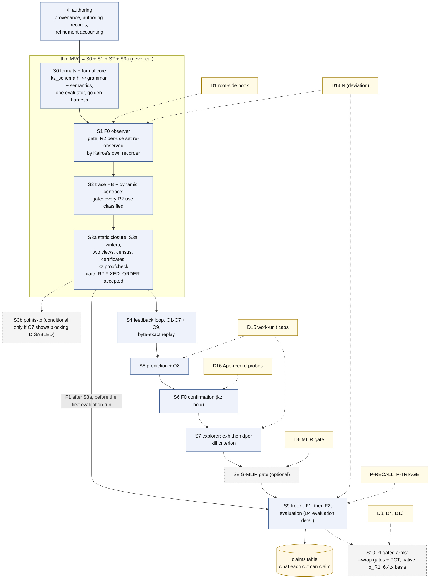

# 08 구현 로드맵: Kairos를 어떤 순서로 만들고, 단계마다 무엇을 주장할 수 있는가

이 문서는 Kairos 설계의 구현 계획(spec §9)과 위험(spec §10.2)을, spec을 읽지 않은 연구자가 15–25분 안에 파악하도록 정리한다. 계획된 디렉터리 구조, 코드를 정돈된 상태로 유지하는 규율, 단계 S0–S10의 출구 조건·필요한 결정·추정 공수, 단계마다 주장할 수 있는 것, 범위를 줄일 때 버리는 순서, 최소 핵심(thin MVC), 먼저 만드는 것을 다룬다.
spec에 없는 설계 요소·수치·인용은 더하지 않는다. 세부는 spec의 해당 절로 넘긴다.

상태: 설계 문서 — 구현·측정 전. 규범 원문: [spec/SPEC_FINAL.md](spec/SPEC_FINAL.md)

## 목차

0. [읽기 전에](#0-읽기-전에): 표기, 이 문서의 자리, 필요한 용어, obligation O1–O9, "F1"의 네 가지 뜻
1. [한 장으로 보기](#1-한-장으로-보기): 로드맵 요약과 그림 D4
2. [디렉터리 구조](#2-디렉터리-구조) (spec §9.1, 아직 만들지 않음)
3. [엔지니어링 규율](#3-엔지니어링-규율) (spec §9.2): interface 먼저, 생성 코드 없음, 사례 전용 코드 금지, 여섯 층의 시험, 결정적 출력
4. [단계와 출구 조건](#4-단계와-출구-조건) (spec §9.3): 요약 표, 단계별 상세
5. [단계별 PI 결정](#5-단계별-pi-결정) (spec §10.1, PI_DECISIONS)
6. [단계별로 주장할 수 있는 것](#6-단계별로-주장할-수-있는-것) (spec §9.3 claims, §6.4)
7. [범위를 줄이는 순서](#7-범위를-줄이는-순서) (spec §9.3 cut list)
8. [thin MVC](#8-thin-mvc): S0 + S1 + S2 + S3a
9. [먼저 만드는 것](#9-먼저-만드는-것) (spec §9.4)
10. [위험](#10-위험) (spec §10.2)
11. [이 문서가 주장하지 않는 것](#11-이-문서가-주장하지-않는-것)
12. [관련 문서](#12-관련-문서)

---

## 0. 읽기 전에

### 0.1 표기

표기는 spec 머리말을 따른다(자세한 설명은 [01_overview.md §0](01_overview.md#0-읽는-법)).

| 표기 | 뜻 |
|---|---|
| [F] | 코드·기록·보고서 인용이 있는 사실 |
| [M] | 측정값. **이 문서의 [M]은 모두 spec이 인용한 기존 측정**이다([R07], [BM], [R2g], [R2c], 검토 X3가 이 머신에서 확인한 값). Kairos는 아직 아무것도 측정하지 않았다 |
| [I] | 추론 또는 설계상 추론. 실행하지 않았다 |
| [D] | 설계 결정. spec §11의 ADR이 기록한다 |
| [U] | 미확인 |

**이 문서의 숫자 대부분은 [I]다.** spec §9.3의 공수 추정, "단계별로 주장할 수 있는 것" 표, cut list, §10.2의 가능성·영향 평가는 spec에서 모두 [I]로 표시되어 있다. 이 문서가 spec의 표를 다시 늘어놓거나 spec의 두 곳을 이어 읽은 곳에는 "이 문서의 대응 [I]"이라고 따로 적는다.

**인용 형식.** "(spec §9.3)"은 SPEC_FINAL.md의 절이다. "[R07 §2.1]"은 `background/`의 보고서, [R2g]·[R2c]는 `results/`의 R2 기록(gdb, 퇴역한 CORD recorder), [BM]은 `env/BASELINE_MEASURE.md`, [POL]은 [CONDITIONS_POLICY.md](../CONDITIONS_POLICY.md)다. PI 결정 D1, D14, P-RECALL 같은 이름은 [spec/PI_DECISIONS.md](spec/PI_DECISIONS.md)의 PI 결정이다. X3-M5 같은 이름은 검토 쟁점이고 처리 내용은 [spec/ISSUE_RESOLUTION.md](spec/ISSUE_RESOLUTION.md)에 있다.

**인용 형식과 이름이 겹치는 기호.** 인용 형식(설계안 [A]/[B]/[C], 심사 [J1]–[J3], 검토 [X1]–[X3], [X3, here], v0.1 등)은 [01_overview.md §0](01_overview.md#0-읽는-법)에 모아 두었다. 같은 기호가 여러 뜻으로 쓰이므로 이 문서는 앞에 종류를 붙인다: "PI 결정 D4"와 "그림 D4", "보장 G5"와 "gap G5", "단계 S0"와 "Init snapshot S0", HB stratum S/O와 cold/warm 층(stratum). 전체 목록은 [10_decisions_adr.md §0.2](10_decisions_adr.md#02-이름-충돌-주의)다.

### 0.2 이 문서의 자리

연구 워크플로우의 흐름은 [03_workflow.md §4](03_workflow.md#4-연구-워크플로우-그림-d4)가 짧게 요약했고, 평가 단계 S9의 내용은 [07_evaluation.md](07_evaluation.md)가 자세히 다룬다. 이 문서는 **엔지니어링 계획** 쪽을 맡는다. 코드를 어디에 두는지, 어떤 규칙으로 쓰는지, 무엇을 먼저 만들고 각 단계가 끝났다는 것을 무엇으로 판정하는지, 시간이 모자랄 때 무엇을 버리는지, 무엇이 계획을 무너뜨릴 수 있는지다.

이 문서가 설명하는 것은 하나도 아직 존재하지 않는다. 디렉터리도, 코드도, 시험도 없다(spec §9.1 제목; spec 머리말).

### 0.3 필요한 용어

전체 용어집은 [10_decisions_adr.md §3](10_decisions_adr.md#3-용어집)이다(원문 spec §13). 여기에는 이 문서를 읽는 데 필요한 만큼만 적는다. 다른 문서의 용어 설명과 같은 뜻으로 쓴다.

| 용어 | 쉬운 설명 | spec |
|---|---|---|
| 단계(stage), 출구 조건(exit gate) | 도구를 나누어 만드는 단위와, 그 단계가 끝났다고 말하려면 **모두** 채워야 하는 조건 목록이다 | §9.3 |
| thin MVC | thin minimum viable core. 그것만으로 논문의 핵심 기여를 주장할 수 있는 가장 작은 단계 묶음이다. Kairos에서는 S0 + S1 + S2 + S3a다 | §9.3, ADR-026 |
| person-week(pw), kLOC | 공수 추정의 단위다. pw는 한 사람이 한 주 일하는 양, kLOC는 코드 천 줄이다. 둘 다 [I]다 | §9.3 |
| basis B | 스케줄을 뺀, 실행을 정하는 모든 것(빌드 tree, 구성, 환경, 초기 상태, 입력)이다. B′는 구성이나 입력을 바꾼 새 basis다 | §1.7 |
| Φ (profile Φ_cFS) | cFS의 자원 종류, 연산의 효과, 순서 규칙, 준비 계약을 적은 선언적 파일이다. engine 코드가 아니라 데이터다 | §0.2, §2.1 |
| fidelity class F0 / F1 | 관측·제어 방식이 실행을 얼마나 바꾸는지의 등급이다. F0는 바이너리와 실행 조건을 바꾸지 않고 timing만 교란한다. F1은 같은 소스와 compiler에서 link나 code-generation 옵션을 바꾼다 | §5.1 |
| uprobe, eBPF | uprobe는 실행 파일을 고치지 않고 사용자 프로그램의 명령 주소에 kernel이 거는 probe다. eBPF는 그 probe가 걸릴 때 kernel 안에서 실행되는, 검증을 거친 작은 프로그램이다 | §5.1, §5.3 |
| happens-before(HB), vector clock | HB는 한 실행 안에서 동기화(lock, message, thread 생성 등)로 정해지는 "먼저 일어남"의 부분 순서다. vector clock은 thread마다 카운터 벡터를 들고 다니며 HB를 계산하는 자료 구조다(Fidge 1988; Mattern 1989 [V-abs]) | §1.9 |
| linearization point(LP), capture point | LP는 연산의 효과가 "이 명령에서 한순간에 일어났다"고 보는 지점이다. Kairos는 요구 조건의 conjunct(∧로 묶인 조건 하나)마다 LP를 둔다. capture point는 호출자가 넘길 값을 미리 읽어 둔 load 지점이다 | §1.4 |
| census | 모든 계약 template을 맞는 모든 문맥 위치에 instance로 만들고, 각 instance에 class나 `unknown(reason)`을 주는 정적 작업이다 | §4.6, §7.1 |
| MustBefore(MB), PWB | MB는 "n이 일어나는 모든 실행에서 a가 n보다 먼저 일어난다"는 정적 관계다. PWB(precedes-whenever-both-occur)는 "둘 다 일어나는 실행에서는 늘 a가 먼저"라는 관계다. certificate는 이 둘로 만든다 | §1.9, §4.4, §4.5 |
| certificate, `kz proofcheck` | certificate는 `fixed-order`나 `protected` 판정이 맞다는 증명 기록이다. `kz proofcheck`는 분석기와 코드를 공유하지 않는 독립 검사기로, certificate를 단계마다 다시 확인한다 | §4.5 |
| σ, M | σ는 스케줄 의미론이다(σ_U 시간 무시, σ_U∞ timeout 없음, σ_R1 한 CPU 고정 우선순위, σ_E 실제 환경). M은 OSAL 모형 수준이다(M_api API 계약 수준, M_impl POSIX 구현 수준). 판정은 (σ, M) 칸마다 따로 낸다 | §0.1, §1.8 |
| `Sk^cert`, `Sk^h` | 같은 actor의 두 skeleton view다. `Sk^cert`는 loop를 star-closure(몇 번이든 돌고 나갈 수 있다)로 닫아 보편 판정에 쓰고, `Sk^h`는 loop를 h번까지만 펼쳐 탐색에만 쓴다 | §4.3, ADR-027 |
| deviation | reference가 정하지 않아 사람이 자원 한계 때문에 고른 값이다(실행 횟수 N, 탐색 cap, 표본 크기). 이유·영향·필요성과 함께 기록한다 | 머리말; [POL] L16, L18–21 |
| work unit | 탐색 상태 수, transition 수 같은 결정적 횟수다. 모든 분석 예산을 이것으로 잰다. 벽시계 시간과 메모리는 비용으로만 보고한다 | §2.1 원칙 8, ADR-034 |
| freeze F1, F2 | 그 시점의 Φ, 도구, 비교 도구, 규칙을 hash로 고정해 이후 바꾸지 못하게 하는 것이다. F1은 첫 평가 실행 전, F2는 held-out을 열기 전이다 | §7.2 |
| LOSS-UNDER-ORDER | 순서 때문에 메시지가 사라지는 route·capacity 계약에서, 전달을 요구하는 reference가 없을 때(Allowed가 `unspecified_by_reference`) 붙이는 결과 label이다. 위반(`violation`)과 구분한다 | §1.6, §1.10 |
| derived | 원래 사례가 아니라 구성 변경이나 hold로 만든 실험의 결과라는 표시다. 원래 사례의 결과와 섞지 않는다 | §4.13 |

### 0.4 obligation O1–O9

출구 조건이 자주 가리키는 것이 obligation이다. Kairos의 계층들이 서로를 검사하는 일관성 의무이고, 실패하면 조용히 넘어가지 않고 `unknown(reason)`이나 model-fault 기록을 남긴다(spec §2.5, ADR-021). 이 문서에서 알아 둘 것은 언제 켜지는가뿐이다. O1–O5, O9는 모든 trace에서, O6은 예측 witness와 explorer witness가 둘 다 있을 때, O7은 모형을 만들 때마다, O8(전역 conformance)은 S5부터 사전 등록한 표본에서, CC(certificate 검사)는 census마다 한다. 각 obligation이 무엇을 확인하고 실패하면 무엇을 하는지는 [02_architecture.md §9](02_architecture.md#9-계층-간-일관성-의무-o1-o9와-cc)의 표 하나에 모았다.

### 0.5 "F1"의 네 가지 뜻

spec은 같은 이름 "F1"을 네 가지 다른 것에 쓴다. 이 문서에서는 항상 앞에 종류를 붙인다.

| 이 문서의 표기 | 뜻 | spec |
|---|---|---|
| **freeze F1** | 첫 평가 실행 전에 Φ, 추출기, engine, 보정표, lint, 모든 비교 도구 구현을 hash로 고정하는 것 | §7.2 |
| **fidelity class F1** | link나 code-generation 옵션을 바꾼 실행. `ld --wrap` gate(`kz gate`, `gate/kz_wrap.c`)가 여기에 속한다 | §5.1 |
| **feedback F1** | feedback loop의 경로 F1–F4 중 하나. O5가 closure의 빈틈을 찾으면 관측에서 배운 key·대상·실제로 열린 startup script를 정적 closure로 돌려보낸다 | §2.4, §2.5, §4.14 |
| **OSAL F1** | OSAL 코드 읽기에서 나온 후보 하나: by-name 조회가 RESERVED 구간에서 lock을 풀지 않고 돌아오는 경로(K-LOCKBAL) | §3.2, App. A.4 |

---

## 1. 한 장으로 보기

출처: spec §9.3, §9.4, ADR-026.

로드맵을 다섯 문장으로 줄이면 다음과 같다.

1. Kairos는 단계 S0–S10과 조건부 단계 S3b로 만든다. **각 단계는 그것만으로 출판할 수 있게** 설계했다(spec §9.3).
2. 단계마다 출구 조건이 있고, 그 항목을 **모두** 채워야 단계가 끝난다. 여러 단계의 출구 조건이 cFS의 구체 사례로 적혀 있다. 예를 들어 S1은 R2를 Kairos 자신의 recorder로 다시 관측해야 끝나고, S3a는 R2의 FIXED_ORDER certificate가 독립 검사기를 통과해야 끝난다.
3. 최소 핵심 **thin MVC는 S0 + S1 + S2 + S3a**다. 이것과 그 층들에 대한 recall protocol은 범위를 줄여도 버리지 않는다([X3-M5] 반영).
4. recorder(관측기)는 좁게 유지하고, 무엇을 기록할지는 모형이 정한다(spec §9.3; v0.1 §15; [J3-M5]; [J1-11]; [J2-15]). probe 계획은 필수 동기화 skeleton과 열린 후보의 obligation을 고른다(spec §2.4 step 5).
5. 공수 추정은 **설계자의 계획용 추정 [I]**이다. 연구 조건이 아니고, 측정한 값이 아니며, 어떤 도구도 쓰지 않는다. PI가 범위를 자를 수 있게 하려고 둔 것이다(spec §9.3).

아래 그림 D4(개요)는 단계, thin MVC, 조건부 단계, 단계를 여는 PI 결정을 한 장에 보인다.

**그림 D4 개요. 연구 단계, 동결, PI 결정** (렌더링: [diagrams/D4_research_overview.svg](diagrams/D4_research_overview.svg); spec §12 D4; §9.3, §10.1)



평가 경로(freeze F1 → template-only 실행 → freeze F2 → held-out·recall)의 상세 그림은 [diagrams/D4_research_evaluation.svg](diagrams/D4_research_evaluation.svg)이고, [07_evaluation.md §1](07_evaluation.md#1-한-장으로-보기-평가-경로-그림-d4-상세)이 설명한다.

**그림 읽는 법.**

- 파란 상자는 Φ 작성과 단계, 점선 테두리 상자(S3b, S8, S10)는 조건부이거나 PI 결정이 있어야 여는 단계다. 노란 상자는 PI 결정이고, 원통은 단계별 주장 표(이 문서 §6)다. 점선 화살표는 PI 결정이 단계를 여는 관계(노란 상자에서 나가는 것)이거나, 조건부로만 이어지는 단계(S3a → S3b, S9 → S10)다([diagrams/README.md](diagrams/README.md) 범례).
- 그림은 S4 → S5 → S6 → S7 → S8을 한 줄로 그렸다. 이것은 만드는 순서다. **실제 선행 조건은 §4.1 표의 "필요" 열**이다. 예를 들어 S7은 S3a만 필요로 하고 S6을 기다리지 않는다(spec §9.3) [이 문서의 대응 I].
- S3a에서 S9로 가는 화살표의 글자 "F1 after S3a, before the first evaluation run"은 freeze F1이 첫 평가 실행 전에 일어난다는 뜻이다(spec §7.2).

---

## 2. 디렉터리 구조

출처: spec §9.1. spec의 절 제목 그대로, 이 구조는 **나중에 만들 계획이고 지금은 아무것도 만들지 않았다**.

```
kairos/
  CMakeLists.txt                     # find_package(LLVM, Clang) from the pinned LLVM 23 build 1053047a; MLIR only after G-MLIR
  include/kz/schema/kz_schema.h      # X-macro field lists: the only record-layout definition (C, _Static_assert)
  include/kz/core/*.hpp              # KEM types, Φ core expression AST, abstract-domain interface, component interfaces
  profiles/cfs-v7.0.1/*.kzp          # Φ: kinds, ops, effects+per-conjunct LPs, bindings, rules, contracts, constants
  profiles/apps/<app>/*.kzp          # optional app-profile layer (provenance, separate authoring cost)
  profiles/freeze/                   # F1/F2 freeze manifests (hashes), incl. comparators and recall protocol
  lib/core/      container I/O, Φ parser, one evaluator (3 domains), rule engine, typestate, vector clocks, verdicts
  lib/llvm/      basis, extract (AST facts, derives, S3a writers, loop-exit trees), link (IR call graph, DWARF, MC,
                 anchor audit, app-unit probe), skel (two views, provenance, once, predicate extraction), modref (S3b)
  lib/static/    MustBefore (per M), PWB/once, certificates, census, plan (joint debug-register allocator)
  lib/proofcheck/ independent checker (no code shared with lib/static; no LLVM) + certificate-mutation engine
  lib/trace/     decode, identity, HB (VC, VC_R, looper rule), per-conjunct LP intervals, routing, chains, mining
  lib/conform/   per-actor acceptance (O1/O2); global conformance O8 (on lib/predict's engine, from S5)
  lib/predict/   cone, A-COMM check, explicit search, prefilters, extrapolation, SMT-LIB2 emitter (optional)
  lib/explore/   model builder, exh and dpor engines, σ variants (σ_U, σ_U∞, σ_R1[P_sched]), monitor, BPOR, L3 checks
  lib/confirm/   hold plans, ptrace + debug-register holder, attach-at-clone, wait-for oracle, F1 controller, PCT,
                 normalization-boot driver, perturbation ratio
  lib/baselines/ comparator reimplementations (frozen at F1; golden tests from the papers' examples)
  probe/bpf/     kz_probe.bpf.c (one generic program per phase; cookie-indexed descriptors; clang-18 -target bpf)
  probe/loader/  raw bpf()/perf_event_open loader (hand-written helper prototypes, <elf.h>), drainer;
                 perf-sample backend; optional tracefs backend
  gate/          kz_wrap.c (C99, cFS flags; F1 only, after D3)
  tools/kz/        core-only CLI: trace|conform|predict|explore|proofcheck|observe|hold|gate|loop|report|dump
  tools/kz-static/ LLVM CLI: basis|extract|link|modref|skel|static|plan
  tests/unit  tests/golden (canonical dumps)  tests/litmus (gcc-built C99 programs on the real OSAL, expected
              classes per σ and M; incl. App. A.8)  tests/mutation (certificates)  tests/property (evaluator
              agreement, HB, containment, loop monotonicity, dpor vs exh)  tests/recall (mutant manifests)
              tests/cfs (integration)
  docs/          formal model, Φ reference (grammar + semantics), provenance rules, ADRs (§11), diagrams (§12)
```

(위 블록은 spec §9.1을 그대로 옮겼다. 주석은 spec 원문의 영어다.)

### 2.1 무엇이 어디에 있나

"관련 단계" 열은 spec §9.3의 단계별 산출물 목록을 이 디렉터리에 대응시킨 것이다 [이 문서의 대응 I].

| 경로 | 담는 것 | 왜 이렇게 두나 | 관련 단계 |
|---|---|---|---|
| `CMakeLists.txt` | 고정된 LLVM 23 build(`1053047a`)에서 LLVM·Clang을 찾는다. MLIR은 G-MLIR gate를 통과한 뒤에만 쓴다 | 도구 사슬을 하나로 고정한다(spec §2.6, ADR-001, ADR-018) | S0 |
| `include/kz/schema/kz_schema.h` | 모든 record layout의 **유일한** 정의. X-macro field 목록과 `_Static_assert` | BPF 프로그램, gcc로 빌드하는 gate 객체, C++ 도구가 같은 layout을 공유해야 한다(spec §2.3, ADR-004) | S0 |
| `include/kz/core/*.hpp` | KEM 타입(하나의 typed 사건 모형), Φ core expression AST, abstract-domain interface, 구성요소 interface | interface를 구현보다 먼저 검토한다(spec §9.2) | S0 |
| `profiles/cfs-v7.0.1/*.kzp` | Φ_cFS: 자원 종류, 연산, effect와 conjunct별 LP, binding, 순서 규칙, 계약, 상수 | framework 지식은 코드가 아니라 provenance가 붙은 데이터다(spec §2.1 원칙 2) | S0(K-ID, K-SELF, K-SPAWN, K-REG 골격), 이후 계속 |
| `profiles/apps/<app>/*.kzp` | 선택적 app-profile 계층 | 앱 고유 protocol(예: FM의 parent–child queue)은 engine에 넣지 않고, 넣더라도 작성 비용을 따로 잰다(spec §7.2) | 필요할 때만 |
| `profiles/freeze/` | freeze F1/F2 manifest(hash). 비교 도구와 recall protocol 포함 | 동결을 hash로 검증한다(spec §7.2) | S9 |
| `lib/core/` | `libkz-core`: container I/O, Φ parser, 평가기 하나(세 domain), 규칙 engine, typestate, vector clock, 판정 | 하나의 formal core를 모든 구성요소가 쓴다. LLVM에 의존하지 않는다(spec §2.1 원칙 1) | S0 |
| `lib/llvm/` | `basis`, `extract`(AST 사실, `derives`, S3a writer, loop 탈출 식), `link`(IR call graph, DWARF, MC, anchor audit, app-unit probe), `skel`(두 view, provenance, once, predicate 추출), `modref`(S3b) | Clang/LLVM은 분석에만 쓴다. 실행되는 것은 gcc 바이너리다(spec §2.6, ADR-023) | S3a(`modref`는 S3b) |
| `lib/static/` | M별 MustBefore, PWB/once, certificate, census, `plan`(debug register 공동 할당기) | | S3a |
| `lib/proofcheck/` | 독립 검사기와 certificate-mutation engine | **`lib/static`과 코드를 공유하지 않고 LLVM도 쓰지 않는다**(spec §2.1 원칙 3, §4.5) | S3a |
| `lib/trace/` | decode, identity, HB(VC, VC_R, looper 규칙), conjunct별 LP 구간, routing, 사슬(chain), outcome mining | | S1(decode, identity join), S2 |
| `lib/conform/` | actor별 수용 검사(O1/O2), 전역 conformance O8(S5부터, `lib/predict`의 engine 위에서) | O8은 S5 예측 engine 위의 trace 제약 탐색으로 푼다. gated explorer를 쓰지 않는다(spec §4.11) | S3a(O1/O2), S5(O8) |
| `lib/predict/` | cone, A-COMM 검사, 명시적 탐색, prefilter, extrapolation, SMT-LIB2 출력기(선택) | solver 없이 동작한다(spec §2.2) | S5 |
| `lib/explore/` | 모형 builder, `exh`·`dpor` engine, σ 변형, monitor, BPOR, L3 검사 | explorer는 모형을 해석(interpret)한다. 모형마다 코드를 생성하지 않는다(spec §9.2) | S7 |
| `lib/confirm/` | hold plan, ptrace + debug-register holder, clone 시 attach, wait-for oracle, fidelity class F1 controller, PCT, normalization-boot driver, perturbation 비율 | | S1(normalization-boot driver), S6, S10(F1 controller, PCT) |
| `lib/baselines/` | 비교 도구 재구현. freeze F1에서 동결하고, 원 논문 예제로 golden test를 만든다 | spec §8.3 | S9 |
| `probe/bpf/` | `kz_probe.bpf.c`: phase마다 generic 프로그램 하나, attach cookie로 site descriptor 조회, 시스템 clang-18 `-target bpf` | site마다 코드를 생성하지 않는다(spec §5.3) | S1 |
| `probe/loader/` | raw `bpf()`/`perf_event_open` loader(helper prototype을 손으로 적고 glibc `<elf.h>`로 ELF를 읽는다), drainer, perf-sample backend, 선택적 tracefs backend | 설치 없이 동작한다(spec §2.1 원칙 7) | S1 |
| `gate/` | `kz_wrap.c`(C99, cFS 빌드 flag). fidelity class F1 전용, PI 결정 D3 승인 뒤에만 | spec §4.13, §5.1 | S10 |
| `tools/kz/` | core만 link하는 CLI: `trace`, `conform`, `predict`, `explore`, `proofcheck`, `observe`, `hold`, `gate`, `loop`, `report`, `dump` | 두 실행 파일(spec §2.2) | 단계마다 하위 명령이 늘어난다 |
| `tools/kz-static/` | LLVM을 link하는 CLI: `basis`, `extract`, `link`, `modref`, `skel`, `static`, `plan` | | S3a |
| `tests/` | `unit`, `golden`, `litmus`, `mutation`, `property`, `recall`, `cfs`(통합) | §3.5의 여섯 층과 통합 시험 | S0부터 |
| `docs/` | 형식 모형, Φ reference(문법 + 의미), provenance 규칙, ADR(spec §11), 그림(spec §12) | | S0부터 |

### 2.2 구조가 지키는 세 경계

디렉터리 구조는 설계 원칙 세 가지를 물리적 경계로 만든다 [이 문서의 대응 I].

1. **지식과 engine의 경계: `profiles/` 대 `lib/`.** cFS에 관한 지식(예: R2에서 쓰는 framework 규칙 R19 CORE-SERIAL, 계약 K-ID)은 `profiles/`의 Φ 파일에만 있다. engine 코드에 사례 식별자가 들어가면 lint가 막는다(§3.4; spec §7.2).
2. **만드는 쪽과 검사하는 쪽의 경계: `lib/static/` 대 `lib/proofcheck/`.** certificate를 만드는 분석과 그것을 다시 확인하는 검사기가 코드를 공유하지 않는다. 검사기가 믿는 입력은 추출 결과(`facts.kz`)뿐이고 나머지는 스스로 다시 유도한다(spec §4.5).
3. **LLVM이 있는 쪽과 없는 쪽의 경계: `tools/kz-static/` 대 `tools/kz/`.** `kz-static`은 `libkz-llvm`을 link하고([M] 정적 LibTooling link 하나가 56.7 MB, [R07 §2.2]), `kz`는 `libkz-core`만 link한다. 그래서 `kz proofcheck`는 Clang을 link하지 않는다(spec §2.2, [X3-m7] 반영).

---

## 3. 엔지니어링 규율

출처: spec §9.2. spec의 이 절 제목은 "how messy code is avoided"다. 규칙 여덟 가지를 한 표로 먼저 보이고, 아래에서 하나씩 설명한다.

| 규칙 | 막으려는 것 [이 문서의 요약, I] | spec |
|---|---|---|
| interface 먼저 | 구현이 형식과 의미를 제각각 정하는 것 | §9.2, §9.4 |
| 구성요소마다 library 하나 + 얇은 CLI | 구성요소끼리 숨은 통로로 소통하는 것 | §9.2, §2.2 |
| 생성 코드 없음 | 검토할 수 없는 코드와 별도 code generator 유지 비용 | §9.2; [R06 K8] |
| 사례 전용 코드·맨 상수 금지 | engine이 다섯 사례에 맞춰지는 것, 근거 없는 상수 | §9.2, §7.2 |
| 여섯 층의 시험 | 분석, 검사기, 모형이 각각 틀려도 모르는 것 | §9.2 |
| LLVM 관례 | LLVM과 link하는 코드의 불일치 | §9.2; [R07 §2.1] |
| 모든 산출물에 provenance | 결과가 어디서 왔는지 모르는 것 | §9.2, §2.3 |
| 결정적 출력 | 다시 돌렸을 때 결과가 바뀌는 것 | §9.2, §4.14 |

### 3.1 interface 먼저

`kz_schema.h`, Φ 문법**과 그 의미**(core expression, binding, pattern), 판정 기록, 구성요소 interface를 구현보다 먼저 검토한다. 이 검토가 S0의 일이다(spec §9.2).

이유는 Kairos의 세 해석기(정적 abstract, trace 위 concrete, explorer의 operational)가 같은 Φ predicate를 같은 뜻으로 읽어야 하기 때문이다. 그래서 평가기는 하나이고, 그 하나가 세 abstract domain을 가진다(spec §0.2 항목 2, ADR-002, ADR-003; [X3-M11] 반영).

### 3.2 구성요소마다 library 하나와 얇은 CLI

구성요소마다 library 하나를 두고, CLI 하위 명령은 그 library를 부르는 얇은 껍데기다. **구성요소끼리는 KZ container로만 소통한다.** 실행 파일은 둘이다(spec §9.2, §2.2).

KZ container는 모든 산출물이 쓰는 typed binary 형식이다. header에 B hash, Φ hash, tool hash, 그리고 이 산출물을 만든 **부모 산출물의 hash**를 담는다(Merkle 방식). section마다 schema version이 따로 있다(spec §2.3; [X3-m6] 반영). 그래서 어떤 판정이든 그것을 만든 입력 사슬을 hash로 거슬러 올라갈 수 있다 [I].

### 3.3 생성 코드 없음

Kairos는 생성 코드를 쓰지 않는다([R06 K8]; spec §9.2). 구체적으로 다음 다섯 가지다.

- **schema compiler 대신 X-macro.** X-macro는 field 목록을 macro 하나로 적어 두고, 그 macro를 여러 번 다르게 펼쳐 같은 목록에서 여러 코드를 얻는 C 전처리기 기법이다. Kairos에서는 목록 하나가 C struct, canonical dump printer, 모든 offset에 대한 `_Static_assert`, "`sizeof`가 field 크기의 합과 같다"는 assert로 펼쳐진다. 그래서 record에 숨은 padding이 생기지 않는다(spec §2.3, ADR-004).
- **TableGen/ODS 없음.** TableGen과 ODS는 LLVM·MLIR이 선언적 명세에서 C++ 코드를 생성하는 도구다. G-MLIR gate를 통과하지 않으면 쓰지 않는다(ADR-018).
- **generic data-driven BPF 프로그램.** phase(entry, point, return, watch)마다 BPF 프로그램 하나가 있고, attach cookie(probe site마다 kernel이 BPF 프로그램에 넘겨 주는 식별 값)로 site descriptor 배열을 찾아 읽는다. descriptor는 데이터다(spec §5.3).
- **손으로 쓴 gate wrapper.** fidelity class F1 gate(`gate/kz_wrap.c`)는 C99로 직접 쓴다.
- **explorer는 모형을 해석한다.** 후보마다 모형 코드를 생성하지 않는다.

배경에는 사용자가 Python/JSON 시제품(CORD)을 버린 결정이 있다([R06 K7]). 모든 구성요소는 C/C++이고, JSON은 CMake의 입력 `compile_commands.json`에만 나온다(ADR-001; spec §2.6).

### 3.4 사례 전용 코드와 맨 상수 금지

두 lint가 이것을 강제한다(spec §7.2, §9.2).

- **상수는 근거와 함께.** 도구 코드의 상수는 `KZ_REF(value, "path:line")` 형태로만 쓴다. 값이 어느 코드 위치나 고정 문서에서 왔는지가 코드에 남는다(spec 머리말; [POL] L22).
- **사례 식별자 금지.** `CFE_SB_Global`, `sem_name`, `C1` 같은 사례 식별자나 사례 전용 symbol은 `profiles/`와 `tests/` 밖의 engine 코드에 쓸 수 없다.

이것은 연구의 개방성 요구와 직접 연결된다. engine은 framework에 중립이어야 하고, cFS 지식은 provenance가 붙은 Φ 항목으로만 들어간다(spec §2.1 원칙 2). 예를 들어 R2의 certificate에는 SB 전용 계약이 없다. generic 계약 K-ID와 framework 규칙 R19가 Φ에서 온다. 판정 기록은 증명에 쓴 Φ 항목을 generic 계약, generic 장치, 사례를 알고 쓴 framework 규칙으로 나눠 적고, R2는 "generic 계약 K-ID + framework 규칙 R19"로 보고한다(spec App. A.1 steps 1, 10; §7.2 refinement accounting).

### 3.5 여섯 층의 시험

spec §9.2는 시험을 여섯 층으로 둔다. `tests/cfs`의 통합 시험은 §9.1 디렉터리에 따로 있다.

| 층 | 무엇을 검사하나 | 예 | 디렉터리 |
|---|---|---|---|
| unit | 함수·자료 구조 단위의 동작 | — | `tests/unit` |
| golden | 출력이 저장된 정답 파일(canonical dump, 한 줄에 record 하나인 정규 text)과 같은지. **모든 Φ 규칙에 golden test가 하나씩 있다** | S0 출구 조건: 합성 trace 위 규칙 catalogue의 golden test | `tests/golden` |
| litmus | 한 가지 패턴만 떼어 낸 작은 C99 프로그램을 gcc로 빌드해 **실제 OSAL 위에서** 돌리고, σ와 M마다 기대 class와 비교한다 | App. A.8의 L-OWN: 실패 분기가 `abort()`로 끝나는 writer가 있는 관측. certificate는 OWN-NOPATH로 통과해야 하고, 실패 분기가 다시 합류하는 변형에서는 certificate를 잃어야 한다. R2의 `cfe_es_start.c:823`(뒤에 panic만 따르는 실패 경로의 writer)을 떼어 낸 모양이다(X2-01) [I] | `tests/litmus` |
| property | 무작위 입력에서 늘 성립해야 하는 성질 | 세 domain 사이 평가기 일치, HB 추이성, 작은 무작위 모형에서 containment, loop 단조성, `dpor` 대 `exh` | `tests/property` |
| certificate mutation | 올바른 certificate를 일부러 망가뜨리고 검사기가 모두 거부하는지. kill rate를 지표로 보고한다 | spawn site 빼기, writer 지우기, `:823`을 OWN-NOPATH 증명 없이 writer 집합에 다시 넣기, once 사실 빼기, 단계를 `TRUNC` 영역으로 옮기기, `derives` 빼기(spec §4.5) | `tests/mutation` |
| recall | 과거 수정 이력에서 만든 program mutant(코드를 일부러 바꾼 변형)를 분석이 찾는지 | 수정의 역(되돌리기)을 v7.0.1에 다시 만든 mutant(spec §8.5) | `tests/recall` |

**두 mutation 시험은 서로 다른 것을 검사한다.** certificate mutation은 **검사기**를 시험하고, program mutant는 **분석**을 시험한다(spec §2.1 원칙 3, §4.5). 검사기가 망가진 certificate를 모두 거부해도 분석이 놓친 writer는 드러나지 않는다. 그래서 둘 다 있다.

### 3.6 LLVM 관례

LLVM과 link하는 코드는 LLVM 관례를 따른다. 예외 처리를 쓰지 않는다(`LLVM_ENABLE_EH=OFF`, [R07 §2.1]; spec §9.2).

### 3.7 모든 산출물에 provenance

모든 산출물은 B, Φ, tool, 부모 산출물의 hash와, LLVM `1053047a`, gcc 13.3.0, kernel, 관측 backend, fidelity class를 기록한다(spec §9.2). S1의 출구 조건 "backend recorded"도 같은 취지로 읽힌다 [I]. 여러 실행의 빈도는 pool key(B hash, plan hash, stratum)가 같을 때만 합친다(spec §8.7).

### 3.8 결정적 출력

출력은 정렬하고 hash하며, 분석 예산은 work unit으로 센다. 그래서 golden test와 replay가 안정적이다(spec §9.2). 저장된 trace에서 다시 돌리면 판정 저장소가 byte 단위로 같아야 하고, 이것 자체가 시험이다(spec §4.14). 벽시계 cap으로 낸 결과는 PI 결정 D15가 허용할 때만 있을 수 있고, label을 붙여 replay 시험에서 뺀다(spec §4.14; PI_DECISIONS D15).

---

## 4. 단계와 출구 조건

출처: spec §9.3, ADR-026.

### 4.1 요약 표

**공수 추정에 관한 주의.** 아래 "추정" 열은 spec §9.3이 **[I]로 표시한 설계자의 계획용 추정**이다. 연구 조건이 아니고, 측정한 값이 아니며, 어떤 도구도 쓰지 않는다. PI가 범위를 자를 수 있게 하려고 둔 것이다. 이 문서는 추정을 더하거나 합산하지 않는다.

| 단계 | 만드는 것 (요약) | 필요 | 추정 [I] |
|---|---|---|---|
| **S0** | 형식과 formal core: `kz_schema.h`, KZ container, Φ 문법 + 의미, 평가기 하나(세 domain), 판정 기록, certificate 형식, lint, golden harness, Φ_cFS 골격 | — | 3–4 pw; 6–9 kLOC |
| **S1** | F0 관측기: perf-sample backend → raw `bpf()` loader, identity join, 보정표, normalization-boot driver | PI 결정 D1, D14(S1 몫); P-LIBBPF는 자체 loader가 실패할 때만 | 5–7 pw; 6–9 kLOC (C + C++) |
| **S2** | trace HB와 동적 계약 검사 | S1 | 3–5 pw; 5–7 kLOC |
| **S3a** | 정적 closure, S3a writer 추출, 두 view, census, certificate, `kz proofcheck` | S0; reach와 O1/O2에는 S1 | 8–12 pw; 12–18 kLOC (그중 `kz proofcheck` 3–5) |
| **S3b** (조건부) | IR 위 Andersen 방식 points-to | S3a | 4–8 pw |
| **S4** | feedback loop(O1–O7, O9)와 재현성. 예측·hold 없음 | S1–S3a | 2–3 pw; 2–3 kLOC |
| **S5** | trace 예측과 같은 engine 위의 O8 | S2(A-COMM에는 S3a도) | 5–7 pw; 6–9 kLOC |
| **S6** | F0 확인(`kz hold`) | S5; PI 결정 D16 | 3–5 pw; 3–5 kLOC |
| **S7** (gated) | explorer: `exh` 다음 `dpor` | S3a | 6–10 pw; 8–12 kLOC |
| **S8** (선택) | G-MLIR gate | PI 결정 D6 | 3–4 pw |
| **S9** | freeze F1 → freeze F2, 평가(recall protocol, 기준선, triage 포함) | PI 결정 D8, D14, P-RECALL, P-TRIAGE | 8–12 pw (기준선은 하나에 ≈1 pw [I]) |
| **S10** (PI arm) | fidelity class F1 `--wrap` gate와 PCT; native σ_R1 arm; H-V를 위한 6.4.x basis | PI 결정 D3, D4, D13 | arm마다 4–8 pw |

S4는 예측이나 hold 없이 `static`과 `trace`만으로 loop를 돌린다. `predict`와 O8은 S5에서, `hold`는 S6에서, `explore`는 S7에서 kill criterion을 통과할 때만 loop에 합류한다(spec §4.14 staged availability).

### 4.2 S0: 형식과 formal core

**만드는 것.** `kz_schema.h`(X-macro), KZ container, Φ 문법과 **의미**(core expression, binding, pattern match), 세 domain을 가진 평가기 하나, 판정 기록, certificate 형식, lint, golden harness. 그리고 provenance가 붙은 Φ_cFS 골격: K-ID, K-SELF, K-SPAWN, K-REG(spec §9.3).

이 네 계약 종류는 이 문서의 예와 이렇게 이어진다(spec §3.15).

| 계약 | 뜻 | cFS 예 |
|---|---|---|
| K-ID | 넘긴 ID 값이 유효하고 등록되어 있어야 한다(capture point 사용) | R2: SB가 EVS에 넘기는 SB의 AppId |
| K-SELF | 호출자 자신의 ES 문맥이 LIVE여야 한다 | core task·script app의 App-record 구간 |
| K-SPAWN | task 생성 handshake가 끝나야 한다 | OSAL task와 timebase thread의 handshake |
| K-REG | 이름으로 찾는 object가 LIVE여야 한다 | C1: CF가 이름으로 찾는 OSAL counting semaphore(K-REG.osal) |

**출구 조건 (모두 충족).**

- container가 안정된 hash로 왕복(쓰고 다시 읽기)하고, padding은 0이다.
- 평가기 일치 property test가 통과한다.
- 규칙 catalogue의 golden test가 합성 trace에서 통과한다.
- lint가 켜져 있다.
- cFS는 쓰지 않는다.

**이 조건이 보이는 것.** 이후 모든 구성요소가 기대는 형식과 의미가 cFS 없이도 고정되어 있다는 것이다. padding을 0으로 두는 이유는 hash가 초기화되지 않은 byte에 좌우되지 않게 하려는 것이다(ADR-004).

### 4.3 S1: F0 관측기

**만드는 것.** 먼저 perf-sample backend(bring-up용, 설치 없음)를 만들고, 그다음 attach cookie와 inode 등록을 쓰는 raw `bpf()` loader를 만든다. entry에서만 기록하는 lock token, identity join, 보정표(calibration table), normalization-boot driver도 이 단계다(spec §9.3).

용어 몇 가지.

- **inode 등록**: uprobe를 실행 파일의 (inode, offset)에 미리 걸어 두면, 나중에 `dlopen`으로 올라오는 앱 `.so`에서도 hit를 센다. 주 바이너리에서는 확인되었고 앱 `.so`에서는 시험하지 않았다(spec §5.2; [R07] L340).
- **identity join**: thread의 kernel tid를 OSAL task, cFE app과 오프라인으로 잇는 일이다. 관측 장치는 `GetAppID` 같은 조회를 프로세스 안에서 절대 부르지 않는다. 그런 조회 자체가 OSAL F1이나 App-record 구간을 건드릴 수 있기 때문이다(spec §5.7).
- **보정표**: probe를 놓는 명령 종류마다 비용을 micro-benchmark로 잰 표다. 측정된 예로, entry+4(`push %rbp`)의 uprobe는 0.57 µs, 에뮬레이션되지 않는 명령의 uprobe는 31.7 µs다 [M] ([R07 §4.7]; spec §5.10).
- **normalization boot**: 비정상 종료 뒤 남은 유지 상태(SysV segment, boot record)를 지우려고 하는 관측 없는 boot다. 이 boot는 어떤 pool에도 넣지 않는다(spec §4.13).

**출구 조건 (모두 충족).**

- **Kairos 자신의 recorder가 수정하지 않은 바이너리에서 R2를 다시 관측한다.** 사용별 집합(task, SB 함수, EID)이 [R2g §2]의 표와, B에서 계산한 기대값과 맞아야 한다. 기대값은 ENV의 version table이 있는 basis에서 24(ES 20 + EVS 4), 없으면 11이다. 어긋나면 조사해 보고하고, **맞추려고 조정하지 않는다.**
- 사용한 backend를 기록한다([X3-m8] 반영).
- trace 손실이 0이거나, 손실이 계산되어 있다.
- 반환값 capture 방식 R-a…R-e의 비용, BPF 본체 비용, cookie 비용, perf-sample 비용을 잰다(R-a uretprobe, R-b 호출 뒤 `mov`, R-c `leave`, R-d 지연 읽기, R-e 호출 뒤 첫 에뮬레이션 명령; spec §5.2).
- 앱 `.so`에서 inode 등록을 시험한다.
- 실험군 A(관측기 없는 수정하지 않은 바이너리)를 현재 kernel `-fc-v114`에서 cold/warm 층(stratum)별로 다시 잰다. 기존 기록은 `-fc-v80`에서 만들었다(PI_DECISIONS D11).
- S1의 실행 횟수 N을 deviation으로 정한다(PI 결정 D14를 이 단계로 옮겼다).
- 실험군 A, B(빈 BPF 프로그램을 단 uprobe), C′(R2 site와 identity bootstrap만 있는 최소 plan)를, 관측 장치 없이도 볼 수 있는 지표로 비교한다. 예: cFE 시간으로 본 CORE_READY → OPERATIONAL 구간, 15개 "Loading file … APP:" 줄의 폭, 종료 때 읽는 SB 카운터(spec §8.6).

**이 조건이 보이는 것.** "분석을 믿기 전에 ground truth는 새 recorder에서 와야 한다"(spec §9.4). 기존 R2 기록은 gdb로 만든 것이고, gdb는 breakpoint hit마다 모든 thread를 잠시 멈추므로 교란 없는 스케줄의 증거가 아니다([R2g] 머리말; [01_overview.md §1.3](01_overview.md#13-네-가지-구체-예)). 24와 11의 구분은 새 증거가 아니라 basis 민감도와 S1 gate를 확인하는 장치다(spec App. A.1 step 12). **S1 전에는 어떤 R2 수도 Kairos의 결과가 아니다**(spec §6.4 항목 21).

### 4.4 S2: trace HB와 동적 계약 검사

**만드는 것.** looper 규칙을 쓰는 VC/VC_R, capture point를 포함한 conjunct별 LP 구간, routing, outcome 일치 검사(O4의 검사력은 HB가 정한 사용에 대해서만), 사슬, outcome mining, scope(spec §9.3).

- **VC와 VC_R**: 사건마다 vector clock 둘을 둔다. VC는 모든 확정 edge로 계산한다. VC_R은 `unconditional`이나 `obs-fatal` 표지가 붙은 edge(관측 없이 성립하는 구조적 규칙과, 다른 출구가 종료뿐인 guarded 관측 edge)만으로 계산한다. VC_R은 정적 certificate를 찾기 위한 값싼 trace 쪽 prefilter일 뿐이고, 모든 실행에 대한 주장이 아니다(spec §1.9).
- **looper 규칙**: 메시지를 받아 handler로 나눠 주는 loop를 도는 actor(looper)에서는 한 handler 안의 program order와, loop의 init 부분에서 각 handler로 가는 program order만 HB다. **두 handler 사이에는 HB edge가 없다**(CAFA PLDI 2014 [V-abs]; DCatch ASPLOS 2017 [P]; spec §1.9).
- **routing**: 관측한 사용을 넷으로 나눈다. conforming, wrong-way(정적 쪽에 certificate를 요청), O-ordered, unordered(뒤의 둘은 예측으로)(spec §2.4 step 7).

**출구 조건 (모두 충족).**

- R2의 모든 사용이 분류된다.
- SB 발행 뒤의 모든 사용이 순서가 정해진다. **시스템 상태 대기로만 순서가 정해지는 사용도 포함한다**([R2c §4.3]). 퇴역한 CORD recorder의 HB 모형에는 `CFE_ES_WaitForSystemState`의 시스템 상태(CORE_READY) 대기 edge가 없었다. 그래서 발행 뒤에 ES나 EVS가 SB의 AppId를 쓰는 사용이 있었다면 false positive로 표시했을 것이라고 그 기록은 적었다. 그 실행들에서는 그런 사용이 나오지 않았다([R2c §4.3]).
- O3–O5, O9가 기본 trace에서 통과한다.
- 17개의 `SEND_NO_SUBS` 사용이 K-ROUTE에 사슬로 이어진다.

**이 조건이 보이는 것.** 마지막 항목이 "SB 구독 전 송신" 예와 R2를 잇는다. R2의 ES 사용 20건 중 17건은 `SEND_NO_SUBS` 이벤트의 사용이다 [M] ([R2g §2]). 이것이 아직 아무도 구독하지 않았을 때 ES의 event packet(MsgId 0x808)을 보내며 생겼다는 귀속은 기록의 추론이다 [I] ([R2g §2]). 이것들은 K-ROUTE instance로 이어지고, label은 LOSS-UNDER-ORDER, harm은 정해지지 않음이다(spec App. A.1 step 13).

### 4.5 S3a: 정적 분석과 certificate

**만드는 것.** 정적 closure(app-unit link probe 포함), A-TYPE listing을 동반한 S3a writer 추출, `derives`, 두 skeleton view, message provenance, predicate 추출, once 사실, M별 MustBefore, census(K-ID, K-SELF, K-SPAWN, K-REG 먼저, 그다음 모든 template), certificate, `kz proofcheck`, certificate mutation, Clang→gcc anchor audit, O1/O2/O7(spec §9.3).

새 용어가 많은 단계다. 한 줄씩만 적는다.

| 용어 | 뜻 | spec |
|---|---|---|
| app-unit link probe | 앱 unit 하나하나를 core를 외부 symbol 제공자로 삼아 link해 보고, 정의되지 않은 symbol을 unit별로 보고한다. `core-cpu1`만 닫힌 link가 확인되었기 때문에 S3a 초반에 한다 | §4.1 step 6; [X3-m5] 반영 |
| writer 추출, A-TYPE | 조건을 떠받치는 위치(support location)에 쓸 수 있는 모든 코드 위치를 Clang AST 수준에서 field 기준으로 찾는다. A-TYPE은 "모든 접근이 선언된 타입을 거친다"는 가정이다. `char*`·`void*`·cast를 통한 write나 주소 유출이 보이면 그 위치의 writer 집합은 `DISABLED`가 된다 | §4.2; [X3-M4] 반영 |
| `derives` | 호출 인자가 공유 위치 하나에서 복사된 값이라는 사실. R2에서 SB 이벤트 site의 인자는 `CFE_SB_Global.AppId`에서 온다 | §4.1 step 3, App. A.1 step 2 |
| message provenance | B에서 각 pipe에 어떤 메시지가 올 수 있는지를 고정점으로 계산하고, 올 수 없는 handler는 접는다 | §4.3; ADR-029 |
| predicate 추출 | 지연을 두고 조건을 기다리는 poll loop에서 대기 조건을 코드로부터 기호적으로 뽑는다. R19의 `MainTaskSyncDelay` loop(`cfe_es_start.c:835`)가 그 예다 | §4.3; ADR-030 |
| once 사실 | 어떤 actor가 한 실행에서 많아야 한 번 돈다는 증명 | §4.5 |
| anchor audit | Φ의 AST pattern을 gcc 바이너리의 명령으로 묶을 때(DWARF, MC), 여러 개와 맞거나 하나도 안 맞는 site를 나열한다 | §3.17 |

**출구 조건 (모두 충족).**

- **R2의 ES·EVS 사용에 대한 FIXED_ORDER certificate를 `kz proofcheck`가 M_api와 M_impl에서 받아들인다.** 신뢰 항목이 모두 나열되어 있어야 한다(spec App. A.1). ES 절반은 `CleanUpApp`의 relational guard, EVS 절반은 A-FRESH, A-OWNER, `CleanUpApp` guard다(App. A.1 step 9). 여기에는 early-return 회귀 시험과, `:823`·once 사실을 건드린 mutation의 거부가 포함된다.
  - early-return 회귀: `CFE_ES_TaskInit`은 실패하면 `cfe_es_task.c:340, 371, 381, 393`에서 일찍 돌아오지만 `CFE_ES_TaskMain`은 `cfe_es_task.c:134`에서 raise한다. 이전 판의 지배(dominance) 기반 증명이 바로 여기서 실패했다([J2-1]; spec §0.4, App. A.1 step 7).
  - `:823` mutation: startup thread의 실패 경로 `memset`(`cfe_es_start.c:823`)은 뒤에 panic만 따르므로 OWN-NOPATH로 writer 집합에서 빠진다. 그 증명 없이 다시 넣은 certificate는 거부되어야 한다(App. A.1 step 11; spec §4.5).
- timebase 조회가 **teardown 밖에서 protected**다(App. A.7). TIME과 SCH_LAB의 `cFS-Master` 조회(`cfe_time_task.c:311`, `sch_lab_app.c:176`)가 대상이다. spec은 이것을 "코드가 순서를 정한 곳에서 도구가 race를 지어내지 않는다는 확인"이라 부른다.
- CF의 조회가 기본 B에서 `inactive`다. 이것이 C1의 기본 구성 모습이다. 조회는 비어 있지 않은 `sem_name` 검사 뒤에 있고, 기본 항목은 둘 다 비어 있다(`cf_def_config.c:60, 78`; App. A.4 step 1).
- `K-ATOM.tbl-load`가 message provenance로 `inactive`다. 기본 B에는 load 명령을 보내는 송신자가 없다(spec §3.11).
- core-task App-record 구간과 SB/TBL의 ABSENT 결과가 open(또는 분류됨)으로 나타난다. 정적으로는 어느 쪽으로도 certificate가 없으므로 open으로 가는 것이 기대 동작이다(App. A.2 steps 2, 4).
- litmus App. A.8이 통과한다.
- O7 보고가 `DISABLED` 수와 함께 나온다.
- app-unit의 정의되지 않은 symbol 보고가 나온다.

**이 조건이 보이는 것.** 한 묶음으로 보면 세 방향의 확인이다 [이 문서의 대응 I]. R2에서는 순서가 고정된 위반을 증명할 수 있어야 하고(certificate), timebase에서는 코드가 정한 순서를 위반으로 착각하지 않아야 하며(protected), CF와 TBL load에서는 기본 구성에서 실행되지 않는 경로를 `inactive`로 가려야 한다. 동시에 증명이 없는 App-record 구간은 open으로 남아야 한다.

**읽는 사람을 위한 주의 [이 문서의 관찰, I].** App. A.8 litmus의 기대 결과 일부는 explorer(S7)를 전제로 적혀 있다. L-H2는 h = 1과 h = 2의 explorer 결과를, L-PATIENT는 σ_U∞ 분류를, L-L3은 explorer의 L3 축약 검사를 기대한다. spec은 S3a 출구 조건에 "litmus App. A.8 passes"를 두지만, 어느 기대 항목을 S3a에서 확인하고 어느 것을 S7로 넘기는지는 따로 적지 않는다. 구현 전에 설계자가 정해야 할 점으로 보인다.

### 4.6 S3b: points-to (조건부)

**만드는 것.** 고정된 pass pipeline(InstCombine과 SROA 없음) 위에서 IR에 대한 Andersen 방식 points-to 분석(Andersen 1994 [V-abs])이다. points-to 분석은 각 pointer가 가리킬 수 있는 memory 위치를 계산한다(spec §4.2 step 10).

**출구 조건.** S3a의 O7 보고가 `DISABLED` conjunct가 certificate를 막는다고 보일 때만 만든다. 얻은 것은 ablation 17(writer 집합을 Φ만으로, S3a만으로, S3a + S3b로 만든 비교)로 잰다(spec §9.3, §8.4).

v1 설계는 opaque-pointer IR 위의 Andersen 분석을 처음부터 만들어 MVC 안에 두었다. 검토 X3의 지적(X3-M4, X3-M5)에 따라 최종 설계는 writer 추출을 Clang AST 수준(S3a)으로 옮기고, Andersen 분석을 조건부 S3b로 뺐다(ADR-007, ADR-026).

### 4.7 S4: feedback loop와 재현성

**만드는 것.** O1–O7과 O9를 쓰는 feedback loop와 재현성. O8은 S5로 미룬다. **이 단계에는 예측도 hold도 없다**(spec §9.3).

feedback loop는 정적 분석 → 관측 → trace 분석을 되풀이하며, 관측에서 배운 key·target·경로를 정적 closure에 돌려보낸다. 판정 상태가 더 바뀌지 않으면(고정점) 멈춘다. 고정점 비교에서는 실행 횟수, pool key, run ID, plan hash처럼 매번 바뀌는 값을 뺀다. obligation 위반으로 규칙이 정지(suspension)되면 그 Φ version의 loop는 끝나고, 사람이 Φ를 고쳐 새 hash로 다시 시작한다(spec §4.14).

**출구 조건 (모두 충족).**

- 기본 B에서 고정점에 이르고, 반복마다의 변화량과 그 run 집합이 기록된다.
- 결정적 replay 시험이 byte 단위로 통과한다.

### 4.8 S5: 예측과 O8

**만드는 것.** lock 뒤집기 예측, A-COMM label, prefilter, extrapolation label, 그리고 같은 engine 위의 O8(spec §9.3).

- **예측 분석**은 관측한 trace 하나에서, 동기화 제약을 지키면서 사건 순서를 바꾼 다른 실행이 가능한지 추론하는 기법이다. **lock 뒤집기**는 같은 lock을 잡는 두 critical section의 순서를 바꾼 실행을 예측하는 것이다. C1, C5, App-record 구간에 필요하고, RVPredict/GPredict 방식의 처리다(spec §4.9 항목 3; [R04 L259, L492]).
- **A-COMM 검사**: Kairos trace에는 모든 공유 접근이 아니라 동기화 skeleton과 계약 site만 있다. 관측하지 않은 공유 위치를 통한 통신이 witness를 무효로 만들 수 있는지 S3a의 read/write 집합으로 확인한다. 실패하면 witness는 `predicted`가 아니라 `predicted-modelled`(모형 기반)로 표시한다(spec §4.9 항목 4; [X1-M4] 반영).
- **anytime curve**: 탐색 예산(work unit)에 따라 판정된 비율이 어떻게 늘어나는지 보인 곡선이다(spec §4.9 항목 8).

**출구 조건 (모두 충족).**

- 합성 suite가 통과한다.
- C1 파생 구성(이름이 비어 있지 않고 provider 앱이 있는 B′)의 trace에서 뒤집기 witness가 나온다.
- 두 App-record 구간이 기본 boot에서 witness를 내거나, anytime curve와 함께 `unknown(budget)`으로 보고된다.
- O8이 사전 등록한 표본(각 pool의 첫 trace와, O1–O7·O9 실패가 있는 모든 trace)에서 돈다(spec §4.11).

### 4.9 S6: F0 확인 (`kz hold`)

**만드는 것.** `kz hold`. root가 `PTRACE_SEIZE`로 thread 하나를 잡고, debug register에 실행 breakpoint를 걸어 그 thread만 멈춘다. 프로그램 text는 고치지 않는다. 기다리던 사건이 관측 stream에 나오면 놓아준다(spec §4.13).

**출구 조건 (모두 충족).**

- App-record 구간 probe를 사건 기반 해제, reference watchdog, attach 전략, 기록된 perturbation 비율과 함께 실행한다.
  - watchdog은 hold가 만료시킬 수 있는 가장 작은 reference timeout이다. 예: EVS 구간에서는 `CFE_PSP_RESTART_DELAY` = 10000 ms(App. A.2 step 5).
  - perturbation 비율은 두 결정 사건 사이에 더해진 probe·hold 시간을, 다른 순서를 지켜 주는 코드상 간격(예: `CFE_ES_GetTaskFunction`의 50 ms poll 지연)으로 나눈 값이다. 문턱 없이 보고한다(spec §4.13).
- 결과는 realized, refuted, inconclusive 중 하나이고 derived로 표시한다.
- holder 비용, clone 시 attach 비용, ptrace × uprobe 상호작용을 잰다. 셋 다 아직 측정되지 않았다(spec §5.11).

비정상 종료로 끝난 실행 뒤에는 normalization boot를 한다(spec §4.13).

### 4.10 S7: explorer (gated)

**만드는 것.** 후보마다 닫힌 모형을 만들고 경계 b 안에서 실행을 탐색하는 explorer다. `exh`를 먼저, `dpor`를 그다음 만든다(spec §4.10).

- **`exh`**: partial-order reduction 없이 방문 상태 집합을 두고 하는 상태 기반 전수 탐색이다. 유한 그래프의 도달성만큼 정확하다.
- **`dpor`**: DPOR(dynamic partial-order reduction)은 의존하는(dependent) transition이 뒤바뀔 수 있는 곳에만 backtracking 지점(다른 순서를 시도하려고 되돌아갈 지점)을 두어, 독립 연산의 순서만 다른 interleaving의 탐색을 줄이는 체계적 탐색 기법이다([R05 §2.2]; DPOR POPL 2005 [V-abs; 보장 문구 UNVERIFIED]). Kairos의 source-DPOR은 class(독립 연산의 순서만 다른 실행들의 동치류)당 실행 하나를 주장하지 않는다(spec §6.4 항목 9). Kairos는 sleep set을 쓰는 source-DPOR(Abdulla et al., POPL 2014 [V-abs])를 쓴다. disabling이 있는 체계에서의 정확성은 JACM 2017 판의 정리에 기대는데, 그 상태가 **P**다([R05 §2.2]). P-PAPERS로 그 정리를 확인하기 전까지 `dpor` 결과에는 보장 G5(닫힌 모형, σ, M, b 안에서 class가 정확히 성립한다)를 붙이지 않고 "unverified"로 표시한다(spec §6.3). `exh`와의 비교 시험은 검증 증거일 뿐 증명이 아니다.

**출구 조건 (모두 충족).**

- 작은 모형 모두에서 `dpor`와 `exh`가 일치한다.
- 개발 cone에서 두 질의(Q_bad: 나쁜 실행이 있나, Q_good: 좋은 실행이 있나)로 분류한다.
- O6을 검사한다.
- **kill criterion**을 적용하고 기록한다. S7 검토에서 certificate가 없는 개발 cone(두 App-record 구간, C1 파생 조회, CF의 K-PHASE instance, `SBNSubPipe`의 K-CAP instance)에 PI가 정한 work-unit cap(PI 결정 D15)까지 explorer를 돌린다. 하나도 판정하지 못하거나, 작은 모형에서 `dpor`와 `exh`가 하나라도 어긋나면 explorer를 동결하고, 그 출력은 ablation으로만 보고한다(spec §4.10 항목 9; [J3-M3]).

### 4.11 S8: G-MLIR gate (선택)

**출구 조건.** 정해 둔 기준(판정 동일성, provenance 완전성, 코드 크기, 실행 시간)으로 잰 측정과 함께 결정을 기록한다(spec §9.3, ADR-018). 기여는 MLIR에 기대지 않는다(spec §2.6). G-MLIR이 측정된 이득을 보이지 않으면 "MLIR이 탐지나 정밀도를 높인다"고 주장하지 않는다(spec §6.4 항목 15).

### 4.12 S9: freeze와 평가

**만드는 것.** freeze F1, 그다음 freeze F2. recall protocol, 기준선, triage를 포함한 평가(spec §9.3).

**출구 조건 (모두 충족).**

- template-only 실행(사례 전용 항목 없이 동결한 generic profile만으로 돌린 실행)을 refinement 전에 기록한다.
- spec §8을 실행한다.
- held-out과 recall 항목은 freeze F2 뒤에만 연다.

순서 규칙이 핵심이다. 결과를 본 뒤 도구나 규칙을 고치지 못하게 하는 장치다(spec §7.2). 자세한 내용은 [07_evaluation.md](07_evaluation.md)에 있다.

### 4.13 S10: PI가 여는 arm

**만드는 것.** 셋 다 PI 결정이 있어야 시작한다(spec §9.3).

| arm | 내용 | 결정 |
|---|---|---|
| fidelity class F1 `--wrap` gate와 PCT | link 옵션 `ld --wrap`으로 동기화 API를 감싸 스케줄을 강제한다. PCT(probabilistic concurrency testing)는 깊이 d 버그에 대해 실행마다 적어도 1/(n·k^(d−1))의 확률을 주는 무작위 스케줄링 기법이다(ASPLOS 2010 [V-abs; mechanism P]; spec §4.13). `--wrap`은 API 호출 site 3,762개 중 같은 TU 안의 88개를 놓친다 [M] ([R07 §4.2]) | PI 결정 D3(S6이 F0 hold로 충분한지 보인 뒤로 미루기를 권고) |
| native σ_R1 arm | 실제 실시간 우선순위 스케줄로 실행. OSAL은 RT 권한이 있으면 스스로 `SCHED_RR`과 root 최고 우선순위를 고르고, root로 돌리면 euid 0이 되어 새 basis B′가 된다 | PI 결정 D4(모형 전용을 권고) |
| 6.4.x basis | 다른 revision에서는 Φ만 바꾼다는 가설 H-V와, 6.4.1의 C3·C5를 위한 파생 platform | PI 결정 D13(S9 전 결정) |

**출구 조건.** 승인된 범위대로(spec §9.3).

---

## 5. 단계별 PI 결정

단계마다 어느 PI 결정이 필요한지만 PI_DECISIONS의 "Needed by" 열 순서로 적는다 [이 문서의 대응 I]. 각 결정의 질문, 선택지, 근거, 권고, 막는 것, 결정하지 않았을 때의 기본값은 [10_decisions_adr.md §2](10_decisions_adr.md#2-pi가-내려야-할-결정)에 한 곳으로 모았다(원문 spec §10.1과 [spec/PI_DECISIONS.md](spec/PI_DECISIONS.md)).

| 필요한 시점 | PI 결정 |
|---|---|
| S1 | D1(root 쪽 관측·hold hook), D17(실험 종료 방법과 normalization boot), D14(N; S1 몫), D11(실험군 A 재측정). S1이 실패할 때만 P-LIBBPF |
| S2 | D10(ad hoc 동기화의 memory-model 입장), D12(퇴역한 recorder 관측의 인용) |
| S3a | D9(첫 논문의 범위) |
| S5 | D15(work-unit cap) |
| S6 | D16(App-record 구간의 파생 probe) |
| S6 뒤 | D3(fidelity class F1 `--wrap` gate, PCT, 실험군 W) |
| S7 / S9 | P-PAPERS(원 논문 접근), P-NIDHUGG(S7) |
| S8 | D6(MLIR gate G-MLIR) |
| F1 전 / F2 전 | P-STATS / D8·P-RECALL |
| S9 전 / S9 | D13 / D18, D19, P-TRIAGE, P-VALGRIND, P-TSAN |
| S10 | D4(native σ_R1 arm) |
| 막는 것 없음 또는 제출 전 | P-TRACEFS, P-Z3, P-NAME |

**설치.** thin MVC(S0 + S1 + S2 + S3a)와 S4–S6에는 아무것도 설치할 필요가 없다(PI_DECISIONS "Tool installs"). 설치 결정 요약은 [10_decisions_adr.md §2.10](10_decisions_adr.md#210-설치-결정-요약)에 있다.

---

## 6. 단계별로 주장할 수 있는 것

출처: spec §9.3 "Claims available at each cut" [I], §6.4 "Not claimed".

각 행은 **그 단계까지의 출구 조건이 모두 통과했을 때** 논문이 주장할 수 있는 것이다. 통과한다는 예측이 아니다. 셋째 열은 그 시점에도 여전히 주장할 수 없는 것을 spec §6.4에서 골라 붙였다 [이 문서의 대응 I].

| 여기서 끊으면 | 논문이 주장할 수 있는 것 [I] (spec §9.3) | 그래도 주장할 수 없는 것 (spec §6.4에서) |
|---|---|---|
| S0 + S1 | 수정하지 않은 gcc 바이너리에 쓰는, 설치 없는 F0 recorder. 측정한 비용·교란과 함께 R2의 사용별 집합을 다시 관측 | 반복 관측에서 "fixed-order"나 "결정적"이라 하는 것(항목 4). R2가 race라는 것(항목 12) |
| + S2 | conjunct별 LP와 handler 범위 HB를 쓴 동적 계약 검사. R2를 사용별로 분류. 사슬. SB oracle과 함께 LOSS-UNDER-ORDER 수 | trace 하나의 VC_R 사슬만으로 "fixed-order"라 하는 것(항목 5) |
| + S3a (**thin MVC**) | census. 독립 검사기로 확인한 R2의 `fixed-order`(σ_U, M_api와 M_impl). 구성 closure와 message provenance에서 나온 inactive·provider 판정. program mutant에서 정적 층과 trace 층의 recall | R2의 certificate가 generic template만으로 나왔다는 것. K-ID와 framework 규칙 R19를 함께 쓴다(항목 12). recall 수치를 실제 순서 버그 일반의 recall로 읽는 것(항목 25) |
| + S4 | 재현 가능한 고정점. 모형 충실도(O1–O7, O9) | 전역 conformance. S5 전의 O8은 `NOT_RUN`으로 보고한다(spec §4.11) |
| + S5 | App-record 구간과 C1 파생의 schedule-dependent witness(`predicted` / `predicted-modelled`). 예측 층의 recall | A-COMM이 실패한 witness를 "trace-sound"라 하는 것(항목 8). σ_U 예측에서 σ_E 빈도나 class를 내는 것(항목 10). 확인 실행 전에 App-record 구간·OSAL F1·F7을 버그라 하는 것(항목 23) |
| + S6 | perturbation 비율과 함께 실현된(held) witness | hold 실행에서 σ_E class를 내는 것. `σ_E(held)`로만 쓴다(항목 10). derived 확인을 "새 버그"라 하는 것(항목 16) |
| + S7 | 모형 M 안에서 경계 b 아래의 class. certificate 너머의 σ_U∞ refinement | T-JACM 확인 전의 `dpor`를 "b 안에서 정확"이라 하는 것(항목 9). h를 b에 적지 않은 `Sk^h` 결과로 보편 판정을 내는 것(항목 6) |

**어느 행에서도** 경보 없음을 "안전"이나 "위반 없음"의 근거로 쓰지 않는다(spec §6.4 항목 2). 관측에서 나쁜 실행이 없었다는 것은 "no σ_E bad witness in n of N runs (pool key); σ_E class unknown"으로만 쓴다(항목 3).

---

## 7. 범위를 줄이는 순서

출처: spec §9.3 "Cut list" [I], ADR-026.

시간이나 인력이 모자라면 **주장 가치가 가장 낮은 것부터** 버린다. 순서는 다음과 같다.

**S8 (MLIR) → S10 arm → S3b → S7 (explorer) → O8 → S6 → S5**

**thin MVC와 그 층들에 대한 recall protocol은 버리지 않는다.**

"잃는 것" 열은 §6 표와 spec의 관련 절에서 읽은 것이다 [이 문서의 대응 I].

| 순서 | 버리는 것 | 잃는 것 | 남는 것 |
|---|---|---|---|
| 1 | S8 (G-MLIR gate) | MLIR에 관한 측정된 결정. 기여는 MLIR에 기대지 않는다(spec §2.6) | 기여 전체 |
| 2 | S10 arm | PCT arm(PI 결정 D3가 없으면 `unknown(budget)` 칸은 그대로 unknown, spec §4.13), native σ_R1 증거(σ_R1은 모형으로만), 6.4.x basis(C3·C5의 RQ2와 H-V, PI_DECISIONS D13) | F0 관측과 hold |
| 3 | S3b | Andersen points-to. `DISABLED` conjunct는 `unknown(writer_incomplete)`으로 남고(spec §4.2 step 7), ablation 17의 S3a + S3b 비교가 빠진다 | S3a writer 추출과 O7 보고 |
| 4 | S7 (explorer) | M 안에서 b 아래의 class와 certificate 너머의 σ_U∞ refinement. spec은 "그러면 refinement는 certificate와 예측에서만 나온다"고 적는다. S7을 조건으로 하는 ablation(1의 explorer 부분, 12, 18의 L2·L3, 19)도 빠진다(spec §8.4) | certificate, 예측 |
| 5 | O8 | 전역 conformance. O8은 `NOT_RUN`으로 남는다 [I] | O1–O7, O9 |
| 6 | S6 | perturbation 비율과 함께 실현된(held) witness. witness는 `predicted`·`predicted-modelled`로 남는다 | 예측 witness |
| 7 | S5 | App-record 구간과 C1 파생의 schedule-dependent witness, 예측 층의 recall | thin MVC, S4, S9 |

두 가지를 덧붙인다.

- ADR-026은 이 순서의 결과를 "explorer, S3b, fidelity class F1은 핵심 기여를 잃지 않고 버릴 수 있다"고 요약한다.
- S4와 S9는 cut list에 없다. spec은 그 이유를 따로 적지 않는다.

---

## 8. thin MVC

출처: spec §9.3, §9.4, ADR-026; [X3-M5] 반영.

### 8.1 정의와 이유

**thin MVC = S0 + S1 + S2 + S3a.** 형식과 formal core, F0 recorder, trace HB와 동적 계약 검사, 정적 closure와 certificate다.

v1 설계의 MVC는 L1 계층 전체와 Andersen 분석을 포함했고, 단계 사이에 의존이 뒤집힌 곳이 있었다. 검토 X3가 이것을 지적했고(X3-M5), 최종 설계는 MVC를 이 네 단계로 줄였다. 동시에 S4를 O8·예측·hold 없이 다시 정의하고, O8을 S5의 engine 위로 옮기고, PI 결정 D14를 S1로 옮기고, 추정과 cut list를 붙였다(ADR-026; [spec/ISSUE_RESOLUTION.md](spec/ISSUE_RESOLUTION.md) X3-M5).

spec §9.4는 출판 가능한 핵심을 이렇게 정의한다. **R2 certificate, census, recorder, 그리고 그 층들에 대한 recall.** 이것은 예측, 확인, explorer를 기다리지 않는다.

### 8.2 MVC에 드는 것

| 항목 | 내용 |
|---|---|
| 단계별 추정 [I] | S0 3–4 pw, S1 5–7 pw, S2 3–5 pw, S3a 8–12 pw (spec §9.3) |
| 설치 | 없음(PI_DECISIONS "Tool installs") |
| PI 결정 | S1에 D1, D17, D14(S1 몫), D11. 문구에 관한 D10, D12(S2), 범위에 관한 D9(S3a)(§5 표) |

### 8.3 MVC 끝에서 이 문서의 예들이 어디까지 가나

아래는 spec의 출구 조건과 App. A가 기대하는 것을 예별로 모은 것이다. **모두 기대 동작 [I]이고, 아무것도 실행하지 않았다**(spec App. A 제목).

| 예 | MVC 끝에서 기대하는 기록 | MVC 밖에 남는 것 | 근거 |
|---|---|---|---|
| R2 | S1이 사용별 집합을 다시 관측한다(B에 따라 24 또는 11). S2가 사용마다 분류한다. S3a가 `fixed-order(σ_U, M_api)`와 `fixed-order(σ_U, M_impl)` certificate를 내고 `kz proofcheck`가 받아들인다. 신뢰 항목은 나열된다. 실현 증거는 자연 실행의 `n of N`(pool key와 함께)으로 붙는다 | 확인 단계(S6)에서도 fixed-order에는 수동 관측(reach와 outcome)만 한다. 좋은 쪽 실행은 basis를 바꾼 B′의 구성 변경 실험에서만 있을 수 있다(spec §4.13 표) | spec §9.3 S1–S3a; App. A.1 |
| SB 구독 전 송신 | S2가 17개의 `SEND_NO_SUBS` 사용을 K-ROUTE로 잇는다. label은 LOSS-UNDER-ORDER, harm은 정해지지 않음 | K-ROUTE(RC5)의 coverage는 송신 site key의 구체/기호/⊤ 비율을 재기 전까지 partial이다. 예측(S5)과 explorer(S7)를 쓰는 판정 | spec §9.3 S2; App. A.1 step 13; §3.15 RC5 |
| C1 | 기본 B에서 CF의 조회는 `inactive`. 증명은 접힌 경로 조건이다 | 파생 구성 B′의 뒤집기 witness(S5), σ_U와 σ_U∞ 분류(S7) | spec §9.3 S3a, S5; App. A.4 |
| core-task App-record 구간 | open(또는 분류됨)으로 나타난다. SB/TBL의 ABSENT 결과도 함께 | witness(S5), derived hold(S6, PI 결정 D16) | spec §9.3 S3a, S5, S6; App. A.2 |
| OSAL RESERVED 구간 | 이 구간은 M_impl에서만 보인다. litmus L-MIMPL(App. A.8)이 전이 규칙 2와 M_api에서의 O4(b)를 확인한다(이 문서 §4.5의 주의 참고) | C1 B′에서 lock 누수와 deadlock 경로(OSAL F1)는 explorer의 deadlock 검사와 선언된 hold 실험이 다룬다 | spec App. A.4 steps 4–5; App. A.8 |
| timebase 조회 | teardown 밖에서 `protected`(보정 확인) | — | spec §9.3 S3a; App. A.7 |

---

## 9. 먼저 만드는 것

출처: spec §9.4, §9.2, §9.3.

### 9.1 단계의 순서와 이유

| 순서 | 단계 | 이유 (spec §9.4) |
|---|---|---|
| 1 | S0 | 이후 모든 구성요소가 공유 formal core와 형식에 기대기 때문이다 |
| 2 | S1 | 어떤 분석이든 믿기 전에 ground truth가 새 recorder에서 와야 하기 때문이다 |
| 3 | S2와 S3a(겹쳐 진행 가능) | S3a는 S0만 필요하고, reach와 O1/O2에만 S1의 trace를 쓴다 |
| 이후 | S4 → S5 → S6 → S7 … | 출판 가능한 핵심은 예측, 확인, explorer를 기다리지 않는다 |

### 9.2 단계 안에서 먼저 하는 것

spec은 몇 단계에서 그 안의 순서도 정한다.

| 단계 | 먼저 하는 것 | 그다음 | 근거 |
|---|---|---|---|
| S0 | `kz_schema.h`, Φ 문법과 의미, 판정 기록, 구성요소 interface의 검토 | 구현 | spec §9.2 |
| S1 | perf-sample backend(설치 없는 bring-up 경로) | attach cookie와 inode 등록을 쓰는 raw `bpf()` loader. attach cookie, ring buffer, task storage, stack capture는 기능 확인이 안 되었고, 안 되면 perf-sample backend가 대체한다 | spec §9.3, §5.3, §5.11 |
| S3a | app-unit link probe(초반 항목) | call graph와 그 뒤 | spec §2.2, §4.1 step 6 |
| S3a | census는 K-ID, K-SELF, K-SPAWN, K-REG 먼저 | 그다음 모든 template | spec §9.3 |
| S7 | `exh` | `dpor` | spec §9.3, §4.10 |
| S9 | freeze F1 → template-only 실행 | refinement → freeze F2 → held-out·recall | spec §7.2, §9.3 |

---

## 10. 위험

출처: spec §10.2. "가능성 / 영향" 열은 spec에서 [I]다. 아래 표는 spec의 18개 행을 **해소 시점 순서로 다시 늘어놓은** 것이다 [이 문서의 대응 I]. 내용은 spec 그대로이고, 낯선 용어에는 괄호로 짧은 설명을 붙였다.

| 해소 시점 | 위험 | 가능성 / 영향 [I] | 완화 |
|---|---|---|---|
| S1 | 관측 교란 | medium / medium | entry에서만 기록하는 token; R-e 방식 반환값 capture; 보정 먼저; witness별 perturbation 비율; `σ_E(plan P)` label(빈도가 어느 probe plan 아래에서 잰 것인지 표시) |
| S1 | 확인하지 않은 eBPF 기능(attach cookie, ring buffer, task storage, stack capture) | medium / medium | perf-sample backend; P-LIBBPF |
| S1, S6 | 실행 사이의 지속 상태 오염 | high(확인 실행의 설계상) / high | normalization boot; canonical Init hash; cold/warm 층 분리 |
| S1 | kernel 변화와 host 공유 | medium / medium | 재측정; 실험군 교차 실행; cold/warm 층 분리; 분석은 work-unit 예산 |
| S3a O7 보고 | S3a writer 추출이 너무 거칠다. 많은 conjunct가 A-TYPE listing이나 주소 유출로 `DISABLED`가 되어 certificate가 적다 | medium / high | key와 guard가 있는 Φ effect; transition·key status; 할당 기록; S3b는 측정으로 필요할 때만; `DISABLED` 수 보고 |
| S3a | 필요한 loop에서 predicate 추출이 실패한다 | medium / medium | 인식 형태 (a)–(c); 아니면 `unmodelled-sync`; R19의 loop는 형태 (b) |
| S3a | message provenance가 너무 거칠다(송신 key가 ⊤, 즉 알 수 없음) | medium / medium | header의 MsgId 분석; table packet decoder; key 비율 보고; RC5(K-ROUTE)는 측정 전까지 partial |
| S3a, S9 | profile 작성 노력과 오류 | medium / medium | API별 template; header 추출; loop·대칭·문맥에서 유도한 template; 노력 측정 |
| S3a | 통합 폭(실행 파일 둘, 하위 명령 약 18개, 해석기 셋) | medium / high | thin MVC; 단계 gate; cut list; formal core 하나 |
| S4 | `DECLARED_TRUSTED` 항목(A-FRESH, A-OWNER, relational guard)이 틀렸다 | low / high | certificate마다 나열; O9와 O3/O4가 반박; ablation 17 |
| S4–S5 | skeleton 충실도 부족(havoc(값을 임의 값으로 둠)과 star closure가 너무 거침; inlining 대신 쓰는 summary fallback) | medium / high | 모든 trace에 O1, O2; S5부터 O8; fallback 수; 의심되면 `unknown` |
| S5, S7 | 예측기와 explorer의 상태 폭발 | high / medium | cone, L1–L3, key 수준 의존, window; anytime curve가 있는 work-unit cap; kill criterion |
| S7 | `dpor`가 미검증으로 남는다(T-JACM 상태 P) | medium / low | `exh` 모드; label; P-PAPERS |
| S6 | hold가 다른 thread를 교란한다(binsem 내부의 2 s timedlock, timer callback, signal, clone 시 attach) | low / medium | gate 배치 규칙; debug register 공동 할당기; watchdog; `timeout-exercised` label; 비용 측정 |
| S9 | recall 대상이 부족하거나 대표성이 없다 | medium / medium | history query와 mutation 연산자; 수정 전후 쌍; synthetic label; equivalent-mutant 규칙 |
| S9 | census 규모의 triage 노력 | high / medium | 층화 표본; LOSS-UNDER-ORDER는 oracle 일치로 대신; 평가자 노력 보고 |
| S10 | 6.4.1 basis에 compile DB가 없다 | high / medium (H-V, C3·C5의 RQ2) | 6.4.x make system에서 재구성, 또는 코드 읽기 증거만(PI 결정 D13) |
| 보고 검토 | route·capacity 판정이 "버그"로 읽힌다 | medium / 평판 | LOSS-UNDER-ORDER label; must-deliver reference가 없으면 harm은 정해지지 않음 |

**표를 읽는 두 가지 방법** [이 문서의 대응 I].

- **영향이 high인 위험은 다섯이다.** writer 추출이 거친 것, `DECLARED_TRUSTED` 항목이 틀린 것, skeleton 충실도, 지속 상태 오염, 통합 폭이다. 그중 넷의 해소 시점이 S1–S4, 곧 thin MVC와 그 바로 다음 단계에 있다(지속 상태 오염은 S6에도 걸린다). 다섯 번째(skeleton 충실도)는 S4–S5다.
- **가능성이 high인 위험은 넷이다.** 지속 상태 오염, 상태 폭발, triage 노력, 6.4.1의 compile DB다. 지속 상태 오염은 확인 실행이 일부러 비정상 종료를 만들기 때문에 생기는 것이고, normalization boot가 그 답이다(spec §4.13).

---

## 11. 이 문서가 주장하지 않는 것

- **존재.** 디렉터리, 코드, 시험, 산출물은 아직 없다. 이 문서의 모든 구조와 단계는 계획이다(spec §9.1).
- **일정과 약속.** 공수 추정은 설계자의 계획용 추정 [I]이다. 측정값도, 연구 조건도, 약속도 아니고, 어떤 도구도 쓰지 않는다(spec §9.3). 이 문서는 추정을 합산하지 않았다.
- **출구 조건의 통과.** "단계별로 주장할 수 있는 것" 표는 출구 조건이 통과했을 때의 주장이다. 통과한다는 예측이 아니다(spec §9.3 [I]).
- **출구 조건 통과 = 도구의 정확성.** 출구 조건은 정해진 사례와 시험에서의 확인이다. 그것이 통과해도 "sound", "complete", "모든 race를 찾는다"는 한정어 없이 쓰지 않는다(spec §6.4 항목 1). 경보 없음은 안전이 아니다(항목 2).
- **R2 수치.** S1에서 Kairos 자신의 recorder가 사용별 집합을 다시 관측하기 전에는 어떤 R2 수도 Kairos의 결과가 아니다. 24는 ENV의 version table이 있는 basis에서만 맞는 수다(spec §6.4 항목 21).
- **후보를 버그로.** OSAL F1, F7, timebase handshake 소실, App-record 구간은 확인 실행 전에는 버그가 아니다. derived 확인은 derived로 표시한다(spec §6.4 항목 23).
- **이 문서의 관찰.** §4.5의 "읽는 사람을 위한 주의"는 이 문서가 spec의 두 곳을 비교해 적은 관찰이다. spec의 결정이 아니다.

---

## 12. 관련 문서

이 폴더의 모든 문서는 아래 같은 문서 지도를 쓴다. 용어는 [10_decisions_adr.md §3 용어집](10_decisions_adr.md#3-용어집), 이름이 겹치는 기호는 [§0.2 이름 충돌 주의](10_decisions_adr.md#02-이름-충돌-주의), PI 결정 목록은 [§2](10_decisions_adr.md#2-pi가-내려야-할-결정)에 있다.

| 문서 | 내용 | spec |
|---|---|---|
| [README.md](README.md) | 폴더 입구: 읽는 순서, 문서별 한 줄 요약 | — |
| [01_overview.md](01_overview.md) | 문제, 네 가지 예(R2, C1, SB 구독 전 송신, OSAL RESERVED 구간), 기존 기법의 한계, 판정 체계, 기여 가설과 하지 않는 주장(그림 D0) | §0, §1, §6.4 |
| [02_architecture.md](02_architecture.md) | 계층 L0–L5, 구성요소, 두 실행 파일, typed 산출물, 데이터 흐름, obligation O1–O9(그림 D1, D2) | §2 |
| [03_workflow.md](03_workflow.md) | instance 하나의 분석 순서, feedback loop, 판정 상태 기계, 연구 단계 개요(그림 D3, D4 개요, D6, D7) | §4, §9.3 |
| [04_formal_model.md](04_formal_model.md) | 형식 모형: actor·자원·계약, 의미론 σ와 모형 수준 M, MustBefore·PWB·certificate의 형식 유도, 보장(그림 D10) | §1, §4.2–4.5, §6 |
| [05_cfs_mapping.md](05_cfs_mapping.md) | cFS 계층과 Φ_cFS의 대응, 계약 template K-*와 RC1–RC15, R2 certificate, 종료 범위(그림 D5, D8, D9) | §3, §7.3, App. A |
| [06_observation_confirmation.md](06_observation_confirmation.md) | 수정하지 않은 바이너리의 관측(`kz observe`)과 확인 실행(`kz hold`, `kz gate`), 비용 모형(그림 D7) | §4.13, §5 |
| [07_evaluation.md](07_evaluation.md) | 평가 계획: 연구 질문, 기준선, ablation, recall protocol, triage, perturbation 실험군, 통계(그림 D4 상세) | §7.2, §7.5, §8 |
| **08_roadmap.md (이 문서)** | 구현 단계 S0–S10, 출구 조건, 공수 추정, 범위를 줄이는 순서, 위험(그림 D4 개요) | §9, §10.2 |
| [09_prior_work.md](09_prior_work.md) | 선행 연구와의 관계, 빌려 온 것과 새로움, [R04 §5]의 gap G1–G8(그림 D0) | §1.11, §0.3, §0.5, App. B |
| [10_decisions_adr.md](10_decisions_adr.md) | ADR 38개, PI 결정 목록(§2), 이름 충돌 주의(§0.2), 한국어 용어집(§3) | §10, §11, §13 |
| [diagrams/README.md](diagrams/README.md) | 그림 D0–D10 목록, 범례, 다시 렌더링하는 법 | §12 |
| [spec/SPEC_FINAL.md](spec/SPEC_FINAL.md) | 규범 원문(영문). 검토 쟁점 처리는 [spec/ISSUE_RESOLUTION.md](spec/ISSUE_RESOLUTION.md), PI 결정 원문은 [spec/PI_DECISIONS.md](spec/PI_DECISIONS.md) | — |
| [background/README.md](background/README.md) | 배경 보고서 [R01]–[R07]의 목록 | — |
| [history/](history/) | 설계 이력: 설계안 [A]/[B]/[C], 심사 [J1]–[J3], 검토 [X1]–[X3], SPEC v1 | — |

**이 문서와 특히 관련된 곳.**

- spec: 주로 §9, §10.2, ADR-026을 풀어 쓴 것이다.
- PI 결정: 단계를 여는 결정 전체. 선택지·권고·기본값은 [10_decisions_adr.md §2](10_decisions_adr.md#2-pi가-내려야-할-결정)와 원문 [spec/PI_DECISIONS.md](spec/PI_DECISIONS.md).
- 검토 쟁점: X3-M5(thin MVC와 단계 재구성), X3-M4(S3a AST writer 추출), X3-m5(app-unit link probe), X3-m6(X-macro schema), X3-m7(두 실행 파일), X3-m8(backend 기록), X3-M10(work unit)([spec/ISSUE_RESOLUTION.md](spec/ISSUE_RESOLUTION.md)).
- 조건 설정 원칙: [CONDITIONS_POLICY.md](../CONDITIONS_POLICY.md).
