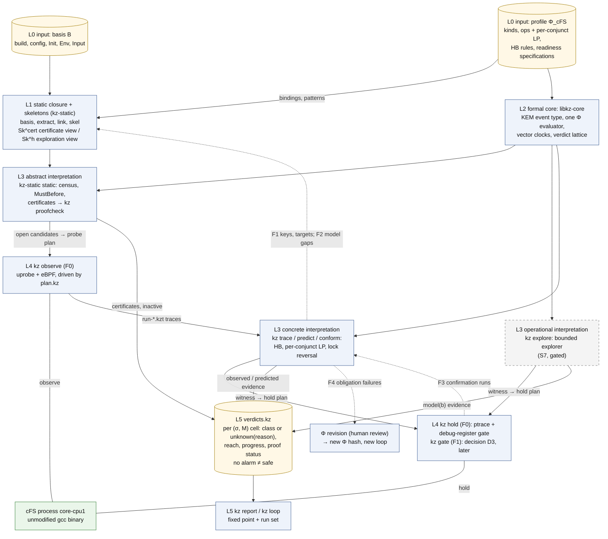

# 09 선행 연구와의 관계: 무엇을 빌려 왔고, 무엇이 새로운가

이 문서는 Kairos 설계가 기존 race·순서 위반 탐지 연구에서 무엇을 빌려 왔고 무엇만 새롭다고 주장하는지를, spec을 읽지 않은 연구자가 15–25분 안에 파악하도록 기법 계열별로 정리한다.
근거는 spec §1.11·§0.3과 배경 보고서 [R04](동적 탐지)·[R05](체계적 테스트·정적 분석)·[R06](설계안 v0.1 비판)이 검증한 문헌뿐이다. 모든 인용에 검증 상태를 붙이며, spec에 없는 설계 요소·수치·인용은 더하지 않는다.

상태: 설계 문서 — 구현·측정 전. 규범 원문: [spec/SPEC_FINAL.md](spec/SPEC_FINAL.md)(revision 1.3: 2026-10-22 PI 결정 D1–D5 반영, spec §0.12. revision 1.2: 2026-10-15 PI 결정, 용어 결정 T1, CORD 인용 정리 반영, spec §0.9–§0.11. revision 1.1: 외부 검토 EXT-20261012 반영, spec §0.7)

> **rev 1.2·1.3 반영 (2026-10-22).** 이 문서는 SPEC revision 1.1을 풀어 썼고, 이번에 revision 1.2(spec §0.10, §0.11; 결정 기록 `spec/PI_DECISIONS_RESOLVED_20261015.md`; ADR-046–ADR-052)와 revision 1.3(spec §0.12; 변경표 `plan/REV13_CHANGE_TABLE.md`; 결정 기록 `spec/PI_DECISIONS_RESOLVED_20261022.md`; ADR-053–ADR-058) 가운데 이 문서가 풀어 쓰는 절(spec §1.11, App. B, 그리고 그와 맞물리는 §8.3의 비교 범위)의 변경을 반영했다. 반영한 것은 다음과 같다.
> - **rev 1.2, 관련 연구와 실험 비교(ADR-046, ADR-047).** spec §1.11의 새 문단 "Related work and the experimental comparison"과 App. B의 머리 문단. thread data-race 도구와 FastTrack·WCP·SHB·GPredict·DefUse·DCatch 방식 재구현, 단순 상태 monitor, helgrind/DRD·ThreadSanitizer 참조점은 **관련 연구일 뿐 실험 비교군이 아니다**. 실험 비교는 기존 Process-Level Race 연구와 하고, 여섯 분석 질문과 여섯 결과 상태로 정리한다. 이에 맞춰 §0.3, §0.5, §1, §2.2, §4의 "기준선" 문단, §7, §9, 부록 A를 고쳤다.
> - **rev 1.2, §1.11 본문.** GPredict 방식 성질로 쓸 수 있다는 추론은 관련 연구에 대한 설계 근거 추론이고 실험이 아니다. R2의 행은 "reference에서 유도한 준비 상태 명세(R2의 K-ID, 근거 등급 `contract-backed`)"로 쓴다. 기여 문단에 다섯 설계 사례, 여섯 분석 질문에 의한 비교, 별도 확장 평가(D8/P-RECALL)를 넣었다. C1의 basis D22는 "결정됐고 아직 만들지 않음"이다. App. B: GPredict §II.B는 결정 전 검토에서 저자 공개본을 읽었다고 결정 기록이 적는다(이 spec은 [R04]가 확인한 것 이상으로 기대지 않는다).
> - **rev 1.2, PI 결정(2026-10-15).** P-PAPERS 승인(접근 가능한 경로부터 즉시 읽음), P-VALGRIND·P-TSAN 제외, P-NIDHUGG 보류, P-Z3(SMT는 첫 구현의 조건이 아님), P-ABL-ALLOWED(단일 요소 ablation 둘 채택, GPredict 이름의 묶음은 두지 않음), D3(F1 gate는 후순위), D9(다섯 사례와 필요한 대조).
> - **rev 1.2, 용어 결정 T1 = (a)(ADR-052).** 판정 대상은 **준비 상태 명세**(readiness specification), `Req`는 준비 사전조건, 위반은 준비 상태 위반, 출처 층은 근거 등급(source tier), refinement `tolerated`는 `allowed-not-ready`다. "계약"은 문서화된 API 의미(API 계약, M_api)와 근거 등급 이름 `contract-backed`에만 남는다. [R04]의 표현을 인용할 때는 원어를 따옴표로 둔다.
> - **rev 1.2, CORD 인용 정리(PI 결정 D12; spec §0.11 항목 1).** 참고 항목 `[R2c]`와 그 인용을 지웠다(§0.1, §2.2 출처 줄). R2의 실행 근거는 gdb 기록 [R2g]다.
> - **rev 1.3, §1.11(변경표 C-13, C-14).** 기여 문단을 **기여 가설과 반증 조건 표**로 바꾸었다(§1.1). certificate·explorer·진행 결과·loop는 선택 경로다(ADR-053). 불완전 기록 감시의 선행 연구 행(Leucker et al. RV 2019; Basin et al. TOCL 2019, 둘 다 [U])을 더했다(§4.13, 부록 A). 실행하지 못한 원 도구에 대한 기여 주장은 문헌·코드 분석의 결과 상태로만 적는다(2026-10-22 결정 D4, ADR-058; §4.10, §7). spec §6.4 항목 58–62 가운데 선행 연구와 맞닿은 것을 §9에 옮겼다.
> - **바꾸지 않은 것.** 문헌의 검증 상태(V-doc, V-abs, V-me, P, UNVERIFIED, [U])는 spec App. B와 [R04]·[R05]·[R06]의 것 그대로이고, 읽지 않은 논문의 상태를 올리지 않았다(P-PAPERS). App. B는 revision 1.3에서 바뀌지 않았다. 그림 D0의 코드 블록은 [01_overview.md](01_overview.md)와 같은 revision 1.2 판으로 맞췄고, `diagrams/`의 원본은 그림 단계에서 맞춘다.
>
> 이 변경은 결정 [D]이고 결과가 아니다. 이 판을 위해 만들거나 실행한 것은 없고, 연구 조건도 정하지 않았다. **우선 규칙**(spec §0.12 "Precedence", ADR-053): revision 1.0–1.2를 위해 쓴 문장 가운데 certificate, explorer, 진행 결과, loop를 Kairos의 첫 산출물·필수 산출물로 부르는 것은 ADR-053에 따라 읽는다.

## 목차

- [0. 읽기 전에](#0-읽기-전에): 표기, 검증 상태, **원문 PDF를 열지 못한 제약(P-PAPERS)**, "sound"라는 말, Kairos 용어
- [1. 입장: 메커니즘은 빌렸고, 조합만 주장한다](#1-입장-메커니즘은-빌렸고-조합만-주장한다): 기여 가설과 반증 조건(rev 1.3), 관련 연구와 실험 비교(rev 1.2)
- [2. 왜 data race 탐지만으로는 부족한가](#2-왜-data-race-탐지만으로는-부족한가) (spec §1.11)
- [3. 빌려 온 기법이 Kairos 안에서 놓이는 자리 (그림 D0)](#3-빌려-온-기법이-kairos-안에서-놓이는-자리-그림-d0)
- [4. 기법 계열별 관계](#4-기법-계열별-관계): HB·vector clock, lockset, 예측 분석, order·atomicity violation, event 구동, 분산, 체계적 테스트, BMC·SMT, 정적 분석, process-level 도구, 확인·triage·후보 발견, typestate, 불완전 기록 감시(rev 1.3)
- [5. 무엇이 새로운가: gap G1–G8](#5-무엇이-새로운가-gap-g1g8)
- [6. cFS 메커니즘 → 기법 대응 표](#6-cfs-메커니즘--기법-대응-표)
- [7. 실험 비교와 관련 연구](#7-실험-비교와-관련-연구-spec-83) (spec §8.3; rev 1.2부터 기준선 표는 철회)
- [8. 설계 안의 계보](#8-설계-안의-계보-spec-03-05) (spec §0.3, §0.5)
- [9. 이 문서가 주장하지 않는 것](#9-이-문서가-주장하지-않는-것)
- [10. 관련 문서](#10-관련-문서)
- [부록 A. 문헌과 검증 상태 일람](#부록-a-문헌과-검증-상태-일람)

---

## 0. 읽기 전에

### 0.1 근거 표기

표기는 spec 머리말을 따른다(자세한 설명은 [01_overview.md §0](01_overview.md#0-읽는-법)).

| 표기 | 뜻 |
|---|---|
| [F] | 코드·기록·보고서 인용이 있는 사실 |
| [M] | 측정값. 이 문서의 [M]은 모두 spec이 인용한 기존 기록이다([R2g], [BM]). Kairos는 아직 아무것도 측정하지 않았다 |
| [I] | 추론 또는 설계상 추론. 실행하지 않았다 |
| [D] | 설계 결정. spec §11의 ADR이 기록한다 |
| [U] | 미확인 |

인용 형식: "(spec §4.9)"는 SPEC_FINAL.md의 절이다. "[R04 §2.5]"는 `background/`의 보고서이고, "[R04 L259]"는 그 보고서의 줄 번호다. "[X1-M12]"는 검토 쟁점 번호다([spec/ISSUE_RESOLUTION.md](spec/ISSUE_RESOLUTION.md)). "[B §4.4]"처럼 쓴 [A]·[B]·[C]는 `history/`의 설계 제안 A·B·C다(§8). "[LED]"는 `cases/ledger.md`, "[R2g]"는 `results/R2_gdb_v701.md`(R2의 gdb 기록), "[BM]"은 `env/BASELINE_MEASURE.md`다. 폐기한 기록기 CORD의 결과는 근거로 쓰지 않는다(PI 결정 D12). 참고 항목 `[R2c]`와 그 인용은 revision 1.2에서 spec에서 지웠고, 이 문서에서도 지웠다(spec §0.11 항목 1). R2의 실행 근거는 gdb 원시 기록 `env/logs/r2_g1..3_*`와 [R2g]다. "[P0.2]"는 revision 1.3의 기초가 된 제안 문서 0.2다(spec 머리말; 이 폴더에는 없다).

**인용 형식과 이름이 겹치는 기호.** 인용 형식(설계안 [A]/[B]/[C], 심사 [J1]–[J3], 검토 [X1]–[X3], [X3, here], v0.1 등)은 [01_overview.md §0](01_overview.md#0-읽는-법)에 모아 두었다. 같은 기호가 여러 뜻으로 쓰이므로 이 문서는 앞에 종류를 붙인다: "PI 결정 D4"와 "그림 D4", "보장 G5"와 "gap G5", "단계 S0"와 "Init snapshot S0", HB stratum S/O와 cold/warm 층(stratum). 전체 목록은 [10_decisions_adr.md §0.2](10_decisions_adr.md#02-이름-충돌-주의)다.

### 0.2 문헌의 검증 상태와 "spec 미사용" 표시

| 표지 | 뜻 ([R04 §0.2]; [R05 §0.2]; [R06 §9]) |
|---|---|
| V-doc | 보고서 작성자가 원문을 직접 읽었다. 예: Linux KCSAN 설계 문서, Nidhugg·GenMC README |
| V-abs | 저자·제목·학회·연도와 **초록 수준의 주장**을, 출판사·저자·DBLP 페이지를 인용한 검색 결과로 확인했다. 본문은 보지 못했다 |
| V-me | [R06] 작성자가 검색으로 서지와 초록 수준 내용을 확인했다 |
| P | 일부만 확인했다. 확인하지 못한 세부를 함께 적는다 |
| UNVERIFIED | 확인하지 않았다. 어떤 결론에도 쓰지 않는다 |

spec 부록 B는 spec이 기대는 문헌 목록을 닫아 두고, 그 밖의 문헌에는 기대지 않는다고 적는다(spec App. B). revision 1.2부터 부록 B의 thread 수준 도구와 기법은 관련 연구이거나 메커니즘의 출처일 뿐이고, 어느 것도 실험 비교군이 아니다(spec App. B 머리 문단; §8.3; ADR-046). 실험 비교는 기존 Process-Level Race 연구와 하며, 그 논문들은 P-PAPERS 아래에서 읽고 상태는 `baselines/availability.md`에 있다(spec App. B). 이 문서는 기법 계열을 설명하려고 [R04]·[R05]에만 있는 문헌도 언급한다. 그런 문헌에는 **"spec 미사용"**을 붙인다. spec 미사용 문헌은 맥락일 뿐이며, Kairos의 어떤 설계 결정이나 주장도 그것에 기대지 않는다. 예외로, 부록 B에 없지만 spec §8.3이 실험 비교 대상으로 이름을 대는 process-level 도구(SimRacer, SIMEXPLORER, RRF, SimEvo, ReDPro, SysPro)에는 "spec §8.3 비교 대상"을 붙인다. 이 문서가 적는 상태 표지는 [R05]의 것 그대로이고, spec이 비교에 쓰는 상태와 자료 기록은 `baselines/availability.md`다.

### 0.3 원문 PDF를 열지 못했다 (P-PAPERS)

이 문서의 모든 문헌 서술은 다음 제약 아래에 있다.

- **확인 경로.** [R04]와 [R05]는 문헌을 WebSearch로 확인했다. Scholar Gateway 검색은 모든 호출에서 거부되었다(`ACCESS_DENIED`). 논문 PDF는 session의 egress 정책 때문에 받을 수 없었다(arxiv.org, dl.acm.org, usenix.org 등이 403). 보고서 작성자는 이 차단을 우회하지 않았다([R04 §0.1]; [R05 §0.1]).
- **원문을 읽은 것.** raw.githubusercontent.com에서 받은 문서만 끝까지 읽었다. KCSAN 설계 문서와 Go memory model([R04 §0.1]), 그리고 Nidhugg·GenMC·CBMC·ESBMC·Goblint·SVF의 README와 LLVM·MLIR 문서·헤더다([R05 §0.1]).
- **결과.** 논문 **본문**에만 있는 보장과 규칙은 확인하지 못했다. 그래서 이 문서는 논문의 주장을 초록 수준(V-abs)까지만 옮긴다.
- **외부 검토.** 외부 검토 EXT-20261012([history/review_EXT_20261012.md](history/review_EXT_20261012.md))는 세 논문을 확인한 범위를 적는다(검토 §10). Joshi & Sen은 초록과 서론, GPredict는 초록, 서론, §II.B, Lifestate는 공식 초록이다. spec은 Joshi & Sen과 Lifestate의 내용을 초록과 이 검토로만 알고 선행 연구로만 인용한다. GPredict §II.B의 성질 형식은 이 검토와 검색 snippet으로만 안다 [U] (spec App. B).

확인하지 못해서 설계에 흔적이 남은 항목은 다음과 같다.

| 확인하지 못한 것 | 영향을 받는 곳 | spec의 처리 |
|---|---|---|
| DroidRacer, CAFA, EventRacer, DCatch의 HB 규칙표 | 규칙별 대조 | 일반적 모양만 인용한다. 규칙표는 open literature check(문헌 확인이 끝나지 않은 항목)다 (spec App. B; [R04 §8 항목 3]) |
| DPOR(POPL 2005)의 보장 문구 | — | UNVERIFIED로 표시하고 근거로 쓰지 않는다 (spec §1.11) |
| source-DPOR를 disabling(한 연산이 다른 연산을 막는 경우, 예: lock)까지 넓힌 JACM 2017 정리(가정 T-JACM) | explorer `dpor` 엔진의 보장 G5 | `dpor` 판정은 "unverified"로 표시한다. 상태를 저장하는 완전 탐색 엔진 `exh`는 영향이 없다 (spec §4.10 항목 4, §6.2 L-DPOR) |
| left/right mover reduction 정리 | explorer 축약 L3의 인용 | L3을 증명 의무로만 쓰고, 인용은 open literature check로 둔다 (spec §4.10 항목 5) |
| timeout 조건부 HB edge(gap G3)의 새로움 | 새로움 문구 | RV·TACAS 등에 대한 targeted search를 하지 않았다. "open literature check"로만 적는다 ([R04 §8 항목 5]; spec §1.11) |
| 원 논문의 worked example | process-level 기법 재구현(K2, 원 도구를 돌릴 수 없을 때만)의 golden test(정답이 정해진 회귀 시험) | 원문에 접근할 수 있을 때만 만든다 (spec §8.3) |
| GPredict(ICSE 2015)의 §II.B 성질 형식(MOP에서 가져옴, P) | §2.2, §4.3, §5의 GPredict 서술 | [R04]가 기록한 만큼만 적는다. 그 형식이 무엇을 표현하는지는 [U]다. spec은 유한 horizon Allowed 항목을 GPredict 방식 성질로 쓸 수 있다고 추론한다 [I]. revision 1.2부터 이 추론은 관련 연구에 대한 설계 근거이고 실험이 아니며, GPredict 방식 재구현은 비교군이 아니다. 그래서 표현력의 차이를 주장하지 않는다 (spec §1.11, §8.3, App. B; §6.4 항목 37). 결정 기록은 결정 전 검토에서 GPredict의 저자 공개본을 읽었다고 적지만, spec은 [R04]가 확인한 것 이상으로 기대지 않고, 이 형식에 대한 진술은 §II.B를 여기서 읽을 때까지 [U]다 (spec §1.11, App. B) |
| Joshi & Sen(ASE 2008)과 Lifestate(ECOOP 2019)의 본문 | framework typestate에 대해 주장하는 차이(§1, §4.12, §5 gap G1) | 선행 연구로만 인용한다. 서지는 V이고, 내용은 초록과 외부 검토로만 안다. 차이 주장은 두 논문을 읽기 전까지 확정하지 않는다 (spec §1.11, App. B) |

PI 결정 **P-PAPERS**(원 논문에 접근하는 길)는 2026-10-15에 **승인되었고 바로 시작한다** [D]. 접근 가능한 경로(저자 공개본, 기관 저장소, 연결된 학술 검색)부터 읽고, 한 환경이 막혔다고 사용자가 주는 PDF를 전제 조건으로 삼지 않는다. 결정 기록은 RacePro와 GPredict의 저자 공개본을 결정 전 검토에서 확인했다고 적는다. 다른 논문에 접근했다고 가정하지 않으며, 읽지 않은 도구의 표현력이나 관측 범위를 검색 발췌로 말하지 않는다(spec §10.1 P-PAPERS; [spec/PI_DECISIONS.md](spec/PI_DECISIONS.md)). 이 결정은 계획에 대한 결정이고 논문을 읽은 결과가 아니다. 그래서 위 표의 항목은 **논문을 읽을 때까지** 그대로 막혀 있다. spec §10.1이 아직 막혀 있다고 적는 것은 `dpor`의 보장 G5, L3 인용, golden test(V4a), [U]로 표시한 진술이다. [R04 §8]과 [R05 §7 항목 6]에 남은 인용 확인 목록도 같은 이유로 열려 있다. P-PAPERS의 항목에는 GPredict §II.B의 성질 형식, Joshi & Sen(ASE 2008), Lifestate(ECOOP 2019)도 들어 있다. 이 셋을 읽기 전에는 §1.11의 GPredict 서술과 framework typestate에 대해 주장하는 차이가 확정되지 않는다(spec §1.11, App. B). 이 문서의 문헌 상태 표지는 이 결정으로 바뀌지 않았다.

### 0.4 "sound"라는 말

공동체마다 같은 단어를 반대로 쓴다([R04 §0.5]; [R05 §0.5]).

- **예측 분석(PL 공동체).** sound는 "보고한 race가 모두 진짜", 즉 false positive가 없다는 뜻이다(CP, WCP, SHB, M2, SyncP, Vindicator).
- **정적 분석·검증.** sound는 "놓치는 버그가 없다"(over-approximation), complete는 "false alarm이 없다"는 뜻이다.
- **KCSAN 문서**는 스스로를 "unsound (false negatives possible), but aims to be complete (no false positives)"라고 쓴다 [V-doc].
- **spec**은 한정어 없는 "sound"를 쓰지 않는다. "M과 가정 A에 상대적으로 over-approximate", "경계 b까지 complete"처럼 쓰고, 이 태도를 soundiness라 부른다(Livshits et al. CACM 2015 [V-abs]; spec §6 머리말).

이 문서는 각 논문의 보장을 그 논문의 용어로 옮긴다.

### 0.5 필요한 Kairos 용어

이 문서를 읽는 데 필요한 만큼만 적는다. 전체 용어집은 [10_decisions_adr.md §3](10_decisions_adr.md#3-용어집)이다(원문 spec §13).

| 용어 | 뜻 (spec 위치) |
|---|---|
| 준비 상태 명세 (readiness specification, κ) | framework 자원(OSAL object, ES 기록, SB route 등)을 쓰는 연산이 그 자원의 특정 lifecycle 상태를 요구한다는 규칙. 준비 사전조건 **Req**(readiness precondition: 사용 시점에 참이어야 할 조건의 논리곱. 자원 상태에 대한 요구이고, 누가 그것을 약속했다는 뜻이 아니다), 상태가 맞지 않을 때 호출자·소비자·미션 쪽 근거가 받아들이는 결과 **Allowed**(재시도, 문서화된 연기, 문서화된 대안 등. 항목마다 reference horizon이 붙는다), 그 사용이 호출하는 앱이나 미션을 위해 이뤄야 할 것을 적은 **`appreq`**를 가진다. API가 문서화한 오류 반환 자체는 Allowed가 아니라 framework 수준 판단으로 따로 적는다. 준비되지 않은 `VIOLATING` 발생은 **준비 상태 위반**(readiness violation)이고 순서 위반의 한 부류다. 용어 결정 T1 = (a)(2026-10-15)에 따른 이름이고, 옛 이름은 "준비 계약(readiness contract)"이다. "계약"은 문서화된 API 의미(API 계약, M_api)와 근거 등급 이름 `contract-backed`에만 남는다. 한국어로는 줄이지 않고 "준비 상태 명세"로 쓴다 (§1.6, §0.11, App. C; ADR-052) |
| 근거 등급 (source tier) | instance 뒤에 어떤 종류의 근거가 서 있는지: `contract-backed`, `requirement-derived`, `admitted`, `issue-derived`, `code-derived`, `researcher`, `unreferenced`. 보고할 때 `prov` 기록과 호출자 수준 Allowed에서 유도하고, 섞이면 약한 쪽을 쓴다 (§1.6, §13) |
| 세 판단 | 준비되지 않은 사용을 세 번 따로 판단하고 기록도 따로 둔다. framework 수준(공급자가 문서화하고 하는 것: `fw_doc`, `fw_conf`), 호출자 수준(`appreq`와 호출자 수준 Allowed. 상태, class, 결과 label, harm을 정한다), 관측된 결과(`consequence`)다. 공급자의 문서화된 결과만으로 TOLERATED가 되는 발생은 없다. `rule` 기록만으로는 어떤 발생도 받아들여지지 않는다(QT-4 엄격한 대안, 2026-10-15) (§1.6 "Three judgements", §1.10; ADR-043, ADR-048) |
| 비교의 세 종류 K1–K3 | K1 공개된 그대로 돌린 원 도구, K2 원 도구를 돌릴 수 없을 때만 그 논문·코드로 만든 **process-level 기법**의 재구현(원 도구 결과와 따로 둔다), K3 Kairos의 한 요소를 뺀 ablation. 이름, 표, 결론에서 섞지 않는다. revision 1.2 전의 K2(thread 수준·예측 기법의 같은 정보 재구현)는 철회되었다 (§8.3; ADR-042, ADR-046) |
| 여섯 분석 질문, 결과 상태 | 기존 Process-Level Race 연구의 (도구, 사례)마다 답하는 같은 질문 여섯과, 칸마다 하나씩 붙는 상태 `NOT_RUN`, `INAPPLICABLE`, `PATH_NOT_EXECUTED`, `OBSERVATION_GAP`, `ANALYSIS_GAP`, `REPORTED` (§8.3; ADR-047). 표는 [01_overview.md §2.5](01_overview.md#25-실험-비교의-범위-기존-process-level-race-연구-spec-83)에 있다 |
| Φ_cFS | 자원 종류, lifecycle automaton, 연산의 효과, HB 규칙, 준비 상태 명세를 선언한 cFS profile. Kairos의 세 해석기가 같은 Φ를 쓴다 (§0.2) |
| linearization point (LP) | 연산의 효과가 한 순간에 일어났다고 보는 지점. Kairos는 요구 조건의 conjunct마다 LP를 둔다. **capture point**는 호출자가 값을 미리 읽어 둔 load 지점이다 (§1.4) |
| σ, M | 스케줄 의미론(σ_U: 시간을 무시한 임의 interleaving, σ_U∞: σ_U에서 시간 기반 전이(timeout 등)를 뺀 것, σ_R1: 한 CPU의 고정 우선순위, σ_E: 실제 실행)과 OSAL 모형 수준(M_api: API 계약 수준, M_impl: POSIX 구현 수준) (§1.8, §1.4) |
| S / O / C_σ | HB 규칙의 층. S는 두 끝이 있는 모든 실행에서 성립하는 구조적 순서, O는 관측한 실행에서만 성립하는 동기화 순서(예측에서 뒤집을 수 있음), C_σ는 σ_R1의 스케줄 제약(HB가 아님) (§1.9) |
| MustBefore, PWB | MustBefore는 "모든 실행에서 a가 n보다 먼저"라는 정적 관계다. PWB(precedes-whenever-both-occur)는 "둘 다 일어나는 실행에서는 항상 a가 먼저"라는 관계다 (§1.9, §4.4) |
| certificate | **안전성 진술 하나**의 검사 가능한 증명 기록. FIXED_ORDER certificate는 `¬OK_i`(도달한 in-scope 발생 중 READY나 TOLERATED가 없다)를 증명하고, 그 REJECT가 발생의 결정 시점에 있을 때 fixed-order를 뒷받침한다. PROTECTED certificate는 `¬NR_i`(도달한 in-scope 발생 중 미준비로 결정된 것이 없다)를 증명하고 protected를 뒷받침한다. 검사기 `kz proofcheck`가 명시한 trusted base(추출 사실, skeleton, closure 목록, Φ, `libkz-core`)에 상대적으로 그 추론 단계를 다시 검증하고, `libkz-core`를 부른 단계를 표시해 네 부분 **trust ledger**(다시 검증한 단계, 추출 사실, 신뢰 항목, 반박될 수 있지만 증명되지 않은 항목)에 남긴다. revision 1.3부터 certificate는 **선택 경로**다. 필수 경로는 관측 기반 판정, 한정 예측, 제어 실행 확인이고, certificate는 보편 순서 주장이 필요할 때 쓴다(ADR-053) (§4.5, §4.5.1, §13) |
| witness | 판정을 뒷받침하는 구체적 실행 순서 (§4.9) |
| class | `inactive`, `protected`, `fixed-order`, `no-final-status`, `schedule-dependent`, `ordinal-split`, `unknown(reason)`. 유한 실행 위의 안전성 진술에서 정한다. 영구 대기와 deadlock은 class가 아니라 칸마다의 진행(progress) 결과다. **어떤 class도 "safe"가 아니다.** 경보가 없다는 것은 근거가 없다는 뜻이다 (§0.1, §1.10) |

---

## 1. 입장: 메커니즘은 빌렸고, 조합만 주장한다

spec의 선행 연구 입장은 한 문장이다. **"개별 메커니즘에는 모두 선행 연구가 있다"**(spec §1.11 마지막 문단).

새롭다고 주장하지 않는 메커니즘은 spec §6.4 항목 18이 이름으로 적는다.

- HB와 vector clock, DPOR, PCT, lockset, delay injection, 예측 분석, SMT 인코딩, points-to 분석
- key를 충돌 대상으로 삼는 lock 뒤집기(RVPredict/GPredict)
- 늦은 등록으로 생기는 손실(InitRacer)
- 예측된 초기화 전 사용(ExceptioNULL)
- framework typestate(predictive typestate checking, Joshi & Sen; Lifestate)

"최초의 process race detector"라는 말도 쓰지 않는다. RacePro, SimRacer 등이 이미 있다(spec §6.4 항목 24; [R06 §6.3 항목 11]).

revision 1.3은 그 밖에 다음도 그 자체로는 새로움으로 주장하지 않는다고 적는다: 불완전한 기록 위에서의 보수적 판정, 애플리케이션 소유의 표시, SMT solver의 사용, certificate가 있다는 사실(spec §1.11 "Contribution hypotheses"; §6.4 항목 62).

### 1.1 기여 가설과 반증 조건 (revision 1.3)

revision 1.3은 기여를 사실이 아니라 **시험할 가설**로 적는다 [D] (spec §1.11 "Contribution hypotheses and their falsification"; [P0.2] §16.1.1; 2026-10-22 결정 D4; ADR-053, ADR-058; 변경표 C-13).

**가설.** cFS task 사이에는 기존 process race 탐지의 관측 표현과 자원 효과 표현이 놓치는 process-level 순서 위반이 있다. 그리고 cFS의 자원 identity, 상태 효과, 실행 제약, task→앱 매핑을 명시적으로 잇는 탐지기가 그 차이를 줄인다. 연구 대상은 여전히 process-level 순서 위반의 탐지다.

| 시험할 주장 | 필요한 근거 | 주장할 수 없는 경우 |
|---|---|---|
| 기존 기법이 이 사례들에서 실제로 모자란다 | 같은 사례와 basis에서 원 도구의 관측, 표현, 탐색, 판정을 따라가 본 것. **원 도구를 돌릴 수 없으면 spec §8.3의 문헌·코드 분석 결과 상태만** 쓴다(2026-10-22 결정 D4) | 원 도구가 이미 그 조건을 탐지하거나, 환경 구축 실패만 보인 경우 |
| 새 모형화와 분석이 탐지를 낫게 한다 | 같은 입력과 조건에서 요소 하나씩의 효과(자원 수명, 값의 출처, 실행 제약, 소유; spec §8.4) | 보고서에 앱 이름만 더해지거나, 단순 상태 검사가 같은 판정과 발견을 내는 경우(R2, spec §6.4 항목 58) |
| 실행에서 보이지 않은 실제 잠재 위반을 찾는다 | 기록에 없는 후보가 유효한 값과 경로를 갖고, 같은 basis에서 확인되거나(spec §4.13), 근거 있는 예측 보장이 있는 것 | 실현 불가능한 후보만 더해지거나, 실패가 통제의 부작용에서만 오는 경우(CF-04) |
| 규칙이 다섯 사례에 맞춘 것이 아니다 | 동결한 engine과 일반 규칙을 새 사용에 적용하고, 그때 더 든 적응 비용(spec §7.5) | 대상마다 버그 전용 조건이 필요한 경우 |

GPredict의 원리를 cFS에 적용한 것만으로 충분한 새 기여가 보이지 않으면, 그 한계를 보고하고 알고리즘과 표현이 실제로 더하는 효과를 더 시험한다. 관측 판정과 사례 basis 구축은 차별점 시험보다 먼저 한다(spec §1.11). 기존 도구에 대한 이 주장은 "탐지하지 못한다"로 쓰지 않는다(§7.3; ADR-058).

### 1.2 revision 1.2까지의 기여 문단 (기록으로 남김)

아래는 revision 1.2의 "Defensible contribution" 문단이다. spec은 이것을 이전 주장의 기록으로 남기고, certificate를 첫 기여로 부르는 곳에서는 ADR-053이 앞선다고 적는다(spec §1.11). 그 문단이 방어할 수 있다고 본 기여는 다음 조합이다 [I] ([X1 §4]를 따르고 EXT-20261012 §3, §5.1–§5.2가 고쳤다).

1. σ와 M을 밝힌 **must-order certificate**. 관측된, HB상 순서가 정해진 준비 상태 위반을 보편 class `fixed-order`로 끌어올린다. 이것은 명시한 trusted base에 상대적으로 다시 검증한 안전성 진술이다(trust ledger, spec §4.5.1). revision 1.3에서 이 경로는 선택 경로이고, R2에 certificate가 필요하지 않다(ADR-053).
2. 출처와 reference horizon이 붙은 **호출자 수준 Allowed** 결과(spec §1.6 "Three judgements")와 **conjunct별 LP**.
3. 위 둘을 **lock을 뒤집는 예측**, **hold 확인**(실제 바이너리에서 한 thread를 붙잡아 순서를 강제하는 확인), **평가**와 결합한 것. 평가는 다섯 설계 사례에서 탐지, 분류, 근거를 따로 보고하고, spec §8.3의 여섯 분석 질문으로 기존 Process-Level Race 연구와 비교하며(차이는 기존 도구의 부족이 확인된 곳에서만), 별도의 확장 평가(D8/P-RECALL)에서 놓친 것을 history 유래 mutant와 수정 전후 쌍으로 잰다(recall protocol).
4. 이 전체를 cFS 의미론, 곧 [R04 §5]의 **gap G1–G8**(§5)을 중심으로 조직한 것.

**더 가까운 선행 연구 셋** (spec §1.11). 개별 메커니즘 말고도 세 갈래가 더 가깝다. 예측된 trace에서 사용자가 쓴 속성을 검사하는 GPredict(ICSE 2015 [V-abs]), 다중 thread 프로그램의 predictive typestate checking(Joshi & Sen, ASE 2008), trace 위에서 검사하는 framework 생애주기 typestate와 protocol 명세(Lifestate, ECOOP 2019)다. 세 논문 모두 전문을 읽지 않았다(P-PAPERS; §0.3).
- 그래서 후보 기여는 cFS에 특화한 추출, 분류, 근거다. 명세나 framework typestate를 쓰는 것 자체가 아니다.
- Joshi & Sen과 Lifestate에 대해 주장하는 차이는 하나뿐이다. 호출자·소비자·미션의 reference가 받아들이는 미준비 결과마다 reference horizon과 출처가 붙고, framework의 문서화된 결과는 따로 보고한다(spec §1.6). 이 차이도 두 논문을 확인할 때까지 보류다.
- 다른 명세 기반 기법이 Allowed를 표현하지 못한다는 주장이 아니다(spec §6.4 항목 37).
- R2 밖에서도 보여야 한다. C1, C2, C3, C5에서 분류 차이는 explorer(S7)와 사례 basis(C1은 D22: 결정됐고 아직 만들지 않음, C2는 P-C2, C3·C5는 D13)가 있어야 나온다. R2 하나에 그친 결과는 단일 사례 결과다(spec §1.11, §8.8, §9.3). revision 1.3에서 R2는 관측 경로의 기반 검증이고 기여의 증거가 아니며, 기여 증거의 첫 사례는 C1이다(2026-10-22 결정 D3; ADR-057; spec §6.4 항목 58).

### 1.3 관련 연구와 실험 비교 (revision 1.2)

이 문서가 다루는 기법 계열 가운데 thread data-race 탐지기(FastTrack, TSan, Djit+, Eraser 방식 lockset 도구), 예측 분석(CP, WCP, SHB, M2, SyncP, RVPredict, GPredict, ExceptioNULL), DefUse, DCatch는 위치를 잡기 위한 **관련 연구**다 [D] (spec §1.11 "Related work and the experimental comparison"; ADR-046). 이들은 실험 비교군이 아니고, 비교를 위한 재구현도 만들지 않는다. 실험 비교는 기존 Process-Level Race 연구(RacePro, SimRacer, SIMEXPLORER, RRF, DESCRY, SimEvo, ReDPro, SysPro)와 한다(spec §8.3; §7). 이 결정은 위 표들이 각 선행 연구가 하는 일에 대해 적은 것을 바꾸지 않고, 그 서술은 [R04]에 기댄다. 2026-10-15의 로드맵(`plan/ROADMAP_20261015.md` §10.3, §11.5)과 결정 기록(§4.4)은 결정 전 검토에서 RacePro와 GPredict의 저자 공개본을 읽었다고 적는다. spec은 그것에 [R04] 이상으로 기대지 않고, GPredict의 형식에 대한 진술은 그 §II.B를 여기서 읽을 때까지 [U]다(P-PAPERS, 2026-10-15 승인, 바로 시작) (spec §1.11).

이 입장은 검토에서 고쳐졌다. 검토 X1은 이전 판(v1)이 InitRacer와 RVPredict/GPredict에 이미 있는 것을 Kairos가 더하는 것처럼 적었고, ExceptioNULL을 인용하지 않았으며, gap G3의 새로움을 검색하지 않았다고 지적했다([X1-M12]). spec은 이를 받아 §1.11을 고치고 같은 계열의 비교 도구 셋을 더했다(ADR-025, ADR-037). 외부 검토 EXT-20261012는 비교를 다시 고쳤다(spec §0.7 항목 6; ADR-042). 그때 같은 계열 비교 도구는 Kairos와 같은 성질 정보를 받았다. **revision 1.2는 이 비교 도구들을 철회했다**(ADR-046, ADR-047. ADR-025는 대체되었고, ADR-037의 비교 관련 부분과 ADR-042의 일부도 대체되었다. 선행 연구에 대한 인정은 그대로다). 요소를 뺀 결과는 Kairos의 ablation으로만 읽고, 선행 기법이 무엇을 표현하는지의 증거로 쓰지 않는다(§7).

---

## 2. 왜 data race 탐지만으로는 부족한가

### 2.1 기본 개념

- **data race**: 두 thread가 같은 메모리 위치에 동기화 없이 접근하고, 그중 하나 이상이 쓰기인 경우다.
- **happens-before(HB)**: 한 실행 안에서 program order(같은 thread 안의 실행 순서)와 동기화(lock 해제 → 다음 획득, 메시지 송신 → 수신)로 정해지는 "반드시 먼저" 관계다(Lamport 1978 [V-abs]).
- **vector clock**: HB를 계산하는 자료 구조다. thread마다 "다른 각 thread의 사건을 몇 번째까지 알고 있는가"를 숫자 벡터로 들고 다닌다(Fidge 1988; Mattern 1989 [V-abs]).
- HB detector는 **HB로 순서가 정해지지 않은** 충돌 접근 쌍을 보고한다. 예측 detector도 **재배열할 수 있는** 쌍만 보고한다([R04 §3 L4]).

Netzer와 Miller(LOPLAS 1992 [V-abs])는 data race(동기화 없는 충돌 접근)와 general race(의도한 순서가 보장되지 않는 것)를 구분하고, 실제로 일어날 수 있는 race(feasible)와 겉보기 race(apparent)도 구분한다. [R04]는 cFS의 준비 위반이 data race라기보다 general race나 order violation이라고 본다 [I] ([R04 §0.5]). 그래서 조사 범위를 data race detector 밖으로 넓혔다.

### 2.2 cFS 현상과 기존 기법 (spec §1.11 표)

아래 "기존 기법" 열의 도구는 모두 관련 연구이고 실험 비교군이 아니다(§1.3; ADR-046). 각 기법이 하는 일에 대한 서술은 [R04]가 확인한 수준이다.

| cFS 현상 | 기존 기법이 하는 것 | Kairos가 더하는 것 (새 메커니즘 주장 없음) | [R04 §5]의 gap (§5) |
|---|---|---|---|
| **R2**: SB의 AppId가 발행되기 전에 ES·EVS init이 SB 코드로 이벤트를 보낸다. 위반 사용은 core 직렬화 때문에 HB상 발행보다 **앞선다** | FastTrack, TSan, Djit+는 순서 없는 충돌만 보고한다. CP, WCP, SHB, M2, SyncP는 재배열 가능한 쌍만 보고한다. DefUse는 R2의 잘못된 정의를 정상으로 배울 것이다 [I]. GPredict는 사용자가 쓴 일반 속성의 위반을 인과 모형 아래에서 예측한다. [R04 L553]의 "합법적 오류 결과라는 개념이 없다"는 [R04 §5]의 초록 수준 추론이다. [R04]는 GPredict에 문서화된 미준비 결과의 어휘가 내장되어 있다고 기록하지 않는다(초록 수준, [I]). 도구와 그 속성 형식(MOP에서 가져옴, P)은 확인하지 못했다(P-PAPERS) [U]. spec은 유한 horizon Allowed를 GPredict 방식 성질로 쓸 수 있다고 추론한다 [I]. revision 1.2부터 이것은 관련 연구에 대한 설계 근거 추론이고 실험이 아니다 (spec §1.11, §8.3) | reference에서 유도한 준비 상태 명세(R2의 K-ID, 근거 등급 `contract-backed`)와 호출자 수준 Allowed(출처와 reference horizon이 붙는다. spec §1.6 "Three judgements")를 **순서가 정해진 쌍**에도 검사하고, σ·M을 밝힌 PWB certificate로 "잘못된 방향으로 정해짐"을 `fixed-order`로 끌어올린다 | gap G1, G2 |
| **C1, C5, App-record 구간**: 같은 lock 아래의 생성/조회, 발행/`GetAppID` | HB는 lock으로 순서를 정하고, lockset은 일관된 보호를 본다. RVPredict·GPredict 식 제약 인코딩은 이미 key를 충돌 대상으로, lock을 원자성으로 다룬다. ExceptioNULL은 "초기화 전 사용"을 예측한다 | solver 대신 explicit-state 탐색(공학적 선택). framework typestate에는 선행 연구가 있다(predictive typestate checking, ASE 2008; Lifestate, ECOOP 2019). Kairos가 여기에 더하는 것은 호출자·소비자·미션의 reference가 받아들이는 미준비 결과(호출자 수준 Allowed)에 reference horizon과 출처를 붙이는 것뿐이고(framework의 문서화된 결과는 따로 보고한다), 두 논문을 확인할 때까지 보류다(P-PAPERS). 첫 행의 추론이 미치는 만큼 GPredict 방식 성질로도 쓸 수 있다고 보므로 [I] 표현력의 차이로 주장하지 않는다. 그 밖에 같은 서수 짝으로 정하는 σ별 class, S-edge가 쌍의 순서를 정하는 곳에서만 나오는 certificate(C1의 B′에서 앱이 제공자인 경우와 C5의 lock 범위 수정에는 없을 것으로 본다 [I]), hold 확인. **예측 건전성은 RVPredict보다 약하다**(A-COMM) | gap G4(좁혀짐: RVPredict·GPredict) |
| **SB 구독 전 송신**: 늦은 구독 때문에 송신이 손실된다. 송신자에게는 성공 반환이라 보이지 않는다. SB는 이를 세고(`NoSubscribersCounter`) `SEND_NO_SUBS` event를 시도한다. R2 구간에서는 그 event가 EVS에서 거부되고 [M], 구간의 counter 증가는 나중에 SB 자신의 초기화가 지운다 [I]. 그래서 그 구간의 손실은 구간 뒤에 남는 흔적이 없다 [I] | InitRacer의 "late event handler registration" | 그 분류의 cFS instance. registry를 key로 쓰고, 전달을 요구하는 `appreq`가 없으면 호출자 수준에서 LOSS-UNDER-ORDER다. framework 수준 판단(cSB4305.5: 오류 아님)은 옆에 따로 적고 합치지 않는다 (spec §1.10, §3.9) | gap G5 아님(InitRacer의 늦은 등록) |
| **용량 손실**: queue가 차면 조용히 버린다. 부팅당 4–49건 [M] ([BM §0]) | event·분산 HB 모형은 전달을 가정한다 | 용량을 typestate로 두고 가능한 순서가 결과를 바꾸는지 묻는다. **gap G5가 실제로 열린 곳은 용량뿐이다** | gap G5 |
| **soft barrier**: `WaitForStartupSync`는 void를 반환한다(`cfe_es_api.c:616–619`) | EventRacer, Tian et al.은 ad hoc 동기화를 인식하지만 timeout 조건부 edge는 없다 | 조건부 O-edge, guard가 붙은 S-edge, σ_U/σ_U∞ 분리, timeout-dependent refinement. **새로움은 open literature check** | gap G3 |
| 실행 task ≠ 소유 앱 ≠ 서비스 ≠ 찍힌 AppId | thread identity. CAFA/DroidRacer는 thread와 event를 나누고, DCatch는 RPC pool을 추상화한다 | identity 필드 넷, on-behalf frame, capture point | gap G6 |
| 구성이 도달 여부와 용량을 정한다 | 구성을 주어진 것으로 받는다 | 구성 closure를 포함한 basis B, `inactive`, provider 축 | gap G7 |
| 우선순위 순서는 RT target에서만 성립한다 | edge도 없고 판정도 없다 | σ_R1[P_sched]를 schedule 제약으로 두고 σ마다 판정 | gap G8 |

출처: spec §1.11, §3.9, App. A.1 step 13a. 그 안의 인용은 [R04 §3 L4–L5, §5], [R04 L249–251, L253–255, L259, L492, L553], [R2g §2]이다. revision 1.1의 R2 행에 있던 CORD 기록 인용은 PI 결정 D12에 따라 spec에서 지웠다(spec §0.11 항목 1).

두 예를 조금 더 보자.

- **R2.** gdb 기록에서 부팅마다 위반 사용 24건(ES 20, EVS 4)이 모두 SB의 AppId 저장보다 먼저 나왔다 [M] ([R2g §2]). 그 순서가 core 직렬화에서 온다는 것은 기록 자신의 추론이다 [I]. 24는 Kairos의 결과가 아니며, 생성된 module version table을 입력으로 가진 ENV basis의 수다. 그 표에 대한 의존은 Kairos 자신의 recorder가 확인할 구성 사실로만 남는다 [I] (spec §6.4 항목 21; §0.11 항목 1). 순서가 정해진 쌍은 정의상 race가 아니므로 HB·예측 race detector는 R2에 대해 보고할 쌍이 없다([R04 §3 L4]). spec은 R2를 race가 아니라 순서가 고정된 의존 오류로 다룬다(spec §6.4 항목 12).
- **C1.** CF가 다른 앱이 만들 counting semaphore를 이름으로 찾는다. 생성과 조회는 각각 OSAL table lock 아래에서 원자적이지만, 둘의 순서를 정하는 장치는 없다([LED §1a]). 관측한 실행 하나에서 HB는 lock edge로 그 실행의 순서를 기록하고 반대 순서를 숨긴다([R04 §3 L5]). v7.0.1 기본 구성에서는 table의 이름이 비어 있어 이 조회 경로가 실행되지 않는다(latent) [F] ([LED §2]).

---

## 3. 빌려 온 기법이 Kairos 안에서 놓이는 자리 (그림 D0)

아래 그림은 Kairos 전체를 한 화면에 보인다(spec §0.2, §2.1, §2.4, §4.14). 점선 테두리는 PI 결정이 있어야 쓰거나 늦은 단계의 구성요소이고, 점선 화살표는 feedback 경로(F1–F4)다. 범례는 [diagrams/README.md](diagrams/README.md)에 있다.

**그림 D0. 한 장으로 보는 Kairos** (렌더링: [diagrams/D0_big_picture.svg](diagrams/D0_big_picture.svg); spec §0.1–0.2, §2.1, §2.4, §4.14)

이 코드 블록은 [01_overview.md](01_overview.md)의 그림 D0와 같은 revision 1.2 판이다(T1 이름, 증명 상태, F1 gate는 후순위). `diagrams/`의 원본과 렌더링 파일은 그림 단계에서 같은 내용으로 맞춘다. revision 1.3에서 L3 abstract 해석(certificate, `kz proofcheck`)과 operational 해석(explorer)은 선택 경로이고, 필수 경로는 관측 → 관측 기반 판정 → 한정 예측 → 제어 실행 확인이다(ADR-053). 그림은 아직 이 구분을 그리지 않는다.

그림의 상자마다 어느 계열의 기법을 빌렸는지 적으면 다음과 같다.

| 그림 D0의 상자 | 하는 일 | 빌려 온 계열 (이 문서 절) |
|---|---|---|
| L1 static closure + skeletons | 구성 자료(startup script, core 객체 표, 모듈 표, 플랫폼 상수)로 프로그램을 닫고 actor별 skeleton을 만든다 | 환경 모형과 harness(SDV, Holzmann & Joshi, FlowDroid), points-to(Andersen, SVF, MLTA) (§4.9) |
| L2 formal core | 하나의 typed event model, Φ evaluator, vector clock | HB와 vector clock (§4.1), typestate (§4.12) |
| L3 abstract 해석 | census, MustBefore, certificate(안전성 진술 하나), `kz proofcheck`의 재검증(명시한 trusted base에 상대적, trust ledger). revision 1.3에서 MustBefore·certificate·`kz proofcheck`는 보편 순서 주장이 필요할 때 쓰는 선택 경로다(ADR-053) | 정적 action HB(SIERRA), soundiness (§4.9). gap G2를 여기서 다룬다 (§5) |
| L3 concrete 해석 | trace의 HB, conjunct별 LP, 관측 기반 판정(불완전한 기록에 맞는 설명 집합, rev 1.3), lock 뒤집기 예측 | HB/VC (§4.1), event·분산 HB 규칙 (§4.5, §4.6), 예측 분석 (§4.3), race coverage (§4.5), 불완전 기록 감시 (§4.13, [U]) |
| L3 operational 해석 (S7, gated) | 후보마다 닫힌 모형의 bounded explorer. revision 1.3에서 선택 경로(ADR-053) | DPOR 계열, BPOR, fair SMC, SCTBench의 bound sweep (§4.7), BMC의 두 질의 (§4.8) |
| L4 kz observe | **uprobe**(실행 파일을 바꾸지 않고 사용자 프로그램의 명령 주소에 거는 kernel probe)와 **eBPF**(그 자리에서 도는 작은 kernel 프로그램)로 수정하지 않은 바이너리를 관측한다 | 메모리 접근 대신 framework 수준 연산을 사건 단위로 삼는 선택(CAFA, DCatch, RacePro, GPredict; [R04 §3 L1]) (§4.1) |
| L4 kz hold / kz gate | 한 thread를 붙잡아 순서를 강제하는 확인 | CTrigger, RaceFuzzer, RacePro, DataCollider·KCSAN의 지연, Portend (§4.11), PCT (§4.7) |
| L5 verdicts, report | (σ, M) 칸마다 class 또는 `unknown(reason)` | 결과 중심 분류(ConMem, Portend) (§4.4, §4.11) |
| (그림 밖) 후보 발견 출처 | 정적 census 외의 발견 출처 (spec §7.1) | CloudRaid, Snowboard, DataCollider, Engler et al. (§4.11) |

---

## 4. 기법 계열별 관계

각 절은 같은 순서로 쓴다. **핵심**(그 계열이 하는 것), **cFS에서**(보는 것과 놓치는 것), **빌린 것**(spec 위치), **다른 점**, 해당하면 **기준선**. cFS에서 무엇을 보고 놓치는지는 대부분 [R04]·[R05]의 추론 [I]이다.

### 4.1 Happens-before와 vector clock

**핵심.**
- HB는 program order와 메시지·동기화 edge를 이행적으로 닫은 부분 순서다(Lamport 1978 [V-abs]).
- vector clock은 HB를 정확히 표현한다. a가 HB상 b보다 먼저인 것과 VC(a) < VC(b)가 같다(Fidge 1988; Mattern 1989 [V-abs]).
- Djit+(PPoPP 2003 [P])와 FastTrack(PLDI 2009 [V-abs])은 이것으로 순서 없는 충돌 접근을 찾는다. FastTrack은 VC detector와 같은 정밀도("no false alarms")를 유지하면서 대부분의 연산을 O(1)로 줄였다([R04 §2.2]).
- ThreadSanitizer v1(WBIA 2009 [V-abs])은 HB와 lockset을 섞고, 사용자가 custom 동기화를 알려 주는 dynamic annotation을 둔다. v2(RV 2011 [V-abs])는 compile-time instrumentation이다([R04 §2.3]).

**cFS에서.**
- 보는 것: 27개 thread 사이의 진짜 메모리 race다. 예를 들어 TSan은 `volatile SystemState` polling 쌍(`cfe_es_start.c:216,234`의 쓰기와 `cfe_es_api.c:585`의 읽기)을 race로 보고할 가능성이 크다 [I] ([R04 §2.3]). C11의 `volatile`은 동기화가 아니기 때문이다.
- 놓치는 것: HB상 잘못된 방향으로 정해진 사용(R2)과, lock이 관측된 순서로 잡혀 가려진 schedule-dependent 쌍(C1)이다([R04 §2.2]).

**빌린 것.**
- HB가 뼈대다. trace의 HB_π는 S·O edge의 이행 폐포이고 vector clock으로 계산한다(spec §1.9 항목 3).
- **시각(timestamp)은 HB가 아니다.** `CLOCK_MONOTONIC` 값은 결코 HB edge가 되지 않는다. 시간은 어떤 스케줄이 관측되었는지만 알려 준다(spec §5.8; ADR-014; [R04 §2.1, §4 row 16]).
- KCSAN 설계 문서[V-doc]의 교훈: HB 모형이 ordering 규칙 하나만 빠뜨려도 false positive가 쏟아진다(`kcsan.rst` L366–373). 그래서 Φ에 없는 동기화는 `unmodelled-sync`로 표시하고, 그것에 기대는 instance는 `unknown(unmodelled)`로 둔다. 조용히 "순서 없음"으로 취급하지 않는다(spec §1.9; [R04 §3 L2]).

**다른 점.**
- **사건 단위.** 메모리 접근이 아니라 framework 수준 연산의 LP다. 메모리 접근은 준비 상태 명세가 필드를 명시한 곳(예: `CFE_SB_Global.AppId`)에만 더한다([R04 §3 L1]; spec §1.4).
- **두 clock.** `VC`는 모든 확정 edge로, `VC_R`은 unconditional·obs-fatal로 표시된 edge로만 계산한다. `VC_R` 순서는 정적 certificate를 찾기 전의 값싼 prefilter일 뿐, 모든 실행에 대한 주장이 아니다(spec §1.9; 출처는 proposal B, §8).
- **층.** 규칙을 S, O, C_σ로 나눈다. 우선순위는 C_σ이고 결코 HB edge가 아니다(spec §1.9).

**비교에서의 자리.** 관련 연구이고 실험 비교군이 아니다(revision 1.2; ADR-046). revision 1.1이 두었던 FastTrack 방식 HB 재구현(참조점)은 철회되었고, ThreadSanitizer 재빌드는 하지 않는다(P-TSAN 제외, 2026-10-15) (spec §8.3 "Withdrawn in revision 1.2").

### 4.2 Lockset과 hybrid

**핵심.**
- **lockset**은 공유 변수마다 접근할 때 잡혀 있던 lock들의 교집합을 추적해, 항상 같은 lock이 보호하는지 보는 기법이다.
- Eraser(TOCS 1997 [V-abs])는 이 규율 검사를 동적으로 하며, 실제로 일어날 수 없는 위반도 보고한다.
- O'Callahan과 Choi(PPoPP 2003 [V-abs])는 lockset과 제한된 HB를 함께 쓴다. 그들의 비교에서 HB는 lockset보다 false positive는 적지만 false negative는 더 많을 수 있다([R04 §2.3]).

**cFS에서.**
- 보는 것: 보호되지 않은 공유 필드(ES 전역 상태, OSAL table)다.
- 놓치는 것: order violation 전체다. C1과 C5에서는 **모든** 접근이 lock 아래에 있으므로 lockset은 일관된 보호를 보고 침묵한다. 메시지 전달과 polling 규약은 오히려 false positive를 만든다([R04 §2.3]).

**빌린 것과 다른 점.**
- **"lock만으로는 순서가 생기지 않는다."** MustBefore에는 lock 규칙이 없다(spec §0.2 항목 3; ADR-005). lock은 원자성을 줄 뿐이다([R04 §3 L5]).
- HB의 false negative가 **우연한 lock 순서**에서 온다는 O'Callahan–Choi의 관찰이 예측 분석(§4.3)으로 넘어가는 이유다([R04 §2.3]).
- lockset을 탐지기로 쓰지 않는다. hold 지점을 고를 때 그 thread가 잡은 lock이 없어야 한다는 조건에서, 관측된 lock 사건과 함께 정적 lockset을 쓴다(spec §4.13 gate placement 1).

**비교에서의 자리.** thread data-race 도구는 사용자의 결정으로 기준선이 아니다([R06 S13]). revision 1.1은 valgrind의 helgrind와 DRD를 수정하지 않은 바이너리에서 돌리는 외부 참조점으로 두었지만, 2026-10-15의 P-VALGRIND는 이것을 **제외**했다. helgrind·DRD 실행과 valgrind 참조점은 없다(spec §8.3; ADR-046). lockset 방식 재구현도 비교군이 아니고 관련 연구다.

### 4.3 예측 분석 (CP, WCP, SHB, M2, SyncP, Vindicator, MCM, RVPredict, GPredict, ExceptioNULL)

**핵심.** 예측 분석은 관측한 trace 하나에서 사건을 재배열해, 같은 프로그램이 낼 수 있는 다른 실행에서 race가 생기는지 추론한다.

| 문헌 (상태) | 보장 또는 핵심 (각 논문의 용어) |
|---|---|
| CP, POPL 2012 [V-abs] | HB의 lock edge를 critical section이 충돌할 때만 남긴다. sound, polynomial |
| WCP, PLDI 2017 [V-abs] | CP보다 약한 관계. sound, vector clock으로 linear time |
| SHB, OOPSLA 2018 [V-abs] | HB의 soundness는 첫 race에만 성립한다. SHB는 "schedulable race를 정확히" 찾는다. linear time |
| M2, POPL 2020 [V-abs] | polynomial, false positive 없음. thread 두 개짜리 trace의 race는 모두 찾는다 |
| SyncP, POPL 2021 [V-abs] | lock 획득·해제의 관측 순서를 지키는 witness가 있는 race(sync-preserving)에 대해 sound and complete. 동기화를 한 번이라도 뒤집으면 예측은 NP-complete이고 W[1]-hard다 |
| Vindicator, PLDI 2018 [V-abs] | over-approximate한 후보 생성(DC) 뒤에, 후보마다 witness를 구성해 확인(vindication)한다 |
| Maximal causal models(MCM), RV 2012 [V-abs] | 그 trace를 낼 수 있는 모든 프로그램이 낼 수 있는 trace의 최대 집합. sound and maximal |
| RVPredict, PLDI 2014 [V-abs] | control flow를 추상화해 race 탐지를 제약 풀이로 바꾼다. SC 아래에서 같은 trace를 쓰는 sound detector 중 최대 탐지 능력 |
| GPredict, ICSE 2015 [V-abs] | race뿐 아니라 사용자가 쓴 일반 속성을 사건 위 제약으로 쓰고, 그 위반을 인과 모형 아래에서 SMT solver로 예측한다([R04] L249–251). 속성 형식(MOP에서 가져옴, P)은 확인하지 못했다(P-PAPERS) [U] |
| ExceptioNULL, FSE 2012 [V-abs] | 실행 하나에서 null 역참조를 일으키는 interleaving을 예측한다. 정적 lockset으로 가지치기하고 SMT를 쓴다. "초기화 전 사용"이 사실상 목표다 |

출처: [R04 §2.5]; spec App. B. spec §0.5 errata는 제안 B와 SPEC v1의 부정확한 문구를 바로잡아 WCP, SyncP, SHB, M2의 보장을 위처럼 정확히 적었다(§8). 그리고 이 lock 순서를 지키는 관계들은 **충돌하는 critical section을 뒤집지 않는다**고 적는다(spec §0.5; [X1-m6]). CP도 같다는 것은 [R04 §2.5]의 추론이다 [I]. [R04]는 CP, WCP, SyncP가 lock 입장에서 충돌하지 않는 critical section만 재배열하므로, 이름 table에서 충돌하는 두 critical section은 여전히 순서가 정해진다고 적는다. 반대로 RVPredict·GPredict 식 제약 인코딩은 key를 충돌 대상으로, lock을 원자성으로 보고 critical section의 순서를 뒤집는다(spec §1.11; [R04 L259, L492]). 아래 "cFS에서"가 이 차이를 C1에 적용한다.

**cFS에서.**
- **R2**: 위 모형 모두 아무것도 보고하지 않는다. 위반 사용은 저장보다 순서상 앞서 있을 뿐 race가 아니다([R04 §2.5]).
- **C1, C5, App-record 구간**: 두 critical section이 이름 table(registry)에서 **충돌**하므로, lock 순서를 지키는 관계는 여전히 둘을 순서 짓는다. 반대 순서를 보려면 registry key를 충돌 대상으로, lock을 원자성으로 보고 "조회가 생성보다 먼저인 가능한 재배열이 있는가"를 물어야 한다. 이것이 RVPredict·GPredict 식 인코딩이다([R04 L259, L492]). SyncP의 sync-preserving 제한은 바로 이 뒤집기를 금지한다([R04 §2.5]).

**빌린 것** (spec §4.9).
- 예측 모형 Pred(π)는 MCM, RVPredict의 control-flow 추상화, GPredict의 "속성을 제약으로" 방식에서 온다.
- **lock 뒤집기**를 허용한다. critical section은 원자 블록이고 registry key가 충돌 대상이다. 획득 시점에 lock이 비어 있어야 한다는 제약을 둔다([X1-M4]).
- SHB, WCP, SyncP는 **prefilter**로만 먼저 돌린다. 이들이 제안한 재배열은 Pred(π)의 검사기로 다시 확인한다(Vindicator의 후보·확인 분리). **이들의 침묵은 아무 뜻도 없다.**
- 선택 사항인 SMT 교차 확인은 Alglave, Kroening, Tautschnig(CAV 2013 [V-abs])와 Wang et al.(FM 2009 [V-abs]) 방식의 순서 변수 인코딩이다. 작은 cone에만 쓰고, 결코 핵심 경로에 두지 않는다(spec §4.9 step 10). PI 결정 P-Z3(2026-10-15; 2026-10-22에 유지)는 SMT solver를 첫 구현의 조건으로 두지 않는다. 예측은 명시적 탐색을 먼저 하고, 지금 구현으로 다룰 수 없는 예측·탐색 질문이 구체적으로 보일 때 다시 검토한다(spec §10.1).

**다른 점.**
- **solver 대신 explicit-state 탐색.** 가능한 선형화를 sleep-set partial-order reduction과 함께 하나씩 탐색한다. 새로움이 아니라 공학적 선택이고, 이 환경에는 solver가 설치되어 있지 않다(spec §1.11; ADR-016).
- **더 약한 건전성.** Kairos trace는 동기화 skeleton, LP 구간, 준비 상태 명세 위치의 결과만 담고 모든 공유 접근을 담지 않는다. 그래서 예측 건전성은 RVPredict보다 **약하다**(spec §1.11). 이를 드러내려고 witness마다 가정 **A-COMM**을 검사한다. cone 안 actor가 읽을 수 있는 위치를 다른 actor가 쓸 수 있으면, 그 쓰기가 모두 관측되었거나, 상수이거나, 유지된 결과로만 읽혀야 한다. 실패하면 witness는 `predicted-modelled`(모형 근거)로 내려간다(spec §4.9 step 4).
- **결과 의미.** 준비 상태 명세마다 reference에서 온 호출자 수준 Allowed와 그 reference horizon이 있어, 호출자 쪽 근거(`caller` 기록)가 받아들인 not-ready 결과(예: CF 코드가 인정한 bounded retry)는 위반이 아니다. API가 그 결과를 문서화했다는 사실만으로는 허용이 되지 않고, 규칙만으로도 허용이 되지 않는다(spec §1.6 "Three judgements"; QT-4). spec은 유한 horizon Allowed를 GPredict 방식 성질로도 쓸 수 있다고 추론하므로 [I], 이것을 GPredict와의 표현력 차이로 주장하지 않는다. revision 1.2부터 이 추론은 관련 연구에 대한 설계 근거이고 실험이 아니다(spec §1.11; §6.4 항목 37).
- **"예측하지 못함"은 판정이 아니다.** witness가 없거나 work-unit cap에 걸린 것은 `protected`가 아니다(spec §4.9 step 9).
- **복잡도.** 동기화를 한 번 뒤집는 예측은 NP-complete이고 W[1]-hard다(SyncP). explicit 탐색은 최악의 경우 cone 크기에 지수적이다(spec §4.9).

**비교에서의 자리.** 이 계열은 관련 연구이고 실험 비교군이 아니다(revision 1.2; ADR-046). revision 1.1이 두었던 WCP·SHB 방식 관계(참조점)와 **GPredict 방식 lock 뒤집기 예측기**(같은 정보 재구현 K2. 검토 [X1-M12]가 요구한 같은 계열 비교 대상), 그리고 준비 상태 명세를 GPredict 방식 성질로 쓰는 표현 가능성 표는 철회되었다(spec §8.3 "Withdrawn in revision 1.2"). P-ABL-ALLOWED(2026-10-15)는 단일 요소 ablation 둘(Allowed 끔, 결과 의미 끔; spec §8.4 항목 23, 24)을 채택했고, GPredict 이름이 붙은 묶음 변형은 비교로 두지 않는다. revision 1.3의 단일 요소 비교에서도 계획 수준의 방법 선택(단순 관측 검사, 자원 상태·연산 쌍 후보, 한정 예측)은 이름 붙은 도구의 재구현으로 부르지 않는다(spec §8.4).

### 4.4 Order·atomicity violation 탐지와 ad hoc 동기화

**order violation**은 두 연산의 의도된 순서가 보장되지 않아 반대 순서로 실행되는 버그다. **atomicity violation**은 한 덩어리로 실행되어야 할 연산들 사이에 다른 thread가 끼어드는 버그다.

**핵심** ([R04 §2.6]).
- Lu et al.(ASPLOS 2008 [V-abs])의 버그 연구는 order violation을 주요 버그 부류로 세운다. 비교착(non-deadlock) 버그의 약 3분의 1이 order violation이고, 약 73%는 lock을 더하거나 바꿔서 고친 것이 아니며, 약 92%는 4개 이하 접근의 순서를 강제하면 재현된다. spec은 이 문헌을 "order violation이 주요 부류"라는 근거로만 쓴다(spec §1.11).
- AVIO(ASPLOS 2006 [V-abs])는 정상 실행에서 "접근 interleaving 불변식"을 배워 어긋남을 표시한다. Velodrome(PLDI 2008 [V-abs])은 관측 trace에 대해 sound and complete한 동적 원자성 검사기다.
- CTrigger(ASPLOS 2009 [V-abs])는 정상 실행에서 드물지만 가능한 비직렬 interleaving을 찾아 최소 교란으로 일으킨다.
- ConMem(ASPLOS 2010 [V-abs])은 결과 중심이다. 메모리 오류를 직접 일으키는 interleaving을 찾는다.
- DefUse(OOPSLA 2010 [V-abs])는 실행에서 정의-사용 불변식(어느 쓰기를 어느 읽기가 읽어야 하는가)을 배워 order violation 등을 찾는다.
- Falcon(ICSE 2010 [V-abs]; spec 미사용)과 Unicorn(ICST 2012 [P]; spec 미사용)은 성공·실패 실행에서 접근 패턴의 의심도를 순위로 매기는 fault localization 기법이다. Unicorn이라는 이름과 ICST 논문의 연결은 확인되지 않았다(P).
- ad hoc 동기화: Xiong et al.(OSDI 2010 [V-abs])은 12개 프로그램에서 229개 instance를 찾았고, Tian et al.(ISSTA 2008 [V-abs])은 spinning-read loop를 동적으로 동기화로 인식한다.

**cFS에서.**
- 다섯 사례는 모두 order violation이나 준비 상태 위반이다. ledger의 수정(재시도, 새 phase, 직렬화와 guard, lock 범위 확장 뒤 guard, 수정 없음)은 "lock으로 고치지 않음"과 맞는다 [I] ([R04 §2.6]).
- DefUse는 R2와 C5에 가장 가까운 기법이다. EVS가 쓰는 `CFE_SB_Global.AppId`가 SB의 저장 대신 EarlyInit의 0인 것이 바로 "잘못된 정의 사용"이다 [I] ([R04 §2.6]). 그러나 **학습**한 불변식은 R2의 잘못된 정의를 정상으로 배울 것이다. 모든 실행이 그 값을 읽기 때문이다 [I] (spec §1.11).
- `CFE_ES_WaitForSystemState`(`cfe_es_api.c:585–603`), `CFE_ES_MainTaskSyncDelay`(`cfe_es_start.c:860ff`), CF의 이름 조회 재시도(`cf_cfdp.c:1280–1290`)는 sleep이 든 spinning-read 또는 재시도 loop다 [F] ([R04 §2.6]).

**빌린 것.**
- **준비 상태 명세는 reference에서 온다.** DefUse처럼 정의-사용 쌍을 검사 단위로 삼되, 검사 기준을 실행에서 배우지 않고 reference(API 문서, 기능 요구사항, 코드 주석 등)에서 가져온다. 연구 조건 정책이 reference를 요구하기 때문이다([R04 §2.6]; spec §7.1–7.2). HB 규칙 RF(결과가 함축하는 reads-from: 성공한 조회는 같은 generation의 발행을 읽었다)는 DefUse를 출처로 적는다(spec §3.16).
- **준비 상태 명세를 invariant라 부르지 않는다.** 준비 상태 명세(spec §1.6의 κ)는 술어 하나가 아니라 여러 칸을 가진 객체다. 준비 사전조건, reference가 받아들이는 미준비 결과와 그 reference horizon, `appreq`, harm, 출처, scope를 함께 담는다. 평가 전에 작성하거나 프로그램 글에서 고정 규칙으로 만들고, hash로 동결하며, 실행에서 배우지 않는다(spec §13 "Readiness specification"). 학습한 불변식(DefUse, AVIO)과 섞여 읽힐 위험은 부차적인 이유다 [I]. 논의는 용어 검토 [background/08_terminology.md](background/08_terminology.md) §0, §5, §6.5에 있고, 이름은 용어 결정 T1 = (a)로 정했다(spec §0.8, §0.11; ADR-052).
- **결과 중심 분류.** 판정 기록의 consequence 어휘(crash, deadlock, 앱 오류 종료, 효과가 조용히 사라짐 등)는 ConMem과 Portend처럼 결과 중심이다(spec §1.10).
- **직렬성.** 파일 handoff의 check-then-act(K-ATOM.file, RC12)는 선언한 transaction의 직렬성을 Velodrome·AVIO 방식으로 본다. 입력이 필요해 coverage는 partial이다(spec §3.15).
- **ad hoc 동기화 인식.** polling barrier는 **조건으로 빠져나왔을 때만** edge를 만든다(규칙 R5, obs-soft). timeout으로 빠져나오면 edge가 없다. predicate는 코드에서 추출하고 검사기가 다시 유도한다(spec §1.9, §3.16; ADR-030). predicate를 추출할 수 없는 loop는 `unmodelled-sync`다.
- **확인의 틀.** CTrigger의 "정상 실행에서 드문 가능한 순서를 찾아 최소 교란으로 강제한다"(§4.11).

**다른 점.**
- timeout에 따라 edge가 성립하거나 사라지는 것을 σ_U(timeout이 언제든 날 수 있음)와 σ_U∞(timeout이 없음)로 나눠 판정하고, "timeout을 거쳐야만 위반되는" 경우를 refinement `timeout-dependent`로 따로 표시한다(spec §1.8, §1.10). 이 형식화(gap G3)의 새로움은 확인되지 않았다(§5).
- volatile flag polling의 메모리 가시성은 가정 A4로 두고 판정마다 표시한다. 그 정확성은 주장하지 않는다(spec §1.9 `assumed` 태그; §6.4 항목 20; PI 결정 D10, 2026-10-15: 가정을 표시하고 보장을 제한한다).

**비교에서의 자리.** DefUse는 관련 연구이고 실험 비교군이 아니다(revision 1.2; ADR-046). revision 1.1이 두었던 DefUse 방식 학습 불변식의 재구현(자기 정보 재구현, K2)은 철회되었다(spec §8.3 "Withdrawn in revision 1.2"). R2의 잘못된 정의를 정상으로 배울 것이라는 문장은 설계 추론 [I]이고, 결과를 미리 적은 것이 아니다(spec §1.11).

### 4.5 Event 구동 시스템 (EventRacer, CAFA, DroidRacer, InitRacer)

**핵심.** event 구동 프로그램은 thread 하나가 queue에서 event를 꺼내 handler를 차례로 실행하는 **looper** 구조다([R04 §2.7]).
- EventRacer(OOPSLA 2013 [V-abs])는 **race coverage**를 둔다. race a를 동기화로 취급하면 race b가 사라질 때 a가 b를 덮는다고 한다. 이것으로 ad hoc 동기화를 드러내고 false positive를 줄인다.
- DroidRacer(PLDI 2014 [V-abs])는 Android 동시성 의미를 형식화하고, 다중 thread HB와 단일 thread event HB를 함께 일반화한다.
- CAFA(PLDI 2014 [V-abs])는 event queue로 생기는 인과 순서를 모형화하고, 메모리 접근이 아닌 **고수준 연산** 사이의 race를 본다. thread 기반 도구는 같은 thread가 차례로 처리한 무관한 event 사이에 거짓 의존을 추론한다고 지적한다.
- InitRacer(OOPSLA 2017 [V-abs])는 웹 앱 시작 시의 세 오류 유형을 찾는다: form 입력 덮어쓰기, **늦은 event handler 등록**, **정의 전 접근**.
- WebRacer(PLDI 2012 [V-abs; 도구 이름 UNVERIFIED]; spec 미사용)는 브라우저 event 실행의 HB 모형이다. Go memory model([R04] V-doc; spec 미사용)은 channel·init·once의 HB 규칙을 정식으로 적은 문서다.

**cFS에서.**
- cFS 앱의 main loop(`CFE_SB_ReceiveBuffer` → dispatch → handle)는 SB pipe 위의 looper다 [I] ([R04 §2.7]).
- **SB 구독 전 송신.** 구독자가 없는 메시지는 송신자에게 성공을 반환하며 버려진다. SB는 `NoSubscribersCounter`를 올리고 `SEND_NO_SUBS` event를 시도한다(`cfe_sb_priv.c:1082–1087`; spec §3.9). InitRacer의 "늦은 handler 등록"과 같은 모양이다. R2 기록의 ES 사용 중 17건이 이 경로의 `SEND_NO_SUBS` 이벤트다([R04 §2.7]; [R2g §2]).
- **준비 위반**은 InitRacer의 "정의 전 접근"을 DOM 이름에서 cFS registry로 옮긴 것이다 [I] ([R04 §2.7]).
- Go의 용량 규칙(k번째 수신이 k+C번째 송신보다 먼저)은 옮겨지지 않는다. SB 송신은 결코 막히지 않고, 꽉 찬 queue는 edge가 아니라 **손실**을 만든다 [I] ([R04 §2.7]).

**빌린 것.**
- **looper 규칙.** looper에서 program order는 handler 하나 안과, init 부분에서 각 handler로만 성립한다. **handler 사이에는 HB edge가 없다.** 순차 실행은 예측에서만 제약으로 남는다. 같은 looper의 handler는 겹치지 않고, 같은 pipe의 메시지 handler는 enqueue 순서대로 실행된다(spec §1.9; ADR-029; CAFA [V-abs], DCatch Rule-Pnreg [P]).
- **race coverage.** 어떤 쌍을 뒤집으려면 ad hoc 동기화 쌍을 먼저 뒤집어야 할 때, 그 동기화 쌍을 root로 보고하고 나머지를 붙인다(spec §4.8 step 7).
- **구독은 상태다.** SB 구독은 HB edge가 아니라 route 상태다(규칙 R8). 준비 상태 명세 K-ROUTE는 송신의 route_lookup 시점에 route가 있는지를 묻는다. 소비자나 미션의 reference가 말하지 않으면(`appreq`, 또는 TO_LAB의 `defer_by_design` 같은 호출자 쪽 항목) 호출자 수준 결과 label LOSS-UNDER-ORDER를 붙인다. cSB4305.5(구독자 없음은 오류가 아님)는 framework 수준 판단(`fw_doc` = `documented-not-error`)으로 옆에 따로 적는다(spec §3.9, §3.15 RC5). spec은 이것을 InitRacer 분류의 cFS instance라고 적는다(spec §1.11).

**다른 점.**
- timeout 조건부 barrier edge(gap G3)와 용량 손실(gap G5)은 이 계열에 없다([R04 §5]).
- DroidRacer, CAFA, EventRacer의 **정확한 규칙표**는 원문을 보지 못해 재현하지 않았다(§0.3). 규칙별 대조는 P-PAPERS 이후의 일이다.

### 4.6 분산 시스템 (DCatch, FCatch, CloudRaid)

**핵심** ([R04 §2.8]).
- TaxDC(ASPLOS 2016 [V-abs]; spec 미사용)는 datacenter 분산 시스템의 비결정적 동시성 버그 104개를 분류한 연구다.
- DCatch(ASPLOS 2017 [P])는 tracing → 충돌 접근의 HB 분석 → triage(국지적 효과뿐인 것을 제거) → **triggering**으로 이어지는 파이프라인이다. HB 규칙은 RPC library queue를 추상화하고(Rule-Rrpc), event dispatch를 enqueue → handler 시작 edge 하나로 줄이며(Rule-Eenq), event·RPC handler thread에서는 "같은 handler 안의 두 연산만 순서가 보장된다"(Rule-Pnreg). 저자 목록은 DBLP key에서, 규칙 이름은 preprint 발췌에서 왔으므로 상태가 P다.
- FCatch(ASPLOS 2018 [V-abs])는 정상 실행에서 time-of-fault 버그(crash가 일어나는 시점에 따라 생기는 버그)를 예측한다.
- CloudRaid(ESEC/FSE 2018 [V-abs])는 log를 뒤져 "가능하지만 늘 한 순서로만 도착한" 메시지 쌍을 찾아 뒤집는다.

**cFS에서** [I] ([R04 §2.8]). 앱 재시작·재적재, processor reset, CDS·persistent RAM이 FCatch의 cFS 대응물이다. R2 실행 기록은 "늘 한 순서로만 관측된" 쌍의 예다.

**빌린 것.**
- looper 규칙의 handler 단위 program order(DCatch Rule-Pnreg, CAFA)(§4.5).
- 후보 출처 10번 **always-one-order 쌍**. 여러 실행에서 한 순서로만 관측된 쌍을 예측의 뒤집기 후보로 삼는다(CloudRaid; spec §7.1).
- 다층 identity(gap G6)를 다룰 때 DCatch의 RPC pool 추상화를 가까운 선행 예로 든다(spec §1.11).

**범위.** FCatch 방식 crash 시점 탐색은 첫 범위 밖이다. 그래서 영속 복원 범주(RC8)는 partial이다(spec §3.15). PI 결정 D9(2026-10-15)는 첫 논문의 범위를 다섯 사례와 그것이 직접 필요로 하는 대조로 한정했다. 영속 상태 계열은 사례가 필요로 할 때 모형 입력으로만 기록하고 독립 목표로 두지 않는다(spec §10.1).

**비교에서의 자리.** DCatch는 관련 연구이고 실험 비교군이 아니다(revision 1.2; ADR-046). revision 1.1이 두었던 DCatch 방식 framework HB의 재구현(자기 정보 재구현, K2)은 철회되었다(spec §8.3 "Withdrawn in revision 1.2"). 준비 상태 명세의 가치는 ablation 16("Readiness specifications off")이 Kairos 안에서 잰다. 이것은 Kairos의 ablation이지 thread data-race 도구와의 비교가 아니다(spec §8.4).

### 4.7 체계적 테스트 (CHESS, PCT, DPOR, optimal DPOR)

**interleaving**은 여러 thread의 사건이 끼어드는 순서 하나다. **DPOR**(dynamic partial-order reduction)은 의존하는(dependent) transition이 뒤바뀔 수 있는 곳에만 backtracking 지점(다른 순서를 시도하려고 되돌아갈 지점)을 두어, 독립 연산의 순서만 다른 interleaving의 탐색을 줄이는 체계적 탐색 기법이다([R05 §2.2]; DPOR POPL 2005 [V-abs; 보장 문구 UNVERIFIED]). Kairos의 source-DPOR은 class(독립 연산의 순서만 다른 실행들의 동치류)당 실행 하나를 주장하지 않는다(spec §6.4 항목 9). **stateless model checking**은 상태를 저장하지 않고 프로그램을 다시 실행하며 스케줄을 바꿔 탐색하는 방식이다.

| 문헌 (상태) | 핵심 | Kairos에서 |
|---|---|---|
| CHESS, OSDI 2008 [V-abs]; spec 미사용 | thread 스케줄을 장악해 interleaving을 체계적으로 탐색하고, 찾은 버그마다 재현 실행을 준다 | [R05]는 OSAL API 경계를 CHESS의 동기화 가로채기에 대응하는 scheduling point로 제안했다 [I] ([R05 §2.1, §4]). spec의 F1 `kz gate`는 동기화 skeleton API에 손으로 쓴 `__wrap_*` gate를 두지만 CHESS를 인용하지 않는다 (spec §4.13) |
| Fair stateless model checking, PLDI 2008 [V-abs] | strongly fair 스케줄러로 끝나지 않는 프로그램도 다룬다 | σ_U∞의 최대 실행에 붙는 strong fairness가 이 스케줄러를 따른다. 판정은 fairness 가정에 기대지 않는다. 최대 실행은 주장하지 않는 것을 적을 때만 쓴다 (spec §1.8; [X1-m6]) |
| PCT, ASPLOS 2010 [V-abs; 메커니즘 P] | 무작위 우선순위 스케줄러. thread n개, 단계 k개인 프로그램에서 depth d 버그를 한 실행에 확률 ≥ 1/(n·k^(d−1))로 찾는다 | F1 `kz gate`의 PCT 실행. PI 결정 D3(2026-10-15: 후순위. 지금의 사건 기반 hold로 부족한 질문이 확인될 때 더한다) 뒤에만, n과 k를 실행마다 재고, gate한 scheduling point에 상대적으로 (spec §4.13; 보장 G7) |
| SCTBench, PPoPP 2014 [V-abs] | 52개 버그 벤치마크의 실증 연구. 대부분 bound 1–3이면 충분하다 | bound를 고정하지 않고 0부터 cap까지 sweep하는 규범 (spec §4.10 항목 6) |
| DPOR, POPL 2005 [V-abs; 보장 문구 UNVERIFIED] | 실행 중 thread 상호작용을 추적해, 의존 transition이 뒤바뀔 수 있는 곳에만 backtracking 지점을 둔다 | 기원으로만 인용한다. 보장 문구는 근거로 쓰지 않는다 |
| source/optimal DPOR, POPL 2014 [V-abs; JACM 2017 확장은 P] | source set과 wakeup tree. optimal DPOR은 동치류마다 실행 하나를 탐색한다 | `dpor` 엔진은 **source-DPOR + sleep set**이다. disabling 아래 정확성은 JACM 정리(T-JACM, 상태 P)에 기대므로 "unverified"로 표시한다. **optimal DPOR과 "class당 실행 하나"는 채택하지도 주장하지도 않는다** (spec §4.10 항목 4; §6.4 항목 9) |
| BPOR, OOPSLA 2013 [V-abs] | DPOR에 preemption bound를 순진하게 붙이면 bound 안에서도 unsound하다. BPOR은 이를 고친다 | 기본으로는 preemption bound가 없다. bound를 도입하면 BPOR을 쓴다 (spec §4.10 항목 6) |
| Nidhugg, TACAS 2015 [V-abs; README V-doc]; GenMC, PLDI 2019 [V-abs; README V-doc] | LLVM IR 수준의 C/pthreads stateless model checker | 비교군이 아니다. revision 1.2에서 비교 행은 철회되었다. Nidhugg는 첫 구현에서 보류하고(P-NIDHUGG), 작은 모형의 explorer 교차 확인이 필요하고 지원 입력 범위가 확인될 때만 나중에 검토하며, process-level 비교를 대신하지 않는다. GenMC는 LLVM 19–22가 필요하다 (spec §8.3, §10.1; §7) |

출처: [R05 §2.1, §2.2]; spec §1.11, App. B. ICB(PLDI 2007), MCR(PLDI 2015), TruSt(POPL 2022)는 [R05]에 V-abs로 있으나 spec 미사용이다.

**cFS에서** [I] ([R05 §2.2]). Nidhugg이나 GenMC로 cFS 실행 파일 전체를 탐색하는 것은 현실적이지 않다. thread가 많고(ENV 빌드에서 부팅당 27개 [M], [BM §0]), `dlopen`, mqueue, timing loop, 끝나지 않는 정상 상태가 있다. 후보마다 닫은 harness라면 현실적이다.

**빌린 것** (spec §4.10; explorer는 단계 S7이며 gate를 통과해야 쓴다).
- **후보마다 닫힌 모형(cone).** 사용 `u`, writer, 지원 객체를 담은 actor와 그들을 만드는 spawn 사슬을 fixpoint까지 모은다.
- **두 엔진.** `exh`는 방문 상태 집합을 두는 완전 탐색이다. 정확성은 유한 graph의 도달성이므로 모형에 상대적인 보장 G5를 가진다. `dpor`는 위 표대로 조건부다. `exh`와의 차분 시험은 **검증 증거일 뿐 증명이 아니다**.
- **축약 L3.** critical section을 mover-reduced 원자 블록으로 만든다. lock이 모든 경로에서 풀려야 한다는 조건이 있어서, M_impl에서 lock이 남는 경로(OSAL RESERVED 구간의 by-name 조회, K-LOCKBAL. K-LOCKBAL은 QT-9에 따라 구현 결함 family다)는 검사에 실패하고 잘게 남는다. mover reduction 정리의 인용은 open literature check다.
- **네 질의.** `Q_reach`(평가된 in-scope 발생이 있는가), `Q_bad`(나쁜 발생이 있는가), `Q_ok`(READY나 TOLERATED 발생이 있는가), `Q_stall`(stall 상태가 있는가)이다. (`Q_bad`, `Q_ok`)가 (yes, no)면 b 안의 fixed-order, (no, yes)면 protected, (no, no)면 no-final-status, (yes, yes)면 어떤 서수가 둘 다 yes일 때 schedule-dependent이고 아니면 ordinal-split이다. `Q_stall`은 진행 결과만 정하고 class를 정하지 않는다(spec §4.10 항목 7). 이 분류는 [R05 §2.3]의 두 SMT 질의에서 왔다(§4.8).
- **deadlock 검사.** 실행마다 도는 monitor가 M_impl에서 OSAL F1(by-name 조회가 lock을 남겨 생성자가 발행 단계에서 막힘)을 드러낸다(spec §4.10 항목 8). 확인 실행 전에는 버그라 부르지 않는다(spec §6.4 항목 23).
- **kill criterion.** 개발 집합에서 certificate가 없는 cone을 하나도 판정하지 못하거나, `dpor`와 `exh`가 작은 모형에서 한 번이라도 다르면 explorer를 동결하고 그 결과를 ablation으로만 보고한다(spec §4.10 항목 9).

**다른 점.**
- 탐색 대상은 Φ 의미를 따르는 모형이고 C 코드 자체가 아니다. explorer 판정은 `model(b)` 근거이며 결코 `realized`로 표시하지 않는다(spec §4.10 항목 10).
- 경계 b를 넘어서는 아무것도 주장하지 않는다. 경계 안 탐색에서 위반이 없었다는 것은 "안전"이 아니다(spec §6.4 항목 2).

### 4.8 Bounded model checking과 SMT 인코딩

**BMC**(bounded model checking)는 loop를 정해진 횟수까지 펼쳐 프로그램을 논리식으로 만들고, solver에게 위반 실행이 있는지 묻는 기법이다. **SMT**는 정수·배열 같은 이론을 포함한 논리식의 만족 가능성 판정이다.

**핵심** ([R05 §2.3]).
- CBMC(TACAS 2004 [V-abs; README V-doc]), ESBMC(ICSE 2011 [V-abs; README V-doc]), Lazy-CSeq(CAV 2014 [V-abs]), Qadeer와 Rehof의 context-bounded model checking(TACAS 2005 [V-abs])이 있다. 모두 spec 미사용이다. Qadeer와 Rehof는 context switch 수를 묶으면 판정이 가능해지고, 그 분석이 전체로는 unsound하지만 bound까지는 sound하다고 말한다.
- Alglave, Kroening, Tautschnig(CAV 2013 [V-abs])는 동시 실행을 정수 차이 논리의 **부분 순서**로 인코딩한다. Wang et al.(FM 2009 [V-abs])은 소스와 관측 사건에서 symbolic causal model을 만들고, trace의 가능한 순열이 속성을 어기는지 SMT로 묻는다.
- [R05]의 제안은 후보마다 SAT(위반 ∧ 모형)과 SAT(¬위반 ∧ 모형) 두 질의를 던지는 것이다. "위반만 SAT"이면 모형 안 fixed-order, "둘 다 SAT"이면 schedule-dependent다 [I] ([R05 §2.3]).

**cFS에서** [I] ([R05 §2.3]). 참조 상수에서 온 unwinding으로 자른 후보 단위 질의에는 좋다. 프로그램을 닫는 문제(§4.9) 때문에 cFS 전체 BMC에는 맞지 않는다.

**빌린 것.**
- 두 질의 분류는 explorer의 `Q_bad`/`Q_ok`로 들어갔다. 지금은 `Q_reach`, `Q_stall`과 함께 네 질의다(spec §4.10 항목 7).
- 순서 변수 SMT 인코딩(Alglave, Wang)은 **선택 사항인 교차 확인**으로만 남았다. SMT-LIB2 emitter가 있고, 작은 cone에만 쓴다. P-Z3(2026-10-15)에 따라 SMT solver는 첫 구현의 조건이 아니다(spec §2.6, §4.9 step 10, §10.1).

**다른 점.** solver는 설치되어 있지 않고 첫 구현의 조건도 아니다(P-Z3). 예측과 explorer는 explicit 탐색으로 한다(ADR-016, ADR-017). CBMC는 설치되어 있지 않다. revision 1.1의 CBMC 비교 행(`NOT_RUN`)은 revision 1.2에서 철회되었다(spec §8.3 "Withdrawn in revision 1.2").

### 4.9 정적 race 탐지, 정적 순서 분석, 환경 모형, points-to

**정적 race 탐지** ([R05 §2.4]; 모두 spec 미사용).

| 도구 (상태) | 핵심 |
|---|---|
| RacerX, SOSP 2003 [V-abs] | flow-sensitive, interprocedural lockset 분석 |
| Locksmith, PLDI 2006 [V-abs] | 공유 위치가 lock으로 일관되게 보호되는지 보는 상관 분석 |
| RELAY, ESEC/FSE 2007 [V-abs] | 수백만 줄 규모의 정적 race 탐지. unsoundness를 식별 가능한 몇 가지 원인으로 모아 둔다 |
| Goblint, ASE 2016 / SAS 2021 [V-abs] | pointer·value 분석을 결합한 race 분석, thread-modular abstract interpretation. "실용에는 환경과 도메인 가정의 추론이 필요하다" |
| Whoop, ASE 2015 [V-abs] | 드라이버 entry point 쌍의 symbolic lockset 분석 뒤 정밀 확인 |
| RacerD, OOPSLA 2018 [V-abs] | Infer의 compositional 정적 race 탐지(Java) |
| RacerF, arXiv 2025 [V-abs; ECOOP venue P] | Frama-C EVA 위의 경량 정적 race 탐지 |

- **보장.** lockset 도구는 일관되게 보호되지 않는 접근을 보고한다. over-approximate하는 도구는 자기 모형과 가정에 상대적으로 모든 잠재적 data race를 찾는다고 주장한다. **올바르게 lock된 접근 사이의 order violation을 찾는다고 주장하는 도구는 없다**([R05 §2.4]).
- **cFS에서** [I] ([R05 §2.4]). C5의 ES table 접근은 ES lock 아래에 있으므로 lockset 탐지기는 *protected*로 분류하고 침묵한다. data race로는 맞고, 준비 상태 명세와는 무관하다.

**정적 순서 분석과 초기화 전 사용.**
- SIERRA(ASPLOS 2018 [V-abs])는 Android의 thread, event, 메시지, 시스템·사용자 action을 "concurrency action"으로 만들고, 그 사이의 HB를 **정적으로** 유도한다. spec은 "정적 action HB"의 출처로 인용한다(spec §1.11).
- UBITect(ESEC/FSE 2020 [V-abs]; spec 미사용)는 Linux kernel의 초기화 전 사용을 type-qualifier 분석으로 후보를 좁힌 뒤 symbolic execution으로 확인한다.

**Kairos의 정적 층** (spec §0.2, §4.4–4.5).
- **MustBefore**는 greatest fixpoint로 계산하는 must 분석이다. 규칙은 program order(T-PO), 모든 spawn 지점에 대한 meet(T-SPAWN), writer 집합이 완전하고 predicate를 코드에서 추출한 관측 edge(T-OBS), 종료 사건으로만 끝나는 분기의 절단(T-TERM)이다. **lock 규칙은 없다.**
- fixed-order와 protected의 certificate는 PWB 위에서 만든다. certificate 하나는 **안전성 진술 하나**를 증명한다. FIXED_ORDER certificate는 `¬OK_i`를, PROTECTED certificate는 `¬NR_i`를 증명하고(§0.5), 도달이나 진행(progress)에 대해서는 아무것도 증명하지 않는다(spec §0.2 항목 3, §4.5; §6.4 항목 26).
- 검사기 `kz proofcheck`는 producer(`kz-static static`)와 분석 코드를 공유하지 않지만, 두 쪽 모두 `libkz-core`를 link한다. 검사기는 certificate의 추론 단계를 명시한 trusted base(추출 사실, skeleton, closure 목록, Φ, `libkz-core`, 그리고 reach 단계가 가리키는 run 기록)에 상대적으로 다시 검증하고, `libkz-core`의 evaluator나 rule engine을 부른 단계는 "via T5"로 표시한다. 결과는 네 부분 trust ledger(다시 검증한 단계, 추출 사실, 신뢰 항목, 반박될 수 있지만 증명되지 않은 항목)로 남는다. 독립성은 추론의 독립이지 사실의 독립이 아니며, 추출 오류는 검사기가 잡는 범위 밖이다. 이보다 강한 뜻의 "독립 검증"은 주장하지 않는다(spec §4.5, §4.5.1; §6.4 항목 31).
- certificate를 일부러 망가뜨린 변형으로 검사기를 시험하고, program mutant로 분석을 시험한다.
- 이 요소들(dataflow fixpoint, 정적 action HB, 증명 검사)은 확립된 기법이다. spec이 기여 조합의 일부로 내세우는 것은 이것들로 **관측된, HB상 순서가 정해진 위반을 σ·M을 밝힌 보편 class `fixed-order`로 끌어올리는 것**이다(§1; §5의 gap G2).

**프로그램을 닫는 일: 환경 모형과 harness.**
- [R05]는 조사한 모든 계열이 **닫힌 프로그램**(thread, entry point, 입력이 알려짐)을 가정한다고 정리한다. cFS에서는 프로그램을 닫는 일 자체가 의미 작업이다. 앱과 라이브러리는 생성된 startup script에서 오고, 모듈은 `dlopen`·`dlsym`으로 이름에 따라 적재된다 [F] ([R05 §1 F2–F6]).
- 선행 예는 SDV(EuroSys 2006 [V-abs])의 OS·환경 모형과 API 규칙, Holzmann과 Joshi(SPIN 2004 [V-abs])의 "수정하지 않은 C 코드를 harness에 넣고 model checker가 몬다", FlowDroid(PLDI 2014 [V-me])의 lifecycle 모형이다(spec §1.11; [R06 §6.1]).
- Kairos의 구성 closure(`kz-static basis`, `extract`, `link`)는 startup script, core 객체 표, 모듈 표, 플랫폼 상수를 읽어 basis B를 만든다. closure boot 한 번의 관측이 실제로 열린 startup script와 만들어진 task를 기록하고, closure와 다르면 판정 전에 고친다(spec §4.1 항목 9; obligation O5).

**Points-to와 간접 호출.**
- **points-to 분석**은 포인터가 가리킬 수 있는 객체 집합을 계산한다. Andersen(1994 [V-abs])은 포함 기반 points-to 분석, SVF(CC 2016 [V-abs])는 LLVM의 interprocedural value-flow 분석, MLTA(CCS 2019 [V-abs])는 함수 포인터를 담은 struct의 type 층으로 간접 호출 대상을 좁힌다.
- Kairos의 writer 집합은 Clang AST 수준의 field 기반 추출(S3a, 가정 A-TYPE)과 Φ가 선언한 효과에서 온다. Andersen 방식 분석(S3b)은 S3a가 certificate를 막는 것이 측정될 때만 만들고, 그 이득은 ablation 17이 잰다. SVF는 참조일 뿐 의존성이 아니다(SVF README는 LLVM 21–22를 지원 대상으로 적는다). callback 대상은 등록 지점으로, 그다음 MLTA식 type 층으로 풀고, 남는 곳은 `unknown_effect`다(spec §3.1, §4.1, §4.2; ADR-007).

**soundiness.** spec §6.1의 가정 A 목록을 "soundiness manifest"라 부른다. unsound한 선택을 명시적으로 나열한다는 Livshits et al.(CACM 2015 [V-abs])의 태도를 따른다. RELAY의 "unsoundness를 식별 가능한 원인으로 모은다"는 [R05]가 같은 맥락에서 든 예다([R05 §2.4]).

**우선순위.** Schwarz et al.(POPL 2011 [V-abs])과 Tulsyan et al.(FSTTCS 2020 [V-abs])은 한 CPU의 우선순위 선점 스케줄 아래에서 우선순위가 부분적인 동기화가 된다고 본다([R05 §2.7]). spec은 [R05 §2.7]을 인용해 우선순위를 HB가 아닌 C_σ 제약으로 두고 σ_R1[P_sched]에서만 쓴다(spec §1.9). 두 논문 자체는 spec 부록 B에 없다.

### 4.10 Process-level 도구 (RacePro 계열)

**핵심.** RacePro(SOSP 2011 [V-abs])는 배포된 시스템에서 process를 기록하고, 공유 kernel 객체를 건드리는 **system call** 사이의 race를 찾은 뒤, replay와 go-live로 해로운 race를 가려낸다. 원래 제목은 "Pervasive Detection of Process Races in Deployed Systems"다([R04 §0.4]). 연구 기록이 코드에서 확인한 것은 다음과 같다 [F] ([R04 §2.9]).
- HB 출처: program order, fork/clone, wait, pipe/socket, signal.
- 후보 부류: RESOURCE, EXIT-WAIT, SIGNAL, TOCTOU. 메모리 사건은 후보가 되지 않는다.
- 다섯 사례의 의존 쌍에 해당하는 후보를 내지 않는다. i386 Linux 2.6.35와 Scribe가 필요해 이 환경에서 돌릴 수 없다(`not_runnable_here`). 이것은 [R04 §2.9]의 코드 읽기이고 실행 결과가 아니다. revision 1.3에서는 실행하지 못한 원 도구에 대해 이런 진술을 문헌·코드 분석의 결과 상태로만 적고, "탐지하지 못한다"로 쓰지 않는다(2026-10-22 결정 D4; ADR-058; §7.3).

같은 계열의 다른 도구([R05 §2.9]). 상태 표지는 [R05]의 것 그대로다. spec §8.3이 비교에 쓰는 역할과 자료 기록은 `baselines/availability.md`에 있고, 그 표는 [01_overview.md §2.5](01_overview.md#25-실험-비교의-범위-기존-process-level-race-연구-spec-83)에 옮겨져 있다.

| 도구 (상태) | 핵심 |
|---|---|
| SimRacer, ISSTA 2013 [P: 제목 미확인]; spec §8.3 비교 대상 | 기존 테스트 trace에서 잠재 process race를 계산하고 가상 플랫폼에서 process 스케줄을 통제 |
| SIMEXPLORER, STVR 2017 [V-abs]; spec §8.3 비교 대상 | 동적 분석과 가상화로 process 수준 race를 시험 |
| RRF, ISSRE 2016 [V-abs]; spec §8.3 비교 대상 | 정적 분석, kernel 사건 보고, yield point로 사용자가 보고한 race를 재현 |
| DESCRY, ESEC/FSE 2017 [V-abs] | 기본 log만으로 시스템 수준 동시성 실패를 재현 |
| SysPro, arXiv 2026 (JSS 게재 승인) [V-abs]; spec §8.3 비교 대상 | bug report의 syscall 이름에서 재현 |
| SimEvo, ICSME 2017 [V-abs; 저자 P]; spec §8.3 비교 대상 | 다중 process 시스템의 회귀 시험 |
| ReDPro [UNVERIFIED]; spec §8.3 비교 대상 | 기록을 찾지 못했다. spec §8.3은 역할과 세부 모형이 확인되지 않았으므로 논문을 읽기 전에는 탐지나 재현 행에 넣지 않는다 |

**cFS에서.**
- native cFS는 **한 process**다. 모든 OSAL task는 같은 process의 pthread다 [F] (spec §1.1; [R05 §1 F1]; `os-impl-tasks.c:568`).
- 확인된 process-level 도구는 모두 syscall이나 kernel 객체 사건을 관측한다. cFS의 의존은 한 process 안 **사용자 메모리**에 있다 [I] ([R05 §2.9]). 기존 기록은 OSAL 이름 생성과 조회에서 syscall이 0개임을 보였다([R06 §6.2 C5]; spec §8.3). spec §8.3은 이것을 도구 결과가 아니라 저장소 probe로 표시한다. OSAL 자체 unit test 하나이고 cFS가 아니다(`baselines/availability.md` §4). CF의 조회, ES 기록 쓰기, R2의 거부된 이벤트 요청이 syscall을 내지 않는다는 것은 참조 cFS를 system-call 관측기 아래에서 돌리기 전까지 코드 분석 [I]이다(spec §8.3; §6.4 항목 47). "RacePro는 공유 메모리를 전혀 기록하지 못한다"는 설명으로 쓰지 않는다(spec §8.3).
- spec의 "process-level"은 OS process 경계가 아니라 **서로 다른 앱·서비스 task·실행 문맥의 논리적 작업 사이의 순서**를 뜻한다(spec §1.1).

**빌린 것.**
- RacePro의 **namespace micro-op 모형**(같은 이름의 생성과 조회를 store와 load로 봄)을 kernel이 아닌 사용자 공간 registry(OSAL idmap, ES app/task 표, TBL registry, SB pipe 이름)로 옮긴다 [I] ([R04 §2.9]).
- **replay + go-live**는 확인 단계의 틀이다. 보장 G6("`realized` 판정은 선언한 통제 아래 B의 gcc 바이너리에서 재현되었다")의 선행 예로 RacePro, DESCRY, CTrigger를 든다(spec §6.3).

**실험 비교에서의 자리** (revision 1.2–1.3; spec §8.3; ADR-046, ADR-047, ADR-058). 이 계열이 Kairos의 **실험 비교 대상**이다. 비교는 기존 Process-Level Race 연구(RacePro, SimRacer, SIMEXPLORER, RRF, DESCRY, SimEvo, ReDPro, SysPro)와 Kairos를 다섯 설계 사례에서 하고, (도구, 사례)마다 같은 여섯 분석 질문에 답하며 칸마다 결과 상태 하나를 붙인다(§7.2). 조사(`baselines/availability.md`, 2026-10-08)에서는 어느 도구도 돌리지 않았고 다섯 사례의 모든 칸이 `NOT_RUN`이다. 그것은 사례에 대한 결과가 아니라 실행 가능성 기록이다. RacePro는 기록기가 i386 Linux 2.6.35 kernel patch라서 조사 환경에서 돌릴 수 없었고, 나머지는 접근할 수 있는 구현을 찾지 못했거나 저장소를 읽을 수 없었다([R06 K6]; spec §8.3 "Roles"). **첫 비교는 RacePro와 R2다**: R2의 AppId 저장, 값 전달, 이벤트 요청, 오류 반환을 RacePro의 기록 사건·후보 사건에 대응시키고, 원 코드의 어느 규칙이 적용되며 어느 사건이 대응하지 않는지 적는다. 같은 분석을 C1, C3, C5에 하고, C2는 역할 재구성에서 아는 조건만 쓴다(P-C2) [계획, I]. 원 도구를 돌릴 수 없을 때만 그 논문·코드로 process-level 기법을 재구현하고(K2), 원 도구 결과와 따로 둔다. revision 1.1이 두었던 "RacePro 방식 syscall 관측 모형을 Kairos trace 위에 재구현"한 행은 철회되었다. RacePro 등을 돌릴 수 없으면 "기존 기법이 이 위반을 놓친다"는 가설은 문헌·코드 분석의 결과 상태(`관측 범위 밖`, `표현 불충분` 등)로만 적고, "기존 도구가 C1–R2를 탐지하지 못한다"고는 쓰지 않는다. `NOT_RUN`은 false negative가 아니다(spec §6.4 항목 14, 60; 2026-10-22 결정 D4).

### 4.11 Sampling·watchpoint, 확인, triage, 후보 발견

**Sampling.** LiteRace(PLDI 2009 [V-abs])와 Pacer(PLDI 2010 [V-abs])는 접근을 표본으로 뽑아 HB를 검사한다. Pacer는 표본 비율과 같은 확률로 race를 찾는다. 둘 다 spec 미사용이다. [R04]는 부팅당 한 번 일어나는 시작 준비 쌍에는 표본 추출이 맞지 않는다고 본다. 표본 비율이 rate인 detector는 그런 쌍을 확률 (1 − rate)로 놓친다 [I] ([R04 §2.4, §3 L8]).

**Watchpoint와 지연.**
- DataCollider(OSDI 2010 [V-abs])는 접근 일부를 골라 하드웨어 breakpoint를 걸고 **지연**한다. 그동안 다른 thread가 그 주소를 건드리면 race다. KCSAN([V-doc])도 짧은 무작위 지연의 soft watchpoint를 쓴다([R04 §2.4]).
- Kairos의 후보 출처 12번 **watchpoint 발견**은 발행 구간 동안 그 필드에 쓰기 watchpoint를 걸어 다른 actor의 저장을 기록한다(spec §7.1). 확인 단계의 `kz hold`는 한쪽 endpoint를 붙잡는다. 하드웨어 debug register의 실행 breakpoint로 한 thread만 멈추고, 기다리는 사건이 관측되면 놓는다(spec §4.13).

**확인과 triage** ([R04 §2.10]).

| 문헌 (상태) | 핵심 | Kairos에서 |
|---|---|---|
| RaceFuzzer, PLDI 2008 [V-abs] | 부정확한 detector의 후보로 무작위 스케줄러를 몰아 그 쌍이 실제로 일어나게 한다 | 확인 단계의 선행 예 (spec §1.11) |
| CTrigger, ASPLOS 2009 [V-abs] | 드문 가능한 순서를 최소 교란으로 강제한다 | 확인 단계의 틀. 보장 G6의 선행 예 (spec §6.3) |
| Portend, ASPLOS 2012 [V-abs] | 여러 경로와 스케줄에서 결과로 race를 분류한다. 탐지기가 찾은 진짜 race의 76–90%가 무해했다 | 결과 중심 분류 (spec §1.10). 단, 판정은 "crash인가"가 아니라 **호출자 수준 Allowed**로 정하고, 관측된 결과는 `consequence`로 따로 적는다 ([R04 §2.10]; spec §1.6 "Three judgements") |
| Narayanasamy et al., PLDI 2007 [V-abs]; spec 미사용 | race를 두 순서로 replay해 비교한다 | — |
| RacePro, SOSP 2011 [V-abs] | replay와 go-live | §4.10 |

Kairos의 확인은 다음 점에서 신중하다(spec §4.13).
- hold 지점은 그 thread가 잡은 lock이 없고, timebase callback·signal handler·OSAL RESERVED 구간 안이 아니어야 한다. RESERVED 구간 안의 hold는 선언된 실험으로만 한다.
- 놓는 시점은 시간이 아니라 사건이다. watchdog은 참조 timeout에서 온다.
- 결과는 `realized`와 naturalness label(`held-F0`, `gated-F1`, `timeout-exercised`)로 남기고, witness마다 perturbation 비율을 적는다. hold로 얻은 실행에서 σ_E class를 끌어내지 않는다(spec §6.4 항목 10).
- deadlock과 lock 누수(K-LOCKBAL)의 oracle은 timeout이 아니라 wait-for 사실이다.

**후보 발견 출처** (spec §7.1).
- 9번 **belief deviance**(Engler et al. SOSP 2001 [V-me]). API마다 상태를 검사하는 호출 지점의 비율을 보고, 벗어난 지점(예: `cfe_sb_task.c:138`이 `GetAppID`의 상태를 무시함)에 순위를 매긴다. **순위일 뿐 판정이 아니다.**
- 10번 **always-one-order 쌍**(CloudRaid; §4.6).
- 11번 **앱별 profiling**(Snowboard SOSP 2021 [V-abs]). 앱을 하나씩 돌려 부팅 순서와 무관한 잠재 발행 → 사용 통신을 모은다. 후보만 낸다.
- 12번 **watchpoint 발견**(DataCollider; 위).

### 4.12 준비 상태 명세의 뿌리: typestate

**핵심.** typestate(Strom & Yemini, IEEE TSE 1986 [V-me])는 객체의 상태에 따라 허용되는 연산이 달라진다는 개념이다.

**Kairos에서.**
- 준비 상태 명세는 공유 자원의 typestate 전제 조건을 **다른 task의 사용 사건**에서 검사하는 것이다([R06 §3]의 v0.1 §2 검토).
- Φ의 resource kind마다 lifecycle automaton이 있다(spec §1.3). 예를 들어 `osal.obj<T>`는 FREE → ALLOC → RES_C(이름 안 보임) → RES_CN(이름은 보이지만 RESERVED, type lock은 안 잡힘) → LIVE → RES_D → FREE이고, 발행 LP는 type lock 아래의 최종 ID 쓰기(`osapi-idmap.c:1092`)다.
- RES_CN에서 by-name 조회는 `OS_ERR_INCORRECT_OBJ_STATE`로 실패하고, 이 경로는 M_impl에서만 보인다(spec §1.3, §3.2). 코드 읽기에서 나온 후보이며 확인 실행 전에는 버그라 부르지 않는다(spec §6.4 항목 23).
- KCSAN의 `ASSERT_EXCLUSIVE_*` 매크로는 실행 중에 검사하는 **선언된 요구**([R04]의 표현으로 "declared contract")의 가장 가까운 선행 예다. 다만 준비가 아니라 배타성을 선언한다 [I] ([R04 §2.4]; [R04 §5]의 gap G1).
- **framework typestate의 선행 연구.** 다중 thread 프로그램의 predictive typestate checking(Joshi & Sen, ASE 2008)과, trace에서 framework 생애주기 typestate와 protocol 명세를 검사하는 Lifestate(ECOOP 2019)가 가장 가까운 선행 연구다(spec §1.11). 둘 다 서지만 확인했고, 내용은 초록과 외부 검토로만 안다(P-PAPERS; spec App. B). 주장하는 차이는 호출자 쪽 reference가 받아들인 미준비 결과마다 reference horizon과 출처가 붙는다는 것뿐이고, 두 논문을 확인하기 전까지 보류다. framework typestate는 새 메커니즘으로 주장하지 않는다(spec §6.4 항목 18).

**비교에서의 자리.** revision 1.1은 Req, oracle code, Kairos의 horizon을 붙인 호출자 수준 Allowed 항목을 관측 trace에서 검사하는 **단순 상태 monitor**를 같은 정보 재구현(K2, runtime verification 계열)으로 두었다. revision 1.2는 이것을 비교군에서 뺐다. R2의 원시 기록에 대한 단순 상태 검사는 recorder 분류의 내부 정확성 확인에만 쓰고, 비교군도 thread 수준 비교 집단도 아니다(spec §8.3; ADR-046). 같은 준비 사전조건을 받은 단순 상태 검사는 실현된 R2 발생을 모두 찾을 것으로 본다 [I]. 그래서 certificate와 예측의 가치는 탐지가 아니라 분류와 근거로만 잰다(spec §6.4 항목 38). revision 1.3은 이 점을 받아, R2의 관측 기반 결과를 기여의 증거로 쓰지 않고 관측 경로의 기반 검증으로만 쓴다(spec §6.4 항목 58; ADR-053, ADR-057).

### 4.13 불완전하거나 순서가 뒤섞인 기록의 감시 (revision 1.3)

**핵심.** revision 1.3은 spec §1.11의 "Established theory" 표에 이 계열을 한 행으로 더했다(변경표 C-14). 두 문헌 모두 제안 문서 0.2([P0.2] §2.3)가 보고한 대로만 알고, **이 저장소에서 원문을 읽지 않았다 [U]**(spec §1.11).
- Leucker, Sánchez, Scheffel, Schmitz, Thoma(RV 2019) [U]: 부분 정보가 있는 timed event stream을 다루고, 가능한 stream들의 추상화된 집합 위에서 sound한 출력을 낸다([P0.2] §2.3의 보고).
- Basin, Klaedtke, Zălinescu(TOCL 2019) [U]: 지연되고 순서가 바뀌고 손실되는 stream 위의 세 값 관측 의미론이다([P0.2] §2.3의 보고).

**Kairos에서.** revision 1.3의 trace 분석은 불완전한 기록과 맞는 설명 집합을 만드는 규칙을 두고, 관측하지 않은 자원을 초기 상태로 읽지 않는다. 관측 기반 판정은 기록과 맞는 모든 설명에서 성립할 때만 확정된다(spec §4.8; ADR-055). 이 절에서 "sound"는 위 문헌의 용어다(§0.4).

**다른 점과 주장하지 않는 것.** Kairos는 불완전한 기록 위의 보수적 판정이라는 원리를 자기 기여로 주장하지 않는다. spec §4.8의 구성은 이 범위에서 검증해야 할 설계이고, 두 논문의 정리를 거기에 옮겨 오지 않는다(spec §1.11; §6.4 항목 62). 두 문헌은 spec App. B에 없다(부록 A).

---

## 5. 무엇이 새로운가: gap G1–G8

[R04 §5]는 조사한 기법이 모형화하지 않는데 cFS가 요구하는 것을 gap G1–G8로 정리했다. 이 목록은 [R04]의 추론이다 [I]. spec §1.11은 검토 X1-M12와 외부 검토 EXT-20261012(§3, §5.1)를 받아 일부를 좁혔다. 아래 표의 "spec의 현재 입장" 열이 그 결과다.

| Gap | 내용 ([R04 §5]) | 가장 가까운 선행 연구 | spec의 현재 입장 | Kairos 요소 (spec) |
|---|---|---|---|---|
| **gap G1** framework 수준 준비 요구와 합법 결과([R04 §5]의 이름은 "Framework-level readiness contracts with legal outcomes") | "자원 R이 상태 S일 때만 연산 O, 아니면 허용 결과는 {기다림, 재시도, 명시적 오류}". 그 요구(Kairos의 준비 상태 명세)를 framework API 문서에서 가져온다. 준수는 문서화된 오류 반환 자체가 아니라, 그 반환을 호출자가 근거에 맞게 처리했는지로 판정한다(예: CF 코드가 인정한, `NAME_NOT_FOUND` 뒤 bounded retry). R2도 문서화된 오류 반환(`cfe_evs.h:199`)을 받지만 호출자 의무(`cfe_evs.h:169–172`)를 어긴 위반이다 (spec §1.6 "Three judgements", App. A.1 step 8에 맞춰 다시 씀) | InitRacer(웹 특화 오류 유형 셋), DefUse·AVIO(학습한 불변식), GPredict(사용자 속성. [R04]는 합법 오류 결과의 어휘를 기록하지 않는다 [I]. 도구와 형식은 확인 전 [U], P-PAPERS), Joshi & Sen(ASE 2008, predictive typestate checking), Lifestate(ECOOP 2019, trace에서 framework 생애주기 typestate 검사), KCSAN `ASSERT_EXCLUSIVE`(배타성) | **좁혀졌다.** 명세와 framework typestate를 쓰는 것 자체에는 선행 연구가 있다. 주장하는 차이는 호출자 수준 Allowed에 reference horizon과 출처를 붙이고 framework의 문서화된 결과를 따로 보고하는 것뿐이며, 두 typestate 논문을 확인할 때까지 보류다. 표현력의 차이로 주장하지 않는다 (spec §1.11; §6.4 항목 37) | Req, `appreq`, 호출자 수준 Allowed(유한 어휘, reference horizon), 세 판단(`fw_doc`, `fw_conf`, `consequence`), Φ 항목별 출처 기록(쪽 `supplier`/`caller`/`rule`), `\par Assumptions` 블록 등 발견 출처 (§1.6, §1.10, §7.1–7.2) |
| **gap G2** HB상 잘못된 방향으로 정해진 위반 | 모든 HB·예측 race detector는 순서 없는 쌍만 보고한다. R2는 framework 시작 직렬화로 순서가 정해져 있다 | 조사한 것 중 없음 | 열려 있다. revision 1.2까지 spec이 내세운 **기여 후보** [I] 조합의 첫 요소가 여기에 답한다(revision 1.3에서 certificate는 선택 경로이고, 기여는 §1.1의 가설로 시험한다, ADR-053): 관측된, HB상 순서가 정해진 위반을 σ·M을 밝힌 `fixed-order`로 끌어올리는 must-order certificate. 그것은 안전성 진술 하나이고, 명시한 trusted base에 상대적으로 다시 검증한 것이다(trust ledger) (spec §1.11 "Defensible contribution") | MustBefore, PWB certificate(안전성 진술 하나), 명시한 trusted base에 상대적으로 추론 단계를 다시 검증하는 검사기 `kz proofcheck`(trust ledger). R2 certificate를 끝까지 적어 둔다 (§4.4–4.5, §4.5.1, App. A.1; [05_cfs_mapping.md](05_cfs_mapping.md)) |
| **gap G3** soft·opt-in·timed barrier | timeout 조건부 edge, "검사 시점에 등록된 앱"이 참가자인 barrier, 일부 task만 지키는 barrier, 상태 발행을 겸하는 wait 호출 | EventRacer, Tian et al., Xiong et al.(ad hoc 동기화 인식) | **새로움은 open literature check**. targeted search를 하지 않았다 | 조건부 O-edge, guard가 붙은 S-edge, σ_U/σ_U∞, timeout-dependent 등의 refinement (§1.8–1.10) |
| **gap G4** 사용자 공간 registry(예약, 확정, 재사용) | registry key를 충돌 대상으로, lock을 원자성으로, finalize를 발행으로 보는 도구가 없다 | RacePro(kernel namespace) | **좁혀졌다.** key 충돌·lock 원자성 재배열은 RVPredict·GPredict 방식에 이미 있고, ExceptioNULL이 가장 가까운 예측 연구다 (spec §1.11; [X1-M12]) | explicit 탐색(공학적 선택), framework typestate(RESERVED 구간, generation 포함. typestate 자체는 선행 연구가 있다)와 호출자 수준 Allowed, σ별 class와 같은 서수 짝, certificate, hold 확인 |
| **gap G5** 손실하는 bounded non-blocking queue | 어떤 기법도 "가능한 순서에서 메시지가 사라짐"을 일급 속성으로 예측하지 않는다 | event·분산 HB 모형은 전달을 가정한다. 구독자 없음 손실은 InitRacer의 늦은 등록이다 | **용량에 대해서만 열려 있다** | K-CAP, K-CAP.msglim, LOSS-UNDER-ORDER, max-weight closure 상한(검증된 인용 없이 쓰는 표준 알고리즘 사실, spec App. B) (§3.9, §3.15 RC14) |
| **gap G6** 다층 identity | 실행 task ≠ 소유 앱 ≠ 호출된 서비스 ≠ 찍힌 AppId. R2가 바로 이것에 달려 있다 | CAFA/DroidRacer(thread와 event 분리), DCatch(RPC pool 추상화) | 열려 있다 | identity 필드 넷(`exec`, `owner`, `svc`, `stamp`), on-behalf frame, capture point (§1.2, §1.4) |
| **gap G7** 구성이 실행 basis의 일부 | startup script 순서, table 내용(CF `sem_name`이 비어 C1 경로가 latent), 실효 우선순위, 잘린 pipe 깊이 | 구성을 주어진 것으로 받는다 | 열려 있다 | basis B와 구성 closure, `inactive`, provider 축(`present`, `none`, `env-absent`, `unknown`) (§1.7, §1.10) |
| **gap G8** 일부 플랫폼에서만 성립하는 우선순위 순서 | C3의 나쁜 순서는 RTOS의 우선순위에서 왔고, ENV에서는 같은 우선순위가 효과가 없다 | 우선순위를 edge로 다루지 않는다(그것이 옳다). 판정도 없다 | 열려 있다 | σ_R1[P_sched]를 C_σ 제약으로 두고 σ마다 판정한다. profile이 없는 RTEMS/VxWorks에는 RT 판정을 내지 않는다 (§1.8; §6.4 항목 17) |

**요약.** [R04 §5] 마지막 문단의 결론은 그대로 유지된다 [I].
- 확립된 기법이 부품을 준다. HB/VC, 예측, framework HB 규칙, 초기화 race 분류, def-use, 확인이 그것이다.
- 조사한 어느 것도 이 부품들을 cFS 의미론(gap G1–G8) 둘레로 결합하지 않았다.
- 논문은 이 결합, cFS HB 규칙 집합, 준비 요구의 형식화([R04]의 "contract formulation")를 주장할 수 있다. 개별 메커니즘의 새로움은 주장할 수 없다.
- spec §1.11은 이 결론을 더 좁혔다. 후보 기여는 cFS에 특화한 추출, 분류, 근거이고, 명세나 framework typestate를 쓰는 것 자체가 아니다(§1.2).
- revision 1.3은 기여를 시험할 가설로 적는다. 기존 process race 탐지가 놓치는 cFS task 사이의 순서 위반이 있고, cFS의 자원 identity, 상태 효과, 실행 제약, task→앱 매핑을 잇는 탐지기가 그 차이를 줄인다는 가설이고, 반증 조건이 붙는다(§1.1).

gap G3에는 특히 조심한다. 새로움 문구는 P-PAPERS 항목 5의 targeted search가 끝날 때까지 "open literature check"로만 쓴다(§0.3). "조사한 것 중 없음"도 "존재하지 않는다"가 아니다. [R05]는 cFS·cFE·OSAL의 동시성 검증에 관한 동료 심사 논문을 **찾지 못했다**고 적고, 이것을 "we found none"으로만 써야 한다고 경고한다([R05 §2.8]).

---

## 6. cFS 메커니즘 → 기법 대응 표

[R04 §4]의 대응 표를 spec §3.16의 HB 규칙 목록과 맞춰 적는다. "가장 가까운 기존 규칙" 열의 출처는 그 규칙이 가장 비슷한 논문이라는 뜻일 뿐, 그 논문이 cFS를 분석했다는 뜻이 아니다. 규칙 대응은 [R04]의 추론이다 [I]. cFS 위치는 코드 사실이다 [F].

| # | cFS 메커니즘 (위치) | 가장 가까운 기존 규칙 (출처, 상태) | Kairos Φ 규칙 (spec §3.16) | 차이·주의 |
|---|---|---|---|---|
| 1 | 한 task의 init 순서 안의 program order (`*_TaskInit`, 앱 `*_Init`) | program order. Lamport 1978 [V-abs], 모든 VC detector | R1 (S, unconditional). init 부분과 handler 하나 안에서만 | main loop에서는 handler 단위로 제한한다 (행 8) |
| 2 | task 생성: `OS_TaskCreate`, `CFE_ES_CreateChildTask` (`cfe_es_api.c:1202`) | fork: 생성 → 자식의 첫 사건. Djit+ [P]·FastTrack [V-abs]의 fork 규칙, DroidRacer fork [V-abs] | R2 / P-TASK (S): `OS_TaskCreate` 호출 → `OS_TaskEntryPoint` | edge는 생성 호출에서 시작하고, 나중의 ES 등록에서 시작하지 않는다. C5 구간이 바로 그 사이에 있다 |
| 3 | task 종료, 앱 삭제·재시작, generation 재사용 | join / exit-wait. Djit+ join, RacePro EXIT-WAIT. 재시작은 FCatch [V-abs]의 crash-recovery가 비슷하다 | R17 / P-TASK-JOIN (S). 자원 key에 generation (spec §1.3) | ID와 이름이 incarnation 사이에 재사용되므로 (id, generation) identity가 필요하다. K-GEN(RC15)은 partial |
| 4 | OSAL mutex, ES·SB shared-data lock | HB: release → acquire. 예측에서는 CP·WCP·SyncP [V-abs]의 critical section 재배열 | R4 / P-MUT (O, schedule-chosen) | lock은 원자성이지 준비 순서가 아니다. registry 연산에는 key 충돌과 lock 뒤집기(RVPredict·GPredict 방식)가 필요하다 (spec §4.9) |
| 5 | OSAL counting·binary semaphore (give/take) | signal → wait edge. Djit+, TSan의 일반 HB (DroidRacer·DCatch의 세부는 UNVERIFIED) | R9 / P-BIN, R10 / P-CNT (O). 보수적 join으로 매칭 (spec §4.8) | 짝 없는 give는 edge를 만들지 않는다 |
| 6 | SB 송신 → 수신 (`OS_QueuePut`, `cfe_sb_priv.c:1177–1178` ↔ `OS_QueueGet`) | 메시지 송신 → 수신, enqueue → handler 시작. Lamport, DroidRacer post → begin, CAFA, DCatch Rule-Eenq [P] | R7 SB-DELIVER, P-Q (O): 같은 descriptor와 pipe. **전달된 것만** | zero-timeout `mq_timedsend`라 꽉 차면 버린다. 용량 edge는 없다 |
| 7 | 한 pipe 안의 FIFO (mq 우선순위는 항상 1, `os-impl-queues.c:305`) | 단일 소비자 FIFO. DroidRacer·CAFA의 looper FIFO 규칙 (정확한 형태 UNVERIFIED) | HB edge가 아니라 **예측 제약**: 같은 pipe 메시지의 handler는 enqueue 순서대로 (spec §1.9, §4.9) | POSIX 동일 우선순위 FIFO 자체가 UNVERIFIED다. 가정 A7-impl에 그렇게 적혀 있다 (spec §6.1) |
| 8 | 앱 main loop dispatch | handler 안에서만 program order, handler 사이에는 edge 없음. CAFA [V-abs], DCatch Rule-Pnreg [P] | looper 규칙 (spec §1.9; ADR-029) | 이것이 없으면 thread 수준 HB가 앱이 처리하는 모든 메시지를 순서 지어 송신자 사이 race를 가린다 |
| 9 | SB 구독 대 첫 송신 (구독자가 없으면 성공을 반환하며 버림, `cfe_sb_priv.c:1082–1087`) | late event handler registration. InitRacer [V-abs] | R8: edge가 아니라 **상태**(route_lookup 시점에 route가 있는가). 준비 상태 명세 K-ROUTE (RC5) | 송신자에게는 성공 반환이라 보이지 않는 손실이다. SB는 counter와 event로 기록하지만, R2 구간에서는 event가 EVS에서 거부되고 [M] 그 구간의 counter 증가도 나중에 지워진다 [I]. 전달을 요구하는 `appreq`가 없으면 호출자 수준에서 LOSS-UNDER-ORDER이고, framework 수준 판단(cSB4305.5: 오류 아님)은 따로 적는다 (spec §3.9, App. A.1 step 13a) |
| 10 | ES phase barrier: `WaitForSystemState`, `WaitForStartupSync` (`volatile SystemState` polling, `cfe_es_api.c:585–619`) | barrier·init·once edge, ad hoc 동기화 인식. Tian [V-abs], Xiong [V-abs], EventRacer race coverage [V-abs] (Go init·once 규칙은 V-doc, spec 미사용) | R5 (O, obs-soft. `SystemState`는 assumed), R6 (조합) | 조건이 참이 되어 빠져나올 때만 edge이고, timeout이면 없다. opt-in이다. wait 호출이 자기 상태의 발행도 겸한다 (`cfe_es_api.c:566–574`) |
| 11 | core 직렬 시작 (`MainTaskSyncDelay`, `cfe_es_start.c:835`) | 행 10과 같은 barrier. 그 아래의 결함은 HB상 잘못된 방향으로 정해져 race detector가 닿지 않는다 ([R04 §3 L4]) | R19 CORE-SERIAL (S, obs-fatal): writer 집합이 완전하고 predicate를 코드에서 추출한 T-OBS와 T-TERM(timeout이면 panic) | R2 certificate의 핵심 규칙이다 (App. A.1). 사례를 아는 상태에서 쓴 framework 규칙으로 판정마다 밝힌다 (spec §7.2) |
| 12 | 이름 registry: `OS_ObjectIdFindByName` 대 `OS_ObjectIdFinalizeNew`, `CFE_ES_GetAppIDByName`, `CFE_TBL_Share`, SB pipe 이름 조회 | access-before-definition(insert = store, lookup = load). InitRacer, DefUse, RacePro micro-op [V-abs] | K-REG의 lifecycle automaton. RF(결과가 함축하는 reads-from, DefUse) | registry는 사용자 메모리라 RacePro에 보이지 않는다. 조회 실패를 호출자 쪽 근거가 받아들일 수 있다(CF 코드가 인정한 재시도, `retry_until_ready`). M_impl에서는 이름이 RESERVED 구간에 보인다 (spec §3.2) |
| 13 | task 등록 (생성자가 `OS_TaskCreate` 뒤 `TaskTable`을 씀, 자식은 `CFE_ES_GetAppID`) | order violation(def-use). Lu et al. [V-abs], DefUse [V-abs], Unicorn [P; spec 미사용] | K-SPAWN, K-SELF.es (spec §3.3) | fork edge의 위치(행 2)가 이 쌍이 순서 없는지(race) 정해져 있는지를 가른다 |
| 14 | 준비 필드: `CFE_SB_Global.AppId` 저장(`cfe_sb_task.c:138`)과 EVS 등록 대 `CFE_EVS_SendEventWithAppID`의 읽기 → `ILLEGAL_APP_ID` | 정의-사용 불변식, 일반 예측 속성. DefUse, GPredict, ExceptioNULL [V-abs] | K-ID(capture point 포함)와 R19 certificate (App. A.1) | R2의 사용은 HB상 저장보다 앞서므로 race 탐지가 아니라 준비 상태 명세 검사가 필요하다 |
| 15 | 표: `CFE_TBL_GetAddress` … `ReleaseAddress`, 소유자의 `CFE_TBL_Manage` | 원자 구역과 갱신 지연, 직렬성. Velodrome, AVIO [V-abs] | R11, R12, R13 (O. R13은 assumed) | lock이 아니라 규약이다 |
| 16 | 주기적 깨우기(SCH_LAB), SB 수신 timeout, `OS_TaskDelay` | timer 사건: 등록 → 발화 edge, 결코 벽시계 시간에서 오지 않음. EventRacer·WebRacer timer, DroidRacer delayed post, Lamport | P-TB(timer add/set → callback). 우선순위·sleep·timeout된 barrier는 **edge 없음** | 시간에서 HB를 끌어내지 않는다 (spec §5.8) |
| 17 | 외부 입력(CI_LAB UDP 명령, 지상) | 들어오는 HB가 없는 환경 root. EventRacer, CAFA, DCatch | `T_env` actor, basis의 Input (spec §1.2, §1.7) | basis B가 입력과 그 시각을 정해야 한다 |
| 18 | 손실: queue 가득(`cfe_sb_priv.c:1188–1193`), MsgLim(`:1058–1063`) | **확립된 HB 규칙 없음**. 순서 위의 결과 술어 (gap G5) | K-CAP, K-CAP.msglim (RC14), LOSS-UNDER-ORDER | 속성은 "가능한 어떤 순서에서 사라진다"이다 |
| 19 | 앱 재시작·재적재, processor reset, CDS와 persistent RAM | fault-aware logical time, crash-regular·crash-recovery. FCatch [V-abs], TaxDC [V-abs; spec 미사용] | K-PERSIST (RC8), `B_restart` | crash 시점 탐색은 첫 범위 밖이다 (PI 결정 D9) |
| 20 | 우선순위 (startup script, core 구성) | **HB가 아니다.** 탐색의 편향으로만 쓴다. PCT [V-abs]. 한 CPU 우선순위 스케줄은 [R05 §2.7] | C_σ, σ_R1[P_sched] (spec §1.8–1.9) | ENV는 `SCHED_OTHER`이고 우선순위가 강제되지 않는다. 우선순위는 basis에 속하고 HB에 속하지 않는다 |

출처: [R04 §4] 행 1–20; spec §1.9, §3.3, §3.9, §3.15, §3.16, §5.8.

---

## 7. 기준선으로 쓰는 것 (spec §8.3)

자세한 비교 방법은 [07_evaluation.md §4](07_evaluation.md#4-기준선과-비교-방법-spec-83)에 있다. 여기서는 선행 연구 계열과의 연결만 정리한다.

### 7.1 규칙

1. **비교의 세 종류를 이름, 표, 결론에서 섞지 않는다** [D] (spec §8.3; ADR-042). K1은 공개된 그대로 돌린 원 도구, K2는 같은 대상에서 돌리는 선행 기법의 재구현, K3은 Kairos의 한 요소를 뺀 ablation이다(§7.3). K2는 쓴 정보를 밝힌다. **같은 정보**는 instance의 Req, oracle 결과 code, 호출자 수준 Allowed 항목과 B에서 얻은 경계·이어짐 사건을 그 기법의 형식이 허락하는 만큼 인코딩한 것이고, **자기 정보**는 그 기법 자신의 HB 규칙이나 학습한 불변식이다. K2의 결과는 만든 그대로의 재구현의 결과이고 원 도구의 결과가 아니다([R06 S5]).
2. **ablation 결과는 선행 기법이 어떤 성질을 표현하지 못한다는 증거가 결코 아니다.** 선행 기법이 무엇을 표현할 수 있는지는 1차 문헌 없이 말하지 않는다(P-PAPERS). 재구현의 침묵도 원 도구가 무엇을 보고할지의 증거가 아니다(spec §0.7 항목 6, §8.3; §6.4 항목 37).
3. **`NOT_RUN`은 결코 false negative가 아니다**([R06 S5]).
4. **thread data-race 도구는 기준선이 아니다.** 사용자의 결정이다([R06 S13]). 표시된 참조점으로만 나온다([J3-M12]).
5. **같은 계열에서 실행 가능한 가장 강한 도구와 같은 대상에서 비교한다**([R05 §6.3]). K2에서 이것은 그 계열의 문서화된 형식이 허락하는 가장 강한 인코딩이고, 요소를 뺀 변형이 아니다. 이 규범 때문에 X1이 같은 계열의 lock 뒤집기 예측기를 요구했다([X1-M12]).
6. **세 결과** [D] (spec §8.3; EXT-20261012 §5.2): 표시된 단위마다 Kairos와 각 비교 도구가 탐지, 분류, 근거를 따로 기록한다. 탐지는 경보와 `not-ready-unjudged` 보고를 모든 도구에 같은 규칙으로 센다. 탐지만 짝지은 검정으로 비교한다. 분류는 F1에 동결한 미리 등록한 기대표와 비교하고, reference의 class 진술과는 P-CLASSGT가 채택한 대응 아래에서만 채점한다. 근거는 서술로 보고한다. 검정, 단위, 그 단위의 독립 가정은 F1 전에 가정으로 기록하고(P-STATS), 비교 도구의 결과를 미리 적지 않는다.
7. **구현 규율**: 재구현한 비교 도구와 그 같은 정보 인코딩은 F1에서 동결하고, 원 논문의 worked example로 golden test를 만들며(원문에 접근할 수 있을 때만, P-PAPERS), 구현자를 기록한다. 같은 정보 인코딩은 누가 썼는지, 그때 어느 설계 사례를 보았는지도 기록한다. 그 인코딩이 원 기법의 형식에 충실한지는 논문을 읽기 전까지 [U]다. Kairos trace 위에서 도는 비교 도구는 Kairos의 probe plan에 의존한다는 점을 모든 비교에 적는다.

### 7.2 비교 대상과 선행 연구 계열

| 비교 대상 | 계열 (이 문서 절) | 종류 | 무엇을 가르는가 |
|---|---|---|---|
| FastTrack 방식 HB(lifecycle LP를 쓰기로, 사용을 읽기로, lock을 edge로) | HB (§4.1) | 재구현(K2), 참조점 | 같은 근거 위에서 순서 없는 쌍만 찾는 검출기 |
| WCP·SHB 방식 관계 | 예측 (§4.3) | 재구현(K2), 참조점 | lock 순서를 지키는 예측 |
| **GPredict 방식 예측기, 같은 정보**(MCM, GPredict. key를 충돌 대상으로, lock을 원자성으로 두고, instance마다 Req와 호출자 수준 Allowed 항목을 성질로 인코딩한다) | 예측 (§4.3) | 같은 정보 재구현(K2), **같은 계열 비교 대상** | 같은 정보에서 분석(예측, certificate, 탐색, σ 분리)이 더하는 것. 형식에 충실한지는 [U] (P-PAPERS) |
| 단순 상태 monitor, 같은 정보 | typestate (§4.12) | 같은 정보 재구현(K2) | 실현된 발생에서는 Kairos와 비길 것으로 본다 [I]. certificate와 예측의 가치는 탐지가 아니라 분류와 근거로 잰다 |
| DefUse 방식 학습 불변식 | order violation (§4.4) | 자기 정보 재구현(K2) | reference 계약 대 학습 불변식 |
| DCatch 방식 framework HB(자기 정보: framework HB 규칙만. 계약·결과 의미·조건부 edge 없음) | 분산 (§4.6) | 자기 정보 재구현(K2) | 같은 근거에서 framework HB가 보는 것. 계약의 가치는 이 행이 아니라 ablation 16이 잰다 |
| RacePro 방식 syscall 모형 (같은 실행의 syscall tracepoint) | process-level (§4.10) | 관측 모형의 재구현 | syscall만 보는 관측이 보는 것 |
| 통제하지 않은 반복 boot와 SB/EVS counter; gdb 기록 [R2g] | — | 참조 관측 | 순서 없이 counter만으로 드러나는 것; 보고자의 방법과 그 교란 |
| valgrind helgrind, DRD (`RUN_CFS_WRAP`로 수정하지 않은 바이너리에서) | lockset·HB (§4.2) | **외부 참조점, 실제 실행**. P-VALGRIND | 메모리 수준만 본다. 설치 없이 여기서 도는 유일한 외부 도구이고, Kairos probe plan에 의존하지 않는 비교를 하나 준다 (P-VALGRIND) |
| ThreadSanitizer (gcc 변형) | HB (§4.1) | 참조점. P-TSAN 승인 시에만 | 메모리 수준 race |
| 원 process-level 도구 (RacePro, SimRacer, …) | §4.10 | 원 도구(K1). `NOT_RUN`, 차단 사유 기록 | — |
| Nidhugg | §4.7 | 원 도구(K1). `NOT_RUN`. 차단 사유는 설치 결정(`llvm-18-dev`; P-NIDHUGG). 승인 뒤에는 pthread create·join·mutex만 쓰는 litmus 프로그램에서 explorer를 교차 확인하는 선택 항목 | — |
| GenMC, CBMC | §4.7, §4.8 | 원 도구(K1). `NOT_RUN`. GenMC는 LLVM 19–22가 필요하고, CBMC는 설치되어 있지 않다 | — |

Φ의 결과 의미, Allowed, capture point, certificate를 뺀 예전 MCM/GPredict 변형은 기준선이 아니다. 남긴다면 표시한 묶음(bundle) ablation이다. 그 여부와, 한 요소 ablation 후보 "Allowed 끔"·"결과 의미 끔"을 더할지는 PI 결정 P-ABL-ALLOWED다. 정하기 전에는 어느 것도 spec §8.4의 목록에 없다(spec §8.3, §10.1).

data race 도구가 보호된 준비 위반에 침묵하는 것은 **질문이 다르다는 발견**이지 도구 품질에 대한 발견이 아니다([R05 §6.3 (c)]). 어느 비교 도구든 침묵은 "문제가 없다"는 증거가 아니다.

### 7.3 선행 연구의 가정을 흉내 내는 ablation

[R06]은 기준선을 돌릴 수 없을 때, 기준선의 관측 모형을 대신하는 내부 ablation을 두되 그것을 기준선이라 부르지 말라고 권고했다. 예로 syscall만 보는 관측, framework 규칙 없는 메모리 접근 HB, 계약 없는 framework HB를 들었다([R06 §3]의 v0.1 §14 검토). spec §8.4의 ablation 가운데 선행 연구의 가정과 직접 겹치는 것은 다음과 같다. 모두 같은 engine, 같은 trace에서 한 요소만 뺀다.

**읽는 법** (spec §8.3의 K3, §8.4). 아래 ablation은 Kairos에서 한 요소를 뺀 K3다. 그 결과는 그 요소가 Kairos에 더하는 것만 말한다. 선행 기법이 그 성질을 표현하지 못한다는 증거도, 원 도구가 무엇을 보고할지의 증거도 아니다(spec §6.4 항목 37). 선행 기법과의 비교는 §7.2의 K1·K2로 한다. ablation마다 표시된 집합에서 단위별 탐지 차이를 짝지은 검정과 효과 크기로 보고하고, class·결과 label·근거의 변화는 서술로 보고한다(spec §8.4). Allowed 하나만 빼는 ablation은 아직 목록에 없다(P-ABL-ALLOWED). 절의 제목은 링크를 지키려고 그대로 두었다. "흉내"는 ablation이 닮은 가정을 뜻하고, 비교를 뜻하지 않는다.

| spec §8.4 ablation | 닮은 선행 연구의 가정 (비교가 아니다) |
|---|---|
| 16. 계약 끔(순수 HB race 보고) | HB race detector의 질문 (§4.1) |
| 20. syscall만 관측; 메모리만으로 HB | process-level 도구와 data race 도구의 관측 모형 (§4.10, §4.1) |
| 15. looper 제한 끔(handler 사이 thread program order) | CAFA가 지적한 thread 기반 도구의 거짓 의존 (§4.5) |
| 10. 조건부 edge를 무조건으로(soft barrier를 must-edge로) | 무조건적인 init·once edge (§4.4, §4.5; [R04 §5]의 gap G3) |
| 13. 예측 끔 | 관측 순서만 보는 검사 (§4.3) |
| 22. A-COMM 검사 끔(모든 예측을 `predicted`로) | 성긴 trace에서 예측 건전성을 그대로 가정 (§4.3) |

---

## 8. 설계 안의 계보 (spec §0.3, §0.5)

Kairos는 세 설계 제안(A "CAIRN": 정적 모형, B "Sextant": 동적·예측, C "Kairos": hybrid 계층), 세 심사(J1 형식, J2 cFS, J3 방법), 세 적대적 검토(X1 soundness, X2 cFS 충실도, X3 실현 가능성·평가)를 거쳐 만들어졌다. 이들은 문헌이 아니라 내부 설계 문서다([history/](history/)). spec §0.3은 어떤 요소가 어디서 왔는지 적는다. 선행 연구와 맞닿은 요소만 추리면 다음과 같다.

| 출처 | 선행 연구와 맞닿은 요소 | spec 위치 |
|---|---|---|
| C (뼈대) | KEM과 Φ의 세 해석, S/O/C_σ 층, σ_U∞와 containment, obligation, feedback loop, solver 없는 예측기, 재시도·대칭에서 유도한 template | §1, §2, §4.8–4.9, §4.14, §7 |
| A | MustBefore fixpoint(T-PO, T-SPAWN, T-OBS, T-TERM), trusted base에 상대적인 독립 추론을 하는 certificate 검사기(trust ledger)와 mutation test, M_api/M_impl, LOSS-UNDER-ORDER, conformance, litmus suite | §1.4, §1.10, §4.2–4.5, §4.10–4.11, §8 |
| B | VC/VC_R와 robustness tag, `timeout-dependent`·`tolerated`, outcome mining과 key-pair 열거, hold-until-event, **같은 trace 위의 기준선** | §1.9, §4.6–4.9, §4.13, §5, §8 |
| 심사 J1–J3 | PWB certificate, transition-aware writer 집합, LP, Allowed horizon, DPOR 정확성 진술, explorer kill criterion | 곳곳; §0.4 |
| X1 | 두 skeleton view, per-M containment, A-COMM과 `predicted-modelled`, σ_U∞의 patient retry, 보장 G5를 명명된 정리에 조건부로, L3를 mover reduction으로, **선행 연구 귀속 정정과 같은 계열 비교 도구**(EXT-20261012 §5.1이 고쳤다: 비교 도구는 같은 성질 정보를 받고, 요소를 뺀 변형은 남긴다면 묶음 ablation이다, P-ABL-ALLOWED) | §1.4–1.10, §4.2–4.12, §6, §8.3 |
| X2 | cFS 메커니즘 정정(K-SELF.es, OSAL timed wait, 2단계 SB transmit, σ_R1 scheduling profile 등) | §1.3, §1.7, §3, App. A |
| X3 | recall protocol, S3a AST writer 추출, thin MVC, 탐지·분류·근거로 하는 비교와 동결된 비교 도구, 층화 표본 triage와 masking한 평가자(EXT-20261012 §5.2–§5.3이 고쳤다), work-unit 예산 | §2, §4, §5, §8, §9 |

선행 연구를 잘못 적용했다가 고친 예도 spec §0.5 errata에 남아 있다.
- 제안 B는 script 앱의 App-record 구간을 "순서 없음 → SHB로 예측"이라 했다. 그러나 발행(`cfe_es_apps.c:861–869`)과 `CFE_ES_GetAppID`(`cfe_es_api.c:738–765`)가 모두 ES lock을 잡으므로 이 구간은 O-ordered이고, lock 뒤집기가 필요하다. SHB의 영역이 아니다.
- 제안 B는 "WCP decides"라고 썼고([B §4.4 P2]), SPEC v1은 이를 "SyncP만 자기 부류에 대해 sound and complete"로 고쳐 썼다. 둘 다 부정확했다. spec §0.5 errata가 이를 정확한 보장으로 고쳤다(WCP는 sound하고 linear time, SyncP는 sync-preserving race에 대해 sound and complete, SHB는 schedulable race를 정확히 찾음, M2는 thread 두 개짜리 trace의 race를 모두 찾음). 그리고 이 관계들 중 어느 것도 충돌하는 critical section을 뒤집지 않는다고 적었다([R04 §2.5]; [X1-m6]). 이 문서의 정리는 §4.3 표에 있다.

---

## 9. 이 문서가 주장하지 않는 것

- **구현과 측정.** 아무것도 구현·실행·측정하지 않았다. 이 문서의 [M]은 spec이 인용한 기존 기록이다. 비교 도구와 ablation의 결과는 예측해 적지 않았다. DefUse가 R2의 잘못된 정의를 배울 것이라는 문장은 그 비교를 둔 설계상 이유 [I]일 뿐이다.
- **메커니즘의 새로움.** HB/vector clock, DPOR, PCT, lockset, delay injection, 예측 분석, SMT 인코딩, points-to, key 충돌 lock 뒤집기, 늦은 등록 손실, 예측된 초기화 전 사용, framework typestate의 새로움을 주장하지 않는다. "최초의 process race detector"도 아니다(spec §6.4 항목 18, 24).
- **명세 사용의 새로움.** 명세나 framework typestate를 쓰는 것 자체를 새롭다고 하지 않는다. Joshi & Sen, Lifestate와의 차이는 두 논문을 읽기 전까지 확정하지 않는다(spec §1.11).
- **표현력의 차이.** GPredict 방식이나 다른 명세 기반 기법이 Allowed 결과, 유한 재시도, 유한 horizon을 표현하지 못한다고 주장하지 않는다. 같은 정보 재구현의 결과와 Kairos ablation의 결과는 그런 주장의 근거가 아니다(spec §6.4 항목 37).
- **탐지만으로 본 가치.** 경보 yes/no만으로 certificate와 예측이 더하는 것을 말하지 않는다(spec §6.4 항목 38).
- **R2 하나의 결과를 일반화.** R2에 그친 결과는 단일 사례 결과다. 다섯 사례를 독립 표본으로 세지 않는다(spec §6.4 항목 43; §8.8).
- **gap G3의 새로움.** 문헌 확인 전이다. "open literature check"로만 쓴다.
- **원문 확인.** V-abs는 초록 수준 확인이다. 어느 논문의 본문 규칙표나 정리도 확인했다고 주장하지 않는다(§0.3). spec 미사용 문헌은 맥락일 뿐이다.
- **기존 도구의 실패.** 외부 process-level 도구는 모두 `NOT_RUN`이고, `NOT_RUN`은 false negative가 아니다(spec §6.4 항목 14).
- **"sound", "안전".** 한정어 없는 "sound"를 쓰지 않는다(항목 1). 경보 없음, 비교 도구·prefilter의 침묵, 경계를 넘은 탐색에서 "안전"을 끌어내지 않는다(항목 2).
- **예측 건전성.** Kairos의 예측이 RVPredict만큼 건전하다고 주장하지 않는다. 더 약하며, A-COMM 검사에 실패한 witness는 `predicted-modelled`다(spec §1.11; 항목 8).
- **DPOR의 정확성.** T-JACM이 확인되기 전에는 `dpor`가 "b 안에서 정확하다"고 하지 않는다. "class당 실행 하나"는 아예 주장하지 않는다(항목 9).
- **"찾지 못함"과 "없음".** 조사에서 찾지 못한 것을 "존재하지 않는다"로 쓰지 않는다([R05 §2.8]).

---

## 10. 관련 문서

이 폴더의 모든 문서는 아래 같은 문서 지도를 쓴다. 용어는 [10_decisions_adr.md §3 용어집](10_decisions_adr.md#3-용어집), 이름이 겹치는 기호는 [§0.2 이름 충돌 주의](10_decisions_adr.md#02-이름-충돌-주의), PI 결정 목록은 [§2](10_decisions_adr.md#2-pi가-내려야-할-결정)에 있다.

| 문서 | 내용 | spec |
|---|---|---|
| [README.md](README.md) | 폴더 입구: 읽는 순서, 문서별 한 줄 요약 | — |
| [01_overview.md](01_overview.md) | 문제, 네 가지 예(R2, C1, SB 구독 전 송신, OSAL RESERVED 구간), 기존 기법의 한계, 판정 체계, 기여 가설과 하지 않는 주장(그림 D0) | §0, §1, §6.4 |
| [02_architecture.md](02_architecture.md) | 계층 L0–L5, 구성요소, 두 실행 파일, typed 산출물, 데이터 흐름, obligation O1–O10(그림 D1, D2) | §2 |
| [03_workflow.md](03_workflow.md) | instance 하나의 분석 순서, feedback loop, 판정 상태 기계, 연구 단계 개요(그림 D3, D4 개요, D6, D7) | §4, §9.3 |
| [04_formal_model.md](04_formal_model.md) | 형식 모형: actor·자원·준비 상태 명세, 의미론 σ와 모형 수준 M, MustBefore·PWB·certificate의 형식 유도, 보장(그림 D10) | §1, §4.2–4.5, §6 |
| [05_cfs_mapping.md](05_cfs_mapping.md) | cFS 계층과 Φ_cFS의 대응, 준비 상태 명세 template K-*와 준비 범주 RC1–RC15, R2 certificate, 종료 범위(그림 D5, D8, D9) | §3, §7.3, App. A |
| [06_observation_confirmation.md](06_observation_confirmation.md) | 수정하지 않은 바이너리의 관측(`kz observe`)과 확인 실행(`kz hold`, `kz gate`), 비용 모형(그림 D7) | §4.13, §5 |
| [07_evaluation.md](07_evaluation.md) | 평가 계획: 연구 질문, 기준선, ablation, recall protocol, triage, perturbation 실험군, 통계(그림 D4 상세) | §7.2, §7.5, §8 |
| [08_roadmap.md](08_roadmap.md) | 구현 단계 S0–S10, 출구 조건, 공수 추정, 범위를 줄이는 순서, 위험(그림 D4 개요) | §9, §10.2 |
| **09_prior_work.md (이 문서)** | 선행 연구와의 관계, 빌려 온 것과 새로움, [R04 §5]의 gap G1–G8(그림 D0) | §1.11, §0.3, §0.5, App. B |
| [10_decisions_adr.md](10_decisions_adr.md) | ADR 44개, PI 결정 목록(§2), 이름 충돌 주의(§0.2), 한국어 용어집(§3) | §10, §11, §13 |
| [diagrams/README.md](diagrams/README.md) | 그림 D0–D10 목록, 범례, 다시 렌더링하는 법 | §12 |
| [spec/SPEC_FINAL.md](spec/SPEC_FINAL.md) | 규범 원문(영문). 검토 쟁점 처리는 [spec/ISSUE_RESOLUTION.md](spec/ISSUE_RESOLUTION.md), PI 결정 원문은 [spec/PI_DECISIONS.md](spec/PI_DECISIONS.md) | — |
| [background/README.md](background/README.md) | 배경 보고서 [R01]–[R07]의 목록 | — |
| [history/](history/) | 설계 이력: 설계안 [A]/[B]/[C], 심사 [J1]–[J3], 검토 [X1]–[X3], SPEC v1 | — |

**이 문서와 특히 관련된 곳.**

- spec: 주로 §1.11, §0.3, §0.5, §1.6(세 판단), §6.4, §8.3–8.4, App. B를 풀어 쓴 것이다.
- PI 결정: P-PAPERS, P-Z3, P-NIDHUGG, P-VALGRIND, P-TSAN, P-ABL-ALLOWED, P-CLASSGT, PI 결정 D3, D9, QT-2–QT-4([spec/PI_DECISIONS.md](spec/PI_DECISIONS.md); 새 항목은 spec §10.1).
- 검토 쟁점: X1-M12(선행 연구 귀속, 같은 계열 비교 도구), X1-m6(예측 분석 보장 문구), X1-M9(DPOR 정확성), X3-M6(비교 방법, 외부 참조점)([spec/ISSUE_RESOLUTION.md](spec/ISSUE_RESOLUTION.md)). 외부 검토 EXT-20261012의 §5.1–§5.2(비교의 세 종류, 세 결과)와 §6.2–§6.4(용어, 세 판단)([history/review_EXT_20261012.md](history/review_EXT_20261012.md); spec §0.7 항목 4, 6; ADR-042, ADR-043).
- 배경: [background/04_lit_dynamic.md](background/04_lit_dynamic.md)([R04]: 대응 표 §4, gap G1–G8 §5, 참고문헌과 검증 상태 §9), [background/05_lit_systematic_static.md](background/05_lit_systematic_static.md)([R05]: 주장 템플릿 §5, 평가 관행 §6, 참고문헌 §8), [background/06_critique_v01.md](background/06_critique_v01.md)([R06]: 요구사항 S5, S13, K6, 기여 구도 §6). 용어 검토는 [background/08_terminology.md](background/08_terminology.md)(계약, invariant, census의 범위)다.

---

## 부록 A. 문헌과 검증 상태 일람

이 문서가 언급한 문헌이다. "부록 B" 열은 spec 부록 B(spec이 기대는 문헌)에 있는지를 뜻한다. "없음"이면 이 문서에서 맥락으로만 쓴다. 상태는 [R04 §9], [R05 §8], [R06 §9]를 따른다. Joshi & Sen과 Lifestate는 spec App. B를 따른다.

| 문헌 | 학회·연도 | 상태 | 부록 B | 이 문서 |
|---|---|---|---|---|
| Lamport | CACM 1978 | V-abs | 있음 | §2.1, §4.1 |
| Fidge; Mattern | 1988; 1989 | V-abs (Fidge 쪽수는 출처마다 다름) | 있음 | §4.1 |
| Netzer & Miller | LOPLAS 1992 | V-abs | 있음 | §2.1 |
| Lu et al. | ASPLOS 2008 | V-abs | 있음 | §4.4 |
| Djit+ (Pozniansky & Schuster) | PPoPP 2003 | P | 있음 | §4.1 |
| FastTrack | PLDI 2009 | V-abs | 있음 | §4.1, §7 |
| ThreadSanitizer | WBIA 2009; RV 2011 | V-abs | 있음 | §4.1 |
| Eraser | TOCS 1997 | V-abs | 있음 | §4.2 |
| O'Callahan & Choi | PPoPP 2003 | V-abs | 있음 | §4.2 |
| CP | POPL 2012 | V-abs | 있음 | §4.3 |
| WCP | PLDI 2017 | V-abs | 있음 | §4.3, §7 |
| SHB | OOPSLA 2018 | V-abs | 있음 | §4.3, §7 |
| M2 | POPL 2020 | V-abs | 있음 | §4.3 |
| SyncP | POPL 2021 | V-abs | 있음 | §4.3 |
| Vindicator | PLDI 2018 | V-abs | 있음 | §4.3 |
| Maximal causal models | RV 2012 | V-abs | 있음 | §4.3, §7 |
| RVPredict | PLDI 2014 | V-abs | 있음 | §4.3 |
| GPredict | ICSE 2015 | V-abs (§II.B 성질 형식은 외부 검토와 검색 snippet으로만 앎 [U], P-PAPERS) | 있음 | §1, §2.2, §4.3, §5, §7 |
| ExceptioNULL | FSE 2012 | V-abs | 있음 | §4.3 |
| AVIO | ASPLOS 2006 | V-abs | 있음 | §4.4 |
| Velodrome | PLDI 2008 | V-abs | 있음 | §4.4 |
| CTrigger | ASPLOS 2009 | V-abs | 있음 | §4.4, §4.11 |
| ConMem | ASPLOS 2010 | V-abs | 있음 | §4.4 |
| DefUse | OOPSLA 2010 | V-abs | 있음 | §4.4, §7 |
| Falcon | ICSE 2010 | V-abs | 없음 | §4.4 |
| Unicorn | ICST 2012 | P (이름과 논문의 연결) | 없음 | §4.4, §6 |
| Xiong et al. | OSDI 2010 | V-abs | 있음 | §4.4 |
| Tian et al. | ISSTA 2008 | V-abs | 있음 | §4.4 |
| WebRacer (Petrov et al.) | PLDI 2012 | V-abs (도구 이름 UNVERIFIED) | 없음 | §4.5 |
| EventRacer | OOPSLA 2013 | V-abs | 있음 | §4.5 |
| DroidRacer | PLDI 2014 | V-abs | 있음 | §4.5 |
| CAFA | PLDI 2014 | V-abs | 있음 | §4.5 |
| InitRacer | OOPSLA 2017 | V-abs | 있음 | §4.5 |
| Go memory model | 2022년 6월 판 | V-doc | 없음 | §4.5 |
| TaxDC | ASPLOS 2016 | V-abs | 없음 | §4.6 |
| DCatch | ASPLOS 2017 | P (저자는 DBLP key, 규칙은 preprint 발췌) | 있음 | §4.6, §7 |
| FCatch | ASPLOS 2018 | V-abs | 있음 | §4.6 |
| CloudRaid | ESEC/FSE 2018 | V-abs | 있음 | §4.6, §4.11 |
| CHESS | OSDI 2008 | V-abs | 없음 | §4.7 |
| Fair stateless model checking | PLDI 2008 | V-abs | 있음 | §4.7 |
| PCT | ASPLOS 2010 | V-abs (메커니즘 P) | 있음 | §4.7 |
| SCTBench | PPoPP 2014 | V-abs | 있음 | §4.7 |
| DPOR (Flanagan & Godefroid) | POPL 2005 | V-abs (보장 문구 UNVERIFIED) | 있음 | §4.7 |
| source/optimal DPOR | POPL 2014 | V-abs (JACM 2017 확장 P) | 있음 | §4.7 |
| BPOR | OOPSLA 2013 | V-abs | 있음 | §4.7 |
| ICB; MCR; TruSt | PLDI 2007; PLDI 2015; POPL 2022 | V-abs | 없음 | §4.7 |
| Nidhugg | TACAS 2015 | V-abs (README V-doc) | README만 있음 | §4.7, §7 |
| GenMC | PLDI 2019 | V-abs (README V-doc) | README만 있음 | §4.7, §7 |
| CBMC | TACAS 2004 | V-abs (README V-doc) | 없음 | §4.8 |
| ESBMC; Lazy-CSeq; Qadeer & Rehof | ICSE 2011; CAV 2014; TACAS 2005 | V-abs | 없음 | §4.8 |
| Alglave, Kroening, Tautschnig | CAV 2013 | V-abs | 있음 | §4.3, §4.8 |
| Wang et al. | FM 2009 | V-abs | 있음 | §4.3, §4.8 |
| RacerX; Locksmith; RELAY; Goblint; Whoop; RacerD | SOSP 2003; PLDI 2006; ESEC/FSE 2007; ASE 2016·SAS 2021; ASE 2015; OOPSLA 2018 | V-abs | 없음 | §4.9 |
| RacerF | arXiv 2025 | V-abs (ECOOP venue P) | 없음 | §4.9 |
| SIERRA | ASPLOS 2018 | V-abs | 있음 | §4.9 |
| UBITect | ESEC/FSE 2020 | V-abs | 없음 | §4.9 |
| SDV | EuroSys 2006 | V-abs | 있음 | §4.9 |
| Holzmann & Joshi | SPIN 2004 | V-abs | 있음 | §4.9 |
| FlowDroid | PLDI 2014 | V-me | 있음 | §4.9 |
| Andersen | DIKU 1994 | V-abs | 있음 | §4.9 |
| SVF | CC 2016 | V-abs (README V-doc) | 있음 | §4.9 |
| MLTA | CCS 2019 | V-abs | 있음 | §4.9 |
| Soundiness (Livshits et al.) | CACM 2015 | V-abs | 있음 | §0.4, §4.9 |
| Schwarz et al.; Tulsyan et al. | POPL 2011; FSTTCS 2020 | V-abs | 없음 ([R05 §2.7]로 인용) | §4.9 |
| RacePro | SOSP 2011 | V-abs | 있음 | §4.10, §7 |
| SimRacer | ISSTA 2013 | P (제목 미확인) | 없음 | §4.10 |
| SIMEXPLORER; RRF; SysPro | STVR 2017; ISSRE 2016; arXiv 2026 | V-abs | 없음 | §4.10 |
| DESCRY | ESEC/FSE 2017 | V-abs | 있음 | §4.10 |
| SimEvo | ICSME 2017 | V-abs (저자 P) | 없음 | §4.10 |
| ReDPro | ACMSE 2022 (기록 없음) | UNVERIFIED | 없음 | §4.10 |
| LiteRace; Pacer | PLDI 2009; PLDI 2010 | V-abs | 없음 | §4.11 |
| DataCollider | OSDI 2010 | V-abs | 있음 | §4.11 |
| KCSAN 설계 문서 | Linux `kcsan.rst` | V-doc | 있음 | §0.4, §4.1, §4.12 |
| RaceFuzzer | PLDI 2008 | V-abs | 있음 | §4.11 |
| Portend | ASPLOS 2012 | V-abs | 있음 | §4.11 |
| Narayanasamy et al. | PLDI 2007 | V-abs | 없음 | §4.11 |
| Snowboard | SOSP 2021 | V-abs | 있음 | §4.11 |
| Engler et al. | SOSP 2001 | V-me | 있음 | §4.11 |
| Strom & Yemini (typestate) | IEEE TSE 1986 | V-me | 있음 | §4.12 |
| Joshi & Sen (predictive typestate checking) | ASE 2008 | 서지 V([background/08_terminology.md](background/08_terminology.md) §8). 내용은 초록과 외부 검토로만 앎 | 있음 (선행 연구로만) | §1, §2.2, §4.12, §5 |
| Lifestate (Meier, Mover, Chang) | ECOOP 2019 | 서지 V(같은 곳). 내용은 초록과 외부 검토로만 앎 | 있음 (선행 연구로만) | §1, §2.2, §4.12, §5 |

spec 부록 B는 다음 넷을 **open literature check**로 남겨 둔다. 이 확인이 끝나기 전에는 어떤 주장도 이것들에 기대지 않는다: L3 뒤의 left/right mover reduction 정리, JACM 2017의 source-DPOR disabling 정리(T-JACM), timeout 조건부 barrier edge(gap G3)의 새로움, DroidRacer·CAFA·EventRacer·DCatch의 HB 규칙표(spec App. B; P-PAPERS).
