# 10 설계 결정 기록(ADR), PI 결정, 용어집

이 문서는 Kairos 설계에서 이미 정한 것(spec §11의 설계 결정 기록 59개), PI가 2026-10-15, 2026-10-22, 2026-10-26에 정한 것과 아직 열린 것(spec §10.1과 [spec/PI_DECISIONS.md](spec/PI_DECISIONS.md)), 설계 문서 전체에서 쓰는 용어(spec §13)를 한곳에 모은다. 검토자가 "왜 이렇게 정했나", "무엇이 정해졌고 무엇이 아직 열려 있나", "이 말이 무슨 뜻인가"를 15–25분 안에 찾을 수 있도록 한국어 표로 줄였다. spec에 없는 설계 요소·수치·인용은 더하지 않는다.

상태: 설계 문서 — 구현·측정 전. 규범 원문: [spec/SPEC_FINAL.md](spec/SPEC_FINAL.md)(revision 1.4: 2026-10-26 PI 결정 반영, spec §0.13, ADR-059. revision 1.3: 2026-10-22 PI 결정 D1–D5 반영, spec §0.12, ADR-053–ADR-058. revision 1.2: 2026-10-15 PI 결정, 용어 결정 T1, CORD 인용 정리 반영, spec §0.9–§0.11, ADR-045–ADR-052. revision 1.1: 외부 검토 EXT-20261012([history/review_EXT_20261012.md](history/review_EXT_20261012.md)) 반영, spec §0.7, ADR-039–ADR-044)

> **rev 1.4 반영 (2026-10-26).** SPEC revision 1.4(spec §0.13; 결정 기록 [spec/PI_DECISIONS_RESOLVED_20261026.md](spec/PI_DECISIONS_RESOLVED_20261026.md), 이하 [PD26]) 가운데 이 문서가 풀어 쓰는 것을 짧게 옮겼다: 새 ADR-059(분석기 하나, 실행 계열 둘, 공통 의미), ADR-001·013·020·023·049·051 행 머리의 개정 1.4 글, PI 결정 D3·D6의 재검토 표시와 2026-10-26 결정(§2.16), 용어 다섯 개(§3). 결정 [D]이고 결과가 아니다. 이 판을 위해 만들거나 실행한 것은 없다.

> **rev 1.2·1.3 반영 (2026-10-22).** 이 문서는 SPEC revision 1.1을 풀어 썼고, 이번에 revision 1.2(spec §0.9–§0.11; 결정 기록 `spec/PI_DECISIONS_RESOLVED_20261015.md`)와 revision 1.3(spec §0.12; 변경표 `plan/REV13_CHANGE_TABLE.md` C-46, C-47; 결정 기록 `spec/PI_DECISIONS_RESOLVED_20261022.md`) 가운데 이 문서가 풀어 쓰는 절의 변경을 반영했다. 반영한 것은 다음과 같다.
> - **spec §11(ADR).** 새 ADR 열넷: revision 1.2의 ADR-045(σ_E 문구, ledger의 L-CONT (c), 증명 상태), ADR-046(실험 비교는 기존 Process-Level Race 연구와), ADR-047(여섯 분석 질문과 결과 상태), ADR-048(엄격한 대안, 충돌 보류, 구현 결함 family), ADR-049(관측 영향, 실행 조건, 수), ADR-050(사례 basis, 대조, gate), ADR-051(범위, 통계, 도구), ADR-052(용어 T1 = (a)); revision 1.3의 ADR-053(필수 경로와 선택 경로), ADR-054(요약 뷰), ADR-055(불완전한 기록의 설명 집합), ADR-056(task→앱 매핑), ADR-057(사다리 재정의, C1 우선, 앱 코드 닫힘), ADR-058(실행하지 못한 원 도구). 그리고 이것들이 고친 앞의 ADR(013, 015, 018, 020, 024, 025, 026, 028, 031, 034, 035, 037, 038, 039, 042, 043, 044. ADR-044는 revision 1.3의 ADR-057도 고쳤다)의 표시와 내용(§1).
> - **spec §10.1.** 2026-10-15의 해결 값(결정 [D])과 아직 막는 것, 그리고 2026-10-22의 결정 D1–D5와 같은 날의 범위 진술(§2). 결정 기록이 다루지 않아 열린 채인 것은 D18(C1 부분 제외), P-TRACEFS, D8/P-RECALL의 세부다.
> - **spec §13.** revision 1.2가 바꾸거나 더한 용어(준비 상태 명세, 준비 사전조건, 준비 상태 위반, 준비 범주, 준비 instance, 근거 등급, API 계약, `cont_candidate`, 여섯 분석 질문과 결과 상태, Allowed·appreq·Side·Normal continuation의 엄격한 대안 등. 93개에서 102개). revision 1.3은 §13을 바꾸지 않았다(§3).
> - **용어 결정 T1 = (a)(ADR-052).** 판정 대상은 **준비 상태 명세**이고, "계약"은 문서화된 API 의미(API 계약, M_api)와 근거 등급 이름 `contract-backed`에만 남긴다(§0.2, §3 표기 통일).
> - **CORD 인용 정리(PI 결정 D12; spec §0.11 항목 1).** `[R2c]`를 이름 충돌 표와 PI 결정 D12 행에서 지웠다. ADR-001이 CORD를 폐기한 시제품으로 이름 대는 것은 프로젝트 이력이고 결과를 인용하지 않으므로 그대로 둔다.
> - **그림 D4.** spec §12 D4는 revision 1.2에서 바뀌었다. 코드 블록은 `diagrams/D4_research_overview.mmd`와 같고, 그 위에 revision 1.3의 사다리(spec §9.3 "Ladder of revision 1.3", ADR-057)를 그렸다.
>
> 이 변경은 결정 [D]이고 결과가 아니다. 이 판을 위해 만들거나 실행한 것은 없고, 연구 조건도 정하지 않았다. **우선 규칙**(spec §0.12 "Precedence", ADR-053): revision 1.0–1.2를 위해 쓴 문장 가운데 certificate, explorer, 진행 결과, loop를 Kairos의 첫 산출물·필수 산출물로 부르는 것은 ADR-053에 따라 읽는다. 아래 ADR 표의 그런 문장도 같다.

## 목차

0. [읽는 법](#0-읽는-법): 표기, 이름 충돌 주의
1. [설계 결정 기록(ADR)](#1-설계-결정-기록adr) (spec §11): ADR 읽는 법, 주제별 지도, 아홉 묶음의 표(외부 검토가 더한 ADR-039–ADR-044, revision 1.2의 ADR-045–ADR-052, revision 1.3의 ADR-053–ADR-058 포함), spec 안의 번호 불일치
2. [PI가 내려야 할 결정](#2-pi가-내려야-할-결정) (spec §10.1, PI_DECISIONS): 결정 규칙, 그림 D4, 묶음의 기준, 묶음별 결정과 2026-10-15 해결 값, 설치 결정, 첫 목표와 V0의 결정(§2.11), 사례 경로와 V2·V3의 결정(§2.12), 이전 현황 결정 G0·T1·T2의 처리(§2.13), rung과 사례 track마다 필요한 결정(§2.14), 2026-10-22의 결정 D1–D5(§2.15)
3. [용어집](#3-용어집) (spec §13): spec §13의 용어 107개, 그리고 이 문서가 더 쓰는 말
4. [관련 문서](#4-관련-문서)

## 0. 읽는 법

### 0.1 표기와 인용

표기는 spec 머리말을 따른다. 인용 형식(spec 절, 보고서 [R01]–[R07], 기록 [LED]·[R2g]·[BM], 설계안 [A]/[B]/[C], 심사 [J1]–[J3], 검토 [X1]–[X3], v0.1)은 [01_overview.md §0](01_overview.md#0-읽는-법)에 모아 두었다.

| 표기 | 뜻 |
|---|---|
| [F] | 코드·기록·보고서 인용이 있는 사실 |
| [M] | 측정값. 이 문서의 [M]은 모두 spec이 인용한 기존 측정이다([R07], [BM], [R2g]). Kairos는 아직 아무것도 측정하지 않았다 |
| [I] | 추론. 실행하지 않았다. "이 문서의 [I]"는 spec의 두 곳을 이 문서가 이어 읽은 것이다 |
| [D] | 설계 결정. ADR이 기록한다 |
| [U] | 미확인 |

- **문헌 상태 표지**: V-doc(원문을 읽음), V-abs(서지와 초록 수준 확인), V-me(보고서 작성자가 검색으로 서지·초록 확인), P(일부만 확인), UNVERIFIED(확인 안 함, 결론에 쓰지 않음) ([R04 §0.2]; [R05 §0.2]; V-me는 [R06 §9]).
- **검토 항목 번호**: `[X1-C1]`은 검토 X1의 critical 1번이고, `M`은 major, `m`은 minor다. X1은 형식적 건전성, X2는 cFS 충실도, X3은 실현 가능성과 평가를 검토했다. `[J1]`–`[J3]`은 세 설계안을 각각 형식(J1), cFS(J2), 방법(J3) 관점에서 심사한 것이다. 검토가 낸 issue 57개는 모두 SPEC FINAL에서 해결됐다(spec §0.6; [spec/ISSUE_RESOLUTION.md](spec/ISSUE_RESOLUTION.md)).
- **외부 검토 EXT-20261012**: commit `b4ac55f`에 대한 외부 검토다. "EXT-20261012 §4.1"은 그 검토 문서의 절이다. spec rev 1.1이 그 항목 §4.1–§4.3, §5.1–§5.4, §6.4, §7, §8에 답했고, 요약은 spec §0.7, 결정은 ADR-039–ADR-044다.
- **2026-10-15와 2026-10-22의 PI 결정**: revision 1.2는 2026-10-15의 해결 값을(spec §0.10, §0.11; ADR-046–ADR-052), revision 1.3은 2026-10-22의 결정 D1–D5를(spec §0.12; ADR-053–ADR-058) 반영한다. 결정은 연구 계획·범위·표현·완료 조건에 대한 결정 [D]이고, 도구·논문·출처에 대한 사실도 실행 기록도 아니다. "[P0.2]"는 revision 1.3의 기초가 된 제안 문서 0.2다(spec 머리말). 폐기한 기록기 CORD의 결과는 근거로 쓰지 않는다(PI 결정 D12). R2의 실행 근거는 gdb 원시 기록 `env/logs/r2_g1..3_*`와 [R2g]다.

### 0.2 이름 충돌 주의

같은 글자와 번호가 여러 뜻으로 쓰인다. 대부분 spec에서 물려받은 것이다. 이 폴더의 모든 문서는 아래 "쓰는 법"처럼 앞에 종류를 붙여 구별한다.

| 표기 | 서로 다른 뜻 | 쓰는 법 |
|---|---|---|
| D 번호 | PI 결정 D1–D22(spec §10.1, [§2](#2-pi가-내려야-할-결정); D20–D22도 2026-10-15에 정해졌다) / **2026-10-22 결정 D1–D5**(spec §10.1 "Decisions of 2026-10-22", [§2.15](#215-2026-10-22의-결정-d1d5)). 같은 번호의 이전 PI 결정(예: 관측 hook의 D1, F1 gate의 D3, native σ_R1의 D4)과 다른 결정이다 / 그림 D0–D10([diagrams/README.md](diagrams/README.md)) / 사례 track 이름 VP-D3, VP-D4, VP-D5(spec §9.3). track 이름의 D3–D5는 PI 결정 D3–D5도, 그림 D3–D5도 아니다 / `cases/C1.md`의 항목 C1 D2–D4(spec §9.3 V3 행)도 따로다 | "PI 결정 D4", "2026-10-22 결정 D4", "그림 D4", "track VP-D4" |
| G 번호 | 보장 G1–G11(spec §6.3; 예: 보장 G3 = 관측된 위반, 보장 G5 = bounded model 분류, 보장 G7 = PCT, 보장 G11 = 경계 안의 progress) / [R04 §5]의 gap G1–G8(예: gap G3 = timeout 조건부 barrier edge, gap G5 = 손실하는 queue) / `STATUS_20261012.md`의 결정 G0(첫 목표; P-LADDER가 대신한다, [§2.13](#213-이전-현황-결정-g0와-t2의-처리)) | "보장 G5", "gap G3", "STATUS 결정 G0" |
| S 번호 | 구현 단계 S0–S10(spec §9.3) / rung V1의 하위 관문 S0-R2, S3a-R2, S1-R2, S2-R2(spec §9.3) / HB stratum S(구조적 순서, spec §1.9) / Init snapshot S0(실행마다 뜨는 유지 상태 snapshot, spec §1.7) / [R06]의 요구사항 S1–S14(예: [R06 S13]) / [R2g]·[R06]이 core 직렬화를 부르는 이름 S1 | "단계 S0", "하위 관문 S1-R2", "stratum S", "Init snapshot S0", "[R06 S13]" |
| T 번호 | `kz proofcheck`의 신뢰 기반 T1–T6(spec §4.5; 예: T5 = 공유 `libkz-core`, "via T5") / 용어 결정 T1(`STATUS_20261012.md`에서 물었고 2026-10-15에 PI 결정 T1 = (a)로 정해졌다, ADR-052) / `STATUS_20261012.md`의 T2–T3(T2는 QT-2로 다시 물었다, [§2.13](#213-이전-현황-결정-g0와-t2의-처리)) / [R06]의 T 항목(예: [R06 T8]) / MustBefore 규칙 T-PO, T-SPAWN, T-OBS, T-TERM / 정리 T-JACM / revision 1.3의 시험 T-01–T-22(spec §9.2) | "신뢰 기반 T5", "PI 결정 T1", "[R06 T8]", "규칙 T-PO", "시험 T-05" |
| Q 번호 | PI 항목 Q15, Q16, Q22와 QT-2–QT-5, QT-9(spec §10.1; Q16은 D13의 일부, Q22는 P-C2의 일부) / explorer 질의 `Q_reach`, `Q_bad`, `Q_ok`, `Q_stall`(spec §4.10 항목 7) | "PI 항목 Q15", "질의 `Q_bad`" |
| V 번호 | 검증 사다리의 rung V0–V4(V0-P, V1b, V4a, V4b 포함. revision 1.3은 첫 rung으로 V1′을 둔다, ADR-057)와 사례 track VP-D3–VP-D5(spec §9.3) / 문헌 상태 표지 V-doc, V-abs, V-me | "rung V1", "rung V1′", "[V-abs]" |
| stratum | HB edge의 등급 S/O/C_σ(spec §1.9) / 실행 층 cold/warm(spec §1.7, §4.13; pool key의 일부) | "HB stratum", "cold/warm 층(stratum)" |
| F 번호 | freeze F1·F2 / fidelity class F0–F3 / feedback F1–F4 / OSAL 결함 후보 F1·F7([R01]) / [R06]의 기능 요구사항 F1–F16 | "freeze F2", "fidelity class F1", "feedback F1", "OSAL F1". 자세히는 [08_roadmap.md §0.5](08_roadmap.md#05-f1의-네-가지-뜻) |
| L 번호 | lemma L1–L3(spec §6.2) / 계층 L0–L5(spec §2.1) / 보고서 줄 번호([R07] L340, [POL] L22) | "lemma L1", "계층 L1", "[R07] L340" |
| R 번호 | HB 규칙 R1–R19(spec §3.16; [R02 §8.1]) / 사례 R2(cFE #2663) / 배경 보고서 [R01]–[R07] / R2의 gdb 기록 [R2g] / [R06]의 요구사항 R1–R7 / 반환값 포착 방식 R-a…R-e(spec §5.2) | "규칙 R19", "사례 R2", "[R02 §8.1]" |
| A, B, C | 설계안 [A], [B], [C](history/) / 실험군 A, B, C′, C, D, W(spec §8.6) / basis B(spec §1.7) / 가정 A(soundiness manifest, spec §6.1) | "[B §4.4]", "실험군 B", "basis B", "가정 A" |
| M | 모형 수준 M(M_api, M_impl) / class M(memory-level data race, spec §1.1) / 표기 [M] (측정값) / 검토 번호의 M(major, 예: [X1-M4]) | "모형 수준 M", "class M", "[M]" |
| C 번호 | 사례 C1, C2, C3, C5 / 검토 번호의 C(critical, 예: [X1-C1]) / revision 1.3 변경표 `plan/REV13_CHANGE_TABLE.md`의 행 C-01–C-52 | "사례 C1", "[X1-C1]", "변경표 C-13" |
| 단계 A–F | [P0.2]의 단계 A–F(spec §9.3 "Ladder of revision 1.3"에서 rung에 대응시킨다; 예: 단계 B = 실제 기록 판정) / 설계안 [A], [B], [C] / 실험군 A, B, C′, C, D, W | "단계 B", "[B §4.4]", "실험군 B" |
| P | 문헌 상태 P(일부만 확인) / PI 결정 P-*(예: P-Z3) / OSAL primitive 규칙 P-*(spec §3, [R01 §3]) | "[P]", "PI 결정 P-Z3" |
| K | 준비 상태 명세 template K-*(예: K-ID, [05_cfs_mapping.md §3](05_cfs_mapping.md#3-준비-상태-명세-catalogue와-15개-준비-범주)) / 비교 종류 K1–K3(spec §8.3: 원 도구, process-level 기법의 재구현, ablation) / [R06]의 요구사항 K1–K9(예: [R06 K7]) | "K-ID", "비교 종류 K2", "[R06 K7]" |

---

## 1. 설계 결정 기록(ADR)

### 1.1 ADR을 읽는 법

**ADR**(architecture decision record, 설계 결정 기록)은 결정 하나를 네 칸으로 적은 짧은 기록이다. **계기**(Context: 왜 결정이 필요했나), **결정**(Decision), **대안**(Alternatives: 고려했지만 택하지 않은 것), **결과**(Consequences: 그 결정이 낳는 비용과 효과)다(spec §11 머리말).

- spec §11은 ADR-001부터 ADR-059까지 59개를 적었다. 상태는 모두 "SPEC FINAL에서 채택(accepted)"이다. 다만 뒤의 ADR이 앞의 ADR을 대체(superseded)하거나 고친(revised, amended, applied) 경우 spec은 앞 ADR의 머리에 그것을 적고, 이 문서도 해당 행의 결정 칸 맨 앞에 적는다.
- 검토가 바꾼 ADR은 계기 칸에 issue 번호를 적는다. PI 결정에 기대는 ADR은 그렇다고 적는다(spec §11 머리말).
- **ADR-039–ADR-044는 외부 검토 EXT-20261012에 답하며 더한 것이다**(spec §0.7). 앞의 ADR 가운데 002, 006, 008, 011, 017, 021, 024, 025, 026, 035, 037, 038은 이 새 ADR이 고쳤고, 아래 표는 고친 내용을 반영한다. 새 ADR은 주제에 따라 묶음 B(041), C(039, 040, 043), H(042), I(044)에 넣었다.
- **ADR-045–ADR-052는 revision 1.2가 더한 것이다**(spec §0.9–§0.11). ADR-045는 PI 결정 D20의 완료 조건이고, ADR-046–ADR-051은 2026-10-15의 해결 값을 결정 기록(`spec/PI_DECISIONS_RESOLVED_20261015.md`)을 출처로 기록하며, ADR-052는 용어 결정 T1 = (a)다. 이것들이 앞의 ADR을 다음과 같이 바꾸었다: 013(ADR-049가 고침), 015·024·028·031·038·042·043(T1 표현), 018(ADR-051이 대체), 020(ADR-049, ADR-050이 고침), 024(재구현만 동결), 025(ADR-046, ADR-047이 대체), 026(ADR-050이 고침, S8 제거는 ADR-051), 034(ADR-049가 적용), 035·038(ADR-051이 고침), 037(비교 관련 부분을 ADR-046이 대체), 039(D20 = A 채택, Q15는 ADR-048), 042(일부를 ADR-046, ADR-047이 대체), 043(ADR-048이 고침), 044(P-LADDER로 승인, ADR-050이 고침). 새 ADR은 묶음 A(052), B(045), C(048), E(049), H(046, 047), I(050, 051)에 넣었다.
- **ADR-053–ADR-058은 revision 1.3이 더한 것이다**(spec §0.12; 변경표 C-47). 출처는 2026-10-22의 결정 기록과 [P0.2]다. 앞의 ADR 가운데 044를 ADR-057이 고쳤다. 그 밖에, revision 1.0–1.2의 ADR이 certificate, explorer, 진행 결과, loop를 첫 산출물이나 필수 산출물로 부르는 곳은 ADR-053에 따라 읽는다(spec §0.12 "Precedence"). 새 ADR은 묶음 B(053), C(054, 055), D(056), H(058), I(057)에 넣었다.
- **ADR-059는 revision 1.4가 더한 것이다**(spec §0.13). 출처는 2026-10-26의 결정 기록([PD26])과 그것이 채택한 검토(IR)다. ADR-013, ADR-020, ADR-023, ADR-049, ADR-051을 고쳤고 ADR-001을 보완했다(각 행 머리의 "개정 1.4" 글).
- ADR-018(ADR-051이 대체하기 전)과 ADR-023은 "v1에서 바뀌지 않음"으로만 적혀 있다. ADR-019, ADR-021–038, ADR-042, ADR-055–ADR-058에는 대안 칸이 없다. ADR-054–ADR-058에는 계기 칸이 없고, ADR-054와 ADR-056–ADR-058에는 결과 칸도 없다. 이 문서는 그 칸을 "적지 않음"으로 두고, 계기가 대체된 v1 방식을 밝힌 경우에만 그것을 옮긴다.
- **ADR은 [D]다.** ADR이 "sound", "재현 가능"이라고 적은 성질은 구현과 실행 전의 설계 목표다. 각 보장이 어떤 가정 아래 성립하는지는 spec §6.1(가정)과 §6.3(보장)이 정하고, 주장하지 않는 것은 §6.4가 정한다.
- **어떤 ADR도 "경보가 없으면 안전하다"는 뜻이 아니다.** 판정 기록에는 "safe" 칸이 없다. 근거가 없는 칸은 `unknown(reason)`이 된다. certificate가 증명하는 것은 safety 진술뿐이고, progress에 대해서는 아무것도 주장하지 않는다(spec §0.1, §1.10, §6.4 항목 26; ADR-011, ADR-039).

표의 열은 다음과 같다.

- **ADR**: 번호. 원문은 모두 spec §11에 있다.
- **결정**: 굵은 글씨의 한 줄 요지와 결정 내용. 목록이 긴 ADR(008, 021, 025, 039, 040, 044)은 세부를 표 아래 "ADR-nnn 세부" 문단으로 옮겼다. 뒤의 ADR이 바꾼 경우 그 표시(*대체*, *고침*, *적용*)를 결정 칸 맨 앞에 기울임으로 적는다.
- **계기**: 왜 결정이 필요했나. 검토 issue 번호를 함께 적는다. ADR-018과 ADR-023은 "v1에서 바뀌지 않음"으로만 적혀 있다.
- **대안**: ADR이 적은, 택하지 않은 선택지.
- **결과·영향**: ADR이 적은 결과.
- **spec 위치**: 결정이 실제로 서술된 본문 절과, 관련 PI 결정. 본문 절은 ADR 본문, spec §0.4, ISSUE_RESOLUTION의 "Where" 열에서 옮겼다.

### 1.2 주제별 지도

| 묶음 | ADR | 한 줄 요지 |
|---|---|---|
| [A. 도구의 형태와 형식](#13-a-도구의-형태와-형식) | 001, 002, 003, 004, 018, 019, 023, 052 | C/C++ 도구, formal core 하나, 선언적 profile Φ, typed 산출물. Clang은 분석에만 쓰고 실행되는 것은 gcc 바이너리다. MLIR 단계는 제외(018을 051이 대체). 용어 T1 = (a) |
| [B. 정적 순서 분석과 증명](#14-b-정적-순서-분석과-증명) | 005, 006, 007, 012, 027, 029, 030, 041, 045, 053 | MustBefore 최대 고정점, 밝힌 신뢰 기반에 상대적으로 checker가 다시 확인하는 certificate와 trust ledger, writer 집합, 두 skeleton view, lemma와 보장의 증명 상태. revision 1.3에서 이 경로는 선택 경로다(053) |
| [C. 의미론과 판정 기록](#15-c-의미론과-판정-기록) | 008, 009, 010, 011, 039, 040, 043, 048, 054, 055 | 스케줄 의미론 family와 prefix 포함, conjunct별 LP, OSAL 모형 두 수준, "safe" 없는 다축 판정, safety와 progress의 분리, 세 판단과 엄격한 대안, 판정의 요약 뷰, 불완전한 기록의 설명 집합 |
| [D. cFS 모형](#16-d-cfs-모형) | 028, 031, 032, 033, 056 | 종료(teardown) 범위, K-SELF 준비 상태 명세, SB 두 단계 송신과 용량, basis closure, task→앱 매핑 |
| [E. 관측과 확인](#17-e-관측과-확인) | 013, 014, 015, 036, 020, 049, 059 | 수정하지 않은 바이너리에 uprobe와 eBPF, token에서만 인과, 필요한 곳만 반환값, ptrace hold, 관측 영향 점검과 실행 조건·수, 개정 1.4의 실행 계열 둘과 공통 관측·제어 의미 |
| [F. 예측과 탐색](#18-f-예측과-탐색) | 016, 017 | solver 없는 lock 역전 예측, gate 뒤에 둔 explorer |
| [G. 층 사이 검사, loop, 예산](#19-g-층-사이-검사-loop-예산) | 021, 022, 034 | obligation O1–O10, 재현 가능한 feedback loop, work-unit 예산 |
| [H. 개방성과 평가](#110-h-개방성과-평가) | 024, 025, 035, 037, 038, 042, 046, 047, 058 | 발견 출처의 합집합, 비교 종류와 세 결과(025를 046·047이 대체), recall, 선행 연구 위치, triage, 노출 기록과 단위, 기존 Process-Level Race 연구와의 비교, 여섯 분석 질문과 결과 상태, 실행하지 못한 원 도구 |
| [I. 구현 계획](#111-i-구현-계획) | 026, 044, 050, 051, 057 | thin MVC와 cut list, 첫 목표인 검증 사다리와 사례별 경로, 사례 basis·대조·gate, 범위·통계·도구, 사다리 재정의(V1′)와 C1 우선 |

이 표의 용어(MustBefore, certificate, LP, uprobe, eBPF 등)는 각 묶음 절의 머리와 [§3 용어집](#3-용어집)에서 풀어 쓴다.

### 1.3 A. 도구의 형태와 형식

Kairos는 두 명령행 프로그램 `kz-static`과 `kz`로 이루어진다. 둘 다 같은 formal core(`libkz-core`: event type, Φ 해석기, 판정 lattice 등을 담은 공용 library)를 쓴다(spec §2.1–2.2). 이 묶음은 그 모양을 정한다. **KEM**(Kairos Event Model)은 정적 분석, trace 분석, 모형 탐색이 함께 쓰는 event·resource·edge type 한 벌이다. **Φ**(profile)는 cFS에 관한 지식을 적은 선언적 파일이다(spec §0.2).

| ADR | 결정 | 계기 | 대안 | 결과·영향 | spec 위치 |
|---|---|---|---|---|---|
| 001 | *개정 1.4가 보완([PD26] §5): 도구 핵심은 C/C++를 유지한다. LLVM Instrumentor처럼 JSON 설정을 쓰는 외부 도구를 채택하면 그 설정은 빌드 설정 경계에만 두고 분석기 입력 형식으로 들이지 않는다.* **C/C++ core와 typed 산출물. Python/JSON pipeline은 쓰지 않는다.** 모든 구성요소는 C++17로 쓴다(BPF 프로그램과 gate 객체는 C). 산출물은 모두 typed KZ container에 담는다. JSON은 CMake가 내는 입력 `compile_commands.json`에만 나온다. | 사용자가 Python/JSON 시제품(CORD)을 폐기했다 [R06 K7] | C++ kernel 위의 Python orchestration; schema compiler | toolchain 하나(LLVM 23 + gcc 13.3 + BPF용 clang-18). 검토는 `kz dump`(사람이 읽는 text 출력)로 한다. 생성 코드가 없다 | §2.2, §2.6 |
| 002 | **formal core 하나를 세 가지로 해석한다.** KEM type 한 벌, Φ 하나, **abstract domain 셋을 가진 evaluator 하나**, 그리고 concretization 관계 `t ⊒ e`(정적 template t가 trace의 event e로 구체화된다)를 쓴다. 예외는 하나다: `kz proofcheck`는 `Pred_code ⇒ C`를 자기 symbolic 절차로 판단한다(ADR-041). | 정적 층, trace 층, 모형 층이 서로 맞아야 한다 [J1][J2][J3]. evaluator를 하나로 한 것은 [X3-M11]이다 | 층마다 따로 만든 모형 | O1–O10 검사가 가능해진다. `libkz-core`는 LLVM에 의존하지 않는다. evaluator 일치 property test가 필수다 | §0.2 항목 2, §1.5, §2.1 원칙 1, §2.5, §4.5 |
| 003 | **Φ는 provenance와 정해진 의미를 가진, 해석되는 DSL이다.** 손으로 parse하는 언어이고, S0에서 하위 언어 셋을 고정한다. (1) resource 상태 위의 typed core expression 언어(선언한 kind 위의 유한 양화만 허용), (2) C field를 resource에 묶는 binding(O7이 검사), (3) match semantics가 있는 AST-pattern 언어. | framework 지식은 버전·인용·재사용이 가능해야 한다(가설 H-V: cFS 버전과 backend에 따라 바뀌는 것은 Φ와 scheduling profile뿐이라는 가설, spec §7.6). 세 해석기가 predicate마다 같은 뜻을 가져야 한다 [X3-M11] | C++ rule class; MLIR ODS; 따옴표 친 predicate 문자열(v1) | engine이 framework에 중립이다. Φ를 고치면 feedback loop가 처음부터 다시 돈다 | §2.1 원칙 2, §2.3, §3.17 |
| 004 | **X-macro schema, typed reference, section별 version을 가진 KZ container.** field 목록 하나를 X-macro(목록을 macro로 적고 여러 번 펼치는 C 기법)로 펼쳐 struct, dump 출력기, offset assert를 만든다. reserved field를 명시하고, `sizeof`가 field 크기의 합과 같게 한다. reference는 `(artifact sha256, section, index)`로 typed하게 적고, Merkle parent hash를 둔다. | BPF, gate 객체, C++이 layout을 공유해야 한다. v1 layout에는 암묵적 padding과 type 없는 reference가 있었다 [X3-m6] | schema compiler; JSON lines | layout을 바꿀 때 목록 하나만 고친다. hash가 초기화되지 않은 byte에 의존하지 않는다 | §2.3 |
| 018 | *ADR-051이 대체(revision 1.2): MLIR 단계와 gate는 로드맵에서 제외한다(PI 결정 D6).* 예전 내용: **MLIR은 gate G-MLIR 뒤에 둔다.** v1에서 바뀌지 않았다. skeleton과 core는 plain C++로 만든다. S8에서 G-MLIR을 기준(판정 동일, provenance 완전성, 코드 크기, 실행 시간)으로 판단하고, 통과 전에는 ODS를 쓰지 않는다 | 적지 않음(v1에서 바뀌지 않음) | 적지 않음 | 적지 않음. spec §2.6은 기여가 MLIR에 의존하지 않는다고 적는다 | §2.6. PI 결정 D6(2026-10-15: 제외); ADR-051 |
| 019 | **version이 바뀌어도 깨지지 않는 site binding.** match semantics가 있는 AST pattern으로 site를 정하고, basis의 gcc DWARF(같은 이름의 local 사본은 compile unit으로 구분)와 MC(LLVM의 기계어 decoder)로 명령 주소를 찾는다. version guard와 anchor audit를 둔다. | line 번호 probe는 revision이 바뀌면 깨진다 [J2-9]. 같은 이름의 local 사본이 있다 [X3-m3] | 적지 않음 | 찾지 못한 pattern은 목록으로 남는다 | §3.17 |
| 023 | *개정 1.4가 고침(ADR-059; [PD26] §1, §2 항목 3): GCC 기준 실험은 그대로이고 기준 바이너리는 gcc가 빌드한다. 계측 변형은 gcc로(GCC plugin, 또는 Clang AST 소스 변환 결과를 gcc로) 빌드하거나, 자기 비계측 Clang 기준(L-A, spec §8.6)을 둔 별도 구성으로 Clang/LLVM이 빌드할 수 있다. 보고: 컴파일러 판, plugin·pass 빌드와 위치, 최적화·LTO 설정, 소스 변환이면 원본 SHA·규칙·diff, 기준 빌드와의 차이는 모두 deviation. Clang 빌드 변형의 결과는 기준 빌드의 결과와 합치지 않는다. GCC plugin은 "실행 컴파일러 gcc"와 충돌하지 않는다. 쟁점은 계측 코드를 실행 파일에 넣는 것을 허용하느냐였고, 파생 구성에서 허용한다. spec §2.6의 "Clang은 실행 바이너리를 빌드하지 않는다"는 "기준 바이너리를 빌드하지 않는다"로 읽는다.* **Clang/LLVM은 분석에만 쓰고, 실행되는 것은 gcc 바이너리다.** v1에서 바뀌지 않았다. Clang facts와 IR은 분석에 쓰고, DWARF/MC로 gcc 바이너리에 고정한다. 진단 전용 flag 조정 두 가지를 B에 기록한다. IR은 call graph에만 쓴다(쓰기 분석에 쓰게 되면 pass pipeline을 고정한다) | 적지 않음(v1에서 바뀌지 않음) | 적지 않음 | 적지 않음. spec §2.6은 Clang이 실행 바이너리를 빌드하지 않는다고 적는다 | §2.2 (`link`), §2.6 |
| 052 | **용어 T1 = (a): 준비 상태 명세, 준비 사전조건, 준비 상태 위반, 근거 등급(revision 1.2)** [D]. 판정 대상은 준비 상태 명세(readiness specification)이고, `Req`는 준비 사전조건(readiness precondition), 위반은 준비 상태 위반(readiness violation), provenance 층은 보고할 때 유도하는 근거 등급(source tier), class refinement `tolerated`는 `allowed-not-ready`다. "API contract"와 근거 등급 이름 `contract-backed`는 문서화된 API 의미에만 남긴다. 연구자가 내린 판단을 "contract violation"이라 부르지 않는다. 식별자 이름은 한 번에 정해 spec 부록 C에 나열한다 | Kairos가 작성하고 판정하는 대상을 "readiness contract"라 불렀다. 용어 연구 노트(`background/08_terminology.md`)는 이 말이 caller에 대한 문서화된 의무(Design-by-Contract의 뜻)와 환경에 대해 인정된 가정(assume-guarantee의 뜻)에는 맞지만, 규칙이 만든 항목이나 reference가 없는 항목에는 맞지 않고, Kairos가 충족하지 않는 책임과 합성에 대한 기대를 불러온다고 보았다. 노트는 "readiness specification"을 권하고 결정을 PI에 맡겼다(08 §5.2, §7 Q1). 출처: 결정 기록 §2(T1), §5 | "readiness contract"를 08 §5.7 (e2)의 두 뜻 정의와 함께 유지(PI가 고르지 않음); 한 instance의 좋은 실행 집합을 부르는 명사 "readiness property"(08 §5.2 대안 2. 이 spec에는 도입하지 않음) | 표현과 식별자 이름만 바뀐다. 어떤 정의, lemma, 보장, 경계, 수도 바뀌지 않았다 [I]. 예외로 근거 등급은 보고 규칙 하나(§1.6)를 더하고, field는 저장하지 않는다. 한국어 미러, 그림, 논문 글은 각자의 단계에서 따른다. 한국어 꼴은 줄이지 않은 "준비 상태 명세"이고 그냥 "명세"라고 쓰지 않는다(08 §5.1) | §0.11, §1.6, App. C. PI 결정 T1 |

### 1.4 B. 정적 순서 분석과 증명

이 묶음의 목표는 R2처럼 **순서가 틀린 쪽으로 고정된** 사용을 증명하는 것이다. revision 1.3에서 이 증명 경로(MustBefore, certificate, `kz proofcheck`)는 **선택 경로**다. 보편 순서 주장이 필요할 때 쓰고, 관측 기반 판정·한정 예측·확인의 전제 조건이 아니다(ADR-053). R2에서는 ES와 EVS의 core task가 초기화(`CFE_ES_TaskInit`, `CFE_EVS_TaskInit`) 중에 SB 코드를 실행하고, 그 SB 코드가 아직 발행되지 않은 SB의 AppId를 찍어 EVS 이벤트를 보낸다(spec §1.2, App. A.1). 이 사용 24개(ES 20 + EVS 4, spec §9.3 S1)는 core serialization 때문에 모두 발행보다 **앞에** happens-before 순서가 정해져 있다(spec §1.11; [R2g §2]). happens-before는 한 실행 안에서 동기화(lock, message, task 생성 등)로 정해지는 사건 사이의 부분 순서다. 순서가 정해지지 않은 접근 쌍을 찾는 보통의 data race 탐지기는 이런 사용을 보고하지 않는다(spec §1.11).

필요한 낱말은 다음과 같다.

- **skeleton**: actor마다 관련 노드(Φ effect, spawn, 종료 연산, loop head 등)만 남긴 제어 흐름 그래프다(spec §4.3).
- **star-closure**: loop를 "0회 이상 반복"으로 닫아 반복 횟수를 정하지 않는 것이다.
- **MustBefore(MB)**: "모든 실행에서 n이 일어날 때마다 a가 이미 일어났다"는 정적 관계다(spec §1.9, §4.4).
- **PWB**(precedes-whenever-both-occur): "둘 다 일어나는 실행이라면 a가 항상 먼저다"라는 관계다.
- **certificate**: 다른 프로그램(`kz proofcheck`)이 다시 확인할 수 있게 적은 증명 기록이다. 증명하는 것은 safety 진술 하나다(spec §4.5; ADR-039).
- **trust ledger**: certificate와 판정 칸마다 붙는 네 부분 기록이다. 검사기가 다시 확인한 단계, 읽은 추출 사실, 믿은 항목, 반박할 수 있지만 증명하지 않은 항목을 적는다(spec §4.5.1; ADR-041).
- **vector clock**: thread마다 "지금까지 본 각 thread의 진행 정도"를 숫자 벡터로 들고 다니며 happens-before를 계산하는 자료 구조다. VC_R은 강한 edge(unconditional, obs-fatal)만 쓴 vector clock이다(spec §1.9).

| ADR | 결정 | 계기 | 대안 | 결과·영향 | spec 위치 |
|---|---|---|---|---|---|
| 005 | **정적 순서는 certificate view 위의 MustBefore 최대 고정점이다.** certificate view `Sk^cert`(무한 loop를 모두 star-closure로 닫은 skeleton) 위에서 규칙 T-PO(program order), T-SPAWN(task 생성), T-OBS(관측), T-TERM(종료 연산)을 쓴다. 모든 root에서 출발값은 ∅다. 관측 o의 writer 집합 W_o는 반복마다 다시 계산하고, 검사 가능한 네 제외 규칙(OWN-NOPATH, falsifier 앞의 PWB, 관측 뒤의 PWB, KEY-SEP)을 쓴다. lock 규칙은 없다(lock만으로는 순서가 생기지 않는다). | v1은 message loop를 h에서 자르면서 b = ∞를 주장했다 [X1-C1]. base case와 W_o 재계산이 적혀 있지 않았다 [X1-m2] | template 위의 may-HB(제안 C); h에서 자른 skeleton(v1) | sound하지만 불완전하다. loop가 정밀도를 깎는다(frontier 노드는 loop 뒤에만 생긴다) | §4.4, §6.2 L-MB |
| 006 | **certificate는 once(τ)를 쓴 PWB로 만들고, 밝힌 신뢰 기반에 상대적으로 추론을 다시 확인하는 checker를 두며, 프로그램 수준에서 반박을 시도한다.** 규칙은 FRONTIER와 ONCE-PWB이고, once 사실(actor가 한 실행에 많아야 한 번 존재)은 증명한다. PROTECTED에는 MUST_KEY must-writer가 필요하다. SCOPE 제외를 둔다. `kz proofcheck`는 밝힌 신뢰 기반(`facts.kz`, `skel.kz`, closure 목록, Φ, `libkz-core`, 실행 산출물)에 상대적으로 추론 단계를 다시 확인하고, certificate마다 trust ledger에 기록한다(ADR-041이 고침). certificate는 safety 진술만 증명한다(ADR-039). certificate를 변형해 checker를 시험하고, program mutant로 분석을 시험한다. 예: R2에서 startup thread의 실패 경로 기록 지우기(`cfe_es_start.c:823`)는 OWN-NOPATH로 빠진다(spec §4.4). | dominance(지배 관계) 논증은 early return에서 깨진다 [J2-1]. PWB에는 actor당 instance 하나가 필요하다 [X1-M2]. v1의 R2 certificate는 writer 하나를 빠뜨렸다 [X2-01] | `u ∈ MB(x)`(제안 A); trace-local VC_R certificate(제안 B) | R2가 신뢰 항목을 나열한 채로 certificate를 받을 수 있게 된다(App. A.1은 실행하지 않은 기대 동작이다). once 분석과 checker는 추가 코드다 | §1.2, §4.5, §6.2 L-ONCE·L-PWB, App. A.1. 그림 D8 |
| 007 | **writer 집합은 S3a AST 추출과 Φ effect로 만들고, key status와 할당 기록을 붙인다.** A-TYPE(지원 위치는 선언된 type으로만 접근한다는 가정) 아래 AST 수준에서 field 기준으로 writer를 추출하고, untyped write와 address escape를 목록으로 낸다. out-pointer 요약, transition-aware filter, MUST_KEY/MAY_KEY/NO_KEY를 쓴다. 할당 기록에는 A-FRESH와 A-OWNER를 "목록에 올린 신뢰 사실"로 붙이고, O9가 반박할 수 있게 한다. S3b points-to(포인터가 가리킬 수 있는 대상을 계산하는 분석)는 측정으로 필요가 보일 때만 만든다. | v1은 opaque pointer IR 위의 Andersen 분석(Andersen 1994 [V-abs])을 처음부터 MVC 안에 넣었다 [X3-M4]. key 의미가 may뿐이었다 [X1-M3] | Andersen 먼저(v1); 선언한 effect만(제안 C) | MVC가 작아진다. S3b가 더할 몫은 ablation 17(구성요소 하나를 빼거나 바꾸고 다시 재는 실험)이 잰다 | §4.2, §6.1 A-TYPE·A-FRESH·A-OWNER, §8.4 항목 17 |
| 012 | **문맥으로 구분한 template과 summary fallback.** template은 `(actor instance, call string, site)`다. skeleton의 work-unit cap에 닿으면 (actor, function)별 summary로 대신하고 정밀도 손실을 적는다. 예: `CFE_SB_CreatePipe` 안의 SB event site는 `CFE_ES_TaskInit`에서 왔을 때와 ES command loop에서 왔을 때 다른 template이다(spec §1.5). | SB event site는 모든 호출자가 공유한다. 완전 inlining은 지수적이다 [X1-m7] | site만으로 된 template | certificate가 문맥별로 나온다. fallback 횟수를 잰다 | §1.5, §4.3, §4.15 |
| 027 | **skeleton view 둘.** `Sk^cert`(star-closure. 모든 보편 주장과 `inactive`에 쓴다)와 `Sk^h`(h에서 자름. 탐색에만 쓰고 h를 bound b에 기록한다)를 둔다. proofcheck는 `Sk^h`나 `TRUNC` 표시가 있는 step을 거부한다. litmus 프로그램은 App. A.8에 있다. | [X1-C1] | 적지 않음. 대체된 것은 v1의 h-cut skeleton이다(ADR-005의 대안) | 보편 판정은 horizon과 무관하다. 탐색 결과는 bound가 있다 | §4.3, §4.5, App. A.8 L-H2. 그림 D10 |
| 029 | **message provenance와 looper rule.** `Prov(p) = (Routes_B(p) ∩ Tx_B) ∪ Input_B(p)`(basis B에서 pipe p에 도달할 수 있는 MsgId와 code의 집합)를 handler 도달성 위의 최소 고정점으로 계산하고, 두 view 모두에서 dispatch를 접는다. 같은 looper의 handler 사이에는 HB edge가 없다. FIFO는 예측의 제약으로만 남는다. | [X1-M7] | 적지 않음 | 입력이 없으면 command 전용 경로는 `inactive`다(예: 기본 B의 K-ATOM.tbl-load와 HS AppMon, ISSUE_RESOLUTION X1-M7). shape는 CAFA(PLDI 2014 [V-abs])/DCatch(ASPLOS 2017 [P])를 따른다 | §1.9 looper rule, §3.9, §4.3 |
| 030 | **await predicate는 코드에서 추출한다.** poll loop는 pattern으로 인식하고, predicate는 exit branch의 symbolic evaluation으로 뽑는다(인식하는 형태 셋). proofcheck가 다시 유도하고 L1 전제를 검사한다. Φ는 규칙 이름, stratum, escape만 묶는다. 예: R2 증명에 쓰는 core serialization loop는 framework 규칙 R19가 묶지만, predicate는 코드에서 뽑는다(spec §7.2). | v1의 T-OBS는 사람이 쓴 predicate 문자열에 기댔다 [X1-M8] | 적지 않음 | R2 증명이 사람이 쓴 predicate에 의존하지 않는다. 추출하지 못한 loop는 `unmodelled-sync`가 된다 | §4.3, §4.5, §6.2 L1, §7.2, App. A.1 step 10 |
| 041 | **trust ledger와 checker의 밝힌 기반.** spec §4.5가 신뢰 기반(T1–T6)과 다시 확인하는 단계를 밝히고, 입력을 읽는 것 이상으로 `libkz-core`를 부르는 단계를 "via T5"로 표시한다. 모든 certificate와 판정 칸이 네 부분 ledger(`KZ_TRUST_LEDGER`, `KZ_TRUST`)를 지닌다. 유도된 칸의 ledger는 그 칸이 더하는 전이 lemma와 실행 근거를 나열한다. A-EXTRACT와 A-CORE를 가정 목록에 올린다. | `kz proofcheck`는 `facts.kz`, `skel.kz`, closure, Φ, 공유 `libkz-core`를 믿고, 일부 단계는 `libkz-core`의 evaluator를 부른다. 그런데 spec은 검사기가 "추출을 뺀 모든 것"을 다시 유도하고 코드를 공유하지 않는다고 적었다(EXT-20261012 §4.3) | 검사기 안에서 `Sk^cert`를 다시 만들기(검사기에 LLVM이 필요해 생산자 코드로부터의 독립과 충돌한다. 열린 질문으로 남긴다); 검사기 전용 두 번째 evaluator(첫 구현에서는 채택하지 않는다. evaluator 일치 property test와 A-CORE가 덮는다); 보고 전용 view | 독립 검증이라는 주장의 범위가 정해진다. S3a 출구 조건이 R2의 ledger를 요구한다 | §2.3, §4.5, §4.5.1, §6.1 A-EXTRACT·A-CORE, §6.3 G10, §6.4 항목 31, App. A.1 step 9a |
| 045 | **σ_E 문구를 정확히, ledger에 L-CONT (c), 모든 lemma와 보장에 증명 상태(revision 1.2).** (1) 전이 규칙 2와 모든 σ_E 진술은 L-FO와 L-PR이 증명하는 것만 말한다. 결정된 범위 안 발생에 대해서이고, `NOT_EVALUATED`를 허용한다. litmus LP-EARLY에 PROTECTED 변형 (c)를 더한다. (2) reach나 witness가 실행에 기대는 모든 칸(certificate 자신의 칸 포함)의 ledger 부분 (iii)에 L-CONT (c)와 L-STATUS를 넣는다. L-CONT (c), L-MAPI-CONE, L-REACH-CONE의 실행 쪽 전제는 O1, O2, O4, O5가 반박할 수 있다(부분 (iv)). (3) 증명 상태 값 셋(`proved`, `depends-on-stated-assumption`, `unproved`)을 §6.2에서 한 번 정의하고, 모든 lemma와 보장에 표로 붙인다. `KZ_TRUST.proof`, `KZ_CERT.proof_status`, `KZ_VERDICT_CELL.proof_status`가 그것을 지니고, 가장 약한 고리 규칙으로 합치며, certificate에 기댄 모든 진술과 함께 출력한다. 의무로만 나열된 lemma는 `unproved`이고, 상태는 써 넣은 증명으로만 올린다 | 전이 규칙 2는 σ_E에 대해 어떤 실제 실행의 범위 안 발생도 "`READY`가 아닌 것"이 없다고 적었다. 이것은 L-PR보다 강하다. L-PR은 결정된 범위 안 발생이 모두 `READY`나 `NOT_EVALUATED`임을 증명하고, 실제 실행에는 early return이 있을 수 있다(LP-EARLY). ledger는 L-CONT를 certificate 자신의 칸이 아닌 칸에만 나열했지만, certificate의 reach 항목(FIXED_ORDER 항목 6; App. A.1 step 9)은 실행에서 L-CONT (c)로 (σ_U, M_impl)의 reach를 증명한다. 모든 lemma가 sketch이거나 의무였는데 판정은 어느 쪽인지 알려 주지 않아서, 의무로만 나열된 lemma가 증명된 것으로 읽힐 수 있었다. 출처: PI 결정 D20의 완료 조건; `REVIEW_RESPONSE_20261012.md` §5의 열린 항목 7, 8 | 두 값 flag(증명됨 또는 아님): 증명되지 않은 항목 가운데 무엇이 밝힌 가정에 기대고 무엇에 틈이 있는지 숨긴다; 모든 sketch를 A에 상대적으로 증명된 것으로 보기: L-MB, L-PWB, L1의 sketch에는 §6.1의 어떤 가정도 덮지 않는 틈이 있다; 보고서 전용 메모: 기록이 지니지 않으므로 도구가 그것 없이 "certified"를 출력할 수 있다; 상태를 통과한 시험이나 의무에 묶기: 관측은 반박할 뿐 증명하지 않는다 | 이 판의 상태에서는 모든 R2 certificate 칸이 "lemma status: unproved"를 출력한다. L-MB, L-ONCE, L-PWB, L-FO, L1이 `unproved`이기 때문이다. 그래서 첫 R2 결과는 V0-P가 그 lemma들을 올릴 때까지, trusted base와 그 lemma들에 상대적으로 checker가 받아들인 것으로 적는다. 한국어 미러와 `plan/proof_status_R2.md`는 §6.2의 표를 따른다 | §0.9, §1.8, §2.3, §4.5.1, §6.2, App. A.1 step 9a, App. A.8 LP-EARLY. PI 결정 D20 |
| 053 | **관측 기반 판정, 한정 예측, 확인이 필수 경로이고, certificate, explorer, 진행 결과, loop는 선택 경로다(revision 1.3).** 필수 경로는 closure와 추출 → probe plan → 관측 → 정규화(task→앱 매핑 포함) → 관측 기반 판정(§4.8) → 한정 예측(§4.9, 명시적 상태 탐색 먼저) → 제어 실행 확인(§4.13)이다. MustBefore 고정점, certificate와 `kz proofcheck`(§4.4–§4.5), explorer(§4.10), 진행 결과(§1.8, §1.10), loop(§4.14)는 바뀌지 않은 채 정의로 남고, 보편 순서 주장이나 진행 결과가 필요할 때 쓴다. 보편 `fixed-order` 주장에는 여전히 certificate나 완전한 유한 모형 분석이 필요하다(§1.10 "Fixed-order evidence"). R2에는 certificate가 필요하지 않다 | revision 1.2까지 첫 목표는 R2의 certificate 경로였다(V1; ADR-044, P-LADDER). 2026-10-19의 검토는 certificate 경로가 R2 하나로만 검증되는 반면 C1, C2, C5에는 예측과 확인이 필요하고, R2의 관측 기반 탐지는 단순 상태 검사로도 똑같이 얻어진다는 것을 보였다(§6.4 항목 38). 출처: 2026-10-22 결정 D1; [P0.2] §3.2, §14.3 | R2의 track에서만 certificate를 요구(`REVIEW_PROPOSAL_20261020.md` R2): 채택하지 않음. [P0.2] §0.2는 certificate가 그 자체로 새로움을 주지 않고, 보편 주장은 논문이 그 주장을 할 때만 완료 조건에 더한다는 이유를 든다; spec을 [P0.2]로 바꾸기: 거절(2026-10-22 결정 D1: 여기에 흡수한다) | trust ledger는 certificate 없는 결과에도 적용된다(§4.5.1). R2의 fixed-order 분류는 "스케줄 의존성 미정"으로 남을 수 있다(§1.10). lemma 표는 바뀌지 않고, 어떤 증명 상태도 움직이지 않는다 | §0.12 "Precedence", §1.10, §2.1–§2.4, §4.4–§4.5, §4.10, §6.3, §9.3. 2026-10-22 결정 D1 |

### 1.5 C. 의미론과 판정 기록

Kairos의 판정은 **(σ, M) 칸**마다 나온다. σ는 스케줄 의미론(어떤 interleaving을 허용하나)이고, M은 OSAL을 어느 수준까지 모형화하나다(spec §1.4, §1.8).

**linearization point**(LP)는 연산의 효과가 한순간에 일어났다고 보는 지점이다. **conjunct**는 요구 조건을 ∧로 나눈 조각 하나다.

이 묶음을 보여 주는 cFS 예는 **OSAL RESERVED 구간**이다. object 이름은 보이지만 아직 LIVE가 아닌 이 구간에서 by-name 조회는 기다리지 않는다. 바로 `OS_ERR_INCORRECT_OBJ_STATE`를 돌려준다(`osapi-idmap.c:401–404`; spec App. A.4) [F]. API 계약 수준의 모형 M_api는 이 구간을 보지 못하고, M_impl만 본다.

외부 검토 EXT-20261012가 이 묶음에 세 ADR을 더했다. revision 1.2는 ADR-048(엄격한 대안)을, revision 1.3은 ADR-054(요약 뷰)와 ADR-055(불완전한 기록의 설명 집합)를 더했다. ADR-039는 **safety와 progress를 나눈다**. class는 유한 실행 위의 safety 진술에서만 나오고, 영원한 대기와 deadlock은 칸마다 따로 두는 progress 결과다. ADR-040은 유한 실행과 maximal 실행을 나누고 포함 관계를 **prefix 포함**으로 다시 적는다. ADR-043은 not-ready 사용을 **세 판단**(framework 수준, caller 수준, 관측된 결과)으로 나눈다.

| ADR | 결정 | 계기 | 대안 | 결과·영향 | spec 위치 |
|---|---|---|---|---|---|
| 008 | **M마다 포함 관계를 가진 의미론 family와, 잘 정의된 refinement.** 의미론은 넷이다(표 아래 ADR-008 세부). σ_U∞는 시간 기반 전이를 뺀 σ_U다(ADR-040이 고침). safety는 유한 실행 위에서, progress는 죽은 actor로 정한다(ADR-039, ADR-040). 포함 관계는 유한한 실제 실행이 `Pref(σ_U, M_impl)`에 prefix로 들어간다는 것이다(ADR-040). M_api 결과는 API 계약에 대한 주장이다. refinement는 σ마다 자기 bound를 가진다. | v1의 포함 관계는 M을 무시했다 [X1-C2]. σ_U∞가 소진된 retry와 liveness에서 정의되지 않았다 [X1-M5]. σ_R1이 OSAL의 RT 정책을 무시했다 [X2-07] | σ_U + σ_E만(제안 A); v1의 family | OSAL을 건드리는 cone마다 분석을 두 번 한다(M_api, M_impl). 인용한 profile이 없는 backend에는 σ_R1 판정을 내지 않는다 | §1.8, §6.2 L-CONT·L-MLEVEL. PI 결정 D4, D13 |
| 009 | **conjunct마다 LP를 두고, capture point를 쓴다.** 모든 conjunct는 자기 LP를 선언한다. 값 conjunct는 `derives`가 찾은 capture point(넘기는 값을 미리 읽은 load 지점)를 LP로 쓴다. T-DERIVE는 stamp 매개변수를 `cell(loc)`로 옮기는 일반 번역 규칙이다. proofcheck가 `derives`를 다시 검사한다. 예: R2의 `valid(arg.AppID)`는 SB 코드가 `CFE_SB_Global.AppId`를 읽는 지점(`cfe_sb_api.c:226–228`)에서 평가한다(spec §1.4). | v1은 값으로 전달되는 conjunct를 틀린 LP에서 평가했다 [X1-M1] | 사용마다 LP 하나(v1) | trace는 capture point를 앞뒤 관측점으로 묶어 기록한다. O4는 conjunct별로 outcome code를 대응시킨다 | §1.4, §1.6, §4.5, App. A.8 L-CAPTURE |
| 010 | **OSAL 모형 두 수준. M_impl의 대기는 실제와 같게 둔다.** M_api는 OSAL API를 LP에서 원자적인 transition으로 본다. M_impl은 OSAL shared와 POSIX 소스를 낮은 어휘 Φ_L-1(pthread mutex·condvar, `sem_*`, `mq_*` 등)로 투영한다. by-ID와 by-name token 변환을 구분하고, 대기 시도는 broadcast나 timed wake로 깬다. label은 portability-hazard, implementation-defect-candidate, portability-hazard-evidence다. | POSIX 내부가 구간, timed wait, lock leak을 만든다 [R01 §7 항목 6]; [X2-03] | API 수준만; 항상 M_impl | litmus test가 Φ_L-1을 검증한다 | §1.4, §3.2, §3.4, App. A.4, App. A.8 |
| 011 | **축이 서로 독립인 판정 기록. "safe"는 없다.** (σ, M)마다 칸을 두고, 칸마다 safety class, reach 값, progress 결과를 둔다(ADR-039). provider 축과 scope를 둔다. 근거는 realization 축과 naturalness 축으로 나눈다. σ_E class는 양쪽 모두 자연스러운 witness가 있을 때만 준다. | [R06] R1–R7, S1. v1은 원인과 결과, 실현과 자연성을 섞었다 [X1-m3], [X1-M11] | 단일 심각도 사다리; v1의 단일 근거 순위 | 보고서가 다축이 된다. 어떤 경로도 "safe"나 "timing-protected"를 내지 않는지 시험한다 | §1.10, §4.12. 그림 D6 |
| 039 | *2026-10-15: PI가 D20 = A로 정했다(ADR-049). normal continuation의 기본값은 ADR-048이 엄격한 대안으로 고쳤다(표 아래 세부).* **safety 진술, safety 기록에서 나오는 class, 따로 두는 progress 결과.** 발생은 호출에서 시작하고, 칸마다 경계마다 safety 기록을 둔다. class는 그 기록의 함수다. 영원한 대기는 칸마다 따로 두는 progress 결과이고 `exh`만 정한다(표 아래 ADR-039 세부). | `protected`는 `S_i = ∅`(stall 실행 없음)를 요구했지만, 어떤 certificate, lemma, checker 단계도 그것을 세우지 않는다. L-MB와 L-PR은 발생에 조건을 건 진술이다(EXT-20261012 §4.1). 개정 1차 초안은 두 보편 진술이 함께 성립할 때 "칸마다 class 하나"가 깨지고, 서로 다른 서수의 발생에서 얻은 schedule-dependent는 어떤 단일 발생에도 없는 스케줄 의존성을 주장한다는 것도 보였다 | 선택지 B: protected에 `S_i = ∅`를 두고 certificate에 progress 의무를 더한다. 첫 구현에서는 네 이유로 거절한다. 선택지 A가 채택되었다(PI 결정 D20 = A, 2026-10-15). stall을 schedule-dependent로 보고하기(X1-M5): 철회. class를 배타적으로 하고 두 진술이 함께 성립하면 `unknown(horizon)`으로 두기(개정 1차): 거절. class가 경로의 순서에 따라 달라진다 | certificate 판정은 reach와 progress와 함께 safety 진술로 표시한다. 모형 stall witness는 확인 가능하고 선택에 기대지 않을 때만 탐지로 센다. progress certificate는 나중에 class를 바꾸지 않고 새 progress 값으로 더할 수 있다 | §1.6, §1.8, §1.10, §4.6, §6.3 G2·G11, §6.4 항목 26, 30, 35. PI 결정 D20, Q15 |
| 040 | **유한 실행 의미, prefix 포함, 죽음(deadness).** Pref와 Max를 나누고, safety는 Pref 위에서 정하며, 결과는 경계마다 둔다. L-CONT는 prefix 포함이다. stall 상태는 곱 상태 위의 죽은 actor로 정한다. refinement는 σ별 결과에서 유도하고, explorer 없이는 아무것도 확립하지 않는다(표 아래 ADR-040 세부). | maximal 실행의 포함은 σ_U∞에서 깨진다. quiescence 규칙은 retry 여럿이 대기 중이면 정의되지 않고, 영원히 도는 actor가 있으면 거의 성립하지 않으며, σ_U∞를 L1에 의존하게 만든다(EXT-20261012 §4.2) | stuttering을 넣고 maximal 포함을 유지하기(새 실행 개념과 모든 전이의 재증명이 필요하다); patient-exhaustion 규칙을 유지하고 quiescence를 cone 상대로 만들기; idle looper와 대기 중인 panic 뒤의 stall을 stall 평가에서 빼기(거절: qualifier로 보이게 하되 세지 않는다) | 전이는 safety 진술만, 하나씩 옮긴다. A.2, A.3, A.4 step 3, A.5, A.6, A.7, L-PATIENT, L-TIMEDWAIT, L-H2를 다시 적었다. progress 결과는 닫힌 cone 모형에 상대적이다 | §1.8, §1.10, §4.10, §6.2 L-CONT·L-DEAD, §6.4 항목 27–29, App. A.8 LP-TW. PI 결정 D21 |
| 043 | *ADR-048이 고침(revision 1.2): QT-2와 QT-3 승인, QT-4와 Q15는 엄격한 대안, QT-5는 보류, QT-9는 분리.* **세 판단: framework 수준, caller 수준, 관측된 결과** [D]. 모든 provenance 기록에 `side ∈ {supplier, caller, rule}`를 둔다. `caller` 기록이 있는 Allowed 항목은 horizon monitor다. `rule`만 있는 항목은 아무것도 정하지 않는다(ADR-048이 고침. 예전에는 기본값에서 monitor이고 rule-backed로 보고했다). supplier만 있는 항목도 아무것도 정하지 않는다. 새 field `appreq`와 우선 규칙을 둔다: `caller` 항목과 충돌하면 그 발생은 NOT_READY_UNJUDGED다(ADR-048이 고침: 충돌을 밝히고 판단을 보류한다, QT-5). framework 수준의 `fw_doc`(instance마다)와 `fw_conf`(칸마다)를 reserved byte에 둔다. `consequence`는 늘 채운다. 결과 label의 이름은 그대로 둔다. | Allowed가 supplier가 문서화한 결과와 caller의 처리를 섞었다. supplier의 요구사항이 caller의 수용으로 제안되었다(STATUS T2). 정하지 않은 Allowed가 관측된 결과를 지웠다(EXT-20261012 §6.4) | Allowed를 두 field로 완전히 나누기(변경이 더 많고 정보는 같다); 섞인 채로 두기(R2의 문서화된 error return과 SB의 문서화된 drop이 일관되게 아무것도 정하지 못한다); generic 규칙을 caller 쪽으로 보기(그러면 문서화된 반환 code와 분기만으로 caller의 글 없이 caller의 의무가 풀린다) | 결과(revision 1.1. ADR-048이 고쳤고, 그에 따라 EVS의 `GetAppID` 발생, TIME의 `CreateChildTask` 호출, C1의 수정 전 발생의 label은 NOT_READY_UNJUDGED가 된다): 그때 채택한 기본값 아래에서 다섯 사례 행의 status는 바뀌지 않을 것으로 기대했다 [U]. 이 기대는 spec §0.7 항목 5의 따라가 보기(따로 기록으로 남기지 않았다)와 App. A의 풀이 예(A.1 steps 8, 13a, A.2 step 3, A.4 step 3)에 기댄다. 아무것도 실행하지 않았다. `appreq`가 없는 supplier 사후조건 준비 상태 명세는 `not-ready-unjudged`가 된다. litmus 기대 하나를 다시 적었다. 근거 등급(§1.6, ADR-052)을 따로 보고하고, rule-backed 수용은 더 이상 없다(ADR-048). census는 Allowed 항목을 side별로 보고한다. 이 설계 뒤의 PI 항목(QT-2, QT-3, QT-4, QT-5, QT-9)은 2026-10-15에 정해졌다(ADR-048). 판정 대상의 이름은 용어 결정 T1 = (a)로 정해졌다(ADR-052) | §0.7 항목 4·5, §1.6, §1.10, §3.9, App. A.1 steps 8·13a, A.2 step 3, A.4 step 3, App. A.8 LP-ALLOW. PI 결정 QT-2, QT-3, QT-4, QT-5, QT-9; ADR-048 |
| 048 | **caller 수준 수용과 continuation에는 엄격한 대안, 충돌은 보류, 구현 결함 family(revision 1.2).** (1) 규칙만으로는 어떤 발생도 받아들여지지 않는다(QT-4): `caller` 기록이 있는 항목만 horizon monitor이고, 원출처 근거가 없는 항목은 `unspecified_by_reference`로 남아 그 발생은 NOT_READY_UNJUDGED다. 코드의 상태 변화, 반환 code, 오류 반환, 종료는 발생의 consequence로 여전히 보고한다. (2) 이어지는 경로가 있다는 코드 사실과 그것이 허용된 복구라는 판단을 나눈다(Q15): `returned_and_tested` 항목은 인용한 continuation에서만 ACCEPT하고, 가장 가까운 post-dominator는 사실 `cont_candidate`로만 추출한다. (3) `appreq`와 `caller` 항목, 또는 두 `caller` 항목이 충돌하면 충돌을 밝히고 판단을 보류하며, 우선순위를 지어내지 않는다(QT-5). (4) K-SPAWN.osal과 K-LOCKBAL은 구현 결함 family이고, 연구자가 쓴 `appreq`를 더하지 않는다(QT-9). (5) QT-2와 QT-3 승인: provenance 종류 `requirement`; 구독자 없는 송신의 SB 규칙과 R2의 잘못된 AppId 오류를 나눈다; 세 층은 따로 둔다 | ADR-043은 `rule` 기록이 `rule`만 있는 Allowed 항목의 status를 정하게 했고, ADR-039는 `returned_and_tested`가 검사의 가장 가까운 post-dominator에서 ACCEPT하게 했다. 둘 다 PI를 기다리는 기본값이었다. 출처: 결정 기록 §2(QT-2, QT-3), §4.1(QT-4, QT-5, QT-9, Q15) | rule-backed 기본값: 거절; K-SPAWN.osal과 K-LOCKBAL에 연구자 요구 더하기: 거절 | 사라지는 label이 있다(rule-backed TOLERATED; 규칙의 REJECT에 기댄 VIOLATING). EVS의 `GetAppID` 발생, TIME의 `CreateChildTask` 호출, C1의 수정 전 발생은 코드 사실을 기록한 채 NOT_READY_UNJUDGED가 된다. C1의 retry 항목은 `caller` 기록(CF의 인정 주석 [I])을 거쳐서만 정한다. NOT_READY_UNJUDGED 발생이 bad인 곳에서 class는 바뀌지 않는다. App. A.2, A.3, A.4, A.8(LP-ALLOW)을 다시 적었다 | §1.6, §3.3, §3.4, §3.15, §7.1, §7.3, A.2, A.3, A.4, A.8. PI 결정 QT-2, QT-3, QT-4, QT-5, QT-9, Q15 |
| 054 | **판정의 요약 뷰(revision 1.3).** 관측 결과 넷(`OBSERVED_VIOLATION`, `NO_VIOLATION_IN_CHECKED_PREFIX`, `INCONCLUSIVE(reason)`, `NOT_APPLICABLE`), 예측 결과 넷(`MODEL_CANDIDATE`, `NONE_IN_SCOPE`, `INCONCLUSIVE(reason)`, `NOT_RUN`), 확인 결과 셋(`CONFIRMED`, `NOT_CONFIRMED`, `NOT_RUN`)과 실행 관계(§1.1)는 바뀌지 않은 status, 세 판단, 근거 등급, 근거 축에서 계산하는 **뷰**다. 기록은 원래 값을 지닌다. `PENDING`과 `OPEN`은 `INCONCLUSIVE(horizon-open)`으로 대응한다 | 적지 않음. 출처: 2026-10-22 결정 D2; [P0.2] §8.2–§8.3 | status 여섯을 결과 넷으로 바꾸기([P0.2] revision 0.1): 거절. status, 세 판단, 근거 등급을 잃는다; `PENDING`을 "확인한 prefix에서 위반 없음"으로 대응시키기([P0.2] revision 0.2 초안): D2가 거절. not-ready 결과가 이미 일어났고 caller 수준 판단이 열려 있기 때문이다 | 적지 않음 | §1.10 "Summary view", §2.3, §4.12. 2026-10-22 결정 D2 |
| 055 | **불완전한 기록의 설명 집합. 관측하지 않은 자원에 초기 상태 기본값을 두지 않는다(revision 1.3).** 관측 기반 판정은 기록과 맞는 모든 설명에서 성립할 때만 확정된다(§4.8 "Explanation set"). 기록된 쓰기만으로 자원을 갱신해도 되는 것은 그 자원의 writer와 별칭이 plan에 덮이고, 시작 상태와 수명을 알며, probe가 붙어 동작했고, 손실이 기록되지 않은 곳뿐이다. 아니면 replay는 가능한 상태, identity, 수명, 관계의 집합을 지니거나 판정을 보류한다. 의무 L-OBS(§6.2)가 추상 구현이 지켜야 할 포함을 적는다 | 적지 않음. 출처: [P0.2] §9.2, `REVIEW_ALGO_20261019.md` D-2, Q2 | 적지 않음 | S1-R2의 8-site plan에서는 발행 뒤 R2의 사용이, 등록 writer와 registry conjunct의 LP가 plan에 들어올 때까지 `VIOLATING`이나 `NOT_EVALUATED`가 아니라 `INCONCLUSIVE`다(App. A.1) | §4.8, §6.1 A-OBS, §6.2 L-OBS, App. A.1 |

**ADR-008 세부.** 의미론 넷은 다음과 같다(spec §0.2 항목 5, §1.8; ADR-040이 σ_U∞와 포함 관계를 고쳤다).

- σ_U: 시간을 무시한 interleaving. retry는 정확한 bound 뒤에만 소진된다.
- σ_U∞: σ_U에서 **시간 기반 전이**를 뺀 것이다.
  - 주기적이 아닌 timed wait는 timeout되지 않는다.
  - delay-paced retry의 마지막 시도에는 실패 결과가 없다. 그 시도가 수준 M에서 전이 하나면 성공할 수 있을 때까지 기다리고, 아니면 그 actor는 stranded가 된다.
  - ES kill timer는 아직 끝나지 않은 앱을 죽이지 않는다.
  - 주기적 대기, timer tick, 끝난 앱의 정리는 남는다.
  - Φ가 아직 시간 기반으로 선언하지 않은 give-up(HS의 application monitor, TIME의 flywheel 진입)도 남고, 그것에 기대는 결과는 `tb-undeclared`로 표시한다.
- σ_R1[P_sched]: 인용한 scheduling profile을 따르는 한 CPU의 고정 우선순위다. 지연은 block한다(가정 A-ZT). 투영하면 σ_U에 들어가는 별도의 전이 체계다.
- σ_E: 실제 환경이다. 실제 실행은 유한 실행이다.

포함 관계는 M마다의 **prefix 포함**이다. σ_U∞의 유한 실행은 시간 기반 전이가 없는 σ_U 유한 실행과 정확히 같다. 투영한 σ_R1 유한 실행은 같은 M의 σ_U 유한 실행이다. 모든 유한 실제 실행은 (σ_U, M_impl)의 유한 실행이다. **maximal 실행의 포함은 주장하지 않는다.** predicate가 끝내 성립하지 않는 timed wait는 σ_U∞ 실행을 거기서 끝내지만, σ_U는 그 실행을 timeout으로 늘인다(spec §0.2 항목 5, §6.4 항목 27).

**ADR-039 세부.** 결정은 세 부분이다(spec §1.6, §1.8, §1.10).

- **발생과 status.**
  - 발생은 호출에서 시작한다. capture는 그 capture가 값을 넘기는 호출에 붙는다.
  - conjunct LP 하나보다 먼저 돌아온 호출은 `NOT_EVALUATED`이고, 어떤 진술도 그것을 세지 않는다.
  - scope는 결정 event에서 정하고, instance의 일부다.
  - 서수는 key마다, 실행 사이에 같은 이름을 쓰는 actor instance 위에서 센다. closure를 거쳐 실행의 identity에 대응시킨다.
  - `returned_and_tested`는 normal continuation에서만 ACCEPT한다. normal continuation은 인용한 노드다(ADR-048이 고침: 예전의 기본값인 검사의 가장 가까운 post-dominator는 이제 추출한 사실 `cont_candidate`일 뿐이고 결코 ACCEPT가 아니다. PI 항목 Q15의 엄격한 대안). 같은 노드의 REJECT가 이긴다. error exit와 error return은 REJECT다. 문서화한 전파에는 reference가 필요하다.
  - process-terminal step 뒤에, 또는 그것으로는 어떤 status나 horizon 판정도 정하지 않는다.
- **safety 기록과 class.**
  - 칸마다, 경계마다 safety 기록을 둔다. 기록에는 진술 `¬Bad_i`, `¬OK_i`(결정 경로와 함께), `¬NR_i`와 그 경로, 그리고 발생 서수가 붙은 witness가 들어간다.
  - class는 기록의 함수다. `protected`, `fixed-order`(`¬OK_i`가 결정적이다: 칸 안에 bad witness가 있거나, REJECT가 발생의 결정에 있는 certificate가 있다), `no-final-status`(두 진술이 모두 있다), `schedule-dependent`(같은 서수의 쌍), `ordinal-split`(서로 다른 서수의 witness뿐).
  - 결정 경로가 없는 `¬OK_i`는 `unknown(no_decision_route)`다.
  - 사용에 도달하는지(존재)는 class가 아니라 reach 축에 적는다.
  - certificate에 맞선 `exh` witness는 obligation O10으로 간다. O10은 탐색한 경계만 다툰다.
- **progress 결과.**
  - 영원한 대기는 칸마다 따로 두는 progress 결과다: `stall-witness`(pre-use, in-use, horizon 조항의 집합), `no-stall-within(b)`, `unknown(reason)`.
  - instance monitor와의 곱 위에서 평가한다. 결과에는 종류, qualifier, wait-for root(wait-for graph의 종단 강연결요소), progress 사슬(stall 상태 위의 결정 가능한 조건)이 붙는다.
  - `exh`만 이것을 정한다. wait-for 사실이 있는 실현된 hang, 그리고 σ 사이로 옮긴 deadlock cycle과 leaked lock은 stall을 증언할 수 있다.
  - timeout-masked-liveness는 instance마다 붙는다. progress 사슬이 들어오지 않는 TML 관련 instance에는 flag `tml-root`가 붙는다.

선택지 B를 거절한 네 이유는 다음과 같다(PI 결정 D20의 근거). PI는 2026-10-15에 D20 = A로 정했다(ADR-049). 새 lock-order 분석, progress를 가진 must-occurrence, spawn 완료, 자기 checker 단계가 필요하다. M_impl이 F7 같은 task 소실을 모형화하는 곳마다 protected를 보류하게 된다. `S_i`는 σ 사이에서 보존되지 않는다. `Sk^cert`의 star-closure 탈출 때문에 looper를 기다리는 actor에서는 증명할 수 없다.

**ADR-040 세부.** 결정은 여섯 가지다(spec §1.8).

- Pref와 Max를 나눈다. safety는 Pref 위에서 정하고, 결과는 경계마다 둔다.
- L-CONT는 prefix 포함이다. σ_U∞에서는 시간 기반 전이 없는 σ_U prefix와의 **같음**이다. σ_U∞는 시간 기반 전이를 모두 없애기 때문이다: 주기적이 아닌 timeout, 수준 M에서 결정하는 전이에서의 delay-paced 마지막 시도 실패, Φ가 선언한 give-up(ES kill timer의 강제 kill `expire-waiting` 포함). 주기적 대기, timer tick, 끝난 앱의 정리는 남는다. Φ가 아직 선언하지 않은 give-up은 `tb-undeclared`로 표시한다. L1이 요약한 poll은 전이 하나이므로 그 actor는 σ_U∞에서 죽을 수 있고, 죽음의 보존은 L1 의무의 일부다. σ_R1은 투영을 가진 별도 체계다.
- stall 상태는 곱 상태 위의 죽은 actor로, 발생마다, 제외한 상태를 sink로 두고, 공정성 가정 없이 정한다. σ_R1의 죽음은 σ_U의 enabling 관계로 잰다. 짝 없는 시간 기반 전이만 남은 actor는 stranded이고, 검열된 actor처럼 그 closure의 검사를 미정으로 만든다.
- `dpor`는 확장한 의존 관계를 쓴다(종료 요청 대 instance의 LP; 결정 대 감시 actor의 전이).
- refinement는 σ별 결과에서 유도한다. explorer 없이는 아무것도 확립되지 않는다.
- process-terminal 목록은 하나를 모든 곳에서 쓴다. 그 뒤의 상태는 제외한다. stop 입력 없이도 도달 가능한 process 끝 앞의 stall은 `terminal-pending`이다. `TRUNC` 영역과 stranded actor는 추이적으로 검열한다.

### 1.6 D. cFS 모형

이 묶음은 cFS v7.0.1의 실제 구조에 맞춘 결정이다. SB 예로 **구독 전 송신**이 있다. 구독(route)이 생기기 전에 보낸 message는 성공을 돌려받고 조용히 사라진다. 이것은 InitRacer가 분류한 "late event handler registration"의 cFS 사례다(OOPSLA 2017 [V-abs]; spec §1.11). R2에서도 사용 24개 가운데 ES 문맥의 사용 17개(EVS 문맥 1개를 더하면 24개 중 18개)가 `SEND_NO_SUBS` 이벤트의 사용이다 [M] ([R2g §2]; spec App. A.1 steps 12, 13a). 이 17개가 route가 생기기 전에 보낸 ES의 EVS packet(MsgId 0x808)에서 나왔다는 귀속은 기록의 추론이다 [I] ([R2g §2]; spec §1.6도 수는 [F], 귀속은 [I]로 적는다). EVS 문맥의 1개는 MsgId 귀속이 열려 있다 [U] (spec App. A.1 step 13a).

| ADR | 결정 | 계기 | 대안 | 결과·영향 | spec 위치 |
|---|---|---|---|---|---|
| 028 | **teardown은 범위(scope)로 다루고, pc-linux에서처럼 모형화한다.** `es.shutdown` kind(RUN → SHUTDOWN_REQ → TEARDOWN)를 둔다. 종료 요청자는 `CFE_PSP_RESTART_DELAY` 뒤 끝난다(terminal). teardown은 `CFE_ES_Main`이 돌아온 뒤 PSP main thread에서만 일어난다. 준비 상태 명세의 범위는 "종료 요청 전"이고, 그 뒤 사용은 K-TEARDOWN family로 모은다. certificate는 SCOPE 제외를 쓴다. | v1은 restart를 끝나지 않는 것으로, `OS_DeleteAllObjects`를 task와 동시에 도는 것으로 모형화해 보정 certificate를 무너뜨렸다 [X1-M6], [X2-04] | 적지 않음. 대체된 것은 v1 모형이다 | 기본 B의 certificate는 "teardown 밖에서"로 진술한다. 모든 실험의 정지가 teardown이므로 따로 보고한다 | §1.6 scope, §3.5, §4.5 SCOPE, App. A.7. 그림 D9. PI 결정 D17 |
| 031 | **일반 K-SELF 준비 상태 명세와 모든 분기를 담는 chain.** `es.self(exec) = LIVE`(호출한 task의 task record와 그 소유 App record를 모두 찾을 수 있다)를, 문맥을 찾는 호출자 7곳 모두에 instance로 만든다. outcome과 harm은 호출자별로 둔다. 결과 chain은 모든 분기를 기록하고, 실행 전까지 [I]로 표시한다. | [X2-02] | 적지 않음 | 새 harm이 생긴다(`app_zombie`, `service_task_absent`, `process_abort`, `panic`) | §1.3, §1.6, §3.3, App. A.2, A.3 |
| 032 | **SB 송신은 두 단계, 용량은 두 수준.** route_lookup LP 하나를 SB lock 아래에 두고, 목적지마다 put LP를 하나씩 둔다. 용량은 K-CAP(queue 깊이)와 K-CAP.msglim(구독별 MsgLim) 두 수준이다. SB counter 넷을 oracle로 쓰고, `PeakQueueDepth`는 SB-accounted로 표시한다. header에 실린 MsgId는 encode/decode summary와 table-packet decoder로 읽는다. K-MODE는 SB command pipe를 거치는 HB 규칙 R7로 SB actor 안에 둔다. | [X2-06], [X2-05], [X2-09] | 적지 않음 | key 몫을 재기 전까지 RC5는 부분(partial)으로 남는다 | §1.3, §1.4, §3.9, App. A.5 |
| 033 | **basis closure는 reset type, script 선택, euid, CWD, CDS image를 덮고, Init은 정규형으로 둔다.** 이 항목들을 출처와 함께 B에 넣는다. startup script 선택 규칙은 `kz-static basis`가 평가한다. queue 용량 `cap_B`는 euid에 따라 정한다. 가정 A11(table 값)은 reset type별로 나눈다. Init hash는 내용만으로 계산한다. cold/warm strata와 normalization boot를 둔다. | [X2-08], [X3-M3] | 적지 않음 | root로 도는 실행 arm은 새 basis다 | §1.7, §4.1, §6.1 A11, §7.4. PI 결정 D4, D17 |
| 056 | **task→앱 매핑은 필수 산출물이다(revision 1.3).** 모든 actor instance는 `app_owner`를 지닌다. 그것을 만든 애플리케이션과 그 근거(생성 요청, 생성 호출 안에 담긴 kernel의 fork 기록, 자식이 알리는 OSAL id, 분석 대상 자원이 아닌 곳의 ES 기록)와 수준 `confirmed \| inferred \| undetermined`다. 매핑은 순서를 분석하는 바로 그 표에서 가져오지 않는다(C5). 소유가 미정인 actor의 결과는 따로 보고하고, 애플리케이션 사이 결과로 세지 않는다(§1.1) | 적지 않음. 출처: PI의 2026-10-22 범위 진술(race가 일어난 task와 그 task를 만든 애플리케이션의 매핑은 구현 범위다); [P0.2] §5.1, EV-03 | 적지 않음 | 적지 않음 | §1.1, §1.2, §2.3, §3.3, §5.7 |

### 1.7 E. 관측과 확인

필요한 낱말은 다음과 같다.

- **uprobe**: 실행 파일을 고치지 않고 사용자 프로그램의 명령 주소에 거는 kernel probe다.
- **eBPF**: 그 자리에서 실행되는 작은 kernel 프로그램이다. kernel이 실행 전에 검증한다.
- **F0**: 수정하지 않은 reference 바이너리를 같은 cFS 사용자가 같은 명령으로 돌리고, 따로 도는 root 프로세스가 hook을 거는 충실도 class다(spec §5.1; [R07 §7]). revision 1.2부터 "timing만 바뀐다"고 주장하지 않고, 관측 영향을 관측하지 않은 기준 실행과 비교해 점검한다(PI 결정 D1; ADR-049).

[M] entry+4(함수 입구에서 4 byte 뒤, kernel이 emulate하는 `push %rbp`)의 uprobe 비용은 0.57 µs이고, emulate하지 않는 명령에서는 31.7 µs다([R07 §4.7]; spec §5.1).

| ADR | 결정 | 계기 | 대안 | 결과·영향 | spec 위치 |
|---|---|---|---|---|---|
| 013 | *개정 1.4가 고침(ADR-059; [PD26] §2 항목 1, 2, 6): F0은 재계측 빌드 없이 기준 빌드를 관측하는 경로로 유지한다. 그 옆에 계측 실행 계열을 허용하고, 두 계열은 사건·정체성·손실·제어 의미를 공유한다(spec §2.3, §5.12). "재계측 없이 기준 실행 파일에서 관측"은 F0만의 주장이다(spec §6.5).* *ADR-049가 고침(revision 1.2): F0는 cFS 사용자와 reference 바이너리를 그대로 두지만 timing만 바꾸는 것으로 읽지 않고, 관측 영향을 관측하지 않은 기준 실행과 대조한다(D1). 기존 환경을 먼저 쓰고, 필요한 기능이 없다고 드러날 때만 유지되는 공개 BPF library를 검토한다(P-LIBBPF).* **F0 관측: perf-PMU uprobe와 자체 raw loader. bring-up은 perf-sample.** uprobe는 entry+4에 두고, 실행 전에 inode로 등록한다. phase마다 일반 BPF 프로그램 하나를 쓴다. bring-up에는 perf-sample backend를 쓴다. tracefs는 host 상태 규칙을 지킬 때만 선택적으로 쓴다. | 수정하지 않은 바이너리에서 충실도가 가장 높다. libbpf가 없다 [R07 §4.7]. tracefs는 전역 상태를 바꾼다 [X3-m2] | `--wrap`(F1); source probe(F2); gdb; libbpf | S1이 attach cookie, ring buffer, task storage, stack capture를 시험해야 한다 | §5.1, §5.3, §5.4, §8.6. PI 결정 D1, P-LIBBPF, P-TRACEFS; ADR-049 |
| 014 | **인과는 token과 protocol key에서만 얻는다.** thread별 `tseq`, object별 `objseq`, descriptor/FIFO, outcome에서 함의되는 reads-from, poll 종료 상태를 쓴다. | timestamp는 happens-before를 주지 않는다 [R04 §2.1]; [J2-4] | 시계를 재구성해 HB로 쓰기 | 자주 지나는 site에는 take-return probe를 두지 않는다 | §1.5, §1.9, §5.8 |
| 015 | **반환값은 필요한 곳에서만, 측정으로 고른 방식으로 포착한다.** 준비 사용(readiness use) site와 edge를 정하는 site에서만 포착한다. 방식 R-a…R-e는 S1에서 비용 class별로 재고 고른다. 정적으로 유효하면 나중에 읽는다. | 호출 뒤 `mov` 명령에 거는 probe는 31.7 µs class일 가능성이 크다 [J3 §2.3]. 더 싼 emulated-branch 선택지가 있다 [X3-m3] | 모든 곳에 호출자 쪽 probe | S1이 전체 plan 전에 보정표를 만든다 | §5.2, §5.10, §5.11 |
| 036 | **attach cookie와 inode 등록.** site id를 attach cookie로 쓴다(site별 perf link 또는 `uprobe_multi`). 실행 전에 inode로 등록한다. verifier를 의식한 일반 프로그램, 손으로 쓴 helper prototype, glibc `<elf.h>`를 쓴다. | 명령 주소(IP)로 찾는 descriptor는 ASLR에서 깨진다. `.so` fallback은 연구 대상인 phase를 교란했다 [X3-M1], [X3-m4] | 적지 않음 | module별로 map을 채우지 않는다. hold fallback을 쓰게 되면 그 실행은 pool에서 뺀다 | §2.3 (`kz_raw_ev.site`), §5.2, §5.3, §5.11. PI 결정 P-LIBBPF |
| 020 | *개정 1.4가 고침(ADR-059; [PD26] §2 항목 5, §3, §4): gate·해제 의미(`kzp-hold 1`, spec §4.13 "Common gate and release semantics")를 F0의 ptrace·debug register 구현과 분리한다. 주소 네 개 한도는 F0의 capability다. 계측 계열에는 보류 가능 문맥을 밝힌 협력적 런타임 gate를 더한다. 제어 실현 기록과 P11–P13은 두 계열 모두에 적용된다.* *ADR-049와 ADR-050이 고침(revision 1.2): 관측과 통제를 나누고, hold·정지·해제를 쓰는 실행은 모두 통제 실행으로 표시한다(D1). hold가 만든 실패는 자연 실행과 구별하고, timeout만으로 영구 deadlock을 정하지 않는다. C1에서는 provider를 생성 직전에 붙잡아 사건으로 놓고, retry 횟수와 지연은 고른 CF 판에서 읽으며, 벽시계 watchdog과 정지 조건은 본실험 전에 기록한다. RESERVED 구간 실험은 다섯 사례 밖의 후속 OSAL 결함 후보 항목이다(P-C1HOLD, §4.13).* **확인은 F0 hold로 하고, 안전 규칙과 정규화를 명시한다.** ptrace와 debug register breakpoint를 쓴다. gate는 program lock 집합이 빈 곳에만 두고, 배치 규칙을 따른다. 해제는 event 기반이다. reference watchdog(`CFE_PSP_RESTART_DELAY` 포함), wait-for oracle, debug register 공동 할당기를 둔다. clone 때 attach하는 비용을 잰다. 비정상 종료 뒤마다 normalization boot를 한다. naturalness label과 perturbation ratio를 붙인다. | 만든 schedule은 실현 가능하고 안전하며 정직하게 표시되어야 한다 [J2-10], [J3-M10]. 비정상 종료는 다음 실행을 오염시킨다 [X3-M3]. debug register는 공유된다 [X3-m1] | 기본으로 `--wrap` gate; 고정 sleep([POL] L22가 거부) | watchpoint와 gate를 합쳐 thread당 debug register 4개까지 | §4.13, §5.9. PI 결정 D3, D16, D17, P-C1HOLD; ADR-049, ADR-050 |
| 049 | *개정 1.4가 넓힘([PD26] §4; ADR-059): 관측 영향 원칙이 컴파일러 차이, 계측 코드, 기록, 런타임 자원 소비까지 덮는다. spec §8.6의 실험군 G-A … L-I-H가 A–W를 이름을 바꾸지 않고 확장한다. 한 빌드의 runtime mode로 기록 비용과 코드 배치를 가능한 한 나눈다.* **관측 영향, 실행 조건, 수(revision 1.2).** (1) D20 = A(ADR-039는 선택지 A로 쓰인 그대로 서고, §0.9의 완료 조건이 붙는다). (2) D1은 고친 설명으로 승인: cFS 사용자와 reference 바이너리를 그대로 두고, "timing만 바뀐다"고 주장하지 않으며, 관측 영향을 관측하지 않은 기준 실행과 대조한다(§8.6). 관측기와 통제 기능을 나누고 통제 실행을 표시한다. D11: 실험군 A를 S1에서 쓰는 kernel 위에서, 실행마다 기록하며, S1의 관측 영향 비교 전에 다시 잰다. (3) D17 (a): CI의 ES POWERON restart 명령으로 정상 실행을 끝내고 비정상 종료 뒤를 정규화한다. POWERON은 모든 영속 파일, 파일 cache, 공유 파일 시스템을 초기화하지 않으므로 초기 상태와 종료 기록을 남긴다. (4) D14: N은 S1에서 목적별로 정하고 본실험 전에 동결한다. D15: work-unit 예산은 단계마다 파일럿 뒤에 동결하고, 넘으면 `unknown(budget)`이다. D21: 닫힌 cone. (5) D10: 가시성 가정을 표시하고 보장을 제한한다. D12: CORD는 현재 문서의 근거가 아니다. D19: `msg_max` 10을 유지하고 손실을 기록한다 | F0를 "timing만 교란"으로 기술했다. 정지 방법, 실행 횟수, work-unit cap은 후보였고, D20은 제안 상태였다. 출처: 결정 기록 §2(D20, D1, D17, D14), §2.1, §2.2, §4.1(D11, D10, D12, D19), §4.2(D15, D21) | "timing만 교란" 유지: 검증되지 않은 주장이라 거절; N을 지금 정하기: 그것을 정하는 reference가 없어 거절 | §1.7 Env, §5.1, §5.9, §5.10, §8.6, §8.7을 다시 적었다. ADR-013과 ADR-020을 고치고, ADR-034를 적용했다. 한국어 미러가 따른다 | §1.7, §3.5, §5.1, §5.9, §5.10, §6.1 A4, §8.6, §8.7, §10.1. PI 결정 D20, D1, D11, D17, D14, D15, D21, D10, D12, D19 |
| 059 | **분석기 하나, 공통 의미를 쓰는 실행 계열 둘(revision 1.4).** Kairos는 분석기(Φ, `kz replay`, `kz predict`, `kz-static`)와 F0를 유지하고, 계측 실행 계열(컴파일러 연결부 + 대상의 공통 C 런타임 + OS별 연결부; 재생·예측·보고는 호스트)을 더한다. 두 계열은 사건·정체성·손실·순서 근거·제어 의미를 공유하고, backend 원시 근거는 참조되는 확장 정보로 남기며, backend마다 capability를 보고한다. 주 컴파일러 연결부는 IR §15.1의 일곱 질문으로 GCC plugin(첫 후보), Clang 소스 변환 → gcc 빌드, 얇은 LLVM pass 가운데 하나를 고른다. [PD26] §4의 런타임 조건은 구속력이 있다(spec §5.12). 주장은 계열별로 범위를 정하고, 계측 때문에 사라진 순서도 결과다(spec §6.5) | 지금까지 관측·제어 경로는 F0(Linux의 perf uprobe, ptrace, x86 debug register)뿐이었고, 기록과 계획에 F0 binding(kernel thread ID, file offset, register fetch, little-endian host만 받는 header)이 일부 남아 있었다. 그래서 관측·제어가 한 OS에 묶이고 제어가 thread당 주소 넷으로 제한되었다 | "Linux F0 대 GCC plugin"을 제품 단위로 나누기(공통 의미가 먼저라 채택하지 않음); 연결부 셋을 모두 완성(기각); 현재 byte layout을 중립 경계로 고정(기각); 분석기를 대상에서 실행(필요 없음); 두 번째 OS 검증을 C3 재현으로 대신(기각, 따로 보고) | ADR-013, 020, 023, 049, 051을 고치고 001을 보완한다. spec §8.6에 G-*·L-* 실험군이 생긴다. schema는 이전 container를 읽는 버전 변경으로 바뀐다. F0 결과는 그 범위를 그대로 지니고, 계측 계열 결과는 경로·컴파일러·런타임·계획을 적는다 | §0.13, §2.2, §2.3, §4.13, §5.12, §6.5, §8.6 |

### 1.8 F. 예측과 탐색

**예측**은 관측한 trace 하나에서 다른 가능한 순서를 계산하는 것이다. **lock 역전**은 같은 lock으로 보호된 두 critical section의 순서를 뒤집어 보는 것이다. C1과 두 App-record 구간처럼 create/lookup이나 발행/`GetAppID`가 같은 lock 아래 있으면, happens-before는 lock을 통해 순서를 매긴다. 그래서 lock 역전 없이는 다른 순서를 볼 수 없다(spec §1.11).

C1(CF #184)은 CF가 table field `sem_name`에 적힌 이름으로 OSAL counting semaphore를 찾는 사례다. 기본 B에서는 이름이 비어 있어 `inactive`다. 이름과 provider app이 있는 파생 구성 B′에서는 열린 후보다(spec App. A.4).

**DPOR**(dynamic partial-order reduction)은 의존하는(dependent) transition이 뒤바뀔 수 있는 곳에만 backtracking 지점(다른 순서를 시도하려고 되돌아갈 지점)을 두어, 독립 연산의 순서만 다른 interleaving의 탐색을 줄이는 체계적 탐색 기법이다([R05 §2.2]; DPOR POPL 2005 [V-abs; 보장 문구 UNVERIFIED]). Kairos의 source-DPOR은 class(독립 연산의 순서만 다른 실행들의 동치류)당 실행 하나를 주장하지 않는다(spec §6.4 항목 9).

| ADR | 결정 | 계기 | 대안 | 결과·영향 | spec 위치 |
|---|---|---|---|---|---|
| 016 | **예측은 명시적 상태 탐색으로 lock을 뒤집어 하고, A-COMM을 검사한다.** Pred(π)는 key를 충돌 대상으로, lock을 원자성으로 본다. 제약은 "acquire는 lock이 비어 있어야 한다"다. witness마다 A-COMM을 검사하고, 실패하면 `predicted-modelled`로 표시한다. prefilter를 쓰되 결과는 다시 검증한다. work-unit cap과 anytime curve를 쓴다. SMT-LIB는 P-Z3 뒤에만 쓴다. | cFS의 중심 class에는 lock 역전이 필요하다. solver가 설치되어 있지 않다. 듬성한 trace는 MCM(maximal causal model, RV 2012 [V-abs])/RVPredict(PLDI 2014 [V-abs]) 보장을 약하게 한다 [X1-M4] | SMT만; sync-preserving 예측만 | 설치가 필요 없다. 예측기의 soundness는 A-COMM에 상대적으로 진술한다 | §4.9, §6.1 A-COMM, §6.2 L-PRED. PI 결정 P-Z3, D15 |
| 017 | **explorer: 검증된 완전 탐색 mode와 조건부로 검증된 DPOR mode. gate 뒤에 둔다.** `exh`(상태를 저장하는 완전 탐색)와 `dpor`(source-DPOR + sleep set)를 둔다. `dpor`는 정리 T-JACM을 확인하기 전까지 unverified로 표시한다. L3는 조건을 정적으로 검사하는 mover reduction이다. differential test는 검증(validation)으로만 쓴다. 최적성은 주장하지 않는다. S7에서 kill criterion과 함께 만든다. | 시험은 증명이 아니다. disabling 정리는 상태 P다 [X1-M9]. v1의 L3 조건은 부족했다 [X1-M10] | optimal DPOR을 정확하다고 주장; explorer 없음 | explorer는 ablation으로 끝날 수 있다. 그러면 **refinement는 하나도 확립되지 않는다.** `timeout-dependent`와 `timeout-rescued`에는 σ_U∞의 보편 진술이 필요한데, certificate(σ_U만)도 예측(witness만)도 그것을 주지 못한다. 예측은 σ_U∞ witness로 refinement를 배제할 수만 있다. 모형 progress 결과도 없다. 모든 progress 값은 `unknown(not_checked)`로 남고, 예외는 wait-for 사실과 함께 실현한 σ_E stall witness뿐이다(ADR-039, ADR-040) | §4.10, §6.1 T-JACM, §6.2 L-DPOR·L3. PI 결정 P-PAPERS, P-NIDHUGG, D15, D21 |

### 1.9 G. 층 사이 검사, loop, 예산

| ADR | 결정 | 계기 | 대안 | 결과·영향 | spec 위치 |
|---|---|---|---|---|---|
| 021 | **일관성 의무 O1–O10과 certificate 검사.** 의무는 여러 갈래로 나뉜다(표 아래 ADR-021 세부). certificate가 확립한 진술에 맞서는 모순(O3, O4, O9)이 나오면 그 규칙을 정지하고 loop를 끝낸다. O6 (b)와 O10은 정지 없이 경계 하나를 다툰다(ADR-039, ADR-040). | 사람이 쓴 규칙에는 "모형이 맞는지 어떻게 아나"에 대한 답이 필요하다 [J1 §6] | 적지 않음 | obligation 실패가 충실도(fidelity) 지표가 된다 | §2.5, §4.11, §4.12 |
| 022 | **재현 가능한 feedback loop.** 반복마다 기록을 남긴다. 고정점 시험은 비교 가능한 상태로만 한다. lattice를 명시한다. 정지(suspension)가 일어나면 loop를 끝낸다. 예산은 work unit으로 센다. byte 단위로 replay한다. 구성요소는 단계적으로 들어온다. | v1의 고정점 시험은 count를 포함해 수렴하지 않았다 [X1-m8]. 예산이 wall clock이었다 [X3-M10] | 적지 않음. 대체된 것은 v1 방식이다 | 수치가 재현된다 | §4.14, §6.2 L-LOOP |
| 034 | *ADR-049가 적용(revision 1.2): N은 S1에서 목적별로 정하고 해당 본실험 전에 동결한다(D14). work-unit cap은 단계마다 파일럿 뒤에 동결하고, 넘으면 `unknown(budget)`이다(D15). 첫 사례 평가의 통계는 기술 통계다(P-STATS, ADR-051).* **결정적 work-unit 예산과 POL에 맞는 label.** 모든 분석 예산은 결정적 탐색 순서를 가진 work unit 개수다. wall time과 memory는 비용으로만 기록한다. PI가 고르는 N, cap, 표본 크기는 deviation이다. event 기반 정지를 우선한다. anytime curve를 낸다. 통계 절차는 가정으로 둔다. | [X3-M9], [X3-M10] | 적지 않음 | byte 단위 replay가 된다. bound가 정직해진다 | spec 머리말 Policy, §2.1 원칙 8, §4.15, §8.7. PI 결정 D14, D15, P-STATS, P-TRIAGE |

**ADR-021 세부.** 의무의 갈래는 다음과 같다.

- actor별 수용: 관측한 event 열을 skeleton이 받아들이는가.
- outcome 일치: 검사력은 HB가 순서를 정한 사용에 대해서만 보고한다.
- writer 집합 일치: A-TYPE 목록을 포함한다.
- 할당·소유 반박(O9).
- 전역 conformance: S5부터.
- 모형 경계의 일관성 O6 (b): 경계 b 안의 실현된 근거가 `exh`만의 진술에 맞서면 그 경계를 `contested`로 만든다.
- 모형–certificate 일치 O10: 같은 칸과 경계에서 `exh`의 결과가 certificate의 진술이나 거기서 옮긴 진술과 어긋나면 그 경계를 `contested`로 만들고 directed check를 시작한다. certificate의 b = ∞ 기록은 그대로 둔다.

O3, O4, O9가 certificate가 세운 진술에 맞서면 규칙을 정지하고 그 Φ 판의 loop를 끝낸다. O6 (b)와 O10은 정지하지 않고 그 경계만 다툰다(spec §2.5, §4.12 항목 5).

### 1.10 H. 개방성과 평가

이 묶음은 PI가 요구한 "다섯 사례에 맞추지 않은" 설계를 평가 쪽에서 뒷받침하려는 결정이다. 다섯 사례는 준비 범주(readiness category) 15개(RC1–RC15; [R03 §4]의 "readiness-contract kinds") 중 3개만 덮는다 [F] ([R06 §5.1]). revision 1.2는 이 묶음에 ADR-046과 ADR-047(실험 비교의 범위와 방법)을, revision 1.3은 ADR-058(실행하지 못한 원 도구)을 더했다. ADR-025는 대체되었고, ADR-035, ADR-037, ADR-038, ADR-042는 고쳐지거나 일부 대체되었다.

| ADR | 결정 | 계기 | 대안 | 결과·영향 | spec 위치 |
|---|---|---|---|---|---|
| 024 | **발견 출처의 합집합과 거버넌스로 개방성을 얻는다.** §7.1의 출처 14개를 쓴다. freeze F1(process-level 기법의 재구현 포함. revision 1.2 전에는 모든 비교 도구. ADR-042 이후로는 평가 기준과 사전 등록 기대표들의 hash도)과 F2(recall protocol과 노출 기록 포함)를 둔다. template-only 실행을 먼저 한다. refinement 회계에는 framework 규칙의 이름을 밝힌다. app-profile 층을 둔다. | 다섯 사례는 준비 범주 15개 중 3개만 덮는다 [R06 §5.1] | 적지 않음 | 작성 노력이 실제로 들고, 그것을 잰다 | §7.1, §7.2, §7.5. PI 결정 D8/P-RECALL |
| 025 | *ADR-046과 ADR-047이 대체(revision 1.2): 비교는 기존 Process-Level Race 연구와 하고, thread 수준이나 같은 정보 비교 도구도 외부 참조점도 없다.* 예전 내용: **비교 도구는 탐지, 분류, 근거로 보고하고, 코드를 동결하며, 외부 참조점을 둔다**(ADR-042가 고침). 비교 도구와 표시된 단위마다 탐지, 분류, 근거를 따로 보고하고, paired test는 탐지에만 쓴다. 비교 도구는 F1에서 동결하고, 논문 예제로 golden test를 만든다. 같은 property 정보를 받은 비교 대상과 학습기를 더한다(표 아래 ADR-025 세부). 기능을 뺀 변형은 남기더라도 묶음 ablation이다(PI 결정 P-ABL-ALLOWED). helgrind/DRD는 `RUN_CFS_WRAP`으로 돌린다. Nidhugg를 못 쓰는 이유는 설치 결정으로 명시한다. | v1의 비교 도구는 모두 직접 재구현했고 metric이 없었다. 가장 강한 같은 계열 비교 대상이 빠졌다 [X3-M6], [X1-M12] | 적지 않음 | 비교는 "같은 표시된 단위에서 각 모형이 무엇을 보나"에 답한다. Kairos plan에 의존한다는 점을 밝힌다 | §8.3. PI 결정 P-VALGRIND, P-NIDHUGG, P-PAPERS, P-ABL-ALLOWED; ADR-046, ADR-047 |
| 035 | *ADR-051이 고침(revision 1.2): recall은 다섯 사례 검증과 따로, 그 뒤에 하는 확장 평가에 속한다. 결과는 변형 집합에만 성립하고, 다섯 설계 사례와 그 수정은 미관측 집합에서 뺀다(D8/P-RECALL). 열린 세부(operator, history query, 기대 판정과 동치 mutant 규칙, query 수행자)는 열린 채다.* **recall은 program mutant와 수정 전/후 쌍으로 잰다.** §8.5의 protocol을 F2 전에 동결한다. `detected`와 `class-correct`를 따로, mutant마다와 원래 수정마다 센다. 맹검은 노출 기록에서만 주장한다(ADR-042). soundness 실패를 센다. 동치 mutant 규칙을 사전 등록한다. 점진 변형 tree는 하나만 쓴다. | v1은 놓친 것에 대해 아무것도 재지 않았다. 자연 사례는 하나뿐이었다 [X3-C1] | 적지 않음 | RQ9가 생긴다. mutant는 synthetic으로 표시한다 | §6.4 항목 25, §7.5, §8.5. PI 결정 D8/P-RECALL, P-CLASSGT |
| 037 | *비교 관련 부분은 ADR-046이 대체(revision 1.2). 선행 연구에 대한 인정은 그대로다.* **선행 연구 위치를 바로잡는다.** InitRacer(늦은 등록), RVPredict/GPredict(key 충돌 lock 역전), ExceptioNULL(FSE 2012 [V-abs]; 예측한 use-before-init), DefUse를 인정한다. gap G3([R04 §5]) 새로움은 "열린 문헌 확인"으로 기록한다. 조합만 주장한다. ADR-042가 고친 것: GPredict는 [R04]가 기록한 대로만 기술한다. 예측 typestate 검사(Joshi & Sen)와 Lifestate를 framework typestate의 선행 연구로 인정한다. 어떤 비교나 ablation도 선행 기법이 어떤 property를 표현하지 못한다는 근거로 내놓지 않는다. | [X1-M12] | 적지 않음 | §1.11과 §6.4 항목 18이 바뀐다 | §1.11, §6.4 항목 18, 37, App. B. PI 결정 P-PAPERS |
| 038 | *ADR-051이 고침(revision 1.2): triage는 확장 평가에 속하고, P-TRIAGE는 모든 정량 판단에 독립된 평가자 둘을 요구한다.* **triage는 층화 표본과 masking한 평가자로 하고, 손실은 oracle과 대조한다.** "보고됨"을 정의한다. (class, RC 범주, 판정한 층)별로 층화 무작위 표본을 뽑는다. 평가자는 만든 층, ablation, 서로에 대해 masking한다. 이것은 평가자 masking(assessor masking)이고, 평가자마다 노출을 기록한다(ADR-042). LOSS-UNDER-ORDER는 SB oracle과 대조한다. 평가자 노력은 비용으로 기록한다. | [X3-M7] | 적지 않음 | 전수 triage 대신 정확 CI를 가진 정밀도를 낸다 | §5.10, §7.2, §8.5 (triage). PI 결정 P-TRIAGE |
| 042 | *일부를 ADR-046과 ADR-047이 대체(revision 1.2): 같은 정보 비교 도구, 탐지의 paired test, 비교 도구별 세 결과는 철회되었다. 탐지·분류·근거는 Kairos 자신의 보고 부분으로 남고(§8.5), 노출 기록, 단위, 단일 요소 ablation은 남는다.* **비교 종류, 세 결과, 노출 기록, 단위.** 원 도구(K1), 같은 정보나 자기 정보를 받은 재구현(K2), 요소 하나를 뺀 ablation(K3)을 나눈다. 어떤 ablation도 선행 기법에 대한 진술로 읽지 않는다. GPredict는 만든 그대로 기술하고, 그 formalism의 표현력은 [U]다(P-PAPERS). 탐지, 분류(결과 label과 progress 결과 포함), 근거를 따로 보고한다. 탐지는 모든 도구에서 경보와 `not-ready-unjudged` 보고를 똑같이 센다. paired test는 탐지에만, 비교 도구와 ablation 모두에 쓴다. 분류는 F1에서 동결한 사전 등록 기대표와 비교한다. reference의 class 진술(C1, C2, C3, C5의 "race")은 PI가 채택한 대응(P-CLASSGT) 아래에서만 채점하고, 그때까지는 일치·불일치를 결과로 보고한다. 맹검은 노출·동결 기록에서만, 항목의 지배 동결(개발 항목은 F1, held-out·recall 항목은 F2)에 상대적으로 주장한다. 평가자 masking은 assessor masking으로 남는다. 단위 U1–U6을 이름 짓고, 모든 통계가 단위와 독립 가정을 적는다(P-STATS). Allowed와 outcome 의미의 단일 요소 ablation은 후보다(P-ABL-ALLOWED). | 기능을 뺀 MCM/GPredict 방식 행을 같은 계열 기준선이라 부르면서 ablation으로 설명했다. GPredict를 그 formalism에 대한 추론으로 성격 지었다. 경보 유무로는 certificate가 더하는 것을 보일 수 없었다(같은 준비 사전조건을 받은 평범한 monitor도 관측된 R2를 잡는다). 수정 글을 맹검의 출처로 삼았다. 발생, instance, mutant, 실행을 독립인 것처럼 검정했다(EXT-20261012 §5.1–§5.4) | 적지 않음 | RQ8은 같은 정보를 받은 모형을 비교한다. 추가 가치의 주장은 분류와 근거에 기댄다. 모든 설계 사례를 자기 현상으로 보고한다. R2만의 결과, 또는 다른 문맥의 R2 template 결과는 단일 사례 결과다 | §6.4 항목 37–41, §7.2, §7.5 항목 5, §8.2, §8.3, §8.4, §8.5, §8.7. PI 결정 P-PAPERS, P-CLASSGT, P-STATS, P-ABL-ALLOWED, P-TRIAGE |
| 046 | **실험 비교는 기존 Process-Level Race 연구와 한다. thread 수준 도구와 thread 수준 기법의 재구현은 관련 연구다(revision 1.2).** (1) 실험 비교는 RacePro, SimRacer, SIMEXPLORER, RRF, DESCRY, SimEvo, ReDPro, SysPro와 Kairos를 다섯 사례에서 비교한다(§8.3). (2) thread data-race 도구와 GPredict·happens-before·lockset 방식 재구현은 실험 비교군이 아니다. GPredict, FastTrack 등은 관련 연구로 남는다(§1.11). helgrind/DRD 실행은 없고(P-VALGRIND 제외), ThreadSanitizer 재빌드도 없으며(P-TSAN 제외), Nidhugg는 보류한다(P-NIDHUGG). (3) process-level 기법의 재구현은 원 도구를 돌릴 수 없을 때만 허용하고 원 도구 결과와 따로 둔다. Kairos ablation은 세 번째 종류다. 어떤 도구의 능력도 검색 발췌로 말하지 않는다(P-PAPERS: 논문 읽기를 승인했고 접근 가능한 경로부터 시작한다) | ADR-025와 ADR-042는 Kairos를 thread 수준·예측 기반 기법의 같은 정보 재구현(FastTrack·WCP·SHB 방식 관계, GPredict 방식 예측기, 단순 상태 monitor, DefUse, DCatch)과 비교하고, helgrind와 DRD를 외부 참조점으로 돌렸다. 2026-10-15의 결정은 실험 비교를 Process-Level Race 연구로 한정한다. 출처: 결정 기록 §1 항목 4, §4.4(P-VALGRIND, P-TSAN, P-NIDHUGG, P-PAPERS), §7 항목 8 | 참조점 행이나 GPredict 방식 비교 도구 유지: PI가 거절; 단순 상태 검사를 비교 도구로 유지: 두지 않음. recorder의 내부 정확성 확인으로는 쓸 수 있다 | §8.3, §8.4, §8.5와 rung V4a를 다시 적었다. 비교 도구 표, 참조점 표, 표현 가능성 표를 철회했다. S9 추정은 다시 추정하지 않았다고 표시했다 | §1.11, §8.1 RQ8, §8.3, §8.5, §9.3 V4a, §6.4 항목 37, 38, 54, App. B. PI 결정 P-VALGRIND, P-TSAN, P-NIDHUGG, P-PAPERS |
| 047 | **여섯 분석 질문과 여섯 결과 상태가 기준선 표를 대신한다(revision 1.2).** (도구, 사례) 쌍마다 같은 질문 여섯에 답하고 각 답이 기대는 근거를 적으며, 칸에 상태 하나(`NOT_RUN`, `INAPPLICABLE`, `PATH_NOT_EXECUTED`, `OBSERVATION_GAP`, `ANALYSIS_GAP`, `REPORTED`)를 붙인다. 관측 가능성, 표현 가능성, 실제 탐지 성공은 한 칸에 합치지 않고, `ANALYSIS_GAP`은 서둘러 붙이지 않는다. 첫 비교는 R2 위의 RacePro다. 부족은 기존 도구의 부족이 확인된 곳에서만 Kairos 기능과 잇는다 | 예전 표는 비교 도구에 metric 하나를 주고 `NOT_RUN` 행과 재구현 행을 섞었다. 기존 도구는 역할, 입력, 출력이 다르고, 조사에서 하나도 돌리지 않았다. 출처: 결정 기록 §1 항목 4, §7 항목 8. 질문과 상태는 `plan/ROADMAP_20261015.md` §10.2, §10.4의 것이다 | 도구마다 탐지 점수 하나: 거절. `NOT_RUN`을 놓친 것으로 세고 결과의 종류를 섞게 된다 | 도구 사이에 paired test와 점수가 없다. Kairos 자신의 결과는 세 보고 부분을 지킨다(§8.5) | §8.3, §8.5. PI 결정의 비교 범위(결정 기반 4) |
| 058 | **실행하지 못한 도구에 대한 기여 주장(revision 1.3).** 원 process-level 도구를 빌드하거나 실행할 수 없으면, "기존 기법이 이 위반을 놓친다"는 가설(§1.11)은 문헌·코드 분석의 결과 상태(§8.3)로만 적고, 결코 "그 도구는 탐지하지 못한다"로 쓰지 않는다. `NOT_RUN`은 결코 놓친 것이 아니다 | 적지 않음. 출처: 2026-10-22 결정 D4; ADR-046 | 적지 않음 | 적지 않음 | §1.11, §6.4 항목 60, §8.3 "Unrun tools". 2026-10-22 결정 D4 |

**ADR-025 세부.** 아래는 revision 1.1이 더한 비교 대상이고, revision 1.2에서 모두 철회되었다(ADR-046; spec §8.3 "Withdrawn in revision 1.2"). 어느 문서도 이것을 현재의 비교로 인용하지 않도록 기록으로 남긴다(spec §8.3; ADR-042가 고쳤던 판).

- **같은 정보를 받은** GPredict(MCM RV 2012, GPredict ICSE 2015 [V-abs])식 lock 역전 예측기. key를 충돌 대상으로, lock을 원자성으로 본다. instance마다 Req와 caller 수준 Allowed 항목을 그 formalism이 허락하는 만큼 encode한다. 그 formalism에 대한 충실도는 P-PAPERS 전까지 [U]다. 예전의, Φ outcome 의미·Allowed·capture point·certificate를 뺀 변형은 기준선이 아니다. 묶음 ablation으로 남길지는 PI 결정 P-ABL-ALLOWED다.
- **같은 정보를 받은** 평범한 상태 monitor(runtime verification 계열). Req, oracle code, Kairos의 horizon을 가진 caller 수준 Allowed 항목을 관측한 trace에서 검사한다. 예측, 탐색, certificate, σ 구분은 없다. spec은 이 monitor가 실현된 R2 발생마다 경보를 낼 것으로 본다 [I]. 그래서 certificate와 예측의 가치는 탐지가 아니라 분류와 근거로만 판단한다.
- DefUse(OOPSLA 2010 [V-abs])식 학습기.

revision 1.2부터 GPredict, FastTrack 등은 관련 연구이고(spec §1.11), R2의 원시 기록에 대한 단순 상태 검사는 recorder 분류의 내부 정확성 확인에만 쓰며 비교군이 아니다(spec §8.3; ADR-046). 단일 요소 ablation "Allowed 끔"과 "결과 의미 끔"은 P-ABL-ALLOWED로 채택되었고(spec §8.4 항목 23, 24), GPredict 이름이 붙은 묶음은 비교로 두지 않는다.

### 1.11 I. 구현 계획

| ADR | 결정 | 계기 | 대안 | 결과·영향 | spec 위치 |
|---|---|---|---|---|---|
| 026 | *ADR-050이 고침(revision 1.2): thin MVC는 claims table과 cut list를 부르는 이름이고 더 이상 첫 완료 조건이 아니다(P-LADDER). S8은 제거되었다(ADR-051).* **thin MVC, 추정, cut list를 가진 단계적 build.** thin MVC(최소 핵심)는 S0 + S1 + S2 + S3a다. 거기에는 검증 사다리(ADR-044)를 거쳐 이른다. 사다리의 첫 목표 V1은 이 단계들에서 하위 관문을 떼어 쓴다. S4에는 O8, predict, hold를 넣지 않는다. O8은 S5의 engine 위에서 돈다. PI 결정 D14는 S1에서 정한다. 공수는 [I] 추정으로 적고, cut list를 둔다. | v1의 MVC는 L1 층 전체와 Andersen을 포함했고, 단계 의존이 거꾸로였다 [X3-M5] | 적지 않음 | explorer, S3b, F1을 잘라도 단계 계획이 자르지 않는 핵심은 남는다. spec ADR-026은 이 F1이 어느 F1인지(예: freeze F1인지, fidelity class F1인 S10의 `--wrap` arm인지; [§0.2](#02-이름-충돌-주의)의 F 번호) 적지 않는다. 이 문서는 그것을 정하지 않는다. 사례 자체의 도구 수준 근거가 R2뿐이면 그 핵심은 단일 사례 결과이고, S5–S7이나 S10을 자르면 다른 사례 자체의 근거가 사라진다(spec §9.3, ADR-044). explorer를 자르면 모형 progress 결과와 refinement로 가는 유일한 길이 없어진다. 그러면 protected 판정은 progress `unknown(not_checked)`인 safety 진술로 보고한다. wait-for 사실과 함께 실현한 σ_E stall witness는 여전히 가능하다 | §9.3, §9.4. 그림 D4. PI 결정 D14 |
| 044 | *ADR-057이 고침(revision 1.3): 첫 rung은 V1′(R2 기반 검증)이고 V3가 나란히 간다. V1의 certificate 출구 항목은 선택이다.* *P-LADDER로 승인되었고 ADR-050이 고쳤다(revision 1.2).* **첫 목표는 검증 사다리와 사례별 경로다.** 결정은 여러 갈래다(표 아래 ADR-044 세부). 요지: 첫 목표는 rung V1(ENV basis에서 R2의 K-ID 사슬을 끝까지)이고, 단계 출구 조건 전체는 rung V1b로 남는다. V0(형식 수정)과 그 증명 항목 V0-P가 먼저다. V2와 V3는 V1과 V1b 뒤에 나란히 간다. 사례 track이 옆에서 간다. 어느 사례도 v7.0.1 대응물로 보고하지 않는다. 어느 rung에도 공수 수치를 두지 않는다. | thin MVC(S0 + S1 + S2 + S3a)가 첫 목표였다. 그 출구 조건에는 R2 사슬과 보정 항목, 다른 사례의 항목이 섞여 있어서, R2만 떼어 낸 조각은 적힌 그대로 통과할 수 없다. 외부 검토는 계획이 크다고 보았고(S0–S3a의 [I] 추정을 더하면 19–28 person-week), 형식 수정, R2 끝까지, 순서를 바로잡은 대조, C1의 세 결과, held-out과 수정 전후 쌍의 순서를 권했다. PI는 검증이 R2에 몰렸다고 지적했다. 사례와 장치를 맞춘 표는, C1(D22. 2026-10-15에 정해졌다), C3·C5(D13), C2(P-C2)의 basis 결정과 그것이 이끄는 basis 없이는 Kairos가 R2의 현상에 대해서만 도구 수준 근거를 낼 수 있음을 보였다(EXT-20261012 §7, §8) | thin MVC를 첫 목표로(거절: 출구 조건에 R2 밖의 항목이 있고 규모 우려가 남는다); 엄격한 R2 → C1 사다리만으로 검증(거절: C2, C3, C5가 F1 뒤에야 설계와 만나고, S5 gate와 S7 kill criterion이 C1의 B′에 기댄다); C1 먼저(거절: C1은 파생 basis와 S5–S7이 있어야 class가 나오지만, V1은 D1만 있으면 된다); V2를 V3의 선행 조건으로(거절: V3는 V2에서 받는 것이 없고, V2의 기본값은 "근거 있는 대조 없음"이며, 그 edge는 C1이 R2를 두 번 기다리게 만든다); 추정을 더해 계획 수치로 쓰기(거절: [I] 계획용 추정이다) | 사례 basis(C1: D22, 결정됐고 아직 만들지 않음; C2: P-C2; C3와 C5: D13)가 만들어져 도구 출력을 내기 전까지 R2에 몰린 상태는 근거 수준에 남고, 이것을 숨기지 않고 보고한다. R2만 남기는 cut은 단일 사례 결과다. 계획이 자르지 않는 핵심이 완성되었다고 출판할 수 있는 결과가 되는 것은 아니다(EXT-20261012 §9). S5 gate와 S7 검토가 C1의 basis 구축에 기댄다(D22 결정; P-D18GATES). RQ1의 덮는 범위는 어느 template을 작성했는지에 달려 있고, 작성하지 않은 종류는 그렇다고 보고한다 | §0.7 항목 7, §9.3, §9.4, §10.1, §10.2. 그림 D4. PI 결정 P-LADDER, P-R2CTRL, D22, P-C1HOLD, D13, P-C2, P-RGIT, P-F1GATE, P-D18GATES |
| 050 | **사례 basis, 대조, gate(revision 1.2).** (1) P-LADDER 승인. thin MVC 전체는 첫 완료 조건이 아니다. (2) R2의 대조: (c2)를 먼저, (c1)을 두 번째로, (b)는 선택으로 하고 "변화 없는 대조로 적용한 변경"이라 적으며 결코 "PR을 되돌림"이라 쓰지 않는다. 다른 선택지는 질문이 남을 때만. C1: 공개 BP basis(D22), provider를 생성 직전에 붙잡아 사건으로 놓기, retry 횟수와 지연은 고른 CF 판에서 읽기, watchdog과 정지 조건은 본실험 전에 기록, RESERVED 구간 실험은 다섯 사례 밖의 후속 OSAL 결함 후보 항목(P-C1HOLD). (3) C3와 C5: D13 (a) 수용, (b)는 (i) 먼저이고 민감하면 (ii)로 전환, (c)는 F1 전. Q16의 대응은 시험한다. C2: 역할 재구성, 첫 대조는 정상적으로 끝나는 provider, 실패할 수 있는 변형은 따로, 결과 이름은 C2 메커니즘의 역할 기반 검증(P-C2, Q22). P-RGIT: 보조 대조. (4) P-F1GATE: 선택과 세부를 F1 전에 기록한다. 사례마다 자기 구성, 기대표, 기능, 단계를 두거나 밝힌 이유와 한계를 둔다. 기대표는 사례마다 첫 출력 전에 동결한다. P-D18GATES: 작은 C1 예는 개발 시험이다. 예비 성능 판단은 최종 판단과 따로다. D16: 파생 probe 승인 | ADR-044는 사다리를 제안하고 사례 결정을 요청했다. 출처: 결정 기록 §2(P-LADDER), §3(P-R2CTRL, D22, P-C1HOLD, D13, Q16, P-C2, Q22, P-RGIT, P-F1GATE), §4.1(D16), §4.2(P-D18GATES) | "하지 않겠다"는 기록을 사례 완료로 보기: 거절; 다른 코드의 결과로 사례를 완료하기: 거절 | §4.13, §7.2, §8.2, §9.3, A.4 step 5와 사례별 표를 다시 적었다. ADR-020을 고쳤다. ADR-044의 결과는 이 결정들이 내려진 채로 선다 | §4.13, §7.2, §7.3, §7.4, §8.2, §9.3, App. A.1 step 15, App. A.4. PI 결정 P-LADDER, P-R2CTRL, D22, P-C1HOLD, D13, Q16, P-C2, Q22, P-RGIT, P-F1GATE, P-D18GATES, D16 |
| 051 | *개정 1.4가 고침([PD26] §2 항목 3–4; IR §14, §15.2; ADR-059): **D6 재검토.** MLIR은 네 가지 구체적 개선(수작업 `.kzm` 일부의 재현 가능한 추출, 자원 효과·task 생성·호출 문맥의 중복 처리 감소, 미확정 실제 경로를 근거와 함께 좁힘, source→model→hook 대응 누락 검출) 중 하나가 보일 때만 들이는 조건부 분석 선택지로 돌아온다. 필수 단계도 계측 계열의 선행 조건도 아니고, S8과 G-MLIR은 여전히 없으며 ADR-018은 대체된 채다. **D3 재검토.** OS 이식성과 F0 제어 한계라는 구체적 이유로 계측 계열의 협력적 gate를 더한다. PCT는 자동으로 더하지 않고, F1 `--wrap` 갈래와 실험군 W는 여전히 나중이다.* **범위, 통계, 도구(revision 1.2).** 필수 범위는 다섯 사례와 그것이 직접 필요로 하는 대조다(D9). held-out, recall, triage는 다섯 사례 검증과 따로 두는 확장 평가이고, 설계 사례와 그 수정은 미관측 집합에서 뺀다(D8/P-RECALL, P-TRIAGE). 첫 사례 평가는 기술 통계다(P-STATS). 출처의 "race"라는 말은 도구 class로 자동 변환하지 않는다(P-CLASSGT). 단일 요소 ablation 둘을 채택하고 GPredict 이름의 묶음은 두지 않는다(P-ABL-ALLOWED). MLIR 단계를 제거한다(D6). `--wrap` gate와 PCT는 나중이다(D3). native 실제 우선순위 arm도 나중이고 따로다(D4). 기존 환경을 먼저 쓴다(P-LIBBPF). SMT solver는 첫 구현의 조건이 아니다(P-Z3). Kairos라는 이름을 작업명으로 유지한다(P-NAME) | 첫 논문의 범위는 census, held-out 출처, recall, triage, 여러 새 자원 family를 포함했고, 통계 절차와 ablation 22개가 있었다. 출처: 결정 기록 §4.1(D9, D8/P-RECALL), §4.2(D3, D4, D6), §4.3(P-STATS, P-CLASSGT, P-TRIAGE, P-ABL-ALLOWED), §4.4(P-LIBBPF, P-Z3), §2(P-NAME) | MLIR gate를 선택 단계로 유지: D6이 거절; 다섯 사례 위의 자동 유의성 검정: 독립 표본이 아니므로 거절 | ADR-018을 대체하고 ADR-035와 ADR-038을 고쳤다. §2.6, §8.1, §8.4, §8.7, §9.3, §9.4, §12를 다시 적었다. ablation은 24개다 | §2.6, §8.1, §8.4, §8.7, §9.3, §9.4, §12. PI 결정 D9, D8/P-RECALL, P-TRIAGE, P-STATS, P-CLASSGT, P-ABL-ALLOWED, D6, D3, D4, P-LIBBPF, P-Z3, P-NAME |
| 057 | **검증 사다리 재정의, 증거는 C1 먼저, 앱 코드까지 닫힘(revision 1.3).** rung V1′(R2 기반 검증: ENV basis에서 관측, 정규화, 판정, ledger. certificate 출구 항목은 선택이 된다)이 첫 rung으로 V1을 대신한다. V3(D22 basis 위의 C1)는 앱 closure와 함께 V1′과 나란히 간다. 단계 B의 사례별 완료에는 그 사례의 closure가 조건에 필요한 writer와 별칭을 덮어야 한다. [P0.2]의 단계 A–F는 §9.3에서 rung에 대응시킨다 | 적지 않음. 출처: 2026-10-22 결정 D3, D5; [P0.2] §15.2; `REVIEW_PROPOSAL_20261022.md` N1, N3 | 적지 않음 | 적지 않음 | §4.1, §4.2, §8.2, §9.3 "Ladder of revision 1.3", App. A.1, App. A.4. 2026-10-22 결정 D3, D5 |

**ADR-044 세부.** 결정의 갈래는 다음과 같다(spec §11 ADR-044, §9.3, §9.4).

- 첫 목표는 rung V1이다. ENV basis에서 R2의 K-ID 사슬을 끝까지 잇고, 하위 관문 S0-R2, S3a-R2, S1-R2, S2-R2를 쓴다. 단계 출구 조건 전체는 rung V1b로 남는다.
- V0(형식 수정 ADR-039–ADR-043)이 먼저다. 그 증명 항목 V0-P는 V1의 certificate 문구와 전이 문구가 쓰는 lemma 의무를, 그 문구를 쓰기 전에 적고 검토한다. 나머지는 F1 전에 적는다. 검토 순서 1의 완료 조건(정의, 증명, 결과 표시가 일치한다)은 그때에야 다 채워진다.
- V2와 V3는 V1과 V1b 뒤에 나란히 간다. 어느 쪽도 다른 쪽을 기다리지 않는다. 결과는 검토의 순서(순서 3 다음 순서 4)로 보고하지만, 그것은 보고 순서이지 의존이 아니다.
- V2는 P-R2CTRL로 고른 순서 수정 대조 basis를 평가한다. 사전 등록한 기록은 "fixed-order 미발급, App. A.2 뿌리에 사슬로 이어진 open, protected 아님"이고, 구성 또는 revision 민감도로 표시한다.
- V3는 D22가 정한 공개 BP basis에서 C1을 켠다 [D]: 후보 쌍은 CF `281a941` → `833fdbb`이고, nasa/bp `b051eb0`의 공개 값(semaphore 이름 `BP0_tsem`/`BP1_tsem`, 시작 순서 CF 다음 BP, 설정된 우선순위 CF 65와 BP 55)을 쓴다. 이 값은 원 보고자 환경의 값이 아니다. 공개 통합의 버전 호환성을 먼저 확인하고, 다른 버전으로 옮기면 모든 차이를 기록한 파생 basis다. 보고자의 CF `2a024d8`은 공개 BP 표와 섞지 않는다. v7.0.1 기본값(빈 이름)은 경로가 inactive인 음성 대조로만 쓴다. 결과는 다섯 갈래로 나눈다(App. A.4 step 6). 갈래 A4는 근거 있는 basis가 없어서, PI가 기록된 deviation으로 basis를 정하지 않는 한 litmus로 보인다.
- V4a는 F1 뒤에 기존 Process-Level Race 연구와 비교한다(revision 1.2, ADR-046과 ADR-047. 그 전에는 같은 정보 비교 도구와). V4b는 F2 뒤에 held-out 출처와 수정 전후 쌍을 평가하고, 더한 규칙, 수작업 비용, `unknown` 사유를 함께 보고한다.
- 사례 track은 나란히 간다. 다섯 사례 모두 지금 읽고 사전 등록한다. C3와 C5는 6.4.x 쌍(D13), C2는 역할 파생(P-C2), A.3 선은 `58abd38d`(P-RGIT)를 쓴다. 이 결정들은 2026-10-15에 내려졌고(ADR-050), F1은 기록된 선택과 세부를 기다린다(P-F1GATE). 사례별 경로와 대조는 규범이다(spec §9.3).
- 어느 사례도 v7.0.1 대응물로 보고하지 않는다.
- SMT, DPOR, 그리고 어느 rung, track, 단계도 필요로 하지 않는 Φ template은 rung, 사례 track, ENV 구간 단계 가운데 하나가 필요를 보인 뒤에만 더한다(MLIR은 제외되었다, D6). S3a census는 사다리가 필요로 하는 template을 덮고, 다른 종류는 작성하지 않음으로 보고한다.
- 어느 rung에도 공수 수치를 두지 않는다.
- **revision 1.3**(ADR-057): 첫 rung은 V1′(R2 기반 검증)이고 V1을 대신한다. V3(D22 basis의 C1)는 V1′과 나란히 간다. V1의 certificate 출구 항목(FIXED_ORDER, `kz proofcheck`, R2 certificate ledger)은 선택이고, 논문이 R2의 보편 진술을 할 때만 쓴다. V2는 V1′ 뒤에 온다.

단계별 출구 조건과 공수 추정은 [08_roadmap.md §4](08_roadmap.md#4-단계와-출구-조건)에 있다. 검증 사다리, V1의 하위 관문, 다섯 사례의 경로와 대조, V2·V3의 기대 기록은 [08_roadmap.md §4.14–§4.17](08_roadmap.md#414-첫-목표-검증-사다리-v0v4)에 있다.

### 1.12 spec 안의 ADR 번호 불일치

revision 1.1의 spec §2.6(기술 결정)이 가리키던 ADR 번호 두 개는 §11의 내용과 맞지 않았다 [F] (그때의 spec §2.6, §11을 대조함). **revision 1.2에서 둘 다 바로잡혔다** [F] (지금의 spec §2.6을 다시 읽음).

| revision 1.1의 spec §2.6 문장 | 그때 적은 번호 | §11에서 그 내용을 다루는 ADR | revision 1.2 이후의 spec §2.6 |
|---|---|---|---|
| "SMT solver optional [D]" | ADR-014(token에서만 인과) | ADR-016(예측, "SMT-LIB only after P-Z3") | "An SMT solver is not a condition of the first implementation [D] (P-Z3, decided 2026-10-15)". ADR 번호를 적지 않는다 |
| "eBPF userland [D]" | ADR-013, ADR-038(triage) | ADR-013, ADR-036(attach cookie와 inode 등록) | "(ADR-013, ADR-036; the earlier reference to ADR-038, the triage ADR, was a slip)" |

이 문서는 §11의 번호와 내용을 따른다. spec은 이 문서의 입력이므로 이 문서에서 고치지 않는다.

---

## 2. PI가 내려야 할 결정

이 절의 제목은 다른 문서의 링크를 지키려고 그대로 두었다. revision 1.1이 PI에게 요청한 결정은 **2026-10-15에 대부분 정해졌고**, 2026-10-22에 새 결정 D1–D5가 더해졌다. 이 절은 spec §10.1을 옮긴다. 결정마다 질문(PI_DECISIONS), 2026-10-15의 해결 값, 아직 막는 것을 적고, 2026-10-22의 결정은 [§2.15](#215-2026-10-22의-결정-d1d5)에 적는다.

### 2.1 결정의 규칙

- **원문**: spec §10.1은 요약 표다. 결정마다의 질문, 선택지, 근거, 막히는 것, 해결 값과 날짜와 출처는 [spec/PI_DECISIONS.md](spec/PI_DECISIONS.md)에 있다. 해결의 원문은 결정 기록 `spec/PI_DECISIONS_RESOLVED_20261015.md`와 `spec/PI_DECISIONS_RESOLVED_20261022.md`다. §10.1은 D9, D10, D12, D16, D19를 한 줄씩 따로 적는다.
- **해결의 성격**: 해결은 연구 계획·범위·표현·완료 조건에 대한 **결정 [D]**이다. 도구, 논문, 출처에 대한 검증된 사실이 아니고 실행 기록도 아니다. 해결된 것 가운데 만들거나 돌린 것은 없다(spec §10.1 머리말).
- **아직 열린 것**: 결정 기록이 다루지 않아 열린 채인 것은 D18(C1 부분은 D22에 들어갔다), P-TRACEFS, D8/P-RECALL의 세부(mutation operator, history query, 기대 판정과 동치 mutant 규칙, query 수행자, 이름만 나온 항목의 제외)다. 이것들의 권고는 그대로다(spec §0.10 "Still open after revision 1.2", §10.1).
- **ID**: v1의 D 번호는 내용이 같은 결정에 그대로 쓴다. 이름이 바뀌었거나 새로 생긴 결정은 `P-` 이름을 쓴다. P-LIBBPF는 예전 D2, P-Z3는 D5, P-TSAN은 D7이었다. 그래서 D2, D5, D7은 없다. 예외: 형식 수정의 D20–D22와 외부 검토가 표시한 항목 QT-n, Qn은 초안의 ID를 그대로 쓴다(spec §10.1). **2026-10-22의 D1–D5는 같은 번호의 이전 결정과 다른 결정이다.** 이 문서는 언제나 "2026-10-22 결정 Dn"으로 쓴다([§0.2](#02-이름-충돌-주의)).
- **이전 현황의 결정**: `STATUS_20261012.md`의 G0는 P-LADDER가 대신하고, T2는 QT-2로 다시 물었으며, T1(이름 바꾸기)은 2026-10-15에 (a)로 정해졌다. 자세히는 [§2.13](#213-이전-현황-결정-g0와-t2의-처리)이다.
- **정책**: 자원이 유한해서 사람이 고르는 값(N, cap, 표본 크기)은 **deviation**으로 기록한다. deviation에는 이유, 효과, 필요성을 적는다([POL] L16, L18–21). `unspecified_by_reference`는 값을 고르지 않았다는 뜻이다([POL] L17). 결정이 값을 열어 두면 그 값은 `unspecified_by_reference`로 남고, 결정이 이름 댄 단계에서 정하며, 여기서 정하지 않는다(D14, D15). 설치는 모두 기록되는 package 결정이다.
- **현재 상태**: 이 결정 목록을 만들면서 아무것도 설치·실행·변경하지 않았다(PI_DECISIONS 머리말).
- **설치 없이 되는 범위**: thin MVC(S0 + S1 + S2 + S3a)와 S4–S6에는 설치가 필요 없다. 고정된 LLVM 23 build, 시스템 clang-18(BPF backend), gcc 13.3, valgrind 3.22, kernel 기능이 이미 있다 [F] (PI_DECISIONS "Tool installs"; [R07 §2]). valgrind는 있지만 helgrind/DRD 실행은 P-VALGRIND로 제외되었다.
- **표의 열**: "결정(2026-10-15)"은 spec §10.1의 해결 값이고, 열린 결정에는 그대로인 권고를 적는다. "아직 막는 것"은 spec §10.1의 "Still blocks"다. 질문 칸은 revision 1.1의 질문을 그대로 두었다.

### 2.2 그림 D4: 검증 사다리, 사례 track, 연구 단계와 PI 결정 gate

그림의 파란 상자는 Φ 작성, 단계, rung(V0, V0-P, V1, V1b, V4a, V4b), paper track, 평가 경로의 상자다. 노란 상자(`P-LADDER`, `D1` 등)는 PI 결정이고, 대부분 2026-10-15에 정해졌다(값은 [§2.4](#24-1순위-s1을-열기-위해-지금-필요한-결정)–[§2.12](#212-1a순위-사례-경로와-rung-v2v3의-결정)와 spec §10.1). 노란 상자에서 나가는 점선 화살표는 그 결정이 여는 rung, 사례 track, 단계(freeze F1과 평가 묶음 포함)를 가리킨다. 그 밖의 점선 화살표는 조건부 경로 둘이다: S3a → S3b, 그리고 VP-D3 → S10(D13 (c)에 따라 6.4.x basis는 F1 앞에 둔다). 점선 테두리는 조건부이거나, 나중이거나, 아직 만들지 않은 상자다: S3b(조건부), S10(arm: `--wrap` gate와 PCT는 나중, native σ_R1은 모형 먼저, 6.4.x basis), 그리고 basis나 arm이 결정이 이름 댄 작업 뒤에만 생기는 V2, V3, VP-D3, VP-D4, VP-D5. S8(MLIR)은 revision 1.2에서 제거되어 그림에 없다(D6). 보라 육각형은 freeze F1과 F2이고, 원통은 기록(claims table, deviation 기록, 노출·동결 기록)이다. **V2와 V3 사이에는 edge가 없다.** EXT-20261012 §7의 순서(순서 3 다음 순서 4)는 보고 순서이고 의존이 아니다. 그림의 어느 rung에도 공수 추정은 없다. 노란 상자의 `D1`은 그림 D1이 아니라 PI 결정 D1이고(2026-10-22 결정 D1도 아니다), track 이름 VP-D3–VP-D5의 D3–D5는 PI 결정도 그림도 아니다([§0.2](#02-이름-충돌-주의)).

이 코드 블록은 `diagrams/D4_research_overview.mmd`와 같다. spec §12 D4의 revision 1.2 판 위에 revision 1.3의 사다리 재정의(spec §9.3 "Ladder of revision 1.3", ADR-057: 첫 rung V1′, V3 병행, V1의 certificate 출구 항목은 선택, 단계 A–F와 단계 B의 사례별 완료 조건)를 그렸다.

rung과 track마다 필요한 결정은 [§2.14](#214-rung과-사례-track마다-필요한-결정)의 표가, 사다리와 그림을 읽는 법은 [08_roadmap.md §1](08_roadmap.md#1-한-장으로-보기)과 [§4.14](08_roadmap.md#414-첫-목표-검증-사다리-v0v4)가 자세히 보인다.

**그림 D4 개요. 검증 사다리, 사례 track, 연구 단계, 동결, PI 결정** (렌더링: [diagrams/D4_research_overview.svg](diagrams/D4_research_overview.svg); spec §12 D4 (rev 1.2); §9.3, §9.4, §10.1; ADR-044)

```mermaid
flowchart TD
    %% D4 overview - research workflow: validation ladder (first rung: V1′, R2 baseline validation; V3 in parallel), case tracks, stages, freezes, decisions.
    %% Source: spec §12 D4 (rev 1.2); §9.3 "Ladder of revision 1.3", §9.4, §10.1; ADR-044, ADR-053, ADR-057. Detail: D4_research_evaluation.mmd (evaluation path).
    %% Dashed border = optional route (rev 1.3, ADR-053), or conditional, later or not yet built (its basis or arm exists only after the work its decision names).
    %% Dashed edge = a decision gating a rung, track or stage (the values are in spec §10.1), an optional route, or a conditional path.
    %% V3 runs in parallel with V1′ (rev 1.3); V2 follows V1′. No edge between V2 and V3: the order of EXT-20261012 §7 is a reporting order. No effort estimate exists for any rung.

    PHI["Φ authoring<br/>provenance, authoring records,<br/>refinement accounting"]

    subgraph LAD["validation ladder (ADR-044, P-LADDER; redefined in rev 1.3, ADR-057): the first rung is V1′, with V3 in parallel"]
        V0["V0 formal fixes<br/>definitions of ADR-039 to ADR-043;<br/>litmus LP-DL, LP-TW"]
        V0P["V0-P lemma obligations written<br/>before any certificate or transfer wording"]
        V1P["V1′ R2 baseline validation (first rung, rev 1.3)<br/>observation, normalization with app_owner,<br/>observation-based judgement (explanation set),<br/>trust ledger; ENV basis; against R2's frozen sheet;<br/>not evidence of the contribution"]
        V1["V1 certificate exit items (optional, rev 1.3)<br/>FIXED_ORDER, kz proofcheck, R2 certificate ledger;<br/>sub-gates S0-R2, S3a-R2, S1-R2, S2-R2;<br/>only if the paper makes R2's universal statement"]
        V1B["V1b the rest of the thin MVC gates<br/>(results on counterparts are not case evidence)"]
        V2["V2 R2's control basis B′<br/>(follows V1′)"]
        V3["V3 C1 on its B′ (public BP basis, D22)<br/>in parallel with V1′: basis, application closure,<br/>observation plan start with stage B;<br/>first case for contribution evidence"]
        V4A["V4a comparison with existing<br/>process-level race work<br/>(in S9, after F1)"]
        V4B["V4b held-out and pre/post-fix pairs<br/>(extended evaluation, in S9, after F2)"]
    end

    STGAF["stages A-F of [P0.2] on the rungs (rev 1.3):<br/>A = V0 + paper track; B = V1′ + observation parts of V3, VP-D3, VP-D4;<br/>C = S5 on V3 first; D = S6 on V3 first (not complete with R2's observations alone);<br/>E = V4b; F = V4a with the contribution hypotheses (§1.11).<br/>Stage B per case (D5): records traceable to evidence, tests T-05, T-17-T-20,<br/>closure covering the writers and aliases its conditions need"]

    subgraph TRK["case tracks (beside the ladder)"]
        PAP["paper track, all five cases<br/>reading at pinned revisions;<br/>expectation sheets frozen before tool output"]
        VPD3["VP-D3 C3 and C5<br/>on the 6.4.x pair"]
        VPD4["VP-D4 C2 role-derived"]
        VPD5["VP-D5 the A.3 line"]
    end

    subgraph MVC["thin MVC = S0 + S1 + S2 + S3a (never cut; its full gates are rung V1b)"]
        S0["S0 formats + formal core<br/>kz_schema.h, Φ grammar + semantics,<br/>one evaluator, golden harness"]
        S1["S1 F0 observer<br/>gate: R2 per-use set re-observed<br/>by Kairos's own recorder"]
        S2["S2 trace HB + dynamic readiness checking,<br/>observation-based judgement (rev 1.3)<br/>gate: every R2 use classified"]
        S3A["S3a static closure, writers, two views, census;<br/>app-unit link probe required on C1, C2, C5 (D5);<br/>certificates + kz proofcheck (optional route, rev 1.3):<br/>R2 FIXED_ORDER accepted, with trust ledger<br/>and progress unknown(not_checked)"]
    end

    subgraph LATER["later stages"]
        S3B["S3b points-to (conditional:<br/>only if O7 shows blocking DISABLED)"]
        S4["S4 feedback loop, O1-O7 + O9,<br/>byte-exact replay"]
        S5["S5 prediction + O8<br/>(explicit-state search first)"]
        S6["S6 F0 confirmation (kz hold)"]
        S7["S7 explorer: exh then dpor<br/>kill criterion (optional route)"]
        S10["S10 arms: --wrap gates + PCT (D3, later),<br/>native σ_R1 (D4, model first),<br/>6.4.x basis (before F1, D13)"]
    end

    subgraph EVL["S9 freezes and evaluation (D4 evaluation detail)"]
        EXR[("exposure and freeze record")]
        F1{{"freeze F1 (by hash)<br/>evaluation engine and rules, any re-implementation<br/>of a process-level technique, evaluation criteria,<br/>expectation-sheet hashes (each sheet frozen<br/>before its case's first output)"}}
        TO["template-only development runs"]
        REF["labelled refinements"]
        F2{{"freeze F2 (by hash)<br/>incl. recall protocol, exposure record"}}
        HO["held-out sources (a)-(e);<br/>recall mutants, pre/post-fix pairs<br/>(extended evaluation)"]
        EVA["comparison among existing process-level race work,<br/>ablations (24, descriptive), sampled triage (extended);<br/>perturbation groups, normalization boots"]
        STAT["descriptive statistics (P-STATS)<br/>(N per purpose frozen; caps as deviations)"]
    end

    CLAIMS[("claims table")]
    DEV[("deviation records<br/>(every deviation)")]

    PHI --> S0
    S0 --> S1 --> S2 --> S3A --> S4 --> S5 --> S6 --> S7
    S3A -.-> S3B
    S1 -->|"perturbation groups"| EVA
    S7 -->|"stage outputs"| EVA
    S3A --> F1 --> TO --> REF --> F2 --> HO
    EXR --> F1
    EXR --> F2
    HO --> EVA --> STAT --> CLAIMS
    STAT -->|"N and caps"| DEV

    V0 --> V1P
    S1 -->|"observation"| V1P
    S2 -->|"judgement, explanation set"| V1P
    V1P -.->|"optional"| V1
    V0P -->|"V1's certificate wording"| V1
    MVC -->|"sub-gates"| V1
    MVC -->|"full gates"| V1B
    V1P --> V2
    V1P ---|"in parallel (rev 1.3)"| V3
    V1B -->|"the App. A.2 instance"| V2
    V1B -->|"app-unit closure (required, D5),<br/>app .so probes"| V3
    S5 -->|"prediction (stage C), V3 first"| V3
    S6 -->|"holds (stage D), V3 first"| V3
    S7 -.->|"classes"| V3
    F1 --> V4A --> F2
    F2 --> V4B
    STGAF --- V1P

    PAP -->|"sheets frozen before tool output"| V1P
    PAP --> VPD3
    PAP --> VPD4
    PAP --> VPD5
    VPD3 -->|"template-only on own basis,<br/>or a recorded reason"| F1
    VPD4 --> F1
    VPD5 --> F1
    VPD3 -.->|"in S10, placed before F1<br/>(D13 (c))"| S10

    DLAD["P-LADDER (approved 2026-10-15;<br/>redefined by the 2026-10-22<br/>decisions D1, D3, D5)"]
    D20["D20 = A (decided)<br/>(certificates prove safety statements only)"]
    D1["D1 root-side hook,<br/>D17 stop method"]
    D14["D14 N per purpose<br/>(deviation, frozen)"]
    DR2["P-R2CTRL<br/>(c2) first, (c1), (b) optional"]
    DC1["D22 public BP basis,<br/>P-C1HOLD C1 holds"]
    D13["D13 6.4.x platform<br/>(with Q16)"]
    DC2["P-C2 role-derived pair"]
    DRG["P-RGIT A.3 pair"]
    D15["P-D18GATES,<br/>D15 work-unit caps"]
    D16["D16 App-record probes"]
    DF1["P-F1GATE"]
    DS9["P-RECALL, P-TRIAGE,<br/>P-STATS, P-CLASSGT"]
    D34["D3 --wrap and PCT (later),<br/>D4 native σ_R1 (model first)"]

    DLAD -.-> V1P
    DLAD -.-> V3
    D20 -.-> V0
    D1 -.-> S1
    D14 -.-> S1
    D14 -.-> EVL
    DR2 -.-> V2
    DC1 -.-> V3
    D13 -.-> VPD3
    DC2 -.-> VPD4
    DRG -.-> VPD5
    D15 -.-> S5
    D15 -.-> S7
    D16 -.-> S6
    DF1 -.-> F1
    DS9 -.-> EVL
    D34 -.-> S10

    classDef comp fill:#eef3fb,stroke:#3b5b92,color:#111
    classDef gated fill:#f4f4f4,stroke:#777,stroke-dasharray:5 5,color:#111
    classDef dec fill:#fffbe6,stroke:#a07a00,color:#111
    classDef art fill:#fff8e6,stroke:#a07a00,color:#111
    classDef frz fill:#e9e4f5,stroke:#5b3f99,color:#111
    classDef ref fill:#ffffff,stroke:#999,color:#555
    class PHI,S0,S1,S2,S3A,S4,S5,S6,V0,V0P,V1P,V1B,V4A,V4B,PAP,TO,REF,HO,EVA,STAT comp
    class S3B,S7,S10,V1,V2,V3,VPD3,VPD4,VPD5 gated
    class DLAD,D20,D1,D14,DR2,DC1,D13,DC2,DRG,D15,D16,DF1,DS9,D34 dec
    class CLAIMS,DEV,EXR art
    class F1,F2 frz
    class STGAF ref
```

### 2.3 묶음의 기준(revision 1.1의 우선순위)

아래 순위는 **이 문서의 분류 [I]**이고, revision 1.1에서 결정이 필요한 시점으로 나눈 것이다. 2026-10-15에 대부분 정해진 지금은 절의 묶음으로만 남는다. 각 행의 "현황"은 spec §10.1을 따른다. 분류는 PI_DECISIONS의 "Needed by" 열과 "Blocks" 열, spec §9.3의 단계 순서와 사다리 표의 "Needs" 열, 그림 D4의 동결 위치(spec §12 D4: S3a → freeze F1 → template-only 실행 → refinement → freeze F2)를 이어 읽어 나눴다. 같은 순위 안에서는 필요한 시점 순서로 적는다. spec rev 1.1이 더한 0순위와 1a순위는 절 번호를 지키려고 §2.11, §2.12로 뒤에 두었다.

| 순위 | 기준(revision 1.1) | 결정 | 현황(spec §10.1) | 절 |
|---|---|---|---|---|
| 0 | 지금 정해야 첫 목표가 정해지고 rung V0이 끝난다 | P-LADDER, D20, QT-2, QT-3, QT-4, T1 | 모두 2026-10-15 결정. P-LADDER는 2026-10-22 결정 D1이 재정의 | [§2.11](#211-0순위-첫-목표와-rung-v0의-결정) |
| 1 | 지금 정해야 첫 실행 단계 S1과 rung V1이 시작되거나 끝난다 | D1, D17, D14(S1 몫), D11(V1b) | 모두 결정. D14의 값은 S1에서 | [§2.4](#24-1순위-s1을-열기-위해-지금-필요한-결정) |
| 1a | 지금 요청한다. 사례 track과 rung V2, V3를 연다. 구현 없이 정할 수 있다 | P-R2CTRL, D22, P-C1HOLD, D13, P-C2, P-RGIT | 모두 결정. D22의 basis는 아직 만들지 않음 | [§2.12](#212-1a순위-사례-경로와-rung-v2v3의-결정) |
| 2 | thin MVC 안(S2–S3a)에서 범위와 문구를 정한다 | D10, D12, D9, QT-5, QT-9, Q15 | 모두 결정 | [§2.5](#25-2순위-thin-mvc-안의-범위와-문구) |
| 3 | 평가 동결 전에 사전 등록하거나 정해야 한다 | P-F1GATE, P-CLASSGT, P-STATS(F1 전), D8/P-RECALL(F2 전) | 결정. D8/P-RECALL의 세부는 열림 | [§2.6](#26-3순위-평가-동결-전의-사전-등록) |
| 4 | thin MVC 다음 단계(S5–S8)를 연다 | D15, D21, P-D18GATES, D16, D3, P-PAPERS, P-NIDHUGG, D6 | 모두 결정. D15의 값은 S5 전과 S7 검토 전에 | [§2.7](#27-4순위-thin-mvc-다음-단계s5s8) |
| 5 | S9 평가의 세부와 S10 arm을 정한다 | P-TRIAGE, P-VALGRIND, P-TSAN, P-ABL-ALLOWED, D18, D19, D4 | 결정. D18(C1 부분 제외)은 열림 | [§2.8](#28-5순위-s9-평가-세부와-s10-arm) |
| 6 | 막는 것이 없거나(권고가 "하지 않음"), 출판에만 걸린다 | P-LIBBPF, P-TRACEFS, P-Z3, P-NAME | 결정. P-TRACEFS는 열림 | [§2.9](#29-6순위-막는-것이-없거나-출판에만-걸린-결정) |
| — | 2026-10-22의 결정(revision 1.3) | 2026-10-22 결정 D1–D5와 같은 날의 범위 진술 | 모두 결정 | [§2.15](#215-2026-10-22의-결정-d1d5) |

아래 표의 열은 다음과 같다. "결정(2026-10-15)"은 spec §10.1의 해결 값(출처: 결정 기록)이고, 열린 결정에는 그대로인 권고를 적는다. "아직 막는 것"은 spec §10.1의 "Still blocks"다("—"는 막는 것이 없다는 뜻이다). "근거·관련"은 PI_DECISIONS가 인용한 출처와, 관련 spec 절과 ADR이다. revision 1.1의 선택지와 권고는 [spec/PI_DECISIONS.md](spec/PI_DECISIONS.md)에 그대로 있다.

### 2.4 1순위: S1을 열기 위해 지금 필요한 결정

| ID | 질문 | 결정(2026-10-15) [D] | 아직 막는 것 (spec §10.1) | 근거·관련 |
|---|---|---|---|---|
| D1 | root 프로세스가 README 방식으로 도는 `ubuntu` 프로세스에 perf-PMU uprobe, eBPF 프로그램, task별 watchpoint, ptrace hold를 걸어도 되나? `env/run_cfs.sh`의 `RUN_CFS_WRAP`/`RUN_CFS_HOOK` 옆에 새 hook 하나가 필요하다 | **승인, 설명을 고침.** root 관측기가 cFS 프로세스에 hook을 건다. cFS 사용자와 reference 바이너리는 그대로다. "timing만 바뀐다"는 가정으로도 주장하지 않고, 대신 관측 영향을 점검한다. 관측기와 통제 기능을 나누고, hold·정지·해제를 쓰는 실행은 표시한다(spec §5.1, §8.6) | — | [R07 §9 항목 1]; [R07] L355(uprobe PMU에는 `CAP_PERFMON`이나 `CAP_SYS_ADMIN`이 필요); [R07 §4.7]([M] entry+4 uprobe 0.57 µs, root에서 uid 1000 프로세스 ptrace 가능, Yama 없음); spec §5.1, §5.9; ADR-013, ADR-020 |
| D17 | 실험 실행을 어떻게 끝내고, 비정상 종료 뒤 유지 상태를 무엇으로 정상화하나? | **(a)**: CI의 ES POWERON restart 명령이 정상 종료의 정지이자 비정상 종료 뒤의 normalization boot다. 초기 상태와 종료 기록을 남긴다. POWERON은 모든 영속 파일, 파일 cache, 공유 파일 시스템을 초기화하지 않는다 | — | [BM] L29, L343–344; [R2g]; spec §1.7, §3.5, §4.13; ADR-020, ADR-028, ADR-033 |
| D14 | 목적별 실행 횟수 N(실험군마다, loop 반복마다, σ_E 빈도마다)을 얼마로 하나? | **S1에서 목적별로 정한다**(기능 확인, 관측 영향 비교, 발생 빈도 평가). 파일럿과 자원 예산에서 정하고 해당 본실험 전에 동결한다. deviation이고, 여기서는 값을 고르지 않는다 | 값(S1에서) | [POL] L16–21; [X3-M9]; spec §8.6, §8.7; ADR-026, ADR-034 |
| D11 | kernel 기록은 `-fc-v80`에서 만들어졌다. `6.18.44-fc-v114`에서 비교하기 전에 실험군 A(관측기 없는 기준)를 다시 재나? | **필수이고, S1의 관측 영향 비교 전에.** 앞 kernel에서 잰 결과를 지금의 기준 실행에 더하지 않는다. 여기서는 S1에서 쓰는 kernel로 적용하고 실행마다 기록한다. VM kernel이 다시 바뀌었기 때문이다(`uname -r`은 2026-10-16에 `6.18.44-fc-v139` [M]; spec §1.7 Env, §8.6) | — | [R07 §1]; [BM]; spec §5.10, §8.6, §9.3 V1b 행 |

### 2.5 2순위: thin MVC 안의 범위와 문구

이 결정들은 실행을 막지 않는다. 그러나 가정의 문구, 보고의 분모, 인용 방식을 정한다.

| ID | 질문 | 결정(2026-10-15) [D] | 아직 막는 것 (spec §10.1) | 근거·관련 |
|---|---|---|---|---|
| D10 | ad hoc 동기화(volatile flag, seqlock 같은 lock 없는 동기화)에 대한 memory-model 입장은? | **가정을 표시하고 보장을 제한한다.** event 단위 가시성 가정을 쓰는 결과는 모두 그렇다고 적는다. x86 TSO 가정만으로 원시 언어, compiler, 전체 실행의 정확성이 서지 않는다. 가정이 성립하는지 불분명하면 결과는 미정이다 | — | [R06 T8]; [R02 §8.3]; spec §3.14, §6.1 A4 |
| D12 | 퇴역한 recorder(CORD)와 M1 harness의 관측을 어떻게 인용하나? | **CORD 결과는 현재 문서의 근거가 아니다.** R2의 근거는 gdb 원시 기록이다. 참고 항목 `[R2c]`와 그 인용은 revision 1.2에서 spec에서 지웠다 | spec §0.11 | [BM §3.3]; spec App. A.5, §0.11 항목 1; ADR-049. (revision 1.1의 근거 칸에 있던 CORD 기록 `[R2c]`는 PI 결정 D12에 따라 지웠다) |
| D9 | 첫 논문의 범위. RC8(persistence), RC9(parent ↔ child), RC10(timer → task), RC12(file TOCTOU)를 process-level로 넣나? class M(지나가며 찾은 memory-level race)은 어떻게 보고하나? route/capacity 손실(LOSS-UNDER-ORDER)을 넣나? | **다섯 사례와 그것이 직접 필요로 하는 대조로 한정한다.** 영속 상태, timer, 파일 family는 사례가 필요로 할 때 모형 입력으로 기록하고 독립 목표로 두지 않는다. 메시지 용량 손실은 사례의 검증을 대신하지 않는다 | — | [R06 §8 Q6]; [R03 §4]; spec §3.15, §9.3 V1b 행 |
| QT-5 | `appreq`와 `caller` 항목이, 또는 `caller` 항목 둘이 충돌하면 어느 글이 이기나? 이름이 나온 경우: C1의 reference들; cSB4305.3–.5를 SB의 `appreq`로 기록할 때 SB의 guard drop | **충돌을 밝히고 최종 판단을 보류한다.** 문서 판, 대상, 범위를 먼저 확인하고, 충돌이 남아 있는 동안 우선순위를 지어내지 않는다 | — | spec §1.6, §13 `appreq`, App. A.8 LP-ALLOW (a3)·(d5); ADR-043 |
| QT-9 | K-SPAWN.osal과 K-LOCKBAL을 구현 결함 family로 옮기나, 연구자가 쓴 `appreq`를 주나? 둘의 `Allowed = none`은 supplier 쪽 글에만 기대므로, caller 수준 규칙에서는 `appreq`가 기록되거나 PI가 옮길 때까지 NOT_READY_UNJUDGED이고 harm은 `unspecified_by_reference`다. 효과는 consequence로 기록한다 | **구현 결함 family로 분리한다.** 준비 상태 위반(caller 요구의 위반)으로 만들려고 연구자 요구를 더하지 않는다. 순서 위반과 이어진 부분만 자기 근거로 보고한다 | — | spec §1.6 `harm`, §3.3, §7.3; ADR-043 |
| Q15 (설계 항목) | `returned_and_tested`의 normal continuation을 spec §1.6의 기본값(검사의 가장 가까운 post-dominator. loop 반복마다 잡고, 함수의 return이 아니며, status와 not-ready 분기의 write가 살아 있지 않은 곳)으로 하나, 아니면 모든 항목이 reference에서 continuation을 이름 대고 그렇지 않은 항목은 `unspecified_by_reference`로 하나? | **엄격한 대안.** 코드에 이어지는 경로가 있다는 사실과 그 경로가 허용된 복구라는 판단을 나눈다. 근거가 없으면 판단하지 않는다(spec §1.6). 가장 가까운 post-dominator는 사실 `cont_candidate`로만 추출한다(ADR-048) | — | spec §1.6, App. A.2 step 3, App. A.4 step 3; ADR-039. Q16은 D13의 일부, Q22는 P-C2의 일부다 |

### 2.6 3순위: 평가 동결 전의 사전 등록

freeze F1은 S3a 다음, 첫 평가 실행 전에 온다(spec §12 D4, §7.2). 사전 등록은 결과를 보기 전에 절차를 고정해, 결과에 맞춰 절차를 고르지 않았음을 보이는 장치다.

| ID | 질문 | 결정(2026-10-15) [D] | 아직 막는 것 (spec §10.1) | 근거·관련 |
|---|---|---|---|---|
| P-F1GATE (새) | D13, D22, P-C2가 각각 결정되거나 그 결과를 기록하며 분명히 거절될 때까지, 그리고 설계 사례마다 자기 basis 위의 template-only 출력이나 그것이 없는 이유의 기록이 생길 때까지 F1을 기다리나? | **승인.** D13, D22, P-C2의 선택과 필요한 세부를 F1 전에 기록한다. 사례마다 자기 reference 구성, 기대표, 필요한 기능, 검증 단계를 둔다. 하지 않은 사례는 이유와 연구 범위의 한계를 밝히고, 하지 않겠다는 기록이 다섯 사례 검증을 완료하지 않는다. 기대표는 사례마다 첫 출력 전에, 평가 engine과 규칙은 본 평가 전에 동결한다 | — | spec §0.7 항목 7, §7.2(F1은 P-F1GATE를 채택하면 그 결정들 전에는 동결하지 않는다), §8.1 RQ2, §9.3 S9 행; ADR-044 |
| P-CLASSGT (새) | reference의 class 진술("race (condition)": C1, C2, C3, C5와 일부 수정 글)을 (σ, M)별 class에 어떻게 대응시키나? progress label에 stall 종류가 필요한가? label이 없는 항목의 class는 어떻게 채점하나? | **출처의 "race"라는 말을 도구 class로 자동 변환하지 않는다.** `fixed-order`와 `schedule-dependent`는 밝힌 모형, 구성, 실제 근거로 판단한다. 출처와의 일치는 따로 보고하고, 근거 없이 정확도 분모를 만들지 않는다 | — | spec §6.4 항목 41, §7.2, §7.6, §8.2, §8.5 항목 3–4; ADR-042 |
| P-STATS | spec §8.7의 통계 절차를 **가정**으로 사전 등록하나? 방법론 문헌은 [POL] L5–10의 reference 종류가 아니기 때문이다. 절차는 다음과 같다. 전체 분포 비교, 실행 위의 시간과 개수에 Mann–Whitney U, 실행 위의 발생 여부에 Fisher exact test, 단위별 탐지 비교에 paired test(spec §8.3, §8.4), 표준화 효과 크기, 정확 binomial CI, 실험군 순서 교차(이것도 가정). 모든 검정과 구간은 단위(U1–U6)와 독립 가정을 적고, 원인과 수정에 따른 묶임(clustering)을 어떻게 다룰지 기록한다 | **첫 사례 평가는 기술 통계와 사례별 근거다.** 원인, 수정, 정적 site, 발생, 실행을 따로 센다. 다섯 사례를 독립 표본으로 보는 자동 유의성 검정은 없다. 따로 하는 정량 실험은 단위와 표본 설계를 먼저 정하고 그때 절차를 동결한다(spec §8.7) | — | spec §8.2, §8.7; ADR-034, ADR-042 |
| D8 / P-RECALL | held-out 출처는 무엇을 쓰나? recall protocol에서 무엇을 동결하나? query는 누가, F2 대비 언제 돌리나? F2 전에 동결할 것은 여섯이다. (1) mutation operator 다섯: wait 제거, 발행(publication)을 spawn 뒤로 옮기기, object-table 항목 교환, retry bound 비우기, status 검사 제거. operator마다 설계 사례 하나를 본떴고, recall은 그 사례 이름과 함께 operator별로 보고한다. (2) offline cFE(2047 commit, 전체 이력), OSAL, app 이력에 대한 history query: keyword, 맞추는 field와 대소문자, 날짜 경계. 전체 commit message를 대소문자 무시로 `race\|startup sync\|order`에 맞추면 cFE commit 23개가 나오고, 관련성은 아직 분류하지 않았다(subject만 맞추면 8개 또는 11개). CF 이력에서는 같은 keyword가 C1의 수정 `833fdbb`를 고른다 [M] (spec §8.5 항목 2; [X3 §1]). (3) expected-verdict 규칙: 수정의 issue 글과 commit에서 가져온다. readiness인지 progress인지도 거기서 가져오고, 수정 글의 class 진술은 인용과 함께 기록한다(P-CLASSGT). (4) 동치 mutant 제외 규칙: 변이 site가 증명과 함께 `inactive(B)`이거나, object가 byte 단위로 같다. (5) held-out issue query: C1, C2, C3, C5, R2는 뺀다. spec이나 사례 기록에 이미 이름이 나온 issue와 수정은 non-blind로 표시한다. (6) held-out·recall 항목마다의 노출·동결 기록(spec §7.5 항목 5). **제외 질문**: 두 query 모두 조회한 이력 안에 있는 설계 사례의 수정(CF #184의 `833fdbb`; cFE #198의 barrier commit; #72와 #73의 6.4.2 수정은 git 이전)과 이미 이름이 나온 항목을 빼나? 정할 때까지 그것들은 남기고 non-blind로 표시한다 | **다섯 설계 사례가 먼저이고, 추가 평가 절차는 따로다**(확장 평가, spec §8.1). 다섯 설계 사례와 그 수정은 미관측 평가 집합에서 뺀다. 새 출처마다 query, 노출, 동결을 기록한다. 변형 예의 결과는 변형 집합에 대한 결과일 뿐이다. **아직 열림:** mutation operator, history query(keyword, 맞추는 field, 날짜 경계), 기대 판정과 동치 mutant 규칙, query 수행자, 이 글에 이름만 나온 다른 항목을 뺄지 | 확장 평가; F2 | [R06 §5.6]; [R05 §6.1 (iii), §6.2]; [X3-C1]; spec §7.2, §7.5, §8.5; ADR-024, ADR-035, ADR-042 |

### 2.7 4순위: thin MVC 다음 단계(S5–S8)

**App-record 구간**은 다음 단계 PI 결정 D16의 대상이다. core app의 경우 ES는 record를 예약하고(`cfe_es_start.c:803`), task를 시작한 뒤(`:810`), 발행한다(`:818`). 발행 전에 새 task가 `GetAppID`를 부르면 자기 App record를 찾지 못할 수 있다(spec §3.3, App. A.2). spec은 이것을 실행 전까지 INFERENCE로 표시한다.

| ID | 질문 | 결정(2026-10-15) [D] | 아직 막는 것 (spec §10.1) | 근거·관련 |
|---|---|---|---|---|
| D15 | 다음 작업의 cap을 얼마로 하나? 예측 탐색 노드, explorer 상태와 transition, O8 탐색, skeleton 구성. 이 cap은 explorer kill criterion에도 쓴다 | **결정적 단위의 work-unit 예산**(예측 노드, 탐색 상태, transition). cap은 단계마다 파일럿 뒤에 동결하고, 넘으면 `unknown(budget)`으로 보고한다. 여기서는 값을 고르지 않는다 | 값(S5 전과 S7 검토 전) | [X3-M9], [X3-M10]; spec §4.6, §4.9 step 8, §4.10 항목 1·6·9, §4.11, §4.15, §9.3; ADR-016, ADR-017, ADR-034 |
| D21 | S7 kill criterion을 어느 cone 위에서 판단하나? | **닫힌 cone**(사용에 영향을 주는 task와 자원을 담은 cone). 더 작은 cone의 결과는 같은 보장으로 쓰지 않는다 | — | spec §4.10 항목 1·9, §9.3 S7·V3 행. 닫힌 cone의 크기는 [I]이고 재지 않았다. kill criterion의 다섯 instance의 닫힌 cone은 startup thread와, 그 instance의 actor보다 먼저 만든 core main task를 모두 담고, C1 파생·K-PHASE·`SBNSubPipe` cone은 script 앱 대부분도 담을 것으로 본다. S7의 anytime curve가 그것을 보일 것이다; ADR-017, ADR-040 |
| P-D18GATES (새) | (a) D22가 정해질 때까지 litmus LP-CASE-C1이 S5 출구 조건의 "C1 파생 trace"를 채우나? (b) S7 검토를 D22까지 미루나, 아니면 kill criterion을 줄어든 cone 집합(App-record 구간 A.2와 A.3, `SBNSubPipe`. 어느 것도 설계 사례의 instance가 아니다)으로 그 집합을 밝혀 보고하나? 그리고 검토 때 있는 사례 track의 cone(P-C2 아래 C2의 역할 파생 쌍, D13 아래 6.4.x 쌍 위의 C3와 C5)을 모두 검토에 넣거나 기다리나? C2, C3, C5의 cone 없이 내린 결정은 그 사실을 밝혀 보고한다 | **(a)** 작은 C1 예는 개발 시험으로 허용하고 실제 C1의 검증을 대신하지 않는다. **(b)** 예비 성능 판단을 최종 판단과 나눈다. 일부 사례만 준비되었을 때 explorer의 비용을 잴 수 있다. 최종 평가와 채택 판단은 준비된 사례의 관련 범위를 넣고, 빠진 사례는 한계로 기록한다 | — | spec §4.10 항목 9(kill criterion의 다섯 cone 가운데 C1 파생 조회와 K-PHASE CF instance 둘은 C1의 파생 basis에만 있다), §9.3 S5·S7·V3 행, §10.1, §10.2, App. A.8(litmus는 정의에 대한 근거이지 사례에 대한 근거가 아니다) |
| D16 | core-task와 script-app의 App-record 구간을 여는 파생 F0 hold([LED] X5)를 돌리나? 범위는 App-record probe뿐이다. C1의 hold(App. A.4 step 5)는 P-C1HOLD다 | **승인, derived로 표시.** C5의 원래 현상을 먼저 검증한다. 지금의 잔여 구간은 따로 검증한다. 어느 것도 C1의 hold(P-C1HOLD)와 섞지 않는다 | — | [LED §3.4, X5]; spec App. A.2, A.3, §4.13; ADR-020, ADR-031 |
| D3 | F1 `--wrap` gate, PCT, 실험군 W를 쓰나? PCT는 깊이 d인 버그를 실행마다 하한이 있는 확률로 찾는 무작위 우선순위 schedule 시험 기법이다 | **나중.** 지금의 사건 기반 hold를 먼저 평가하고, 부족한 질문이 확인될 때 gate를 더한다. *2026-10-26 재검토(spec §10.1, ADR-051 개정):* OS 이식성과 F0 제어 한계라는 구체적 이유로 계측 계열의 협력적 gate를 더한다. PCT는 자동으로 더하지 않고, F1 `--wrap`과 실험군 W는 여전히 나중이다 | S10 arm(더할 때만) | [R07 §4.2]([M] `--wrap`은 API 호출 site 3,762개 중 같은 TU 안의 88개를 놓친다), [R07 §5.1](handoff 1.1/10.5 µs), [R07] L423(변형 빌드 ≈15분); PCT ASPLOS 2010 [V-abs; mechanism P]; spec §4.13, §8.6; ADR-020 |
| P-PAPERS | P/UNVERIFIED 상태를 확인할 수 있도록 원 논문 PDF를 주거나 host를 허용하나? 항목은 여덟이다. (1) source/optimal DPOR을 disabling으로 확장한 JACM 2017판(T-JACM, 상태 P). (2) DroidRacer(PLDI 2014 [V-abs]), CAFA, EventRacer(OOPSLA 2013 [V-abs]), DCatch의 HB 규칙표(DCatch는 P). (3) L3 뒤의 left/right-mover reduction 인용(R04/R05에서 확인 안 됨). (4) DPOR(POPL 2005 [V-abs]; FG05) 보장 문구(UNVERIFIED). (5) timeout 조건부 HB edge에 대한 RV/TACAS 표적 검색(gap G3 새로움). (6) 비교 도구 golden test용 논문 예제. (7) GPredict §II.B의 property formalism. spec §8.3 표현력 표의 기능을 그것이 갖는지에 같은 정보 encoding의 충실도가 달려 있다(읽기 전까지 [U]. revision 1.2에서 그 표와 같은 정보 encoding은 철회되었고, 남는 것은 §1.11의 GPredict 서술이다). (8) Joshi & Sen(ASE 2008)과 Lifestate(ECOOP 2019). 그것들과의 차이를 주장하기 전에 필요하다 | **승인, 바로 시작.** 접근 가능한 경로(저자 공개본, 기관 저장소, 연결된 학술 검색)부터 읽는다. 한 환경이 막혔다고 사용자가 주는 PDF를 전제 조건으로 삼지 않는다. 결정 기록은 RacePro와 GPredict의 저자 공개본을 결정 전 검토에서 확인했다고 적는다. 다른 논문에 접근했다고 가정하지 않고, 읽지 않은 도구의 표현력이나 관측 범위를 검색 발췌로 말하지 않는다 | `dpor`의 보장 G5, L3 인용, golden test(V4a), [U]로 표시한 진술(논문을 읽을 때까지) | [R04 §8]; [R05 §2.2, §8]; [`baselines/availability.md`](../baselines/availability.md) A1이 `research/cfs_procrace/paper/`를 보관 위치로 제안; spec §1.11, §8.3, App. B; ADR-017, ADR-037, ADR-042, ADR-046. **이 문서의 [I]**: process-level 기법의 재구현(K2)은 F1에서 동결하고 논문 예제로 golden test를 만든다(spec §8.3). 그러므로 항목 (6)은 그런 재구현이 있으면 F1 전에 필요할 수 있다 |
| P-NIDHUGG | pthread create, join, mutex만 쓰는 litmus 프로그램에서 explorer를 교차 확인하려고 `llvm-18-dev`를 설치하고 Nidhugg를 빌드하나? [F] Nidhugg README는 LLVM 8–19를 지원하고 "각 thread는 따로 돌 때 결정적이어야 한다"고 적는다. `llvm-18-dev`는 apt 후보이고 설치되어 있지 않다. GenMC는 LLVM 19–22가 필요해 쓸 수 없다 | **첫 구현에서 보류.** 작은 모형 교차 확인이 필요하고 지원 입력 범위가 확인될 때만 나중에 검토한다. process-level 비교를 결코 대신하지 않는다 | — | [R05 F11]; [R07] L126–127; [R05 §6.3] L452; ADR-017, ADR-025 |
| D6 | MLIR gate G-MLIR을 돌리나? | **이 로드맵에서 제외.** S8과 G-MLIR gate를 그 주장, ablation, 위험과 함께 없앤다. 이 단계를 필수로도 선택으로도 되살리지 않는다. *2026-10-26 재검토(spec §2.6, §10.1, ADR-051 개정):* MLIR은 단계가 아니라 조건부 분석 선택지로 돌아온다. S8과 G-MLIR은 여전히 없다 | — | [R06 T1, K8]; spec §2.6; ADR-018(대체됨), ADR-051 |

### 2.8 5순위: S9 평가 세부와 S10 arm

| ID | 질문 | 결정(2026-10-15) [D] | 아직 막는 것 (spec §10.1) | 근거·관련 |
|---|---|---|---|---|
| P-TRIAGE | 누가 평가하나? 어떻게 masking하나? 층화 표본은 얼마나 크게 하나? 평가자마다의 노출은 어떻게 기록하나? 일치 통계량은 무엇인가? masking은 평가자 masking(assessor masking)이지 데이터 맹검이 아니고, 평가자의 사전 노출은 노출 기록에 들어간다(spec §7.2, §7.5 항목 5) | **모든 정량 판단에 독립된 평가자 둘.** 적어도 한 명은 관련 규칙의 작성자가 아니다. 사전 노출과 불일치를 기록한다. 사람을 확보하기 전에는 독립 검토를 했다고 주장하지 않고, 그에 해당하는 정량 정밀도도 주장하지 않는다 | 확장 평가 | [X3-M7]; [R05 §6.2](독립 평가자 둘과 불일치 기록); spec §7.2, §8.5; ADR-038, ADR-042 |
| P-ABL-ALLOWED (새) | 단일 요소 ablation "Allowed off"와 "outcome semantics off"를 더하고, 예전의 기능을 뺀 GPredict 방식 행을 표시한 묶음(bundle)으로 남기나? 그 변형은 기준선이 아니다. Allowed의 단일 요소 ablation은 이 결정이 더하지 않으면 없다 | **단일 요소 ablation 둘을 채택한다**(Allowed 정보 제거; 반환값과 결과 의미 제거). 판정, 미정 비율, 비용 변화를 보고한다. GPredict 이름이 붙은 묶음은 비교로 두지 않는다(spec §8.4 항목 23, 24) | — | spec §0.3 X1 행, §8.3, §8.4; ADR-025, ADR-042 |
| P-VALGRIND | gdb를 돌린 것처럼([R2g] L11) `RUN_CFS_WRAP`으로 수정 없는 바이너리에 helgrind와 DRD를 돌리나? [F] valgrind 3.22와 helgrind/DRD가 설치되어 있고 시험 프로그램에서 돌았다. valgrind는 thread를 직렬화하므로 schedule이 README 방식과 다르다. cFS에서의 감속은 재지 않았다. 사용자 결정으로 기준선(baseline)에서는 빠졌지만, 표시된 참조점으로는 허용된다 | **제외.** helgrind와 DRD를 외부 참조점으로 더하지 않는다 | — | [R07] L156, L346, L466; [R06 S13]; spec §5.1, §8.3; ADR-025(대체됨), ADR-046 |
| P-TSAN (구 D7) | ThreadSanitizer 재빌드를 참조점으로 쓰나? | **제외.** ThreadSanitizer 비교를 위한 재빌드 단계는 없다 | — | [R04 §8 항목 4]; [R05 §6.3 (c)]; [R07 §2], L129 |
| D13 | 1a순위로 옮겼다. 하위 항목 (a)–(c)와 Q16을 붙여 "지금 요청"이 되었다([§2.12](#212-1a순위-사례-경로와-rung-v2v3의-결정)) | — | — | — |
| D18 | 어떤 구성·입력 변형 B′를 돌리나? C1의 부분(provider가 있는 CF `sem_name`)은 D22로 옮겨, V3 전에 정한다 | **열림.** 결정 기록이 다루지 않는다. 권고는 그대로다: latent-path table과 `B_restart`를 먼저. C1의 부분은 D22에 들어갔다 | §7.4 결과(S9); P-R2CTRL 선택지 (c3), (d)를 나중에 더하면 | spec §7.4, §9.3 V2 행; ADR-033 |
| D19 | `msg_max` 변형을 돌리나? | **지금의 reference 값 10을 유지**하고, queue 손실은 구성과 함께 기록한다. 손실이 목표 경로를 막으면 민감도 구성을 따로 설계하고, 값을 조용히 바꾸지 않는다 | — | spec §1.3 `sb.queue`(euid ≠ 0일 때만 `min(requested, msg_max)`; [M] pipe 26개 중 22개가 잘림, [BM §3.1]) |
| D4 | 모형 외에 σ_R1을 실제로 실현하나? [F] RT가 허용되면 OSAL POSIX는 다음과 같이 한다(`os-impl-tasks.c:78–106, 348–365, 391–409`; `os-impl-mutex.c:82`). • Linux에서 `SCHED_RR`을 고른다. • root thread(`CFE_ES_Main`)에 최고 우선순위를 준다. • 우선순위를 압축한다. • 우선순위 상속 mutex를 쓴다. root가 강제한 `SCHED_FIFO`는 OSAL의 선택에 덮인다. root로 RT 권한을 가지고 돌면 euid 0이 되어 `msg_max` queue 잘림이 없어진다(`bsp_start.c:56–74`). 그래서 새 basis B′다 | **모형 기반의 한 CPU 실시간 해석을 먼저.** 실제 우선순위 실행은 필요가 확인된 뒤 자기 구성과 조건으로 따로 검증한다. 모형 결과를 실제 실시간 결과로 표시하지 않는다 | S10 arm(더할 때만) | [X2-07]; [R07 §5.2]; spec §1.8, §7.4, §9.3 VP-D3 행; ADR-008, ADR-033 |

### 2.9 6순위: 막는 것이 없거나 출판에만 걸린 결정

| ID | 질문 | 결정(2026-10-15) [D] | 아직 막는 것 (spec §10.1) | 근거·관련 |
|---|---|---|---|---|
| P-LIBBPF (구 D2) | eBPF 사용자 공간 도구로 무엇을 쓰나? | **기존 환경을 먼저.** loader가 따로 큰 연구 과제로 커지면 안 된다. 필요한 기능이 없다고 드러나면 유지되는 공개 library를 검토하고 환경 변경을 기록한다 | — | [R07 §2.3, §4.7](libbpf header 없음, raw `bpf()` load와 uprobe attach 시험함); [J3 §2.4]; spec §5.3; ADR-013, ADR-036 |
| P-TRACEFS | tracefs uprobe event를 만들어도 되나? 이 event는 kernel 전역이고 private mount namespace보다 오래 남는다 [I]. 그래서 host 상태 변경이다 | **열림.** 결정 기록이 다루지 않는다. 권고는 그대로다: 허용하지 않고 perf-sample backend를 쓴다 | 없음 | [R07 §4.7]; [R07] L340(perf-PMU uprobe는 tracefs 없이 동작); [X3-m2]; spec §5.4; ADR-013 |
| P-Z3 (구 D5) | SMT solver를 설치하나? | **첫 구현의 조건이 아니다.** 예측이나 탐색 질문을 지금 구현으로 다룰 수 없다는 구체적 이유가 보이면 다시 검토한다. 2026-10-22 결정 D1이 유지했다 | — | [R07 §2.4]; spec §2.6, §4.9 step 10; ADR-016, ADR-051. 2026-10-22 결정 D1이 유지 |
| P-NAME | "Kairos"(도구 prefix `kz`)라는 이름을 유지하나? [F] 제안 C에서 온 작업명이고, 이름 충돌이나 상표 검색은 하지 않았다 | **Kairos를 작업명으로 유지한다.** 공개 직전에 충돌을 확인한다. 이름의 풀이나 학술적 뜻을 지어내지 않는다 | 공개 | spec 머리말; PI_DECISIONS P-NAME |

### 2.10 설치 결정 요약

| package | 쓰는 곳 | 결정 | 2026-10-15의 해결 [D] |
|---|---|---|---|
| libbpf / bpftool | 더 짧은 BPF loader | P-LIBBPF | 기존 환경 먼저. 필요한 기능이 없다고 드러날 때만 유지되는 공개 library를 검토하고 환경 변경을 기록한다 |
| Z3 4.8.12(apt 후보, [R07 §2.4]) | SMT-LIB 교차 확인 | P-Z3 | 첫 구현의 조건이 아니다. 구체적 이유가 보일 때 다시 검토한다 |
| `llvm-18-dev`(apt 후보, [R07] L126–127)와 Nidhugg 빌드 | pthread만 쓰는 litmus 프로그램에서 explorer 교차 확인 | P-NIDHUGG | 첫 구현에서 보류 |
| compiler-rt(LLVM tree에서 빌드, 시간 미시험, [R07 §9 항목 6]) 또는 gcc `-fsanitize=thread` 변형 | TSan 참조점 | P-TSAN | 제외(빌드하지 않음) |
| nasa/bp의 CI가 C1의 provider에 쓰는 것: `/`에 설치하는 TinyCBOR, 바뀌는 PSP branch, bplib(spec §10.2) | D22가 고른 공개 BP basis의 provider | D22(설치는 package 결정이다) | D22는 공개 BP basis를 정했다. 공개 통합의 판 호환성을 먼저 본다. 설치 자체는 기록되는 package 결정이고, 이 결정 목록은 설치하지 않았다 |
| 문헌 host의 sysroot | 6.4.x basis(C3, C5) | D13 (b)(ii) | (i) 이 container의 32-bit header를 먼저 쓰고, 민감하다고 드러날 때만 (ii)로 바꾼다(설치 결정) |
| valgrind의 helgrind/DRD(설치되어 있음) | 외부 참조점 | P-VALGRIND | 제외(실행하지 않음) |
| GenMC | — | 불가능: README가 LLVM 19–22를 요구한다([R05 F11]) | — |

출처: PI_DECISIONS "Tool installs"; spec §10.1.

### 2.11 0순위: 첫 목표와 rung V0의 결정

spec rev 1.1이 더한 결정이다. 원문은 spec §10.1과 PI_DECISIONS의 해당 절이다. QT-2–QT-4는 ADR-043 뒤의 PI 항목이고, rung V0이 필요로 한다(spec §9.3 V0 행). 모두 2026-10-15에 정해졌다(ADR-048, ADR-049, ADR-050). 같은 날 정해진 용어 결정 T1도 여기에 둔다. 2026-10-22 결정 D1은 P-LADDER를 재정의하고, D20, QT-4, T1은 유지했다([§2.15](#215-2026-10-22의-결정-d1d5)).

| ID | 질문 | 결정(2026-10-15) [D] | 아직 막는 것 (spec §10.1) | 근거·관련 |
|---|---|---|---|---|
| P-LADDER (새) | 다섯 사례의 track과 함께 검증 사다리 V0–V4를 첫 목표로 승인하나? 항목은 넷이다. (a) 사례 track과 함께 사다리를 첫 목표로. (b) V1이나 다른 rung의 공수. 추정은 없다. spec §9.3은 단계 전체만 [I]로 추정하므로, rung의 추정은 `unspecified_by_reference`다. (c) V2, V3, 비교의 순서. (d) 확장 규칙. 이것은 `STATUS_20261012.md`의 G0("첫 목표는 thin MVC S0–S3a")를 대신한다([§2.13](#213-이전-현황-결정-g0와-t2의-처리)) | **승인.** 사다리와 사례 경로가 첫 목표다. R2 처리 경로를 먼저 끝까지 만들고, 그동안 다른 사례의 reference 출처와 구성을 준비한다. 예전의 큰 최소 묶음(thin MVC) 전체는 첫 완료 조건이 아니다. 어느 rung에도 공수 수치는 없다. 2026-10-22 결정 D1이 재정의했다(첫 rung V1′, [§2.15](#215-2026-10-22의-결정-d1d5)) | — | spec §0.7 항목 7, §9.3, §9.4, §10.2; ADR-044; EXT-20261012 §7, §8. 외부 검토가 S0–S3a 추정을 더한 19–28 person-week는 [I] 입력의 산술로는 맞지만, 기간이 아니라 공수이고 thin MVC만 덮으며 계획 값으로 쓰지 않는다(spec §9.3). 사다리 자체는 [08_roadmap.md §4.14](08_roadmap.md#414-첫-목표-검증-사다리-v0v4) |
| D20 | 첫 구현에서 선택지 A(certificate는 safety 진술만; `exh`가 돌지 않는 곳의 progress는 `unknown(not_checked)`)로 하나, 선택지 B(certificate에 progress 의무)로 하나? | **A.** certificate는 safety 진술만 증명한다. progress는 한정된 완전 탐색이나 영구 대기 근거에서 따로 보고한다. safety 판정을 deadlock이 없다는 뜻으로 읽지 않는다. 완료 조건(spec §0.9)이 붙는다: lemma마다 증명 상태, 나열된 의무에는 "proved"가 없음, early return의 `NOT_EVALUATED`가 실제 실행으로의 전이와 맞음, R2 ledger에 L-CONT (c), 확인한 단계와 신뢰한 추출 사실의 구별(ADR-045). 2026-10-22 결정 D1이 유지했다 | — | spec §0.7 항목 1, §1.8, §1.10, §6.3 G2·G11, §6.4 항목 26, §9.3 V0 행; ADR-039 |
| QT-2 | STATUS 결정 T2를 다시 묻는다. (a) provenance 종류 `requirement`(cFS 기능 요구사항: `cfe/docs/cFE_FunctionalRequirements.csv`, 앱의 `*_FunctionalRequirements.csv`)를 더하나? (b) SB 구독 전 송신 손실을 허용된 drop이 아니라 세 판단으로 보고하나? framework 수준은 `documented-not-error`(cSB4305.5), caller 수준은 consumer나 mission의 reference가 정하지 않는 한 LOSS-UNDER-ORDER이고, 관측한 손실을 함께 기록한다 | **승인.** provenance 종류 `requirement`. 구독자 없는 송신의 SB 규칙과 R2의 잘못된 AppId 오류를 나눈다(spec §1.6) | — | spec §0.7 항목 4, §1.6, §3.9, App. A.1 step 13·13a; ADR-043; EXT-20261012 §6.4 |
| QT-3 | ADR-043의 최소 세 판단 설계를 채택하나? side 표시, `caller` 항목은 horizon monitor, `rule`만 있는 항목은 기본값에서 monitor이고 rule-backed로 보고, supplier만 있는 항목은 아무것도 정하지 않음, `appreq`와 우선 규칙, `fw_doc`과 `fw_conf`, `consequence`는 늘 채움, 결과 label 이름은 그대로 | **승인.** framework의 문서와 API 동작, caller의 요구, 관측된 결과는 세 층이다. framework가 반환 결과를 허용한다는 것만으로 caller의 요구가 충족되지 않는다 | — | spec §0.7 항목 4, §1.6, §1.10, App. A.8 LP-ALLOW; ADR-043 |
| QT-4 | `rule`만 있는 Allowed 항목이 status를 정하고 그 수용을 rule-backed로 보고하나, 아니면 그 항목들을 `unspecified_by_reference`로 두나? | **엄격한 대안.** 규칙만으로는 어떤 발생도 받아들여지지 않는다. 원출처 근거가 없는 항목은 판단하지 않은 채로 둔다. 코드의 상태 변화와 오류 반환은 여전히 보고한다(spec §1.6). 예: litmus LP-ALLOW (b1r)은 NOT_READY_UNJUDGED다. 2026-10-22 결정 D1이 유지했다 | — | spec §0.7 항목 4, §1.6 "Caller-level Allowed", §7.1 출처 4, App. A.8; ADR-043 |
| T1 | 판정 대상의 이름(계약을 다른 말로 바꿀지). `STATUS_20261012.md`에서 물었다 | **(a) "readiness specification"(준비 상태 명세).** 준비 사전조건 Req는 "readiness precondition", 위반은 "readiness violation"이 된다. "API contract"는 문서화된 API 의미에만 남는다. 이름은 전용 단계(Spec-C)에서 한 번에 바꾸었다. 대응표는 spec 부록 C이고, 결정은 ADR-052다. 2026-10-22 결정 D1이 유지했다(식별자와 근거 등급. 문서의 상위 개념은 Process-Level Order Violation) | spec §0.11, 부록 C, ADR-052 | `background/08_terminology.md`; spec §0.8, §0.11; ADR-052 |

### 2.12 1a순위: 사례 경로와 rung V2·V3의 결정

spec rev 1.1이 요청한 결정이고(spec §0.7 항목 7; ADR-044), 2026-10-15에 모두 정해졌다(ADR-050). 정해진 basis가 만들어져 도구 출력을 내기 전까지, 사례 자체의 현상에 대한 도구 수준 근거는 R2에만 있다. F1이 D13, D22, P-C2의 기록된 선택과 세부를 기다리게 하는 것은 P-F1GATE다([§2.6](#26-3순위-평가-동결-전의-사전-등록)). C1의 V3는 R2의 V2를 기다리지 않는다. 2026-10-22 결정 D3은 C1을 기여 증거의 첫 사례로 정하고, D22의 공개 BP basis를 단계 B와 나란히 만들게 했다([§2.15](#215-2026-10-22의-결정-d1d5)).

| ID | 질문 | 결정(2026-10-15) [D] | 아직 막는 것 (spec §10.1) | 근거·관련 |
|---|---|---|---|---|
| P-R2CTRL (새) | rung V2에서 R2의 통제 basis B′로 무엇을 쓰나? R2에는 **병합된 수정이 없다** [F]: #2663은 열려 있고, 그것을 가리키는 nasa/cFE commit이 없다 | **(c2) 먼저, (c1) 두 번째, (b) 선택.** "변화 없는 대조로 적용한 변경"으로 적고 "PR을 되돌림"으로 쓰지 않는다. 직접 만든 core 순서(c3, d), lazy resolution 구현(e), 모형 수준 mutant(f)는 첫 검증에 넣지 않고, 자연 쌍으로 답할 수 없는 질문이 남을 때 더한다. 기준은 순서 근거가 다른 곳에서 판정이 철회되는지다. 철회만으로 전체 안전이 서지 않고, 구성이나 판의 차이는 한 바이너리의 스케줄 의존성의 증명이 아니다 | — | spec §4.13 fixed-order 행, §7.4, §8.2, §9.3 V2 행·R2 행, §10.2, App. A.1 step 15; ADR-044 |
| D22 (D18의 C1 부분 포함) | C1의 파생 basis B′와 B′_buggy. provider, 이름, 시작 순서, 우선순위는 `unspecified_by_reference`다 (revision 1.1의 질문이다. 이름, 순서, 우선순위에 reference가 없다는 진술은 spec §0.9 항목 5가 철회했다. 공개 BP 구성의 값에는 출처가 있다) | **공개 BP basis. 후보 쌍 CF `281a941` → `833fdbb`.** nasa/bp `b051eb0`의 공개 값 [F] (`cases/C1.md` F9): semaphore 이름 `BP0_tsem`/`BP1_tsem`, 시작 순서 CF 다음 BP, 설정된 우선순위 CF 65, BP 55. 원 보고자 환경의 값이 아니다. 확인되지 않음 [U]: 그때의 cFS, cFE, OSAL, PSP 판 조합 전체와 바뀌는 reference의 내용; 보고자의 provider가 공개 BP 구성인지; 실시간 우선순위 적용, CPU 수, affinity; 다른 판으로 옮길 때의 구성·코드 차이. 작업 순서: 공개 통합의 판 호환성을 먼저 본다. 그대로 빌드되지 않으면 다른 판으로의 이동은 모든 차이를 기록한 파생 basis다. 보고자의 `2a024d8`은 공개 BP 표와 섞지 않는다. v7.0.1 기본값(빈 이름)은 경로가 inactive인 음성 대조로만 쓴다. D18의 C1 부분은 여기에 넣는다. 선택지 (iv)(갈래 A4를 위해 provider 없는 설정 이름)는 PI가 그 갈래의 실현을 원할 때만이고, 모든 조건은 `unspecified_by_reference`이며 기록된 deviation으로 정한다 | V3(그 전에 필요하고, S9가 아니다); App. A.4와 §7.3의 C1 행 | spec §0.9 항목 5, §7.3, §7.4, §8.2 C1 행, §9.3 V3 행, §10.2, App. A.4 steps 2, 5, 6; `cases/C1.md` F9; ADR-044, ADR-050. revision 1.1의 v7.0.1 선택지(CF `15a871e`, 그 25 × 100 ms 재시도 등)와 그 reference 상태는 PI_DECISIONS에 남아 있다. V3에는 C1 D2–D4(`cases/C1.md`)도 필요하다 |
| P-C1HOLD (새) | C1의 hold. (i) provider를 생성 전에 잡아 CF의 loop 탈출을 볼 때까지 두는 hold(갈래 A3, `held-F0`, `timeout-exercised`, `σ_E(held)`). (ii) 선언한 RESERVED 구간 실험: provider를 `OS_CountSemCreate_Impl` 입구에서 CF의 조회가 돌아올 때까지 잡고, wait-for oracle을 쓴다(갈래 A5). 그 hang 한계는 `unspecified_by_reference`다. (iii) App. A.4 step 5의 watchdog("실효 retry bound × 실효 지연")을 spec §4.13과 맞추기 | **provider를 생성 직전에 붙잡고 사건으로 놓는다**(retry 소진 또는 최종 초기화 결과). retry 횟수와 지연은 고른 CF 판에서 읽는다. 벽시계 watchdog과 정지 조건은 본실험 전에 기록하고, "retry 횟수 × 지연"을 안전한 벽시계 한계로 삼지 않는다. hold가 만든 실패는 자연 실행과 구별하고, timeout만으로 영구 deadlock을 정하지 않는다. RESERVED 구간 실험은 다섯 사례에 세지 않는 후속 OSAL 결함 후보 항목으로 옮긴다 | — | spec App. A.4 steps 4–6, §4.13, §9.3 V3 행. provider는 관측을 시작한 뒤에 만들어지므로 holder는 startup thread의 clone 때 붙는다. 선언 실험은 CF의 VIOLATING 발생과 새는 lock(safety 결과)을 확인하고, 영속성도 보일 때만 실현된 progress `stall-witness`다. 둘 다 derived로 표시한다. D16은 App-record probe만 다룬다 |
| D13 (1a순위로 옮김) | C3/C5(6.4.1)와 H-V를 위해 공유 파생 6.4.x platform을 만드나? [F] 6.4.1 basis에는 compile DB가 없다(위험 high). RT 주장에는 그 backend의 인용된 scheduling profile이 필요하고, 없으면 σ_R1 판정을 내지 않는다. 하위 항목: • Q16: Φ_6.4.x의 outcome map과 binding, C3·C5의 Allowed 항목에 쓸 6.4.1 reference. • (a) 재구성한 compile DB를 분석 전용으로 parse하는 것이 "코드 읽기 근거만"에 드나? • (b) compile DB 입력: OSAL artifact와 자리, host, gcc 판, include 집합. 입력마다 reference 상태를 적는다. • (c) basis를 F1 앞에 두나, 아니면 C3·C5를 설계상 동결 뒤(post-freeze)로 기록하나? | **(a) 수용**: 재구성한 compile DB를 분석 전용으로 parse하는 것은 코드 읽기 근거로 친다. 분석 전용의 다른 조건이고 원 플랫폼 실행의 재현이 아니다. **(b)는 (i)로 시작**: 이 container의 32-bit header를 deviation으로 기록한다(6.4.1 문서가 적는 build host가 아니다). 관련 경로나 type 해석이 header나 환경에 민감하다고 드러나면 **(ii)** 문헌 host의 sysroot(설치 결정)로 바꾸고, 민감성이 풀릴 때까지 해당 결과를 보류한다. **(c) F1 전.** Q16: 판마다 상태, 반환값, source 위치의 대응을 적고 시험한다. 입력이나 대응의 실패를 기법의 실패로 세지 않는다. 과거 code base의 실제 실행은 분석 전용 작업과 따로인 산출물로 보고한다 | (i)이 민감하다고 드러날 때만 sysroot | [LED] X3; [R06 §4 T5]; spec §7.6, §8.2, §9.3 S10 행·VP-D3 행·C3와 C5 행·cut list, §10.2; ADR-008. 6.4.x basis는 S10 arm(track VP-D3)이고, (c)가 정할 때만 F1 앞에 둔다. S10을 자르면 (c)가 basis를 F1 앞에 두지 않은 한 C3·C5의 도구 수준 근거와 C2의 6.4.2 행이 사라진다 |
| P-C2 (새) | C2의 역할 파생 쌍(앱, script 순서, 우선순위, 요청 방식 C2-D4, oracle, timeout), Q22(provider의 late init이 실패할 수 있나?), 버그·수정 revision, 6.5.0a/6.6.0a의 구성 결정, 2 × 2 가운데 RQ9에 셀 대비 | **역할 재구성.** 코드 읽기와 정적 분석으로 시작해 재구성 실험으로 간다. provider의 늦은 초기화와 consumer의 의존 사용을 나눈다. 요청 방식, 초기화 내용, 우선순위, timeout은 재구성의 선택이고, 그렇게 기록하며 보고자의 값으로 인용하지 않는다. 2 × 2를 준비한다(spec §10.1의 문구. revision 1.3의 뒤 수정은 교차 2 × 2가 실현될 수 없다고 보고, 칸 B를 뺀 **세 구성**으로 바꾸었다: spec §9.3 C2 행과 VP-D4 행, §6.4 항목 50). **Q22**: 첫 대조는 늦은 초기화가 정상적으로 끝나는 provider를 쓴다. 실패할 수 있는 변형은 따로다. 초기화가 실패하지 않는다는 가정은 재구성에만 적용된다. 결과의 이름은 **C2 메커니즘의 역할 기반 검증**이고, 칸들은 독립된 실제 결함이 아니다 | — | spec §7.3, §8.2 C2 행, §9.3 VP-D4 행·C2 행, App. A.8 LP-CASE-C2. C2 자신의 instance는 v7.0.1에 없다. 대조는 쌍이 아니라 2 × 2였다(revision 1.3의 뒤 수정에서 칸 B를 뺀 세 구성: 새 provider는 단일 단계 판에 없는 symbol을 부른다, spec §9.3 C2 행): 단일 OPERATIONAL counter barrier(6.4.2 tarball 또는 v6.5.0a) 대 two-phase barrier(v6.6.0a), 그리고 ENV cFE 위의 옛 provider 대 새 provider. C2의 수정된 설계가 `timeout-dependent`가 될 수 있는 것은 provider의 late init이 실패할 수 없을 때뿐이다(Q22). VP-D4는 template-only `unknown(unmodelled)`을 먼저 기록하고, class를 Q22가 있을 때와 없을 때로 보고한다. 결과는 합성·역할 파생이고, #198의 재현이 아니다. 6.4.2 행에는 D13이 필요하다 |
| P-RGIT (새) | cFE `58abd38d^`/`58abd38d`("Fix #978, store task parameters in task record")를 A.3 잔여 선의 basis로 쓰나? 모든 조건은 `unspecified_by_reference`다 | **보조 대조로 승인.** 원래 C5(#72)의 검증을 대신하지 않고, 그 과거 판 lock 틈 검증이 먼저다. 추가 입력 대응 비용을 확인한 뒤 돌리고, 맹검으로 보고하지 않는다 | — | spec §7.2, §7.3, §8.2 C5 행, §8.5 항목 2, §9.3 VP-D5 행·C5 행. 기대 [I]: `58abd38d^`에서 PROTECTED certificate가 나타나고 `58abd38d`에서 보류된다. #72(C5)가 아니라 A.3 선에 있다. spec §8.5 항목 2가 이름을 대고 C5 사례 기록에도 있으므로 맹검이 아니다 |

**P-R2CTRL의 선택지와 reference 상태**(spec §10.1, §7.4, §8.2, §9.3, App. A.1 step 15). v7.0.1의 core 순서는 `MISSION_CORE_MODULES`에서 온다. 그 장치는 문서화되어 있다("Missions may add/remove/replace components in this list as needed. For the CFE core, the order of this list is the order in which they will be initialized", `cfe/cmake/mission_defaults.cmake` L25–L26). `sb`를 `es`와 `evs`보다 앞에 둔 순서를 주는 reference는 없다(spec §7.4). 2026-10-15의 P-R2CTRL은 (c2)를 먼저, (c1)을 두 번째로, (b)를 선택으로 정했고, (c3), (d), (e), (f)는 첫 검증에 넣지 않았다(위 표). 아래 표는 선택지의 reference 상태를 기록으로 남긴다.

| 선택지 | 내용 | reference 상태 |
|---|---|---|
| (a) | 없음 | revision 1.1에서 V2의 기본값("근거 있는 대조 없음", ADR-044). P-R2CTRL이 정해져 이제 해당하지 않는다 |
| (b) | PR #2820 head(`5bc6a792`)의 backport | 병합되지 않고 닫힌 PR [F]. 판정이 움직이면 안 되는 대조다. fixed-order가 유지될 것으로 기대한다. 선택이고, "변화 없는 대조로 적용한 변경"으로 적는다 |
| (c1) | bundle tag `v7.0.0`, 그 README로 | 공개 bundle tag [F]. tag `v7.0.0` → v7.0.1이 대체 쌍이다 |
| (c2) | `b9bec567^`/`b9bec567`("Fix #197, dynamic object table creation") | ES 절반의 자연 회귀 쌍, 곧 수정의 역 [F] |
| (c3) | `b9bec567` 이전의 core 순서를 v7.0.1의 `MISSION_CORE_MODULES`에 적기 | 공개 선례가 있는 것은 `b9bec567` 이전의 **task** 순서 EVS, SB, ES, TIME, TBL뿐이고, 그것은 R2의 ES 절반만 바로잡는다. v7.0.1에서는 목록 하나가 EarlyInit 단계와 TaskMain 단계를 함께 정하고(`cfe_es_start.c:751`, `:775`), ES의 항목이 CDS EarlyInit을 담으므로(`cfe_es_objtab.c`), 옮기면 EarlyInit 순서와 `config`, `fs`, `osal`, `psp`, `msg`, `sbr`, `resourceid`의 자리도 정해진다. 그것은 `unspecified_by_reference`이고 D18 아래 PI가 기록된 deviation으로 정한다 |
| (d) | SB를 먼저 둔 `MISSION_CORE_MODULES` 순서 | 장치는 문서화되어 있지만 그런 순서를 주는 reference는 없다. D18 변형이다 |
| (e) | lazy resolution 제안의 구현 | 코드 변경이다. 어느 절반이 움직이는지와 App. A.2 사슬이 있는지가 쓴 코드에 달려 있으므로, 기대는 코드가 생긴 뒤에야 적어 동결한다 |
| (f) | 모형 수준의 수정 방향 mutant | 정적 부분만 해당한다. 실행, O4, reach는 시험하지 않는다 |

순서를 바로잡은 절반에서 미리 등록한 기대 [I](선택지 (c1)–(d); App. A.1 step 15): fixed-order는 나오지 않는다. protected도 아니다. 그 절반은 App. A.2 뿌리에 사슬로 이어진 open이고, S5/S7까지 class는 `unknown`이며, 그 뒤에는 shape ABSENT의 schedule-dependent(σ_U)를 기대한다. 자연 실행은 "no σ_E bad witness in n of N runs; σ_E class unknown"이다. 순서가 그대로인 절반에서는 fixed-order가 다시 나오고, 판정 불변 대조 (b)에서는 유지된다. V2의 결과는 모두 구성 또는 revision 민감도이고, 스케줄 근거도, 기본 구성이 race라는 근거도 아니다.

### 2.13 이전 현황 결정 G0와 T2의 처리

`STATUS_20261012.md` §3.1은 결정 G0, T1, T2, T3를 물었다. spec rev 1.1이 그중 셋을 바꾸거나 남겼고, 2026-10-15의 결정이 그 셋을 모두 정했다. 절 제목은 링크를 지키려고 그대로 두었다.

| 이전 ID | 이전 질문(STATUS §3.1) | spec rev 1.1에서 | 결정(2026-10-15) |
|---|---|---|---|
| **G0** | 첫 목표 범위를 thin MVC(S0–S3a)로 할지 | **P-LADDER가 대신한다.** 첫 목표는 thin MVC 전체가 아니라 검증 사다리의 rung V1이다. thin MVC의 출구 조건 전체는 rung V1b로 남는다. ADR-044는 "thin MVC를 첫 목표로"를 거절한 대안으로 적는다 | P-LADDER 승인([§2.11](#211-0순위-첫-목표와-rung-v0의-결정)). 2026-10-22 결정 D1이 재정의했다(첫 rung V1′) |
| **T2** | 근거 종류에 `requirement`를 더할지, SB 구독 전 송신 손실을 cSB4305.5에 따라 허용된 drop(`documented_drop`)으로 볼지 | **QT-2로 다시 물었다.** 이전 권고("허용으로 분류")는 쓰지 않는다. spec은 손실을 framework 수준 `documented-not-error`와 caller 수준 LOSS-UNDER-ORDER의 세 판단으로 보고한다(spec §0.7 항목 4; ADR-043) | QT-2 승인: 근거 종류 `requirement`; 구독자 없는 송신의 SB 규칙과 R2의 잘못된 AppId 오류를 나눈다([§2.11](#211-0순위-첫-목표와-rung-v0의-결정)) |
| **T1** | 판정 대상의 이름(계약을 다른 말로 바꿀지) | 미결이었다. spec과 이 폴더의 문서는 결정이 나올 때까지 "contract"(계약)라는 말을 그대로 썼다(spec §0.7 항목 4) | **PI 결정 T1 = (a)**: "readiness specification"(준비 상태 명세). spec은 Spec-C 단계에서 바꾸었고(§0.11, 부록 C, ADR-052), 이 문서는 이번 반영에서 따른다([§2.11](#211-0순위-첫-목표와-rung-v0의-결정)) |

### 2.14 rung과 사례 track마다 필요한 결정

spec §9.3 사다리 표의 "Needs" 열을 그대로 옮겼다(revision 1.2 판. 결정된 것은 그렇게 적는다). paper track(고정한 revision 읽기와, 첫 도구 출력 전에 hash로 동결하는 기대표)은 단계도 결정도 필요 없다.

| rung·track | 확인하는 것 | 필요한 결정 |
|---|---|---|
| V0 형식 수정(V0-P 포함) | ADR-039–ADR-043의 정의 | D20(A, 결정); QT-2–QT-5, QT-9, Q15(2026-10-15 결정; ADR-048) |
| V1 ENV basis에서 R2의 K-ID 사슬 끝까지 | R2(certificate 경로, recorder, O4); R2의 basis 안 음성 대조(E-post, E-TBL)의 FIXED_ORDER 방향 | D1, D17, D14(S1 몫), P-LADDER(모두 2026-10-15 결정) |
| V1b thin MVC 출구 조건의 나머지 | C1, C2, C5의 v7.0.1 대응물 위의 일반 층; 보정; 음성 대조의 PROTECTED 방향; V3에 필요한 app-unit closure와 app `.so` probe 등록 | D1, D17, D14, D11, D9 |
| V2 R2의 대조 basis(V3와 나란히) | 발행 순서를 바로잡은 곳에서 fixed-order 판정이 철회되는지 | P-R2CTRL(2026-10-15 결정: (c2) 먼저, (c1) 두 번째, (b) 선택); 실행에는 D1, D17, D14; (c3)나 (d)를 나중에 더할 때만 D18 |
| V3 자기 B′의 C1(V2와 나란히) | D22의 공개 BP basis 위 C1 자신의 현상(공개 통합의 판 호환성을 먼저 확인하고, 다른 판으로 옮기면 모든 차이를 기록한다) | D22(결정: 공개 BP basis; D18의 C1 부분 포함), C1 D2–D4, P-C1HOLD(2026-10-15 결정), D15, D21, P-D18GATES (a) |
| VP-D3 6.4.x 쌍의 C3·C5 | C3·C5 자신의 현상; H-V | D13 (a)–(c), Q16, D15, D4, D16. 이 basis에서 §4.13의 hold watchdog은 Φ_6.4.x에서 읽을 때까지 `unspecified_by_reference`이고(Q16), Φ_6.4.x가 hold로 만료시킬 수 있는 대기 가운데 reference timeout을 주지 않으면, C1의 P-C1HOLD처럼 그 hold는 D13의 하위 항목이다 |
| VP-D4 역할 파생 C2 | C2 자신의 현상(합성 대조) | P-C2와 Q22(2026-10-15 결정), D15; 6.4.2 행에는 D13 |
| VP-D5 A.3 선 | `58abd38d^`에서 나타나고 `58abd38d`에서 보류되는 PROTECTED certificate | P-RGIT |
| V4a 기존 Process-Level Race 연구와의 비교 | (도구, 사례)마다 여섯 분석 질문과 결과 상태 하나(spec §8.3), 그리고 Kairos의 보고 부분(spec §8.5) | P-STATS, P-CLASSGT, P-PAPERS(접근 경로 먼저), P-F1GATE |
| V4b held-out과 수정 전후 쌍(확장 평가) | spec §7.5의 출처 (a)–(e); recall(§8.5) | D8/P-RECALL, P-TRIAGE, P-STATS, D14, P-CLASSGT |

**revision 1.3의 사다리**(spec §9.3 "Ladder of revision 1.3"; ADR-057; 2026-10-22 결정 D1, D3, D5). 위 표와 다르면 이것이 앞선다.
- **V1′ R2 기반 검증**이 첫 rung으로 V1을 대신한다. ENV basis에서 관측(S1), task→앱 매핑을 포함한 정규화, 설명 집합을 가진 관측 기반 판정(S2, spec §4.8), trust ledger를 R2의 동결한 기대표와 대조한다. V1의 certificate 출구 항목(FIXED_ORDER, `kz proofcheck`, R2 certificate ledger)은 **선택**이고, 논문이 R2의 보편 진술을 할 때만 쓴다. V2는 V1′ 뒤에 온다. spec은 V1′에 따로 "Needs" 칸을 적지 않는다.
- **V3(D22 basis 위의 C1)는 V1′과 나란히 간다.** 공개 BP basis 구축, 앱 closure(spec §4.1 "Closure per case"), C1의 관측 plan(spec §4.7)이 단계 B와 함께 시작한다.
- **단계 B의 사례별 완료**(2026-10-22 결정 D5)에는 실제 기록과 올바른 대조의 판정이 근거로 이어지고, 시험 T-05, T-17–T-20을 통과하며, 그 사례의 closure가 조건에 필요한 writer와 별칭을 덮어야 한다. C1, C2, C5에는 앱 closure가 필요하고, 그 track에서는 S3a의 app-unit link probe가 필수다.
- [P0.2]의 단계 A–F는 rung에 대응한다: A = V0와 paper track, B = V1′과 V3·VP-D3·VP-D4의 관측 부분, C = V3에서 먼저 하는 S5, D = V3에서 먼저 하는 S6(R2의 관측만으로는 끝나지 않는다), E = V4b, F = §1.11의 기여 가설을 가진 V4a.

### 2.15 2026-10-22의 결정 D1–D5

PI는 2026-10-22에 검토된 제안 문서 0.2([P0.2])를 revision 1.3의 기초로 삼고, `REVIEW_PROPOSAL_20261022.md` §4의 권고를 모두 채택했다 [D] (spec §10.1 "Decisions of 2026-10-22"; 결정 기록 `spec/PI_DECISIONS_RESOLVED_20261022.md`; 변경표 `plan/REV13_CHANGE_TABLE.md` C-46). 이 결정은 연구 계획·범위·완료 조건에 대한 결정이고, 도구나 실험의 결과가 아니다. **이 D1–D5는 같은 번호의 이전 PI 결정(관측 hook의 D1, F1 gate의 D3, native σ_R1의 D4 등)과 다른 결정이다**([§0.2](#02-이름-충돌-주의)).

| ID | 결정 | 2026-10-22의 해결 [D] | 아직 막는 것 | ADR |
|---|---|---|---|---|
| 2026-10-22 결정 D1 | 제안 0.2의 지위 | **revision 1.3의 기초로 채택한다.** 2026-10-15 결정과의 관계는 결정 기록 §2에서 정한다: P-LADDER는 재정의하고, D20, P-Z3, ADR-046, P-ABL-ALLOWED, QT-4, QT-5, Q15, T1, D8/P-RECALL은 유지한다 | 없음 | ADR-053 |
| 2026-10-22 결정 D2 | `PENDING`과 `OPEN`의 요약 | **`INCONCLUSIVE(horizon-open)`.** `NO_VIOLATION_IN_CHECKED_PREFIX`는 `READY`와, `caller` 기록과 ACCEPT가 있는 `TOLERATED`에만 쓴다 | 없음 | ADR-054 |
| 2026-10-22 결정 D3 | 기여 증거의 첫 사례 | **C1.** D22의 공개 BP basis를 단계 B와 나란히 만든다. C5는 6.4.x 실행 basis가 생긴 뒤다 | basis가 만들어질 때까지 C1의 근거 | ADR-057 |
| 2026-10-22 결정 D4 | 실행하지 못한 도구에 대한 기여 주장 | **문헌·코드 분석의 결과 상태로만**(`out of observation scope`, `insufficient expressiveness` 등). 결코 "탐지하지 못한다"로 쓰지 않는다 | 없음 | ADR-058 |
| 2026-10-22 결정 D5 | 단계 B의 사례별 완료 | **그 사례의 closure가 조건에 필요한 writer와 별칭을 덮어야 한다**(C1, C2, C5는 앱 코드까지) | closure가 생길 때까지 C1, C2, C5의 단계 B | ADR-057 |

같은 날의 범위 진술: 각 task와 그 task를 만든 애플리케이션의 대응은 구현의 일부다(spec §1.2; ADR-056).

**2026-10-15 결정과의 관계**(결정 기록 §2). P-LADDER는 재정의되었다. R2는 첫 관측 판정 대상(기반 검증)으로 남고, "R2에서 certificate·예측·탐색을 끝낸 뒤 다른 사례"라는 선행 관계는 없어졌으며, V1의 certificate 출구 조건은 선택 항목이 되었다. D20은 유지된다. certificate는 safety 진술만 증명하고, trust ledger는 certificate 없는 관측·예측·확인 결과에도 적용된다. P-Z3는 유지된다(예측은 명시적 탐색 먼저). ADR-046과 P-ABL-ALLOWED는 유지된다(내부 대조는 방법 선택과 단일 요소 제거 시험이고 원 도구의 결과라 부르지 않는다). QT-4, QT-5, Q15, T1(식별자와 근거 등급), D8/P-RECALL과 §7.5의 동결은 유지된다. 그 밖의 2026-10-15 결정은 바뀌지 않았다.

### 2.16 2026-10-26의 결정 (revision 1.4)

PI는 2026-10-26에 OS 독립 계측·실행 제어 재검토(IR, 사용자 업로드, 검토 기준 `b959dd1`)를 "철저히 검토하고 합당한 만큼 반영"하라고 지시했고, 결정 기록 [PD26]은 IR §17의 최종 선택 1–8, §14의 개정 방향, §15의 실행 계획을 작업 기준으로 채택했다고 적는다 [D] (spec §0.13). 이것은 기록자의 해석이고 PI가 어느 항목이든 따로 뒤집을 수 있다([PD26] 머리말).

| 항목 | 결정 [D] | 반영 위치 |
|---|---|---|
| [PD26] §2 항목 1–3 | 분석기와 F0 유지, 계측 계열 추가, 연결부 후보 셋 중 주 구현 하나 | spec §2.2, §5.12; ADR-013, 023, 059 |
| §2 항목 4 | MLIR은 조건부 분석 선택지(D6 재검토) | spec §2.6; ADR-051 |
| §2 항목 5 | `.kzt`·`.kzh` byte layout을 그대로 고정하지 않음, 중립 사건과 backend 원시 근거, 명시적 byte order | spec §2.3, §5.5–§5.7 |
| §2 항목 6, 8 | 주장 범위는 계열별(IR §12.1 표), 계측 때문에 사라진 순서도 결과, 기여는 컴파일러가 아니라 순서 근거를 얻고 판정·확인하는 능력 | spec §6.4 항목 63–66, §6.5 |
| §2 항목 7 | C1·R2 관측 대조 → 대표 confirm2 제어 대조 → 다른 사례·두 번째 OS → C3 조건, 두 번째 OS와 C3 재현은 따로 | spec §5.12, §8.6 |
| §3 P11–P13 | 제어 실행의 순서 근거는 별도 종류, 예측 전 개발 실행은 확인이 아님(W1 독립 실행은 인정), 미해제 gate 실행은 후보 전체의 확인이 아님 | spec §4.13 "Confirmation counting" |
| §4 | 런타임 필수 조건(초기화 전 관측, 제어 자원, 값, 순서, 보류 문맥, 손실, runtime mode별 비교군) | spec §4.13, §5.6, §5.7, §5.12, §8.6 |
| §5 | 외부 도구의 JSON 설정은 빌드 설정 경계에만 | spec §2.6; ADR-001 |
| D3 재검토(IR §14) | 협력적 gate 추가, PCT 자동 추가 없음 | spec §4.13, §10.1; ADR-051 |

**아직 열린 것**(spec §0.13): 주 컴파일러 연결부, 중립 사건의 버전 번호·필드 위치·enum 값, 협력적 gate 실행의 naturalness label 이름, 두 번째 OS와 그 연결부, MLIR 용도의 채택 여부. GCC plugin header(`gcc-13-plugin-dev`)는 P-LIBBPF 규칙의 환경 변경으로 설치한다([PD26] §1).

---

## 3. 용어집

spec §13의 용어 107개를 spec의 순서(대체로 영문 알파벳 순)대로 옮겼다. 그중 25개는 spec rev 1.1이 외부 검토 EXT-20261012에 답하며 더했고, 9개(API contract, Six analysis questions / result states, cont_candidate, Readiness category, Readiness instance, Readiness precondition, Readiness specification, Readiness violation, Source tier)는 revision 1.2가 더했다. 여러 개는 뜻이 바뀌었다(예: Protected, Fixed-order, Schedule-dependent, σ_U∞, Reach; revision 1.2에서 Allowed, appreq, Side, Normal continuation, Comparison kinds, Detection / classification / evidence). revision 1.3은 §13을 바꾸지 않았다. revision 1.4는 5개(Backend raw evidence / backend capability, Compiler connector, Cooperative gate, Execution family, Neutral event)를 더해 107개가 되었다. "쉬운 설명"은 spec §13의 정의를 풀어 쓴 것이고, cFS 예는 spec 본문에서 가져왔다. "spec 위치"는 정의가 있는 절이다. spec §13이 절을 적지 않은 용어는 본문에서 정의를 찾아 적었다.

| 용어 | 쉬운 설명 | spec 위치 |
|---|---|---|
| **Actor / actor instance** | 실행 흐름 하나다. OSAL task, OSAL task record가 없는 raw thread(예: `CFE_ES_Main`을 도는 PSP main thread), 지상 명령 같은 환경 근원이 있다. instance는 (static actor τ, generation, n)이다. n은 τ의 spawner가 τ의 생성 지점(spawn site)을 실행한 횟수를 센 것이고, once actor와 raw thread에서는 1이다 | §1.2 |
| **Allocation record ρ(n)** | reservation node n(빈 record를 골라 사용 중으로 표시하는 호출)이 할당하는 추상 record다. 예: ES core loop의 반복마다 `cfe_es_start.c:803`에서 하나씩 생긴다 | §4.2 step 8 |
| **Allowed** | 준비 상태 명세가 받아들이는 "아직 준비 안 됨" 결과의 유한한 목록이다(`none`, `documented_drop`, `returned_and_tested`, `retry_until_ready`, `fallback`, `defer_by_design`, `exit`, `unspecified_by_reference`). 항목마다 reference에서 온 horizon이 있다. caller 수준에서는 `caller` 기록이 있는 항목만 status를 정한다. `rule`이나 `supplier` 기록만 있는 항목은 아무것도 정하지 않는다(QT-4 엄격한 대안) | §1.6 |
| **Anchor / anchor audit** | source site나 AST pattern을, 실제로 실행되는 gcc 바이너리의 명령 하나에 대응시킨 것이다 / 하나로 정해지지 않는 site를 나열하는 점검이다 | §3.17, §4.1 |
| **API contract (API 계약)** | 문서화된 API 의미다(supplier의 문서가 적는 의무나 결과). 모형 수준 M_api의 OSAL API 계약과 근거 등급 `contract-backed`에 쓴다. 판정 대상의 이름이 아니다(그것은 준비 상태 명세다, 결정 T1) | §1.4, §1.6 |
| **appreq** | 사용이 호출하는 앱이나 mission을 위해 무엇을 이뤄야 하는지를 적은 reference다. 기본값은 `unspecified_by_reference`다. supplier 쪽 글이나 규칙은 appreq가 될 수 없다. `caller` 항목과 충돌하면 그 충돌을 밝히고 판단을 보류하며, 우선순위를 지어내지 않고 그 발생은 NOT_READY_UNJUDGED다(QT-5) | §1.6 |
| **A-COMM** | 예측한 witness마다 하는 검사다. cone 안 actor의 관측하지 않은 코드가 읽는 공유 위치 중 다른 cone actor가 쓸 수 있는 것은, 모두 관측됐거나 상수이거나 유지한 outcome으로 덮여야 한다. 실패하면 witness는 `predicted-modelled`가 된다 | §4.9, §6.1 |
| **Assumed visibility** | 가정 A4(x86-64 TSO, `-O0`에서 event 단위 순차 일관성) 아래에서만 성립하는 edge다. 그것을 쓰는 판정마다 표시한다. 예: volatile flag, TIME의 seqlock, TBL 결과 flag | §1.9, §3.14, §6.1 A4 |
| **A-TYPE, A-FRESH, A-OWNER** | 각각 다음 가정이다. • A-TYPE: 지원 위치는 선언된 type으로만 접근된다. • A-FRESH: 서로 다른 reservation node는 아직 쓰지 않은 서로 다른 record를 할당한다. • A-OWNER: `StartAppTask`로 만든 task의 App record는 그 `PendingAppId`를 준 reservation의 record다. 뒤 둘은 `DECLARED_TRUSTED`이고 O9가 반박할 수 있다 | §4.2, §6.1 |
| **B (basis) / B′** | 스케줄을 뺀 실행 조건 전부다: Build, Config, Init(실행 전 유지 상태), Env, Input / 구성이나 입력을 바꾼 변형이다. B′는 새 basis이지 "새 버그"가 아니다 | §1.7 |
| **Backend raw evidence / backend capability** (개정 1.4) | 중립 사건 뒤에 있는 backend 자신의 기록(perf record, register fetch, debug register 배치, 런타임 buffer record)이다. 지우지 않고 중립 사건이 참조하는 확장 정보로 둔다 / backend가 실현할 수 있는 것(actor별 gate 수, 주소 수, buffer 용량, 보류 가능 문맥, 계획 기능)이다. 가정하지 않고 보고한다 | §2.3, §4.13 |
| **Bad / good witness / stall state** | bad witness는 범위 안의 VIOLATING(또는 NOT_READY_UNJUDGED) 발생을 담은 유한 실행이다 / good witness는 범위 안의 READY나 TOLERATED 발생을 담은 유한 실행이다. 둘 다 발생 서수와 함께 기록한다 / stall 상태는 사용의 발생 앞에서, 그 안에서, 또는 그 horizon을 붙든 채 죽은 actor가 있는 도달 가능한 곱 상태다 | §1.6, §1.8 |
| **Capture point** | 호출자가 넘기는 값이 나온 load 지점이다. 값 conjunct의 LP다. 예: R2에서 SB 코드가 `CFE_SB_Global.AppId`를 읽는 곳 | §1.4 |
| **Census** | 모든 준비 상태 명세를 모든 문맥 위치에 instance로 만들고, (σ, M)마다 class나 `unknown(reason)`을 주는 작업이다 | §4.6 |
| **Certificate** | 검사할 수 있는 증명 객체다. 규칙 instance, status가 붙은 writer 항목, once 사실, derives 사실, 추출한 predicate, frontier, reach를 담는다. **safety 진술** 하나를 증명한다: `¬OK_i`(REJECT가 발생의 결정에 있으면 fixed-order) 또는 `¬NR_i`(도달한 발생 가운데 not ready로 정해진 것이 없다, protected). `kz proofcheck`가 신뢰 기반에 상대적으로 추론 단계를 다시 확인하고, `libkz-core`를 부르는 단계를 표시한다. trust ledger가 그것을 기록한다. progress는 주장하지 않는다 | §4.5, §4.5.1, App. A.1(R2) |
| **Certificate view `Sk^cert` / exploration view `Sk^h`** | 무한 loop를 모두 star-closure("0회 이상 반복")로 닫은 skeleton / loop를 h번까지 펼치고 잘린 곳에 표시를 한 skeleton | §4.3. 그림 D10 |
| **Cell** | 판정 기록에서 (σ, M) 하나에 해당하는 부분이다 | §1.10 |
| **Chain** | 준비 상태 위반 사슬 `i₁ ⇝ i₂`다. 발생 사이의 연결이고, 모든 분기를 기록한다. 예: R2에서 ES 문맥의 `SEND_NO_SUBS` 사용 17개는 ES event packet의 K-ROUTE instance와 이어진다(spec App. A.1 step 13) / progress 사슬 `i₁ ⇝_p i₂`는 i₂의 stall을 i₁의 not-ready 결과 탓으로 돌린다 | §1.6, §1.8 |
| **Comparison kinds (K1, K2, K3)** | K1: 공개된 그대로 돌린 원 도구다. `NOT_RUN`은 결코 false negative가 아니다 / K2: process-level 기법의 재구현이다. 원 도구를 돌릴 수 없을 때만 만들고 원 도구 결과와 따로 둔다 / K3: 요소 하나를 뺀 Kairos ablation이다. K3은 선행 기법이 무엇을 표현할 수 있는지에 대해 아무것도 말하지 않는다 | §8.3, §8.4 |
| **Six analysis questions / result states (여섯 분석 질문, 결과 상태)** | 기존 Process-Level Race 연구의 (도구, 사례) 쌍마다 답하는 질문 여섯과, 칸마다의 상태: `NOT_RUN`, `INAPPLICABLE`, `PATH_NOT_EXECUTED`, `OBSERVATION_GAP`, `ANALYSIS_GAP`, `REPORTED` | §8.3 |
| **Compiler connector (컴파일러 연결부)** (개정 1.4) | 계측 계열에서 파생 빌드의 선택한 위치에 런타임 호출을 넣는 부분이다: GCC plugin, gcc로 빌드하는 Clang 소스 변환, LLVM pass. 하나를 주 구현으로 고른다 | §5.12 |
| **Cone** | 한 후보와 관련된 actor와 object를 닫은 집합이다 | §4.9, §4.10 |
| **Cooperative gate (협력적 gate)** (개정 1.4) | 계측 빌드에 넣은 제어 hook이다. 공통 gate·해제 의미를 평가하고, 밝힌 보류 가능 문맥에서만 OS 연결부를 통해 기다린다 | §4.13 |
| **C_σ** | σ_R1의 스케줄 제약(한 CPU의 고정 우선순위, affinity)이다. happens-before가 아니고, 관측한 실행 앞부분과 섞지 않는다 | §1.9 |
| **Dead actor** | 끝나지 않았는데, 도달 가능한 어떤 상태도 그것을 enable하지 않는 actor instance다. 공정성과 무관하다. σ_R1에서는 σ_U의 enabling 관계로 잰다 | §1.8 |
| **DECLARED_TRUSTED** | Φ의 guard나 가정에 기대지만 분석이 검증하지 못한 writer·할당·소유 항목이다. 그것을 쓰는 모든 certificate에 나열한다. 예: R2 certificate의 CleanUpApp guard, A-FRESH, A-OWNER | §4.2 step 7, App. A.1 |
| **derives(arg, loc, site)** | 인자 값이 site에서 읽은 공유 위치 loc 하나로부터 복사만으로 이어진다는 사실이다 | §1.4, §4.1 |
| **Detection / classification / evidence** | Kairos 결과의 세 보고 부분이다. 탐지: 기대한 instance의 not-ready 발생을 보고했나(발생 탐지. VIOLATING과 NOT_READY_UNJUDGED 발생을 똑같이 센다) / 분류: class, refinement, 결과 label, progress 결과 / 근거: 경로, realization, 경계, scope, reach, trust ledger, 증명 상태. **class 탐지**는 §8.5 항목 4의 Kairos recall 점수다(RQ9, 확장 평가) | §8.5 |
| **E-post / E-TBL** | ENV basis에서 R2의 basis 안 음성 대조다. E-post는 `cfe_sb_task.c:138`의 발행 뒤에 SB의 identity cell을 읽는 K-ID instance들이고, E-TBL은 TBL의 identity cell을 읽는 K-ID instance들이다. 어느 쪽에도 fixed-order 판정이 나오지 않을 것으로 기대한다. C3의 v7.0.1 site는 E-post 안에 있다 | §9.3 |
| **Evidence: realization / naturalness** | class를 뒷받침하는 방식(certificate, model(b), predicted, …, realized) / 실현된 실행이 얼마나 자연스러운가(natural, held-F0, gated-F1, timeout-exercised) | §1.10. 그림 D6 |
| **Execution family (실행 계열; F0 / 계측)** (개정 1.4) | F0: 재계측 빌드 없이 기준 빌드를 밖에서 관측·보류하는 경로(perf uprobe, ptrace, debug register). 계측: 공통 C 런타임과 OS별 연결부를 부르는 호출을 넣은 파생 빌드. 두 계열은 사건·정체성·손실·제어 의미를 공유하고, 주장은 계열별로 범위를 정한다 | §5.12, §6.5 |
| **exh / dpor** | explorer의 상태 저장 완전 탐색 engine / source-DPOR engine(T-JACM이 P 상태인 동안 unverified로 표시) | §4.10 |
| **Exposure and freeze record; blind** | 누가 어느 사례, 수정, 기대 판정을 언제 보았는지와, 동결과 동결 뒤의 변경을 적는 추가 전용 기록이다 / blind는 그 기록이 항목의 지배 동결(개발 항목은 F1, held-out·recall 항목은 F2) 전에 노출이 없었음을 보일 때만 붙이는 label이다 | §7.2, §7.5 항목 5 |
| **F0–F3** | [R07 §7]의 충실도 class다. F0은 바이너리와 실행 조건이 그대로이고 timing만 교란된다. F1은 link나 code-generation 옵션을 바꾼다. F2는 source를 고친다. F3은 다른 compiler를 쓴다. *개정 1.4:* 계측 빌드는 연결부에 따라 F1, F2, F3의 파생 구성이다 | §5.1 |
| **Framework-level judgement (`fw_doc`, `fw_conf`)** | not-ready 결과에 대해 supplier의 reference가 무엇이라고 하는지(`fw_doc`, instance마다), 그리고 그 결과가 문서대로 일어났는지(`fw_conf`, 칸마다)다. 결과 label과 합치지 않는다 | §1.6, §1.10 |
| **Finite execution Pref / maximal execution Max** | enable된 전이의 유한한 열이다. safety는 이것 위에서 정한다 / 더 enable된 전이가 없는 유한 실행과 공정한 무한 실행이다. 주장하지 않는 것을 말할 때만 쓴다 | §1.8 |
| **Falsifier** | 관측과 같은 actor 안에서 관측을 지배(dominate)하고, 관측한 conjunct를 확실히 거짓으로 만드는 event다. 예: `cfe_es_start.c:803`의 `SetUsed(ρ(f), RESERVED)` | §4.2 step 9 |
| **Fixed-order** | class다. `¬OK_i`가 확립되었고 결정적이며(칸 안의 bad witness, 또는 REJECT가 발생의 결정에 있는 certificate), `¬Bad_i`는 확립되지 않았다. 도달한 범위 안 발생 가운데 READY나 TOLERATED인 것이 없고, not-ready 발생은 bad로 보인다. 모든 실행이 결정에 이른다는 주장은 아니다. 결정 경로가 없으면 `unknown(no_decision_route)`다. k번 중 k번 실패한 실행으로는 이 class를 주지 않는다 | §1.10 |
| **Frontier node m** | 사용의 once actor 안에 있고, conjunct의 LP로 가는 경로가 없으며, 모든 writer x에 대해 `m ∈ MB(x)`인 노드다 | §4.5 |
| **Generation** | resource나 actor의 한 번의 탄생이다. 예: OSAL serial, restart 세대 | §1.3 |
| **HB_π, VC, VC_R** | trace 위의 happens-before다(looper rule 적용). vector clock은 thread마다 "지금까지 본 각 thread의 진행 정도"를 숫자 벡터로 들고 다니며 happens-before를 계산하는 자료 구조다. VC는 모든 확정 edge 위의 vector clock이고, VC_R은 unconditional과 obs-fatal edge만 쓴 vector clock이다 | §1.9 |
| **Horizon h** | exploration view에서 펼친 message loop 반복 수다. 사람이 고르지 않고, 끝낸 h마다 결과를 보고한다 | §4.3, §4.10 항목 6 |
| **Idle wait / hang state** | star-closed message loop나 주기 loop의 한 반복에서 처음 만나는 blocking 대기다 / idle도 terminal-pending도 아닌 stall 상태다 | §1.8 |
| **Inactive** | class다. B에서 어떤 실행도 사용에 도달하지 않는다(certificate view와 message provenance로 증명). 관측되지 않은 사용은 inactive가 아니라 `unknown(not_reached)`다. 예: 기본 B의 C1 lookup | §1.10, §4.5, App. A.4 |
| **KEM** | Kairos Event Model. 세 해석기가 함께 쓰는 event·resource·edge type 한 벌이다 | §0.2, §2.1 |
| **Key / key status** | kind 안에서 resource를 가리키는 identity다(이름, ID, (MsgId, pipe), slot, 할당 기록 등) / writer와 instance key의 관계다: MUST_KEY(같음), MAY_KEY(같을 수 있음), NO_KEY(확실히 다름) | §1.3, §4.2 step 8 |
| **K-SELF.es** | "호출자 자신의 App record와 task record가 LIVE다"라는 일반 준비 상태 명세다. 호출 위치는 7곳이다 | §3.3 |
| **K-TEARDOWN** | instance `(κ, t, key, teardown)`이다. 결정 event가 SHUTDOWN_REQ LP 뒤에 오는 발생을 담는다. 기본 scope의 여집합이고, 같은 status로 분류해 따로 보고한다. progress는 `unknown(teardown_scope)`다 | §1.6, §3.5. 그림 D9 |
| **KZ container** | typed binary 산출물 형식이다 | §2.3 |
| **L1/L2/L3** | lemma 의무다. L1은 추출한 predicate로 await를 요약하는 것이다. L2는 critical section을 없애는 것이다. 조건은 그 lock이 cone object가 아니고 다른 cone actor가 잡지 않으며, body가 cone의 어떤 것도 건드리지 않고 blocking 연산이 없는 것이다. L3는 mover reduction으로 줄인 critical section이다 | §4.10 항목 5, §6.1, §6.2 |
| **LOSS-UNDER-ORDER** | caller 수준 Allowed를 reference가 정하지 않았고 반드시 전달하라는(must-deliver) `appreq`도 없는 route·용량 준비 상태 명세에 붙는 caller 수준 결과 label이다. must-deliver `appreq`가 `caller` 항목과 충돌해서 Allowed가 정해지지 않은 경우에는 label이 `not-ready-unjudged`다(spec §1.6 `appreq` 단계 (3)). framework 수준 판단과 관측된 손실을 옆에 함께 보고한다. 예: SB에서 구독 전에 보낸 message가 성공을 돌려받고 사라지는 것. "버그"라는 뜻이 아니다 | §1.6, §1.10, §3.9 |
| **LP** | linearization point. 연산의 효과가 한순간에 일어났다고 보는 지점이다. conjunct마다 선언한다 | §1.4 |
| **M_api / M_impl** | OSAL 모형 수준이다. M_api는 LP에서 원자적인 API 계약 모형이다. M_impl은 OSAL POSIX 내부까지 분석한다 | §1.4 |
| **M_impl-relevant** | 두 수준에서 다르게 모형화되는 연산이다(idmap, task, binsem, queue 경로) | §1.4 |
| **MB (MustBefore)** | 정적 필수 선행 관계다. §4.4의 최대 고정점이다 | §4.4 |
| **Message provenance Prov(p)** | B에서 pipe p에 도달할 수 있는 MsgId(와 code)의 집합이다 | §4.3 |
| **Neutral event (중립 사건)** (개정 1.4) | backend와 무관한 기록 사건의 의미다: 실행·인스턴스, actor와 세대, 정체성 범주, 논리 site와 binding, 연산과 phase, 자원, 유효성을 단 값, actor 안 순서, 순서 근거 종류, 손실과 구간, 버전. backend 원시 근거를 참조한다 | §2.3 |
| **Normalization boot** | 비정상 종료 뒤에 하는, 관측하지 않는 boot다. POWERON restart로 끝난다 | §4.13 |
| **No-final-status** | class다. `¬Bad_i`와 `¬OK_i`가 모두 확립되었다. 도달한 모든 발생이 PENDING(또는 `NOT_EVALUATED`)이거나, 도달한 발생이 없다 | §1.10 |
| **cont_candidate** | 검사 노드의 가장 가까운 post-dominator다. loop 반복마다 잡고, 함수의 return이 아니며, 거기서 status도 not-ready 분기의 write도 살아 있지 않다. 발생과 함께 보고하는 추출한 코드 사실이고, 결코 ACCEPT가 아니다(Q15 엄격한 대안) | §1.6 |
| **Normal continuation / error exit** | `returned_and_tested`에서 ACCEPT하는 노드다. Allowed 항목이 인용과 함께 이름을 댄 노드다(ACCEPT. 같은 노드의 REJECT가 이긴다). 아무 노드도 인용하지 않은 항목은 `unspecified_by_reference`이고, 검사의 가장 가까운 post-dominator(`cont_candidate`)는 추출한 사실일 뿐이다(Q15 엄격한 대안) / error exit는 `CFE_ES_ExitApp`, `CFE_ES_ExitChildTask`, `OS_TaskExit`, `CFE_ES_ResetCFE`, `CFE_PSP_Restart`의 호출이나 terminal 연산이다(REJECT). error return도 reference가 전파를 문서화하지 않으면 REJECT다 | §1.6 |
| **O1–O10, CC** | 층 사이의 일관성 의무(obligation)와 certificate 검사다. O10은 모형–certificate 일치다. `exh` witness가 certificate의 진술이나 거기서 옮긴 진술과 어긋나면 그 경계를 contested로 만들고 directed check를 시작한다 | §2.5 |
| **Occurrence / ordinal / ordinal-split** | 발생은 호출에서 시작하고, 값 conjunct의 capture가 붙으며, 늦어도 호출의 return에서 정해진다. 호출이 conjunct LP 하나보다 먼저 돌아오면 `NOT_EVALUATED`이고, 어떤 진술도 그것을 세지 않는다 / 서수는 (실행 사이에 같은 이름을 쓰는 actor instance, k)다. 그 actor가 시작한, instance의 key를 가진 template의 k번째 발생이다 / ordinal-split은 class다. bad witness와 good witness가 서로 다른 서수에만 있다. 스케줄 의존성을 주장하지 않는다 | §1.6, §1.10 |
| **once(τ), once(n)** | actor가 한 실행에 많아야 하나 존재한다 / 노드가 한 실행에 많아야 한 번 일어난다. 증명하고, 가정하지 않는다 | §1.2 |
| **On-behalf frame** | 한 actor 안에서 다른 actor를 대신해 도는 코드의 identity frame이다. 예: TIME synch callback은 등록한 app을 대신해 TIME의 task에서 돈다 | §1.2 |
| **PENDING / horizon monitor** | Allowed horizon이 아직 끝나지 않은 not-ready 발생이다. TOLERATED로 세지 않는다 / Allowed 항목을 감시 actor 위에서 ACCEPT–REJECT–OPEN으로 읽는 것이다 | §1.6 |
| **Periodic wait** | star-closed loop 안의 timed wait 가운데 timeout과 성공이 모두 loop를 이어 가는 것이다. 그 timeout은 시간 기반 전이가 아니다 | §1.8 |
| **Perturbation ratio** | 두 결정 event 사이에 더해진 probe·hold 시간을, 반대 순서를 막아 주는 코드상의 간격으로 나눈 값이다. 문턱값은 두지 않는다 | §4.12 항목 8, §4.13 |
| **Φ (profile)** | 선언적 cFS 지식 기반이다. core expression, binding, pattern으로 쓴다 | §0.2, §2.3 |
| **P_sched** | σ_R1에 쓰는, 인용한 target scheduling profile이다 | §1.8 |
| **Portability hazard (-evidence)** | M_impl에서는 protected인데 M_api에서는 위반될 수 있는 것이다 / M_api 전용 certificate를 실제 바이너리가 반박한 증거다. 모형 결함으로 보지 않는다 | §1.4, §2.5 O4 |
| **Pred(π)** | trace π의 예측 모형이다 | §4.9 |
| **Pre-registered expectation sheet** | 개발 사례마다, basis와 (σ, M, b) 칸과 instance마다 기대하는 class, refinement, progress 값, 결과 label을 적은 표다. reference가 class 진술을 하면 그것도 적는다. F1에서 hash로 동결한다 | §7.2 |
| **Process-terminal step** | process를 끝내는 terminal 단계다. pc-linux에서는 `abort`, `CFE_PSP_Panic`, restart 요청자의 abort, teardown 뒤 `main`의 return이다. 그 뒤의 상태는 stall 평가에서 빼고, 그것으로나 그 뒤에 어떤 status나 horizon 판정도 정하지 않는다. 아직 도달 가능한 process-terminal step 앞의 stall은 terminal-pending이다 | §1.6, §1.8 |
| **Progress result** | 칸과 경계마다 하나다: stall-witness(pre-use, in-use, horizon; 종류, qualifier, harm, progress 사슬), no-stall-within(b)(`exh`만), unknown(reason)(기본값은 not_checked). 결코 "live"가 아니다 | §1.8, §1.10 |
| **Protected / allowed-not-ready** | class다. `¬Bad_i`가 확립되었고 `¬OK_i`는 아니다. 도달한 범위 안 발생 가운데 VIOLATING이나 NOT_READY_UNJUDGED인 것이 없다(certificate가 있으면 `¬NR_i`: not ready로 정해진 것이 없다). 사용에 도달하지 않는 실행에 대해서는 아무것도 말하지 않는다 / `allowed-not-ready`(옛 이름 tolerated, 결정 T1)는 TOLERATED 발생이 있는 protected다(`exh`만). 발생 status `TOLERATED`의 이름은 그대로다 | §1.10 |
| **Provider axis** | present, none, env-absent, unknown이다. 예: HS `linux_sysmon`은 env-absent다 | §1.10, App. A.6 |
| **PWB** | precedes-whenever-both-occur. FRONTIER나 ONCE-PWB로 증명한다 | §1.9, §4.5 |
| **Reach** | 칸과 경계마다 하나다: proved(그 σ, 그 M의 실행이나 확인된 모형 경로. §1.10의 칸별 조건이 있다), assumed, model(b), unreached(b)(`exh`). 근거로 반박된 경계는 `contested`다 | §1.10 |
| **Readiness category (준비 범주, RC1–RC15)** | [R03 §4]의 준비 상태 명세 범주 15개 가운데 하나다([R03]에서는 "readiness-contract kinds"라 불렀다). 식별자는 그대로다 | §3.15 |
| **Readiness instance (준비 instance)** | 준비 상태 명세의 instance `i = (κ, t, key, scope)`다. census와 판정 기록의 단위다 | §1.6 |
| **Readiness precondition (준비 사전조건, `Req`)** | 준비 상태 명세가 요구하는 lifecycle이나 값 술어의 논리곱이다. 각 술어는 자기 LP를 가진다. key로 고른 자원에 대한 요구이고, 어느 당사자의 약속이 아니다 | §1.4, §1.6 |
| **Readiness specification (준비 상태 명세, κ)** | 판정 대상 `κ = ⟨id, U, sel, Req, Oracle, Allowed, appreq, harm, prov, authored, guard, scope⟩`이다. 평가 전에 작성하거나 프로그램 글에서 고정 규칙으로 만들고, hash로 동결하며, 실행에서 배우지 않는다. 옛 이름은 "readiness contract"(준비 계약)다(결정 T1 = (a), 부록 C). 한국어로는 줄이지 않고 쓴다 | §1.6 |
| **Readiness violation (준비 상태 위반)** | 범위 안에서 `VIOLATING`인 발생이다. 준비 사전조건이 성립하지 않고 caller 수준 Allowed가 그 결과를 받아들이지 않는다. 상태의 provider가 있는 곳에서 순서 위반의 한 부류다. caller 수준 Allowed가 `unspecified_by_reference`인 발생은 위반이라 부르지 않는다 | §1.6 |
| **Recall protocol** | 이력에서 유도한 program mutant와 수정 전/후 쌍으로 탐지율을 재는 절차다. 다섯 사례 검증과 따로 두는 확장 평가에 속하고, 결과는 변형 집합에만 성립한다(D8/P-RECALL) | §8.5 |
| **Robustness tag** | trace edge마다 붙는 표시다: unconditional, obs-fatal, obs-soft, schedule-chosen, assumed | §1.9 |
| **Schedule-dependent / refinements** | class다. 같은 발생 서수에 bad witness와 good witness가 있다 / refinement는 timeout-dependent(`exh`만; σ_U∞ reach가 필요하다)이고, flag는 timeout-rescued다. instance마다의 progress refinement는 timeout-masked-liveness이고, progress 사슬이 들어오지 않는 TML 관련 instance(사슬의 뿌리, 또는 사슬이 없는 TML instance)에 flag `tml-root`가 붙는다 | §1.8, §1.10 |
| **Scope** | instance `(κ, t, key, scope)`의 일부다. 발생의 결정 event 앞에 SHUTDOWN_REQ LP가 없을 때만 그 발생은 기본 scope instance에 속하고, 발생이 정해질 때 정한다. 아니면 K-TEARDOWN instance에 속한다 | §1.6 |
| **Shape** | bad 유한 witness의 모양이다: WRONG-WAY, UNORDERED, ABSENT(어떤 확장도 그 enabling 전이를 담을 수 없음), NOT-OBSERVED, STALE | §1.10 |
| **Side (`supplier` / `caller` / `rule`)** | 준비 상태 명세 하나에 대해 provenance 기록이 어느 쪽인지다. supplier는 supplier의 행동을 말한다. caller는 사용하는 코드가 무엇을 이뤄야 하거나 무엇을 받아들이는지 적은 글이다. rule은 글이 아니라, 사용하는 코드에 적용한 Kairos의 고정 규칙이다. `rule` 기록은 결코 status를 정하지 않는다 | §1.6 |
| **Source tier (근거 등급)** | instance 뒤에 서 있는 근거의 종류다: `contract-backed`, `requirement-derived`, `admitted`, `issue-derived`, `code-derived`, `researcher`, `unreferenced`. 보고할 때 `prov`와 caller 수준 Allowed에서 유도하고, 섞이면 가장 약한 부분을 쓴다. 수와 판정은 등급별로 보고한다 | §1.6 |
| **σ_U, σ_U∞, σ_R1[P_sched], σ_E** | 시간을 무시한 의미론 / 시간 기반 전이를 뺀 σ_U: 주기적이 아닌 timeout, delay-paced retry 마지막 시도의 실패(그 시도가 M에서 전이 하나면 기다리고, 아니면 actor가 stranded가 된다), Φ가 선언한 give-up(그중 끝나지 않은 앱의 강제 kill)을 뺀다. 끝난 앱의 만료 처리는 남는다 / profile 아래 한 CPU의 고정 우선순위. σ_U로 투영되는 별도 체계다 / 실제 환경(유한 실행) | §1.8 |
| **σ_E(held), σ_E(plan P)** | 실현됐지만 자연스럽지 않은 것 / 관측 plan P 아래의 σ_E 진술 | §1.10, §8.6 |
| **Stranded actor** | σ_U∞에서, σ_U가 enable하는 전이가 짝 없는 시간 기반 전이뿐인 actor다(M에서 전이가 여럿인 마지막 시도의 실패 결과 분기). 그 actor와 그 closure의 죽음 검사는 미정이다 | §1.8 |
| **Support locations** | conjunct의 oracle이 읽는 메모리, 그 binding, 그 `derives` 위치다 | §1.6, §4.2 step 4 |
| **T-PO, T-SPAWN, T-OBS, T-TERM** | MustBefore 규칙이다. 각각 program order, task 생성, 관측, 종료 연산을 다룬다 | §4.4 |
| **Template-only run** | 동결한 profile로, 사례별 refinement 없이 하는 평가 실행이다 | §7.2 |
| **Time-based transition** | 주기적이 아닌 timed wait의 timeout, delay-paced retry 마지막 시도의 실패 결과, Φ가 시간 기반으로 선언한 give-up이다. 만료가 대기를 포기하거나 다른 actor에 작용하는 모든 countdown·시각 비교는 선언해야 하고, 선언하지 않은 것은 `tb-undeclared`로 표시한다. σ_U∞는 이것들을 없앤다 | §1.8 |
| **Transition status** | COMPUTED, DECLARED_VERIFIED, DECLARED_TRUSTED, DISABLED | §4.2 step 7 |
| **Trust ledger** | certificate나 판정 칸의 네 부분 기록이다: 다시 확인한 단계(자기 루틴 또는 via T5), 추출한 사실, 신뢰 항목, 반박할 수 있지만 증명하지 않은 항목 | §4.5.1 |
| **Units U1–U6** | 결함 원인, 수정 이력, 프로그램 변형, 정적 instance, 동적 발생, 실행이다. 모든 수는 단위 하나를 이름 대고, 한 단위의 수를 다른 단위의 표본 크기로 쓰지 않는다 | §8.2 |
| **unspecified_by_reference** | 어떤 reference도 값을 정하지 않았고, 값을 고르지도 않았다. 고른 값은 deviation이다 | spec 머리말 Policy, §1.6 |
| **v7.0.1 counterpart** | 설계 사례가 v7.0.1에서 잠복하거나, 없거나, 더 오래된 판에만 있을 때, 그 사례와 모양을 나누는 v7.0.1의 site나 구간이다(기본 B의 C1, C2의 barrier, C3의 TIME/TBL 문맥, App. A.3). 일반 층만 시험하고, 그 사례의 근거로 보고하지 않는다 | §9.3 |
| **Validation ladder (V0–V4, V0-P) / case track** | 첫 목표(2026-10-15에 P-LADDER로 승인)이자 끝에서 끝까지 확인하는 일의 순서다: 형식 수정 V0(적어 둔 lemma 의무 V0-P 포함), R2의 사슬 V1, thin MVC 출구 조건의 나머지 V1b, R2의 대조 V2와 C1의 V3(나란히), 비교 V4a, held-out 평가 V4b / case track은 reference 기반 수준은 지금 하고, 도구 수준 단계는 basis 결정과 그 track 행이 이름 댄 단계 뒤에 시작하는 사례별 경로다. revision 1.3은 첫 rung을 V1′(R2 기반 검증)으로 바꾸고 V3를 V1′과 나란히 둔다(ADR-057) | §9.3, ADR-044, ADR-057 |
| **Wait-for root** | stall의 wait-for graph에서 종단 강연결요소(lock cycle, 또는 predicate·object 대기의 cycle)이거나, 채워지지 않은 대기를 남기는 sink다. leaked lock이면 그 object와 holder다. 센 탐지는 root 집합으로 묶는다 | §1.8 |
| **Work unit** | 결정적으로 세는 개수다(상태, transition, 탐색 노드, 고정점 갱신). 모든 분석 예산의 단위다 | §2.1 원칙 8, §4.15 |
| **Writer set W / W^must / disabler set D** | key에 대해 conjunct를 참으로 만들 수 있는 store / 확실히 참으로 만드는 store / 거짓으로 만들 수 있는 store | §4.2 step 6 |

**spec §13에 없지만 이 문서가 쓰는 말.** 모두 spec의 다른 곳에서 정의한다.

| 용어 | 쉬운 설명 | spec 위치 |
|---|---|---|
| **ADR** | architecture decision record. 계기, 결정, 대안, 결과로 적은 설계 결정 기록이다 | §11 |
| **from-reference / deviation** | 코드 상수나 고정 문서에서 인용한 값 / reference와 다르거나 reference에 없는 값. 이유, 효과, 필요성을 기록한다 | spec 머리말 Policy; `CONDITIONS_POLICY.md` |
| **thin MVC** | 최소 핵심(minimum viable core): S0 + S1 + S2 + S3a. 잘라 내지 않는다. revision 1.2부터 claims table과 자르는 순서를 부르는 이름이고 첫 완료 조건이 아니다(P-LADDER; ADR-050). 첫 목표는 thin MVC 전체가 아니라 검증 사다리의 rung V1이었고(revision 1.3에서는 V1′, ADR-057), thin MVC의 출구 조건 전체는 rung V1b다. 사례 자체의 도구 수준 근거가 R2뿐이면 thin MVC는 단일 사례 결과다 | §9.3, §9.4; ADR-026, ADR-044, ADR-050, ADR-057 |
| **S0–S10** | 구현 단계다. 단계마다 출구 조건이 있다. S8(MLIR)은 revision 1.2에서 제거되었고 번호는 다시 쓰지 않는다(D6) | §9.3 |
| **하위 관문 S0-R2, S3a-R2, S1-R2, S2-R2** | rung V1이 단계 S0, S3a, S1, S2의 출구 조건에서 R2 사슬에 필요한 항목만 떼어 쓰는 관문이다. 각 단계 출구 조건의 나머지는 rung V1b가 맡는다 | §9.3 |
| **paper track** | 사례 track의 첫 단계다. 고정한 공개 revision에서 코드를 읽고, 첫 도구 출력 전에 hash로 동결한 기대표를 쓴다. 단계도 결정도 필요 없다. 다섯 사례 모두 지금 할 수 있다 | §9.3 |
| **freeze F1 / F2** | 첫 평가 실행 전에 Φ, 추출기, engine, 보정표, lint, process-level 기법의 재구현(revision 1.2 전에는 비교 도구와 같은 정보 encoding), 평가 기준, 사전 등록 기대표들의 hash를 고정하는 것(기대표는 사례마다 첫 출력 전에 동결한다, P-F1GATE) / held-out 항목을 열기 전에 고정하는 것(recall protocol과 노출 기록 포함) | §7.2 |
| **RC1–RC15** | 준비 범주 15개(위 Readiness category). [R03 §4]에서는 "readiness-contract kinds"라 불렀다 | §3.15 |
| **RQ1–RQ9** | 평가의 연구 질문 | §8.1 |
| **보장 G1–G11** | 보장 진술. 예: 보장 G5는 bounded model 분류, 보장 G7은 PCT(PI 결정 D3에 따라 gate를 나중에 더할 때), 보장 G10은 신뢰 사실의 투명성, 보장 G11은 경계 안의 progress다. [R04 §5]의 gap G1–G8과는 다른 번호 체계다(§0.2) | §6.3 |
| **STATUS 결정 G0, T1, T2** | `STATUS_20261012.md` §3.1이 물은 결정이다. G0은 P-LADDER가 대신하고, T2는 QT-2로 다시 물었으며, T1은 2026-10-15에 PI 결정 T1 = (a)로 정해졌다([§2.13](#213-이전-현황-결정-g0와-t2의-처리)) | §0.7 항목 4, §0.11, §10.1 |
| **gap G1–G8** | [R04 §5]가 "조사한 기법이 모형화하지 않는데 cFS가 요구하는 것"으로 정리한 공백 목록이다([R04]의 추론). 예: gap G3은 timeout 조건부 barrier edge, gap G5는 손실하는 bounded queue다. 정리와 spec의 현재 입장은 [09_prior_work.md §5](09_prior_work.md#5-무엇이-새로운가-gap-g1g8) | §1.11 |
| **H-V** | 일반화 가설이다. 버전과 backend에 따라 바뀌는 것은 Φ와 `P_sched`뿐이라는 가설이다. 진술만 하고 주장하지 않는다 | §7.6 |
| **실험군 A, B, C′, C, D, W** | 관측 비용과 교란을 나눠 재는 실행 묶음이다. A는 관측기 없는 기준이고, W는 PI 결정 D3에 따라 `--wrap` gate를 더할 때만 쓴다. 설계안 [A]/[B]/[C], basis B와 다르다(§0.2) | §8.6 |
| **K-* (준비 상태 명세 template)** | `K-<family>.<변형>` 꼴의 이름은 준비 상태 명세 template family다. 예: K-ID(넘긴 identity 값이 유효하고 등록됨), K-SELF.es(호출자 자신의 App·task record가 LIVE), K-ROUTE(송신 시점에 route가 있음), K-CAP / K-CAP.msglim(queue 깊이 / 구독별 MsgLim), K-SPAWN.osal(새 task의 OSAL handshake), K-LOCKBAL(조회 실패 때 lock을 풂. K-SPAWN.osal과 함께 QT-9에 따라 구현 결함 family다), K-TEARDOWN(종료 요청 뒤의 사용). 전체 목록과 준비 범주 RC1–RC15와의 대응은 [05_cfs_mapping.md §3](05_cfs_mapping.md#3-준비-상태-명세-catalogue와-15개-준비-범주) | §3.15 |
| **stratum (실행 층: cold/warm)** | VM을 다시 켠 뒤 첫 실행(cold)과 그 뒤 실행(warm)의 구분이다. pool key의 일부이고 cold와 warm은 한 pool에 섞지 않는다. HB edge의 stratum S/O/C_σ와 다른 뜻이다(§0.2) | §1.7, §4.12 항목 4, §4.13 |
| **Init snapshot S0** | 실행마다 뜨는 유지 상태(boot record, CDS, SysV segment, `EEPROM.DAT` 등)의 snapshot이다. 정규형으로 만든 내용 hash를 B.Init에 기록한다. 구현 단계 S0와 다른 뜻이다(§0.2) | §1.7, §4.13 |
| **pool key** | 빈도 `n of N`을 합칠 때 같아야 하는 (B hash, plan hash, cold/warm 층)이다 | §4.12 항목 4 |
| **rung V1′** | revision 1.3의 첫 rung인 R2 기반 검증이다. ENV basis에서 관측, task→앱 매핑을 포함한 정규화, 관측 기반 판정, trust ledger를 R2의 동결한 기대표와 대조한다. V1의 certificate 출구 항목은 선택이다 | §9.3 "Ladder of revision 1.3"; ADR-057 |
| **요약 뷰(summary view)** | 바뀌지 않은 status, 세 판단, 근거 등급, 근거 축에서 계산하는 판정의 뷰다. 관측 결과 넷, 예측 결과 넷, 확인 결과 셋과 실행 관계로 보인다. `PENDING`과 `OPEN`은 `INCONCLUSIVE(horizon-open)`이다. 기록은 원래 값을 지닌다 | §1.10 "Summary view"; ADR-054 |
| **task→앱 매핑(`app_owner`)** | actor instance마다 그것을 만든 애플리케이션과 그 근거, 수준(`confirmed`, `inferred`, `undetermined`)이다. revision 1.3에서 필수 산출물이다. rev 1.3 보충(2026-10-24): 실행 task, 생성 실행자, 소유(생성) 앱, 전달 AppID를 따로 두고 같다고 가정하지 않는다(ADR-056 보충; [04 §1.4](04_formal_model.md#14-실행-관계와-생성-앱-rev-13)) | §1.2, §5.7; ADR-056 |
| **호출 문맥 규칙** (rev 1.3 보충, 2026-10-24) | 준비 상태 명세는 출처가 정당화한 역할(목적·요구)을 가진 호출 문맥에만 붙는다. 소스 위치는 그 역할을 바이너리에 묶을 뿐이다. 사례 결과에 맞춘 제외 규칙은 금지한다([04 §5.11](04_formal_model.md#511-요구를-붙이는-호출-문맥-rev-13-보충-2026-10-24)) | §1.6 "Call contexts" |
| **필수 경로 / 선택 경로** | revision 1.3의 필수 경로는 closure와 추출 → probe plan → 관측 → 정규화 → 관측 기반 판정 → 한정 예측 → 제어 실행 확인이다. MustBefore, certificate, `kz proofcheck`, explorer, 진행 결과, loop는 선택 경로다 | §0.12; ADR-053 |
| **2026-10-22 결정 D1–D5** | revision 1.3의 기초가 된 PI 결정이다. 같은 번호의 이전 PI 결정과 다르다([§2.15](#215-2026-10-22의-결정-d1d5)) | §0.12, §10.1 |

**표기 통일.** 같은 개념을 이 폴더의 모든 문서에서 아래 한 가지 꼴로 쓴다.

| 개념 | 쓰는 꼴 | 쓰지 않는 꼴 |
|---|---|---|
| publication, publish | 발행, 발행 LP | 게시, 영어 그대로 |
| window (RESERVED, App-record) | 구간 | window |
| model (OSAL 모형 수준, 형식 모형) | 모형 | 모델 |
| blind | 맹검 | 블라인드 |
| calibration table | 보정표 | calibration 표 |
| threshold | 문턱값 | 임계값 |
| subscribe-before-send | SB 구독 전 송신 | SB subscribe-before-send |
| thread | thread | 스레드 |
| horizon | horizon | 지평 |
| identity | identity | 정체성 |
| one CPU (σ_R1) | 한 CPU | 한 core |
| validation ladder, rung | 검증 사다리, rung | 검증 계단 |
| sub-gate | 하위 관문 | sub-gate |
| case track | 사례 track | 사례 트랙 |
| v7.0.1 counterpart | v7.0.1 대응물 | 대응 사례 |
| negative control | 음성 대조 | negative control |
| readiness specification(옛 readiness contract) | 준비 상태 명세(줄이지 않는다). "계약"은 문서화된 API 의미(API 계약, M_api)와 근거 등급 이름 `contract-backed`에만 쓴다(용어 결정 T1 = (a)) | 준비 계약, 계약, 그냥 "명세" |
| readiness precondition / readiness violation / source tier | 준비 사전조건 / 준비 상태 위반 / 근거 등급 | 요구 상태, 준비 위반, 출처 층 |

---

## 4. 관련 문서

이 폴더의 모든 문서는 아래 같은 문서 지도를 쓴다.

| 문서 | 내용 | spec |
|---|---|---|
| [README.md](README.md) | 폴더 입구: 읽는 순서, 문서별 한 줄 요약 | — |
| [01_overview.md](01_overview.md) | 문제, 네 가지 예(R2, C1, SB 구독 전 송신, OSAL RESERVED 구간), 기존 기법의 한계, 판정 체계, 기여 가설과 하지 않는 주장(그림 D0) | §0, §1, §6.4 |
| [02_architecture.md](02_architecture.md) | 계층 L0–L5, 구성요소, 두 실행 파일, typed 산출물, 데이터 흐름, obligation O1–O10(그림 D1, D2) | §2 |
| [03_workflow.md](03_workflow.md) | instance 하나의 분석 순서, feedback loop, 판정 상태 기계, 연구 단계 개요(그림 D3, D4 개요, D6, D7) | §4, §9.3 |
| [04_formal_model.md](04_formal_model.md) | 형식 모형: actor·자원·준비 상태 명세, 의미론 σ와 모형 수준 M, MustBefore·PWB·certificate의 형식 유도, 보장(그림 D10) | §1, §4.2–4.5, §6 |
| [05_cfs_mapping.md](05_cfs_mapping.md) | cFS 계층과 Φ_cFS의 대응, 준비 상태 명세 template K-*와 준비 범주 RC1–RC15, R2 certificate, 종료 범위(그림 D5, D8, D9) | §3, §7.3, App. A |
| [06_observation_confirmation.md](06_observation_confirmation.md) | 수정하지 않은 바이너리의 관측(`kz observe`)과 확인 실행(`kz hold`, `kz gate`), 비용 모형(그림 D7) | §4.13, §5 |
| [07_evaluation.md](07_evaluation.md) | 평가 계획: 연구 질문, 기준선, ablation, recall protocol, triage, perturbation 실험군, 통계(그림 D4 상세) | §7.2, §7.5, §8 |
| [08_roadmap.md](08_roadmap.md) | 구현 단계 S0–S10, 출구 조건, 공수 추정, 범위를 줄이는 순서, 위험(그림 D4 개요) | §9, §10.2 |
| [09_prior_work.md](09_prior_work.md) | 선행 연구와의 관계, 빌려 온 것과 새로움, [R04 §5]의 gap G1–G8(그림 D0) | §1.11, §0.3, §0.5, App. B |
| **10_decisions_adr.md (이 문서)** | ADR 59개(ADR-001–ADR-059), PI 결정과 그 해결(§2), 이름 충돌 주의(§0.2), 한국어 용어집(§3) | §10, §11, §13 |
| [diagrams/README.md](diagrams/README.md) | 그림 D0–D10 목록, 범례, 다시 렌더링하는 법 | §12 |
| [spec/SPEC_FINAL.md](spec/SPEC_FINAL.md) | 규범 원문(영문). 검토 쟁점 처리는 [spec/ISSUE_RESOLUTION.md](spec/ISSUE_RESOLUTION.md), PI 결정 원문은 [spec/PI_DECISIONS.md](spec/PI_DECISIONS.md) | — |
| [background/README.md](background/README.md) | 배경 보고서 [R01]–[R07]의 목록 | — |
| [history/](history/) | 설계 이력: 설계안 [A]/[B]/[C], 심사 [J1]–[J3], 검토 [X1]–[X3], SPEC v1 | — |

**이 문서와 특히 관련된 곳.**

- spec: 주로 §10.1, §11, §13을 옮긴 것이다. PI 결정의 원문(질문, 선택지, 근거, 해결 전의 권고, 해결 값과 날짜와 출처)은 [spec/PI_DECISIONS.md](spec/PI_DECISIONS.md)이고, 해결의 원문은 결정 기록 `spec/PI_DECISIONS_RESOLVED_20261015.md`와 `spec/PI_DECISIONS_RESOLVED_20261022.md`다. revision 1.3의 반영 경로는 변경표 `plan/REV13_CHANGE_TABLE.md`(이 문서에 걸린 행은 C-46, C-47)다.
- 단계별로 어느 PI 결정이 필요한지는 [08_roadmap.md §5](08_roadmap.md#5-단계별-pi-결정)가 단계 순서로 다시 묶는다. 검증 사다리와 다섯 사례의 경로·대조는 [08_roadmap.md §4.14–§4.17](08_roadmap.md#414-첫-목표-검증-사다리-v0v4)에 있다.
- 외부 검토: [history/review_EXT_20261012.md](history/review_EXT_20261012.md). 그 처리는 spec §0.7과 ADR-039–ADR-044다. 이 문서에는 새 ADR 여섯 개, 그것이 고친 앞의 ADR, 새 PI 결정(P-LADDER, D20–D22, QT-2–QT-5, QT-9, Q15, P-R2CTRL, P-C1HOLD, P-C2, P-RGIT, P-F1GATE, P-D18GATES, P-CLASSGT, P-ABL-ALLOWED), 새 용어 25개가 반영되어 있다.
- revision 1.2–1.3: spec §0.9–§0.12, ADR-045–ADR-058, 결정 기록 둘, 변경표 `plan/REV13_CHANGE_TABLE.md`. 이 문서에는 새 ADR 열넷과 그것이 고친 앞의 ADR, 2026-10-15의 해결 값과 2026-10-22의 결정 D1–D5(§2), revision 1.2가 바꾸거나 더한 용어(§3)가 반영되어 있다. 이 반영은 결정 [D]이고 결과가 아니다.
- revision 1.4: spec §0.13, ADR-059, 결정 기록 [spec/PI_DECISIONS_RESOLVED_20261026.md](spec/PI_DECISIONS_RESOLVED_20261026.md). 이 문서에는 ADR-059와 그것이 고친 앞의 ADR, D3·D6 재검토, §2.16, 용어 다섯 개를 반영했다.
