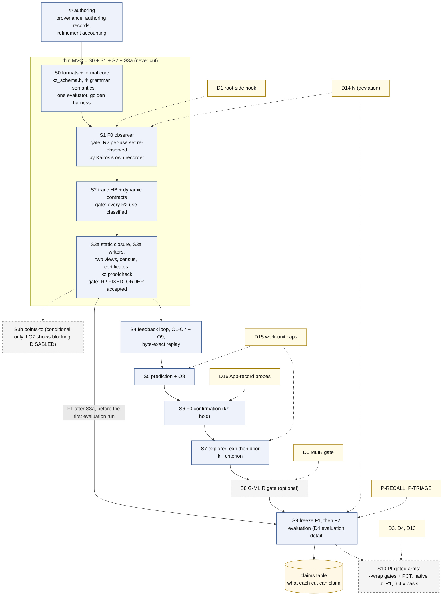

# 10 설계 결정 기록(ADR), PI 결정 요청, 용어집

이 문서는 Kairos 설계에서 이미 정한 것(spec §11의 설계 결정 기록 38개), 아직 PI가 정해야 하는 것(spec §10.1과 [spec/PI_DECISIONS.md](spec/PI_DECISIONS.md)), 설계 문서 전체에서 쓰는 용어(spec §13)를 한곳에 모은다. 검토자가 "왜 이렇게 정했나", "무엇이 아직 열려 있고 무엇을 막고 있나", "이 말이 무슨 뜻인가"를 15–25분 안에 찾을 수 있도록 한국어 표로 줄였다. spec에 없는 설계 요소·수치·인용은 더하지 않는다.

상태: 설계 문서 — 구현·측정 전. 규범 원문: [spec/SPEC_FINAL.md](spec/SPEC_FINAL.md)

## 목차

1. [설계 결정 기록(ADR)](#1-설계-결정-기록adr) (spec §11): ADR 읽는 법, 주제별 지도, 아홉 묶음의 표, spec 안의 번호 불일치
2. [PI가 내려야 할 결정](#2-pi가-내려야-할-결정) (spec §10.1, PI_DECISIONS): 결정 규칙, 그림 D4, 우선순위 기준, 여섯 단계의 표, 설치 결정
3. [용어집](#3-용어집) (spec §13): spec §13의 용어 68개, 그리고 이 문서가 더 쓰는 말

**읽는 법.** 표기는 spec 머리말을 따른다(자세한 설명은 [01_overview.md §0](01_overview.md#0-읽는-법)).

| 표기 | 뜻 |
|---|---|
| [F] | 코드·기록·보고서 인용이 있는 사실 |
| [M] | 측정값. 이 문서의 [M]은 모두 spec이 인용한 기존 측정이다([R07], [BM], [R2g]). Kairos는 아직 아무것도 측정하지 않았다 |
| [I] | 추론. 실행하지 않았다. "이 문서의 [I]"는 spec의 두 곳을 이 문서가 이어 읽은 것이다 |
| [D] | 설계 결정. ADR이 기록한다 |
| [U] | 미확인 |

- **문헌 상태 표지**: V-doc(원문을 읽음), V-abs(서지와 초록 수준 확인), V-me(보고서 작성자가 검색으로 서지·초록 확인), P(일부만 확인), UNVERIFIED(확인 안 함, 결론에 쓰지 않음) ([R04 §0.2]; [R05]).
- **검토 항목 번호**: `[X1-C1]`은 검토 X1의 critical 1번이고, `M`은 major, `m`은 minor다. X1은 형식적 건전성, X2는 cFS 충실도, X3은 실현 가능성과 평가를 검토했다. `[J1]`–`[J3]`은 세 설계안(A, B, C)의 심사다. 검토가 낸 issue 57개는 모두 SPEC FINAL에서 해결됐다(spec §0.6; [spec/ISSUE_RESOLUTION.md](spec/ISSUE_RESOLUTION.md)).
- **이름 충돌 주의**:
  - PI 결정 `D1`–`D19`와 그림 `D0`–`D10`은 서로 다른 번호 체계다. 이 문서는 "PI 결정 D1", "그림 D4"처럼 앞에 종류를 붙인다.
  - 구현 단계 `S0`–`S10`(spec §9.3)은 stratum `S`(구조적 순서, spec §1.9)와 다르다.
  - lemma `L1`–`L3`(spec §6.2)는 계층 `L0`–`L5`(spec §2.1)와 다르다.
  - "F1"에는 네 가지 뜻(freeze F1, fidelity class F1, feedback F1, OSAL 후보 F1)이 있다. [08_roadmap.md §0.5](08_roadmap.md#05-f1의-네-가지-뜻)를 본다.

---

## 1. 설계 결정 기록(ADR)

### 1.1 ADR을 읽는 법

**ADR**(architecture decision record, 설계 결정 기록)은 결정 하나를 네 칸으로 적은 짧은 기록이다. **계기**(Context: 왜 결정이 필요했나), **결정**(Decision), **대안**(Alternatives: 고려했지만 택하지 않은 것), **결과**(Consequences: 그 결정이 낳는 비용과 효과)다(spec §11 머리말).

- spec §11은 ADR-001부터 ADR-038까지 38개를 적었다. 상태는 모두 "SPEC FINAL에서 채택(accepted)"이다.
- 검토가 바꾼 ADR은 계기 칸에 issue 번호를 적는다. PI 결정에 기대는 ADR은 그렇다고 적는다(spec §11 머리말).
- ADR-018과 ADR-023은 "v1에서 바뀌지 않음"으로만 적혀 있다. ADR-019와 ADR-021–038에는 대안 칸이 없다. 이 문서는 그 칸을 "적지 않음"으로 두고, 계기가 대체된 v1 방식을 밝힌 경우에만 그것을 옮긴다.
- **ADR은 [D]다.** ADR이 "sound", "재현 가능"이라고 적은 성질은 구현과 실행 전의 설계 목표다. 각 보장이 어떤 가정 아래 성립하는지는 spec §6.1(가정)과 §6.3(보장)이 정하고, 주장하지 않는 것은 §6.4가 정한다.
- **어떤 ADR도 "경보가 없으면 안전하다"는 뜻이 아니다.** 판정 기록에는 "safe" 칸이 없다. 근거가 없는 칸은 `unknown(reason)`이 된다(spec §0.1, §1.10; ADR-011).

표의 열은 다음과 같다.

- **ADR**: 번호. 원문은 모두 spec §11에 있다.
- **결정**: 굵은 글씨의 한 줄 요지, 결정 내용, 그리고 *계기*.
- **대안**: ADR이 적은, 택하지 않은 선택지.
- **결과·영향**: ADR이 적은 결과.
- **spec 위치**: 결정이 실제로 서술된 본문 절과, 관련 PI 결정. 본문 절은 ADR 본문, spec §0.4, ISSUE_RESOLUTION의 "Where" 열에서 옮겼다.

### 1.2 주제별 지도

| 묶음 | ADR | 한 줄 요지 |
|---|---|---|
| [A. 도구의 형태와 형식](#13-a-도구의-형태와-형식) | 001, 002, 003, 004, 018, 019, 023 | C/C++ 도구, formal core 하나, 선언적 profile Φ, typed 산출물. Clang은 분석에만 쓰고 실행되는 것은 gcc 바이너리다 |
| [B. 정적 순서 분석과 증명](#14-b-정적-순서-분석과-증명) | 005, 006, 007, 012, 027, 029, 030 | MustBefore 최대 고정점, 독립 checker가 다시 확인하는 certificate, writer 집합, 두 skeleton view |
| [C. 의미론과 판정 기록](#15-c-의미론과-판정-기록) | 008, 009, 010, 011 | 스케줄 의미론 family, conjunct별 LP, OSAL 모형 두 수준, "safe" 없는 다축 판정 |
| [D. cFS 모형](#16-d-cfs-모형) | 028, 031, 032, 033 | 종료(teardown) 범위, K-SELF 계약, SB 두 단계 송신과 용량, basis closure |
| [E. 관측과 확인](#17-e-관측과-확인) | 013, 014, 015, 036, 020 | 수정하지 않은 바이너리에 uprobe와 eBPF, token에서만 인과, 필요한 곳만 반환값, ptrace hold |
| [F. 예측과 탐색](#18-f-예측과-탐색) | 016, 017 | solver 없는 lock 역전 예측, gate 뒤에 둔 explorer |
| [G. 층 사이 검사, loop, 예산](#19-g-층-사이-검사-loop-예산) | 021, 022, 034 | obligation O1–O9, 재현 가능한 feedback loop, work-unit 예산 |
| [H. 개방성과 평가](#110-h-개방성과-평가) | 024, 025, 035, 037, 038 | 발견 출처의 합집합, 기준선, recall, 선행 연구 위치, triage |
| [I. 구현 계획](#111-i-구현-계획) | 026 | thin MVC와 cut list |

이 표의 용어(MustBefore, certificate, LP, uprobe, eBPF 등)는 각 묶음 절의 머리와 [§3 용어집](#3-용어집)에서 풀어 쓴다.

### 1.3 A. 도구의 형태와 형식

Kairos는 두 명령행 프로그램 `kz-static`과 `kz`로 이루어진다. 둘 다 같은 formal core(`libkz-core`: event type, Φ 해석기, 판정 lattice 등을 담은 공용 library)를 쓴다(spec §2.1–2.2). 이 묶음은 그 모양을 정한다. **KEM**(Kairos Event Model)은 정적 분석, trace 분석, 모형 탐색이 함께 쓰는 event·resource·edge type 한 벌이다. **Φ**(profile)는 cFS에 관한 지식을 적은 선언적 파일이다(spec §0.2).

| ADR | 결정 | 대안 | 결과·영향 | spec 위치 |
|---|---|---|---|---|
| 001 | **C/C++ core와 typed 산출물. Python/JSON pipeline은 쓰지 않는다.** 모든 구성요소는 C++17로 쓴다(BPF 프로그램과 gate 객체는 C). 산출물은 모두 typed KZ container에 담는다. JSON은 CMake가 내는 입력 `compile_commands.json`에만 나온다. *계기*: 사용자가 Python/JSON 시제품(CORD)을 폐기했다 [R06 K7] | C++ kernel 위의 Python orchestration; schema compiler | toolchain 하나(LLVM 23 + gcc 13.3 + BPF용 clang-18). 검토는 `kz dump`(사람이 읽는 text 출력)로 한다. 생성 코드가 없다 | §2.2, §2.6 |
| 002 | **formal core 하나를 세 가지로 해석한다.** KEM type 한 벌, Φ 하나, **abstract domain 셋을 가진 evaluator 하나**, 그리고 concretization 관계 `t ⊒ e`(정적 template t가 trace의 event e로 구체화된다)를 쓴다. *계기*: 정적 층, trace 층, 모형 층이 서로 맞아야 한다 [J1][J2][J3]. evaluator를 하나로 한 것은 [X3-M11]이다 | 층마다 따로 만든 모형 | O1–O9 검사가 가능해진다. `libkz-core`는 LLVM에 의존하지 않는다. evaluator 일치 property test가 필수다 | §0.2 item 2, §1.5, §2.1 원칙 1, §2.5 |
| 003 | **Φ는 provenance와 정해진 의미를 가진, 해석되는 DSL이다.** 손으로 parse하는 언어이고, S0에서 하위 언어 셋을 고정한다. (1) resource 상태 위의 typed core expression 언어(선언한 kind 위의 유한 양화만 허용), (2) C field를 resource에 묶는 binding(O7이 검사), (3) match semantics가 있는 AST-pattern 언어. *계기*: framework 지식은 버전·인용·재사용이 가능해야 한다(가설 H-V: cFS 버전과 backend에 따라 바뀌는 것은 Φ와 scheduling profile뿐이라는 가설, spec §7.6). 세 해석기가 predicate마다 같은 뜻을 가져야 한다 [X3-M11] | C++ rule class; MLIR ODS; 따옴표 친 predicate 문자열(v1) | engine이 framework에 중립이다. Φ를 고치면 feedback loop가 처음부터 다시 돈다 | §2.1 원칙 2, §2.3, §3.17 |
| 004 | **X-macro schema, typed reference, section별 version을 가진 KZ container.** field 목록 하나를 X-macro(목록을 macro로 적고 여러 번 펼치는 C 기법)로 펼쳐 struct, dump 출력기, offset assert를 만든다. reserved field를 명시하고, `sizeof`가 field 크기의 합과 같게 한다. reference는 `(artifact sha256, section, index)`로 typed하게 적고, Merkle parent hash를 둔다. *계기*: BPF, gate 객체, C++이 layout을 공유해야 한다. v1 layout에는 암묵적 padding과 type 없는 reference가 있었다 [X3-m6] | schema compiler; JSON lines | layout을 바꿀 때 목록 하나만 고친다. hash가 초기화되지 않은 byte에 의존하지 않는다 | §2.3 |
| 018 | **MLIR은 gate G-MLIR 뒤에 둔다.** v1에서 바뀌지 않았다. skeleton과 core는 plain C++로 만든다. S8에서 G-MLIR을 기준(판정 동일, provenance 완전성, 코드 크기, 실행 시간)으로 판단하고, 통과 전에는 ODS를 쓰지 않는다 | 적지 않음 | 적지 않음. spec §2.6은 기여가 MLIR에 의존하지 않는다고 적는다 | §2.6, §9.3 S8. PI 결정 D6 |
| 019 | **version이 바뀌어도 깨지지 않는 site binding.** match semantics가 있는 AST pattern으로 site를 정하고, basis의 gcc DWARF(같은 이름의 local 사본은 compile unit으로 구분)와 MC(LLVM의 기계어 decoder)로 명령 주소를 찾는다. version guard와 anchor audit를 둔다. *계기*: line 번호 probe는 revision이 바뀌면 깨진다 [J2-9]. 같은 이름의 local 사본이 있다 [X3-m3] | 적지 않음 | 찾지 못한 pattern은 목록으로 남는다 | §3.17 |
| 023 | **Clang/LLVM은 분석에만 쓰고, 실행되는 것은 gcc 바이너리다.** v1에서 바뀌지 않았다. Clang facts와 IR은 분석에 쓰고, DWARF/MC로 gcc 바이너리에 고정한다. 진단 전용 flag 조정 두 가지를 B에 기록한다. IR은 call graph에만 쓴다(쓰기 분석에 쓰게 되면 pass pipeline을 고정한다) | 적지 않음 | 적지 않음. spec §2.6은 Clang이 실행 바이너리를 빌드하지 않는다고 적는다 | §2.2 (`link`), §2.6 |

### 1.4 B. 정적 순서 분석과 증명

이 묶음의 목표는 R2처럼 **순서가 틀린 쪽으로 고정된** 사용을 증명하는 것이다. R2에서는 ES와 EVS의 core task가 초기화(`CFE_ES_TaskInit`, `CFE_EVS_TaskInit`) 중에 SB 코드를 실행하고, 그 SB 코드가 아직 발행되지 않은 SB의 AppId를 찍어 EVS 이벤트를 보낸다(spec §1.2, App. A.1). 이 사용 24개(ES 20 + EVS 4, spec §9.3 S1)는 core serialization 때문에 모두 발행보다 **앞에** happens-before 순서가 정해져 있다(spec §1.11; [R2g §2]). happens-before는 한 실행 안에서 동기화(lock, message, task 생성 등)로 정해지는 사건 사이의 부분 순서다. 순서가 정해지지 않은 접근 쌍을 찾는 보통의 data race 탐지기는 이런 사용을 보고하지 않는다(spec §1.11).

필요한 낱말은 다음과 같다.

- **skeleton**: actor마다 관련 노드(Φ effect, spawn, 종료 연산, loop head 등)만 남긴 제어 흐름 그래프다(spec §4.3).
- **star-closure**: loop를 "0회 이상 반복"으로 닫아 반복 횟수를 정하지 않는 것이다.
- **MustBefore(MB)**: "모든 실행에서 n이 일어날 때마다 a가 이미 일어났다"는 정적 관계다(spec §1.9, §4.4).
- **PWB**(precedes-whenever-both-occur): "둘 다 일어나는 실행이라면 a가 항상 먼저다"라는 관계다.
- **certificate**: 다른 프로그램(`kz proofcheck`)이 다시 확인할 수 있게 적은 증명 기록이다(spec §4.5).
- **vector clock**: thread마다 "지금까지 본 각 thread의 진행 정도"를 숫자 벡터로 들고 다니며 happens-before를 계산하는 자료 구조다. VC_R은 강한 edge(unconditional, obs-fatal)만 쓴 vector clock이다(spec §1.9).

| ADR | 결정 | 대안 | 결과·영향 | spec 위치 |
|---|---|---|---|---|
| 005 | **정적 순서는 certificate view 위의 MustBefore 최대 고정점이다.** certificate view `Sk^cert`(무한 loop를 모두 star-closure로 닫은 skeleton) 위에서 규칙 T-PO(program order), T-SPAWN(task 생성), T-OBS(관측), T-TERM(종료 연산)을 쓴다. 모든 root에서 출발값은 ∅다. 관측 o의 writer 집합 W_o는 반복마다 다시 계산하고, 검사 가능한 네 제외 규칙(OWN-NOPATH, falsifier 앞의 PWB, 관측 뒤의 PWB, KEY-SEP)을 쓴다. lock 규칙은 없다(lock만으로는 순서가 생기지 않는다). *계기*: v1은 message loop를 h에서 자르면서 b = ∞를 주장했다 [X1-C1]. base case와 W_o 재계산이 적혀 있지 않았다 [X1-m2] | template 위의 may-HB(제안 C); h에서 자른 skeleton(v1) | sound하지만 불완전하다. loop가 정밀도를 깎는다(frontier 노드는 loop 뒤에만 생긴다) | §4.4, §6.2 L-MB |
| 006 | **certificate는 once(τ)를 쓴 PWB로 만들고, 독립 checker가 확인하며, 프로그램 수준에서 반박을 시도한다.** 규칙은 FRONTIER와 ONCE-PWB이고, once 사실(actor가 한 실행에 많아야 한 번 존재)은 증명한다. PROTECTED에는 MUST_KEY must-writer가 필요하다. SCOPE 제외를 둔다. `kz proofcheck`는 추출을 뺀 모든 것을 다시 유도한다. certificate를 변형해 checker를 시험하고, program mutant로 분석을 시험한다. 예: R2에서 startup thread의 실패 경로 기록 지우기(`cfe_es_start.c:823`)는 OWN-NOPATH로 빠진다(spec §4.4). *계기*: dominance(지배 관계) 논증은 early return에서 깨진다 [J2-1]. PWB에는 actor당 instance 하나가 필요하다 [X1-M2]. v1의 R2 certificate는 writer 하나를 빠뜨렸다 [X2-01] | `u ∈ MB(x)`(제안 A); trace-local VC_R certificate(제안 B) | R2가 신뢰 항목을 나열한 채로 certificate를 받을 수 있게 된다(App. A.1은 실행하지 않은 기대 동작이다). once 분석과 checker는 추가 코드다 | §1.2, §4.5, §6.2 L-ONCE·L-PWB, App. A.1. 그림 D8 |
| 007 | **writer 집합은 S3a AST 추출과 Φ effect로 만들고, key status와 할당 기록을 붙인다.** A-TYPE(지원 위치는 선언된 type으로만 접근한다는 가정) 아래 AST 수준에서 field 기준으로 writer를 추출하고, untyped write와 address escape를 목록으로 낸다. out-pointer 요약, transition-aware filter, MUST_KEY/MAY_KEY/NO_KEY를 쓴다. 할당 기록에는 A-FRESH와 A-OWNER를 "목록에 올린 신뢰 사실"로 붙이고, O9가 반박할 수 있게 한다. S3b points-to(포인터가 가리킬 수 있는 대상을 계산하는 분석)는 측정으로 필요가 보일 때만 만든다. *계기*: v1은 opaque pointer IR 위의 Andersen 분석(Andersen 1994 [V-abs])을 처음부터 MVC 안에 넣었다 [X3-M4]. key 의미가 may뿐이었다 [X1-M3] | Andersen 먼저(v1); 선언한 effect만(제안 C) | MVC가 작아진다. S3b가 더할 몫은 ablation 17(구성요소 하나를 빼거나 바꾸고 다시 재는 실험)이 잰다 | §4.2, §6.1 A-TYPE·A-FRESH·A-OWNER, §8.4 item 17 |
| 012 | **문맥으로 구분한 template과 summary fallback.** template은 `(actor instance, call string, site)`다. skeleton의 work-unit cap에 닿으면 (actor, function)별 summary로 대신하고 정밀도 손실을 적는다. 예: `CFE_SB_CreatePipe` 안의 SB event site는 `CFE_ES_TaskInit`에서 왔을 때와 ES command loop에서 왔을 때 다른 template이다(spec §1.5). *계기*: SB event site는 모든 호출자가 공유한다. 완전 inlining은 지수적이다 [X1-m7] | site만으로 된 template | certificate가 문맥별로 나온다. fallback 횟수를 잰다 | §1.5, §4.3, §4.15 |
| 027 | **skeleton view 둘.** `Sk^cert`(star-closure. 모든 보편 주장과 `inactive`에 쓴다)와 `Sk^h`(h에서 자름. 탐색에만 쓰고 h를 bound b에 기록한다)를 둔다. proofcheck는 `Sk^h`나 `TRUNC` 표시가 있는 step을 거부한다. litmus 프로그램은 App. A.8에 있다. *계기*: [X1-C1] | 적지 않음. 대체된 것은 v1의 h-cut skeleton이다(ADR-005의 대안) | 보편 판정은 horizon과 무관하다. 탐색 결과는 bound가 있다 | §4.3, §4.5, App. A.8 L-H2. 그림 D10 |
| 029 | **message provenance와 looper rule.** `Prov(p) = (Routes_B(p) ∩ Tx_B) ∪ Input_B(p)`(basis B에서 pipe p에 도달할 수 있는 MsgId와 code의 집합)를 handler 도달성 위의 최소 고정점으로 계산하고, 두 view 모두에서 dispatch를 접는다. 같은 looper의 handler 사이에는 HB edge가 없다. FIFO는 예측의 제약으로만 남는다. *계기*: [X1-M7] | 적지 않음 | 입력이 없으면 command 전용 경로는 `inactive`다(예: 기본 B의 K-ATOM.tbl-load와 HS AppMon, ISSUE_RESOLUTION X1-M7). shape는 CAFA(PLDI 2014 [V-abs])/DCatch(ASPLOS 2017 [P])를 따른다 | §1.9 looper rule, §3.9, §4.3 |
| 030 | **await predicate는 코드에서 추출한다.** poll loop는 pattern으로 인식하고, predicate는 exit branch의 symbolic evaluation으로 뽑는다(인식하는 형태 셋). proofcheck가 다시 유도하고 L1 전제를 검사한다. Φ는 규칙 이름, stratum, escape만 묶는다. 예: R2 증명에 쓰는 core serialization loop는 framework 규칙 R19가 묶지만, predicate는 코드에서 뽑는다(spec §7.2). *계기*: v1의 T-OBS는 사람이 쓴 predicate 문자열에 기댔다 [X1-M8] | 적지 않음 | R2 증명이 사람이 쓴 predicate에 의존하지 않는다. 추출하지 못한 loop는 `unmodelled-sync`가 된다 | §4.3, §4.5, §6.2 L1, §7.2, App. A.1 step 10 |

### 1.5 C. 의미론과 판정 기록

Kairos의 판정은 **(σ, M) 칸**마다 나온다. σ는 스케줄 의미론(어떤 interleaving을 허용하나)이고, M은 OSAL을 어느 수준까지 모형화하나다(spec §1.4, §1.8).

**linearization point**(LP)는 연산의 효과가 한순간에 일어났다고 보는 지점이다. **conjunct**는 요구 조건을 ∧로 나눈 조각 하나다.

이 묶음을 보여 주는 cFS 예는 **OSAL RESERVED 구간**이다. object 이름은 보이지만 아직 LIVE가 아닌 이 구간에서 by-name 조회는 기다리지 않는다. 바로 `OS_ERR_INCORRECT_OBJ_STATE`를 돌려준다(`osapi-idmap.c:401–404`; spec App. A.4) [F]. API 계약 수준의 모형 M_api는 이 구간을 보지 못하고, M_impl만 본다.

| ADR | 결정 | 대안 | 결과·영향 | spec 위치 |
|---|---|---|---|---|
| 008 | **M마다 포함 관계를 가진 의미론 family와, 잘 정의된 refinement.** 의미론은 넷이다. • σ_U: 시간을 무시한 interleaving. retry는 정확한 bound 뒤에만 소진된다. • σ_U∞: timeout이 없고 retry가 인내한다. 소진은 quiescence에서만 일어나고, 스케줄은 강하게 공정하며, 결과는 good/bad/stall이다. • σ_R1[P_sched]: 인용한 scheduling profile을 따르고, 지연은 block한다(가정 A-ZT). • σ_E: 실제 환경이다. 포함 관계는 `Exec(σ_E) ⊆ Exec(σ_U, M_impl)`다. M_api 결과는 API 계약에 대한 주장이다. refinement는 σ마다 자기 bound를 가진다. *계기*: v1의 포함 관계는 M을 무시했다 [X1-C2]. σ_U∞가 소진된 retry와 liveness에서 정의되지 않았다 [X1-M5]. σ_R1이 OSAL의 RT 정책을 무시했다 [X2-07] | σ_U + σ_E만(제안 A); v1의 family | OSAL을 건드리는 cone마다 분석을 두 번 한다(M_api, M_impl). 인용한 profile이 없는 backend에는 σ_R1 판정을 내지 않는다 | §1.8, §6.2 L-CONT·L-MLEVEL. PI 결정 D4, D13 |
| 009 | **conjunct마다 LP를 두고, capture point를 쓴다.** 모든 conjunct는 자기 LP를 선언한다. 값 conjunct는 `derives`가 찾은 capture point(넘기는 값을 미리 읽은 load 지점)를 LP로 쓴다. T-DERIVE는 stamp 매개변수를 `cell(loc)`로 옮기는 일반 번역 규칙이다. proofcheck가 `derives`를 다시 검사한다. 예: R2의 `valid(arg.AppID)`는 SB 코드가 `CFE_SB_Global.AppId`를 읽는 지점(`cfe_sb_api.c:226–228`)에서 평가한다(spec §1.4). *계기*: v1은 값으로 전달되는 conjunct를 틀린 LP에서 평가했다 [X1-M1] | 사용마다 LP 하나(v1) | trace는 capture point를 앞뒤 관측점으로 묶어 기록한다. O4는 conjunct별로 outcome code를 대응시킨다 | §1.4, §1.6, §4.5, App. A.8 L-CAPTURE |
| 010 | **OSAL 모형 두 수준. M_impl의 대기는 실제와 같게 둔다.** M_api는 OSAL API를 LP에서 원자적인 transition으로 본다. M_impl은 OSAL shared와 POSIX 소스를 낮은 어휘 Φ_L-1(pthread mutex·condvar, `sem_*`, `mq_*` 등)로 투영한다. by-ID와 by-name token 변환을 구분하고, 대기 시도는 broadcast나 timed wake로 깬다. label은 portability-hazard, implementation-defect-candidate, portability-hazard-evidence다. *계기*: POSIX 내부가 구간, timed wait, lock leak을 만든다 [R01 §7 item 6]; [X2-03] | API 수준만; 항상 M_impl | litmus test가 Φ_L-1을 검증한다 | §1.4, §3.2, §3.4, App. A.4, App. A.8 |
| 011 | **축이 서로 독립인 판정 기록. "safe"는 없다.** (σ, M)마다 칸을 둔다. provider 축, reach 축, scope를 둔다. 근거는 realization 축과 naturalness 축으로 나눈다. σ_E class는 양쪽 모두 자연스러운 witness가 있을 때만 준다. *계기*: [R06] R1–R7, S1. v1은 원인과 결과, 실현과 자연성을 섞었다 [X1-m3], [X1-M11] | 단일 심각도 사다리; v1의 단일 근거 순위 | 보고서가 다축이 된다. 어떤 경로도 "safe"나 "timing-protected"를 내지 않는지 시험한다 | §1.10, §4.12. 그림 D6 |

### 1.6 D. cFS 모형

이 묶음은 cFS v7.0.1의 실제 구조에 맞춘 결정이다. SB 예로 **구독 전 송신**이 있다. 구독(route)이 생기기 전에 보낸 message는 성공을 돌려받고 조용히 사라진다. 이것은 InitRacer가 분류한 "late event handler registration"의 cFS 사례다(OOPSLA 2017 [V-abs]; spec §1.11). R2에서도 사용 24개 중 17개가 route가 생기기 전에 보낸 ES의 EVS packet에서 나온 `SEND_NO_SUBS` 이벤트다 [F] (spec §1.6; [R2g §2]).

| ADR | 결정 | 대안 | 결과·영향 | spec 위치 |
|---|---|---|---|---|
| 028 | **teardown은 범위(scope)로 다루고, pc-linux에서처럼 모형화한다.** `es.shutdown` kind(RUN → SHUTDOWN_REQ → TEARDOWN)를 둔다. 종료 요청자는 `CFE_PSP_RESTART_DELAY` 뒤 끝난다(terminal). teardown은 `CFE_ES_Main`이 돌아온 뒤 PSP main thread에서만 일어난다. 계약의 범위는 "종료 요청 전"이고, 그 뒤 사용은 K-TEARDOWN family로 모은다. certificate는 SCOPE 제외를 쓴다. *계기*: v1은 restart를 끝나지 않는 것으로, `OS_DeleteAllObjects`를 task와 동시에 도는 것으로 모형화해 보정 certificate를 무너뜨렸다 [X1-M6], [X2-04] | 적지 않음. 대체된 것은 v1 모형이다 | 기본 B의 certificate는 "teardown 밖에서"로 진술한다. 모든 실험의 정지가 teardown이므로 따로 보고한다 | §1.6 scope, §3.5, §4.5 SCOPE, App. A.7. 그림 D9. PI 결정 D17 |
| 031 | **일반 K-SELF 계약과 모든 분기를 담는 chain.** `es.self(exec) = LIVE`(호출한 task의 task record와 그 소유 App record를 모두 찾을 수 있다)를, 문맥을 찾는 호출자 7곳 모두에 instance로 만든다. outcome과 harm은 호출자별로 둔다. 결과 chain은 모든 분기를 기록하고, 실행 전까지 [I]로 표시한다. *계기*: [X2-02] | 적지 않음 | 새 harm이 생긴다(`app_zombie`, `service_task_absent`, `process_abort`, `panic`) | §1.3, §1.6, §3.3, App. A.2, A.3 |
| 032 | **SB 송신은 두 단계, 용량은 두 수준.** route_lookup LP 하나를 SB lock 아래에 두고, 목적지마다 put LP를 하나씩 둔다. 용량은 K-CAP(queue 깊이)와 K-CAP.msglim(구독별 MsgLim) 두 수준이다. SB counter 넷을 oracle로 쓰고, `PeakQueueDepth`는 SB-accounted로 표시한다. header에 실린 MsgId는 encode/decode summary와 table-packet decoder로 읽는다. K-MODE는 SB command pipe를 거치는 HB 규칙 R7로 SB actor 안에 둔다. *계기*: [X2-06], [X2-05], [X2-09] | 적지 않음 | key 몫을 재기 전까지 RC5는 부분(partial)으로 남는다 | §1.3, §1.4, §3.9, App. A.5 |
| 033 | **basis closure는 reset type, script 선택, euid, CWD, CDS image를 덮고, Init은 정규형으로 둔다.** 이 항목들을 출처와 함께 B에 넣는다. startup script 선택 규칙은 `kz-static basis`가 평가한다. queue 용량 `cap_B`는 euid에 따라 정한다. 가정 A11(table 값)은 reset type별로 나눈다. Init hash는 내용만으로 계산한다. cold/warm strata와 normalization boot를 둔다. *계기*: [X2-08], [X3-M3] | 적지 않음 | root로 도는 실행 arm은 새 basis다 | §1.7, §4.1, §6.1 A11, §7.4. PI 결정 D4, D17 |

### 1.7 E. 관측과 확인

필요한 낱말은 다음과 같다.

- **uprobe**: 실행 파일을 고치지 않고 사용자 프로그램의 명령 주소에 거는 kernel probe다.
- **eBPF**: 그 자리에서 실행되는 작은 kernel 프로그램이다. kernel이 실행 전에 검증한다.
- **F0**: 바이너리와 실행 조건을 바꾸지 않고 timing만 교란하는 충실도 class다(spec §5.1; [R07 §7]).

[M] entry+4(함수 입구에서 4 byte 뒤, kernel이 emulate하는 `push %rbp`)의 uprobe 비용은 0.57 µs이고, emulate하지 않는 명령에서는 31.7 µs다([R07 §4.7]; spec §5.1).

| ADR | 결정 | 대안 | 결과·영향 | spec 위치 |
|---|---|---|---|---|
| 013 | **F0 관측: perf-PMU uprobe와 자체 raw loader. bring-up은 perf-sample.** uprobe는 entry+4에 두고, 실행 전에 inode로 등록한다. phase마다 일반 BPF 프로그램 하나를 쓴다. bring-up에는 perf-sample backend를 쓴다. tracefs는 host 상태 규칙을 지킬 때만 선택적으로 쓴다. *계기*: 수정하지 않은 바이너리에서 충실도가 가장 높다. libbpf가 없다 [R07 §4.7]. tracefs는 전역 상태를 바꾼다 [X3-m2] | `--wrap`(F1); source probe(F2); gdb; libbpf | S1이 attach cookie, ring buffer, task storage, stack capture를 시험해야 한다 | §5.1, §5.3, §5.4. PI 결정 D1, P-LIBBPF, P-TRACEFS |
| 014 | **인과는 token과 protocol key에서만 얻는다.** thread별 `tseq`, object별 `objseq`, descriptor/FIFO, outcome에서 함의되는 reads-from, poll 종료 상태를 쓴다. *계기*: timestamp는 happens-before를 주지 않는다 [R04 §2.1]; [J2-4] | 시계를 재구성해 HB로 쓰기 | 자주 지나는 site에는 take-return probe를 두지 않는다 | §1.5, §1.9, §5.8 |
| 015 | **반환값은 필요한 곳에서만, 측정으로 고른 방식으로 포착한다.** 계약 사용 site와 edge를 정하는 site에서만 포착한다. 방식 R-a…R-e는 S1에서 비용 class별로 재고 고른다. 정적으로 유효하면 나중에 읽는다. *계기*: 호출 뒤 `mov` 명령에 거는 probe는 31.7 µs class일 가능성이 크다 [J3 §2.3]. 더 싼 emulated-branch 선택지가 있다 [X3-m3] | 모든 곳에 호출자 쪽 probe | S1이 전체 plan 전에 보정표를 만든다 | §5.2, §5.10, §5.11 |
| 036 | **attach cookie와 inode 등록.** site id를 attach cookie로 쓴다(site별 perf link 또는 `uprobe_multi`). 실행 전에 inode로 등록한다. verifier를 의식한 일반 프로그램, 손으로 쓴 helper prototype, glibc `<elf.h>`를 쓴다. *계기*: 명령 주소(IP)로 찾는 descriptor는 ASLR에서 깨진다. `.so` fallback은 연구 대상인 phase를 교란했다 [X3-M1], [X3-m4] | 적지 않음 | module별로 map을 채우지 않는다. hold fallback을 쓰게 되면 그 실행은 pool에서 뺀다 | §2.3 (`kz_raw_ev.site`), §5.2, §5.3, §5.11. PI 결정 P-LIBBPF |
| 020 | **확인은 F0 hold로 하고, 안전 규칙과 정규화를 명시한다.** ptrace와 debug register breakpoint를 쓴다. gate는 program lock 집합이 빈 곳에만 두고, 배치 규칙을 따른다. 해제는 event 기반이다. reference watchdog(`CFE_PSP_RESTART_DELAY` 포함), wait-for oracle, debug register 공동 할당기를 둔다. clone 때 attach하는 비용을 잰다. 비정상 종료 뒤마다 normalization boot를 한다. naturalness label과 perturbation ratio를 붙인다. *계기*: 만든 schedule은 실현 가능하고 안전하며 정직하게 표시되어야 한다 [J2-10], [J3-M10]. 비정상 종료는 다음 실행을 오염시킨다 [X3-M3]. debug register는 공유된다 [X3-m1] | 기본으로 `--wrap` gate; 고정 sleep([POL] L22가 거부) | watchpoint와 gate를 합쳐 thread당 debug register 4개까지 | §4.13, §5.9. PI 결정 D3, D16, D17 |

### 1.8 F. 예측과 탐색

**예측**은 관측한 trace 하나에서 다른 가능한 순서를 계산하는 것이다. **lock 역전**은 같은 lock으로 보호된 두 critical section의 순서를 뒤집어 보는 것이다. C1과 두 App-record 구간처럼 create/lookup이나 publish/`GetAppID`가 같은 lock 아래 있으면, happens-before는 lock을 통해 순서를 매긴다. 그래서 lock 역전 없이는 다른 순서를 볼 수 없다(spec §1.11).

C1(CF #184)은 CF가 table field `sem_name`에 적힌 이름으로 OSAL counting semaphore를 찾는 사례다. 기본 B에서는 이름이 비어 있어 `inactive`다. 이름과 provider app이 있는 파생 구성 B′에서는 열린 후보다(spec App. A.4).

**DPOR**(dynamic partial-order reduction)은 서로 독립인 transition의 순서만 다른 interleaving들을 대표 하나만 탐색해 탐색 공간을 줄이는 기법이다.

| ADR | 결정 | 대안 | 결과·영향 | spec 위치 |
|---|---|---|---|---|
| 016 | **예측은 명시적 상태 탐색으로 lock을 뒤집어 하고, A-COMM을 검사한다.** Pred(π)는 key를 충돌 대상으로, lock을 원자성으로 본다. 제약은 "acquire는 lock이 비어 있어야 한다"다. witness마다 A-COMM을 검사하고, 실패하면 `predicted-modelled`로 표시한다. prefilter를 쓰되 결과는 다시 검증한다. work-unit cap과 anytime curve를 쓴다. SMT-LIB는 P-Z3 뒤에만 쓴다. *계기*: cFS의 중심 class에는 lock 역전이 필요하다. solver가 설치되어 있지 않다. 듬성한 trace는 MCM(maximal causal model, RV 2012 [V-abs])/RVPredict(PLDI 2014 [V-abs]) 보장을 약하게 한다 [X1-M4] | SMT만; sync-preserving 예측만 | 설치가 필요 없다. 예측기의 soundness는 A-COMM에 상대적으로 진술한다 | §4.9, §6.1 A-COMM, §6.2 L-PRED. PI 결정 P-Z3, D15 |
| 017 | **explorer: 검증된 완전 탐색 mode와 조건부로 검증된 DPOR mode. gate 뒤에 둔다.** `exh`(상태를 저장하는 완전 탐색)와 `dpor`(source-DPOR + sleep set)를 둔다. `dpor`는 정리 T-JACM을 확인하기 전까지 unverified로 표시한다. L3는 조건을 정적으로 검사하는 mover reduction이다. differential test는 검증(validation)으로만 쓴다. 최적성은 주장하지 않는다. S7에서 kill criterion과 함께 만든다. *계기*: 시험은 증명이 아니다. disabling 정리는 상태 P다 [X1-M9]. v1의 L3 조건은 부족했다 [X1-M10] | optimal DPOR을 정확하다고 주장; explorer 없음 | explorer는 ablation으로 끝날 수 있다. 그러면 refinement는 certificate와 예측에서만 온다 | §4.10, §6.1 T-JACM, §6.2 L-DPOR·L3. PI 결정 P-PAPERS, P-NIDHUGG, D15 |

### 1.9 G. 층 사이 검사, loop, 예산

| ADR | 결정 | 대안 | 결과·영향 | spec 위치 |
|---|---|---|---|---|
| 021 | **일관성 의무 O1–O9와 certificate 검사.** 각 결정은 다음과 같다. • actor별 수용: 관측한 event 열을 skeleton이 받아들이는가. • outcome 일치: 검사력은 HB가 순서를 정한 사용에 대해서만 보고한다. • writer 집합 일치: A-TYPE 목록을 포함한다. • 할당·소유 반박(O9). • 전역 conformance: S5부터. 모순이 나오면 그 규칙을 정지하고 loop를 끝낸다. *계기*: 사람이 쓴 규칙에는 "모형이 맞는지 어떻게 아나"에 대한 답이 필요하다 [J1 §6] | 적지 않음 | obligation 실패가 충실도(fidelity) 지표가 된다 | §2.5, §4.11 |
| 022 | **재현 가능한 feedback loop.** 반복마다 기록을 남긴다. 고정점 시험은 비교 가능한 상태로만 한다. lattice를 명시한다. 정지(suspension)가 일어나면 loop를 끝낸다. 예산은 work unit으로 센다. byte 단위로 replay한다. 구성요소는 단계적으로 들어온다. *계기*: v1의 고정점 시험은 count를 포함해 수렴하지 않았다 [X1-m8]. 예산이 wall clock이었다 [X3-M10] | 적지 않음. 대체된 것은 v1 방식이다 | 수치가 재현된다 | §4.14, §6.2 L-LOOP |
| 034 | **결정적 work-unit 예산과 POL에 맞는 label.** 모든 분석 예산은 결정적 탐색 순서를 가진 work unit 개수다. wall time과 memory는 비용으로만 기록한다. PI가 고르는 N, cap, 표본 크기는 deviation이다. event 기반 정지를 우선한다. anytime curve를 낸다. 통계 절차는 가정으로 둔다. *계기*: [X3-M9], [X3-M10] | 적지 않음 | byte 단위 replay가 된다. bound가 정직해진다 | spec 머리말 Policy, §2.1 원칙 8, §4.15, §8.7. PI 결정 D14, D15, P-STATS, P-TRIAGE |

### 1.10 H. 개방성과 평가

이 묶음은 PI가 요구한 "다섯 사례에 맞추지 않은" 설계를 평가 쪽에서 뒷받침하려는 결정이다. 다섯 사례는 [R03 §4]의 계약 종류 15개 중 3개만 덮는다 [F] ([R06 §5.1]).

| ADR | 결정 | 대안 | 결과·영향 | spec 위치 |
|---|---|---|---|---|
| 024 | **발견 출처의 합집합과 거버넌스로 개방성을 얻는다.** §7.1의 출처 14개를 쓴다. freeze F1(비교 도구 포함)과 F2(recall protocol 포함)를 둔다. template-only 실행을 먼저 한다. refinement 회계에는 framework 규칙의 이름을 밝힌다. app-profile 층을 둔다. *계기*: 다섯 사례는 계약 종류 15개 중 3개만 덮는다 [R06 §5.1] | 적지 않음 | 작성 노력이 실제로 들고, 그것을 잰다 | §7.1, §7.2, §7.5. PI 결정 D8/P-RECALL |
| 025 | **공통 metric, 동결한 코드, 외부 참조점을 가진 기준선.** 표시된 instance마다 경보 있음/없음을 보고 paired test를 한다. 비교 도구는 F1에서 동결하고, 논문 예제로 golden test를 만든다. 다음 비교 대상을 더한다. • Φ outcome이 없는 MCM/GPredict(ICSE 2015 [V-abs])식 lock 역전 예측기 • typestate(객체의 현재 상태가 허용되는 연산을 정한다는 개념; Strom & Yemini 1986 [V-me]) monitor • DefUse(OOPSLA 2010 [V-abs])식 학습기 helgrind/DRD는 `RUN_CFS_WRAP`으로 돌린다. Nidhugg를 못 쓰는 이유는 설치 결정으로 명시한다. *계기*: v1의 비교 도구는 모두 직접 재구현했고 metric이 없었다. 가장 강한 같은 계열 비교 대상이 빠졌다 [X3-M6], [X1-M12] | 적지 않음 | 비교는 "같은 instance에서 각 모형이 무엇을 보나"에 답한다. Kairos plan에 의존한다는 점을 밝힌다 | §8.3. PI 결정 P-VALGRIND, P-NIDHUGG, P-PAPERS |
| 035 | **recall은 program mutant와 수정 전/후 쌍으로 잰다.** §8.5의 protocol을 F2 전에 동결한다. soundness 실패를 센다. 동치 mutant 규칙을 사전 등록한다. 점진 변형 tree는 하나만 쓴다. *계기*: v1은 놓친 것에 대해 아무것도 재지 않았다. 자연 사례는 하나뿐이었다 [X3-C1] | 적지 않음 | RQ9가 생긴다. mutant는 synthetic으로 표시한다 | §6.4 item 25, §7.5, §8.5. PI 결정 D8/P-RECALL |
| 037 | **선행 연구 위치를 바로잡는다.** InitRacer(늦은 등록), RVPredict/GPredict(key 충돌 lock 역전), ExceptioNULL(FSE 2012 [V-abs]; 예측한 use-before-init), DefUse를 인정한다. G3 새로움은 "열린 문헌 확인"으로 기록한다. 조합만 주장한다. *계기*: [X1-M12] | 적지 않음 | §1.11과 §6.4 item 18이 바뀐다 | §1.11, §6.4 item 18, App. B. PI 결정 P-PAPERS |
| 038 | **triage는 층화·맹검 표본으로 하고, 손실은 oracle과 대조한다.** "보고됨"을 정의한다. (class, RC kind, 판정한 층)별로 층화 무작위 표본을 뽑는다. 평가자는 맹검한다. LOSS-UNDER-ORDER는 SB oracle과 대조한다. 평가자 노력은 비용으로 기록한다. *계기*: [X3-M7] | 적지 않음 | 전수 triage 대신 정확 CI를 가진 정밀도를 낸다 | §5.10, §8.5 (triage). PI 결정 P-TRIAGE |

### 1.11 I. 구현 계획

| ADR | 결정 | 대안 | 결과·영향 | spec 위치 |
|---|---|---|---|---|
| 026 | **thin MVC, 추정, cut list를 가진 단계적 build.** thin MVC(최소 핵심)는 S0 + S1 + S2 + S3a다. S4에는 O8, predict, hold를 넣지 않는다. O8은 S5의 engine 위에서 돈다. PI 결정 D14는 S1에서 정한다. 공수는 [I] 추정으로 적고, cut list를 둔다. *계기*: v1의 MVC는 L1 층 전체와 Andersen을 포함했고, 단계 의존이 거꾸로였다 [X3-M5] | 적지 않음 | explorer, S3b, F1을 잘라도 핵심 기여가 남는다. 여기의 F1은 cut list에 있는 S10의 `--wrap` gate arm으로 읽는다(이 문서의 [I]; spec §9.3 cut list) | §9.3, §9.4. 그림 D4. PI 결정 D14 |

단계별 출구 조건과 공수 추정은 [08_roadmap.md §4](08_roadmap.md#4-단계와-출구-조건)에 있다.

### 1.12 spec 안의 ADR 번호 불일치

spec §2.6(기술 결정)이 가리키는 ADR 번호 두 개는 §11의 내용과 맞지 않는다 [F] (spec §2.6, §11을 대조함).

| spec §2.6의 문장 | §2.6이 적은 번호 | §11에서 그 내용을 다루는 ADR |
|---|---|---|
| "SMT solver optional [D]" | ADR-014(token에서만 인과) | ADR-016(예측, "SMT-LIB only after P-Z3") |
| "eBPF userland [D]" | ADR-013, ADR-038(triage) | ADR-013, ADR-036(attach cookie와 inode 등록) |

이 문서는 §11의 번호와 내용을 따른다. spec은 읽기 전용 입력이므로 고치지 않았다.

---

## 2. PI가 내려야 할 결정

### 2.1 결정의 규칙

- **원문**: spec §10.1은 요약 표다. 결정마다의 질문, 선택지, 근거, 권고, 막히는 것, 결정하지 않았을 때의 기본값은 [spec/PI_DECISIONS.md](spec/PI_DECISIONS.md)에 있다. 두 문서의 권고는 서로 같다. §10.1은 D9–D13과 D16–D19를 한 줄로 묶었다.
- **ID**: v1의 D 번호는 내용이 같은 결정에 그대로 쓴다. 이름이 바뀌었거나 새로 생긴 결정은 `P-` 이름을 쓴다. P-LIBBPF는 예전 D2, P-Z3는 D5, P-TSAN은 D7이었다. 그래서 D2, D5, D7은 없다.
- **정책**: 자원이 유한해서 사람이 고르는 값(N, cap, 표본 크기)은 **deviation**으로 기록한다. deviation에는 이유, 효과, 필요성을 적는다([POL] L16, L18–21). `unspecified_by_reference`는 값을 고르지 않았다는 뜻이다([POL] L17). 설치는 모두 기록되는 package 결정이다.
- **현재 상태**: 이 결정 목록을 만들면서 아무것도 설치·실행·변경하지 않았다(PI_DECISIONS 머리말).
- **설치 없이 되는 범위**: thin MVC(S0 + S1 + S2 + S3a)와 S4–S6에는 설치가 필요 없다. 고정된 LLVM 23 build, 시스템 clang-18(BPF backend), gcc 13.3, valgrind 3.22, kernel 기능이 이미 있다 [F] (PI_DECISIONS "Tool installs"; [R07 §2]).
- **기본값**: "결정하지 않으면 어떻게 되나"는 PI_DECISIONS가 D1, D17, D14에만 적었다. 아래 표에도 그 셋에만 적는다.

### 2.2 그림 D4: 연구 단계와 PI 결정 gate

그림에서 노란 상자(`D1`, `D14` 등)는 PI 결정이다. 노란 상자에서 나가는 점선 화살표는 그 결정이 여는 단계를 가리킨다. S3a → S3b와 S9 → S10의 점선은 조건부 단계나 PI 결정이 필요한 단계로 가는 경로다. 점선 테두리는 조건부 단계(S3b)와 PI 결정이 있어야 하는 단계(S8, S10)다. 노란 상자의 `D1`은 그림 D1이 아니라 PI 결정 D1이다.

**그림 D4 개요. 연구 단계, 동결, PI 결정** (렌더링: [diagrams/D4_research_overview.svg](diagrams/D4_research_overview.svg); spec §12 D4, §9.3, §10.1)

### 2.3 우선순위를 나눈 기준

아래 여섯 단계는 **이 문서의 분류 [I]**다. PI_DECISIONS의 "Needed by" 열과 "Blocks" 열, spec §9.3의 단계 순서, 그림 D4의 동결 위치(spec §12 D4: S3a → freeze F1 → template-only 실행 → refinement → freeze F2)를 이어 읽어 나눴다. 같은 단계 안에서는 필요한 시점 순서로 적는다.

| 순위 | 기준 | 결정 |
|---|---|---|
| 1 | 지금 정해야 첫 실행 단계 S1이 시작되거나 끝난다 | D1, D17, D14(S1 몫), D11 |
| 2 | thin MVC 안(S2–S3a)에서 범위와 문구를 정한다 | D10, D12, D9 |
| 3 | 평가 동결 전에 사전 등록해야 한다 | P-STATS(F1 전), D8/P-RECALL(F2 전) |
| 4 | thin MVC 다음 단계(S5–S8)를 연다 | D15, D16, D3, P-PAPERS, P-NIDHUGG, D6 |
| 5 | S9 평가의 세부와 S10 arm을 정한다 | P-TRIAGE, P-VALGRIND, P-TSAN, D13, D18, D19, D4 |
| 6 | 막는 것이 없거나(권고가 "하지 않음"), 출판에만 걸린다 | P-LIBBPF, P-TRACEFS, P-Z3, P-NAME |

표의 열은 다음과 같다. "막히는 것"은 PI_DECISIONS의 "Blocked until decided"이고, 괄호 안은 "Needed by"다. "근거·관련"은 PI_DECISIONS가 인용한 출처와, 관련 spec 절과 ADR이다.

### 2.4 1순위: S1을 열기 위해 지금 필요한 결정

| ID | 질문 | 선택지 | 권고 | 막히는 것 (필요 시점) | 근거·관련 |
|---|---|---|---|---|---|
| D1 | root 프로세스가 README 방식으로 도는 `ubuntu` 프로세스에 perf-PMU uprobe, eBPF 프로그램, task별 watchpoint, ptrace hold를 걸어도 되나? `env/run_cfs.sh`의 `RUN_CFS_WRAP`/`RUN_CFS_HOOK` 옆에 새 hook 하나가 필요하다 | (a) 승인: fidelity class F0(바이너리와 실행 조건은 그대로, timing만 교란). (b) 거부: F1(`--wrap`, link 옵션 deviation)이나 F2(source probe)만 남는다 | (a) | S1과 trace를 쓰는 모든 것(S2, S3a의 reach와 O1/O2, S4–S6, RQ5, RQ7) (S1). **결정하지 않으면 Kairos 관측 실행이 없다** | [R07 §9 item 1]; [R07] L355(uprobe PMU에는 `CAP_PERFMON`이나 `CAP_SYS_ADMIN`이 필요); [R07 §4.7]([M] entry+4 uprobe 0.57 µs, root에서 uid 1000 프로세스 ptrace 가능, Yama 없음); spec §5.1, §5.9; ADR-013, ADR-020 |
| D17 | 실험 실행을 어떻게 끝내고, 비정상 종료 뒤 유지 상태를 무엇으로 정상화하나? | (a) CI의 ES POWERON restart 명령(`.github/workflows/build-run-app-reusable.yml` L209–214; [BM]의 E11 후보 (a)). `CFE_PSP_Restart(POWERON)`로 끝나며 SysV segment를 지운다(`cfe_psp_support.c:62–69`). (b) signal 정지. segment가 남아 다음 boot가 PROCESSOR reset이 된다([R01 §5.2]: signal 정지 뒤 PO → PR → PO). (c) 문서화된 다른 방법 | (a)를 관측 실행의 정지와 normalization boot 모두에 쓰고, from-reference 후보로 기록한다. 모든 정지는 teardown이므로 그 뒤 사용은 K-TEARDOWN instance로 따로 보고한다 | S1의 pool 실행; S6 확인 실행(비정상 종료하도록 설계됨) (S1). **결정하지 않으면 실행을 S0를 기록하며 하나씩 하되 pool하지 않는다** | [BM] L29, L343–344; [R2g]; spec §1.7, §3.5, §4.13; ADR-020, ADR-028, ADR-033 |
| D14 | 목적별 실행 횟수 N(실험군마다, loop 반복마다, σ_E 빈도마다)을 얼마로 하나? | PI가 목적별로 N을 deviation으로 정한다(이유: 자원 유한; 효과: 정확 구간이 있는 bounded 결과 또는 `unknown(budget)`; 필요성: N을 정한 reference 없음). event 기반 정지가 있으면 그것을 쓴다(loop 고정점, 소진). 방법론 문헌(Arcuri & Briand [V-abs]; Klees et al.의 약 30회는 2차 요약으로만 알려짐, P)은 동기가 될 수는 있지만 from-reference가 아니다 | S1의 특성화 N은 S1에서, 평가 N은 S9 전에 정한다 | S1 출구 조건(실험군 A, B, C′ 비교); S9 (S1). **결정하지 않으면 실험군 비교를 보고하지 않는다** | [POL] L16–21; [X3-M9]; spec §8.6, §8.7; ADR-026, ADR-034 |
| D11 | kernel 기록은 `-fc-v80`에서 만들어졌다. `6.18.44-fc-v114`에서 비교하기 전에 실험군 A(관측기 없는 기준)를 다시 재나? | PI_DECISIONS에 따로 적지 않음 | 필수. S1에서 다시 잰다 | 모든 perturbation 비교 (S1) | [R07 §1]; [BM]; spec §5.10, §8.6 |

### 2.5 2순위: thin MVC 안의 범위와 문구

이 결정들은 실행을 막지 않는다. 그러나 가정의 문구, 보고의 분모, 인용 방식을 정한다.

| ID | 질문 | 선택지 | 권고 | 막히는 것 (필요 시점) | 근거·관련 |
|---|---|---|---|---|---|
| D10 | ad hoc 동기화(volatile flag, seqlock 같은 lock 없는 동기화)에 대한 memory-model 입장은? | 가시성 가정 A4(x86-64 TSO, `-O0`에서 event 단위 순차 일관성)를 쓰고, `assumed` edge를 쓰는 판정마다 표시한다; 또는 ad hoc 동기화 site를 발견으로 보고한다 | 가시성 가정, 판정마다 표시 | A4와 `assumed-visibility` sub-label의 최종 문구 (S2) | [R06 T8]; [R02 §8.3]; spec §3.14, §6.1 A4 |
| D12 | 퇴역한 recorder(CORD)와 M1 harness의 관측을 어떻게 인용하나? | 이전 관측으로 인용; 또는 Kairos가 다시 관측한 뒤에만 | 이전 관측으로만 인용한다. S1/S2가 다시 관측한다 | RQ5와 App. A.5의 문구 (S2) | [R2c]; [BM §3.3]; spec App. A.5 |
| D9 | 첫 논문의 범위. RC8(persistence), RC9(parent ↔ child), RC10(timer → task), RC12(file TOCTOU)를 process-level로 넣나? class M(지나가며 찾은 memory-level race)은 어떻게 보고하나? route/capacity 손실(LOSS-UNDER-ORDER)을 넣나? | PI_DECISIONS에 따로 적지 않음. 질문의 각 항목을 범위에 넣거나 뺀다 | label을 붙여 포함한다. RC8, RC9, RC12는 partial로 표시하고, class M과 LOSS-UNDER-ORDER는 따로 보고한다 | RQ1과 RQ5의 분모 (S3a) | [R06 §8 Q6]; [R03 §4]; spec §3.15 |

### 2.6 3순위: 평가 동결 전의 사전 등록

freeze F1은 S3a 다음, 첫 평가 실행 전에 온다(spec §12 D4, §7.2). 사전 등록은 결과를 보기 전에 절차를 고정해, 결과에 맞춰 절차를 고르지 않았음을 보이는 장치다.

| ID | 질문 | 선택지 | 권고 | 막히는 것 (필요 시점) | 근거·관련 |
|---|---|---|---|---|---|
| P-STATS | spec §8.7의 통계 절차를 **가정**으로 사전 등록하나? 방법론 문헌은 [POL] L5–10의 reference 종류가 아니기 때문이다. 절차는 다음과 같다. 전체 분포 비교, 시간과 개수에 Mann–Whitney U, 발생 여부에 Fisher exact test, instance별 이진 비교에 paired test, 표준화 효과 크기, 정확 binomial CI, 실험군 순서 교차(이것도 가정) | PI_DECISIONS에 따로 적지 않음(승인 여부) | F1 전에 승인한다 | S9 분석 (F1 전) | spec §8.7; ADR-034 |
| D8 / P-RECALL | held-out 출처는 무엇을 쓰나? recall protocol에서 무엇을 동결하나? query는 누가, F2 대비 언제 돌리나? F2 전에 동결할 것은 다섯이다. (1) mutation operator 다섯: wait 제거, publication을 spawn 뒤로 옮기기, object-table 항목 교환, retry bound 비우기, status 검사 제거. (2) offline cFE(2047 commit, 전체 이력), OSAL, app 이력에 대한 history query: keyword와 날짜 경계. `race\|startup sync\|order`에 맞는 cFE subject 23개는 아직 분류하지 않은 출발 집합이다 [X3 §1]. (3) expected-verdict 규칙: 수정의 issue 글과 commit에서 가져온다. (4) 동치 mutant 제외 규칙: 변이 site가 증명과 함께 `inactive(B)`이거나, object가 byte 단위로 같다. (5) held-out issue query: C1, C2, C3, C5, R2는 뺀다 | 다섯 출처 전부와 recall protocol 전부; 또는 일부. query 수행자는 Φ 작성자이거나 아닌 사람 | 다섯 출처 모두, 전체 protocol을 F2 전에 동결하고, Φ를 쓰지 않는 사람이 query를 돌린다 | F2; RQ3; RQ9 (F2 전) | [R06 §5.6]; [R05 §6.1 (iii), §6.2]; [X3-C1]; spec §7.5, §8.5; ADR-024, ADR-035 |

### 2.7 4순위: thin MVC 다음 단계(S5–S8)

**App-record 구간**은 다음 단계 결정 D16의 대상이다. core app의 경우 ES는 record를 예약하고(`cfe_es_start.c:803`), task를 시작한 뒤(`:810`), 발행한다(`:818`). 발행 전에 새 task가 `GetAppID`를 부르면 자기 App record를 찾지 못할 수 있다(spec §3.3, App. A.2). spec은 이것을 실행 전까지 INFERENCE로 표시한다.

| ID | 질문 | 선택지 | 권고 | 막히는 것 (필요 시점) | 근거·관련 |
|---|---|---|---|---|---|
| D15 | 다음 작업의 cap을 얼마로 하나? 예측 탐색 노드, explorer 상태와 transition, O8 탐색, skeleton 구성. 이 cap은 explorer kill criterion에도 쓴다 | 결정적 work unit으로 PI가 정한 cap. 각각 deviation이다(효과: anytime curve와 `unknown(budget)`). wall-clock cap은 표시된 예외로만 쓰고, byte 단위 replay 시험에서 뺀다 | work unit으로만 정한다. 예측과 O8은 S5 전에, explorer는 S7 검토 전에 정한다 | S5의 예산 곡선; S7 kill criterion (S5) | [X3-M9], [X3-M10]; spec §4.9 step 8, §4.10 items 6·9, §4.11, §4.15; ADR-016, ADR-017, ADR-034 |
| D16 | core-task와 script-app의 App-record 구간을 여는 파생 F0 hold([LED] X5)를 돌리나? | PI_DECISIONS에 따로 적지 않음(예/아니오) | 진행한다. derived로 표시하고, 비정상 종료 뒤에는 normalization boot를 한다 | S6 출구 조건 (S6) | [LED §3.4, X5]; spec App. A.2, A.3, §4.13; ADR-020, ADR-031 |
| D3 | F1 `--wrap` gate, PCT, 실험군 W를 쓰나? PCT는 깊이 d인 버그를 실행마다 하한이 있는 확률로 찾는 무작위 우선순위 schedule 시험 기법이다 | PCT와 여러 지점 schedule을 위한 link 옵션 deviation을 승인한다(실험군 W는 변형의 code layout 효과를 잰다); 또는 F0 hold만 쓴다 | S6이 F0 hold로 충분한지 보인 뒤로 미룬다. 이것이 "native PCT arm"이다 | S10의 PCT arm; G7; 실험군 W (S6 뒤) | [R07 §4.2]([M] `--wrap`은 API 호출 site 3,762개 중 같은 TU 안의 88개를 놓친다), [R07 §5.1](handoff 1.1/10.5 µs), [R07] L423(변형 빌드 ≈15분); PCT ASPLOS 2010 [V-abs; mechanism P]; spec §4.13, §8.6; ADR-020 |
| P-PAPERS | P/UNVERIFIED 상태를 확인할 수 있도록 원 논문 PDF를 주거나 host를 허용하나? 항목은 여섯이다. (1) source/optimal DPOR을 disabling으로 확장한 JACM 2017판(T-JACM, 상태 P). (2) DroidRacer(PLDI 2014 [V-abs]), CAFA, EventRacer(OOPSLA 2013 [V-abs]), DCatch의 HB 규칙표(DCatch는 P). (3) L3 뒤의 left/right-mover reduction 인용(R04/R05에서 확인 안 됨). (4) DPOR(POPL 2005 [V-abs]) 보장 문구(UNVERIFIED). (5) timeout 조건부 HB edge에 대한 RV/TACAS 표적 검색(G3 새로움). (6) 비교 도구 golden test용 논문 예제 | PI_DECISIONS에 따로 적지 않음(승인 여부) | 승인 | `dpor` engine의 G5는 unverified로 남는다(`exh`는 영향 없음). L3 인용, 비교 도구 golden test, G3 새로움 문구(그때까지 "open literature check")도 막힌다 (S7 / S9). **이 문서의 [I]**: ADR-025는 비교 도구를 F1에서 동결하고 논문 예제로 golden test를 만든다고 적는다. 그러므로 항목 (6)은 F1 전에 필요할 수 있다 | [R04 §8]; [R05 §2.2, §8]; `availability.md` A1이 `research/cfs_procrace/paper/`를 보관 위치로 제안; ADR-017, ADR-025, ADR-037 |
| P-NIDHUGG | pthread create, join, mutex만 쓰는 litmus 프로그램에서 explorer를 교차 확인하려고 `llvm-18-dev`를 설치하고 Nidhugg를 빌드하나? [F] Nidhugg README는 LLVM 8–19를 지원하고 "각 thread는 따로 돌 때 결정적이어야 한다"고 적는다. `llvm-18-dev`는 apt 후보이고 설치되어 있지 않다. GenMC는 LLVM 19–22가 필요해 쓸 수 없다 | PI_DECISIONS에 따로 적지 않음(설치 여부) | S7 검토로 미룬다. explorer가 kill criterion을 통과할 때만 설치한다 | 선택적 교차 확인만 (S7) | [R05 F11]; [R07] L126–127; [R05 §6.3] L452; ADR-017, ADR-025 |
| D6 | MLIR gate G-MLIR을 돌리나? | S8에서 G-MLIR(판정 동일 필수; provenance 완전성, 코드 크기, 실행 시간); 또는 미룸 | S8로 미룬다. gate 통과 전에는 ODS/TableGen을 쓰지 않는다 | S8만 (S8) | [R06 T1, K8]; spec §2.6; ADR-018 |

### 2.8 5순위: S9 평가 세부와 S10 arm

| ID | 질문 | 선택지 | 권고 | 막히는 것 (필요 시점) | 근거·관련 |
|---|---|---|---|---|---|
| P-TRIAGE | 누가 평가하나? 어떻게 맹검하나? 층화 표본은 얼마나 크게 하나? 일치 통계량은 무엇인가? | 평가자 둘(작성자이거나 아님). 판정한 층, ablation, 서로에 대해 맹검한다. (class, RC kind, 판정 층) 층마다 표본 크기는 deviation이다. 일치 통계량은 가정으로 기록한다 | 맹검 평가자 둘, 적어도 한 명은 Φ 작성자가 아니다. 표본 크기는 deviation과 정확 CI로 기록한다. LOSS-UNDER-ORDER는 평가하지 않고 SB oracle과 대조한다 | triage 정밀도(RQ3), 그리고 ablation과 기준선이 쓰는 triage label (S9) | [X3-M7]; [R05 §6.2](독립 평가자 둘과 불일치 기록); spec §8.5; ADR-038 |
| P-VALGRIND | gdb를 돌린 것처럼([R2g] L11) `RUN_CFS_WRAP`으로 수정 없는 바이너리에 helgrind와 DRD를 돌리나? [F] valgrind 3.22와 helgrind/DRD가 설치되어 있고 시험 프로그램에서 돌았다. valgrind는 thread를 직렬화하므로 schedule이 README 방식과 다르다. cFS에서의 감속은 재지 않았다. 사용자 결정으로 기준선(baseline)에서는 빠졌지만, 표시된 참조점으로는 허용된다 | 표시된 참조점으로 승인(deviation: 감싼 실행 명령); 생략 | 승인. 설치 없이 도는 유일한 외부 도구이고, Kairos 자신의 probe plan에 의존하지 않는 비교 하나를 준다 | spec §8.3의 외부 참조점 행 (S9) | [R07] L156, L346, L466; [R06 S13]; spec §5.1; ADR-025 |
| P-TSAN (구 D7) | ThreadSanitizer 재빌드를 참조점으로 쓰나? | 생략; gcc `-fsanitize=thread` 변형 빌드(표시된 deviation); compiler-rt를 빌드한 뒤 clang TSan(compiler-rt 없음, 빌드 시간 미시험) | 검토자가 요청하지 않으면 생략한다. memory-level 참조점은 P-VALGRIND가 덮는다 | 그 참조점 행만 (S9) | [R04 §8 item 4]; [R05 §6.3 (c)]; [R07 §2], L129 |
| D13 | C3/C5(6.4.1)와 H-V를 위해 공유 파생 6.4.x platform을 만드나? [F] 6.4.1 basis에는 compile DB가 없다(위험 high). RT 주장에는 그 backend의 인용된 scheduling profile이 필요하고, 없으면 σ_R1 판정을 내지 않는다 | 빌드(6.4.x make system에서 compile DB를 재구성)하고 `P_sched`를 인용; 또는 코드 읽기 근거만 | S9 전에 결정한다 | C3와 C5의 RQ2; H-V (S9) | [LED] X3; [R06 §4 T5]; spec §7.6, §10.2; ADR-008 |
| D18 | 어떤 구성·입력 변형 B′를 돌리나? | spec §7.4의 변형들이다. • 잠든 경로를 여는 table: provider가 있는 CF `sem_name`, LC, MD, HS AMT/EMT/XCT, CS • 다른 schedule; script·core 순서; cpu2 • `msg_max`와 euid • reset type: CDS를 유지하고 volatile script가 있는 PROCESSOR reset • 입력: `B_restart`, table 명령, `B_stop` | latent-path table과 `B_restart`를 먼저 돌린다. 변형에서만 나온 것은 기본 구성의 "새 버그"가 아니다 | §7.4 결과 (S9) | spec §7.4; ADR-033 |
| D19 | `msg_max` 변형을 돌리나? | 기록된 Env의 10 유지([BM §3.1]); 또는 기록된 변형 | 기본 B는 10이다. RQ5 민감도에만 변형 B′를 쓴다 | RQ5 민감도만 (S9) | spec §1.3 `sb.queue`(euid ≠ 0일 때만 `min(requested, msg_max)`; [M] pipe 26개 중 22개가 잘림, [BM §3.1]) |
| D4 | 모형 외에 σ_R1을 실제로 실현하나? [F] RT가 허용되면 OSAL POSIX는 다음과 같이 한다(`os-impl-tasks.c:78–106, 348–365, 391–409`; `os-impl-mutex.c:82`). • Linux에서 `SCHED_RR`을 고른다. • root thread(`CFE_ES_Main`)에 최고 우선순위를 준다. • 우선순위를 압축한다. • 우선순위 상속 mutex를 쓴다. root가 강제한 `SCHED_FIFO`는 OSAL의 선택에 덮인다. root로 RT 권한을 가지고 돌면 euid 0이 되어 `msg_max` queue 잘림이 없어진다(`bsp_start.c:56–74`). 그래서 새 basis B′다 | (a) 모형 전용 σ_R1[`P_sched^posix`]. (b) native로 돌리고 OSAL의 선택(RR, root 최고)을 실현된 σ로 기록한다(B′). (c) OSAL 정책을 덮어쓰는 native(deviation) | (a). native를 원하면 (b)이고, (c)는 하지 않는다 | S10의 σ_R1 arm; H-V의 native 근거 (S10) | [X2-07]; [R07 §5.2]; spec §1.8, §7.4; ADR-008, ADR-033 |

### 2.9 6순위: 막는 것이 없거나 출판에만 걸린 결정

| ID | 질문 | 선택지 | 권고 | 막히는 것 (필요 시점) | 근거·관련 |
|---|---|---|---|---|---|
| P-LIBBPF (구 D2) | eBPF 사용자 공간 도구로 무엇을 쓰나? | (a) Kairos 자체 raw `bpf()`/`perf_event_open` loader, 손으로 쓴 helper prototype, glibc `<elf.h>` ELF reader(설치 없음). (b) libbpf/bpftool 설치(package 결정) | (a). S1에서 attach cookie, ring buffer, task storage를 libbpf 없이 쓸 수 없다고 드러날 때만 설치한다 | S1이 실패하지 않는 한 없음 (S1, 실패할 때만) | [R07 §2.3, §4.7](libbpf header 없음, raw `bpf()` load와 uprobe attach 시험함); [J3 §2.4]; spec §5.3; ADR-013, ADR-036 |
| P-TRACEFS | tracefs uprobe event를 만들어도 되나? 이 event는 kernel 전역이고 private mount namespace보다 오래 남는다 [I]. 그래서 host 상태 변경이다 | PI_DECISIONS에 따로 적지 않음(허용 여부) | 허용하지 않는다. perf-sample backend가 설치 없는 bring-up 경로다. 승인한다면 전용 instance, 명시적 CPU 간 시계, 종료 때 event 제거, host 상태 변경 기록을 지킨다 | 없음 (—) | [R07 §4.7]; [R07] L340(perf-PMU uprobe는 tracefs 없이 동작); [X3-m2]; spec §5.4; ADR-013 |
| P-Z3 (구 D5) | SMT solver를 설치하나? | 작은 cone의 SMT-LIB 교차 확인용으로 apt의 Z3 4.8.12; 또는 명시적 탐색만 | 명시적 탐색만 쓴다. MCM/GPredict식 기준선은 등가인 명시적 탐색으로 구현하고, 그 SMT-LIB 변형은 이 결정을 기다린다 | SMT 교차 확인과 기준선 하나의 SMT-LIB 변형 (—) | [R07 §2.4]; spec §4.9 step 10, §8.3; ADR-016 |
| P-NAME | "Kairos"(도구 prefix `kz`)라는 이름을 유지하나? [F] 제안 C에서 온 작업명이고, 이름 충돌이나 상표 검색은 하지 않았다 | PI_DECISIONS에 따로 적지 않음(유지 여부) | 작업명으로 유지한다. 출판이나 공개 저장소 전에 충돌을 확인한다 | 출판만 (제출 전) | spec 머리말; PI_DECISIONS P-NAME |

### 2.10 설치 결정 요약

| package | 쓰는 곳 | 결정 | 기본값 |
|---|---|---|---|
| libbpf / bpftool | 더 짧은 BPF loader | P-LIBBPF | 설치하지 않음 |
| Z3 4.8.12(apt 후보, [R07 §2.4]) | SMT-LIB 교차 확인 | P-Z3 | 설치하지 않음 |
| `llvm-18-dev`(apt 후보, [R07] L126–127)와 Nidhugg 빌드 | pthread만 쓰는 litmus 프로그램에서 explorer 교차 확인 | P-NIDHUGG | 설치하지 않음 |
| compiler-rt(LLVM tree에서 빌드, 시간 미시험, [R07 §9 item 6]) 또는 gcc `-fsanitize=thread` 변형 | TSan 참조점 | P-TSAN | 빌드하지 않음 |
| GenMC | — | 불가능: README가 LLVM 19–22를 요구한다([R05 F11]) | — |

출처: PI_DECISIONS "Tool installs".

---

## 3. 용어집

spec §13의 용어를 spec의 순서(영문 알파벳 순)대로 옮겼다. "쉬운 설명"은 spec §13의 정의를 풀어 쓴 것이고, cFS 예는 spec 본문에서 가져왔다. "spec 위치"는 정의가 있는 절이다. spec §13이 절을 적지 않은 용어는 본문에서 정의를 찾아 적었다.

| 용어 | 쉬운 설명 | spec 위치 |
|---|---|---|
| **Actor / actor instance** | 실행 흐름 하나다. OSAL task, OSAL task record가 없는 raw thread(예: `CFE_ES_Main`을 도는 PSP main thread), 지상 명령 같은 환경 근원이 있다. instance는 (static actor, generation) 쌍이다 | §1.2 |
| **Allocation record ρ(n)** | reservation node n(빈 record를 골라 사용 중으로 표시하는 호출)이 할당하는 추상 record다. 예: ES core loop의 반복마다 `cfe_es_start.c:803`에서 하나씩 생긴다 | §4.2 step 8 |
| **Allowed** | 계약이 문서로 허용하는 "아직 준비 안 됨" 행동의 유한한 목록이다(`documented_drop`, `returned_and_tested`, `retry_until_ready` 등). 항목마다 reference에서 온 관찰 범위(horizon)가 있다 | §1.6 |
| **Anchor / anchor audit** | source site나 AST pattern을, 실제로 실행되는 gcc 바이너리의 명령 하나에 대응시킨 것이다 / 하나로 정해지지 않는 site를 나열하는 점검이다 | §3.17, §4.1 |
| **A-COMM** | 예측한 witness마다 하는 검사다. cone 안 actor의 관측하지 않은 코드가 읽는 공유 위치 중 다른 cone actor가 쓸 수 있는 것은, 모두 관측됐거나 상수이거나 유지한 outcome으로 덮여야 한다. 실패하면 witness는 `predicted-modelled`가 된다 | §4.9, §6.1 |
| **Assumed visibility** | 가정 A4(x86-64 TSO, `-O0`에서 event 단위 순차 일관성) 아래에서만 성립하는 edge다. 그것을 쓰는 판정마다 표시한다. 예: volatile flag, TIME의 seqlock, TBL 결과 flag | §1.9, §3.14, §6.1 A4 |
| **A-TYPE, A-FRESH, A-OWNER** | 각각 다음 가정이다. • A-TYPE: 지원 위치는 선언된 type으로만 접근된다. • A-FRESH: 서로 다른 reservation node는 아직 쓰지 않은 서로 다른 record를 할당한다. • A-OWNER: `StartAppTask`로 만든 task의 App record는 그 `PendingAppId`를 준 reservation의 record다. 뒤 둘은 `DECLARED_TRUSTED`이고 O9가 반박할 수 있다 | §4.2, §6.1 |
| **B (basis) / B′** | 스케줄을 뺀 실행 조건 전부다: Build, Config, Init(실행 전 유지 상태), Env, Input / 구성이나 입력을 바꾼 변형이다. B′는 새 basis이지 "새 버그"가 아니다 | §1.7 |
| **Bad / good / stall** | instance 하나에 대한 최대 실행의 결과다. bad는 위반한 occurrence가 있는 것이다. good은 사용에 도달하고 모든 occurrence가 READY나 TOLERATED인 것이다. stall은 사용에 도달하지 못하고, 거짓인 predicate에 영원히 막힌 것이다 | §1.6, §1.8 |
| **Capture point** | 호출자가 넘기는 값이 나온 load 지점이다. 값 conjunct의 LP다. 예: R2에서 SB 코드가 `CFE_SB_Global.AppId`를 읽는 곳 | §1.4 |
| **Census** | 모든 계약을 모든 문맥 위치에 instance로 만들고, (σ, M)마다 class나 `unknown(reason)`을 주는 작업이다 | §4.6 |
| **Certificate** | fixed-order나 protected 판정의 검사 가능한 증명 객체다. 규칙 instance, status가 붙은 writer 항목, once 사실, derives 사실, 추출한 predicate, frontier, reach를 담는다. `kz proofcheck`가 다시 확인한다 | §4.5, App. A.1(R2) |
| **Certificate view `Sk^cert` / exploration view `Sk^h`** | 무한 loop를 모두 star-closure("0회 이상 반복")로 닫은 skeleton / loop를 h번까지 펼치고 잘린 곳에 표시를 한 skeleton | §4.3. 그림 D10 |
| **Cell** | 판정 기록에서 (σ, M) 하나에 해당하는 부분이다 | §1.10 |
| **Chain** | 위반 연결 `i₁ ⇝ i₂`다. i₂의 occurrence가 i₁의 not-ready 결과 때문에만 생긴다는 뜻이다. 모든 분기를 기록한다. 예: R2의 `SEND_NO_SUBS` 사용 17개는 K-ROUTE instance와 이어진다 | §1.6 |
| **Cone** | 한 후보와 관련된 actor와 object를 닫은 집합이다 | §4.9, §4.10 |
| **C_σ** | σ_R1의 스케줄 제약(한 CPU의 고정 우선순위, affinity)이다. happens-before가 아니고, 관측한 실행 앞부분과 섞지 않는다 | §1.9 |
| **DECLARED_TRUSTED** | Φ의 guard나 가정에 기대지만 분석이 검증하지 못한 writer·할당·소유 항목이다. 그것을 쓰는 모든 certificate에 나열한다. 예: R2 certificate의 CleanUpApp guard, A-FRESH, A-OWNER | §4.2 step 7, App. A.1 |
| **derives(arg, loc, site)** | 인자 값이 site에서 읽은 공유 위치 loc 하나로부터 복사만으로 이어진다는 사실이다 | §1.4, §4.1 |
| **Evidence: realization / naturalness** | class를 뒷받침하는 방식(certificate, model(b), predicted, …, realized) / 실현된 실행이 얼마나 자연스러운가(natural, held-F0, gated-F1, timeout-exercised) | §1.10. 그림 D6 |
| **exh / dpor** | explorer의 상태 저장 완전 탐색 engine / source-DPOR engine(T-JACM이 P 상태인 동안 unverified로 표시) | §4.10 |
| **F0–F3** | [R07 §7]의 충실도 class다. F0은 바이너리와 실행 조건이 그대로이고 timing만 교란된다. F1은 link나 code-generation 옵션을 바꾼다. F2는 source를 고친다. F3은 다른 compiler를 쓴다 | §5.1 |
| **Falsifier** | 관측과 같은 actor 안에서 관측을 지배(dominate)하고, 관측한 conjunct를 확실히 거짓으로 만드는 event다. 예: `cfe_es_start.c:803`의 `SetUsed(ρ(f), RESERVED)` | §4.2 step 9 |
| **Fixed-order** | class다. 범위 안에서 사용에 도달하는 모든 실행이 bad다. k번 중 k번 실패한 실행으로는 결코 이 class를 주지 않는다 | §1.10 |
| **Frontier node m** | 사용의 once actor 안에 있고, conjunct의 LP로 가는 경로가 없으며, 모든 writer x에 대해 `m ∈ MB(x)`인 노드다 | §4.5 |
| **Generation** | resource나 actor의 한 번의 탄생이다. 예: OSAL serial, restart 세대 | §1.3 |
| **HB_π, VC, VC_R** | trace 위의 happens-before다(looper rule 적용). vector clock은 thread마다 "지금까지 본 각 thread의 진행 정도"를 숫자 벡터로 들고 다니며 happens-before를 계산하는 자료 구조다. VC는 모든 확정 edge 위의 vector clock이고, VC_R은 unconditional과 obs-fatal edge만 쓴 vector clock이다 | §1.9 |
| **Horizon h** | exploration view에서 펼친 message loop 반복 수다. 사람이 고르지 않고, 끝낸 h마다 결과를 보고한다 | §4.3, §4.10 item 6 |
| **Inactive** | class다. B에서 어떤 실행도 사용에 도달하지 않는다(certificate view와 message provenance로 증명). 관측되지 않은 사용은 inactive가 아니라 `unknown(not_reached)`다. 예: 기본 B의 C1 lookup | §1.10, §4.5, App. A.4 |
| **KEM** | Kairos Event Model. 세 해석기가 함께 쓰는 event·resource·edge type 한 벌이다 | §0.2, §2.1 |
| **Key / key status** | kind 안에서 resource를 가리키는 identity다(이름, ID, (MsgId, pipe), slot, 할당 기록 등) / writer와 instance key의 관계다: MUST_KEY(같음), MAY_KEY(같을 수 있음), NO_KEY(확실히 다름) | §1.3, §4.2 step 8 |
| **K-SELF.es** | "호출자 자신의 App record와 task record가 LIVE다"라는 일반 계약이다. 호출 위치는 7곳이다 | §3.3 |
| **K-TEARDOWN** | 종료 요청 뒤의 사용을 모은 family다 | §1.6, §3.5. 그림 D9 |
| **KZ container** | typed binary 산출물 형식이다 | §2.3 |
| **L1/L2/L3** | lemma 의무다. L1은 추출한 predicate로 await를 요약하는 것, L2는 무관한 critical section을 없애는 것, L3는 mover reduction으로 critical section을 줄이는 것이다. 증명하기 전까지는 가정으로 나열하고 ablation한다 | §4.10 item 5, §6.1, §6.2 |
| **LOSS-UNDER-ORDER** | Allowed를 reference가 정하지 않은 route·용량 계약에 붙는 결과 label이다. 예: SB에서 구독 전에 보낸 message가 성공을 돌려받고 사라지는 것. "버그"라는 뜻이 아니다 | §1.6, §1.10, §3.9 |
| **LP** | linearization point. 연산의 효과가 한순간에 일어났다고 보는 지점이다. conjunct마다 선언한다 | §1.4 |
| **M_api / M_impl** | OSAL 모형 수준이다. M_api는 LP에서 원자적인 API 계약 모형이다. M_impl은 OSAL POSIX 내부까지 분석한다 | §1.4 |
| **M_impl-relevant** | 두 수준에서 다르게 모형화되는 연산이다(idmap, task, binsem, queue 경로) | §1.4 |
| **MB (MustBefore)** | 정적 필수 선행 관계다. §4.4의 최대 고정점이다 | §4.4 |
| **Message provenance Prov(p)** | B에서 pipe p에 도달할 수 있는 MsgId(와 code)의 집합이다 | §4.3 |
| **Normalization boot** | 비정상 종료 뒤에 하는, 관측하지 않는 boot다. POWERON restart로 끝난다 | §4.13 |
| **O1–O9, CC** | 층 사이의 일관성 의무(obligation)와 certificate 검사다 | §2.5 |
| **once(τ), once(n)** | actor가 한 실행에 많아야 하나 존재한다 / 노드가 한 실행에 많아야 한 번 일어난다. 증명하고, 가정하지 않는다 | §1.2 |
| **On-behalf frame** | 한 actor 안에서 다른 actor를 대신해 도는 코드의 identity frame이다. 예: TIME synch callback은 등록한 app을 대신해 TIME의 task에서 돈다 | §1.2 |
| **Perturbation ratio** | 두 결정 event 사이에 더해진 probe·hold 시간을, 반대 순서를 막아 주는 코드상의 간격으로 나눈 값이다. 임계값은 두지 않는다 | §4.12 item 8, §4.13 |
| **Φ (profile)** | 선언적 cFS 지식 기반이다. core expression, binding, pattern으로 쓴다 | §0.2, §2.3 |
| **P_sched** | σ_R1에 쓰는, 인용한 target scheduling profile이다 | §1.8 |
| **Portability hazard (-evidence)** | M_impl에서는 protected인데 M_api에서는 위반될 수 있는 것이다 / M_api 전용 certificate를 실제 바이너리가 반박한 증거다. 모형 결함으로 보지 않는다 | §1.4, §2.5 O4 |
| **Pred(π)** | trace π의 예측 모형이다 | §4.9 |
| **Protected / tolerated** | class다. protected는 bad 실행도 stall 실행도 없는 것이다. tolerated는 protected이면서 허용된 not-ready occurrence가 있는 것이다 | §1.10 |
| **Provider axis** | present, none, env-absent, unknown이다. 예: HS `linux_sysmon`은 env-absent다 | §1.10, App. A.6 |
| **PWB** | precedes-whenever-both-occur. FRONTIER나 ONCE-PWB로 증명한다 | §1.9, §4.5 |
| **Reach** | proved(실행이나 확인된 모형 경로) 또는 assumed("도달한다면")다 | §1.10 |
| **Recall protocol** | 이력에서 유도한 program mutant와 수정 전/후 쌍으로 탐지율을 재는 절차다 | §8.5 |
| **Robustness tag** | trace edge마다 붙는 표시다: unconditional, obs-fatal, obs-soft, schedule-chosen, assumed | §1.9 |
| **Schedule-dependent / refinements** | class다. good 실행과 bad(또는 stall) 실행이 모두 있다 / refinement는 timeout-dependent와 timeout-masked-liveness이고, flag는 timeout-rescued다 | §1.8, §1.10 |
| **Scope** | 계약은 종료 요청 전에 적용된다. 그 뒤의 사용은 K-TEARDOWN이다 | §1.6 |
| **Shape** | WRONG-WAY, UNORDERED, ABSENT, STALE이다 | §1.10 |
| **σ_U, σ_U∞, σ_R1[P_sched], σ_E** | 시간을 무시한 의미론 / 인내 의미론(timeout 없음, retry가 인내함, 강하게 공정함, stall 있음) / profile 아래 한 core의 고정 우선순위 / 실제 환경 | §1.8 |
| **σ_E(held), σ_E(plan P)** | 실현됐지만 자연스럽지 않은 것 / 관측 plan P 아래의 σ_E 진술 | §1.10, §8.6 |
| **Support locations** | conjunct의 oracle이 읽는 메모리, 그 binding, 그 `derives` 위치다 | §1.6, §4.2 step 4 |
| **T-PO, T-SPAWN, T-OBS, T-TERM** | MustBefore 규칙이다. 각각 program order, task 생성, 관측, 종료 연산을 다룬다 | §4.4 |
| **Template-only run** | 동결한 profile로, 사례별 refinement 없이 하는 평가 실행이다 | §7.2 |
| **Transition status** | COMPUTED, DECLARED_VERIFIED, DECLARED_TRUSTED, DISABLED | §4.2 step 7 |
| **unspecified_by_reference** | 어떤 reference도 값을 정하지 않았고, 값을 고르지도 않았다. 고른 값은 deviation이다 | spec 머리말 Policy, §1.6 |
| **Work unit** | 결정적으로 세는 개수다(상태, transition, 탐색 노드, 고정점 갱신). 모든 분석 예산의 단위다 | §2.1 원칙 8, §4.15 |
| **Writer set W / W^must / disabler set D** | key에 대해 conjunct를 참으로 만들 수 있는 store / 확실히 참으로 만드는 store / 거짓으로 만들 수 있는 store | §4.2 step 6 |

**spec §13에 없지만 이 문서가 쓰는 말.** 모두 spec의 다른 곳에서 정의한다.

| 용어 | 쉬운 설명 | spec 위치 |
|---|---|---|
| **ADR** | architecture decision record. 계기, 결정, 대안, 결과로 적은 설계 결정 기록이다 | §11 |
| **from-reference / deviation** | 코드 상수나 고정 문서에서 인용한 값 / reference와 다르거나 reference에 없는 값. 이유, 효과, 필요성을 기록한다 | spec 머리말 Policy; `CONDITIONS_POLICY.md` |
| **thin MVC** | 최소 핵심(minimum viable core): S0 + S1 + S2 + S3a. 잘라 내지 않는다 | §9.3 |
| **S0–S10** | 구현 단계다. 단계마다 출구 조건이 있다 | §9.3 |
| **freeze F1 / F2** | 첫 평가 실행 전에 Φ, 추출기, engine, 보정표, lint, 비교 도구를 hash로 고정하는 것 / held-out 항목을 열기 전에 고정하는 것(recall protocol 포함) | §7.2 |
| **RC1–RC15** | [R03 §4]의 준비 계약 종류 15개 | §3.15 |
| **RQ1–RQ9** | 평가의 연구 질문 | §8.1 |
| **G1–G10** | 보장 진술. 예: G5는 bounded model 분류, G7은 PCT(PI 결정 D3이 승인될 때) | §6.3 |
| **H-V** | 일반화 가설이다. 버전과 backend에 따라 바뀌는 것은 Φ와 `P_sched`뿐이라는 가설이다. 진술만 하고 주장하지 않는다 | §7.6 |
| **실험군 A, B, C′, C, D, W** | 관측 비용과 교란을 나눠 재는 실행 묶음이다. A는 관측기 없는 기준이고, W는 PI 결정 D3이 승인될 때만 쓴다 | §8.6 |
