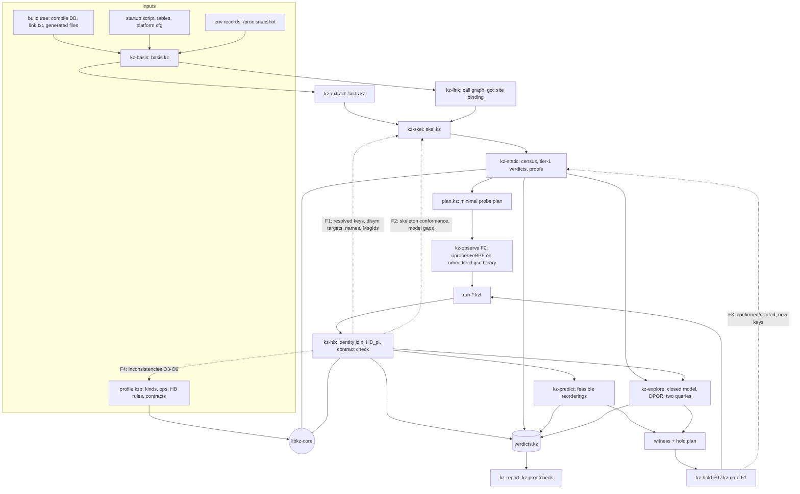

# Proposal C — "Kairos": a hybrid, layered, feedback-driven readiness-contract detector for cFS

- Angle C of the AR2 panel: **hybrid, layered, with feedback**. Date: 2026-10-12. Status: design only. Nothing was built, run, installed, modified or committed for this document.
- Evidence base: reports [R01]–[R07] in `scratchpad/arch/` (cited as `[R0n §x]`), the research records under `/home/user/Shape-Perf/research/cfs_procrace/` (`CONDITIONS_POLICY.md`, `cases/ledger.md`, `results/R2_gdb_v701.md`, `results/R2_cord_v701.md`, `env/BASELINE_MEASURE.md`), the user's v0.1 design (`39d4fa4a-…20261008.md`, cited `v0.1 §n`), and spot checks of the pinned tree `/home/user/work/procrace/cfs_ref/cFS` (cFS `088b2fa8`, cFE `c5fb2b4d`, OSAL `d2d877a6`, PSP `c4b3b0b6`). Code paths are relative to that tree; `path:line` citations are taken from the reports, and the ones re-read for this document are marked "(re-read)".
- Labels: **[F]** fact with citation; **[M]** measured in [R07] or a record; **[I]** my inference or a design decision, not executed; **[U]** unverified. Literature is cited only as verified in [R04]/[R05]/[R06], with their status tag (V-doc, V-abs, V-me, P).
- Policy: every bound and parameter below is either `from-reference` (a code constant or document, cited), `deviation` (recorded with reason), or `unspecified_by_reference` (no value chosen, or swept and reported). No arbitrary constant is introduced.

---

## 0. Summary

**What the detector decides.** For every *readiness-contract instance* in a cFS build (a use of a framework resource that requires that resource to be in some lifecycle state), Kairos produces a verdict `(class, σ, b, evidence)`:
`class ∈ {inactive, protected, fixed-order, schedule-dependent, unknown}`, under a named scheduling/timing semantics `σ`, within a stated bound `b`, carrying the evidence that supports it (static proof, model exploration, predicted witness, observed, confirmed on the binary). "No alarm" is never a class; it is the absence of evidence and maps to `unknown`.

**The core idea of angle C.** One formal core, used by every layer:

1. A typed **event model (KEM)** and a **framework profile Φ_cFS** written once in a small DSL. Φ declares resource kinds with lifecycle automata (typestate), the operations that move them, the happens-before (HB) rules with their code citations, and the readiness contracts with their allowed not-ready outcomes.
2. Φ is interpreted **three ways over the same event type**: *abstractly* over static event skeletons (structural must-order, census of all instances), *concretely* over traces of the unmodified binary (HB + contract checking, predictive reordering), and *operationally* in a bounded explorer over a closed event-level model (fixed-order vs schedule-dependent classification). Confirmation runs on the real binary produce traces that go back through the concrete interpreter.
3. A **feedback loop** closes the layers: static closure and contract mining produce candidates and a minimal probe plan; F0 observation resolves configuration-dependent unknowns, validates the static skeletons, and yields observed and predicted violations; the explorer classifies; confirmation closes each candidate; every new resource key, model gap or inconsistency flows back into the static model. Six **consistency obligations** make the static and dynamic layers check each other (§2.5); a contradiction is reported as a finding about the tool, never resolved silently.

**Ordering is stratified**, and this is what separates the five known case shapes:

| Stratum | Meaning | Used for | Case it decides |
|---|---|---|---|
| **S** (structural) | Holds in every execution on the given path: program order, task create → start, EarlyInit → tasks, script sequencing, barriers whose timeout branch is terminal (core serialization with panic) | proofs of `protected` and `fixed-order` | R2: all 24 uses are S-ordered before the publication (§A.1) |
| **O** (observed sync) | Holds in the observed execution only: mutex release → acquire, semaphore, delivered SB message, poll that exited by its condition, registry reads-from | HB of a trace; *reorderable* in prediction subject to the primitive's semantics | C1/C5: lock-ordered create/lookup is O, so the reverse order can be predicted |
| **C_σ** (schedule constraint) | Not HB: e.g. fixed-priority preemption on one CPU | feasibility under σ_R1 only | C3 (6.4.1): fixed under σ_R1, schedule-dependent under σ_U |

**Mechanisms (all measured feasible in [R07]).** Static: Clang LibTooling on the existing `compile_commands.json` (448 flight TUs in 10 s), LLVM IR per link unit with `link.txt` archive semantics (0.35 s), LLVM DWARF/MC to bind every site to the **gcc** reference binary. Dynamic: root-side **uprobes + eBPF on the unmodified gcc binary** (0.57 µs per hit at function entry+4), HW write-watchpoints for at most four readiness fields (≈34 µs per hit), ptrace holds for few-hold confirmations. Optional, PI-gated: an `ld --wrap` gate variant (deviation) for PCT-style campaigns. Language: C++17 on the pinned LLVM 23 build, C for the BPF program and gate objects. **No Python, no JSON in the tool's own formats**: one typed binary container format and one profile DSL. MLIR is optional behind a measured gate; an SMT solver is optional (Z3 is not installed).

**Openness.** The profile's contracts come from API headers, code admissions, retry/timeout loops and deviant error handling, not from the five cases. A static census instantiates every template at every call site in cFE core and the 15 bundled apps. The 15 readiness-contract kinds of [R03 §4] are all mapped; 11 fully, 4 partially, with the reason (§3.15). The five cases are a development set; evaluation adds a pre-registered held-out protocol (§8).

**Changes relative to v0.1** (keep the frame, change the engine, demote MLIR; consistent with [R06 §7]):

| v0.1 | Kairos |
|---|---|
| Forward pipeline: facts → MLIR model → classify → explore → execute | Loop with feedback and consistency obligations; same formal core in every stage |
| `Exec(B)` without a scheduler/timing semantics | `Exec(B, σ)` with σ_U, σ_U∞, σ_E, σ_R1 and a containment lemma (§1.7) |
| First scope = what the five cases share | First scope = generic contract kinds; SB route and capacity included because they are the only measured order-dependent losses ([R03 §5.2]) |
| MLIR dialect as the semantic model | Serialization-independent KEM + profile DSL; MLIR behind gate T1 of [R06 §4] |
| Selective source instrumentation | F0 uprobe/eBPF observation at the API boundary of the unmodified gcc binary; source probes not needed |
| R2-specific contract example | Generic K-ID template from `cfe_evs.h:168-172` finds R2 with no SB knowledge (§A.1) |

---

## 1. Problem definition

### 1.1 Scope: "process-level"

Following v0.1 §2.1 and [R06 §2.1 F1], *process-level* means ordering between the logical work of different cFS applications, service tasks or execution contexts, independent of OS process boundaries. In the native POSIX port all of them are threads of one process ([R05 §1 F1]; `osal/src/os/posix/src/os-impl-tasks.c:568`). The objects of interest are **framework resources** (named OSAL objects, ES app/task/lib records, service identities, SB routes and pipes, TBL registry entries, phases, CDS blocks, callbacks), not raw memory words. A memory-level data race found in passing (e.g. the unlocked EVS filter counters, [R02 §3.3]) is reported in a separate class `M` and never counted as an order violation ([R02 §8.4 item 7]).

### 1.2 Actors and the four identities

**Actors** `T = T_osal ∪ T_raw ∪ T_env` [I, from F in R01 §2.6, R02 §1.1]:

- `T_osal`: OSAL tasks created by `OS_TaskCreate`: cFE core main tasks, app main tasks, child tasks (`ES_BG_TASK`, TIME tone/1 Hz children, FM child, …).
- `T_raw`: threads without an OSAL task record: the PSP main thread (which runs `CFE_ES_Main` as the "ES startup thread" and later `OS_Application_Run`), the console writer, the timebase thread of `cFS-Master`, signal-handler contexts on the faulting thread, and the linux_sysmon worker (absent here because `/proc/schedstat` is missing, [R01 §2.6]).
- `T_env`: environment roots: ground commands arriving at CI_LAB, SBN peers, the stop command. They have no incoming HB edges ([R04 §4 row 17]).

Each actor has an identity record `⟨kind, osal_id, serial, tid, name, creator_event, generation⟩`. OSAL IDs are `(type << 16) | serial` and are not stable across runs, so cross-run correlation uses `(type, name, creator, creation ordinal)` ([R01 §1.2, §6.2 item 3]).

**Four identity fields per event** ([R06 F1]; v0.1 §2.1):

| Field | Definition | Why it is separate (cFS fact) |
|---|---|---|
| `exec(e)` | the actor that executes `e` | SB code runs in the **caller's** task ([R02 §2.4, §2.8]) |
| `owner(e)` | the ES App whose task set contains `exec(e)` at `e` (generation-aware); `⊥` for raw threads | an app has a main task and child tasks; ES's background task runs work for other apps ([R02 §1.12]) |
| `svc(e)` | the stack of frames active at `e`: **API frames** (SB, EVS, TBL, …) and **on-behalf frames** `cb(registrant)` | TIME synch callbacks run in TIME's task on behalf of the registering app ([R02 §5.3]); FS write callbacks run in `ES_BG_TASK` on behalf of SB/TBL ([R02 §6.1]); OSAL timer callbacks run in the timebase thread on behalf of the timer creator ([R01 §3]) |
| `stamp(e)` | an identity value the code passes or stamps explicitly, e.g. the `AppID` argument of `CFE_EVS_SendEventWithAppID` | R2: the ES task executes SB code that stamps SB's not-yet-published AppId ([R2_gdb §2]) |

### 1.3 Resources, kinds, lifecycle automata, generations

A resource is `r = ⟨kind, scope, key, gen⟩`. `scope ∈ {process, persistent}` (persistent resources survive the process: CDS, boot record, files on `/dev/shm/osal:RAM`, `EEPROM.DAT`, [R01 §5.3]). `key` is a name, numeric ID, `(MsgId, pipe)` pair, path or symbol; in static mode a key may be **symbolic** (e.g. "the string in CF table field `chan[i].sem_name`") or `⊤` (unresolved). `gen` is a generation: the OSAL serial, the cFE resource-ID serial ([R02 §6.2]), or a restart count.

Each kind `k` has a lifecycle automaton `A_k = (Q_k, q0_k, Σ_k, δ_k)` (typestate in the sense of Strom and Yemini, IEEE TSE 1986 [V-me in R06 §9]). A new generation starts on the first transition out of `q0_k`. Examples, all from code:

| Kind | States (→ transitions) | Anchors [F] |
|---|---|---|
| `osal.obj<T>` (task, queue, binsem, countsem, mutex, timebase, timer, module, stream) | `FREE → ALLOC (type lock held, invisible) → RES_C (name visible to search, ID RESERVED, lock *not* held) → LIVE → RES_D → FREE` | alloc `osapi-idmap.c:1171,645-648`; RESERVED + unlock `:435-439,513-516`; name visible at `OS_OBJECT_INIT` (`os-shared-idmap.h:106-111`); **publish = `:1092` under lock, unlock `:1105`** (not the CREATED event at `:864`); delete begin `:438`, end `:1092` with id 0 ([R01 §1.5-1.6]) |
| `es.app` / `es.task` / `es.lib` | `FREE → RESERVED → LIVE → RESERVED (cleanup) → FREE` | app reserve `cfe_es_apps.c:821`, publish `:869`; task record `:694-703`; lib reserve `:989`, init `:1013-1021`, publish `:1037`; cleanup `:1467,:1498` ([R02 §1.16]) |
| `svc.identity(S)` | `UNSET → SET → REGISTERED` | SB: `cfe_sb_task.c:138` then EVS registration `:155`; EVS own ID `cfe_evs_task.c:312`; TBL `cfe_tbl_task.c:196` ([R02 §7.1]) |
| `evs.reg(app)` | `UNREG → REG` | `cfe_evs.c:106`, no lock ([R02 §3.1]) |
| `sb.pipe` | `FREE → RES (OSAL queue name visible) → LIVE → RES_D → FREE` | `cfe_sb_api.c:153,163,190-194`; delete `:409` ([R02 §1.16]) |
| `sb.route(m, p)` | `NONE → ROUTED → NONE` | `CFE_SB_SubscribeFull` under SB lock `cfe_sb_api.c:967-1091` ([R02 §2.3]) |
| `sb.mode.subreport` | `OFF ↔ ON` | toggled by SBN `sbn_subs.c:43-60` ([R03 §2.15]) |
| `sb.queue(p)` | depth `d ∈ [0, cap_B(p)]` | `cap_B(p) = min(requested, msg_max)`; full → drop ([R01 §3 queue row]; [M] `msg_max` 10, CONDITIONS E5) |
| `tbl.table(name)` | `FREE → REGISTERED → LOADED → ACTIVE`, with pending load/validate/activate substates and an access lock flag | [R02 §4.2-4.5] |
| `es.phase` | `EARLY_INIT < CORE_STARTUP < CORE_READY < APPS_INIT < OPERATIONAL` (monotone) | writes `cfe_es_start.c:87,183,194,216,234` ([R02 §1.2]) |
| `es.appstate(app)` | `UNDEFINED < EARLY_INIT < LATE_INIT < RUNNING < WAITING < STOPPED` | raises at `cfe_es_api.c:571-574`, `:469-472`, `:399`; scan `cfe_es_apps.c:1139-1146` ([R02 §1.8]) |
| `es.cds(App.Name)` (persistent) | `ABSENT → REGISTERED(new | restored)` | `es/cfe_es_cds.c:311-477` ([R02 §1.13]) |
| `time.synchcb(app)` | `EMPTY → SET → EMPTY` | `cfe_time_api.c:614-645`; cleanup `cfe_time_utils.c:1018-1041` ([R02 §5.3]) |

### 1.4 Events and traces

An event is `e = ⟨id, actor, seq, op, phase, args, outcome, keys, site, ι(e), t⟩` where `seq` is the per-actor index (the causal token), `op` ranges over the operations declared in Φ, `phase ∈ {call, return, point}`, `outcome` is the result code the program itself received ([R06 F11]), `keys` are the resources touched, `site` is a stable site identifier, `ι(e) = ⟨exec, owner, svc, stamp⟩`, and `t` is a timestamp kept as **evidence only** (Lamport, CACM 1978 [V-abs]: physical time gives no HB). Operation classes: `lifecycle(r, a ∈ Σ_k)`, `use(r, outcome)`, `sync(obj, role)` with roles `acq, rel, give, take, flush, put, get, create, start, exit, join, observe, timeout`, `env(input)`, and `mark(handler_begin | handler_end)`.

A **trace** π is a sequence of events in which each actor's events appear in program order. A **static event template** has the same type, with symbolic fields and a path condition. A template `t` *concretizes* to an event `e` (`t ⊒ e`) iff `site(e) = site(t)` and the fields of `e` satisfy the symbolic constraints of `t`. This single type is what lets the static, dynamic and model layers share one checker.

### 1.5 Readiness contracts

A contract is `κ = ⟨id, U, sel, Req, Allowed, harm, prov, authored⟩`:

- `U`: a use pattern (operation plus site predicate);
- `sel`: a resource selector from event fields to a resource key (e.g. `osal.countsem(arg.name)`, `evs.reg(arg.AppID)`);
- `Req ⊆ Q_k`: the states required at the use;
- `Allowed`: the documented not-ready behaviours, as predicates over the use's outcome and the actor's continuation, drawn from a finite vocabulary: `retry(op, until success, bound read at the site)`, `fallback(op')`, `drop(documented)`, `error_propagated`, `exit(APP_ERROR)`, `panic`;
- `harm`: the effect class when not allowed (event lost, error status discarded, wrong identity stamped, app exit, hang);
- `prov`: provenance (header line, code admission, issue), with file:line and hash;
- `authored`: authoring time relative to when each case was examined (anti-circularity, [R06 §5.3]).

A **contract instance** `i = (κ, t)` pairs a contract with a use template `t`; dynamic use events attach to instances through their site. For a linearization λ, let `state_λ(r, e)` be `δ_k*` applied to the lifecycle events on `r` (same generation) that precede `e` in λ. Then:

- **violation** `V(λ, u) ⇔ state_λ(sel(u), u) ∉ Req_κ`;
- **tolerated** `V(λ, u) ∧ Allowed(outcome(u), continuation)`;
- **harmful** `V(λ, u) ∧ ¬Allowed(…)`.

Example: `CFE_EVS_SendEventWithAppID` documents "The Application ID must correspond to a registered application or core service. For messages outside the context of a registered application (for example early in app initialization or if registration fails) #CFE_ES_WriteToSysLog can be used" (`cfe/modules/core_api/fsw/inc/cfe_evs.h:168-172`, re-read). So `Req = {REG}` on `evs.reg(arg.AppID)`, `Allowed = ∅` (the documented alternative is a different API), harm = event lost.

**Violation chains** ([R06 §3 v0.1 §8]): a use `u2` is *caused* by a violation at `u1` if `u2` exists only because of `u1`'s outcome. R2 contains one: 17 of the 24 identity uses are `SEND_NO_SUBS` events that exist because ES's EVS packets were transmitted before any route existed ([R2_gdb §2]). Verdict records carry a `chain` link.

### 1.6 The analysis basis B

`B = ⟨Build, Config, Init, Env, Input⟩`, each item with value, source and policy status:

- **Build**: commits; compiler gcc 13.3.0 and the recorded flags ([R06 K1]); `link.txt` archive semantics (whole-archive core, lazy BSP members, [R07 §3.4]); generated files by hash, at least `cfe_static_module_list.c` (core order, [R02 §1.3]) and the generated module version table (which changes R2's count from 24 to 11 when absent, [R2_cord §4.2, §7]).
- **Config**: the generated startup script (`build-native_std/exe/cpu1/cf/cfe_es_startup.scr`, 2 libs + 15 apps, [R03 §6.1]); built tables (`*.tbl`) with their source initializers; platform constants (timeouts, poll periods, limits, [R02 §0]); `osconfig.h` limits ([R01] header); the PSP module list.
- **Init**: persistent state before the run (boot record, CDS and reset-area shm, `/dev/shm/osal:RAM` files, `EEPROM.DAT`) and the resulting reset type ([R01 §5.2-5.3]).
- **Env**: kernel (now `6.18.44-fc-v114`, drifted from the recorded `-fc-v80`, [R07 §1]), 4 vCPU, `SCHED_OTHER` for all threads ([M] CONDITIONS E4, M1-5), affinity (the PSP pins `CFE_*` tasks to CPU 0 by code, `cfe_psp_start.c:184-189`; not yet measured, [R06 K5]), effective queue depth (`msg_max` 10), run user.
- **Input**: external commands with their **event-based** triggers, and the stop method (still PI decision D3 per the records).

Every verdict carries the hash of B. A configuration variant (another table, script or core order) is a new B, never a "new bug" ([R06 §5.4]).

### 1.7 Scheduling and timing semantics σ

The set of executions is `Exec(B, σ)`. Four semantics are defined [I; refines R06 §4 T5]:

| σ | Definition | Role |
|---|---|---|
| **σ_U** (untimed) | Any interleaving of enabled actors at event granularity. `OS_TaskDelay` is a yield. Every timed wait may return by timeout at any point. Polls read the current value. Priorities are ignored. | The reference semantics for structural proofs and model classification |
| **σ_U∞** (patient) | σ_U without timeout transitions. Executions that end with a blocked waiter are reported as `stall`, not as a verdict. | Separates "schedule-dependent through timing" from "schedule-dependent in the ordering logic itself" |
| **σ_E** (ENV) | The executions of the real binary under the recorded Env (SCHED_OTHER, 4 vCPU, measured affinity, `msg_max` 10). Not modelled; sampled by observation and confirmation runs. Capacities and configuration enter the model as B values. | Empirical witnesses and frequencies |
| **σ_R1** (RT, one core) | Fixed-priority preemptive scheduling on one CPU, priorities as requested by the startup script and platform config ([R02 §0] table), FIFO among equals, timeouts as in σ_U. Model-only by default; a native realization needs root-imposed `SCHED_FIFO` and single-CPU affinity, a deviation from E1/E4 ([R07 §5.2]). | Platform classes where priority orders (C3 at 6.4.1, [ledger §1a]) |

**Containment lemma** [I, by construction, under assumptions A of §6.1]: `Exec(B,σ_U∞) ⊆ Exec(B,σ_U)`, `Exec(B,σ_R1) ⊆ Exec(B,σ_U)`, and `Exec(B,σ_E) ⊆ Exec(B,σ_U)` provided the profile's operation semantics over-approximate the real OS behaviour at event granularity (assumption A7). Consequences: a `protected` or `fixed-order` verdict under σ_U holds under every other σ in which the use is reachable; a witness found under any σ is a witness under σ_U; a σ_U `schedule-dependent` verdict says nothing about σ_E until a σ_E witness exists.

### 1.8 Ordering relations

The profile's HB rules are inference rules `e1 → e2` with a matching condition, a stratum and a code citation. Three relations result:

- **`≺_S` (structural)**: S-rules only. Program order inside an actor *outside* message-handler loops and inside one handler (the CAFA/DCatch restriction: thread order between two handlers on a looper is not an ordering guarantee; CAFA, PLDI 2014 [V-abs]; DCatch Rule-Pnreg, ASPLOS 2017 [P], both in [R04 §2.7-2.8]); task create call → child's first event; join; EarlyInit → first task; startup-thread script sequencing; and **guarded structural edges**: a barrier exit whose only alternative continuation is terminal. Core serialization is the instance: `CFE_ES_MainTaskSyncDelay(RUNNING, CORE_MAX_STARTUP_MSEC)` at `cfe_es_start.c:835`, with `CFE_PSP_Panic` on failure at `:838-846` (both re-read), and the only writer that raises a core app to `RUNNING` is that app's own wait call ([R02 §1.3, R19]).
- **`≺_O` (observed sync)**: O-rules applied to a trace: outermost mutex release → next acquire, binsem/countsem give → take, delivered queue put → get, SB transmit → receive of the same buffer, poll write → loop exit **by condition**, timer add/set → callback, TBL lock-flag and request protocols, FS request → background → completion, **looper order** between handlers, and **outcome-implied reads-from**: a use whose outcome is success reads from the lifecycle event that made its resource ready (the DefUse idea, OOPSLA 2010 [V-abs]).
- **`HB_π = (≺_S ∪ ≺_O)⁺`** on a trace π, computed with vector clocks (Fidge 1988 / Mattern 1989 [V-abs]).
- **`C_σ`**: schedule constraints of σ_R1 (priority, affinity). They restrict feasibility; they are **never** HB edges ([R04 §4 row 20]; [R05 §2.7]).

Rules not in Φ are listed as **unmodelled**. A static loop that looks like synchronization but matches no rule (a poll on a shared field with `OS_TaskDelay`) becomes an `unmodelled-sync` mark, and every candidate whose decision depends on it is `unknown(unmodelled)`. This is the KCSAN lesson that an HB model missing one ordering mechanism floods false positives (`kcsan.rst` L366-373 [V-doc], [R04 §2.4]).

### 1.9 Verdicts and their proof obligations

For instance `i`, basis B, semantics σ and bound b:

| Class | Definition over `Exec(B,σ)` | Proof obligation (what Kairos must exhibit) |
|---|---|---|
| `inactive(B)` | no execution reaches the use | static: the use template is unreachable in the configuration-closed skeleton (e.g. CF's semaphore lookup with empty `sem_name` in the default table, `cf_def_config.c:60,78`, [R03 §2.6]). An unobserved use is **not** inactive; it is `unknown(not_reached)` |
| `protected(B,σ)` | every execution reaching `u` has `sel(u)` in `Req` (or an allowed outcome) | `p ≺_S u` for every path in the skeleton, with no retire event that can intervene; or exhaustive exploration within `b` finds no violation (then the class is "protected within b") |
| `fixed-order(B,σ)` | every execution reaching `u` violates | `u ≺_S p` for every publisher `p` of a ready state, no alternative publisher, and every non-terminal path to `p` passes the guarded edge; or exploration within `b` finds only violating executions |
| `schedule-dependent(B,σ)` | both violating and conforming executions exist | two witnesses, each predicted, model-derived, observed or confirmed; the class records the weakest evidence used |
| `unknown` | none of the above established | with a reason: `not_reached`, `model_gap`, `bound`, `budget`, `key_unresolved`, `loss`, `unmodelled` |

Evidence is a separate axis: `{static_proof, model(b), predicted, observed(n of N runs), confirmed(F0 | F1)}`. "Fixed-order" is never inferred from k-of-k failing runs ([R06 S9]); "protected" is never inferred from absence of observation. A verdict is the tuple `(class, σ, b, evidence, harm, B-hash, Φ-hash)`.

### 1.10 Why plain data-race HB detection is insufficient, and what theory is extended

| Phenomenon in cFS | What an HB or lockset race detector does | What Kairos adds |
|---|---|---|
| **R2**: all 24 violating uses are HB-ordered *before* the publication by core serialization ([R2_gdb §2]; [R06 §4 T5]) | Reports nothing. Djit+, FastTrack (PLDI 2009 [V-abs]) and TSan report unordered conflicting accesses only; predictive relations (CP POPL 2012, WCP PLDI 2017, SHB OOPSLA 2018, M2 POPL 2020, SyncP POPL 2021; all [V-abs]) report reorderable pairs only ([R04 §3 L4]) | Contract checking on **ordered** pairs, and a structural proof (`u ≺_S p`) that lifts "ordered the wrong way in this trace" to `fixed-order(σ_U)` |
| **C1 / C5**: create and lookup (C1) or registration and `GetAppID` (C5) are each lock-protected ([ledger §1a]) | HB orders them through the lock in the observed direction; lockset finds them consistently locked ([R04 §2.3, §3 L5]) | The registry **key** is the conflict object and the lock gives atomicity, not order. Lock edges are stratum O, reorderable in prediction. This is a lock-order reversal, outside SyncP's tractable sync-preserving class (NP-complete in general, [R04 §2.5]), so prediction uses an RVPredict/GPredict-style constraint search with a budget |
| Losses: no-subscriber drop returns success; queue full drops silently ([R03 §1]; [M] 4–49 queue-full drops per boot, `NoSubscribersCounter` 15–26, BASELINE_MEASURE §0, §3.5) | No HB rule covers them (gap G5, [R04 §5]) | Outcomes are first-class: route and capacity states in the typestate; prediction asks whether a feasible reordering changes an outcome |
| Soft, opt-in, timed barriers (`WaitForStartupSync` returns void, `cfe_es_api.c:616-619`) | Either unconditional edges (Go init/once style) or false positives (gap G3) | Conditional O-edges (only on exit by condition), and the σ_U / σ_U∞ split |
| Executing task ≠ owner ≠ service ≠ stamped AppId (gap G6) | Thread identity only | Four identity fields and on-behalf frames |
| Configuration decides reachability and capacity (gap G7) | Configuration taken as given | B with configuration closure; `inactive` as a class |
| Priority order that exists only on RT targets (gap G8) | No edge, correctly, but no verdict either | σ_R1 as a schedule constraint, verdict per σ |

**Established theory extended** (no individual mechanism is claimed as new; [R04 §5, last paragraph]):

| Element | Source (status) |
|---|---|
| HB as partial order; vector clocks | Lamport 1978; Fidge 1988; Mattern 1989 [V-abs] |
| Framework/event-driven HB rules (looper, post/begin, RPC/event abstraction) | DroidRacer PLDI 2014 [V-abs]; CAFA PLDI 2014 [V-abs]; DCatch ASPLOS 2017 [P] |
| Typestate contracts | Strom & Yemini 1986 [V-me] |
| Def-use invariants as the unit of checking; generic predictive properties | DefUse OOPSLA 2010 [V-abs]; GPredict ICSE 2015 [V-abs] |
| Sound predictive reordering with control-flow abstraction | Maximal causal models RV 2012 [V-abs]; RVPredict PLDI 2014 [V-abs]; Vindicator PLDI 2018 (candidate + vindication split) [V-abs] |
| Ad hoc synchronization as conditional edges; race coverage | Xiong et al. OSDI 2010 [V-abs]; Tian et al. ISSTA 2008 [V-abs]; EventRacer OOPSLA 2013 [V-abs] |
| Initialization races (late handler registration, access before definition) | InitRacer OOPSLA 2017 [V-abs] |
| Systematic exploration | DPOR POPL 2005 [V-abs]; optimal/source DPOR POPL 2014 [V-abs]; BPOR OOPSLA 2013 [V-abs]; PCT ASPLOS 2010 [V-abs; mechanism P] |
| Static action-level HB; environment models | SIERRA ASPLOS 2018 [V-abs]; SDV EuroSys 2006 [V-abs]; FlowDroid lifecycle model PLDI 2014 [V-me] |
| Triggering and confirmation; outcome triage | CTrigger ASPLOS 2009, RaceFuzzer PLDI 2008, RacePro SOSP 2011, Portend ASPLOS 2012 [all V-abs] |
| Feasible vs apparent races | Netzer & Miller LOPLAS 1992 [V-abs] |
| Order violations as a major bug class | Lu et al. ASPLOS 2008 [V-abs] |

---

## 2. Architecture

### 2.1 Layers and principles

```
L5  Orchestration & reporting     kz-loop (feedback driver, fixed point), kz-report, kz-proofcheck
L4  Real-binary observation/control  kz-observe (F0 uprobe+eBPF), kz-hold (F0 ptrace), kz-gate (F1, PI-gated)
L3  Analyses (three interpreters)  abstract: kz-static | concrete: kz-hb, kz-predict | operational: kz-explore
L2  Formal core                    libkz-core: KEM types, profile DSL, rule engine, typestate, vector clocks,
                                   verdict lattice, provenance, KZ container I/O
L1  Static closure & skeletons     kz-basis, kz-extract (Clang), kz-link (LLVM IR + DWARF binder), kz-skel
L0  Inputs                         basis B (build tree, configuration, environment), profile Φ_cFS (DSL text)
```

Principles [I]:

1. **One formal core.** Every component reads and writes the same KEM types through `libkz-core`. No component has a private notion of event, resource, edge or verdict.
2. **The profile is data, not code.** Framework knowledge (resource kinds, operations, HB rules, contracts, bindings) lives in versioned DSL files. Engines are framework-neutral. This is the precondition for the version and framework generalization hypotheses of §7.4.
3. **Proof-carrying verdicts.** Every `protected` or `fixed-order` verdict carries the edge path (rule IDs plus code citations) that justifies it. A separate small checker, `kz-proofcheck`, re-validates each edge against the static facts.
4. **Observation first, control second.** F0 observation on the unmodified gcc binary is the default ([R07 §7] fidelity class F0). Controlled execution is used only for confirmation, with every hold recorded.
5. **Feedback with obligations.** Each loop iteration re-checks the consistency obligations of §2.5.
6. **Honest unknowns.** Every gap (unresolved key, model gap, loss, budget) produces `unknown` with a reason.

### 2.2 Components

| Component | Layer / kind | Language and libraries | Inputs → outputs | Why this technology (measured or argued) |
|---|---|---|---|---|
| `kz-basis` | L1 static | C++17 | build tree, env records, `/proc` snapshot → `basis.kz` | reads `compile_commands.json`, `link.txt`, the generated `cfe_static_module_list.c` and startup script; JSON/CMake files are *inputs* produced by CMake, not tool formats |
| `kz-extract` | L1 static | C++17, Clang LibTooling + ASTMatchers (LLVM 23 build `1053047a`) | 448 FSW compile commands → `facts.kz` | [M] all 448 TUs parse in 10 s single-threaded with two documented adaptations (`-Wno-unknown-warning-option`, `-Wno-error`, plus `-resource-dir`) ([R07 §3.3]); Clang gives macro provenance (467 of 3,762 API call sites are inside macro expansions, [R07 §4.6]) and constant evaluation of table initializers |
| `kz-link` | L1 static | C++17, LLVM IR (`llvm-link` semantics), LLVM DebugInfo/DWARF, LLVM MC disassembler | bitcode per link unit; the **gcc** binary and app `.so` files → call graph, site binding table | [M] bitcode for 448 TUs in 4.4 s, closed `core-cpu1.bc` in 0.35 s with 0 undefined `CFE_`/`OS_` symbols ([R07 §3.4]); DWARF + MC bind each Clang-level site to an instruction address in the gcc binary, which keeps fidelity to the reference build ([R06 T7]) |
| `kz-skel` | L1 static | C++17 on `libkz-core` | facts + call graph + Φ → per-actor event skeletons `skel.kz` | projection of the interprocedural CFG onto event templates; poll and retry loop summaries |
| `libkz-core` | L2 core | C++17, no LLVM dependency | — | the shared formal core; independent of LLVM so the trace and model layers do not link Clang |
| `kz-static` | L3 abstract interpreter | C++17 | skeletons + Φ → census, tier-1 verdicts, proofs, probe plan | static `≺_S`, key unification, set-cover probe planning |
| `kz-hb` | L3 concrete interpreter | C++17 | trace + Φ + bindings → `HB_π`, per-use three-valued state, observed violations, candidate pairs, chains | vector clocks; traces are small (CORD logged 626–632 events per boot with a limited probe set, [R2_cord §4.1]) |
| `kz-predict` | L3 concrete (relaxed) | C++17; optional SMT-LIB2 emitter | trace cone + Φ → predicted witnesses or `unknown(budget)` | explicit search with partial-order reduction needs no solver; Z3 is not installed ([R07 §2.4]) |
| `kz-explore` | L3 operational interpreter | C++17 | closed candidate model + σ + b → class within b, witness schedules | source/optimal DPOR over event-level transitions; no external model checker needed (GenMC needs LLVM 19–22 and a closed C program, [R05 §1 F11, §2.2]) |
| `kz-observe` | L4 dynamic, F0 | C (one BPF program, compiled with system clang-18 `-target bpf`); C++17 loader on raw `bpf()`/`perf_event_open` | probe plan + binaries → trace `run-*.kzt` | [M] uprobe 0.57 µs/hit at entry+4, eBPF attach to uprobes works, no binary or build change, observer as root next to the `ubuntu` README-mode process ([R07 §4.7]); system `llc-18` has the BPF backend, libbpf headers are absent, the kernel UAPI `linux/bpf.h` is present (re-read) |
| `kz-hold` | L4 confirmation, F0 | C++17, ptrace | hold plan → controlled run + trace | [M] ptrace on a uid-1000 process works from root (no Yama); gdb measured ≈203 µs per breakpoint hit ([R07 §4.7]); a confirmation needs few holds |
| `kz-gate` | L4 confirmation, F1 (PI-gated) | C99 under the cFS flags (`__wrap_*` objects), C++17 controller | variant link → gated runs (PCT, directed) | [M] `--wrap` covers cross-TU and app→core calls (misses 88 of 3,762 intra-TU API sites, 2.3%); handoff 1.1 µs same CPU, 10.5 µs across CPUs ([R07 §4.2, §5.1]); it is a link-option **deviation** |
| `kz-loop` | L5 | C++17 | everything → iteration log, fixed-point report | drives the feedback loop of §4.10 |
| `kz-report`, `kz-proofcheck` | L5 | C++17 | `verdicts.kz` → Markdown/CSV for humans; proof re-validation | humans read rendered reports; the store stays binary and typed |

**MLIR** is not on the critical path. The facts are not a program to be lowered, so MLIR would serve as a container ([R06 §3 v0.1 §5, T1]). The out-of-tree build works and the `smt` dialect with `--export-smtlib` exists in the LLVM 23 build ([R07 §2.2]), but an SMT-LIB2 printer for our constraint language is small, and no solver is installed. Kairos keeps an optional `kz-mlir` adapter behind gate T1: implement tier-1 classification on the plain KEM graph and on an MLIR dialect over the same facts, compare lines of code, runtime, provenance completeness and verdict equality, and adopt MLIR only on a measured win.

### 2.3 Data artifacts and typed formats

**One container format, KZ.** All tool artifacts use one binary container: a header and a section table, each section an array of fixed-layout little-endian records plus a string pool. The record layouts are declared once, in a single C header `include/kz/schema/kz_schema.h`, included from C (BPF program, gate objects) and C++ (everything else), with `_Static_assert`s on every size and offset. No schema compiler and no generated code.

```c
/* kz_schema.h (excerpt, illustrative) */
typedef struct kz_file_header {
  uint32_t magic;               /* 'K','Z','0','1' */
  uint16_t major, minor;
  uint8_t  schema_sha256[32];   /* hash of the SCHEMA section (field table of every record type) */
  uint8_t  basis_sha256[32];    /* B */
  uint8_t  profile_sha256[32];  /* compiled Φ */
  uint32_t nsections, flags;
} kz_file_header;

typedef struct kz_section { uint32_t type, rec_size; uint64_t count, offset; uint32_t crc32c, rsv; } kz_section;

typedef struct kz_raw_ev {      /* emitted by the BPF program; 72 bytes */
  uint64_t t_ns;                /* CLOCK_MONOTONIC: evidence only, never HB */
  uint32_t tid;                 /* kernel thread id */
  uint32_t seq;                 /* per-thread sequence: causal token and loss detector */
  uint32_t site;                /* probe-site id -> SITES section (binding to template, decoder) */
  uint16_t phase;               /* ENTRY | RET | POINT | WATCH */
  uint16_t flags;               /* STR_FOLLOWS, STACK_TRUNC, ... */
  uint64_t a[4];                /* raw values captured per the site decoder (registers, stack slots, derefs) */
  uint64_t objseq;              /* per-object sequence assigned inside the probe (e.g. mutex acquisition count) */
  uint64_t stack_ref;           /* -> STACKS section (frame-pointer user stack), 0 if none */
} kz_raw_ev;

typedef struct kz_verdict {
  uint64_t instance;            /* (contract, template, key) */
  uint32_t sigma;               /* SIGMA_U | SIGMA_U_INF | SIGMA_E | SIGMA_R1 */
  uint8_t  cls;                 /* INACTIVE | PROTECTED | FIXED | SCHED_DEP | UNKNOWN */
  uint8_t  evidence;            /* bitmask: STATIC_PROOF | MODEL | PREDICTED | OBSERVED | CONF_F0 | CONF_F1 */
  uint8_t  harm;                /* NONE | TOLERATED | HARMFUL | UNSPECIFIED_BY_REFERENCE */
  uint8_t  unknown_reason;
  uint32_t bound;               /* -> BOUNDS section (b) */
  uint64_t proof, witness_violating, witness_conforming, chain;   /* section references */
} kz_verdict;
```

Section types: `SCHEMA, STRINGS, BASIS, SITES, TEMPLATES, SKELETONS, ACTORS, RESOURCES, RAW_EVENTS, EVENTS (decoded), STACKS, EDGES, INSTANCES, PROOFS, WITNESSES, HOLDPLANS, VERDICTS, BOUNDS, LOSS, RUNMETA, PROVENANCE`. Each artifact is a container holding the sections it owns.

| Artifact | Producer → consumer | Content |
|---|---|---|
| `basis.kz` | kz-basis → all | B items with value, source, policy status |
| `profile.kzp` (text) → `profile.kz` | human → libkz-core | Φ: kinds, operations, rules, contracts, bindings; each entry with provenance and authoring record |
| `facts.kz`, `skel.kz` | kz-extract/kz-link/kz-skel → kz-static, kz-explore | call sites, constants, guards, loop summaries, lock regions, handler loops; per-actor skeleton automata |
| `census.kz` | kz-static → kz-loop | all instances, tier-1 verdicts, proofs, open candidates |
| `plan.kz` | kz-static → kz-observe | probe sites (file, offset, instruction class, decoder), watchpoints, expected cost |
| `run-<id>.kzt` | kz-observe / kz-hold / kz-gate → kz-hb | raw events, stacks, strings, loss table, run metadata (B hash, plan hash, holds) |
| `hb-<id>.kz` | kz-hb → kz-predict, kz-loop | decoded events, identity join, edges, per-use states, observed violations |
| `witness-<cand>.kz`, `holdplan-<cand>.kz` | kz-predict/kz-explore → kz-hold/kz-gate | violating/conforming schedules; hold points and release events |
| `verdicts.kz` | all analyses → kz-report | append-only verdict store, versioned by B, Φ and tool hashes |

**The profile DSL** is a small declarative language parsed by a hand-written recursive-descent parser in `libkz-core`. It is interpreted, never compiled to C++. Illustrative excerpt (syntax not final; citations are from the reports):

```
profile cfs "cFS 088b2fa8 / cFE c5fb2b4d / OSAL d2d877a6 / PSP c4b3b0b6";

kind evs.reg(app: AppId) { states UNREG, REG; initial UNREG; }

op CFE_EVS_Register {
  bind symbol "CFE_EVS_Register";
  effect lifecycle evs.reg(owner) UNREG -> REG when result == CFE_SUCCESS;
  source code "cfe/modules/evs/fsw/src/cfe_evs.c:42-111";              # R02 §3.1
}

op CFE_EVS_SendEventWithAppID(EventID, EventType, AppID, Spec) {
  bind symbol "CFE_EVS_SendEventWithAppID";
  effect use evs.reg(arg.AppID);  stamp arg.AppID;
  outcome CFE_EVS_APP_ILLEGAL_APP_ID   : not_ready;                    # cfe_evs.c:185-189
  outcome CFE_EVS_APP_NOT_REGISTERED   : not_ready;                    # cfe_evs.c:190-194
}

contract K-ID.send-with-appid {
  use op CFE_EVS_SendEventWithAppID;
  requires evs.reg(arg.AppID) in {REG};
  allowed none;   harm event_lost;
  source doc "cfe/modules/core_api/fsw/inc/cfe_evs.h:168-172";
  authored 2026-10-12 relation unaware_of_case;                        # bookkeeping, see §7.5
}

rule CORE-SERIAL stratum S guarded {
  from op CFE_ES_WaitForSystemState(min >= CORE_READY) in actor class core;   # raises own AppState to RUNNING
  to   return of CFE_ES_MainTaskSyncDelay at "cfe/modules/es/fsw/src/cfe_es_start.c:835" == CFE_SUCCESS;
  else terminal panic at "cfe/modules/es/fsw/src/cfe_es_start.c:838-846";
  writers es.appstate(a) := RUNNING only by actor main(a);           # writer-set fact, checked statically
  source code "cfe_es_start.c:776-847", "cfe_es_api.c:545-551,571-574";
}
```

### 2.4 Data flow



Numbered flow [I]:

1. `kz-basis` records B. `kz-extract` and `kz-link` produce facts, the configuration-resolved call graph and the gcc site binding table.
2. `kz-skel` builds one event skeleton per static actor (§4.2).
3. `kz-static` computes `≺_S`, instantiates every contract at every matching template (census), classifies what it can (tier 1), and emits proofs, open candidates and a minimal probe plan (§4.3-4.4).
4. `kz-observe` runs the unmodified binary under B with the plan and writes a trace.
5. `kz-hb` joins identities, builds `HB_π`, evaluates every use (ordered and unordered), and records observed violations, wrong-direction orders and unordered candidates (§4.5).
6. Feedback F1/F2: observed names, MsgIds, `dlsym` results and per-actor sequences refine the closure and validate the skeletons.
7. `kz-predict` searches feasible reorderings for candidates (§4.6). `kz-explore` classifies candidates on a closed model (§4.7).
8. Witnesses become hold plans; `kz-hold` (F0) or `kz-gate` (F1, if approved) runs them; the confirmation trace goes back through `kz-hb` (§4.9). Feedback F3 updates candidates.
9. Inconsistencies (F4) are reported against Φ or the extractor for human review; they are findings about the tool.
10. The loop stops at a fixed point (§4.10). `kz-report` renders verdicts with provenance, σ, b and evidence; `kz-proofcheck` re-validates proofs.

### 2.5 Consistency obligations between layers

Checked after every observation or confirmation run [I]:

| ID | Obligation | Failure means | Action |
|---|---|---|---|
| O1 | Every decoded event concretizes some template of its actor's skeleton | the skeleton misses behaviour (closure or extraction gap) | `model_gap` on the actor; feedback F2 |
| O2 | Each actor's observed event sequence is accepted by its skeleton automaton | path abstraction or loop summary is wrong | as O1; instances touching the actor drop to `unknown(model_gap)` for model evidence |
| O3 | No observed order contradicts an S-edge (`u ≺_S p` but the trace shows `p` before `u` on that path) | an S-rule or its binding is invalid | the rule is suspended; all proofs using it are withdrawn |
| O4 | No observed violation at an instance proven `protected`; no observed conformance at an instance proven `fixed-order` (same path) | rule, binding or contract error | as O3 |
| O5 | Every observed resource key is in the static key universe | closure incomplete (e.g. a name from a table that was not decoded) | feedback F1 |
| O6 | A predicted witness is admitted by the explorer's model, and an explorer witness projected onto observed actors is admitted by Pred(π) | the model is too strict or the predictor too loose | `unknown(model_gap)` for the pair; report |

This is the angle-C argument for validity: each layer is a test oracle for the others, and every disagreement is surfaced instead of averaged away.

### 2.6 Technology decisions and their justification

- **Clang/LLVM (yes).** Measured cheap and complete on this tree ([R07 §3]). Facts are extracted with Clang because macro provenance, constant folding of table initializers and source locations are needed; whole-link-unit IR gives call-graph closure with archive semantics; DWARF and MC bind facts to the **gcc** binary that is executed. Clang is never used to build the executed binary (that would be fidelity class F3).
- **gcc as the executed compiler (yes).** The reference build is gcc 13.3.0, `-O0 -g` ([R06 K1]); a recompiled object is byte-identical to the build-tree object ([R07 §3.5]), so fidelity of any variant can be measured per object.
- **MLIR (optional, gated).** §2.2.
- **SMT solver (optional).** `kz-predict` and `kz-explore` run without a solver. An SMT-LIB2 backend is kept for cross-checking and for larger cones if the PI approves installing Z3 (apt candidate 4.8.12, [R07 §2.4]).
- **eBPF tooling.** No libbpf headers, bpftool or bpftrace are installed ([R07 §4.7]). The design needs a minimal loader for one BPF object with a few maps; it uses raw `bpf()` and `perf_event_open` (both probed to work, [R07 §4.7]). Installing libbpf would shorten this work; that is a PI decision (§10).
- **No Python in the tool.** All components are C/C++; reports are rendered by `kz-report`. Existing harness scripts (`env/run_cfs.sh`) stay as the run driver; Kairos adds one root-side observer hook (PI decision, [R07 §9 item 1]).

---

## 3. cFS mapping: the profile Φ_cFS for v7.0.1

Each mechanism below becomes profile entries: resource kinds, operations (with probe binding), HB rules (stratum S or O), and contracts. Rule IDs `R1`–`R19` are those of [R02 §8.1]; `P-*` are OSAL primitive rules from [R01 §3, §6.1]. Edges are **API-level only**: OSAL-internal locks (type table locks, binsem internal mutex, console lock) are not treated as synchronization, because they would hide races that other OSAL backends or timings expose ([R01 §3, §6.2 item 2]; assumption A5).

### 3.1 Actor inventory and closure sources

| Actor class | Source in B | Entry resolution | Observation anchor |
|---|---|---|---|
| ES startup thread (PSP main thread) | `bsp_start.c` → `CFE_PSP_MAIN_FUNCTION` ([R01 §5.1]) | static | `CFE_ES_Main` entry |
| cFE core main tasks ES, EVS, SB, TBL, TIME | generated `cfe_static_module_list.c` (from `MISSION_CORE_MODULES`, `cfe/cmake/mission_defaults.cmake:26-40`) ([R02 §1.3]) | `TaskMain` field of the constant object table | `OS_TaskCreate` call in `CFE_ES_StartAppTask`; child `OS_PthreadTaskEntry` |
| App main tasks (15) | generated startup script ([R03 §6.1]) | script entry symbol → definition in the module's `.so` (static analogue of `dlsym`, [R05 §2.5 item 1]); confirmed by the observed `OS_ModuleSymbolLookup` result (feedback F1) | as above |
| Child tasks | `CFE_ES_CreateChildTask` call sites with constant function arguments (`cfe_es_api.c:1202-1294`) | constant argument | as above |
| Timebase thread `cFS-Master` | PSP `soft_timebase` module (`cfe_psp_soft_timebase.c:53`), PSP module list | OSAL timebase | `OS_TimeBaseCreate` |
| Callback contexts | `OS_TimerAdd`, `CFE_TIME_RegisterSynchCallback`, FS background requests, TBL validation functions | constant function arguments; otherwise type-filtered, otherwise `unknown_effect` | on-behalf frames from stacks |
| Console writer, signal contexts | OSAL console create; PSP exception handlers ([R01 §2.6, §5.4]) | static | creation sites |
| Environment roots | B.Input | — | CI_LAB socket receive returns |

Residual indirect calls (110 function-pointer call sites in the FSW set, [R07 §4.2]) are resolved in this order: constant initializers in configuration tables, then struct-layer type filtering (the MLTA idea, CCS 2019 [V-abs]), then `unknown_effect` ([R05 §2.5]).

### 3.2 OSAL ID map lifecycle and lookups

- **Kind** `osal.obj<T>` with the automaton of §1.3. The publication anchor is the final ID write under the type lock (`osapi-idmap.c:1092`, unlock `:1105`), not the `OS_EVENT_RESOURCE_CREATED` callback (`:864`), which runs after the unlock; a time-ordered trace would otherwise show use before create ([R01 §6.1]).
- **Observation**: entry/return of each `OS_*Create`, plus entry of `OS_ObjectIdFinalizeNew` (a function boundary, [R04 §1]) for the publication point; entry/return of `OS_*GetIdByName`, `OS_TaskFindIdBySystemData`, `OS_*Delete`.
- **Outcome-implied reads-from (O)**: a successful by-name or by-ID lookup reads from the publication of the same generation. Timestamps are not used to order them.
- **Lookup outcomes by state** ([R01 §1.7]) are profile outcomes: `RES_C` with `name_entry` still NULL → `OS_ERR_NAME_NOT_FOUND`; `RES_C` with name set → `OS_ERR_INCORRECT_OBJ_STATE`; by-ID NONE mode on RESERVED → `OS_ERR_INVALID_ID`; GLOBAL/REFCOUNT/EXCLUSIVE → bounded wait (≤ 4 waits of `attempts² × 10 ms`, failure on the 5th attempt, `osapi-idmap.c:475-480`) then success or `OS_ERR_OBJECT_IN_USE`.
- **Contracts**: `K-REG.osal-lookup` (Req `{LIVE}`; Allowed `NAME_NOT_FOUND` followed by a retry whose bound is read at the call site, e.g. CF's 25, `cf_internal_cfg.h:173`); `K-LOCKBAL` (after an OSAL API returns failure, the type lock is released). The invariant is the code's own documented one: "Upon failure, the global table lock is always released for all lock modes other than OS_LOCK_MODE_NONE" (`osapi-idmap.c:384-385`, re-read), while `:401-404` returns `OS_ERR_INCORRECT_OBJ_STATE` before the unlock logic (re-read). This yields the **F1 lock-leak candidate** of [R01 §1.8] from a generic template (§7.2).
- **Other OSAL findings mapped**: F2 duplicate names under concurrent creation (`K-REG.unique`, low relevance, [R01 §1.8]); F4 NONE-mode operations concurrent with deletion (`K-LIFE.osal`, use after `RES_D`); F5 shutdown searches (teardown scenario); F6 rwlock without a POSIX table lock (latent: no non-test caller; profile marks rwlock as unmodelled).

### 3.3 Task create and start

- **P-TASK / R2 (S)**: the `OS_TaskCreate` call → the child's first event. At OSAL level the creator's `TransactionFinish` unlock (`osapi-idmap.c:1105`) precedes the child's successful lock in `OS_TaskPrepare` (`osapi-task.c:84`) ([R01 §2.2]). Nothing the creator does after `OS_TaskCreate` returns is ordered before the child without further synchronization.
- **K-SPAWN.osal (F7)**: the child waits at most 4 times for the record to leave RESERVED; every task-table unlock in the process consumes an attempt; on the 5th attempt the entry point never runs while the creator got `OS_SUCCESS` ([R01 §2.2 F7]). Modelled as a bounded retry with the code bound; reachable under σ_U; harm "task silently never runs".
- **ES handshake (O, conditional)**: `CFE_ES_StartAppTask` creates the task before taking the ES lock (`cfe_es_apps.c:664-672`) and fills the task record afterwards (`:694-703`). The child polls in `CFE_ES_GetTaskFunction` (`:559-605`, re-read): `OS_TaskDelay(50)`, then a locked check of its task record, with a 1000 ms budget, i.e. at most 21 checks ([R05 §1 F4]). Edge: task-record publication → the poll iteration that saw it, only on exit by condition; timeout → the entry is never called.
- **K-SPAWN.app-record (ES RESERVED window)**: the child checks only the task record. `CFE_ES_GetAppID` needs the App record to be final (`cfe_es_resource.c:308-341`), which happens at `cfe_es_apps.c:869`. Between `:722` and `:869` only the 50 ms sleep separates them, and a sleep is not synchronization ([R02 §1.6, §8.2]). In the same window `CFE_ES_GetAppIDByName` returns `CFE_SUCCESS` with `0xFFFFFFFF` (`cfe_es_api.c:639-653`). Profile outcome `RESERVED-sentinel` makes that "successful" lookup a violation.
- **Delete/exit (P-TASK-JOIN, S)**: `OS_TaskDelete` cancels and joins (`os-impl-tasks.c:693-723`); its return implies the victim executes nothing more (R17). Deferred cancellation: a victim holding a program lock at a cancellation point leaves it held ([R01 §2.4]) → `K-LOCK.cancel` hazard on `CFE_ES_DeleteChildTask`, which deletes under the ES lock (`cfe_es_api.c:1348,1383`).

### 3.4 OSAL primitives

| Primitive | Rule (stratum) | Matching condition | Outcomes recorded | Probe anchors |
|---|---|---|---|---|
| Mutex (`OS_MutSem*`), recursive (`os-impl-mutex.c:94`) | P-MUT / R4 (O) | outermost release → next outermost acquire of the same mutex; nested acquisitions add no edge | result, recursion depth | take return; give entry; `objseq` assigned inside the critical section so release *k* matches acquire *k+1* |
| Binary semaphore | P-BIN / R9 (O) | give → the take that consumed it; conservatively the join of all gives since the last consuming take; flush → each flushed take; timeout → no edge | consumed vs flushed (indistinguishable to the caller), timeout, `OS_SEM_FAILURE` from the internal 2 s `timedlock` (`os-impl-binsem.c:50,60-77`) | give/flush entry; take/timedwait return |
| Counting semaphore | P-CNT / R10 (O) | conservative join of prior gives (the ThreadSanitizer model, [R01 §3]); in prediction, exact count semantics | result; EINTR failure (`os-impl-countsem.c:145-148`) | give entry; take return |
| Queue (all are SB pipes, [M] 26 per run) | P-Q (O) | put(m) → get(m) for the same 8-byte payload (`mq_msgsize` 8, [M] BASELINE_MEASURE §0), FIFO per queue; `OS_QUEUE_FULL` → **drop outcome, no edge** | depth, drop, payload | put entry+return; get return |
| Timebase and timer | P-TB (O); callback chain (S within the timebase thread) | `OS_TimerAdd`/`OS_TimerSet` (unlock of `handler_mutex`, `osapi-time.c:185,345`) → later callbacks (`osapi-timebase.c:448`); callback *k* → *k+1* on one thread; callbacks attributed to the timer creator; `OS_TaskGetId` returns the timebase ID inside callbacks (`osapi-timebase.c:383`) | callback start/end; overruns are not counted by OSAL ([R01 §3]) | timer add/set; callback entry |
| Modules and symbols | P-MOD (O, reads-from) | `OS_ModuleLoad` success → successful symbol lookup | names, results | load/lookup entry/return |
| Files, dirs, paths | none (shared state) | path as resource; `OS_FileOpenCheck` is check-then-act ([R01 §3]) | path, op, result | API entry/return |
| Sockets | P-NET (O) | datagram send → receive; external senders are `T_env` | payload identity | recv return |
| Console `OS_printf` | **none** | implementation-level serialization only; must be ignored ([R01 §3]) | — | not probed |
| `OS_TaskDelay` | **none** | yield in σ_U | delay calls (timing-based "synchronization" is a race signature) | entry |
| Condition variables, rwlocks | unmodelled | no non-test caller ([R01 §3]) | — | — |

### 3.5 PSP startup and persistence

- **Startup order (S, program order on the PSP main thread)** ([R01 §5.1]): `OS_API_Init` → event-handler registration → reserved memory → `OS_FileSysAddFixedMap` → `CFE_PSP_ModuleInit` (creates and starts timebase `cFS-Master` at 10 ms) → `sleep(1)` → reset-type decision → `CFE_PSP_InitProcessorReservedMemory` → `CFE_ES_Main` → `OS_Application_Run`. Hence `cFS-Master` is `LIVE` before any cFE task exists, so SCH_LAB's and TIME's timebase lookups are `protected_S` in the default B ([R01 §4]; [R03 §3 row 1], which left this as an inference; Kairos discharges it with a structural proof).
- **PSP task-startup hook**: on `OS_EVENT_TASK_STARTUP` the PSP calls `OS_GetResourceName` (task-table GLOBAL lock) and pins `CFE_*` tasks to CPU 0 (`cfe_psp_start.c:174,184-189`). The lock use is an attempt consumer for F7; the pinning is an Env fact to measure (B.Env).
- **Persistence (kind scope = persistent)**: boot record, CDS, reset area, user-reserved shm (keyed by `ftok` of CWD key files), `/dev/shm/osal:RAM`, `EEPROM.DAT` ([R01 §5.3]). These are B.Init. The reset type of run *n+1* depends on how run *n* ended ([R01 §5.2]; [M] PO → PR → PR → PO after signal stops, CONDITIONS E7). Cross-run contracts (`K-PERSIST`) are checked over **run sequences** `B_n → B_{n+1}`, where run *n*'s end state becomes `B_{n+1}.Init`.
- **Asynchronous PSP paths**: exception handler (faulting thread) → 4-entry lock-free ring with an acknowledged race (`cfe_psp_exception.c:72-86`) → `SIGUSR1` to the idle thread → `SystemNotify` → ES; `CFE_PSP_Restart` → `ShutdownReq` + `SIGUSR1` → `OS_DeleteAllObjects` concurrently with running tasks, with a 10 s abort ([R01 §5.5]). Both are teardown/fault scenarios outside the first startup scope; their kinds and edges are in Φ so they are not silently unordered.

### 3.6 ES phases, soft barriers and core serialization

- **Core object order** comes from the generated `cfe_static_module_list.c` (CONFIG, ES, EVS, FS, SB, TBL, TIME, MSG, SBR, RESOURCEID), not from `cfe_es_objtab.c` ([R02 §1.3], correcting `mapping_v701.md`). Kairos reads the generated file; changing `MISSION_CORE_MODULES` is a new B.
- **R18 EarlyInit → all tasks (S)**: phase 1 runs every `EarlyInit` in table order on the startup thread before the first core task is created (`cfe_es_start.c:752-773`).
- **R19 CORE-SERIAL (S, guarded)**: per core entry: reserve the App record, `StartAppTask`, publish, then `CFE_ES_MainTaskSyncDelay(RUNNING, 30000)` with panic on failure (`cfe_es_start.c:776-847`, `:835`, `:838-846`). A core task reaches `RUNNING` only inside its own `CFE_ES_WaitForSystemState(CORE_READY, …)` (`cfe_es_api.c:545-551,571-574`), called after its `*_TaskInit` (`cfe_es_task.c:134`, `cfe_evs_task.c:229`, `cfe_sb_task.c:93`, `cfe_tbl_task.c:74`, `cfe_time_task.c:88`). Because the timeout branch is terminal, the edge holds in every execution in which the next core task exists. This is why R2 is fixed-order.
- **`CFE_ES_WaitForSystemState(s, T)`** is split into two events ([R04 §1]; [R02 §1.7]):
  1. a *publication* `lifecycle(es.appstate(owner), raise)` under the ES lock, per the caller-type table of [R02 §1.7];
  2. a *conditional consumption*: the unlocked poll of `SystemState` (`cfe_es_api.c:585`, re-read) with exit reason. Edge (R5/R6, O): the startup thread's store of `SystemState ≥ s` → the waiter's return **with `CFE_SUCCESS`**. A return with `CFE_ES_OPERATION_TIMED_OUT` gives no edge. `CFE_ES_WaitForStartupSync` returns void (`:616-619`), so the observer records the return value of the inner `WaitForSystemState`.
- **`CFE_ES_MainTaskSyncDelay(state, T)`** counts used records below `state` under the ES lock (a RESERVED record counts as used and blocks; STOPPED counts as past) ([R02 §1.4]; [R03 §1]). Edge (O, outcome-implied): each counted app's state raise → the successful return. Startup-script barriers time out softly after 1000 ms each (`cfe_es_start.c:210-213,225-228`; "soft limit", `cfe_es_internal_cfg.h:866-879`).
- **After OPERATIONAL** every wait returns immediately: restarted, reloaded and commanded apps get no startup ordering at all ([R02 §1.7]).
- **Contract `K-PHASE.declare-after-provide`**: for each app *a*, every lifecycle event by which *a* publishes a resource consumed by another app *b* through a barrier-mediated order must precede, in *a*'s program order, *a*'s readiness declaration (its `WaitForSystemState` raise or first `RunLoop`). Provenance: the documented state meanings in `default_cfe_es_extern_typedefs.h:184-219` ([R02 §1.2]). This generic check captures C2's shape and the in-tree variants found by [R03 §4 RC7]: SBN declares before its real init, CS declares even after init failure, an app that exits on error is STOPPED and passes the barrier.

### 3.7 Startup-script apps, libraries, trampoline, child tasks

- **Script parsing** (`cfe_es_apps.c:115-332`): one line at a time, return status ignored (`:313`), no synchronization between entries ([R02 §1.5]).
- **R3 SCRIPT-SEQ (S)**: library init *k* (run synchronously in the startup thread while the Lib record is RESERVED, `:1013-1021`, published at `:1037`) → any later entry; `AppCreate(k)` → `AppCreate(k+1)` for **creation** only. Script order does not order app execution ([R02 §1.5]; [R03 §6.1]: init completions interleave out of script order).
- **App creation** (`cfe_es_apps.c:733-902`): reserve (`:821`) → `CFE_ES_LoadModule` (`:841` → `OS_ModuleLoad`/`dlopen`, `OS_ModuleSymbolLookup`/`dlsym`, `:499,:522`) → `StartAppTask` (`:848-854`) → publish (`:861-869`). Each step is an operation in Φ; the module load and the symbol lookup are observed (their results close the `dlsym` gap dynamically).
- **Trampoline**: `CFE_ES_TaskEntryPoint` (`:613-641`) → `CFE_ES_GetTaskFunction` (§3.3) → the real entry through a stored function pointer (`:581,:639`). Statically, the closure links each task to its entry (§3.1); dynamically, the first event inside the entry function confirms the mapping.
- **Child tasks** (`cfe_es_api.c:1202-1294`): main-task-only check (`:1268`); same `StartAppTask`; the App record is already final, so the App-record window does not apply ([R02 §1.10]). `ExitChildTask` frees its own record and calls `OS_TaskExit` (`:1453-1478`).

### 3.8 Restart, reload, delete and teardown

- **R15 CTRL-REQ (O)**: request written under the ES lock (`cfe_es_api.c:184,239,278`) → the app's `RunLoop` read (`:478`) → `ExitApp` → background scan sees STOPPED. The kill path is also reached by the background timer without any app action: `RUNNING` + request → `WAITING` with `APP_KILL_TIMEOUT × APP_SCAN_RATE` = 5 × 1000 ms (`cfe_es_apps.c:1139-1146`; `cfe_es_internal_cfg.h:199,229`) → teardown with no edge from the app ([R02 §1.11]).
- **`CFE_ES_CleanUpApp`** (`:1407-1640`): mark task and App records RESERVED; run module cleanups EVS → SB → TBL → TIME **without** the ES lock; delete tasks (children first); delete pools; unload the module; free records. Live tasks of a timer-killed app can observe torn-down resources ([R02 §1.11]).
- **Contracts**: `K-LIFE` (use after retire: `ReceiveBuffer` on a deleted pipe → `CFE_SB_BAD_ARGUMENT`; `GetAppID` with a RESERVED task record; TIME synch callback invoked after the module is unloaded, [R02 §5.3]); `K-GEN` (a peer keeps an ID or address of the old generation: CF's semaphore ID, MD's resolved address, SBN module symbols; [R03 §4 RC15]).
- **Scenario family** `B_restart(app, request)`: B.Input contains one ground command per documented control request (restart, reload, delete) for one app, triggered by an event (e.g. after OPERATIONAL is observed). One request per scenario is the minimal case that exercises the path; longer request sequences are `unspecified_by_reference` and are only swept if the budget allows, with coverage reported.

### 3.9 Software Bus

| Mechanism | Profile entry | Source |
|---|---|---|
| Pipe creation with a two-registry window | `sb.pipe`: reserve (`cfe_sb_api.c:153`) → OSAL queue created and named outside the lock (`:163`) → commit (`:185-203`); `CFE_SB_GetPipeIdByName` finds the OSAL queue before the descriptor is committed and fails with an error event (`:802-839`) → `K-REG.sb-pipe-name` | [R02 §1.16, §2.2] |
| Pipe ownership | AppId of the caller stored as owner; status of `GetAppID` ignored (`:120`); ownership checked on subscribe and delete, **not** on receive | [R02 §2.2, §2.5] |
| Subscribe-before-send | `sb.route(m, p)`; R8 is modelled as **state** (route exists or not at the transmit's locked route lookup), not as an edge; the transmit snapshots destinations under the SB lock (`cfe_sb_priv.c:1010-1079`); no late-join delivery | [R02 §2.7] |
| Transmit outcomes | per destination: delivered (put succeeds), `MsgLim` exceeded (`:1058-1064`), queue full (`:1176-1194`), inactive, deleted; no route → `NoSubscribersCounter++`, `SEND_NO_SUBS` event, **`CFE_SUCCESS` returned** (`:1083-1086`) | [R02 §2.4]; [R03 §1] |
| R7 SB-DELIVER (O) | transmit that enqueued descriptor *d* on pipe *p* → the `ReceiveBuffer` on *p* that dequeued *d*; FIFO per pipe; no reverse edge; no edge for dropped messages | [R02 §2.6] |
| Looper rule (O) | an app main loop over `ReceiveBuffer` is a looper: program order holds inside one handler; between handlers it is observed order, reorderable subject to per-pipe FIFO (CAFA / DCatch Rule-Pnreg) | [R04 §2.7, §4 row 8] |
| Buffer lifetime | a received buffer is valid until the next `ReceiveBuffer` on the same pipe or pipe deletion (`cfe_sb_priv.c:1374-1379`); zero-copy buffer until transmit or release → `K-LIFE.sb-buffer` | [R02 §2.5, §7.4] |
| Events on behalf of callers | SB API code emits events with `CFE_SB_Global.AppId` as `stamp`, in the caller's task (`cfe_sb_priv.c:786`) → K-ID instances | [R02 §2.8] |
| Subscription reporting mode | `sb.mode.subreport`; when ON every global subscribe transmits a `ONESUB` packet from the subscriber's task (`cfe_sb_api.c:1192-1195`); SBN enables it after OPERATIONAL and replays earlier subscriptions with `SEND_PREV_SUBS` → `K-MODE` | [R03 §2.15, §4 RC13] |
| Capacity | `sb.queue(p)` with `cap_B(p) = min(requested depth, msg_max)`; 22 of 26 pipes truncated, 247 of 584 slots ([M] BASELINE_MEASURE §0) → `K-CAP` | [R03 §4 RC14] |

Observation: entry/return of `CFE_SB_CreatePipe`, `CFE_SB_Subscribe*`, `CFE_SB_TransmitMsg`/`TransmitBuffer` (MsgId read from the message header in memory), the cross-TU `OS_QueuePut` per destination (delivery or drop), `OS_QueueGet` return, `CFE_SB_ReceiveBuffer` return. "No route" is a transmit with zero puts.

### 3.10 Event Services

- `CFE_EVS_Register` publishes `evs.reg(owner)` with no lock (`cfe_evs.c:42-111`, publish last at `:106`); single writer per slot ([R02 §3.1]).
- `CFE_EVS_SendEvent` resolves the caller's AppId; `CFE_EVS_SendEventWithAppID` trusts the passed AppId with three outcomes: index invalid → `ILLEGAL_APP_ID`, silent (`cfe_evs.c:185-189`); slot holds another or no ID → `NOT_REGISTERED` plus one event per (slot, caller) (`:190-194`); registered → filter, squelch, generate ([R02 §3.2]). These outcomes are the cheapest oracle for K-ID: the program's own return code.
- EVS's own identity is published last (`cfe_evs_task.c:311-312`) and guarded at its use site (`cfe_evs_utils.c:613-623`): a guarded early use is a *documented drop*, i.e. `Allowed = drop(documented)` for that contract ([R02 §3.4]).
- The unlocked filter counters and `EVS_NotRegistered` flag updates are memory-level races (class M, [R02 §3.3]).

### 3.11 Table Services

| Mechanism | Profile entry | Source |
|---|---|---|
| Register | owner context required; under the registry lock; `OwnerAppId` set last (`cfe_tbl_api.c:145-149`) → lifecycle `REGISTERED` | [R02 §4.2] |
| Share | by full name under the registry lock; not found → `CFE_TBL_ERR_INVALID_NAME` (`cfe_tbl_api.c:212-229`) → `K-TBL.share` (Req `REGISTERED`) | [R02 §4.3] |
| GetAddress / ReleaseAddress | not owned → `ERR_UNREGISTERED`; never loaded → `ERR_NEVER_LOADED` (`cfe_tbl_registry.c:182-196`) → `K-TBL.getaddr` (Req `LOADED`); R11 lock-flag protocol (O): `ReleaseAddress` → the `Update` that saw the flag clear | [R02 §4.5] |
| Load paths | owner `CFE_TBL_Load` releases the registry lock before the check-then-claim of `LoadInProgress` (`cfe_tbl_api.c:305-309`); ground `LoadCmd` does it under the lock (`cfe_tbl_task_cmds.c:423-431`) → **`K-ATOM.tbl-load`** candidate (owner vs TBL task) | [R02 §4.4], recorded there as a candidate, not a finding |
| Validate / activate | R12 (O): request under the lock → owner's `Manage` that sees it; R13: result flags written and read without a lock → ad hoc sync with assumed visibility (§3.14) | [R02 §4.4] |
| Critical tables | registry lock → CDS mutex (lock-order fact for a deadlock check) | [R02 §4.7] |
| Cleanup | `CFE_TBL_CleanUpApp` from the ES background task | [R02 §4.9] |

### 3.12 CDS and generic counters

- `CFE_ES_RegisterCDS` needs a valid caller AppId and holds the CDS mutex for the whole operation; a duplicate name is reused and reported as `CFE_ES_CDS_ALREADY_EXISTS`, which is the restore path (`es/cfe_es_cds.c:311-477`, `:461-472`) ([R02 §1.13]). Kind `es.cds(App.Name)` is persistent; `K-PERSIST` checks restore-before-use and reset-type dependence over run sequences (§3.5).
- Generic counters are a name-addressed registry with no RESERVED step; `GetGenCount` reads without the lock ([R02 §1.14]) → `K-REG.es-counter`.

### 3.13 Time Services

- `CFE_TIME_TaskInit` registers with EVS, creates its semaphores and children, subscribes, and adds a 1 Hz OSAL timer on `cFS-Master` ([R02 §5.1]).
- The 1 Hz pipeline is a chain of real edges: timer callback (timebase thread) → `OS_BinSemGive(LocalSemaphore)` → `Local1HzTask` → SB → TIME main → `Tone1HzISR` (gives `ToneSemaphore`, calls app synch callbacks) → `Tone1HzTask` → SB → TIME main ([R02 §5.1]). Each link is a P-TB, P-BIN or R7 edge; correctness relies on them, not on priority 25.
- `ReferenceState[4]` with `LastVersionCounter` is a seqlock-like single-writer buffer with `volatile` only (`cfe_time_utils.c:538-656`). R14 (O, assumed visibility): writer's counter store → a reader that validated the version. The reader's speculative loads are not reported as races (Boehm, MSPC 2012, cited in [R02 §10]).
- Synch callbacks run in TIME's context on behalf of the app (on-behalf frame); cleanup clears the slot before the module is unloaded (`cfe_es_apps.c:1526-1545` then `:1595-1609`) → `K-LIFE.callback` candidate ([R02 §5.3]).
- Readers before the first tone read the EarlyInit reference; there is no ordering window for readers (R18) ([R02 §5.4]).

### 3.14 Ad hoc synchronization and the memory-model assumption

The eight ad hoc sites of [R02 §8.3] are profile rules with explicit treatment:

| Site | Treatment |
|---|---|
| `WaitForSystemState` poll of `volatile sig_atomic_t SystemState` (`cfe_es_global.h:151`; `cfe_es_api.c:585`) | O-edge on exit by condition, flagged **assumed visibility** (A4) |
| `MainTaskSyncDelay` poll under the ES lock | O-edge (lock-mediated, outcome-implied); S when guarded by a terminal timeout (core) |
| `GetTaskFunction` poll under the ES lock | O-edge on exit by condition |
| TBL `ValidationResults.State` / `DumpCtrl.State` | O-edge, assumed visibility |
| TIME seqlock | R14, assumed visibility |
| FS `IsPending` pre-check | benign flag; no edge (FS mutex carries the real edges, R16) |
| ES `AppTimerMsec` countdown | time-based transition: nondeterministic in σ_U |
| TIME `AutoStartFly` / `IsToneGood` | single-writer flags, assumed visibility |

Assumed-visibility edges are proven safe only under assumption A4 (sequential consistency at event granularity on x86-64 TSO at `-O0`). Kairos never reports these sites as defects; a memory-model analysis is out of scope ([R06 T8]). Verdicts whose proof uses an assumed-visibility edge carry the flag.

### 3.15 Contract library: coverage of the 15 readiness-contract kinds of [R03 §4]

| RC | Kind ([R03 §4]) | Kairos template(s) | Req (resource) | Allowed not-ready (source) | Decided by | Oracle | Scope |
|---|---|---|---|---|---|---|---|
| RC1 | Named OSAL/PSP object lookup | K-REG.osal, K-REG.psp-dev, K-LOCKBAL | `osal.obj<T>(name)`: LIVE | `NAME_NOT_FOUND` + retry with the site's bound (CF: `cf_cfdp.c:1272-1290`, re-read; bound `cf_internal_cfg.h:173`); `INCORRECT_OBJ_STATE` is a violation with lock-balance suspicion | static census (names from tables) → structural or predictive (lock reversal) → hold the provider | return codes; orphaned-lock wait (§4.9) | full |
| RC2 | Named ES lookup at steady state | K-REG.es | `es.app/task/lib/counter(name)`: LIVE; `RESERVED`-sentinel success is a violation | `NAME_NOT_FOUND` tolerated only where the caller handles it; HS AppMon counts not-found as "no progress" ([R03 §2.10]): harm by app semantics is `unspecified_by_reference` | as RC1, plus restart scenarios | return codes; HS action events | full (ordering); partial (harm) |
| RC3 | Named table sharing | K-TBL.share, K-TBL.getaddr | `tbl.table(name)`: REGISTERED / LOADED | CS refreshes stale handles (`cs_compute.c:215-226`) | as RC1 | TBL return codes | full |
| RC4 | Symbol/module by name | K-REG.loader | `osal.module`: LIVE; symbol defined | SBN loads on demand (`sbn_app.c:1060-1088`); MD rejects the table; MM rejects the command | as RC1 | return codes | full |
| RC5 | MsgId subscribe-before-first-send | K-ROUTE | `sb.route(m, p_b)`: ROUTED at the transmit's route lookup | documented design drop: TO_LAB defers subscription until OPERATIONAL (`to_lab_app.c:64-66`); elsewhere `unspecified_by_reference` (loss reported, harm not judged) | census of subscribe/transmit pairs with table-derived MsgIds; HB (barrier, or none: SCH_LAB's 1 s margin is timing, [R03 §6.3]) | per-destination puts; `NoSubscribersCounter` | full (harm partial) |
| RC6 | Identity/registration publication | K-ID | `evs.reg(stamp)`: REG; `svc.identity(S)`: SET/REGISTERED | `CFE_ES_WriteToSysLog` instead (`cfe_evs.h:168-172`); guarded drop where documented (`cfe_evs_utils.c:613-623`) | structural proof | EVS return codes | full |
| RC7 | Phase barrier / readiness declaration | K-PHASE | provision before declaration | soft timeouts are documented ("soft limit") | static program-order check per app + barrier HB | ES app-state table | full |
| RC8 | Persistent state restore | K-PERSIST | `es.cds`, critical tables: RESTORED/REGISTERED before use | `ALREADY_EXISTS` → restore; defaults on failure; HS complement check | run sequences `B_n → B_{n+1}` | CDS status codes | **partial**: crash-point exploration (FCatch-style, ASPLOS 2018 [V-abs]) is out of the first scope |
| RC9 | Parent ↔ child handoff | K-HANDOFF; class M | queue protocol (count, semaphore, mutex) | per app | HB; the unlocked count read (`fm_child.c:162`) is class M | app counters | full (ordering); class M reported separately |
| RC10 | Timer callback → task | K-HANDOFF.timer | semaphore LIVE before `OS_TimerSet` | — | structural (creation order sem → timer add → set, `sch_lab_app.c:168,184,303`) + P-TB | — | full |
| RC11 | Library before client | K-REG.lib | `es.lib`: LIVE before the client's call | — (guaranteed) | structural (R3); expected `protected` | — | full (sanity check of the rules) |
| RC12 | File-object handoff (TOCTOU) | K-ATOM.file | check-then-act on a path without interleaving | CF's comment calls it TOCTOU (`cf_cfdp_s.c:447-463`) | serializability of the declared check-act transaction (Velodrome PLDI 2008 [V-abs]; AVIO ASPLOS 2006 [V-abs]) | return codes | **partial**: file-system content semantics minimal |
| RC13 | Global SB mode change | K-MODE + K-ROUTE | `sb.mode.subreport` and the ONESUB emission | `SEND_PREV_SUBS` replay (`sbn_subs.c:43-60`) | typestate mode + prediction | `SBNSubPipe` overflow | full |
| RC14 | Bounded-queue capacity under a burst | K-CAP | `depth(p) ≤ cap_B(p)` | harm `unspecified_by_reference`; capacity source recorded (env-truncated) | queue model in prediction and exploration; observed drops | `PipeOverflowErrorCounter`, put outcome | full (B-dependent) |
| RC15 | Stale reference after owner restart | K-GEN | key generation *g* LIVE at use | CS/HS re-resolve (compensated) | restart scenario family; generation-aware keys | return codes; wrong-generation detection | **partial**: needs restart inputs in B |

Templates beyond the 15 kinds, taken from [R01]/[R02] findings: `K-SPAWN` (OSAL bounded wait, ES task record, ES App record), `K-LIFE` (use after retire), `K-LOCKBAL` (API lock balance), `K-ATOM.tbl-load`, `K-LOCK.cancel` (cancellation while holding a program lock). Partial-scope reasons are stated in the table; nothing is silently dropped.

### 3.16 HB rule catalogue (summary)

| ID | Rule | Stratum | Matching / condition | Source |
|---|---|---|---|---|
| R1 | Program order | S (init and within one handler); O (between handlers on a looper) | same actor | [R02 §8.1]; CAFA, DCatch |
| R2 / P-TASK | Task create call → child's first event | S | `OS_TaskCreate` call → `OS_TaskPrepare` lock (`osapi-task.c:84`) | [R01 §2.2] |
| R3 | Startup-script sequencing | S | lib init *k* → later entries; `AppCreate(k)` → `AppCreate(k+1)` | [R02 §1.5] |
| R4 / P-MUT | Mutex outermost release → next acquire | O | same mutex, `objseq` | [R01 §3] |
| R5 | Polled-flag barrier | O, conditional | write observed → loop exit by condition; timeout → none | [R02 §8.1] |
| R6 | State write → barrier release (composed) | O | app raise → `MainTaskSyncDelay` success → `SystemState` store → waiter success | [R02 §8.1] |
| R7 | SB transmit → receive | O | same descriptor and pipe; delivered only | [R02 §2.6] |
| R8 | Subscribe → later routing | state, not edge | route present at the transmit's locked lookup | [R02 §8.1] |
| R9 / P-BIN, R10 / P-CNT | Semaphore give → take | O | §3.4 | [R01 §3] |
| R11, R12, R13 | TBL lock flag, request → owner, result flags | O (R13 assumed visibility) | §3.11 | [R02 §4] |
| R14 | TIME reference publication | O, assumed visibility | validated reader | [R02 §5.2] |
| R15 | ES control request → exit/teardown | O | §3.8; timer path gives no edge | [R02 §1.11] |
| R16 | FS request → background → completion | O | FS mutex | [R02 §6.1] |
| R17 / P-TASK-JOIN | Task delete/exit | S | deleter's return | [R01 §2.4] |
| R18 | EarlyInit → all tasks | S | — | [R02 §1.3] |
| R19 | Core serialization | S, guarded (terminal timeout) | §3.6 | [R02 §1.3]; `cfe_es_start.c:835,838-846` (re-read) |
| P-TB | Timer add/set → callbacks | O | `handler_mutex` | [R01 §3] |
| P-Q | Queue put → get | O | payload, FIFO; drops give no edge | [R01 §3] |
| P-MOD | Module load → symbol lookup | O (reads-from) | success outcome | [R01 §4] |
| RF | Outcome-implied reads-from | O | successful use ← the publication of the same generation | DefUse [V-abs] |
| — | Priorities, sleeps, script order for execution, timed-out barriers, `volatile` alone, use-site guards, console order | **none** | listed so they cannot be added by mistake | [R02 §8.2] |

---

## 4. Algorithms

### 4.1 Configuration closure and fact extraction (`kz-basis`, `kz-extract`, `kz-link`)

1. **Translation units.** Take the cpu1 compile DB (1417 entries) and keep the 448 flight entries; take target membership from `link.txt` (or the CMake File API), not from paths, because the FSW set still contains test modules and header checks ([R07 §3.1]).
2. **Parse** with Clang LibTooling using the recorded commands plus the two diagnostic-only adaptations and `-resource-dir` ([R07 §3.3]). Record the adaptation in B as a recorded transformation (analysis only).
3. **Facts per call site**: callee; arguments as constant, symbolic (table field, global), or `⊤`; macro expansion provenance; enclosing function; loop context; branches that test the call's result (guards); the set of program locks held (from `OS_MutSemTake/Give` and `CFE_ES_LockSharedData`-style wrappers, intraprocedurally plus summaries).
4. **Readiness-field stores and loads** named by Φ's mod/ref summaries, including out-pointer publications such as `CFE_ES_GetAppID(&CFE_SB_Global.AppId)` (`cfe_sb_task.c:138`) ([R06 §3 v0.1 §9]).
5. **Tables**: evaluate the table source initializers (the `tblobj_*` TUs) with Clang's constant evaluator to obtain names and MsgIds; cross-check against the built `.tbl` bytes using the table type's layout from the gcc DWARF.
6. **Link units**: emit bitcode and link per unit with archive semantics (whole-archive core, lazy BSP members) ([R07 §3.4]); build the call graph; resolve function pointers by configuration (§3.1); residual indirect calls → `unknown_effect`. Cross-check the call graph against gcc `-fcallgraph-info` output ([R07 §4.4]).
7. **Site binding**: map each Clang site (file:line:col, callee) to the call instruction in the **gcc** binary using the DWARF line table and the MC disassembler; sites without a unique match are listed (the extraction audit of [R06 T7]).

Cost [M]: parse 10 s, bitcode 4.4 s, link 0.35 s on this VM ([R07 §6]).

### 4.2 Skeleton construction (`kz-skel`)

For each function, an event summary automaton over templates (calls to Φ operations, readiness stores/loads, handler marks); summaries are composed bottom-up over the call graph to give one automaton `Sk_τ` per static actor. Recursion, if present, makes the affected summary `unknown` [I].

- **Guards.** A branch whose condition depends on an operation's outcome becomes an outcome-labelled transition. Other data-dependent branches become nondeterministic choices (over-approximation). Configuration constants of B fold branches (e.g. CF's empty `sem_name` makes the lookup unreachable).
- **Loop summaries** (no arbitrary unrolling):
  - *poll loops* (an `OS_TaskDelay` plus an exit test on a shared field or an API result): one `await(pred) | timeout` transition. Recognized instances: `GetTaskFunction`, `WaitForSystemState`, `MainTaskSyncDelay`, OSAL `WaitForStateChange`. Under σ_U both branches are enabled; under σ_U∞ only the condition branch;
  - *count-bounded retry loops*: unrolled exactly to the bound read from code (CF 25, `cf_internal_cfg.h:173`; OSAL 5 attempts, `osapi-idmap.c:475-480`). A non-constant bound gives `unknown(bound)`;
  - *message loops* (`while (CFE_ES_RunLoop(...)) { ReceiveBuffer; dispatch }`): a handler automaton with `handler_begin/end` marks;
  - other loops containing events: star-closure (over-approximation).
- **Output**: `skel.kz` with per-actor automata and their sizes.

### 4.3 Candidate generation and tier-1 structural classification (`kz-static`)

```
for each contract κ, each template t matching κ.U reachable in Sk(B):
    k := key(κ.sel(t))                      # concrete | symbolic | ⊤
    P := publishers: lifecycle templates moving kind(k) with unifiable key into κ.Req
    Rt := retirers:  lifecycle templates moving it out of κ.Req
    if t unreachable under B constants:                   verdict inactive(B), proof = path condition
    elif k = ⊤ or P depends on an unresolved key:          open(key_unresolved) → probe plan
    elif ∃p∈P: p ≺S t on every path to t
         ∧ ∀r∈Rt: r ≺S p ∨ t ≺S r:                         verdict protected(σU), proof = S-paths
    elif ∀p∈P: t ≺S p on every path on which p occurs
         ∧ P is closed (no unresolved publisher):          verdict fixed-order(σU), proof = S-paths
    else:                                                 open(unordered) → probe plan, predict, explore
```

`≺_S` over templates is computed by assigning per-actor clocks to the (loop-summarized) skeleton DAGs and propagating S-edges (R1 restricted, R2, R3, R17, R18, guarded R19), i.e. vector clocks over templates; path conditions are carried on edges. "P is closed" requires that every operation able to publish the kind is in the closure; for kinds whose publishers are fully enumerated by Φ (e.g. `evs.reg` is published only by `CFE_EVS_Register`, and `evs.reg(UNDEFINED)` has no publisher by construction) the census can conclude; otherwise the instance stays open. Every proof is a list of edges `(rule, from-site, to-site, condition)` checked again by `kz-proofcheck`.

Complexity [I]: clocks `O((|V_S|+|E_S|)·|T_S|)` over templates `V_S` and static actors `T_S`; key unification `Σ_κ |U_κ|·|P_κ|`, near-linear with hashing by kind and key.

### 4.4 Probe-plan synthesis

- **Mandatory sync skeleton** for all actors: the anchors of every S and O rule (OSAL task, mutex, semaphore, queue, timer, module operations; ES lock wrappers, waits, `RunLoop`, `ExitApp`, app/task creation; SB create/subscribe/transmit/receive). The set is small and closed ([R01 §0 item 6]); keeping all of it avoids the third-party-synchronization slicing error noted in v0.1 §7.3.
- **Candidate obligations**: publish and use sites of open instances; result points of guards that are control-relevant for them; write watchpoints on readiness fields that no API covers (at most 4 per thread, the x86 debug-register limit, [R07 §4.7]); user stacks for the identity frames.
- **Placement and cost**: each site is bound to a gcc address (§4.1 step 7) and classified by instruction; its unit cost comes from a **calibration table measured on this VM** (as in [R07 §4.7]: entry+4 at 0.57 µs, `endbr64` or a non-emulated instruction at 31.7 µs), never from an assumed list. Function-entry probes go at entry+4.
- **Selection**: weighted set cover of obligations by sites (expected hits from the previous trace, or from the static count on the first iteration); greedy selection. The plan records its estimated cost; optimality is not claimed.

### 4.5 Trace analysis: identity, HB and contract checking (`kz-hb`)

1. **Decode** raw records with the site decoders; check per-thread `seq` gaps and per-CPU drop counters; mark actors with loss.
2. **Identity join** (no in-process lookups): `tid ↔ OSAL id` from `OS_PthreadTaskEntry`'s argument in the child and `OS_TaskCreate`'s out-parameter in the creator; `OSAL id ↔ ES task ↔ App` from `CFE_ES_StartAppTask` arguments and the record publications; generations from serials; `svc` frames by symbolizing frame-pointer stacks against the gcc binary (gcc `-O0` keeps frame pointers, [R07 §4.7]); `stamp` from arguments.
3. **HB** by vector clocks over S- and O-edges. Matching keys: mutex `objseq`; queue payload plus FIFO; SB descriptor plus pipe; semaphore conservative join; poll edges only when the recorded return status is success; outcome-implied reads-from for successful registry uses. Ambiguous matches are recorded as such and weaken the affected evidence.
4. **Contract check on every use `u`, ordered and unordered.** With `L⁻(u)` the lifecycle events on `sel(u)` that are HB-before `u`, `L⁺(u)` those HB-after, and `L∥(u)` the concurrent ones:
   - `L∥ = ∅` and the state from `L⁻` is in `Req` → *ordered-conforming*;
   - `L∥ = ∅` and the state is not in `Req` → *ordered-violating (wrong direction)*: an observed violation; `kz-static` is asked for an S-proof on the template pair to lift it to `fixed-order(σ_U)`;
   - `L∥ ≠ ∅` → *unordered*: the observed outcome says which order happened; the other order goes to `kz-predict`.
   The program's own outcome code (`ILLEGAL_APP_ID`, `NAME_NOT_FOUND`, `NEVER_LOADED`, `RESOURCEID_NOT_VALID`, `Q_FULL`) must agree with the computed state; a disagreement is a model gap (O4).
5. **Allowed outcomes** are evaluated on the actor's continuation (e.g. a retry until success within the site bound).
6. **Race coverage**: if reversing an unordered pair requires reversing an ad hoc synchronization pair first, the synchronization pair is reported as the root and the dependents are attached (EventRacer OOPSLA 2013 [V-abs]).
7. **Violation chains** from on-behalf/API frame containment and Φ's `emits` annotations (e.g. a `SEND_NO_SUBS` event emitted inside a transmit with no route).

Complexity: `O(N·|T|)` for `N` events and `|T|` actors ([M] 27 threads per boot, CONDITIONS M1-5).

### 4.6 Predictive feasibility (`kz-predict`)

Question: given trace π and a candidate (e.g. publisher `p` before use `u` observed), is there a feasible execution in which `u` precedes `p` (or, for capacity, in which a delivered put overflows)? The model `Pred(π)` follows maximal causal models (Șerbănuță, Chen, Roșu, RV 2012 [V-abs]) and RVPredict's control-flow abstraction (PLDI 2014 [V-abs]); properties are generic constraints as in GPredict (ICSE 2015 [V-abs]).

- **Cone** `C`: per-actor prefixes up to `u` and `p`, closed backward under `≺_S` and under the reads-from needed by control-relevant events.
- **Constraints**: (1) per-actor prefix order; (2) S-edges; (3) every control-relevant event in `C \ {u}` keeps its observed outcome class, so it must read from an event that produces that outcome (a successful lookup needs a preceding publication and no retire; a poll exit by condition needs the write first; an acquire needs the previous release); (4) primitive semantics from Φ: mutual exclusion with recursion, binsem saturation and flush, non-negative counts, queue FIFO with capacity `cap_B`; (5) `C_σ` for σ_R1 when requested; (6) the target order or outcome flip. Lock edges are **not** fixed: a lock-order reversal is allowed when (3) still holds, which is exactly what C1/C5 need and what sync-preserving prediction forbids ([R04 §2.5]).
- **Search**: depth-first over linearizations of `C` with sleep-set partial-order reduction (independence from Φ: operations on different resources and sync objects commute), memoizing states (per-actor positions, resource states, sync-object states); stop at the first witness. Optional: emit SMT-LIB2 with integer order variables in the partial-order encoding of Alglave, Kroening, Tautschnig (CAV 2013 [V-abs]) and symbolic predictive analysis (Wang et al., FM 2009 [V-abs]) for an external solver.
- **Complexity**: prediction with even one synchronization reversal is NP-complete and W[1]-hard (SyncP, POPL 2021 [V-abs]); explicit search is exponential in `|C|` in the worst case. The search budget is a resource parameter, recorded as `unspecified_by_reference`; results report the number of `unknown(budget)` instances as a function of the budget (sweep).
- **Result**: a witness in `Pred(π)` (sound in the predictive sense: feasible for any program able to produce π, under assumptions A), or "not predictable from π within budget". Neither outcome is a `protected` verdict.

### 4.7 Model-level bounded explorer (`kz-explore`)

- **Closed model per candidate**: all actors' sync skeletons (never sliced), plus the data events that touch the candidate's resource keys or its control-relevant guards; each actor's skeleton specialised by B's constants; operations given their Φ semantics; poll summaries as `await | timeout` per σ; retries unrolled to their code bounds; environment inputs from B.Input. This is the "harness" principle of Holzmann and Joshi (SPIN 2004 [V-abs]) applied at event level: only the environment and launcher are synthesized as model data, nothing is re-implemented in C.
- **Algorithm**: source-set/optimal DPOR (Abdulla et al., POPL 2014 [V-abs]) with dependence = same resource with at least one state change, or same sync object. If a preemption bound is used, BPOR's correction applies, because naive DPOR plus a bound is unsound within the bound (OOPSLA 2013 [V-abs]). The preemption bound is `unspecified_by_reference`: it is swept upward while the budget allows and coverage is reported per bound (the SCTBench norm, PPoPP 2014 [V-abs]).
- **Two queries** ([R05 §2.3]): `Q_v` = some execution reaches `u` with a violation; `Q_c` = some execution reaches `u` without one. `Q_v ∧ ¬Q_c` → fixed-order in M within b; `¬Q_v ∧ Q_c` → protected in M within b; both → schedule-dependent; neither → `u` unreachable in the model (compared with the static verdict: a disagreement is O6); budget exhausted → `unknown(bound)`.
- **σ variants**: σ_U (all choices), σ_U∞ (no timeout transitions; executions ending blocked are `stall`), σ_R1 (the scheduler picks the highest-priority enabled actor on one CPU, priorities from B).
- **Output**: per-actor event schedules for the violating and conforming witnesses.
- **Fidelity**: explorer verdicts carry `model(b)` evidence. Their validity rests on obligations O1, O2 and O6; they are never labelled observed or confirmed.

### 4.8 Combining evidence into verdicts

1. Compute σ_U first; derive the other σ by the containment lemma where possible and by σ-specific exploration otherwise; σ_E classes come only from witnesses observed or confirmed on the binary.
2. `protected` and `fixed-order` need a static proof or exhaustive exploration within b. Observed conformance or violation is supporting evidence only.
3. `schedule-dependent` needs a witness pair; the evidence label is the weaker of the two.
4. Contradictions between layers are never averaged: they produce O3–O6 reports and suspend the involved rule or model.
5. Harm comes from `Allowed` and the observed continuation; with no reference for an allowed outcome, harm is `unspecified_by_reference`.

### 4.9 Confirmation on the real binary (`kz-hold`, `kz-gate`)

- **Gate placement** (refining [R06 §3 v0.1 §10]): from a violating witness of "`u` before `p`", hold the **publisher** at the last API boundary before `p`'s operation (for a reserve/finalize window: after the reserve, before the finalize) at which its held-lock set is empty, according to the lock events of the observation run. Release when `u`'s event and outcome appear in the live stream (event-based release, `CONDITIONS_POLICY.md`). For a conforming witness, hold the **consumer** before `u` until `p` is observed.
- **Watchdog**: the smallest reference timeout among the waits the hold can make expire, read from Φ and B (e.g. `CFE_PLATFORM_ES_STARTUP_SCRIPT_TIMEOUT_MSEC` 1000, `CFE_PLATFORM_CORE_MAX_STARTUP_MSEC` 30000, a retry loop's bound × delay such as CF's 25 × 100 ms). If a timeout fires during a hold (observed by the return status), the run is labelled "timeout branch exercised": a σ_U witness realized on the binary, not a natural σ_E schedule.
- **F0 holds** (`kz-hold`): ptrace-seize the target thread, place a breakpoint at the hold site (a different address from any uprobe site), continue on the release event. Cost per hold: gdb measured ≈203 µs per hit ([R07 §4.7]); a purpose-built holder is unmeasured. A confirmation needs few holds.
- **F1 gates** (`kz-gate`, only if the PI approves the link-option deviation): handwritten `__wrap_*` wrappers for the sync-skeleton APIs in one C99 file built with the cFS flags; the controller enforces witness schedules or PCT. PCT gives probability at least `1/(n·k^(d−1))` per run for a depth-*d* bug, with `n` actors and `k` gated steps measured per run and `d` swept (ASPLOS 2010 [V-abs; mechanism P]). The guarantee applies only to the gated scheduling points.
- **Oracle**: `kz-hb` re-evaluates the confirmation trace with the same contracts: the target use must show the violating state and its outcome; harm follows `Allowed`. For `K-LOCKBAL` the oracle is a wait-for fact, not a timeout: the creator blocks on the type lock while the lock's last acquirer has returned from its API (thread state from `/proc/<tid>/wchan` or futex tracepoints, [R07 §4.7]).
- **Perturbation accounting**: per run, holds (count, site, duration), probe hits × unit cost, OPERATIONAL time, and the order-sensitive outcomes (queue-full drops, no-subscriber counts, init-completion order) compared with uninstrumented runs (§5.7).
- **Labelling**: a confirmation that needs a hold realizes a constructed schedule. It shows feasibility on the real binary, not natural frequency; such results are labelled "derived" and kept apart from original-case results ([R06 S10]; ledger X5).

### 4.10 The feedback loop and its termination (`kz-loop`)

```
K0 := static closure of B;   census0 := kz-static(K0, Φ)
repeat
   plan_i   := probe plan for open instances of census_i (+ mandatory sync skeleton)
   π_i      := kz-observe(B, plan_i)                       # F0
   check O1..O5 on π_i; record inconsistencies
   K_{i+1}  := K_i ⊔ keys/targets/paths learned from π_i   # F1, F2
   census_{i+1} := kz-static(K_{i+1}, Φ)  ⊔  kz-hb(π_i)  ⊔  kz-predict(π_i)  ⊔  kz-explore(K_{i+1})
   for each witness: π_c := kz-hold/kz-gate(B, holdplan); census_{i+1} ⊔= kz-hb(π_c)   # F3
until census_{i+1} = census_i and K_{i+1} = K_i
```

The join `⊔` is monotone: keys and targets only become more resolved, evidence only accumulates, and suspended rules stay suspended until a human edits Φ (a new Φ hash restarts the loop). Under a fixed B the universe of sites, keys (from code constants and finite tables) and instances is finite, so the loop terminates after at most that many strict refinements [I]. The number of repeated observation runs per iteration used for σ_E frequencies is `unspecified_by_reference` and is a PI decision (§8.6).

### 4.11 Complexity and bounds

| Stage | Cost | Bound and its source |
|---|---|---|
| Closure and extraction | linear in TUs; [M] 10 s parse, 4.4 s bitcode, 0.35 s link | — |
| Skeletons | linear in CFG size with summaries | poll loops summarized (no unrolling); retry loops at code bounds (CF 25: `cf_internal_cfg.h:173`; OSAL 5 attempts: `osapi-idmap.c:475-480`; `GetTaskFunction` ≤ 21 checks: `cfe_es_apps.c:570-595`, [R05 §1 F4]) |
| Tier-1 static | `O((|V_S|+|E_S|)·|T_S|)` + key unification | — |
| Trace HB + contracts | `O(N·|T|)` | — |
| Prediction | NP-complete in general (SyncP); exponential worst case in `|C|` | search budget: resource parameter, `unspecified_by_reference`, swept |
| Exploration | one execution per Mazurkiewicz class (optimal DPOR); exponential worst case | preemption bound swept (BPOR when bounded); scenario set from B.Input; restart depth 1 per documented request |
| Confirmation | one run per witness; PCT: per-run probability ≥ `1/(n·k^(d−1))` | watchdogs from platform constants; `d` swept |
| Feedback loop | ≤ size of the finite universe under B | — |

---

## 5. Observation and instrumentation design

### 5.1 Mechanisms and fidelity classes

Fidelity classes are those of [R07 §7]: F0 unmodified binary and conditions (timing perturbed only); F1 same sources and compiler, link or code-generation option changed; F2 sources rewritten; F3 another compiler.

| Mechanism | Class | Role in Kairos | Measured unit cost [R07] | Notes |
|---|---|---|---|---|
| uprobes (perf PMU) + eBPF, root-side | F0 | **default observation** for all API-boundary and function-boundary events, in `core-cpu1` and the app `.so` files | 0.57 µs/hit at entry+4 (`push %rbp`); 31.7 µs at `endbr64` or a non-emulated instruction | sees the 88 intra-TU API sites that `--wrap` misses, because probes sit at the callee ([R07 §4.2]) |
| HW write watchpoints (perf breakpoint PMU) | F0 | readiness-field stores with no API boundary (e.g. `CFE_ES_Global.SystemState`) | ≈34 µs/hit; 4 slots per thread | write-only watch; these fields are written a handful of times per boot |
| ptrace holds | F0 | confirmation with few holds | gdb ≈203 µs per breakpoint hit; purpose-built holder unmeasured | no Yama; root on uid-1000 works |
| `ld --wrap` gates | F1 (+deviation) | PCT and many-point directed schedules, only if approved | handoff 1.1 µs (same CPU) / 10.5 µs (cross CPU); call overhead "a few ns plus handler" (inference in [R07 §7]) | apps must be relinked; misses intra-TU calls |
| Source probes | F2 | not planned; fallback only if a needed site cannot be probed at F0 | — | 12.4% of API sites are inside macro expansions ([R07 §4.6]) |
| Clang-built execution | F3 | never | — | — |
| `LD_PRELOAD` / `LD_AUDIT` | — | rejected: cannot interpose symbols defined in the PIE executable (probe) and refused by `run_cfs.sh:154-158` | — | [R07 §4.3] |
| gdb | F0 | reference observation only (R2 records) | +0.6 to +1.1 s to OPERATIONAL ([R2_gdb §1]) | — |

The observer runs as root next to the README-mode `ubuntu` process, which requires a new root-side hook in the run harness ([R07 §4.7, §9 item 1]; PI decision D1).

### 5.2 Probe placement

- **Function entries** at entry+4 (gcc on Ubuntu emits `endbr64; push %rbp; mov %rsp,%rbp` at `-O0`, [R07 §4.7]). At entry+4 the argument registers still hold the arguments.
- **Returns** (outcome codes and out-parameters): a probe on the first instruction after the `call` in the *caller*, which reads `%rax` and dereferences out-pointers recorded at entry. The cost class of that instruction is taken from the calibration table; uretprobe cost is unmeasured ([R07 §4.7]) and is measured in milestone M2 before either is chosen.
- **Internal points** (e.g. the store at `cfe_sb_task.c:138` if the out-pointer read at the return of `CFE_ES_GetAppID` were insufficient): prefer a write watchpoint; otherwise a probe on the nearest instruction whose class is cheap in the calibration table.
- **Site validator**: for each planned address, disassemble with LLVM MC, look the instruction class up in the calibration table measured on this VM, and record the expected unit cost in `plan.kz`. Expensive sites are reported, not silently accepted.
- **App `.so` files**: uprobes are registered by file and offset before launch. Pre-registration was tested on the main binary only ([R07 §4.7, §9 item 6]); milestone M2 tests it on a not-yet-`dlopen`ed `.so`. Fallback: hold the ES startup thread (F0 ptrace) at the return of `OS_ModuleLoad` for that module until the probes are attached; the hold is recorded as perturbation.

### 5.3 eBPF data path

- **One generic BPF program per phase** (entry, return, point). It looks up a *site descriptor* in a hash map keyed by the probed instruction address: site id, which registers, stack slots and dereferences to capture (including a bounded string read for names), whether to capture a user stack, and whether to assign an `objseq`. Site descriptors are data loaded by the user-space loader; there is **no per-site code generation**.
- **Buffers**: records go to per-CPU ring buffers (an array of ring buffers indexed by CPU, or a perf event array), so no lock is shared across CPUs and nothing is shared with the traced program in user space. The traced threads make no extra system calls, allocate nothing and take no user-space lock; v0.1's per-task-buffer goals ([R06 F10]; v0.1 §9.2) are met by moving the buffer out of the process.
- **Per-thread state**: the sequence counter `seq` in task-local storage; `objseq` via atomic add on a per-object map entry, executed at a point inside the object's critical section (mutex take return, before the release at give entry), so the counter order equals the acquisition order [I].
- **Stacks**: `bpf_get_stack` with `BPF_F_USER_STACK` (frame-pointer unwinding of gcc `-O0` code) to recover API and on-behalf frames offline. Depth: the maximum static call depth from task entries to probed sites, from the closure, capped by the kernel's `perf_event_max_stack`; truncation is flagged.
- **Feasibility status**: raw `bpf()` program load and attach to a uprobe were probed ([R07 §4.7]); the kernel UAPI header `linux/bpf.h` with ring-buffer and task-storage map types is present (re-read); ring buffers, task storage, `bpf_get_stack` and IP-keyed lookups were **not** probed [U]. Milestone M2 tests each; the perf sample path (`PERF_SAMPLE_REGS_USER`, `PERF_SAMPLE_STACK_USER`) is the fallback.

### 5.4 Event record format

The raw record `kz_raw_ev` (72 bytes, §2.3) carries timestamp, tid, per-thread `seq`, site id, phase, flags, four raw values decoded per site, `objseq` and a stack reference. Strings and stacks go in separate records keyed by `(tid, seq)`. The drainer writes a `.kzt` container with sections `SITES` (copied from the plan, with the gcc binary build-id and site addresses), `RAW_EVENTS`, `STRINGS`, `STACKS`, `LOSS` and `RUNMETA` (B hash, plan hash, holds, harness version). `kz-hb` decodes `RAW_EVENTS` into typed `EVENTS` (actor, operation, resource, outcome, identity quadruple, template link).

### 5.5 Loss accounting

- Ring-buffer reservation failures increment per-CPU, per-site drop counters.
- Per-thread `seq` gaps identify lost records for each actor.
- Any loss marks the affected actor's interval as incomplete. Every verdict whose evidence depends on that interval becomes `unknown(loss)`. Loss is never treated as absence of events.

### 5.6 Identity bootstrap without `GetAppID`

No in-process lookup is ever made by the instrumentation; all joins are offline ([R01 §6.3]: an instrument that calls an OSAL name lookup could trigger the F1 lock leak it is meant to detect).

1. Every record carries the kernel tid.
2. Creator side: `OS_TaskCreate` entry (name, entry pointer, priority) and its out-parameter at return; ES side: `CFE_ES_StartAppTask` arguments (AppId) and the task/App record publications.
3. Child side: `OS_PthreadTaskEntry` receives the OSAL ID as its argument, which links the new tid to the OSAL task.
4. Raw threads (PSP main, console, timebase) are identified by their creation sites; kernel thread names set by the PSP hook (truncated to 15 characters, `cfe_psp_start.c:197-201`) are evidence only.
5. Generations come from OSAL and cFE serials; across runs, actors are matched by `(type, name, creator, creation ordinal)`.

### 5.7 Timestamps versus causal tokens

- Cross-thread order comes **only** from matched synchronization: `objseq` for mutexes, payload plus FIFO for queues, buffer descriptor plus pipe for SB, outcome-implied reads-from for registries, recorded exit status for polls.
- Semaphore give/take matching uses the conservative join; where a protocol key is insufficient, a timestamp window is used as *matching evidence*, the edge is marked ambiguous, and the evidence of affected verdicts is weakened. `CLOCK_MONOTONIC` values are never turned into HB edges ([R04 §4 row 16]).

### 5.8 Safety rules for observation and control

From [R01 §6.3]: no instrumentation runs user code inside OSAL table-locked regions (eBPF runs in kernel context and calls no OSAL API); no `OS_printf` (it would impose a process-wide order); nothing is held inside a binsem operation (its internal 2 s `timedlock` would turn other givers and takers into `OS_SEM_FAILURE`); holds are never placed inside the timebase callback (it holds `handler_mutex` for the 10 ms timebase), and the probe cost added inside callbacks is measured; probes and holds are cancellation-safe because no user-space state is involved. Holds are placed only where the held thread's program-lock set is empty (§4.9).

### 5.9 Cost model

Per boot: `Δ_obs ≈ Σ_sites n_s · (c_trap(s) + c_bpf(s)) + Σ_watch n_w · c_wp`, and per confirmation run add `Σ_holds (c_hold + hold duration)`.

| Quantity | Value | Status |
|---|---|---|
| `c_trap` at entry+4 | 0.57 µs | [M] [R07 §4.7] |
| `c_trap` at `endbr64` or a non-emulated instruction | 31.7 µs | [M] |
| `c_wp` (HW watchpoint hit) | ≈34 µs | [M] |
| `c_hold` (ptrace breakpoint, gdb) | ≈203 µs | [M]; purpose-built holder unmeasured |
| gate handoff (F1) | 1.1 µs same CPU / 10.5 µs cross CPU | [M] |
| `c_bpf` (program + record + optional stack) | unmeasured | measured in M2 |
| `n_s` per boot | unmeasured for the full sync skeleton; CORD logged 626–632 events per boot with a limited set; R2 has 211–258 SB-AppId uses per boot | [M] [R2_cord §4.1, §7] |
| Static API call sites | 3,762 (a static count, not a dynamic one) | [M] [R07 §4.2] |

Illustrative arithmetic only [I]: 10⁴ hits at 0.57 µs is 5.7 ms of trap time, against an OPERATIONAL time of about 1.6 s ([M] 1613–1636 ms without debugger, [R2_gdb §1]). This is not a target and not a prediction; M2 measures `n_s` and `c_bpf`.

**Perturbation metrics**, compared between uninstrumented and instrumented groups (§8.6): the OPERATIONAL time distribution; order-sensitive outcome distributions (queue-full drops, [M] 33, 37, 4, 49, 45, 41 per run in M1, BASELINE_MEASURE §0; `NoSubscribersCounter` 15–26); the R2 violating-use set (24 per boot, ES 20, EVS 4, [R2_gdb §2], [R2_cord §7]); the order of app init completions. Because the kernel changed since the baseline (`-fc-v80` → `-fc-v114`, [R07 §1]), the uninstrumented baseline is re-measured before comparison.

### 5.10 Untested items and fallbacks

| Item | Status | Fallback |
|---|---|---|
| uprobe pre-registration on app `.so` before `dlopen` | untested ([R07 §9]) | hold the startup thread at `OS_ModuleLoad` return, attach, release |
| ring buffer, task storage, `bpf_get_stack`, IP-keyed descriptor lookup | not probed | perf sample records with registers and user stack |
| cost of call-site return probes vs uretprobes | unmeasured | calibration table decides |
| `c_bpf` with stack capture | unmeasured | capture stacks only at sites that need frames |
| purpose-built ptrace holder cost | unmeasured | gdb-equivalent cost bound (≈203 µs) |
| BPF ELF loading without libbpf | design inference | install libbpf (PI decision D2) |

---

## 6. Guarantees

### 6.1 Assumptions A (enumerated, "soundy" in the sense of Livshits et al., CACM 2015 [V-abs])

- **A1** Rule validity: every rule in Φ is correct for the pinned revision (each carries a code citation; O3/O4 detect violations of this assumption when traces contradict it).
- **A2** Binding correctness: Clang sites map to the gcc binary's instructions (audited, §4.1 step 7).
- **A3** Closure: actors come only from the startup script, the generated object table, `CreateChildTask` sites, OSAL timebase/timer creation, PSP threads and environment inputs; `dlsym` targets are resolved by configuration; residual indirect calls are `unknown_effect`; code outside the compile DB is out of model.
- **A4** Memory model: sequential consistency at event granularity on x86-64 TSO at `-O0`; ad hoc flag synchronization is an assumed-visibility edge (§3.14).
- **A5** API-level edges only; OSAL-internal locks are not synchronization.
- **A6** Observation completeness for planned sites, with loss accounting.
- **A7** Library summaries: POSIX threads, semaphores, message queues and the kernel behave as summarized in Φ at event granularity (equal-priority FIFO for `mq` is UNVERIFIED in [R04 §4 row 7]; OSAL always uses priority 1).
- **A8** Out of model: inline assembly, signals beyond the PSP exception path, ISRs, DMA, weak-memory effects.
- **A9** Inputs: B.Input is the complete set of external events of the run.

### 6.2 Statements

- **G1 (census over-approximation, soundy).** For B, Φ and A, every contract use reachable in the configuration-closed skeletons yields an instance with a verdict or `unknown(reason)`; instances outside the closure are counted and listed. This is claim C-1 of [R05 §5.2].
- **G2 (structural verdicts).** A `protected` or `fixed-order` verdict with static proof holds for every execution in `Exec(B, σ_U)` under A1–A5, A7–A9, and hence under σ_U∞, σ_R1 and σ_E wherever the use is reachable (containment lemma). Each verdict carries a proof object that `kz-proofcheck` re-validates.
- **G3 (observed violations).** An "observed violation" is reported only when, in the recorded trace, the resource state at the use computed from HB-ordered lifecycle events is outside `Req`, or the program's own outcome code signals not-ready (A2, A6). It makes no claim that the contract is the "right" requirement; its provenance is shown.
- **G4 (predictive soundness relative to the trace model).** Every predicted witness is a linearization in `Pred(π)` and is therefore feasible for any program able to produce π under A4, A5, A7 (maximal causal models; RVPredict [V-abs]). Prediction is not maximal (the budget can stop it) and "not predictable" is not "protected".
- **G5 (bounded model classification).** Within the closed model `M_i` and bound b, the explorer visits one execution per equivalence class (optimal/source DPOR [V-abs]; BPOR when preemption-bounded [V-abs]), so its class holds "in `M_i` under σ within b" (claim C-2 of [R05 §5.2]). Fidelity evidence is O1, O2, O6.
- **G6 (confirmation).** A "confirmed" verdict was reproduced on the gcc-built binary of B under the declared control (F0 ptrace holds, or F1 gates if approved), with the contract oracle evaluated on the confirmation trace and the perturbation reported (claim C-3 of [R05 §5.2]; precedents RacePro, DESCRY, CTrigger [V-abs]).
- **G7 (PCT).** With F1 gates, each run finds a depth-*d* bug, relative to the gated scheduling points, with probability at least `1/(n·k^(d−1))`, with `n` and `k` measured (claim C-4 of [R05 §5.2]).
- **G8 (loop termination).** Under a fixed B and Φ, the feedback loop terminates (§4.10).
- **G9 (inconsistency surfacing).** Every contradiction between layers (O1–O6) is reported and suspends the involved rule or model; none is resolved silently.

### 6.3 Not claimed

1. "Sound", "complete", "detects all races" or "no false positives" without the qualifiers above ([R06 §6.3 item 1]).
2. "Safe" or "no violation exists" from the absence of an alarm, from a bounded exploration beyond its bound, or from a model whose fidelity obligations failed.
3. "Fixed-order" or "deterministic" from repeated failing runs; only from a σ-stated proof ([R06 S9]).
4. A σ_E frequency or a σ_E class from a σ_U prediction or model witness; any priority-based verdict carried between σ_R1 and σ_E ([R06 §6.3 item 14]).
5. "R2 is a race": its evidence and proof shape make it a fixed-order dependency error ([R06 S6]).
6. "C3 or C5 reproduced on v7.0.1": their buggy code is absent there ([R06 §6.3 item 9]).
7. "Existing tools fail on C1–R2": every external process-level tool is `NOT_RUN` (`baselines/availability.md`).
8. "MLIR improves detection or precision", unless gate T1 shows a measured win on a stated metric.
9. Generality from the five design cases; "new bugs" for derived, role-derived or seeded tests.
10. Flight-representative timing or overhead from Linux `SCHED_OTHER` in permissive mode.
11. Novelty for HB/vector clocks, DPOR, PCT, lockset, delay injection, predictive analysis or SMT encodings as mechanisms; novelty is claimed only for their combination around the cFS semantics (gaps G1–G8 of [R04 §5]).
12. Anything about F Prime or other frameworks beyond the stated hypothesis (§7.4).
13. Memory-model correctness of the ad hoc synchronization sites (assumed, A4).

---

## 7. Openness

### 7.1 Generic contract library and its sources

Contracts are written per **API and resource kind**, never per case, and instantiated automatically at every call site by the census. Sources, in order of preference (refining [R06 §5.3]):

1. **API headers.** Clang exposes Doxygen comments; `kz-extract` collects every `\par Assumptions, External Events, and Notes` block and every `\retval` list of `cfe/modules/core_api/fsw/inc/*.h` and `osal/src/os/inc/*.h` as *annotation candidates* with file:line. A human turns a candidate into a Φ entry (kind, Req, Allowed); the effort is counted ([R06 R4]). Example: `cfe_evs.h:168-172` gives K-ID; `cfe_evs.h` `\retval` gives its not-ready outcomes (re-read).
2. **Code admissions.** Comments that state an ordering assumption or an acknowledged race become candidates: CF's "start up race condition" (`cf_cfdp.c:1272-1278`, re-read); CF's TOCTOU (`cf_cfdp_s.c:447-463`); OSAL's lock-release invariant (`osapi-idmap.c:384-385`, re-read); the PSP's acknowledged exception-ring race (`cfe_psp_exception.c:72-86`); ES's "informational" wake (`cfe_es_backgroundtask.c:254-257`).
3. **Retry and timeout loops.** Every loop recognized in §4.2 that retries an operation on a not-ready outcome implies a readiness contract for that operation with `Allowed = retry(bound read at the site)`. These contracts are derived automatically, with the loop as provenance.
4. **Error-path deviance.** Belief inference (Engler et al., SOSP 2001 [V-me]): for each API, the fraction of call sites that check its status; sites that ignore a status most callers check are ranked as deviants (e.g. `cfe_sb_task.c:138` ignores `CFE_ES_GetAppID`'s status, [R06 §5.3 item 5]). The ranking directs probes; it is not a verdict.
5. **Lifecycle symmetry.** Every kind with create and delete operations automatically gets `K-REG`, `K-LIFE` and `K-GEN` templates.
6. **Issues** are used last and labelled "historical" (v0.1 §6.2).

### 7.2 Discovery of candidates not in the five cases

Every item below comes out of a generic template applied by the census, not from case knowledge. Each stays a **candidate** until the loop produces evidence; a confirmation that needs a constructed schedule is labelled "derived".

| Candidate | Template | Source facts | Expected first verdict [I] | Path to evidence |
|---|---|---|---|---|
| OSAL lookup of a RESERVED record leaks the type lock (F1) | K-LOCKBAL + K-REG.osal | `osapi-idmap.c:384-385` vs `:401-404` (re-read); exposure through every `OS_*GetIdByName` ([R01 §1.8]) | open: static path exists; no S-edge orders a creator's window against a peer's lookup of the same name | OSAL-level derived probe as proposed in [R01 §7.1]: hold a creator inside its creation window, issue the lookup, use the wait-for oracle (§4.9) |
| Silent task loss after the OSAL bounded wait (F7) | K-SPAWN.osal | `osapi-idmap.c:475-480`; `osapi-task.c:106-109` ([R01 §2.2]) | schedule-dependent in the model under σ_U (a delay is a yield) | hold the creator between thread creation and finalize until the child's preparation returns an error |
| ES App record RESERVED window; by-name lookup returns success with the sentinel | K-SPAWN.app-record, K-REG.es | `cfe_es_apps.c:575,577-587,722,869`; `cfe_es_api.c:639-653,757-761` ([R02 §1.6]) | schedule-dependent under σ_U and σ_U∞ (only a sleep separates the two) | Appendix A.3 |
| SB pipe name visible before the descriptor commit | K-REG.sb-pipe-name | `cfe_sb_api.c:153,163,190-194,802-839` ([R02 §1.16]) | open where a by-name lookup exists | observation; prediction |
| TBL owner load vs ground load claim `LoadInProgress` under different locking | K-ATOM.tbl-load | `cfe_tbl_api.c:305-309`; `cfe_tbl_task_cmds.c:423-431` ([R02 §4.4]) | inactive in the default B unless an app loads at run time and ground loads the same table | configuration/input variant of B |
| TIME synch callback reached after the owner's module is unloaded | K-LIFE.callback | `cfe_time_tone.c:1310-1333`; cleanup order `cfe_es_apps.c:1526-1545,1595-1609` ([R02 §5.3]) | open; restart scenario family | `B_restart` scenarios |
| Post-OPERATIONAL burst: SBN's reporting toggle vs TO_LAB's 37 subscriptions | K-MODE + K-CAP | [R03 §5.2]; [M] `SBNSubPipe` overflowed in 5 of 6 runs, BASELINE_MEASURE §3.3 | schedule-dependent in σ_E (both outcomes already observed in the records) | uncontrolled runs give σ_E witnesses directly |
| SCH_LAB wakeups vs late subscribers | K-ROUTE | SCH_LAB's first send ≥ 1 s after its init; [M] margin 0.12–0.9 s ([R03 §6.3]) | schedule-dependent under σ_U (no edge, a timing margin only); conforming in all recorded σ_E runs | prediction; a hold of the subscriber confirms the loss path |
| HS AppMon counts "name not found" as "no progress" | K-REG.es (harm unspecified) | `hs_monitors.c:69-160` ([R03 §2.10]) | inactive with default tables (all `NOACT`); open under table variants | table variant of B |
| Ignored `GetAppID` status at an identity publication | belief-inference ranking | `cfe_sb_task.c:138` ([R06 §5.3 item 5]) | a ranking hint, not a verdict | directs K-ID probes |

### 7.3 Configuration variants as a dimension of B

The dependency graph is configuration-driven: six apps subscribe from tables, several take names or symbols from tables, and the schedule decides who wakes when ([R03 §7]). Variants are new bases, each recorded with its provenance status:

- tables that activate latent paths (CF `sem_name`, LC watchpoint/actionpoint tables, MD dwell symbols, HS AMT/EMT, CS tables);
- alternate schedule tables, including the five wakeups absent from the default schedule ([R03 §6.2]);
- startup-script order and `MISSION_CORE_MODULES` order;
- the cpu2 target present in the build tree;
- effective queue depth (`msg_max`; a pending PI decision in the records).

A finding that appears only in a variant is reported for that variant, never as a defect of the default configuration.

### 7.4 Generalization: stated hypotheses, not claims

- **H-V (cFS versions).** Only Φ is version-specific; rules carry version guards. Example: core serialization (R19) entered in 6.4.2 as C3's fix F3, and the two-phase barrier with `WaitForSystemState` in 6.6.0 as C2's fix ([ledger §3.3]). Test: with `Φ_6.4.x`, the same engines should classify C3 at 6.4.1 as fixed under σ_R1 and schedule-dependent under σ_U, and C5 at 6.4.1 as schedule-dependent ([R06 §4 T5]). If an engine change is needed, H-V is refuted in its strong form.
- **H-C (configurations).** The verdict set changes only through B. Tested by the variants of §7.3.
- **H-F (other flight frameworks, e.g. F Prime).** A profile for another framework would need actor classes, resource kinds, operations with bindings, HB rules, contracts and readers for its configuration artifacts. F Prime's mechanisms were **not examined** in R01–R07, so no mapping is proposed and nothing is claimed. Test, after the cFS evaluation: write such a profile without changing any engine; any required engine change refutes the strong form.

### 7.5 Anti-circularity bookkeeping and held-out discipline

- Every Φ entry records when it was authored and whether its author had examined a given case ([R06 §5.3 item 4]).
- Two configurations of the profile are always evaluated: **template-only** (no case-specific entry) and **refined** (case refinements added, labelled as such). The paper reports which verdicts change.
- Φ, the extractor, the engines and the probe calibration are frozen by hash before any held-out subject is examined (§8.2).

---

## 8. Evaluation plan

### 8.1 Research questions

- **RQ1 Openness.** How many contract instances exist in cFE core and the 15 apps under the default B and its variants, per contract kind; what share is decided statically (tier 1), by observation, by prediction, by exploration; what share stays unknown, and why?
- **RQ2 Development cases.** With the template-only profile, what verdicts `(class, σ, b, evidence)` does Kairos produce for C1, C2, C3, C5 and R2, and which need refinements?
- **RQ3 Held-out generalization.** On subjects not used for design, what does Kairos find and how precise are its reports after triage?
- **RQ4 Value of each layer and of the feedback loop** (ablations, §8.4).
- **RQ5 Cost and perturbation** of analysis, observation, prediction, exploration and confirmation, plus profile-authoring effort.
- **RQ6 Comparison with established ordering and observation models** applied to the same traces (§8.3).

### 8.2 Subjects

- **Development set** (labels per the ledger, [R06 S10]): R2 on v7.0.1 (current code; previously observed with gdb and the retired recorder, 24 uses per boot); C1 in a derived configuration (non-empty `sem_name` and a provider app; public-code-derived); C2 role-derived (private apps; a constructed app pair, labelled synthetic control); C3 and C5 at the 6.4.1 tarballs (needs the shared derived 6.4.x platform, ledger X3). C3 and R2 share a resource family and are not counted as independent ([ledger §3.1]).
- **Census subject**: the v7.0.1 bundle under the default B, plus the variants of §7.3.
- **Held-out sources** ([R06 §5.6]), each counted separately: (a) other cFS revisions as version transfer; (b) other configurations; (c) issues mined with a query fixed before the freeze, excluding the five cases; (d) seeded ordering mutations drawn from the real fix history (remove a wait, move a publication, swap object-table entries), labelled synthetic; (e) in-code admissions.

### 8.3 Baselines and reference detectors

Rules: original tool vs extension vs reimplementation is always stated; not-run is never a false negative ([R06 S5]); thread data-race tools are not baselines by the user's roadmap decision ([R06 S13]), so they appear only as labelled reference points.

| Comparator | Kind | What it shows |
|---|---|---|
| FastTrack-style HB race detection over the same traces, on readiness-field accesses plus API events (PLDI 2009 [V-abs]) | reimplementation, reference point | what an unordered-pair detector reports on the same evidence (expected: nothing for R2, [R04 §3 L4]) |
| WCP- and SHB-style predictive relations over the same traces (PLDI 2017, OOPSLA 2018 [V-abs]) | reimplementation, reference point | prediction that preserves lock order vs Kairos's lock-reversing search |
| DCatch-style framework HB without contracts or outcomes (ASPLOS 2017 [P]) | reimplementation | the value of contracts and outcome semantics on top of framework HB |
| RacePro-style syscall-level model (SOSP 2011 [V-abs]; candidate classes as recorded in `baselines/availability.md`) over syscall tracepoints of the same runs | reimplementation of the observation model | process-level syscall observation on cFS (the records found zero syscalls for an OSAL name create plus lookup) |
| Uncontrolled repeated boots and the gdb records | reference observation | what plain observation reveals without prediction or control |
| ThreadSanitizer (gcc variant) | reference point, only if the PI approves the deviation | memory-level races; expected silence on lock-protected order violations ([R05 §6.3 (c)]) |
| Original process-level tools | `NOT_RUN` with recorded blockers | — |

### 8.4 Ablations (same engine, one element removed at a time, [R06 S11])

Configuration closure; S-rules (fall back to generic pthread semantics); conditional barrier edges (made unconditional); the looper restriction; the four identities (collapsed to one); API non-atomicity (APIs atomic); contracts (pure HB race reporting); prediction; exploration; **the feedback loop** (a single forward pass: static → observe → classify, no refinement); syscall-only observation; memory-only HB. For the loop ablation the metrics are the number of keys and indirect targets resolved, unknowns removed, and model gaps detected per iteration.

### 8.5 Metrics

Instances per class, σ and evidence level; tier-1 decided share; unknown share by reason; triaged precision of reported violations and candidates (two raters, a disagreement log and an agreement statistic, triage protocol stated); confirmed share; static coverage (entry functions resolved, indirect call sites resolved, concrete vs unresolved keys, [R06 T3]); obligation failures (O1–O6) per iteration; time and memory per stage; profile size and authoring hours.

### 8.6 Overhead and perturbation experiments

Groups: **A** uninstrumented; **B** F0 sync skeleton only; **C** F0 full plan; **D** C plus holds; **E** F1 gates (only if approved). Measures: OPERATIONAL time distribution; queue-full and no-subscriber counts; the R2 use set; init-completion order; probe hits per site and drops. The A group is re-measured on the current kernel first ([R07 §1]).

### 8.7 Statistics

The number of runs per group is a design parameter with no value in the references (`unspecified_by_reference`) and is set by the PI. Analysis follows the guidelines of Arcuri and Briand (ICSE 2011 [V-abs]): report full distributions, use nonparametric two-sample tests (Mann-Whitney U, as in the experiments of Klees et al., CCS 2018 [V-abs; trial count P]) and confidence intervals. Persistent state between runs follows the existing harness protocol and is recorded per run as B.Init.

### 8.8 Threats to validity

- **Internal**: profile errors (mitigated by O3/O4 and proof checking); Clang/gcc fact differences (site audit); model fidelity (O1, O2, O6); probe perturbation (§5.9); kernel drift.
- **External**: one platform (Linux `SCHED_OTHER`, 4 vCPU, permissive mode); one bundle version; RT behaviour only in the model (σ_R1).
- **Construct**: contracts are authored, so the oracle is only as good as its provenance (shown per verdict); harm judgments are limited to documented allowed outcomes.
- **Conclusion**: few and partly dependent development cases; held-out scarcity.

---

## 9. Implementation roadmap

### 9.1 Directory layout

```
kairos/
  CMakeLists.txt                       # find_package(LLVM, Clang) from the pinned LLVM 23 build
  include/kz/schema/kz_schema.h        # the only record-layout definition (C, static asserts)
  include/kz/core/  *.hpp              # KEM types and component interfaces
  profiles/cfs-v7.0.1/ *.kzp           # Φ: kinds, ops, rules, contracts, bindings (with provenance)
  lib/core/      container I/O, DSL parser, rule engine, vector clocks, typestate, verdict lattice
  lib/static/    basis, extract (Clang), link (LLVM IR, DWARF, MC), skeletons, census, plan
  lib/trace/     decode, identity join, HB, contract check, race coverage, chains
  lib/predict/   cone, explicit search, SMT-LIB2 emitter (optional)
  lib/explore/   model builder, DPOR, σ variants
  lib/confirm/   hold plans, ptrace holder, gate controller, PCT
  probe/bpf/     kz_probe.bpf.c (one generic program per phase)
  probe/loader/  raw bpf()/perf_event_open loader and drainer
  gate/          kz_wrap.c (C99, cFS flags; F1 only)
  tools/kz/      one CLI: kz basis|extract|static|observe|hb|predict|explore|confirm|loop|report|proofcheck
  tests/unit     tests/golden (tiny C programs and synthetic traces per rule)     tests/cfs (integration)
  docs/          formal model, profile reference, provenance rules
```

### 9.2 Engineering discipline (how messy code is avoided)

- Interfaces first: `kz_schema.h` and the component interfaces are reviewed before any implementation.
- Each component is a library plus a thin CLI subcommand; components communicate only through KZ containers.
- No generated code: no schema compiler, no TableGen (unless the MLIR gate passes), the BPF program is generic and data-driven, gate wrappers are handwritten for the small sync-skeleton API set.
- Every profile rule has a golden test: a tiny C program or synthetic trace that exercises it, with the expected edges and verdicts. Property tests check HB transitivity, the containment lemma on small random models, and monotonicity of the loop.
- LLVM conventions for code linked with LLVM (no exceptions, since the build has `LLVM_ENABLE_EH=OFF`, [R07 §2.1]).
- Provenance in every artifact: B, Φ and tool hashes, LLVM commit `1053047a`, gcc 13.3.0, kernel version, fidelity class.

### 9.3 Milestones and exit criteria

| # | Milestone | Exit criterion |
|---|---|---|
| M0 | Formal core: schema, container I/O, DSL parser, rule engine, vector clocks, typestate, verdict lattice | golden tests for the rule catalogue of §3.16 pass on synthetic traces; containers round-trip with stable hashes |
| M1 | Basis and closure: `kz-basis`, `kz-extract`, `kz-link`, `kz-skel` | all startup-script entries and core `TaskMain`s resolved; actor set consistent with the measured thread inventory (27 threads, CONDITIONS M1-5); unresolved indirect sites listed; Clang/gcc site audit complete |
| M2 | F0 observer and calibration | instruction-class cost table measured; R2's violating-use set re-observed on the **unmodified** binary by Kairos's own recorder (the records' 24 per boot is the reference to match, not a result to assume); loss zero or accounted; OPERATIONAL distribution compared with a fresh A group; `.so` pre-registration tested |
| M3 | Trace HB and contract checker | R2 uses classified as ordered-violating; every later use ordered, **including** those ordered only by the system-state wait (the gap noted in [R2_cord §4.3]); O1–O5 pass on the default B |
| M4 | Static census and tier 1 | census of all instances in core and 15 apps; R2 `fixed-order(σ_U)` with a proof accepted by `kz-proofcheck`; timebase lookups `protected`; CF lookup `inactive` in the default B |
| M5 | Feedback loop | closure refinement and skeleton conformance working; fixed point reached on the default B with per-iteration deltas reported |
| M6 | Prediction | synthetic suites pass; derived C1 trace yields a reversal witness; budget sweep reported |
| M7 | Exploration | two-query classification for open candidates; agreement with prediction where both apply (O6); σ_R1 model of 6.4.1 if that build is available |
| M8 | Confirmation (F0) | the App-record window probe (Appendix A.3) executed with event-based release and recorded perturbation, result either confirmed or not confirmed; F1 only after a PI decision |
| M9 | Freeze and evaluation | hashes frozen; §8 executed; held-out subjects examined only after the freeze |

Built first: M0, because every later component depends on the shared formal core; then M1 and M2 in parallel, because the loop needs both a static closure and a trace.

---

## 10. Risks and open decisions for the PI

### 10.1 Decisions

| ID | Decision | Options and effect |
|---|---|---|
| D1 | Root-side observer next to the README-mode process ([R07 §9 item 1]) | approve a new harness hook; otherwise only F1/F2 mechanisms remain for observation |
| D2 | eBPF userland | write a minimal loader (more work, no install) or install libbpf/bpftool (recorded package decision) |
| D3 | F1 gate variant (link-option deviation) | needed for PCT and many-point schedules; F0 holds suffice for few-hold confirmations |
| D4 | Semantics in the paper | σ_U, σ_U∞, σ_E required; σ_R1 model-only, or also native as a recorded deviation |
| D5 | SMT solver | Z3 4.8.12 from apt, or explicit search only |
| D6 | MLIR | run gate T1, or defer |
| D7 | ThreadSanitizer reference point | a gcc variant build as a labelled deviation, or omit |
| D8 | Held-out sources and the timing of the issue query relative to the freeze | per §8.2 |
| D9 | Scope of RC8, RC9, RC10, RC12 as "process-level", and reporting of class M | include with labels, or exclude |
| D10 | Memory-model stance for ad hoc synchronization | assumed visibility (A4) flagged in every affected verdict |
| D11 | Re-baselining after the kernel change | re-measure group A before any comparison |
| D12 | Citing observations of the retired recorder | as prior observations, or only after Kairos re-observes them |
| D13 | Building the 6.4.x derived platform for C3/C5 and H-V | as consolidated in ledger X3 |
| D14 | Number of runs per experimental group | `unspecified_by_reference`; PI sets it |

### 10.2 Risks

| Risk | Impact | Mitigation |
|---|---|---|
| Model fidelity of skeletons and operation semantics | wrong model verdicts | obligations O1, O2, O6; model verdicts never labelled observed or confirmed |
| Profile authoring effort and errors | slow start; wrong proofs | provenance per entry; proof checker; O3/O4; effort reported |
| eBPF tooling without libbpf; untested map types and stack capture | M2 delay | perf-sample fallback; D2 |
| Expensive probe sites (non-emulated instructions, uretprobes) | perturbation | calibration table; watchpoints for rare stores; plan cost reported |
| `.so` pre-registration not working | missed early app events | hold at `OS_ModuleLoad` return (recorded) |
| Predictive and explorer state explosion | many `unknown(budget)` | cone slicing, POR, poll summaries; unknowns reported with budget sweep |
| Perturbation shifts order-sensitive distributions | biased σ_E frequencies | A/B/C/D comparison with distributions, §5.9 |
| Feedback loop needs many runs | evaluation time | each iteration's new probes are bounded by open candidates; the loop stops at a fixed point |
| Held-out scarcity | weak generalization evidence | five held-out source types counted separately; seeded mutations labelled synthetic |
| Scope versus schedule | late first result | M0–M4 already decide R2 and every structurally ordered instance; prediction, exploration and confirmation add the schedule-dependent classes |

---

## Appendix A. Worked examples (expected behaviour; nothing here was run)

### A.1 R2: fixed-order under σ_U from a generic template

1. **Census.** `K-ID.send-with-appid` (provenance `cfe_evs.h:168-172`) is instantiated at every `CFE_EVS_SendEventWithAppID` call site. The 39 SB sites pass `CFE_SB_Global.AppId` as `stamp` ([R2_cord §2]). No SB-specific contract exists.
2. **Def-use.** The stamp's value is loaded from `CFE_SB_Global.AppId`, whose publication is the out-pointer store of `CFE_ES_GetAppID` at `cfe_sb_task.c:138` (`svc.identity(SB)`, `UNSET → SET`). EarlyInit leaves it 0, an undefined AppId, which has no `evs.reg` publisher by construction.
3. **Structural proof** for a use in ES's `CFE_ES_TaskInit` (path shape from [R06 §4 T5]): ES init use `≺_S` (R1) ES's `WaitForSystemState(CORE_READY)` raise at `cfe_es_task.c:134` `≺_S` (R19, guarded: `MainTaskSyncDelay` success at `cfe_es_start.c:835`, panic otherwise at `:838-846`) creation of the next core tasks in table order `≺_S` (R1 on the startup thread) creation of SB `≺_S` (R2) SB task start `≺_S` (R1) publication at `cfe_sb_task.c:138`. EVS's uses follow the same shape (`cfe_evs_task.c:213` init, `:229` wait). Since every non-terminal path to the publication passes the guarded edge, every use precedes it in every execution in which SB exists.
4. **Verdict**: `fixed-order(σ_U)`, evidence `static_proof` (+ `observed` once M2 re-observes the use set), harm "event lost" (Allowed = ∅; the documented alternative is the system log). By containment the class holds under σ_U∞, σ_R1 and σ_E.
5. **Chain.** 17 of the 24 uses are `SEND_NO_SUBS` events from ES's own early transmits ([R2_gdb §2]): each is linked to a `K-ROUTE` violation (transmit before any route) that caused it.
6. **Configuration dependence.** 13 of the 24 uses come through the module-version callback whose iteration count depends on the generated version table; B records that table's hash, and a build without it changes the count to 11 ([R2_cord §4.2, §7]).

### A.2 C1 in a derived configuration: schedule-dependent, with two not-ready outcomes

1. **Census.** `K-REG.osal-lookup` at `OS_CountSemGetIdByName` in `cf_cfdp.c:1282` with key "the string in `chan[i].sem_name`". In the default B the name is empty, so the instance is `inactive(B)` with the path condition as proof.
2. **Derived B.** A table with a non-empty name and a provider app that creates the semaphore (public-code-derived, labelled). Statically there is no S-edge between the provider's creation and CF's lookup (both are script apps; neither waits), so the instance is open.
3. **Observation** gives either a successful lookup (reads-from the provider's publication, lock-mediated, stratum O) or `NAME_NOT_FOUND` followed by retries.
4. **Prediction** reverses the lock-mediated order; the witness has CF's lookup before the creation → `schedule-dependent(σ_U)`. Allowed: `NAME_NOT_FOUND` with up to 25 retries (`cf_internal_cfg.h:173`), so a single early lookup is tolerated; exploration shows an execution in which all 25 attempts precede the creation (a delay is a yield under σ_U and σ_U∞), which is harmful (CF exits).
5. **Second outcome.** A lookup landing inside the provider's creation window, after the name became visible, returns `OS_ERR_INCORRECT_OBJ_STATE`; CF's loop stops on any code other than `NAME_NOT_FOUND` ([R01 §1.8]), and `K-LOCKBAL` predicts the provider then blocks on the type lock. This is the F1 candidate of §7.2 reached from the same instance.

### A.3 ES App-record window in current code: a candidate the five cases do not contain

1. **Census.** `K-SPAWN.app-record` for every app main task's first operation that needs `CFE_ES_GetAppID` (EVS registration, pipe creation, table registration).
2. **Static.** The child's poll observes the task record (`cfe_es_apps.c:577-587`, published by `:694-703`); nothing orders the App-record publication at `:869` before the child's use except the 50 ms delay at `:575`, which is not synchronization → open.
3. **Observation** under σ_E: conforming in default runs is expected, because the delay usually suffices.
4. **Exploration** under σ_U and σ_U∞ finds a violating execution → `schedule-dependent(σ_U, model(b))`.
5. **Confirmation** (F0): hold the ES startup thread after `StartAppTask` returns (the ES lock is released at `:722`, so the held thread owns no program lock) until the child's first `GetAppID`-dependent call returns; the watchdog is the startup-script budget from the platform configuration. The expected oracle is `CFE_ES_ERR_RESOURCEID_NOT_VALID` (`cfe_es_api.c:757-761`); for peers, `GetAppIDByName` returning success with `0xFFFFFFFF` (`:639-653`). The result is labelled derived (ledger X5), and its harm per app is read from the confirmation trace.

---

## Appendix B. Literature cited (status as verified in R04/R05/R06)

Lamport 1978; Fidge 1988; Mattern 1989; Netzer & Miller 1992; FastTrack 2009; ThreadSanitizer 2009/2011; CP 2012; MCM 2012; RVPredict 2014; WCP 2017; SHB 2018; Vindicator 2018; M2 2020; SyncP 2021; GPredict 2015; Alglave et al. 2013; Wang et al. 2009; Lu et al. 2008; AVIO 2006; CTrigger 2009; DefUse 2010; Velodrome 2008; Xiong et al. 2010; Tian et al. 2008; EventRacer 2013; DroidRacer 2014; CAFA 2014; InitRacer 2017; FCatch 2018; RacePro 2011; DESCRY 2017; RaceFuzzer 2008; Portend 2012; PCT 2010 (mechanism P); DPOR 2005; optimal DPOR 2014; BPOR 2013; SCTBench 2014; SIERRA 2018; SDV 2006; Holzmann & Joshi 2004; MLTA 2019; Soundiness 2015; Arcuri & Briand 2011; Klees et al. 2018 (trial count P); all **V-abs** in [R04 §9] or [R05 §8]. KCSAN design document: **V-doc** [R04]. DCatch 2017: **P** [R04]. Strom & Yemini 1986 (typestate), Engler et al. 2001, FlowDroid 2014, RaceMob 2013: **V-me** [R06 §9]. Boehm 2012 (seqlocks): cited as verified in [R02 §10]. No other literature is relied on.

