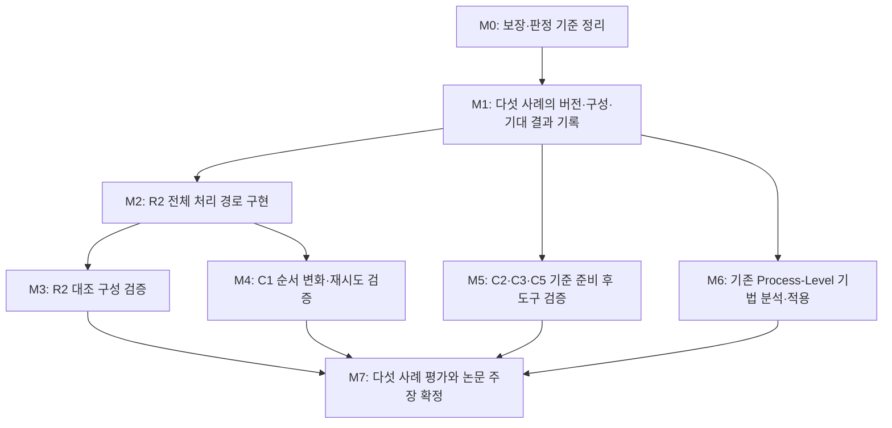

# Process-Level Race Detection in core Flight System

## 검토 결과를 반영한 Kairos 구현·검증 로드맵

- 작성일: 2026-10-15, 한국 시간 기준.
- 검토 대상 저장소: [wookjaeya/Shape-Perf, claude/busy-shannon-y903qc](https://github.com/wookjaeya/Shape-Perf/tree/claude/busy-shannon-y903qc).
- 이 문서가 근거로 삼는 고정 커밋: [`2499ad461637a6573d8420620bbcbd96eea71eb2`](https://github.com/wookjaeya/Shape-Perf/commit/2499ad461637a6573d8420620bbcbd96eea71eb2). 이후 변경 사항은 반영하지 않는다.
- 입력 문서: [STATUS_20261012_2.md][S01], [SPEC_FINAL.md rev 1.1][S02], [검토 처리표][S03], 사례·실험 기록, 아래에 명시한 NASA 원본 및 학술 논문.
- 문서 성격: **현재 확보한 근거의 검토와, 그 근거를 바탕으로 제안하는 실행 계획**. 저장소의 코드·명세·실험 조건을 이 문서 작성만으로 수정하거나 확정한 것은 아니다.

## 1. 읽는 기준과 연구 범위

### 1.1 사실·분석·계획의 구분

| 표시 | 의미 | 읽을 때 주의할 점 |
|---|---|---|
| **[원출처 사실]** | NASA 이슈·고정 소스·수정 코드·논문 본문에 명시된 내용 | 이슈의 보고 내용과 독립적으로 재현한 결과는 구분한다 |
| **[저장소 기록]** | 연구 저장소가 수행했다고 보고하고 보존한 내용 | 기록이 존재한다는 사실과 실험의 타당성은 별도로 검토한다 |
| **[재검산]** | 이번 검토에서 저장된 원시 기록을 다시 읽어 확인한 수치 | 새로운 cFS 실행이나 독립된 추가 표본을 뜻하지 않는다 |
| **[분석]** | 원출처·코드·기록을 연결해 도출한 해석 | 출처가 직접 말한 결론으로 인용하지 않는다 |
| **[제안]** | 앞으로 수행할 작업·구현 순서·완료 기준 | 이미 구현됐거나 검증됐다는 뜻이 아니다 |
| **[미확인]** | 필요한 자료나 결과가 아직 없는 내용 | 누락을 임의의 값이나 기대 결과로 채우지 않는다 |

이하의 **작업 지시, 산출물 이름, 완료 기준, 순서, 최소 구현 범위는 모두 [제안]**이다. 현황·버전·사례 메커니즘은 별도로 표시하고 출처를 연결한다. 파일명은 예정 산출물이며, 이미 존재하는 파일로 읽지 않는다.

### 1.2 연구 목표

**cFS(core Flight System)의 서로 다른 애플리케이션·task 실행 사이에서 공유자원과 의존성을 식별하고, 필요한 실행 순서가 보장되지 않거나 잘못 보장되는 순서위반 오류를 탐지한다.**

이 연구의 Process-Level은 cFS 애플리케이션·task를 작업 단위로 다루는 운용상 정의이다. 서로 다른 운영체제 프로세스로 실행된다는 뜻으로 한정하지 않는다. 논문에서는 이 정의를 처음에 밝히고, 기존 Process-Level Race 연구의 실행 단위와 비교한다. [S02 §1.1][S02]

공유·의존성 대상에는 메모리뿐 아니라 서비스 초기화 상태, 상태 변수, 이름으로 식별하는 객체, 애플리케이션·task 등록 정보가 포함된다. 다만 이 목록 자체가 표준 분류 체계라는 주장은 하지 않는다. 각 사례에서 실제 자원과 접근 연산을 확인한다.

검증 대상은 **C1·C2·C3·C5·R2의 다섯 사례**이다. 새 후보를 발견하더라도 별도 결과로 보고하며, 다섯 사례의 검증을 대체하지 않는다.

### 1.3 검증할 관점

다음 세 문장은 사례별로 검증할 관점이다.

1. cFS 애플리케이션 실행 사이에 공유자원 또는 의존성 정보가 존재한다.
2. 필요한 의존성을 보장하는 동기화·실행 제어가 충분히 반영되지 않았거나, 기존 제어가 반대 순서를 강제한다.
3. 그 결과 필요한 순서가 충족되지 않는다. 실제 오류 결과와 임무상의 피해는 별도로 판정한다.

**[분석]** R2는 특히 2번의 후자에 해당한다. 기존 core 시작 순서의 직렬화가 SB 초기화보다 ES·EVS의 관련 사용을 먼저 실행시킨다는 코드 근거가 있다. 따라서 모든 사례의 원인을 단순히 “lock 부재”로 통일하면 안 된다. [S06], [P06], [P07]

### 1.4 비교와 구현의 범위

- 기존 기법의 실험 비교는 **Process-Level Race 탐지·재현·회귀 연구**로 한정한다. 역할이 다른 도구는 같은 탐지 점수로 합치지 않는다.
- thread data-race 도구를 비교군에 포함하지 않는다. 명세 기반 분석 등 인접 기법은 관련 연구에서 표현력과 아이디어를 검토할 수 있지만, Process-Level Race 도구 실험을 대신하지 않는다.
- 구현 언어·컴파일러 기반 기술을 이 문서에서 새로 확정하지 않는다. 필요한 소스 추출·관측·판정 기능과 검증 기준을 먼저 정한다.
- 연구 조건은 기존 [조건 설정 원칙][S10]에 따라 값·근거·차이를 기록한다. 문헌에 없는 실험 상수나 일정을 사실처럼 제시하지 않는다.

## 2. 현재 도달한 단계

### 2.1 확인된 진척

| 구분 | 현재 상태 | 근거와 해석 |
|---|---|---|
| 다섯 사례 조사 | 사례별 자원·작업·관련 소스·수정 이력과 미확인 조건을 기록함 | **[저장소 기록]** [사례 원장][S08]과 개별 사례 파일 |
| R2 실행 증거 | gdb 3회, 과거 CORD 6회의 원시 기록이 남아 있음 | **[저장소 기록·재검산]** 다른 바이너리·관측 방식·구성을 합산하지 않음 [S06], [S07] |
| Kairos 구현 | 검토 커밋에서는 설계 단계 | **[저장소 기록]** 이번 설계 수정에서 구현·설치·실행을 하지 않았다고 명시 [S01], [S03] |
| 형식 모델 | 안전성·진행성 분리, 유한 실행 구간의 포함 관계, 신뢰 원장, 세 층 판정으로 수정 | **[저장소 기록]** rev 1.1. 핵심 미해결 항목과 미증명 부분이 남아 있음 [S02], [S03] |
| 기존 도구 평가 | 조사한 8개 도구 모두 다섯 사례에서 `NOT_RUN` | **[저장소 기록]** 실행 환경 또는 자료 접근의 장애 요인 조사. 실제 미탐지 결과가 아님 [S09] |
| 네 사례의 추가 실증 | C1·C2·C3·C5 자체 현상에 대한 도구 수준 실행 근거는 아직 없음 | **[저장소 기록]** 최신 버전의 대응 코드에 대한 결과를 원 사례 검증으로 세지 않음 [S01 §3][S01] |

**[재검산]** `c31e20d`에서 검토 커밋까지 47개 변경 파일은 문서·도식이다. 최근 갱신의 진척은 설계와 평가 기준의 수정이며, 추가 사례 실행 결과의 확보가 아니다.

### 2.2 R2 수치의 정확한 의미

| 기록 | SB 관련 사용 | SB AppId 설정 전 사용 | AppId 0 | 대응하는 `ILLEGAL_APP_ID` |
|---|---:|---:|---:|---:|
| gdb `r2_g1` | 223 | 24 | 24 | 24 |
| gdb `r2_g2` | 229 | 24 | 24 | 24 |
| gdb `r2_g3` | 229 | 24 | 24 | 24 |
| CORD 초기 구성 `r2_c1–c3` | 실행별 수치는 각 원시 기록 참조 | 실행당 11 | 모두 0 | 실행당 11 |
| CORD 버전 테이블 복구 후 `r2_c4–c6` | 실행별 수치는 각 원시 기록 참조 | 실행당 24 | 모두 0 | 실행당 24 |

**[재검산]** gdb의 24회는 `CreatePipe` 2회, `SubscribeFull` 4회, `ReportSingleEvent` 18회이다. 한 원인에서 발생한 반복 호출이며 독립 결함 24개가 아니다. 세 번 같은 결과가 나왔다는 사실만으로 모든 실행의 고정 순서가 증명되지는 않는다. [S06 §6–7][S06]

**[원출처 사실·분석]** EVS(Event Services)의 관련 함수는 유효하지 않은 AppId에서 이벤트 패킷을 생성하기 전에 오류를 반환한다. 결과 표현은 “이벤트 요청 24회가 거부됨”으로 쓴다. 이것을 이미 생성된 텔레메트리 패킷 24개의 손실로 바꾸어 쓰지 않는다. [P06]

CORD는 폐기된 도구이다. 해당 원시 기록은 과거 관측 자료로 사용하고, Kairos 결과로 계산하지 않는다. [S11]

## 3. 구현 착수와 함께 정리할 검토 사항

아래 항목은 **현재 문서에 남은 문제를 추적하기 위한 작업 목록**이다. 문서 정리가 끝났다는 사실로 실제 알고리즘의 타당성을 대신하지 않는다.

| 우선순위 | 항목 | 구체적인 수정 | 완료 기준 | 근거 |
|---|---|---|---|---|
| 최우선 | 실제 실행으로 옮기는 보장 문장의 과장 | §1.8의 `¬NR_i` 설명을 L-PR과 맞춤. 검사 전 반환한 `NOT_EVALUATED`를 포함해 해석 | 조기 반환 예제에서 정의·보장 문장·기대 출력이 모순되지 않음 | [S03 §5 항목 7][S03] |
| 최우선 | R2 신뢰 원장에서 L-CONT(c) 누락 | 실제 기록으로 모델의 도달을 주장하는 각 결과에 필요한 포함 관계와 가정을 추가 | 결과 하나를 선택하면 사용된 모든 보조정리·가정·추출 자료까지 추적 가능 | [S03 §5 항목 8][S03] |
| 최우선 | 증명 의무 작성과 증명 완료의 혼동 | 핵심 보조정리를 `증명 완료 / 가정 의존 / 미증명`으로 구분. 적용 범위와 반례 점검을 기록 | 단순한 목록 작성만으로 “증명됨”을 출력하지 않음 | **[분석·제안]** [S02 §6.2·§9.3][S02] |
| 높음 | C1의 기준 버전이 이미 정해진 듯한 표현 | C1 구성을 제안 상태로 맞추고, 선택된 버전에서 재시도 상수를 읽음 | ADR·한국어 문서·조건표가 같은 구성을 가리킴 | [S03 §5 항목 1·4][S03] |
| 높음 | C2·C3·C5의 기준 자료 생산 단계 누락 | 과거 버전의 규칙·반환값·소스 위치를 만드는 작업을 사례 경로에 추가 | 버전 대응 실패를 탐지 알고리즘 실패와 구분함 | [S03 §5 항목 2·3][S03] |
| 높음 | 신뢰 원장·교착 예제·결과 필드의 문서 불일치 | 원장에 속하는 확인 의무와 외부 시험을 구분. LP-DL의 근거와 `consequence` 필드를 정정 | 영문 명세와 한국어 설명이 같은 의미·예제를 사용 | [S03 §5 항목 9–11][S03] |
| 높음 | C1 구성값 전체를 출처 없음으로 처리 | 공개 BP 구성의 값과 원 보고자 환경 미확인을 분리 | 이름·시작 순서·설정 우선순위의 출처가 정확하게 연결됨 | [P01], [P02], [S12] |
| 높음 | 비교 대상의 재확장 | thread data-race 비교 행과 그 전용 실험을 본 로드맵에서 제외 | 실제 비교표가 Process-Level Race 연구로만 구성됨 | 연구 범위 §1.4; [S02 §8.3][S02] |
| 높음 | R2 결과 표현의 과장 | “이벤트 요청 거부”로 정정. 시스템 호출 부재를 주장할 때 코드 분석과 실제 관측 근거를 구분 | 관측하지 않은 시스템 호출 전체의 부재를 gdb 로그만으로 주장하지 않음 | [S06], [P06] |

[S03]이 기록한 blocking 9건 중 핵심은 위 표에 묶었다. 나머지 경로·정오표·이미 커밋된 작업을 미커밋이라고 쓰는 설명도 같은 수정 묶음에서 정리한다. 중요도 표시는 이 로드맵의 작업 우선순위 제안이다.

## 4. 전체 실행 순서

**[제안]** 구현은 R2에서 시작하되, 다른 네 사례의 근거와 실험 기준 준비는 R2 구현의 종료를 기다리지 않는다. 기존 도구 원문·코드 분석도 같은 시기에 진행한다. 이는 작업 의존성에 관한 계획이며, 별도의 실행 환경이나 표본 수를 임의로 정하는 지시가 아니다.

| 단계 | 핵심 질문 | 기존 명세와의 대응 | 완료 산출물 |
|---|---|---|---|
| M0 | 무엇을 판정하고 어디까지 보장하는가? | V0·V0-P의 보완 | 수정 명세, 증명 상태표, 최소 예제의 기대 결과 |
| M1 | 각 사례를 어떤 소스·구성·조건으로 검증하는가? | 사례별 경로, 기준 버전·구성 결정 | 다섯 조건표, 소스 대응표, 기대 결과표 |
| M2 | R2를 Kairos 자체로 관측·판정·설명할 수 있는가? | V1 | 첫 실행 가능한 구현과 재실행 자료 |
| M3 | 순서 근거가 바뀔 때 판정도 적절하게 달라지는가? | V2와 R2 음성 대조 | R2의 버전·구성별 결과 비교 |
| M4 | 순서에 따라 결과가 달라지는 C1과 재시도를 다룰 수 있는가? | V3, 필요한 S5–S7 기능 | C1의 관측·예측·실행 확인·제한된 탐색 결과 |
| M5 | 세 종류의 다른 의존성에도 같은 분석 기능을 적용하는가? | VP-D3·VP-D4 | C2·C3·C5의 고유 현상 검증 |
| M6 | 기존 Process-Level 도구에 무엇이 부족하고 어떻게 적용 가능한가? | 기존 도구 조사와 비교 계획 | 도구별 사건 대응표와 실제 적용 결과 |
| M7 | 어떤 결과를 어느 강도로 논문에서 주장할 수 있는가? | 평가 단계 | 동결된 결과표, 재현 묶음, 논문 주장표 |

M5의 기준 준비는 M1부터 진행하고, 실제 도구 검증은 M2·M4에서 필요한 공통 기능이 마련된 뒤 수행한다. 기존 단계의 전체 구현 범위를 그대로 완료해야 다음 단계로 이동하는 구조로 만들지 않는다. 단계마다 필요한 기능을 명시하고, 그 기능이 다른 사례에 주는 효과를 기록한다. 전체 명세의 모든 기능을 첫 구현에 요구하지 않는다.

## 5. M0 — 판정과 보장 범위를 정리한다

### 5.1 구현 전에 고정할 결과의 의미

| 결과 요소 | 뜻 | 필요한 근거 |
|---|---|---|
| 관측된 순서위반 | 특정 실행에서 요구된 순서와 맞지 않는 사용을 확인 | 관련 상태·자원 식별, 사용과 반환 결과를 연결한 기록 |
| 고정된 잘못된 순서 `fixed-order` | 명시한 모델·구성에서 최종 판정된 관련 사용이 정상 결과가 될 수 없다는 분석 | 소스·순서 규칙·완전성 가정과 증명 상태. 반복 실행 횟수로 대체하지 않음 |
| 실행 순서 의존 `schedule-dependent` | 같은 구성·의미에서 같은 발생 순번의 정상·비정상 근거가 모두 있음 | 실제 실행인지 모델 경로인지, 제어한 실행인지 구분 |
| 사용 시 조건 충족 `protected` | 조건을 검사한 사용에서 해당 조건을 만족한다는 제한된 안전성 결과 | 도달 여부·진행성은 별도 표시. 교착 부재로 읽지 않음 |
| 미결정 `unknown` | 자료·모델·경계·관측이 충분하지 않음 | 무엇이 부족한지 이유와 다음 확인 작업을 함께 제공 |

**[제안]** 기존 코드 표기를 유지하더라도 한국어 보고서에는 위 해석과 적용 조건을 같이 출력한다. 아직 미증명인 보조정리에 의존한 결과에는 그 상태를 표시한다. [S02 §1.10·§6][S02]

### 5.2 처음 검증할 최소 예제

1. **LP-DL:** 사용 조건은 만족하지만 사용 전에 교착될 수 있는 예제. 안전성 결과와 교착 근거를 함께 표현해야 한다.
2. **LP-TW:** 시간 초과가 있는 모델에서는 진행하고, 제거한 모델에서는 정지하는 예제. 안전성만 옮기고 도달·진행성은 따로 계산해야 한다.
3. **조기 반환:** 필요한 상태를 검사하기 전에 함수가 반환하는 예제. `NOT_EVALUATED`를 정상 사용이나 오류 사용으로 오분류하지 않아야 한다.
4. **틀린 근거:** writer 목록·순서 연결·한 번 실행한다는 사실을 의도적으로 바꾼 입력. 재확인기가 이를 받아들이면 원인을 조사한다.

첫 두 예제는 기존 명세의 설계 예제이고 아직 실제 시험 결과가 아니다. 세 번째·네 번째의 구체적인 시험 입력도 실제 구현 시 보존한다. 작은 예제의 성공은 cFS 전체 모델의 타당성을 증명하지 않는다. [S02 App. A.8][S02]

### 5.3 완료 기준

- §3의 보장 관련 불일치를 수정하고 소스 문서 간 대응을 확인한다.
- R2 최초 결과에 필요한 보조정리를 식별하고, 각 정리의 전제·결론·증명 상태를 작성한다.
- 필요한 정리의 증명이 미완료라면 “가정에 의존하는 판정”으로 보고한다. 목록 작성만으로 완료된 증명을 주장하지 않는다.
- 안전성 결과에 진행성 미검사를 함께 표시한다.
- 구현 뒤 위 예제의 입력·기대 결과·실제 결과를 보존한다. **문서 작성 완료와 실행 시험 완료는 각각 표시한다.**

## 6. M1 — 다섯 사례의 검증 기준을 만든다

### 6.1 사례마다 작성할 조건표

**[제안]** 다섯 사례 모두에 다음 필드를 둔다. 최초 도구 출력 전에 기대 결과표의 해시를 남긴다. 이미 사례와 수정 내용을 알고 작성한 표이므로 맹검 자료라고 부르지 않는다.

| 필드 | 기록 내용 |
|---|---|
| 사례 정체성 | 원 이슈, 원 보고의 주장, 공개 코드와 연결되는 부분, 연결되지 않는 부분 |
| 소스 기준 | cFS·cFE(core Flight Executive)·OSAL(Operating System Abstraction Layer)·PSP(Platform Support Package)·앱의 커밋 또는 배포 파일 해시 |
| 실행 조건 | 대상·호스트·빌드 옵션·생성 설정·앱 목록·시작 순서·실제 스케줄링·권한·실행 명령 |
| 초기 상태 | 재시작 종류, 유지 파일과 공유 메모리, 메시지 큐 제한, 종료 방법 |
| 의존성 | 어떤 작업의 어떤 상태 변화가 어떤 작업의 사용과 연결되는지 |
| 정상·오류 판정 기준 | API 반환 결과, 호출자 요구, 실제 결과를 각각 기록. 근거 없는 임무 피해는 미확인 |
| 관측 계획 | 소스 위치, 실제 바이너리 위치, 자원 식별값, task 식별, 반환값과 사건 연결 방법 |
| 예상 결과 | 실제 현상, 도구 분류, 기대 근거를 따로 기록. 미확인 부분은 미확인으로 둠 |
| 변경 기록 | 원출처의 조건, 차이가 있는 조건, 출처가 정하지 않은 조건을 구분 |

조건표에서 `from-reference`는 해당 원출처의 조건이라는 뜻이다. **공개 BP 구성에서 온 값이 원 보고자 구성에서도 사용됐다는 뜻은 아니다.** [S10], [S12]

### 6.2 현재 자료로 먼저 할 수 있는 작업

- R2: 현재 기본 구성과 시작 순서·관련 필드·gdb 기록을 연결한다.
- C1: 공개 BP의 설정값과 CF 수정 전후 버전을 대응시킨다. 기본 구성의 빈 이름 조건은 음성 대조로 남긴다.
- C2: 공개된 단일 단계·두 단계 시작 동기화 코드를 비교하고, 비공개 provider·consumer의 역할에서 알려진 것만 기록한다.
- C3·C5: 6.4.1/6.4.2 배포 소스와 문서, OSAL 4.1.1을 기준으로 변경 위치를 확인한다. 분석용 구문 처리와 실제 실행을 구분한다.
- 기존 도구: 원문·코드를 읽어 입력 사건·의존성·실행 제어·오류 판정에 필요한 정보를 추출한다.

### 6.3 완료 기준

각 사례에서 **확정된 항목, 실험 설계로 제안된 항목, 아직 없는 항목**이 드러나는 조건표를 만든다. 모든 자료가 확보될 때까지 다른 사례의 독립적인 작업을 멈추지 않는다. 과거 플랫폼 실행이 불가능하면 분석 전용 결과를 먼저 보존하되, 실행 재현으로 올려 세지 않는다.

## 7. M2·M3 — R2에서 첫 전체 구현과 대조 검증을 한다

### 7.1 R2의 대상과 필요한 정보

**[원출처 사실·저장소 기록]** ES(Executive Services)·EVS task가 초기화 중 SB(Software Bus) API를 호출한다. 이 API의 이벤트 요청은 호출자 ES·EVS의 AppId가 아니라 SB의 AppId 필드를 전달한다. SB task가 그 필드를 설정하기 전에 전달된 값은 유효하지 않아 EVS가 요청을 거부한다. [P05], [P06], [S06]

| 필요한 기능 | R2에서 확인할 내용 |
|---|---|
| 자원 식별 | `CFE_SB_Global.AppId`와 EVS 등록 정보를 서로 다른 상태로 구분 |
| 호출 문맥 식별 | 실제 실행 task, SB API 호출 함수, 이벤트 발생 주체를 구분 |
| 설정 지점 식별 | `CFE_ES_GetAppID` 호출 직전과 실제 값 저장 완료를 구분 |
| 값 전달 추적 | SB 필드에서 이벤트 API 인자로 전달되는 값의 경로 |
| 순서 추출 | 생성된 core 목록과 `CFE_ES_MainTaskSyncDelay`의 조건을 실제 빌드에 연결 |
| 결과 연결 | 이벤트 요청과 같은 호출의 `ILLEGAL_APP_ID` 또는 다른 반환 결과를 대응 |
| 설명·근거 | 값의 초기 상태, writer, 실행 순서, 사용 지점을 연결해 제시 |

### 7.2 구현 순서

1. **실험 기준과 소스 위치를 읽는 기능:** 고정 구성, 생성 core 목록, 필드·함수 위치와 바이너리 대응을 산출한다.
2. **정적 추출과 첫 판정:** 관련 필드의 초기값·writer·값 전달·시작 순서 규칙을 추출한다. 수동으로 입력한 규칙은 표시한다.
3. **Kairos 자체 기록기:** 애플리케이션 바이너리의 관련 사건을 기록한다. 관측에 필요한 권한과 cFS 실행 권한을 구분하고, 권한 변경에 따른 스케줄링 변화를 확인한다.
4. **동적 판정:** 사건을 사용 단위로 묶어 상태·순서·반환 결과를 확인한다.
5. **근거 재확인:** 생성한 근거에서 추론 단계와 신뢰한 입력을 다시 확인한다. 추출기·공유 라이브러리까지 독립 검증했다고 표현하지 않는다.
6. **재실행:** 다른 실행자가 같은 입력·빌드·명령으로 결과를 다시 얻을 수 있도록 묶는다.

기록기 데이터 형식과 추론 입력은 위 경로에 필요한 최소 범위부터 구현한다. 아직 구현하지 않은 기능을 명령 이름이나 도식만으로 완료 처리하지 않는다.

### 7.3 M2 완료 기준

- 원시 기록에서 **task·호출 함수·이벤트 ID별 집합**을 재구성할 수 있다.
- 기존 기준 구성에서는 24회의 집합과 대응 결과를 대조한다. 일치하지 않으면 구성 차이·기록 손실·관측 영향·구현 오류를 조사한다. 과거 숫자를 재현하도록 규칙을 임의 조정하지 않는다.
- SB AppId 미설정과 EVS 미등록을 서로 다른 원인으로 표현한다.
- 이후 정상 호출에 R2의 고정된 오류 판정을 일괄 적용하지 않는다.
- 정적 결과에는 모델·구성·가정·증명 상태·신뢰 원장이 연결된다.
- 부팅 시간, 관측 기록의 누락, 요청·반환 사건 대응 실패와 환경 차이를 보고한다.
- 단 한 번의 정상적인 경로 기록은 그 경로의 발생 증거다. 빈도·확률·일반적 오버헤드에는 별도 표본 설계가 필요하다.

### 7.4 M3의 대조 구성

| 대조 | 목적 | 근거와 제한 |
|---|---|---|
| 동일 기본 구성의 설정 후 호출 | 오류 경로를 다른 호출에 잘못 확대하는지 확인 | 기존 gdb 기록에도 존재. 고정 순서 오류를 내지 않는다는 기대와 전체 안전성 보장은 구분 [S06] |
| `b9bec567` 전후 | 실제 이력에서 순서 근거와 영향받는 task 범위가 달라질 때 판정이 반응하는지 확인 | **[저장소 기록]** ES 측의 자연 회귀 쌍 후보. 각 버전의 빌드·관련 변경을 먼저 확인 [S02 §9.3][S02] |
| v7.0.0과 v7.0.1 | 배포 버전 차이에 대한 민감도 확인 | 다른 변경도 포함하므로 시작 순서 하나의 인과 효과로 단정하지 않음 [S02] |
| PR #2820 | 의미 없는 수정에 판정이 불필요하게 바뀌지 않는지 확인 | 과거 PR 자체와 현재 버전으로 옮긴 변경을 구분. 이식본은 연구자 구성 [P08], [S03] |

**[제안]** 공개 이력의 자연 쌍을 우선 검토하고, 적합한 실행 기준이 확보되는 대조부터 수행한다. 위 후보를 모두 필수 비교군으로 요구하지 않는다.

**M3 완료:** 바뀐 순서 근거와 바뀌지 않은 근거를 결과에 반영한다. 특정 반쪽에서 고정 순서 오류 판정이 철회돼도 전체적으로 `protected`라고 단정하지 않는다. 버전·구성 비교는 같은 프로그램에서 스케줄만 바꾼 증거가 아니다. [S02 App. A.1 step 15][S02]

## 8. M4 — C1에서 순서 변화와 재시도를 검증한다

### 8.1 기준 구성에 대한 구체적인 권고

**[원출처 사실]** 공개 BP(Bundle Protocol) 구성에는 `BP0_tsem`·`BP1_tsem`, CF 다음 BP의 시작 스크립트 순서, CF 65·BP 55의 설정 우선순위가 존재한다. 실제 운영체제 우선순위가 적용됐는지는 별도 항목이다. [P01], [P02]

**[제안]** 첫 기준 후보는 공개 BP 통합과 호환되는 CF 수정 전후 쌍 `281a941` → `833fdbb`로 한다. 원 보고의 CF `2a024d8`과 공개 BP 테이블은 형식·앱 이름이 다르므로 그대로 혼합하지 않는다. [S12]

- BP 구성에서 확인된 이름·순서·설정 우선순위를 원출처 값으로 기록한다.
- cFS·cFE·OSAL·PSP의 전체 버전 조합과 당시 mutable 참조는 아직 확정된 것으로 쓰지 않는다.
- 과거 전체 조합이 확보되지 않아 다른 버전에서 구성하면 공개 코드 기반 파생 실험이라고 표시한다.
- 원 보고자의 provider·전체 실행 환경과 같다는 주장은 하지 않는다.
- 현재 v7.0.1의 빈 이름 기본 구성은 경로 비활성 음성 대조로 유지한다.

### 8.2 반드시 연결할 사건

provider의 생성 시작·이름 공개·객체 사용 가능 시점, CF(File Transfer 애플리케이션)의 조회 시점과 이름, 반환값, 시도 번호, 재시도 종료, CF 초기화의 최종 결과를 연결한다. 이름이 같아도 삭제·재생성된 객체는 같은 세대라고 가정하지 않는다. [S12], [S02 App. A.4][S02]

### 8.3 결과를 구분하는 실험표

| 구간 | 관측할 현상 | 판정에서 주의할 점 |
|---|---|---|
| A1 | 첫 조회에서 성공 | 생성 완료·조회·반환 결과를 연결 |
| A2 | 먼저 실패하고 후속 재시도로 성공 | 처음의 실패를 최종 초기화 실패와 혼동하지 않음. 단일 시도 버전에는 이 구간이 없음 |
| A3 | provider가 늦게 생성되어 재시도까지 종료 | 같은 구성의 A1/A2와 비교. 제어된 지연과 자연 실행을 구분 |
| A4 | 해당 이름의 provider가 없음 | 원출처가 정한 cFS 구성이 없으면 단위 예제로 검증하고, 실제 사례 결과로 세지 않음 |
| A5 | OSAL 객체 생성 중간 상태에서 조회 | `INCORRECT_OBJ_STATE`와 lock 잔류는 별도의 구현 결함 후보. 원 C1에서 실증된 사실로 쓰지 않음 |

**[저장소 기록]** 현재 CF `15a871e`에서는 재시도 상수 25, 지연 100 ms가 코드에 있다. **[제안]** 모든 실험은 선택한 버전의 생성 설정과 소스에서 값을 다시 읽는다. 25를 모든 CF 버전에 공통으로 고정하지 않는다. [S02 App. A.4][S02]

### 8.4 필요한 탐지 기능과 개발 순서

1. 이름으로 같은 객체를 가리키는 생성·조회 관계를 추출한다.
2. 기본 구성에서 경로가 실행되지 않는 이유를 판정한다.
3. 활성 구성의 실제 성공·실패와 재시도 종료를 추적한다.
4. 관측되지 않은 순서를 예측하되, 예측의 가정과 경로를 기록한다.
5. provider를 **사건 기준으로** 보류·해제해 예측 경로를 확인한다. 근거 없는 고정 sleep으로 성공률을 조절하지 않는다.
6. 수정 전후의 모델별 분류와 재시도 관련 세부 판정을 위해 관련 작업·자원에 제한된 전수 탐색을 구현한다. 탐색 경계·모델 가정·완료 여부를 결과에 붙인다.

### 8.5 완료 기준

- 이름으로 연결된 생성·조회 의존성을 도구가 식별한다.
- A1·A2·A3의 결과 또는 미실현 이유가 각각 기록된다. A2가 없는 단일 시도 버전은 해당 없음으로 쓴다.
- 같은 바이너리·구성·의미에서 같은 발생 순번의 정상·비정상 근거를 확보했을 때만 실행 순서 의존을 주장한다.
- 수정 후 재시도로 회복된 결과와 수정 전 즉시 실패를 구분한다. 재시도가 모든 순서 오류를 제거한다고 주장하지 않는다.
- 탐색 경계 안의 결론과 실제 실행 확인 결과를 분리한다.
- A5를 포함하면 별도 후보·별도 근거·별도 결과로 보고하고, 원 사례의 탐지 수에 추가하지 않는다.

## 9. M5 — C2·C3·C5의 고유 현상을 검증한다

### 9.1 C2: 시작 동기화 이후의 late initialization

**[원출처 사실]** 공개 이슈는 앱이 시작 동기화에서 풀린 뒤 수행하는 late initialization과 다른 앱의 호출 사이에 생긴 문제를 설명한다. 실제 앱 이름·함수·서비스 구현은 공개되지 않았다. 단일 단계와 두 단계 시작 동기화의 공개 코드는 존재한다. [P03], [S13]

**[제안] 작업:**

1. 공개된 두 방식의 상태 전이와 timeout 경로를 버전별로 기록한다.
2. provider의 초기화 완료와 consumer의 의존 사용이라는 역할만 재구성한다. 통신 방식·초기화 내용·실패 결과는 원 사례 사실로 꾸미지 않는다.
3. 선택한 요청 방식과 실행 조건의 설계 이유·차이를 별도 기록한다.
4. 단일 단계/두 단계 barrier와 기존/수정 provider 역할을 교차한 2×2 구성을 검토한다. 실행 가능한 셀과 제외한 셀의 이유를 남긴다.
5. 동기화 반환, 실제 초기화 완료, 의존 사용, 오류 반환 또는 회복 결과를 기록한다.
6. timeout으로 기다림이 끝난 경우를 정상 초기화 완료와 구분한다.

**완료:** barrier 통과와 앱 고유 초기화 완료가 같지 않음을 도구가 다루고, 선택한 수정 구성의 차이를 설명한다. 결과 명칭은 **“C2 메커니즘의 역할 기반 검증”**이다. 비공개 EVA CWS 앱의 원 실행 재현으로 표기하지 않는다.

### 9.2 C3: core 앱 시작 순서와 EVS 오류 경로

**[원출처 사실·저장소 기록]** 과거 TIME task의 SB API 호출이 SB·EVS 초기화보다 앞서면서 두 AppId와 등록 상태에 영향을 주고, EVS 내부의 잘못된 인덱스 접근으로 이어지는 경로가 보고·분석돼 있다. 원 보고 플랫폼은 Microblaze이고 정확한 전체 환경은 확보되지 않았다. [P04], [S14]

**[제안] 작업:**

1. 해시가 확인된 6.4.1/6.4.2 소스에서 상태·우선순위·생성 순서·호출 경로를 대응시킨다.
2. 분석용 환경에서는 소스 추출과 기대 결과만 보고한다. 실제 실행 플랫폼을 구성한 뒤에 실행 결과를 추가한다.
3. SB의 AppId, EVS 자신의 AppId, EVS 등록·필터 상태를 각각 기록한다.
4. TIME 문맥의 호출이 어느 초기화보다 먼저 일어나는지 확인한다. 실제 우선순위 적용과 CPU 수를 기록한다.
5. 6.4.2의 변경을 시작 순서 제어·범위 검사·공개 시점 변경으로 나누어 해석한다. 배포 버전 전체 비교에는 여러 수정이 섞였다고 표시한다.

**완료:** 원 의존성의 선후 관계를 식별하고, 잘못된 상태 사용과 실제 crash 여부를 분리해 보고한다. 수정 후 crash가 사라졌다는 사실만으로 순서 의존성까지 제거됐다고 하지 않는다. 현재 버전의 R2 기록을 C3의 추가 실행 근거로 계산하지 않는다.

### 9.3 C5: task 생성과 앱 등록 사이의 공백

**[원출처 사실·저장소 기록]** 과거 ES 앱 생성 경로는 task 생성 전에 ES lock을 풀고, 생성 후 다시 잡아 등록 정보를 채웠다. 새 앱의 main task가 등록 전에 AppId를 조회할 수 있다. 수정은 task 생성과 등록을 같은 lock 범위에 두는 방식이다. [P09], [S15]

**[제안] 작업:**

1. 6.4.1/6.4.2와 대응 OSAL에서 생성·진입·task ID 반환·ES 등록·조회 경로를 확인한다.
2. task가 `OS_TaskCreate` 반환 전에 실행될 수 있다는 점을 관측 계획에 반영한다.
3. 기록기가 아직 성공하지 않은 `GetAppID`에 자기 식별을 의존하지 않도록 한다. 운영체제 task ID와 생성 관계를 임시 식별 근거로 사용하고 뒤에 앱 정보와 연결한다.
4. 새 task 진입, ES 등록 공개 완료, 조회 결과와 lock 범위를 연결한다.
5. 수정 전후에 첫 조회가 실패하는 경로가 달라지는지 확인한다. 원 보고에 없는 앱 crash를 기대 결과로 추가하지 않는다.
6. 현재 버전의 App-record 잔여 후보는 원 C5와 별도 결과로 관리한다.

**완료:** 새 task가 먼저 실행됐다는 사실만 보고하지 않고, **등록 전 조회와 그 결과**를 식별한다. 수정 후에는 선택한 분석·탐색 범위에서 해당 경로가 제거됐는지 확인한다. 전체 프로그램의 안전성으로 확대하지 않는다.

## 10. M6 — 기존 Process-Level Race 기법의 적용과 한계를 검증한다

### 10.1 비교 대상의 역할

| 대상 | 저장소 조사에서의 역할 | 우선 확인할 자료 |
|---|---|---|
| RacePro | 탐지 | 원 논문 §4–6, 공개 코드, 실행 환경·후보 생성·검증 방식 |
| SimRacer | 탐지 | 원문과 구현에서 관측·실행 단위, 자원·순서 모델 확인 |
| SIMEXPLORER | 탐지·탐색 범위 확인 대상 | 시스템 수준 사건과 메모리 관측 범위를 원문에서 확인 |
| RRF | 보고된 race의 재현 | 입력으로 필요한 위치·사건·실패 조건과 실행 제어 |
| DESCRY | 로그에 근거한 재현 | 실패 로그 요구, 시스템 호출 사건, 의존성 모델 |
| SimEvo | 회귀 관련 분석 | 버전 쌍과 시스템 사건의 사용 방식 |
| ReDPro | 역할·세부 모델 미확인 | 원문 확인 전 탐지·재현 표의 확정 행으로 채우지 않음 |
| SysPro | 버그 보고 기반 재현 | 보고서에서 추출하는 사건과 실제 제어 위치·결과 확인 |

**[저장소 기록]** 이 표의 역할은 기존 조사 범위를 요약한 것이다. 원문을 읽지 못한 도구의 세부 기능을 확정하지 않는다. 원문 접근 실패와 구현을 찾지 못한 사실도 당시 접근 범위에 한정한다. [S09]

### 10.2 각 도구에 적용할 동일한 분석 질문

1. 다섯 사례에서 필요한 **관측 사건**을 원 도구가 수집하는가?
2. 서로 다른 이름·ID·필드가 같은 자원·세대를 가리키는 것을 식별하는가?
3. 생성·등록·초기화 완료와 의존 사용의 관계를 표현하는가?
4. 필요한 순서 또는 허용된 오류 처리에 관한 정보를 입력받는가, 추론하는가?
5. 아직 실행되지 않은 순서를 예측·탐색하는가? 실제 실행에서 확인할 수 있는가?
6. 출력은 후보·재현 성공·오류 결과 중 무엇인가? 원 사례의 현상과 대응하는가?

**[제안]** 도구×사례마다 위 여섯 질문의 근거와 답을 기록한다. 관측 가능성, 표현 가능성, 실제 탐지 성공을 한 칸으로 합치지 않는다.

### 10.3 RacePro부터 확인할 구체적인 차이

**[원출처 사실]** RacePro는 공유 메모리 접근 순서를 기록·재생한다. race 후보 분석은 시스템 호출이 공유 커널 객체에 수행하는 연산과 happens-before 관계를 중심으로 한다. [P10 §4–5][P10]

**[분석]** cFS 내부의 AppId·이름 테이블·서비스 초기화 상태를 그 후보 생성 모델에 연결하는 정보가 부족할 가능성이 핵심이다. “공유 메모리를 전혀 기록하지 못해서 불가능”이라는 설명은 사용하지 않는다.

**[제안] 첫 산출물:** R2의 AppId 설정·값 전달·이벤트 요청·오류 반환을 RacePro의 기록 사건·후보 사건에 각각 대응시킨다. 원 코드의 어느 규칙이 적용되고, 대응하지 않는 사건이 무엇인지 적는다. 이어 C1·C3·C5에 같은 분석을 하고, C2는 역할 재구성에서 알려진 조건만 사용한다.

### 10.4 실제 적용 결과의 구분

| 상태 | 의미 | 결과 집계 |
|---|---|---|
| `NOT_RUN` | 환경·자료·결정 등으로 실행하지 못함 | 미탐지 수에 넣지 않음 |
| `INAPPLICABLE` | 원 기법의 명시된 입력·대상 범위에 해당하지 않음 | 이유·원문 위치를 보고 |
| `PATH_NOT_EXECUTED` | 도구는 실행했으나 목표 현상이 실행되지 않음 | 탐지 능력 판정 보류 |
| `OBSERVATION_GAP` | 목표 사건이 실행됐지만 필요한 정보가 기록되지 않음 | 관측의 부족으로 보고 |
| `ANALYSIS_GAP` | 필요한 사건이 기록됐지만 의존성·후보를 만들지 못함 | 해당 입력·기준에서 분석의 부족으로 보고 |
| `REPORTED` | 관련 후보·재현·오류를 출력함 | 원 사례·출력의 정확한 대응과 실제 근거를 확인 |

여기서 상태 이름은 결과 정리를 위한 **[제안]**이다. 사건이 기록됐다는 기준 자체가 부족하면 `ANALYSIS_GAP`으로 서둘러 분류하지 않는다.

원 도구를 실행할 수 없고 논문·코드로 기법을 재구현하면 **원 도구 결과와 분리**한다. 사건을 추가로 제공했는지, 기법을 확장했는지 기록한다. Kairos 기능 제거 시험을 기존 도구의 결과로 부르지 않는다.

### 10.5 Kairos의 필요 기능으로 연결하는 방식

| 확인된 부족의 종류 | Kairos에 필요한 기능 후보 | 확인할 사례 |
|---|---|---|
| cFS 내부 사건이 후보 생성 입력에 없음 | 내부 API·상태 변화·값 전달을 관측하고 소스와 연결 | R2·C3·C5 |
| 이름·ID·등록 정보를 같은 자원으로 연결하지 못함 | 이름과 객체 ID·세대, task와 AppId의 관계 추적 | C1·C5 |
| 기존 시작 동기화와 실제 초기화 완료를 혼동 | 시작 상태와 앱 고유 의존 상태를 구분하는 규칙 | C2 |
| 오류 반환과 회복 처리를 구분하지 못함 | 반환값·재시도·초기화 최종 결과 추적 | C1 |
| 관측된 실행만 다룸 | 관련 작업·자원으로 범위를 좁힌 예측·탐색 및 실행 확인 | C1·C3·C5 |
| 잘못된 순서가 고정된 이유를 설명하지 못함 | 소스 기반 순서 근거·전제·신뢰 범위를 결과에 연결 | R2 |

위 표는 **연구 가설과 개발 후보**다. 실제 기존 도구의 부족이 확인된 행에 대해서만 비교 결과와 연결한다. 이미 가능한 기능은 재발명한 차별점으로 주장하지 않는다.

## 11. M7 — 평가와 논문의 주장 범위를 확정한다

### 11.1 결과를 세 부분으로 나누어 보고한다

| 부분 | 보고 내용 |
|---|---|
| 탐지 | 어떤 자원의 어떤 사용을 보고했는가? 목표 경로가 실행됐는가? 실제 결과와 연결되는가? |
| 분류 | 고정된 잘못된 순서인지, 같은 구성에서 순서 의존인지, 제한된 탐색에서만 확인됐는지, 미결정인지 |
| 근거 | 실행 기록·소스 추출·가정·증명 상태·실행 제어·모델 경계·재확인 가능성 |

**[분석]** R2의 관측된 오류 요청은 같은 조건이 주어진 단순 상태 검사로도 확인할 수 있다. 이것은 원시 기록을 검사하는 내부 정확성 확인에 활용할 수 있다. 이를 별도의 thread-level 비교군으로 확장하지 않는다. Kairos의 추가 기여는 어떤 의존성을 자동으로 찾았고 어떤 순서 근거를 제공했는지에서 검증한다. [S02 §8.3][S02]

### 11.2 관측 단위와 통계

결함 원인, 수정 이력, 버전·구성, 정적 사용 지점, 동적 발생 횟수, 실행 횟수를 따로 센다. R2의 24회, 한 번의 부팅, 한 결함 원인을 같은 표본으로 취급하지 않는다. C3·C5는 수정 릴리스를 공유하고 C3·R2는 자원 계열이 겹치므로 다섯 사례를 독립적인 다섯 표본이라고 가정하지 않는다. [S06], [S02 §8.2·§8.7][S02]

**[제안]** 우선 사례별 근거와 원시 수치를 보고한다. 통계 검정이 필요하면 분석 단위·반복 구조·같은 원인과 수정에 따른 묶임·표본 설계를 먼저 정한다. 작은 설계 사례 집합에서 근거 없는 유의확률이나 일반 탐지율을 만들지 않는다.

### 11.3 동결과 변경 기록

1. 각 사례의 최초 출력 전에 조건표와 기대 결과표를 보존한다.
2. 비교 평가 전에 분석기·cFS 규칙·관측 계획·판정 기준을 동결한다.
3. 이후 수정하면 변경 이유, 이미 확인한 사례, 결과 변화를 기록한다. 발견한 구현 오류를 수정할 수 있으나, 같은 버전의 평가 결과처럼 섞지 않는다.
4. 이미 설계에 사용한 다섯 사례는 알려진 사례 검증으로 명시한다. 사전 노출이 있는 결과를 맹검·미관측 사례 성과로 부르지 않는다.
5. 추가 사례를 별도로 평가하려면 출처 선정·노출·동결 시점을 새로 기록한다. 이는 다섯 사례 검증 완료 이후의 확장 과제이며 필수 사례를 대체하지 않는다.

### 11.4 최종 사례별 완료표

| 사례 | 필수 근거 | 완료로 세면 안 되는 대체 결과 |
|---|---|---|
| R2 | 자체 기록·판정·소스 순서 근거와 대조 결과 | 기존 gdb 수치만 다시 인용 |
| C1 | 활성 구성의 생성·조회 연결, 회복·최종 실패 구분, 수정 전후·순서 변화 근거 | 기본 구성에서 경로 비활성만 확인 |
| C2 | 원출처에 대응시킨 역할 재구성과 barrier·late init 대조 | 일반 barrier 코드 목록만 작성 |
| C3 | 과거 기준의 상태·순서 오류 분석과 해당 범위의 검증 | 현재 R2를 C3라고 계산 |
| C5 | 등록 전 조회와 lock 범위 수정 효과 검증 | 새 task가 먼저 실행된 사실만 기록하거나 현재 잔여 후보로 대체 |

모든 행에 증거 종류를 쓴다. 실제 실행, 소스 분석, 제한된 모델 탐색, 역할 재구성은 서로 다른 근거다. 미완료 행이 있으면 “다섯 실제 사례를 모두 재현·탐지했다”는 문장을 사용하지 않는다. C2는 역할 재구성이 완료돼도 원 비공개 시스템 재현으로 보고할 수 없다.

### 11.5 기여 후보와 필요한 증거

| 기여 후보 — 아직 입증 전 | 뒷받침해야 할 결과 |
|---|---|
| cFS 작업 간 공유·의존성 식별 | 다섯 사례에서 자원·사용·설정 관계를 도구가 산출한 결과. 수동 입력과 자동 추출을 구분 |
| 순서위반의 분류 | R2의 고정된 순서와 다른 사례의 순서 변화·미결정을 일관되게 처리 |
| cFS 내부 의미를 반영한 판정 | C1의 재시도, C2의 시작 단계, C5의 등록을 실제 코드와 연결 |
| 검토 가능한 탐지 근거 | 가정·추출 사실·추론·관측·미증명 부분을 추적하고 잘못된 근거를 거부 |
| 기존 Process-Level 기법 대비 보완 | 원 도구 또는 충실한 기법 적용에서 확인한 부족과 해결 기능의 대응 |

명세 기반 판정 자체가 새롭다는 주장은 하지 않는다. 인접 학술 연구의 표현력과 공통점을 원문으로 검토하고, 새로운 부분은 cFS 적용에서 검증한 범위로 한정한다. GPredict가 일반 동시성 속성의 정규식 명세와 예측을 다룬다는 점은 원문에서 확인되므로 관련 기능이 원천적으로 표현 불가능하다고 단정하지 않는다. [P11 §II.B][P11]

## 12. 즉시 실행할 작업 목록

아래 순서는 **[제안]**이며 완료된 작업 목록이 아니다. 같은 묶음 안에서 서로 의존하지 않는 자료 정리·소스 확인은 함께 진행할 수 있다.

| 순서 | 작업 | 예정 산출물 | 완료 확인 |
|---:|---|---|---|
| 1 | §3의 핵심 보장 문장·신뢰 원장 수정 | `formal_corrections.md` | 조기 반환과 R2 도달 근거가 일치 |
| 2 | 최초 R2 결과에 필요한 증명 상태 정리 | `proof_status_R2.md` | 정리별 전제·결론·증명 상태와 사용 결과 연결 |
| 3 | 다섯 사례의 조건·미확인 항목을 한 형식으로 정리 | `case_basis_register.md` | 출처·차이·미확인이 분리됨 |
| 4 | C1 공개 구성과 버전 호환성 정리 | `C1_basis_plan.md` | 공개 값과 미확인 전체 버전 조합을 구분 |
| 5 | C2 역할 재구성과 C3·C5 과거 기준 준비 | `case_setup_C2_C3_C5.md` | 각 사례의 첫 실행 또는 분석 경로가 구체화됨 |
| 6 | Process-Level 도구×사례 사건 대응표 작성 | `process_race_method_matrix.md` | 원문 근거와 미확인 부분이 드러남 |
| 7 | R2 최소 추출·기록·판정·근거 재확인 구현 | 구현 코드와 실행 명령 | 원시 기록에서 보고까지 이어짐 |
| 8 | R2 최소 예제·잘못된 근거·후속 정상 호출 점검 | `R2_validation.md` | 기대와 다른 결과의 이유를 기록 |
| 9 | R2 자체 기록을 과거 기록과 대조 | `R2_observation.md` | 24회 집합의 일치 또는 차이 원인 설명 |
| 10 | R2 대조 구성 실행 | `R2_controls.md` | 순서 근거 변화에 맞는 판정 변화 |
| 11 | C1 활성 구성에서 A1–A3 검증 | `C1_validation.md` | 회복·최종 실패와 자연·제어 실행 구분 |
| 12 | C1에 필요한 예측·실행 확인·탐색을 구현 | `C1_prediction_confirmation.md` | 예측과 실제 확인·경계 결론 분리 |
| 13 | C2·C3·C5의 도구 검증 | 사례별 `validation` 문서 | §9 및 §11.4의 고유 기준 충족 |
| 14 | 적용 가능한 기존 기법과 실제 비교 | `process_race_comparison.md` | `NOT_RUN`과 실제 누락을 구분 |
| 15 | 결과·구현·조건 동결 후 논문 주장 확정 | `claim_evidence_matrix.md` | 모든 주장이 원시 근거 또는 명시적 분석에 연결 |

### 12.1 아직 값을 채우지 않을 항목

실행 횟수, 탐색 상한, 보류 실험의 중단 기준, 과거 버전의 전체 빌드 조합은 출처와 실험 목적을 확인한 뒤 정한다. 원출처가 정하지 않은 값은 연구 설계로 제시한 이유와 영향을 기록한다. 도구 단위 시험의 값은 실제 사례 조건에 자동 승계하지 않는다.

### 12.2 일정 산정 방법

현재 자료로 확정 주차·인월을 제시하지 않는다. 기존 명세의 19–28 person-week 합은 추정 항목의 산술 합이고, 이 문서의 R2 최소 구현 일정으로 사용할 수 없다. [S01], [S03]

**[제안]** M2에서 소스 추출, 바이너리 관측, 사건 대응, 결과 재현에 실제로 걸린 시간과 장애 요인을 기록한 뒤 다음 작업을 추정한다. 이후 일정에는 추정 근거·대상 범위·불확실성을 함께 쓴다. 연구 진행률은 문서 분량보다 **완료 기준을 통과한 기능과 사례별 근거**로 관리한다.

## 13. 막혔을 때의 처리

| 문제 | 다음 조치 | 유지할 주장 범위 |
|---|---|---|
| 기록기에 필요한 권한·기능이 없음 | 실패 원인과 필요한 기능을 확인. 대체 관측은 결과 종류와 교란 정도를 별도 표시 | 기존 gdb 근거 유지. 자체 기록기 완료로 세지 않음 |
| 과거 cFS 실행 환경을 구성하지 못함 | 고정 소스 분석과 구문 추출을 먼저 보존. 실행 조건의 차이를 검토 | 과거 바이너리 재현·실행 결과로 주장하지 않음 |
| 원 도구 구현에 접근하지 못함 | 원문·공개 코드의 사건 대응 분석을 진행. 재구현 시 충실성과 확장 부분을 명시 | 원 도구 미탐지로 계산하지 않음 |
| 제한된 탐색이 끝나지 않음 | 경계·작업량·원인을 기록. 실제 관측된 위반 근거는 유지 | 미결정 또는 경계 내 결과. 전체 순서 분류를 강제하지 않음 |
| 예측한 순서를 실제로 만들지 못함 | 해당 경로의 가능성 가정·실행 제어·입력을 조사 | 예측·모델 후보로 남김. 실행 확인 성공으로 올리지 않음 |
| 기대 결과와 실제 출력이 다름 | 원출처 해석·기준 구성·관측·모델·구현을 순서대로 조사하고 변경 이력을 남김 | 예상값을 맞추는 조정과 실제 오류 수정을 구분 |
| C2 원 앱 자료가 없음 | 공개된 역할 관계를 재구성한 실험으로 진행 | 메커니즘 검증. 원 시스템 재현 아님 |

## 14. 참고자료와 근거

### 14.1 고정된 연구 저장소 자료

- **S01** — [STATUS_20261012_2.md][S01]. 현재 상태·미실행 항목·다섯 사례 경로·미해결 사항.
- **S02** — [SPEC_FINAL.md rev 1.1][S02]. 정의, 형식 모델, 사례 대응, 판정, 평가, 단계별 계획. 이 문서의 알고리즘은 구현·검증 결과와 구분한다.
- **S03** — [REVIEW_RESPONSE_20261012.md][S03]. 검토 처리와 최종 미해결 목록.
- **S04** — [PI_DECISIONS.md][S04]. 기존 미정 항목의 위치 확인용. 해당 선택을 이 로드맵에서 확정한 것으로 취급하지 않는다.
- **S05** — [외부 검토 원문][S05]. 이전 설계의 문제와 보완 권고.
- **S06** — [R2_gdb_v701.md][S06]. 관측 조건, 실행 결과, 관측 단위와 재집계. [gdb 원시 기록 디렉터리][RAW].
- **S07** — [R2_cord_v701.md][S07]. 폐기된 기록기로 얻은 과거 관측. Kairos 성과가 아니다.
- **S08** — [사례 원장][S08]. 다섯 사례의 관계와 미확인 조건을 종합한 2차 연구 기록.
- **S09** — [기존 도구 가용성·관측 모델 조사][S09]. 원문 확인 수준·환경 제약·`NOT_RUN` 상태.
- **S10** — [조건 설정 원칙][S10]. 원출처·차이·미확인 조건의 기록 원칙.
- **S11** — [CORD 폐기 기록][S11]. 과거 결과와 신규 구현의 관계.
- **S12–S16** — [C1][S12], [C2][S13], [C3][S14], [C5][S15], [R2][S16] 상세 기록. 원출처와 연구자의 분석을 구분해서 읽는다.

### 14.2 NASA 1차 출처

- **P01** — [nasa/bp의 공개 시작 스크립트 @b051eb0][P01]. CF·BP의 시작 순서와 설정 우선순위.
- **P02** — [동일 공개 구성의 CF 테이블][P02]. `BP0_tsem`·`BP1_tsem`.
- **P03** — [nasa/cFE #198][P03]. late initialization과 시작 동기화에 관한 원 보고.
- **P04** — [nasa/cFE #73][P04]. 과거 core 앱 초기화와 EVS 오류 경로의 원 보고.
- **P05** — [nasa/cFE #2663][P05]. SB AppId 설정 전 이벤트 요청에 관한 원 보고.
- **P06** — [cFE c5fb2b4d, cfe_evs.c][P06]. 유효하지 않은 AppId의 오류 분기와 패킷 생성 경로.
- **P07** — [동일 버전 cfe_es_start.c][P07]. core task 생성과 초기화 동기화 코드. 생성 목록과 해당 버전의 앱 상태 갱신도 함께 확인해야 전체 순서를 해석할 수 있다.
- **P08** — [nasa/cFE PR #2820][P08]. R2 관련 대조 후보. 고정 검토 시점의 상태는 S02·S16에 기록돼 있다.
- **P09** — [nasa/cFE #72][P09]. 앱 생성 중 lock 공백과 task 등록 문제의 원 보고.
- **P12** — [nasa/CF #184][P12] 및 [재시도 수정 833fdbb][P13]. 생성·이름 조회 관계와 수정 코드. 원 보고와 실제 수정의 범위를 구분한다.

### 14.3 학술 1차 출처

- **P10** — Oren Laadan et al. *Pervasive Detection of Process Races in Deployed Systems*. SOSP 2011. DOI: [10.1145/2043556.2043589](https://doi.org/10.1145/2043556.2043589). [저자 공개 원문][P10]. §4의 공유 메모리 기록·재생과 §5의 시스템 호출 중심 후보 분석을 구분한다.
- **P11** — Jeff Huang, Qingzhou Luo, Grigore Roșu. *GPredict: Generic Predictive Concurrency Analysis*. ICSE 2015. DOI: [10.1109/ICSE.2015.96](https://doi.org/10.1109/ICSE.2015.96). [저자 공개 원문][P11]. §II.B의 일반 속성 표현과 §IV의 Java 구현은 인접 기법 분석의 근거이며, 본 로드맵의 Process-Level Race 실험 비교군을 뜻하지 않는다.

그 밖의 도구에 대한 세부 기능은 원문·코드 확인이 끝난 뒤 추가한다. S09의 검색 발췌·간접 추론을 학술 1차 출처와 같은 수준으로 격상하지 않는다.

[S01]: https://github.com/wookjaeya/Shape-Perf/blob/2499ad461637a6573d8420620bbcbd96eea71eb2/research/cfs_procrace/STATUS_20261012_2.md
[S02]: https://github.com/wookjaeya/Shape-Perf/blob/2499ad461637a6573d8420620bbcbd96eea71eb2/research/cfs_procrace/Architecture/spec/SPEC_FINAL.md
[S03]: https://github.com/wookjaeya/Shape-Perf/blob/2499ad461637a6573d8420620bbcbd96eea71eb2/research/cfs_procrace/Architecture/spec/REVIEW_RESPONSE_20261012.md
[S04]: https://github.com/wookjaeya/Shape-Perf/blob/2499ad461637a6573d8420620bbcbd96eea71eb2/research/cfs_procrace/Architecture/spec/PI_DECISIONS.md
[S05]: https://github.com/wookjaeya/Shape-Perf/blob/2499ad461637a6573d8420620bbcbd96eea71eb2/research/cfs_procrace/Architecture/history/review_EXT_20261012.md
[S06]: https://github.com/wookjaeya/Shape-Perf/blob/2499ad461637a6573d8420620bbcbd96eea71eb2/research/cfs_procrace/results/R2_gdb_v701.md
[S07]: https://github.com/wookjaeya/Shape-Perf/blob/2499ad461637a6573d8420620bbcbd96eea71eb2/research/cfs_procrace/results/R2_cord_v701.md
[S08]: https://github.com/wookjaeya/Shape-Perf/blob/2499ad461637a6573d8420620bbcbd96eea71eb2/research/cfs_procrace/cases/ledger.md
[S09]: https://github.com/wookjaeya/Shape-Perf/blob/2499ad461637a6573d8420620bbcbd96eea71eb2/research/cfs_procrace/baselines/availability.md
[S10]: https://github.com/wookjaeya/Shape-Perf/blob/2499ad461637a6573d8420620bbcbd96eea71eb2/research/cfs_procrace/CONDITIONS_POLICY.md
[S11]: https://github.com/wookjaeya/Shape-Perf/blob/2499ad461637a6573d8420620bbcbd96eea71eb2/research/cfs_procrace/tool/RETIRED.md
[S12]: https://github.com/wookjaeya/Shape-Perf/blob/2499ad461637a6573d8420620bbcbd96eea71eb2/research/cfs_procrace/cases/C1.md
[S13]: https://github.com/wookjaeya/Shape-Perf/blob/2499ad461637a6573d8420620bbcbd96eea71eb2/research/cfs_procrace/cases/C2.md
[S14]: https://github.com/wookjaeya/Shape-Perf/blob/2499ad461637a6573d8420620bbcbd96eea71eb2/research/cfs_procrace/cases/C3.md
[S15]: https://github.com/wookjaeya/Shape-Perf/blob/2499ad461637a6573d8420620bbcbd96eea71eb2/research/cfs_procrace/cases/C5.md
[S16]: https://github.com/wookjaeya/Shape-Perf/blob/2499ad461637a6573d8420620bbcbd96eea71eb2/research/cfs_procrace/cases/R2.md
[RAW]: https://github.com/wookjaeya/Shape-Perf/tree/2499ad461637a6573d8420620bbcbd96eea71eb2/research/cfs_procrace/env/logs
[P01]: https://github.com/nasa/bp/blob/b051eb0d12bfe76c0230215c2ff851cfaa553ce4/.github/buildconfig/cfe_es_startup.scr
[P02]: https://github.com/nasa/bp/blob/b051eb0d12bfe76c0230215c2ff851cfaa553ce4/.github/buildconfig/tx/tables/cf_def_config.c
[P03]: https://github.com/nasa/cFE/issues/198
[P04]: https://github.com/nasa/cFE/issues/73
[P05]: https://github.com/nasa/cFE/issues/2663
[P06]: https://github.com/nasa/cFE/blob/c5fb2b4d540bd55eb6c3707da7dd13eee679d4dd/modules/evs/fsw/src/cfe_evs.c
[P07]: https://github.com/nasa/cFE/blob/c5fb2b4d540bd55eb6c3707da7dd13eee679d4dd/modules/es/fsw/src/cfe_es_start.c
[P08]: https://github.com/nasa/cFE/pull/2820
[P09]: https://github.com/nasa/cFE/issues/72
[P10]: https://www.cs.columbia.edu/~orenl/papers/sosp2011-racepro.pdf
[P11]: https://fsl.cs.illinois.edu/publications/huang-luo-rosu-2015-icse.pdf
[P12]: https://github.com/nasa/CF/issues/184
[P13]: https://github.com/nasa/CF/commit/833fdbb

## 15. 2026-10-29 덧붙임: 재검증 순서와 평가 질문

- 근거: `Architecture/spec/PI_DECISIONS_RESOLVED_20261029.md`(이하 PD29) §1 D1–D6, §2 A7·A8, §3 N-C5-1, §4. 통합본(IP, 사용자 업로드, 2026-10-29) §6–§7. 2026-10-29 종합 검토(CR) §13(권고).
- 지위: 결정 [D]과 실행 지침이다. 이 절 말고 본문은 고치지 않았다. 본문은 고정 커밋 `2499ad46`의 근거로 쓴 2026-10-15 계획이다. 본문과 다르게 읽을 곳은 §15.3에 적었다.
- 원 기록 소실: 저장소 밖에 있던 실행 기록과 빌드는 2026-10-29 세션 컨테이너 교체로 없어졌다(`REVIEW_ANALYSIS_20261029.md` §0.1). 저장소 안의 기록(`env/logs/` 등)은 남아 있다. 없어진 기록에 기댄 결과는 [기록]이다. 재검증은 새 실행 식별자를 붙인 새 실행으로 한다(`CONFIG_MANAGEMENT.md` §5).

### 15.1 순서 (PD29 §4)

| 단계 | 작업 | 완료 조건 (IP §7) | 본문의 자리 |
|---|---|---|---|
| 0 | 보존 경로(`records/`, PD29 A2) | 원격에서 새로 clone해 해시와 재생을 확인할 수 있다 | — |
| 1 | 비교기 수정과 도구 시험, 문서 정합 | 서로 다른 확정 앱을 같은 발생으로 맞추지 않는다. 비교 범위가 적혀 있다 | — |
| 2 | C1·R2 기대 판정 근거표, 환경 재구축(PD29 A5·A6) | 실행 전에 입력·기대 판정·가정·보존 계획을 설명할 수 있다 | 관련: §6.1(사례 조건표) |
| 3 | C1·R2 핵심 재검증, 정상 대조, R2 초기화 구간과 OPERATIONAL 뒤 구독·종료 구간의 분리 | 핵심 판정·귀속·유보를 새 실제 기록에서 다시 볼 수 있다 | §7(M2·M3), §8(M4) |
| 4 | C5 준비: 큐 요구 목록(D1·A3), E-ST·E-ID1·E-RT(D3·D5), 계측 파생 빌드 | `CFE_ES_AppCreate`·관심 조회 도달, 기록에서 분석까지 연결 | §9.3 |
| 5 | C5 부팅·판정 검증: root·실시간 우선순위(N-C5-1). 두 판의 자연 실행, 필요하면 D4 제약 안의 제어 | 실제 순서, 기대·실제 판정, 최종 결과를 나눈 사례 보고 | §9.3 |
| 6 | 조건부 외부 비교(D6, `plan/h4_comparison_20261028.md`) | 적용 범위·입력·환경·확장·실제 결과를 나눈 비교 | §10(M6) |
| 7 | 후속 사례와 주장 정리: C2 자료 확보 범위, C3 실행 조건 | 검증한 범위에 맞는 주장–근거 표 | §9.1–§9.2, §11(M7) |

### 15.2 평가 질문과 규칙

질문과 제한의 표는 `Architecture/07_evaluation.md` §14.1–§14.3에 있다. 요약:
- 질문: 실제 위반의 판정, 정상·허용 경로의 오경보, 같은 기록에서 근거를 뺀 대조, task–앱 귀속, C5에 공통 엔진 적용(사례별 추가 작업과 엔진 변경을 나눠 기록), 제어 확인, 관측 영향, 기존 방법과의 대조.
- 기대 판정의 근거는 프로필과 독립이어야 한다(IP §6.1).
- 관측 영향은 지금의 정확한 환경에서 무관측 기준군을 다시 잰 뒤에만 다룬다(PD29 A8, D11).
- 집계 단위는 사례 / 의존 구조 / 계획 / 실행 / 호출 발생이다(PD28 §3).
- 기능 재검증은 구성마다 부팅 1회다(PD29 A7). 그 밖의 반복 수와 시간 한도는 질문을 설계할 때 정한다(PD28 Q4).
- 합성 입력은 도구 시험으로만 쓴다(PD28 §3).

### 15.3 본문과 다르게 읽을 곳

- §10.3 "RacePro부터 확인할 구체적인 차이": 고정 순서가 아니다. 외부 실행은 H4-개념·적용성에서 비교가 성립할 때만 한다(PD29 D6). N1(RacePro userland)은 보류다.
- §10.4 실제 적용 결과의 구분: H4 문서 §1의 기록 축으로 적는다. 미도달·유보는 미탐지가 아니다.
- §12 즉시 실행할 작업 목록: 2026-10-29 이후의 순서는 §15.1이다. §12의 산출물 이름은 그대로 쓸 수 있다.
- 수치의 근거: §2의 R2 gdb·CORD 수치는 저장소 안의 원시 기록(`env/logs/`)에 근거하므로 이번 소실과 관계없다. 본문 뒤에 나온 결과 문서(2026-10-25–28)의 수치는 원 기록이 저장소 밖에 있었고 없어졌으므로 [기록]이다. 재검증으로 확인했다고 쓰지 않는다.
